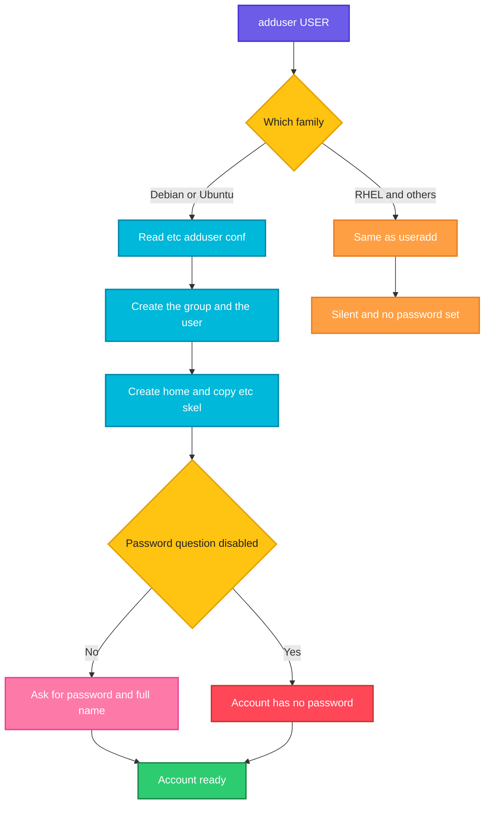

# adduser

## What is it?
`adduser` creates a new **user account**, but what it is depends on your Linux family:

- **On Debian and Ubuntu**, `adduser` is a friendly, **interactive Perl script**. It creates the user, the group, the home directory (with the files of `/etc/skel`), asks for a password and for the full name, and prints what it does. It calls `useradd` underneath. It is meant for people who type commands at the keyboard.
- **On RHEL, CentOS, Rocky Linux, AlmaLinux, Fedora and openSUSE**, `adduser` is only a **symbolic link to `useradd`**. It is the same command, it is **not interactive**, and it does not know the Debian options (`--disabled-password`, `--gecos`, ...).

Because of this, `adduser` is **not portable**. `useradd` is.

### `useradd` and `adduser`: the difference, and when to use which
| | `useradd` | `adduser` |
|-|-----------|-----------|
| What it is | The low level program of the `shadow` package | **Debian, Ubuntu:** a friendly **Perl script** (package `adduser`) that calls `useradd`. **RHEL, CentOS, Rocky, AlmaLinux, Fedora, openSUSE:** a plain **symbolic link to `useradd`**, so it is exactly the same command |
| Same on all distributions? | Yes, but the **defaults** are different (see below) | **No.** The behavior is different on Debian and on Red Hat |
| Interactive? | No. It never asks anything | On Debian: yes. It asks for a password and the full name |
| Home directory | **Debian, Ubuntu:** **not created** unless you use `-m`. **RHEL family:** created by default (`CREATE_HOME yes` in `/etc/login.defs`) | **Debian, Ubuntu:** always created, with the files of `/etc/skel` |
| Password | None is set. The account is locked until `passwd` | **Debian:** asks for it (or `--disabled-password`) |
| Default login shell | **Debian, Ubuntu:** `/bin/sh` (a known trap). **RHEL family:** `/bin/bash` | **Debian:** `/bin/bash` (`DSHELL` in `/etc/adduser.conf`) |
| Home directory mode | Mode from `UMASK`/`HOME_MODE` in `/etc/login.defs` (RHEL: `700`, Debian: `755` or by `UMASK`) | `DIR_MODE` in `/etc/adduser.conf` (`755` on Ubuntu 22.04, `700` on Debian 12) |
| Creates a private group | Yes, if `USERGROUPS_ENAB yes` (the default) | Yes, a group with the same name (`USERGROUPS=yes`) |
| Messages | Silent when it works | Prints each step |
| Config files | `/etc/default/useradd`, `/etc/login.defs` | `/etc/adduser.conf` (and `useradd` underneath) |
| Can also make groups / add a user to a group | No (use `groupadd`, `usermod`) | Yes: `adduser --group`, `adduser USER GROUP` |
| Good for | **Scripts, automation, containers,** and when you must be **exact and portable** | **Humans** on Debian and Ubuntu who create a normal user at the prompt |

**When to use which:**
- **In a script, in Ansible, Docker, Terraform or cloud-init, use `useradd`** on every distribution. It is the same everywhere, never asks a question, and its options are the same. Always write the options that you need (`-m`, `-s /bin/bash`, `-G ...`), and do not rely on the defaults.
- **At the keyboard on Debian or Ubuntu, `adduser` is easier.** It creates the home directory, sets a good shell, asks for the password and the name.
- **In a script on Debian or Ubuntu where you want `adduser` anyway,** use `--disabled-password --gecos ""` (or `--comment ""` in the newest versions), so that it never waits for input.
- **On RHEL, Rocky, Alma, CentOS or Fedora, `adduser` and `useradd` are the same command.** There is no interactive mode. You must run `sudo passwd NAME` afterwards.
- **For portable documentation, write `useradd -m -s /bin/bash NAME`.** It works the same on both families.

> The rest of this page describes the **Debian and Ubuntu** `adduser`. Examples that look different on Red Hat are marked.

## Syntax
```bash
adduser [OPTIONS] USER                   # add a normal user
adduser --system [OPTIONS] USER          # add a system user
adduser --group [--gid ID] GROUP         # add a group (same as addgroup)
addgroup [--gid ID] GROUP                # add a group
adduser USER GROUP                       # add an existing user to a group
```
`adduser` must run as `root` (use `sudo`). It looks at `/etc/adduser.conf` for its defaults.

## Visual Overview
> `adduser` reads its configuration, creates the group, runs `useradd`-like steps, makes the home directory from `/etc/skel`, and then asks for the password and the user information.



## Options/Flags

### Account data (Debian and Ubuntu)
| Flag | Description |
|------|-------------|
| `--home DIR` | Use `DIR` as the home directory |
| `--shell SHELL` | Use `SHELL` as the login shell (default `DSHELL`, usually `/bin/bash`) |
| `--no-create-home` | Do not create the home directory |
| `--uid ID` | Use this user ID |
| `--gecos GECOS` | The comment (full name) field. Using it (even `--gecos ""`) skips the questions about the name. Newer versions call it `--comment` |
| `--firstuid ID` | Choose the new UID in the range from `ID` (overrides `FIRST_UID`) |
| `--lastuid ID` | Choose the new UID in the range up to `ID` (overrides `LAST_UID`) |
| `--encrypt-home` | Encrypt the home directory with `ecryptfs` (needs the package `ecryptfs-utils`) |

### Groups
| Flag | Description |
|------|-------------|
| `--ingroup GROUP` | The **primary group** is the existing group `GROUP`, and no private group is created |
| `--gid ID` | The primary group ID, or (with `--group`) the ID of the new group |
| `--add_extra_groups` | Add the new user to the groups in `EXTRA_GROUPS` (`/etc/adduser.conf`). Newer versions: `--add-extra-groups` |
| `USER GROUP` | (second form) Add the existing user `USER` to the existing group `GROUP` |

### Password and login
| Flag | Description |
|------|-------------|
| `--disabled-password` | Do not set a password. The user can log in with an SSH key, but not with a password |
| `--disabled-login` | Do not set a password, **and** make `su` and password login impossible (the account is locked and `nologin`-like) |

### System accounts and groups
| Flag | Description |
|------|-------------|
| `--system` | Create a system user or group (low UID, no password, shell `nologin`) |
| `--group` | With `--system`, create a group with the same name as the user. Alone, it creates a normal group |

### General options
| Flag | Description |
|------|-------------|
| `-q` / `--quiet` | Do not print the process information |
| `--force-badname` | Allow names that do not match `NAME_REGEX`. Newer versions: `--allow-bad-names` |
| `--extrausers` | Use the "extra users" database (`/var/lib/extrausers`) |
| `-c FILE` / `--conf FILE` | Read this configuration file, not `/etc/adduser.conf` |
| `-h` / `--help` | Show the help text |
| `-v` / `--version` | Show the version |

### Main settings of `/etc/adduser.conf`
| Setting | Meaning (Ubuntu 22.04 value) |
|---------|------------------------------|
| `DSHELL` | The default shell (`/bin/bash`) |
| `DHOME` | The base directory of the homes (`/home`) |
| `GROUPHOMES`, `LETTERHOMES` | Put homes in `/home/GROUP/` or `/home/FIRSTLETTER/` (`no`) |
| `SKEL` | The template of the home directory (`/etc/skel`) |
| `FIRST_UID`, `LAST_UID` | The range of normal UIDs (`1000` to `59999`) |
| `FIRST_SYSTEM_UID`, `LAST_SYSTEM_UID` | The range of system UIDs (`100` to `999`) |
| `USERGROUPS` | Create a private group for each user (`yes`) |
| `USERS_GID`, `USERS_GROUP` | The group if `USERGROUPS=no` (`100`, `users`) |
| `DIR_MODE` | The mode of a new home (`0755` on Ubuntu 22.04, `0700` on Debian 12) |
| `SETGID_HOME` | Set the setgid bit on new homes (`no`) |
| `EXTRA_GROUPS`, `ADD_EXTRA_GROUPS` | The groups that `--add_extra_groups` adds (`dialout cdrom floppy audio video plugdev users`) |
| `NAME_REGEX` | The allowed form of a user name |
| `QUOTAUSER` | A user whose quota is copied to the new user |

## Usage Examples

Let's say we are on **Ubuntu 22.04** on the server `web01` and work with `sudo`. Today is `2026-10-12`. These accounts exist:

**Input file** (`/etc/passwd`):
```text
root:x:0:0:root:/root:/bin/bash
www-data:x:33:33:www-data:/var/www:/usr/sbin/nologin
deploy:x:1001:1001:Deploy User,,,:/home/deploy:/bin/bash
```
**Input file** (`/etc/group`):
```text
root:x:0:
sudo:x:27:deploy
www-data:x:33:
docker:x:999:deploy
devs:x:1004:
deploy:x:1001:
```
The next free UID is `1002`. Each example starts again from this state.

### Example 1: The interactive way
**Command:**
```bash
sudo adduser alice
```
**Sample Output** (the words after the colons are typed by you):
```text
Adding user `alice' ...
Adding new group `alice' (1002) ...
Adding new user `alice' (1002) with group `alice' ...
Creating home directory `/home/alice' ...
Copying files from `/etc/skel' ...
New password: 
Retype new password: 
passwd: password updated successfully
Changing the user information for alice
Enter the new value, or press ENTER for the default
	Full Name []: Alice Smith
	Room Number []: 
	Work Phone []: 
	Home Phone []: 
	Other []: 
Is the information correct? [Y/n] y
```
The account has a group, a home with the shell start files, a password and a full name. On the newest versions (`adduser` 3.137 and later) every line starts with `info:`.

### Example 2: No questions at all (`--disabled-password` and `--gecos`)
This is the form for scripts on Debian and Ubuntu.

**Command:**
```bash
sudo adduser --disabled-password --gecos "" alice
getent passwd alice
```
**Sample Output:**
```text
Adding user `alice' ...
Adding new group `alice' (1002) ...
Adding new user `alice' (1002) with group `alice' ...
Creating home directory `/home/alice' ...
Copying files from `/etc/skel' ...
alice:x:1002:1002:,,,:/home/alice:/bin/bash
```
No password was set, so only key based logins work. `--gecos ""` skips the questions. Debian puts the `,,,` in the comment field, when the name is empty.

### Example 3: Give the full name (`--gecos`)
**Command:**
```bash
sudo adduser --disabled-password --gecos "Alice Smith" alice
getent passwd alice
```
**Sample Output:**
```text
Adding user `alice' ...
Adding new group `alice' (1002) ...
Adding new user `alice' (1002) with group `alice' ...
Creating home directory `/home/alice' ...
Copying files from `/etc/skel' ...
alice:x:1002:1002:Alice Smith,,,:/home/alice:/bin/bash
```
Newer versions: `--comment "Alice Smith"`.

### Example 4: Set the password in a script
Without a question, set the password afterwards with `chpasswd`, so that nobody can see it in `ps`.

**Command:**
```bash
sudo adduser --disabled-password --gecos "" -q alice
echo 'alice:Temp-Pass-123' | sudo chpasswd
sudo passwd -S alice
```
**Sample Output:**
```text
alice P 10/12/2026 0 99999 7 -1
```
`P` means that the account has a usable password. `-q` (quiet) hid the messages of `adduser`.

### Example 5: Choose the home directory (`--home`)
**Command:**
```bash
sudo adduser --disabled-password --gecos "" --home /srv/alice alice
getent passwd alice
```
**Sample Output:**
```text
Adding user `alice' ...
Adding new group `alice' (1002) ...
Adding new user `alice' (1002) with group `alice' ...
Creating home directory `/srv/alice' ...
Copying files from `/etc/skel' ...
alice:x:1002:1002:,,,:/srv/alice:/bin/bash
```

### Example 6: Choose the shell (`--shell`)
**Command:**
```bash
sudo adduser --disabled-password --gecos "" --shell /bin/zsh alice
getent passwd alice
```
**Sample Output:**
```text
Adding user `alice' ...
Adding new group `alice' (1002) ...
Adding new user `alice' (1002) with group `alice' ...
Creating home directory `/home/alice' ...
Copying files from `/etc/skel' ...
alice:x:1002:1002:,,,:/home/alice:/bin/zsh
```

### Example 7: Do not create a home directory (`--no-create-home`)
**Command:**
```bash
sudo adduser --disabled-password --gecos "" --no-create-home alice
ls -d /home/alice
```
**Sample Output:**
```text
Adding user `alice' ...
Adding new group `alice' (1002) ...
Adding new user `alice' (1002) with group `alice' ...
Not creating home directory `/home/alice'.
ls: cannot access '/home/alice': No such file or directory
```

### Example 8: Choose the UID (`--uid`)
**Command:**
```bash
sudo adduser --disabled-password --gecos "" --uid 2000 alice
id alice
```
**Sample Output:**
```text
Adding user `alice' ...
Adding new group `alice' (2000) ...
Adding new user `alice' (2000) with group `alice' ...
Creating home directory `/home/alice' ...
Copying files from `/etc/skel' ...
uid=2000(alice) gid=2000(alice) groups=2000(alice)
```

### Example 9: Choose the UID range (`--firstuid` and `--lastuid`)
**Command:**
```bash
sudo adduser --disabled-password --gecos "" --firstuid 5000 --lastuid 5999 svc1
id svc1
```
**Sample Output:**
```text
Adding user `svc1' ...
Adding new group `svc1' (5000) ...
Adding new user `svc1' (5000) with group `svc1' ...
Creating home directory `/home/svc1' ...
Copying files from `/etc/skel' ...
uid=5000(svc1) gid=5000(svc1) groups=5000(svc1)
```

### Example 10: Use an existing primary group (`--ingroup`)
**Command:**
```bash
sudo adduser --disabled-password --gecos "" --ingroup devs alice
id alice
```
**Sample Output:**
```text
Adding user `alice' ...
Adding new user `alice' (1002) with group `devs' ...
Creating home directory `/home/alice' ...
Copying files from `/etc/skel' ...
uid=1002(alice) gid=1004(devs) groups=1004(devs)
```
No private group `alice` is created.

### Example 11: Use a primary group ID (`--gid`)
**Command:**
```bash
sudo adduser --disabled-password --gecos "" --gid 1004 alice
id alice
```
**Sample Output:**
```text
Adding user `alice' ...
Adding new user `alice' (1002) with group `devs' ...
Creating home directory `/home/alice' ...
Copying files from `/etc/skel' ...
uid=1002(alice) gid=1004(devs) groups=1004(devs)
```

### Example 12: Add the usual extra groups (`--add_extra_groups`)
It adds the groups of `EXTRA_GROUPS` in `/etc/adduser.conf`.

**Command:**
```bash
sudo adduser --disabled-password --gecos "" --add_extra_groups alice
id alice
```
**Sample Output:**
```text
Adding user `alice' ...
Adding new group `alice' (1002) ...
Adding new user `alice' (1002) with group `alice' ...
Creating home directory `/home/alice' ...
Copying files from `/etc/skel' ...
Adding new user `alice' to extra groups ...
Adding user `alice' to group `dialout' ...
Adding user `alice' to group `cdrom' ...
uid=1002(alice) gid=1002(alice) groups=1002(alice),20(dialout),24(cdrom),25(floppy),29(audio),44(video),46(plugdev),100(users)
```

### Example 13: Block the password and the `su` login (`--disabled-login`)
**Command:**
```bash
sudo adduser --disabled-login --gecos "Backup Agent" backup2
sudo passwd -S backup2
sudo su - backup2
```
**Sample Output:**
```text
Adding user `backup2' ...
Adding new group `backup2' (1002) ...
Adding new user `backup2' (1002) with group `backup2' ...
Creating home directory `/home/backup2' ...
Copying files from `/etc/skel' ...
backup2 L 10/12/2026 0 99999 7 -1
```
`L` means locked. `--disabled-login` is stronger than `--disabled-password`: the password field is `!` and the shell cannot be reached by `su` with a password.

### Example 14: A system user (`--system`)
**Command:**
```bash
sudo adduser --system --no-create-home --group myapp
getent passwd myapp
```
**Sample Output:**
```text
Adding system user `myapp' (UID 998) ...
Adding new group `myapp' (998) ...
Adding new user `myapp' (998) with group `myapp' ...
Not creating home directory `/home/myapp'.
myapp:x:998:998::/home/myapp:/usr/sbin/nologin
```
`--system` gives a UID below `1000`, the shell `/usr/sbin/nologin`, and no password. `--group` creates the group with the same name. Without `--no-create-home`, a home is made. A real service often wants `--home /var/lib/myapp`.

### Example 15: A system user with a home directory
**Command:**
```bash
sudo adduser --system --group --home /var/lib/myapp --shell /usr/sbin/nologin myapp
ls -ld /var/lib/myapp
```
**Sample Output:**
```text
Adding system user `myapp' (UID 998) ...
Adding new group `myapp' (998) ...
Adding new user `myapp' (998) with group `myapp' ...
Creating home directory `/var/lib/myapp' ...
drwxr-xr-x 2 myapp myapp 4096 Oct 12 10:05 /var/lib/myapp
```

### Example 16: Create a group (`--group`, and `addgroup`)
**Command:**
```bash
sudo adduser --group devs2
sudo addgroup --gid 2500 ops
getent group devs2 ops
```
**Sample Output:**
```text
Adding group `devs2' (GID 1005) ...
Done.
Adding group `ops' (GID 2500) ...
Done.
devs2:x:1005:
ops:x:2500:
```

### Example 17: Add an existing user to a group (`USER GROUP`)
**Command:**
```bash
sudo adduser deploy devs
id deploy
```
**Sample Output:**
```text
Adding user `deploy' to group `devs' ...
Adding user deploy to group devs
Done.
uid=1001(deploy) gid=1001(deploy) groups=1001(deploy),27(sudo),999(docker),1004(devs)
```
This is the same as `sudo usermod -aG devs deploy`, and is safe, because it **adds** and does not replace.

### Example 18: Quiet mode (`-q`)
**Command:**
```bash
sudo adduser -q --disabled-password --gecos "" alice
echo "exit code: $?"
```
**Sample Output:**
```text
exit code: 0
```

### Example 19: A user name that is not allowed (`--force-badname`)
The default `NAME_REGEX` allows only lower case letters, digits, `_`, `-` and a few more.

**Command:**
```bash
sudo adduser --disabled-password --gecos "" Alice.Smith
sudo adduser --force-badname --disabled-password --gecos "" Alice.Smith
```
**Sample Output:**
```text
adduser: To avoid problems, the username should consist only of letters, digits, underscores, periods, at signs and dashes, and not start with a dash (as defined by IEEE Std 1003.1-2001). For compatibility with Samba machine accounts $ is also supported at the end of the username
Adding user `Alice.Smith' ...
...
```
The first command is refused. The second one creates the user. Avoid it, if you can. Newer versions use `--allow-bad-names`.

### Example 20: Use the extra users database (`--extrausers`)
Put the user into `/var/lib/extrausers/passwd`, not into `/etc/passwd`. It is used in some images (read-only root file system).

**Command:**
```bash
sudo adduser --extrausers --disabled-password --gecos "" alice
sudo cat /var/lib/extrausers/passwd
```
**Sample Output:**
```text
Adding user `alice' ...
Adding new group `alice' (1002) ...
Adding new user `alice' (1002) with group `alice' ...
Creating home directory `/home/alice' ...
Copying files from `/etc/skel' ...
alice:x:1002:1002:,,,:/home/alice:/bin/bash
```

### Example 21: Another configuration file (`-c`)
Let's say `/etc/adduser-team.conf` is a copy of `/etc/adduser.conf` with `DSHELL=/bin/zsh` and `DIR_MODE=0700`.

**Command:**
```bash
sudo adduser -c /etc/adduser-team.conf --disabled-password --gecos "" alice
getent passwd alice
ls -ld /home/alice
```
**Sample Output:**
```text
Adding user `alice' ...
Adding new group `alice' (1002) ...
Adding new user `alice' (1002) with group `alice' ...
Creating home directory `/home/alice' ...
Copying files from `/etc/skel' ...
alice:x:1002:1002:,,,:/home/alice:/bin/zsh
drwx------ 2 alice alice 4096 Oct 12 10:05 /home/alice
```

### Example 22: Encrypt the home directory (`--encrypt-home`)
**Command:**
```bash
sudo adduser --encrypt-home --disabled-password --gecos "" alice
```
**Sample Output:**
```text
Adding user `alice' ...
Adding new group `alice' (1002) ...
Adding new user `alice' (1002) with group `alice' ...
Creating home directory `/home/alice' ...
Copying files from `/etc/skel' ...
Setting up encryption ...
```
The package `ecryptfs-utils` must be installed. `ecryptfs` is old, so many new systems use disk encryption (LUKS) instead.

### Example 23: What happens on Red Hat
On RHEL, Rocky, Alma and Fedora, `adduser` is `useradd`. The Debian options do not exist.

**Command:**
```bash
ls -l /usr/sbin/adduser
sudo adduser alice
sudo adduser --disabled-password alice
```
**Sample Output:**
```text
lrwxrwxrwx 1 root root 7 Jan 10  2026 /usr/sbin/adduser -> useradd
adduser: unrecognized option '--disabled-password'
Usage: useradd [options] LOGIN
       useradd -D
       useradd -D [options]
```
The first `adduser alice` runs `useradd`, prints nothing, and creates `alice` with a home and the shell `/bin/bash`, **without** a password. The third command fails with the error from `useradd`.

### Example 24: Errors
**Command:**
```bash
sudo adduser deploy
adduser bob
sudo adduser --ingroup nosuchgroup bob
```
**Sample Output:**
```text
adduser: The user `deploy' already exists.
adduser: Only root may add a user or group to the system.
adduser: The group `nosuchgroup' does not exist.
```

### Example 25: Check the version (`-v`) and show the help (`-h`)
**Command:**
```bash
adduser --version | head -n 2
adduser --help | head -n 3
```
**Sample Output:**
```text
adduser version 3.118ubuntu5
Copyright (C) 1997, 1998, 1999 Guy Maor. Copyright (C) 1995 Ian Murdock, 
adduser [--home DIR] [--shell SHELL] [--no-create-home] [--uid ID]
[--firstuid ID] [--lastuid ID] [--gecos GECOS] [--ingroup GROUP | --gid ID]
[--disabled-password] [--disabled-login] [--add_extra_groups] [--encrypt-home] USER
```

## Pitfalls / Gotchas
- **`adduser` is not the same on all Linux systems.** On Debian and Ubuntu it is an interactive script. On RHEL it is `useradd`. A script with `adduser --disabled-password` fails on Red Hat. Use `useradd` for portable scripts.
- **The script waits for input.** In Docker builds, CI and cloud-init, `adduser alice` hangs or fails when there is no terminal. Always add `--disabled-password --gecos ""`, or use `useradd`.
- **`--disabled-password` does not lock the account completely.** An SSH key still works, and `sudo -u` and `su` from root, too. Use `--disabled-login` if even that is not wanted.
- **Option names changed in new versions.** `adduser` 3.137 and later (Debian 12 and 13, Ubuntu 24.04) renamed `--gecos` to `--comment`, `--force-badname` to `--allow-bad-names` and `--add_extra_groups` to `--add-extra-groups`, and prints `info:` lines. The old names usually still work with a warning.
- **The home directory mode depends on the version.** `DIR_MODE` is `0755` on Ubuntu 22.04, which means that every user can read the home of the others. Debian 12 and Ubuntu 24.04 use `0700`. Check `ls -ld /home/*`.
- **The extra groups are not safe on a server.** `--add_extra_groups` adds `dialout`, `cdrom`, `floppy`, `audio`, `video`, `plugdev` and `users`. A server user does not need them.
- **The first form of `adduser USER GROUP` is useful, but the user must log in again** to use the new group.
- **`adduser --system` does not create a home directory unless you ask for it** with `--home`. A system user with `/nonexistent` as home is common.
- **`--system` users have no `/etc/skel` files** and cannot log in. That is on purpose.
- **Do not edit `/etc/passwd` by hand** to fix a user that `adduser` created. Use `usermod` or `vipw`.
- **`deluser` is the partner of `adduser`.** On Debian use `deluser --remove-home USER`. See `deluser` and `userdel`.
- **Alpine Linux and BusyBox have a third `adduser`,** with other options (`-D`, `-h`, `-s`, `-G`). Its `-D` means "no password". Check `adduser --help` in containers.

## DevOps Use Cases

### Use Case 1: Create an operator at the keyboard, the quick way
**Situation:** You log in to an Ubuntu server and must make an account for a new colleague, with a password that they must change.

**Command:**
```bash
sudo adduser alice
sudo chage -d 0 alice
sudo usermod -aG sudo alice
```
**Output:**
```text
Adding user `alice' ...
Adding new group `alice' (1002) ...
Adding new user `alice' (1002) with group `alice' ...
Creating home directory `/home/alice' ...
Copying files from `/etc/skel' ...
New password: 
Retype new password: 
passwd: password updated successfully
Changing the user information for alice
Enter the new value, or press ENTER for the default
	Full Name []: Alice Smith
	...
Is the information correct? [Y/n] y
```
`chage -d 0` forces a password change at the first login. `usermod -aG sudo` gives administrator rights.

### Use Case 2: A user that only logs in with an SSH key
**Situation:** On Ubuntu, create the account without a password, and install the public key. This is the safest choice for servers.

**Input file** (`alice.pub`):
```text
ssh-ed25519 AAAAC3NzaC1lZDI1NTE5AAAAIExample alice@laptop
```
**Command:**
```bash
sudo adduser --disabled-password --gecos "Alice Smith" alice
sudo install -d -m 700 -o alice -g alice /home/alice/.ssh
sudo install -m 600 -o alice -g alice alice.pub /home/alice/.ssh/authorized_keys
sudo ls -l /home/alice/.ssh
```
**Output:**
```text
Adding user `alice' ...
Adding new group `alice' (1002) ...
Adding new user `alice' (1002) with group `alice' ...
Creating home directory `/home/alice' ...
Copying files from `/etc/skel' ...
total 4
-rw------- 1 alice alice 83 Oct 12 10:05 authorized_keys
```

### Use Case 3: Dockerfile for Debian or Ubuntu images
**Situation:** Create a non-root user in an Ubuntu or Debian image with `adduser`, and without any question.

**Input file** (`Dockerfile`):
```text
FROM ubuntu:22.04
RUN adduser --disabled-password --gecos "" --uid 10001 appuser
USER appuser
CMD ["id"]
```
**Command:**
```bash
docker build -t myapp . && docker run --rm myapp
```
**Output:**
```text
uid=10001(appuser) gid=10001(appuser) groups=10001(appuser)
```
In a `Dockerfile` the more portable line is `RUN useradd -m -u 10001 -s /bin/bash appuser`. For Alpine use `RUN adduser -D -u 10001 appuser`.

### Use Case 4: A service account on Debian, in a package script
**Situation:** The `postinst` script of a package must create a system user, and must not fail if it already exists.

**Command:**
```bash
getent passwd myapp >/dev/null || \
  sudo adduser --system --group --home /var/lib/myapp --shell /usr/sbin/nologin --quiet myapp
getent passwd myapp
```
**Output:**
```text
myapp:x:998:998::/var/lib/myapp:/usr/sbin/nologin
```
Debian packages use `adduser --system` or `systemd-sysusers` for this.

### Use Case 5: Add a user to a group, to give a right
**Situation:** `alice` must be allowed to use Docker.

**Command:**
```bash
sudo adduser alice docker
id alice
```
**Output:**
```text
Adding user `alice' to group `docker' ...
Adding user alice to group docker
Done.
uid=1002(alice) gid=1002(alice) groups=1002(alice),999(docker)
```
`alice` must log out and in again. Access to the Docker socket gives `root` rights on the host.

### Use Case 6: Write a script that works on Debian and on Red Hat
**Situation:** One script for both families. Use `useradd` and check what you need.

**Command:**
```bash
create_user() {
  local name=$1
  id "$name" >/dev/null 2>&1 && return 0
  sudo useradd -m -s /bin/bash "$name"
}
create_user alice
id alice
```
**Output:**
```text
uid=1002(alice) gid=1002(alice) groups=1002(alice)
```
This function runs on Ubuntu, Debian, RHEL, Rocky and Alma, and does not use any interactive feature.

### Use Case 7: Which `adduser` is this?
**Situation:** You get a new server, and you do not know if `adduser` is the Debian script or the Red Hat link.

**Command:**
```bash
file "$(command -v adduser)"
readlink -f "$(command -v adduser)"
```
**Output (Ubuntu):**
```text
/usr/sbin/adduser: Perl script text executable
/usr/sbin/adduser
```
**Output (Rocky Linux):**
```text
/usr/sbin/adduser: symbolic link to useradd
/usr/sbin/useradd
```

## Related Commands
- [`useradd`](useradd.md) - the portable low level command, and the comparison with `adduser`
- [`deluser`](deluser.md) - the Debian partner that removes users (and `userdel` on Red Hat)
- [`userdel`](userdel.md) - remove a user on every distribution
- [`usermod`](usermod.md) - change a user
- [`passwd`](passwd.md) - set or change a password
- [`chpasswd`](chpasswd.md) - set passwords from standard input
- [`chage`](chage.md) - password aging, force a change at the first login
- [`groupadd`](groupadd.md) - create a group (on Debian: `addgroup`)
- [`gpasswd`](gpasswd.md) - add and remove group members
- [`id`](id.md) / [`groups`](groups.md) - check the result
- [`sudo`](sudo.md) - needed to run `adduser`
- `/etc/adduser.conf` - the settings of `adduser`
- `systemd-sysusers` - declare system users in a file
