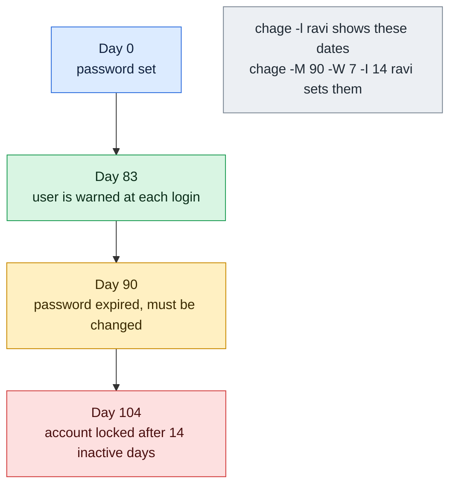

# chage

## What is it?
`chage` (change age) shows and changes the **password and account aging information** of a user: when the password was last changed, how long it is valid, how many days before the expiry the user is warned, how many days after the expiry the account is locked, and the date on which the **account itself** expires. It edits the fields of `/etc/shadow`. It does the same as the aging options of `passwd` (`-n`, `-x`, `-w`, `-i`), but also lets you set exact **dates**, and prints a readable report with `chage -l`. It is part of the `shadow-utils` package and is the same on all distributions.

## Syntax
```bash
chage [OPTIONS] LOGIN
chage -l LOGIN                  # list (a normal user may list his own data)
```
You need `root` rights to change values. Without any option, `chage LOGIN` asks for each value in an interactive dialog.

### The aging fields of `/etc/shadow`
```text
alice:$6$...:20727:0:90:7:14:20800:
        |       |   |  |  |  |    └─ 8: account expires (day number since 1970-01-01)
        |       |   |  |  |  └────── 7: inactive days after the password expires
        |       |   |  |  └───────── 6: warning days before the expiry
        |       |   |  └──────────── 5: maximum age of the password (days)
        |       |   └─────────────── 4: minimum age of the password (days)
        |       └─────────────────── 3: last password change (day number since 1970-01-01)
        └─────────────────────────── 2: the password hash
```

## Visual Overview
> `chage` controls password aging. Here is the timeline of one password with maximum age 90, warning 7 and inactive 14 days.



## Options/Flags
| Flag | Description |
|------|-------------|
| `-l` / `--list` | Show the aging information of the user in a report |
| `-d DATE` / `--lastday` | Set the date of the last password change: `YYYY-MM-DD` or a day number. **`-d 0` forces a password change at the next login** |
| `-E DATE` / `--expiredate` | Set the date when the **account** expires: `YYYY-MM-DD`, a day number, or `-1` for never |
| `-I DAYS` / `--inactive` | Days after the password expires before the account is locked. `-1` for never, `0` at once |
| `-m DAYS` / `--mindays` | The minimum days between password changes. `0` means that it can be changed at any time |
| `-M DAYS` / `--maxdays` | The maximum days that a password is valid. `-1` or `99999` means never expires |
| `-W DAYS` / `--warndays` | The number of days of warning before the password expires |
| `-R CHROOT_DIR` / `--root` | Apply the change in a chroot directory |
| `-P PREFIX_DIR` / `--prefix` | Use a prefix directory for the files (newer versions) |
| `-h` / `--help` | Show the help text |

### The lines of `chage -l`
| Line | Meaning |
|------|---------|
| `Last password change` | The date of the last change (`never`, or `password must be changed` after `-d 0`) |
| `Password expires` | The last change plus the maximum age, or `never` |
| `Password inactive` | The date when the account is locked after the expiry, or `never` |
| `Account expires` | The date when the account is disabled, or `never` |
| `Minimum number of days between password change` | `-m` |
| `Maximum number of days between password change` | `-M` |
| `Number of days of warning before password expires` | `-W` |

### Exit status
| Code | Meaning |
|------|---------|
| `0` | Success |
| `1` | Permission denied |
| `2` | Invalid command syntax |
| `15` | Cannot find the shadow password file |

## Usage Examples

Let's say we are on the server `web01` and work as `root` (or with `sudo`). Today is `2026-10-12`. These accounts exist:

**Input file** (`/etc/shadow`, the hash is shortened):
```text
root:$6$...:20000:0:99999:7:::
deploy:$6$...:20727:0:99999:7:::
alice:$6$...:20727:0:90:7:14::
```
The number `20727` is the day `2026-10-01` (the number of days since 1970-01-01). `alice` has a password that is valid for 90 days, a warning of 7 days and 14 inactive days. Each example starts again from this state.

### Example 1: Show the aging information (`-l`)
**Command:**
```bash
sudo chage -l alice
```
**Sample Output:**
```text
Last password change					: Oct 01, 2026
Password expires					: Dec 30, 2026
Password inactive					: Jan 13, 2027
Account expires						: never
Minimum number of days between password change		: 0
Maximum number of days between password change		: 90
Number of days of warning before password expires	: 7
```
The password was changed on Oct 1, it expires 90 days later (Dec 30), and the account is locked 14 days after that (Jan 13, 2027).

### Example 2: Show your own data (normal user)
**Command:**
```bash
chage -l deploy
```
**Sample Output:**
```text
Last password change					: Oct 01, 2026
Password expires					: never
Password inactive					: never
Account expires						: never
Minimum number of days between password change		: 0
Maximum number of days between password change		: 99999
Number of days of warning before password expires	: 7
```
A normal user can run `chage -l` only for himself. For other users: `chage: Permission denied`.

### Example 3: Force a new password at the next login (`-d 0`)
**Command:**
```bash
sudo chage -d 0 alice
sudo chage -l alice | head -n 2
```
**Sample Output:**
```text
Last password change					: password must be changed
Password expires					: password must be changed
```
The next login of `alice` asks for the old password, and then for a new one. This is the usual way for a new account.

### Example 4: Set the date of the last password change (`-d DATE`)
**Command:**
```bash
sudo chage -d 2026-10-12 alice
sudo chage -l alice | head -n 2
```
**Sample Output:**
```text
Last password change					: Oct 12, 2026
Password expires					: Jan 10, 2027
```
The expiry date moves, because it is computed from the last change. Using today's date gives the user a fresh 90 days.

### Example 5: Set the maximum age (`-M`)
**Command:**
```bash
sudo chage -M 60 alice
sudo chage -l alice | grep -E 'expires|Maximum'
```
**Sample Output:**
```text
Password expires					: Nov 30, 2026
Account expires						: never
Maximum number of days between password change		: 60
```
The password is valid for 60 days from the last change (Oct 1). `-M 99999` (or `-M -1`) removes the expiry.

### Example 6: Set the minimum age (`-m`)
**Command:**
```bash
sudo chage -m 2 alice
sudo chage -l alice | grep Minimum
```
**Sample Output:**
```text
Minimum number of days between password change		: 2
```
The user cannot change the password again within 2 days.

### Example 7: Set the warning period (`-W`)
**Command:**
```bash
sudo chage -W 14 alice
sudo chage -l alice | grep warning
```
**Sample Output:**
```text
Number of days of warning before password expires	: 14
```
The user is warned at every login in the last 14 days.

### Example 8: Lock the account after the password has expired (`-I`)
**Command:**
```bash
sudo chage -I 30 alice
sudo chage -l alice | grep inactive
```
**Sample Output:**
```text
Password inactive					: Jan 29, 2027
```
`Dec 30 + 30 days` = `Jan 29`. After this date, the user cannot even change the expired password, and an administrator must unlock the account. `-I -1` turns the feature off, and `-I 0` locks the account at once when the password expires.

### Example 9: Set the date when the account expires (`-E`)
**Command:**
```bash
sudo chage -E 2026-12-31 alice
sudo chage -l alice | grep 'Account expires'
```
**Sample Output:**
```text
Account expires						: Dec 31, 2026
```
It is a good way to give a contractor an end date. After the date, logins (also with SSH keys, when `UsePAM yes`) are refused with `Your account has expired`.

### Example 10: Disable the account now, and remove the limit
**Command:**
```bash
sudo chage -E 0 alice
sudo chage -l alice | grep 'Account expires'
sudo chage -E -1 alice
sudo chage -l alice | grep 'Account expires'
```
**Sample Output:**
```text
Account expires						: Jan 01, 1970
Account expires						: never
```
A date in the past (`-E 0`) disables the account at once. `-E -1` removes the date.

### Example 11: Change several values at once
**Command:**
```bash
sudo chage -m 1 -M 90 -W 14 -I 30 -E 2027-06-30 alice
sudo chage -l alice
```
**Sample Output:**
```text
Last password change					: Oct 01, 2026
Password expires					: Dec 30, 2026
Password inactive					: Jan 29, 2027
Account expires						: Jun 30, 2027
Minimum number of days between password change		: 1
Maximum number of days between password change		: 90
Number of days of warning before password expires	: 14
```

### Example 12: The interactive dialog
Without an option, `chage` asks for each value. Press `Enter` to keep the value in the brackets.

**Command:**
```bash
sudo chage alice
```
**Sample Output** (you type the values):
```text
Changing the aging information for alice
Enter the new value, or press ENTER for the default

	Minimum Password Age [0]: 1
	Maximum Password Age [90]: 
	Last Password Change (YYYY-MM-DD) [2026-10-01]: 
	Password Expiration Warning [7]: 14
	Password Inactive [14]: 
	Account Expiration Date (YYYY-MM-DD) [-1]: 
```

### Example 13: A day number instead of a date
**Command:**
```bash
sudo chage -d 20749 alice
sudo chage -l alice | head -n 1
```
**Sample Output:**
```text
Last password change					: Oct 23, 2026
```
The number is the count of days since 1970-01-01 (`20749` is the day `2026-10-23`). Use the date form (`-d 2026-10-23`) when you can. It is easier to read.

### Example 14: The same data in the shadow file
**Command:**
```bash
sudo chage -m 1 -M 90 -W 7 -I 14 -E 2026-12-31 alice
sudo getent shadow alice | cut -d: -f1,3-9
```
**Sample Output:**
```text
alice:20727:1:90:7:14:20818
```
The fields are: last change, minimum, maximum, warning, inactive, expire. `20818` is the day number of `2026-12-31`.

### Example 15: Another user is not allowed
**Command:**
```bash
chage -l alice
chage -M 90 deploy
```
**Sample Output:**
```text
chage: Permission denied.
chage: Permission denied.
```

### Example 16: A user that does not exist
**Command:**
```bash
sudo chage -l nosuchuser
```
**Sample Output:**
```text
chage: user 'nosuchuser' does not exist in /etc/passwd
```

### Example 17: A bad value
**Command:**
```bash
sudo chage -M abc alice
sudo chage -E 2026-13-45 alice
```
**Sample Output:**
```text
chage: invalid numeric argument 'abc'
chage: invalid date '2026-13-45'
```

### Example 18: Apply the change in a chroot (`-R`)
**Command:**
```bash
sudo chage -R /mnt/newroot -M 90 alice
sudo chage -R /mnt/newroot -l alice | grep Maximum
```
**Sample Output:**
```text
Maximum number of days between password change		: 90
```

### Example 19: Show the help (`-h`)
**Command:**
```bash
chage -h | head -n 4
```
**Sample Output:**
```text
Usage: chage [options] LOGIN

Options:
  -d, --lastday LAST_DAY        set date of last password change to LAST_DAY
```

## Pitfalls / Gotchas
- **`-d 0` is the way to force a password change.** It is not a date. It marks the password as "must be changed". It is used right after you set a first password.
- **Password expiry and account expiry are two things.** `-M` (and `-I`) concern the **password**. `-E` concerns the **account**. An expired password can be renewed by the user at the login. An expired account is closed for good until an administrator changes `-E`.
- **Service and automation accounts must not expire.** If the password of a service user expires, cron jobs, backups and applications can stop at 3 a.m. Set `-M 99999 -E -1`, or better, lock the password (`passwd -l`) and use keys.
- **SSH keys and the expiry.** With `UsePAM yes` (the default on most distributions), an **expired account** (`-E`) blocks key logins, too. A locked password (`passwd -l`) does not. An **expired password** may allow a key login, and then asks for a new password.
- **The values apply to old and new passwords.** When you set `-M 90` and the last change was 120 days ago, the password has expired at once, and the user must change it at the next login.
- **Defaults for new users are in `/etc/login.defs`** (`PASS_MAX_DAYS`, `PASS_MIN_DAYS`, `PASS_WARN_AGE`). They are copied into `/etc/shadow` when the user is created. Changing `login.defs` does **not** change existing users. Use `chage` for them.
- **`chage -l` shows `never` when the maximum is `99999`.** That is the "no expiry" value.
- **Dates depend on the time zone** of the server (the day number is in UTC), so an account can expire a few hours earlier or later than you expect.
- **An unreadable `chage -l` for other users.** It is a feature: a normal user can only list his own data.
- **`chage` does not change the password,** only the dates. Use `passwd` or `chpasswd` for the password.
- **Hash locked accounts show the aging data, too.** `chage -l` works for locked accounts, which is useful in audits.
- **`passwd -n/-x/-w/-i` writes the same fields.** Use whichever you like. `chage` is the only one that sets dates (`-d` and `-E`) and prints the report.

## DevOps Use Cases

### Use Case 1: Onboarding: temporary password, forced change
**Situation:** A new engineer gets an account with a temporary password. At the first login, the password must be replaced.

**Command:**
```bash
sudo useradd -m -s /bin/bash alice
echo 'alice:Temp-Pass-123' | sudo chpasswd
sudo chage -d 0 alice
sudo chage -l alice | head -n 2
```
**Output:**
```text
Last password change					: password must be changed
Password expires					: password must be changed
```

### Use Case 2: A contractor account with an end date
**Situation:** A contractor works for you until the end of the year. The account must close itself on `2026-12-31`.

**Command:**
```bash
sudo useradd -m -s /bin/bash -e 2026-12-31 contractor
sudo chage -l contractor | grep 'Account expires'
```
**Output:**
```text
Account expires						: Dec 31, 2026
```
Add the date to your offboarding calendar. Remove the account and its files a few weeks later.

### Use Case 3: A password policy for all human users
**Situation:** The rule is: change the password every 90 days, warn 14 days before, lock after 30 days. Apply it to all the human users.

**Command:**
```bash
getent passwd | awk -F: '$3>=1000 && $3<60000 {print $1}' | while read -r u; do
  sudo chage -m 1 -M 90 -W 14 -I 30 "$u"
done
sudo chage -l alice | tail -n 4
```
**Output:**
```text
Minimum number of days between password change		: 1
Maximum number of days between password change		: 90
Number of days of warning before password expires	: 14
```

### Use Case 4: Find the accounts whose password will expire soon
**Situation:** Send a reminder to users whose password expires in the next 14 days.

**Command:**
```bash
for u in $(getent passwd | awk -F: '$3>=1000 && $3<60000 {print $1}'); do
  exp=$(sudo chage -l "$u" | awk -F': ' '/^Password expires/{print $2}')
  [ "$exp" = "never" ] && continue
  days=$(( ( $(date -d "$exp" +%s) - $(date +%s) ) / 86400 ))
  [ "$days" -le 14 ] && echo "$u: password expires in $days days ($exp)"
done
```
**Output:**
```text
alice: password expires in 3 days (Oct 15, 2026)
```

### Use Case 5: Exclude a service account from the expiry
**Situation:** A backup job runs as the user `backup`. Its password expired, and the nightly backup stopped. Make sure that it does not expire again.

**Command:**
```bash
sudo chage -l backup | grep -E 'expires|Maximum'
sudo chage -M -1 -E -1 -I -1 backup
sudo chage -l backup | grep -E 'expires|Maximum'
```
**Output:**
```text
Password expires					: Oct 11, 2026
Account expires						: never
Maximum number of days between password change		: 90
Password expires					: never
Account expires						: never
Maximum number of days between password change		: 99999
```

### Use Case 6: An audit report in CSV
**Situation:** Make a table of all human users with the dates of the last change and the expiry, for the security team.

**Command:**
```bash
echo "user,last_change,expires,account_expires"
for u in $(getent passwd | awk -F: '$3>=1000 && $3<60000 {print $1}'); do
  sudo chage -l "$u" | awk -F': ' -v u="$u" '
    /Last password change/{l=$2} /^Password expires/{p=$2} /^Account expires/{a=$2}
    END{print u","l","p","a}'
done
```
**Output:**
```text
user,last_change,expires,account_expires
deploy,Oct 01, 2026,never,never
alice,Oct 01, 2026,Dec 30, 2026,never
```
Dates contain a comma. Quote the fields (`"Oct 01, 2026"`) if a program reads the CSV.

### Use Case 7: Suspend an account for a leave of absence
**Situation:** An employee is on leave for 3 months. Disable the account now, and enable it again with a new date.

**Command:**
```bash
sudo chage -E 0 alice
sudo chage -l alice | grep 'Account expires'
sudo chage -E -1 alice
sudo chage -l alice | grep 'Account expires'
```
**Output:**
```text
Account expires						: Jan 01, 1970
Account expires						: never
```

### Use Case 8: Change the dates of a user in an image or chroot
**Situation:** While you build an image, set the aging rules for the user inside the new root directory.

**Command:**
```bash
sudo chage -R /mnt/newroot -M 90 -W 14 deploy
sudo chage -R /mnt/newroot -l deploy | grep -E 'Maximum|warning'
```
**Output:**
```text
Maximum number of days between password change		: 90
Number of days of warning before password expires	: 14
```

## Related Commands
- [`passwd`](passwd.md) - set the password, and the same aging options in short form (`-n`, `-x`, `-w`, `-i`)
- [`usermod`](usermod.md) - `usermod -e` and `-f` also set the account expiry and the inactive days
- [`useradd`](useradd.md) - `useradd -e` and `-f` set the same values at the creation
- [`chpasswd`](chpasswd.md) - set passwords from a script, then use `chage -d 0`
- [`userdel`](userdel.md) - remove the account when the time has come
- [`getent`](getent.md) - read the raw `shadow` fields (`getent shadow NAME`)
- [`last`](last.md) - see the last logins of the users
- [`who`](who.md) - see who is logged in now
- `lastlog` - see when each user last logged in
- `/etc/login.defs` - the defaults for new users (`PASS_MAX_DAYS`, `PASS_WARN_AGE`)
