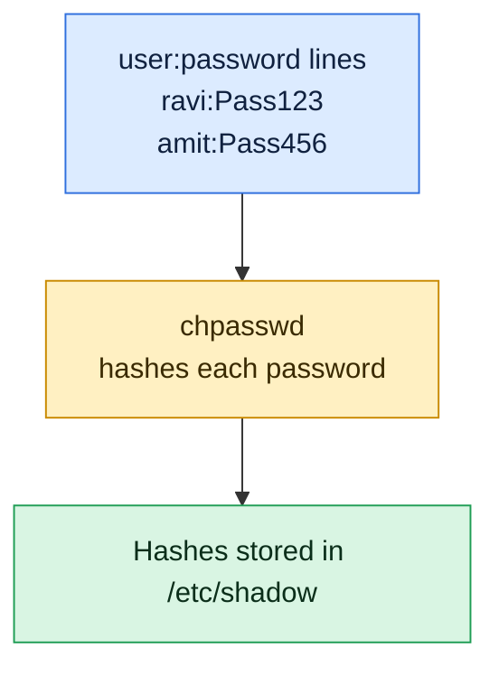

# chpasswd

## What is it?
`chpasswd` (change passwords) **updates the passwords of many users at once**, in batch mode. It reads lines of the form `user:password` from **standard input** and sets each password. It does not ask any question, so it is the standard way to set passwords **in scripts**, in Dockerfiles, in `cloud-init` and in Ansible. It works on all Linux distributions, and (unlike `passwd --stdin`, which exists only on Red Hat) it is the **portable** way to set a password without a terminal. It is part of the `shadow-utils` package (Debian and Ubuntu: `passwd`). By default it uses PAM, so the password quality rules can apply.

## Syntax
```bash
chpasswd [OPTIONS]                       # reads from standard input
echo 'user:password' | chpasswd
chpasswd < FILE
chpasswd -e < FILE_WITH_HASHES
```
Each input line is `LOGIN:PASSWORD`. You need `root` rights. A line with a user that does not exist makes `chpasswd` print an error, and in most versions **no password is changed at all** (all or nothing, see the pitfalls).

## Visual Overview
> `chpasswd` sets passwords from a list, which makes it the tool for scripts. It reads `user:password` lines, hashes them and writes `/etc/shadow`.



## Options/Flags
| Flag | Description |
|------|-------------|
| `-e` / `--encrypted` | The passwords in the input are **already hashed** (for example from `openssl passwd -6`). They are stored as they are |
| `-c METHOD` / `--crypt-method` | The hash method for plain passwords: `NONE`, `DES`, `MD5`, `SHA256`, `SHA512` (and `YESCRYPT` on newer systems) |
| `-m` / `--md5` | Use the MD5 method (old, weak). Same as `-c MD5` |
| `-s ROUNDS` / `--sha-rounds` | The number of rounds for `SHA256` and `SHA512` (from `1000` to `999999999`) |
| `-R CHROOT_DIR` / `--root` | Apply the change in a chroot directory |
| `-P PREFIX_DIR` / `--prefix` | Use a prefix directory for the files (newer versions) |
| `-h` / `--help` | Show the help text |

> The default method is set in `/etc/login.defs` (`ENCRYPT_METHOD`, for example `SHA512` or `YESCRYPT`). On Debian and Ubuntu `chpasswd` goes through PAM, and the setting of `pam_unix` (`sha512`, `yescrypt`) is used. The options `-c`, `-m` and `-s` are used only when PAM is not used.

### The hash prefixes (the first characters of the hash in `/etc/shadow`)
| Prefix | Method |
|--------|--------|
| `$1$` | MD5 (old, do not use) |
| `$5$` | SHA-256 |
| `$6$` | SHA-512 (a common default) |
| `$y$` | yescrypt (default on Debian 11+, Ubuntu 22.04+ new installs, Fedora) |

## Usage Examples

Let's say we are on the server `web01` and work as `root` (or with `sudo`). Today is `2026-10-12`. These users exist:

**Input file** (`/etc/passwd`):
```text
root:x:0:0:root:/root:/bin/bash
deploy:x:1001:1001:Deploy User,,,:/home/deploy:/bin/bash
alice:x:1002:1002:Alice Smith,,,:/home/alice:/bin/bash
bob:x:1003:1003:Bob Jones,,,:/home/bob:/bin/bash
```
`alice` and `bob` have no password yet (`!` in `/etc/shadow`). Each example starts again from this state.

### Example 1: Set one password
**Command:**
```bash
echo 'alice:Temp-Pass-123' | sudo chpasswd
sudo passwd -S alice
```
**Sample Output:**
```text
alice P 10/12/2026 0 99999 7 -1
```
`chpasswd` is silent when it works. The status `P` shows that `alice` has a usable password now.

### Example 2: Set the passwords of many users from a file
**Input file** (`passwords.txt`):
```text
alice:Temp-Pass-123
bob:Temp-Pass-456
deploy:Temp-Pass-789
```
**Command:**
```bash
sudo chpasswd < passwords.txt
sudo passwd -S alice bob deploy
```
**Sample Output:**
```text
alice P 10/12/2026 0 99999 7 -1
bob P 10/12/2026 0 99999 7 -1
deploy P 10/12/2026 0 99999 7 -1
```
Protect the file (`chmod 600`) and delete it afterwards (`shred -u passwords.txt`).

### Example 3: Use hashes that are already made (`-e`)
Make the hash on a safe machine, so that the plain password never touches the server.

**Command:**
```bash
hash=$(openssl passwd -6 'Temp-Pass-123')
echo "alice:$hash" | sudo chpasswd -e
sudo grep '^alice' /etc/shadow | cut -c1-24
```
**Sample Output:**
```text
alice:$6$kP3xT9aB$Ve1mQ2z
```
The hash was stored as it is. In the input file the line looks like `alice:$6$kP3xT9aB$Ve1mQ...`. Note the single quotes in scripts: `$6$` would be understood as variables by the shell.

### Example 4: Choose the hash method (`-c`)
**Command:**
```bash
echo 'alice:Temp-Pass-123' | sudo chpasswd -c SHA512
sudo grep '^alice' /etc/shadow | cut -d: -f2 | cut -c1-3
echo 'alice:Temp-Pass-123' | sudo chpasswd -c SHA256
sudo grep '^alice' /etc/shadow | cut -d: -f2 | cut -c1-3
```
**Sample Output:**
```text
$6$
$5$
```
On Debian and Ubuntu with PAM, the method comes from `pam_unix` (in `/etc/pam.d/common-password`, for example `yescrypt`), and `-c` may be ignored.

### Example 5: The weak MD5 method (`-m`)
**Command:**
```bash
echo 'alice:Temp-Pass-123' | sudo chpasswd -m
sudo grep '^alice' /etc/shadow | cut -d: -f2 | cut -c1-3
```
**Sample Output:**
```text
$1$
```
`$1$` is MD5. It is broken, so do not use it. It is useful only for old systems.

### Example 6: More rounds for SHA-512 (`-s`)
More rounds make the hash slower to compute, and so the brute force attacks slower.

**Command:**
```bash
echo 'alice:Temp-Pass-123' | sudo chpasswd -c SHA512 -s 100000
sudo grep '^alice' /etc/shadow | cut -d: -f2 | cut -c1-20
```
**Sample Output:**
```text
$6$rounds=100000$kP3x
```
`rounds=100000` is now a part of the hash. The default is 5000 rounds (not shown in the hash).

### Example 7: Force a password change after you set it
Combine `chpasswd` with `chage -d 0`, so that the temporary password must be replaced at the first login.

**Command:**
```bash
echo 'alice:Temp-Pass-123' | sudo chpasswd
sudo chage -d 0 alice
sudo chage -l alice | head -n 1
```
**Sample Output:**
```text
Last password change					: password must be changed
```

### Example 8: Set a random password and show it once
**Command:**
```bash
pw=$(openssl rand -base64 12)
echo "alice:$pw" | sudo chpasswd
echo "New password for alice: $pw"
```
**Sample Output:**
```text
New password for alice: kT8mQ2xV9aBn4wLz
```
Do not write this to a log. Send it through a safe channel (a password manager, or an encrypted message).

### Example 9: A password with special characters
Everything after the **first colon** is the password, so passwords can contain colons, spaces and `$`. Use single quotes, so that the shell does not change them.

**Command:**
```bash
printf '%s\n' 'alice:P@ss w0rd:with:colons$and"quotes' | sudo chpasswd
sudo passwd -S alice
```
**Sample Output:**
```text
alice P 10/12/2026 0 99999 7 -1
```
A user name cannot contain a colon. The password can. Do not use `echo -e` here, because it can change backslashes. `printf '%s\n'` is safe.

### Example 10: A user that does not exist
**Command:**
```bash
printf 'alice:Pass1\nnosuchuser:Pass2\n' | sudo chpasswd; echo "exit code: $?"
sudo passwd -S alice
```
**Sample Output:**
```text
chpasswd: line 2: user 'nosuchuser' does not exist
chpasswd: error detected, changes ignored
exit code: 1
alice L 10/01/2026 0 99999 7 -1
```
The first line was valid, but one line was wrong, so **nothing** was changed (alice is still locked). On some older versions, the valid lines are applied. Check the exit code in scripts.

### Example 11: A line without a colon
**Command:**
```bash
echo 'alice Temp-Pass-123' | sudo chpasswd
```
**Sample Output:**
```text
chpasswd: line 1: missing new password
chpasswd: error detected, changes ignored
```

### Example 12: A weak password and the quality rules
On Debian and Ubuntu, `chpasswd` uses PAM. When `pam_pwquality` is set to **enforce for root**, a weak password is refused.

**Command:**
```bash
echo 'alice:123' | sudo chpasswd
```
**Sample Output:**
```text
chpasswd: (line 1, user alice) password not changed
Password change aborted.
```
By default `root` can set weak passwords (with a warning on `passwd`). The rules depend on `/etc/security/pwquality.conf` and on `enforce_for_root`.

### Example 13: Change the passwords in a chroot (`-R`)
**Command:**
```bash
echo 'alice:Temp-Pass-123' | sudo chpasswd -R /mnt/newroot
sudo grep '^alice' /mnt/newroot/etc/shadow | cut -c1-14
```
**Sample Output:**
```text
alice:$6$kP3xT
```

### Example 14: Not enough rights
**Command:**
```bash
echo 'alice:Pass1' | chpasswd
```
**Sample Output:**
```text
chpasswd: Permission denied.
chpasswd: cannot lock /etc/shadow; try again later.
```

### Example 15: Show the help (`-h`)
**Command:**
```bash
chpasswd -h | head -n 4
```
**Sample Output:**
```text
Usage: chpasswd [options]

Options:
  -c, --crypt-method METHOD     the crypt method (one of NONE DES MD5 SHA256 SHA512)
```

### Example 16: The same job with `passwd --stdin` (Red Hat only)
**Command:**
```bash
echo 'Temp-Pass-123' | sudo passwd --stdin alice
echo 'alice:Temp-Pass-123' | sudo chpasswd
```
**Sample Output (RHEL):**
```text
Changing password for user alice.
passwd: all authentication tokens updated successfully.
```
**Sample Output (Ubuntu):**
```text
passwd: unrecognized option '--stdin'
Usage: passwd [options] [LOGIN]
```
The first command works only on Red Hat. The second works on all systems, and prints nothing.

## Pitfalls / Gotchas
- **Plain passwords in a file or in a command line are a risk.** `echo 'alice:Pass' | chpasswd` is safe for `ps` (the `echo` is a shell built-in, not a process), but the line goes into your shell history. Read the secret from a variable in a secret store, a file with mode `600`, or a here-document without history. Delete the file afterwards.
- **`-e` needs correct hashes.** A hash with a typo is stored as it is, and the account cannot be used. Test with `openssl passwd -6 -salt SALT 'pw'`, and use single quotes (`$6$...` contains dollar signs).
- **The default method depends on the system.** On modern systems you get `yescrypt` (`$y$`) or `SHA-512` (`$6$`). An old system that reads the shadow file (for example a legacy application) may not know `$y$`.
- **One bad line can stop the whole run.** In recent versions, `chpasswd` applies nothing when one line is wrong. In older versions it applies the lines before the error. Always check the exit code.
- **The account does not become usable, only the password.** A locked account (`passwd -l`), an expired account (`chage -E`), a `nologin` shell, or `PasswordAuthentication no` in `sshd_config` can still prevent a login.
- **It does not force a change.** Use `chage -d 0 USER` after `chpasswd`, if you want the user to choose a new password.
- **`chpasswd` is not interactive.** It cannot ask for confirmation, and it does not show the password. Use `passwd` for a person at the keyboard.
- **A colon in the user name is not possible.** The first colon ends the name. Passwords can contain colons.
- **Trailing spaces and `\r` become part of the password.** A file made on Windows (`CRLF`) puts a `\r` into every password. Clean it first with `tr -d '\r'`.
- **Container images:** `chpasswd` exists in most images (package `passwd` on Debian, `shadow-utils` on Red Hat, `shadow` on Alpine). A password in a `Dockerfile` `RUN` line stays in the image layers for good. Do not put real secrets there.
- **Use SSH keys when you can.** Passwords on servers are a weak point. `chpasswd` is for legacy needs, labs and first logins.
- **It uses PAM on Debian and Ubuntu.** Behavior (quality rules, the hash method) depends on `/etc/pam.d/chpasswd`. On Red Hat the same file exists. Check it when results are strange.

## DevOps Use Cases

### Use Case 1: Create a user with a first password in a script (Debian and Red Hat)
**Situation:** A bootstrap script creates a user and gives them a temporary password. `chpasswd` works on every distribution.

**Command:**
```bash
sudo useradd -m -s /bin/bash alice
echo 'alice:Temp-Pass-123' | sudo chpasswd
sudo chage -d 0 alice
sudo passwd -S alice
```
**Output:**
```text
alice P 10/12/2026 0 99999 7 -1
```

### Use Case 2: Onboard a team from a spreadsheet
**Situation:** HR sends a CSV file with the names. Create all the users with random temporary passwords, and write the list of the passwords to a protected file.

**Input file** (`team.csv`):
```text
alice,Alice Smith
bob,Bob Jones
```
**Command:**
```bash
umask 077
: > new-passwords.txt
while IFS=, read -r user name; do
  id "$user" >/dev/null 2>&1 || sudo useradd -m -s /bin/bash -c "$name" "$user"
  pw=$(openssl rand -base64 12)
  echo "$user:$pw" | sudo chpasswd
  sudo chage -d 0 "$user"
  echo "$user:$pw" >> new-passwords.txt
done < team.csv
ls -l new-passwords.txt
```
**Output:**
```text
-rw------- 1 deploy deploy 54 Oct 12 10:05 new-passwords.txt
```
Send the passwords through a safe channel, and `shred -u new-passwords.txt`.

### Use Case 3: Docker image for a lab or a CI test
**Situation:** A test image needs a user with a known password, for a test of SSH password login. The password is only for the test.

**Input file** (`Dockerfile`):
```text
FROM ubuntu:22.04
RUN useradd -m -s /bin/bash tester && echo 'tester:test-only-password' | chpasswd
CMD ["getent", "passwd", "tester"]
```
**Command:**
```bash
docker build -t lab . && docker run --rm lab
```
**Output:**
```text
tester:x:1000:1000::/home/tester:/bin/bash
```
Never use this for production images. The password is stored in the layer history.

### Use Case 4: Rotate the password of a service account on a schedule
**Situation:** A legacy application needs a password for the user `legacyapp`. Rotate it each month, and write it to a secret file for the application.

**Command:**
```bash
newpw=$(openssl rand -base64 24)
echo "legacyapp:$newpw" | sudo chpasswd
sudo install -m 600 -o legacyapp -g legacyapp /dev/null /etc/legacyapp/password
echo "$newpw" | sudo tee /etc/legacyapp/password >/dev/null
sudo passwd -S legacyapp
```
**Output:**
```text
legacyapp P 10/12/2026 0 99999 7 -1
```

### Use Case 5: Ansible: set a hashed password
**Situation:** In Ansible, the module `user` expects a **hash** (like `chpasswd -e`), not a plain password.

**Input file** (`playbook.yml`):
```text
- name: Set the password of alice
  ansible.builtin.user:
    name: alice
    password: "{{ 'Temp-Pass-123' | password_hash('sha512') }}"
    update_password: on_create
```
**Command:**
```bash
ansible-playbook -i web01, playbook.yml
sudo grep '^alice' /etc/shadow | cut -c1-12
```
**Output:**
```text
TASK [Set the password of alice] ***
changed: [web01]
alice:$6$Zt1
```
`update_password: on_create` sets the password only when the user is created, so a run later does not undo the change of the user.

### Use Case 6: Reset the password of a user who forgot it
**Situation:** Help desk: `bob` forgot the password. Set a temporary one, and make him change it.

**Command:**
```bash
pw=$(openssl rand -base64 9)
echo "bob:$pw" | sudo chpasswd
sudo chage -d 0 bob
echo "Temporary password for bob: $pw"
```
**Output:**
```text
Temporary password for bob: Rk3vWq8bT1xN
```
Remember to unlock the account if it was locked (`sudo passwd -u bob`), and to reset failed login counters (`faillock --user bob --reset`).

### Use Case 7: Make sure that an automatic password change worked
**Situation:** A script changes a password and then tests the login.

**Command:**
```bash
echo 'alice:Temp-Pass-123' | sudo chpasswd && echo "password set"
sudo passwd -S alice | awk '{print "status:", $2}'
```
**Output:**
```text
password set
status: P
```

## Related Commands
- [`passwd`](passwd.md) - set a password interactively, lock and unlock, and `--stdin` on Red Hat
- [`chage`](chage.md) - `chage -d 0` forces a change after `chpasswd`
- [`useradd`](useradd.md) - create the user before you set the password
- [`adduser`](adduser.md) - on Debian, asks for the password when it creates the user
- [`usermod`](usermod.md) - `usermod -p` sets a hash (not recommended in scripts)
- [`userdel`](userdel.md) - remove the user
- [`su`](su.md) / [`sudo`](sudo.md) - use the new password
- [`getent`](getent.md) - read the `shadow` entry (`getent shadow NAME`)
- `openssl passwd -6` - make a SHA-512 hash for `chpasswd -e`
- `mkpasswd` - another tool to make hashes (package `whois` on Debian)
- `newusers` - create many users, with passwords, from a file
- `shred -u` - delete a file with passwords in a safe way

---
<!-- nav -->
[← Previous: `chage`](chage.md) | [Learning path](../README.md) | [Next: `chsh` →](chsh.md)
