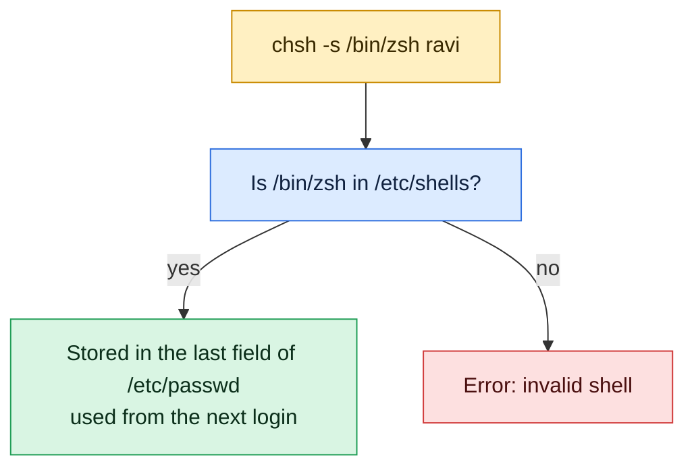

# chsh

## What is it?
`chsh` (change shell) changes the **login shell** of a user: the program that starts when the user logs in (`/bin/bash`, `/bin/zsh`, `/usr/bin/fish`, or `/usr/sbin/nologin` to forbid an interactive login). It changes the last field of the user's line in `/etc/passwd`. A normal user can change **his own** shell (after typing the password), and `root` can change the shell of any user. The shell must be listed in `/etc/shells`, which is the list of the shells that are allowed. The change applies to the **next login**, not to the session that is running.

> There are **two different programs** with the name `chsh`:
> - **Debian and Ubuntu:** from the package `login` (the `shadow` project).
> - **RHEL, CentOS, Rocky, AlmaLinux, Fedora:** from the package `util-linux-user` (it may need to be installed). Its output is different, and it also has the option `-l` to list the shells.
>
> The common use `chsh -s /bin/zsh USER` works the same on both.

## Syntax
```bash
chsh [OPTIONS] [LOGIN]
chsh -s SHELL [LOGIN]
```
Without `-s`, `chsh` asks for the new shell in an interactive dialog. Without `LOGIN`, it changes the shell of the user who runs it.

### Differences between the two programs
| | Debian, Ubuntu (`shadow`) | RHEL, Rocky, Alma, Fedora (`util-linux-user`) |
|-|---------------------------|-----------------------------------------------|
| Change the shell | `chsh -s SHELL [LOGIN]` | `chsh -s SHELL [LOGIN]` |
| List the allowed shells | Not available (use `cat /etc/shells`) | `chsh -l` (or `--list-shells`) |
| Chroot | `-R CHROOT_DIR` | Not available in older versions (`-R` in the newest) |
| Help | `chsh -h` | `chsh -u` or `--help` |
| Messages | `chsh: ...` errors only | `Changing shell for alice.` and `Shell changed.` |
| Package | `login` | `util-linux-user` (install it if `chsh` is missing) |

## Visual Overview
> `chsh` changes the login shell of a user. The shell must be listed in `/etc/shells`.



## Options/Flags
| Flag | Description |
|------|-------------|
| `-s SHELL` / `--shell SHELL` | Set the login shell to `SHELL` (a full path). Without it, `chsh` asks interactively |
| `-l` / `--list-shells` | (RHEL, util-linux) Print the shells that are listed in `/etc/shells` |
| `-R CHROOT_DIR` / `--root` | (Debian, Ubuntu) Apply the change in a chroot directory |
| `-h` / `--help` | (Debian, Ubuntu) Show the help text. On Red Hat `-h` and `--help` show the help, too |
| `-u` / `--help` | (RHEL, util-linux) Show the usage |
| `-v` / `--version` | (RHEL, util-linux) Show the version |

### The file `/etc/shells`
Only the shells that are listed here are allowed for normal users. A typical file on Ubuntu 22.04:
```text
# /etc/shells: valid login shells
/bin/sh
/bin/bash
/usr/bin/bash
/bin/rbash
/usr/bin/rbash
/usr/bin/sh
/bin/dash
/usr/bin/dash
```
Add a new shell (for example `zsh` or `fish`) with `echo /usr/bin/zsh | sudo tee -a /etc/shells`. Installing the package normally does it for you.

## Usage Examples

Let's say we are on **Ubuntu 22.04** on the server `web01`. Today is `2026-10-12`. We are logged in as `deploy`. These accounts exist:

**Input file** (`/etc/passwd`):
```text
root:x:0:0:root:/root:/bin/bash
www-data:x:33:33:www-data:/var/www:/usr/sbin/nologin
deploy:x:1001:1001:Deploy User,,,:/home/deploy:/bin/bash
alice:x:1002:1002:Alice Smith,,,:/home/alice:/bin/bash
```
The packages `zsh` and `fish` are installed, and `/etc/shells` lists `/usr/bin/zsh`, but **not** `/usr/bin/fish`. Each example starts again from this state.

### Example 1: Change your own shell (`-s`)
**Command:**
```bash
chsh -s /usr/bin/zsh
getent passwd deploy
```
**Sample Output:**
```text
Password: 
deploy:x:1001:1001:Deploy User,,,:/usr/bin/zsh
```
You type your password (it is not shown). The shell changes at the **next login**. The running shell stays `bash`. Check the current one with `echo $SHELL` (the login shell) and `echo $0` (the running shell).

### Example 2: The interactive dialog (no `-s`)
**Command:**
```bash
chsh
```
**Sample Output** (you type the password and the new shell):
```text
Password: 
Changing the login shell for deploy
Enter the new value, or press ENTER for the default
	Login Shell [/bin/bash]: /usr/bin/zsh
```
Press `Enter` without a value to keep the current shell.

### Example 3: Change the shell of another user (`root`)
**Command:**
```bash
sudo chsh -s /usr/bin/zsh alice
getent passwd alice
```
**Sample Output:**
```text
alice:x:1002:1002:Alice Smith,,,:/home/alice:/usr/bin/zsh
```
`root` does not need the password of `alice`.

### Example 4: Forbid the interactive login (`nologin`)
`/usr/sbin/nologin` is a "shell" that prints a message and ends. It is used for service accounts, and for users who may only use SFTP or a mail service.

**Command:**
```bash
sudo chsh -s /usr/sbin/nologin alice
getent passwd alice
sudo su - alice
```
**Sample Output:**
```text
alice:x:1002:1002:Alice Smith,,,:/home/alice:/usr/sbin/nologin
This account is currently not available.
```
SSH key logins, `scp` and `sftp` through the `sshd` internal SFTP server can still be used, depending on the `sshd_config`. Programs can also run with `sudo -u alice COMMAND`.

### Example 5: A shell that is not in `/etc/shells`
A normal user is refused. `root` gets only a warning.

**Command:**
```bash
chsh -s /usr/bin/fish
sudo chsh -s /usr/bin/fish alice
```
**Sample Output:**
```text
Password: 
chsh: /usr/bin/fish is an invalid shell
chsh: Warning: "/usr/bin/fish" is not listed in /etc/shells.
```
The user is refused with `invalid shell`. `root` sees a warning, and the shell is changed. To allow it, add the line `/usr/bin/fish` to `/etc/shells`.

### Example 6: A shell that does not exist
**Command:**
```bash
sudo chsh -s /bin/nosuchshell alice
```
**Sample Output:**
```text
chsh: Warning: "/bin/nosuchshell" does not exist.
chsh: Warning: "/bin/nosuchshell" is not listed in /etc/shells.
```
`root` may do it, and the user cannot log in any more (`/bin/nosuchshell: No such file or directory`). Use the full path of a shell that exists. Find it with `command -v zsh`.

### Example 7: Use a relative path
**Command:**
```bash
chsh -s zsh
```
**Sample Output:**
```text
Password: 
chsh: shell must be a full path name.
```
Always use the **full path**: `/usr/bin/zsh`.

### Example 8: A wrong password
**Command:**
```bash
chsh -s /usr/bin/zsh
```
**Sample Output:**
```text
Password: 
chsh: PAM: Authentication failure
```

### Example 9: List the allowed shells
**Command:**
```bash
cat /etc/shells
```
**Sample Output:**
```text
# /etc/shells: valid login shells
/bin/sh
/bin/bash
/usr/bin/bash
/bin/rbash
/usr/bin/rbash
/usr/bin/sh
/bin/dash
/usr/bin/dash
/usr/bin/zsh
```
On Red Hat you can also write `chsh -l`, which prints the same list without the comment lines.

### Example 10: Add a shell to the list
**Command:**
```bash
echo /usr/bin/fish | sudo tee -a /etc/shells
chsh -s /usr/bin/fish
getent passwd deploy | cut -d: -f1,7
```
**Sample Output:**
```text
/usr/bin/fish
Password: 
deploy:/usr/bin/fish
```

### Example 11: Change the shell in a chroot (`-R`)
**Command:**
```bash
sudo chsh -R /mnt/newroot -s /usr/bin/zsh alice
grep '^alice' /mnt/newroot/etc/passwd
```
**Sample Output:**
```text
alice:x:1002:1002:Alice Smith,,,:/home/alice:/usr/bin/zsh
```

### Example 12: A user that does not exist
**Command:**
```bash
sudo chsh -s /bin/bash nosuchuser
```
**Sample Output:**
```text
chsh: user 'nosuchuser' does not exist
```

### Example 13: A normal user may not change another user
**Command:**
```bash
chsh -s /bin/bash alice
```
**Sample Output:**
```text
You may not change the shell for 'alice'.
```

### Example 14: See which shell you really use
**Command:**
```bash
echo "login shell: $SHELL"
echo "running shell: $0"
getent passwd "$USER" | cut -d: -f7
ps -p $$ -o comm=
```
**Sample Output:**
```text
login shell: /usr/bin/zsh
running shell: bash
/usr/bin/zsh
bash
```
After `chsh`, `$SHELL` still shows the old value in the old session. Here, a new login has set it.

### Example 15: What `chsh` looks like on Red Hat
On RHEL, Rocky, Alma and Fedora (with the package `util-linux-user`).

**Command:**
```bash
chsh -l | head -n 3
chsh -s /bin/zsh
```
**Sample Output:**
```text
/bin/sh
/bin/bash
/usr/bin/sh
Changing shell for deploy.
Password: 
Shell changed.
```
When `chsh` is missing: `sudo dnf install util-linux-user`. In the same family, `usermod -s` is an alternative that works for `root` (see below).

### Example 16: Version and usage on Red Hat (`-v` and `-u`)
**Command:**
```bash
chsh -v
chsh -u | head -n 3
```
**Sample Output (RHEL):**
```text
chsh from util-linux 2.37.4
Usage:
 chsh [options] [<username>]
```

### Example 17: Show the help (`-h`)
**Command:**
```bash
chsh -h | head -n 5
```
**Sample Output:**
```text
Usage: chsh [options] [LOGIN]

Options:
  -h, --help                    display this help message and exit
  -R, --root CHROOT_DIR         directory to chroot into
```

## Pitfalls / Gotchas
- **The change applies at the next login.** The session that is open keeps the old shell. Log out and log in, or start the new shell by hand (`exec zsh`).
- **Always use a full path.** `chsh -s zsh` is refused. Use `command -v zsh` to find the path.
- **A shell that is missing from `/etc/shells` is refused for normal users.** Add it with `tee -a /etc/shells`. `root` can force it.
- **A wrong shell locks the user out.** If the file does not exist, or is not executable, the user cannot log in at all (SSH closes the connection at once). Test with `sudo -u USER /usr/bin/zsh -c 'echo ok'` before you change it.
- **Do not use `chsh` to change the shell of `root` on production servers,** unless you must. Some recovery tools and `sudo` expect `/bin/bash` or `/bin/sh`.
- **Scripts do not read the login shell.** A script uses the shell in its first line (`#!/bin/bash`). The login shell matters only for interactive logins and some tools (`ssh host command` uses the login shell to run the command!).
- **`ssh host command` runs through the login shell.** If you change the shell to `fish` or `nologin`, remote commands, `scp` and `rsync` can break, because they depend on a `sh` compatible syntax. Keep `bash` for accounts that run automation.
- **`nologin` blocks `su - USER` and a console login,** but not `sudo -u USER COMMAND`, a systemd service or a cron job that runs as the user. For a full lock, also lock the password and the keys.
- **`chsh` on Debian and Ubuntu asks for a password.** A user who has only an SSH key (a locked password) cannot use it. The administrator uses `usermod -s` or `sudo chsh`.
- **Use `usermod -s` in scripts.** `usermod -s /bin/bash USER` (and `useradd -s`) never ask for a password, and exist on all distributions. It is the portable choice for automation.
- **LDAP and Active Directory users** cannot be changed with `chsh`. The shell comes from the directory (`loginShell`, or `override_shell` in SSSD).
- **The command is named `chsh`, but on some systems `lchsh` exists** (a variant for the local users with a few more options). Use `chsh` unless the manual says otherwise.

## DevOps Use Cases

### Use Case 1: Give developers a nicer shell without breaking automation
**Situation:** Developers like `zsh`. The service account `deploy`, which is used by Ansible, must stay `bash`.

**Command:**
```bash
sudo chsh -s /usr/bin/zsh alice
getent passwd alice deploy | cut -d: -f1,7
```
**Output:**
```text
alice:/usr/bin/zsh
deploy:/bin/bash
```

### Use Case 2: Close an interactive login, and keep the account for a service
**Situation:** The user `backup` runs a nightly backup job under cron. Nobody should log in as `backup`.

**Command:**
```bash
sudo chsh -s /usr/sbin/nologin backup
sudo -u backup /usr/local/bin/backup.sh && echo "backup job still works"
sudo su - backup
```
**Output:**
```text
backup job still works
This account is currently not available.
```
The job runs with `sudo -u` or cron. The login with `su -` is refused.

### Use Case 3: Audit: who has an interactive shell?
**Situation:** Security wants a list of accounts that can log in interactively.

**Command:**
```bash
getent passwd | awk -F: '$7 !~ /(nologin|false)$/ {print $1": "$7}'
```
**Output:**
```text
root: /bin/bash
deploy: /bin/bash
alice: /usr/bin/zsh
```
Service accounts with a real shell (for example `postgres: /bin/bash`) are a finding to review.

### Use Case 4: Restrict a user to a limited shell
**Situation:** A support user may only run a few commands. Use the restricted shell `rbash` (no `cd`, no `/` in commands, no redirection).

**Command:**
```bash
sudo chsh -s /bin/rbash support
sudo -u support -i bash -c 'cd /tmp' 2>&1
sudo su - support -c 'cd /tmp'
```
**Output:**
```text
rbash: line 1: cd: restricted
```
`rbash` is easy to bypass (a `vi` shell escape, for example). For real restriction use containers, `sudo` rules, or `ForceCommand` in SSH.

### Use Case 5: Set the shell in a script, on any distribution
**Situation:** The script must work on Debian and Red Hat. `usermod -s` is portable and never asks for a password.

**Command:**
```bash
sudo usermod -s /bin/bash alice
getent passwd alice | cut -d: -f1,7
```
**Output:**
```text
alice:/bin/bash
```

### Use Case 6: Fix a user who cannot log in after a bad shell change
**Situation:** `alice` cannot log in. Her shell is `/usr/bin/fish`, which was removed. Use `root` to restore `bash`.

**Command:**
```bash
getent passwd alice | cut -d: -f1,7
ls -l /usr/bin/fish
sudo chsh -s /bin/bash alice
getent passwd alice | cut -d: -f1,7
```
**Output:**
```text
alice:/usr/bin/fish
ls: cannot access '/usr/bin/fish': No such file or directory
alice:/bin/bash
```

### Use Case 7: Dockerfile: change the shell of a user
**Situation:** In an image, the user `appuser` was created with `/bin/sh` (the default of `useradd` on Debian). Give it `bash`.

**Input file** (`Dockerfile`):
```text
FROM ubuntu:22.04
RUN useradd -m appuser && chsh -s /bin/bash appuser
CMD ["getent", "passwd", "appuser"]
```
**Command:**
```bash
docker build -t myapp . && docker run --rm myapp
```
**Output:**
```text
appuser:x:1000:1000::/home/appuser:/bin/bash
```
`chsh` runs as `root` in the build, so it does not ask for a password. Writing `useradd -m -s /bin/bash appuser` is shorter.

## Related Commands
- [`usermod`](usermod.md) - `usermod -s` changes the shell without a password, and is portable
- [`useradd`](useradd.md) - `useradd -s` sets the shell when you create the user
- [`adduser`](adduser.md) - on Debian, `adduser --shell` sets it
- [`passwd`](passwd.md) - the password that `chsh` asks for
- [`su`](su.md) - `su -s SHELL` uses another shell for one session
- [`id`](id.md) / [`whoami`](whoami.md) - check who you are
- [`getent`](getent.md) - read the shell from `passwd` (`getent passwd NAME`)
- `chfn` - change the full name and the phone fields of the user
- `/etc/shells` - the list of the allowed login shells
- `nologin` - the "shell" that refuses logins
