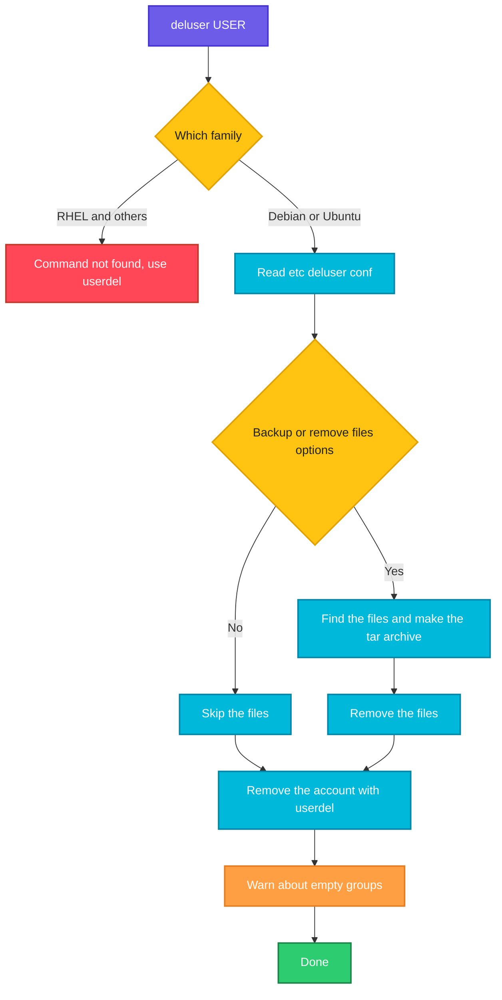

# deluser

## What is it?
`deluser` removes a **user account** (or a group, or a user from a group) in a friendly way. It exists only on **Debian, Ubuntu and their derivatives** (Linux Mint, Raspberry Pi OS ...), where it is a **Perl script** from the package `adduser`. It is the partner of `adduser`. It calls `userdel` underneath, and adds some features: a **backup** of the files before they are removed, the removal of **all the files** of the user on the system, the removal of a user from **one group** and the removal of an **empty group**. On **RHEL, CentOS, Rocky Linux, AlmaLinux and Fedora, `deluser` does not exist** (`deluser: command not found`). There you use `userdel`.

### `userdel` and `deluser`: the difference, and when to use which
| | `userdel` | `deluser` |
|-|-----------|-----------|
| What it is | The low level program of the `shadow` package, on **all** Linux distributions | **Debian, Ubuntu:** a friendly **Perl script** (package `adduser`). **RHEL, CentOS, Rocky, AlmaLinux, Fedora:** it **does not exist** (unless you install it from another source) |
| Interactive? | No | No, but it prints each step |
| Remove the home directory | `-r` | `--remove-home` |
| Remove all files of the user on the system | No such option. Use `find / -user NAME` | `--remove-all-files` (scans the whole system, slow) |
| Make a backup first | No | `--backup` and `--backup-to DIR` (a `tar.gz` of the files that are removed) |
| Remove a user from a group | No (use `gpasswd -d`) | Yes: `deluser USER GROUP` |
| Remove a group | No (use `groupdel`) | Yes: `deluser --group GROUP` (and `delgroup GROUP`) |
| Remove only if the group is empty | No | `--only-if-empty` |
| Force removal of a logged in user | `-f` (dangerous) | No (it refuses) |
| Config file | `/etc/login.defs` (`USERDEL_CMD`, `USERGROUPS_ENAB`) | `/etc/deluser.conf` (`REMOVE_HOME`, `REMOVE_ALL_FILES`, `BACKUP`, `BACKUP_TO`, `ONLY_IF_EMPTY`, `EXCLUDE_FSTYPES`) |
| Good for | **Scripts and automation on every distribution** | **Debian and Ubuntu**, at the keyboard, when you want a backup or want to remove from a group |

**When to use which:**
- **In scripts, Ansible, Docker or any portable code, use `userdel -r NAME`.** It exists everywhere and behaves the same.
- **On Debian or Ubuntu, `deluser --remove-home NAME` (or with `--backup`) is more careful** and prints what it does.
- **On RHEL, Rocky, Alma, CentOS or Fedora, only `userdel` exists.**
- **Never rely on `REMOVE_HOME` of `/etc/deluser.conf` for portability.** Write the option you want (`--remove-home`) explicitly.

## Syntax
```bash
deluser [OPTIONS] USER                  # remove a normal user
deluser --system [OPTIONS] USER         # remove a system user
deluser --group [OPTIONS] GROUP         # remove a group (same as delgroup)
delgroup [OPTIONS] GROUP                # remove a group
deluser USER GROUP                      # remove a user from a group
```
You need `root` rights. `deluser` reads its settings from `/etc/deluser.conf`.

## Visual Overview
> `deluser` reads the configuration, optionally makes a backup and removes the files, calls `userdel` for the account, and warns about groups that become empty.



## Options/Flags

### Removing a user
| Flag | Description |
|------|-------------|
| `--remove-home` | Remove the home directory and the mail spool of the user |
| `--remove-all-files` | Remove **all** the files on the system that are owned by the user (the home included). It scans the file systems, so it can take a long time |
| `--backup` | Make a backup of the files that are removed, before they are removed. Works with `--remove-home` and `--remove-all-files` |
| `--backup-to DIR` | Where to put the backup (default: the current directory, `BACKUP_TO` in the config). Implies a backup |
| `--system` | Remove the user only if it is a system user. Without it, a system user is refused |

### Removing a group, or a user from a group
| Flag | Description |
|------|-------------|
| `--group` | The argument is a group. The group is removed (the same as `delgroup`) |
| `--only-if-empty` | Remove the group only if it has no members |
| `USER GROUP` | (second form) Remove the user `USER` from the group `GROUP`. The user and the group stay |

### General options
| Flag | Description |
|------|-------------|
| `-q` / `--quiet` | Do not print the process information |
| `-f` / `--force` | Remove anyway, even if it is a system user or group (for example `root`). Dangerous |
| `--extrausers` | Use the "extra users" database (`/var/lib/extrausers`) |
| `-c FILE` / `--conf FILE` | Read this configuration file, not `/etc/deluser.conf` |
| `-h` / `--help` | Show the help text |
| `-v` / `--version` | Show the version |

### Settings of `/etc/deluser.conf`
| Setting | Meaning (default) |
|---------|-------------------|
| `REMOVE_HOME` | Remove the home directory and the mail spool (`0`) |
| `REMOVE_ALL_FILES` | Remove all the files of the user (`0`) |
| `BACKUP` | Make a backup before removing files (`0`) |
| `BACKUP_TO` | The directory of the backups (`.`) |
| `ONLY_IF_EMPTY` | Remove a group only if it is empty (`0`) |
| `EXCLUDE_FSTYPES` | File system types that `--remove-all-files` skips (`(proc\|sysfs\|usbfs\|devpts\|tmpfs\|afs)`) |

## Usage Examples

Let's say we are on **Ubuntu 22.04** on the server `web01` and work with `sudo`. Today is `2026-10-12`. These accounts exist:

**Input file** (`/etc/passwd`):
```text
root:x:0:0:root:/root:/bin/bash
www-data:x:33:33:www-data:/var/www:/usr/sbin/nologin
deploy:x:1001:1001:Deploy User,,,:/home/deploy:/bin/bash
alice:x:1002:1002:Alice Smith,,,:/home/alice:/bin/bash
bob:x:1003:1003:Bob Jones,,,:/home/bob:/bin/bash
```
**Input file** (`/etc/group`):
```text
root:x:0:
sudo:x:27:deploy,alice
devs:x:1004:alice,bob
deploy:x:1001:
alice:x:1002:
bob:x:1003:
```
The user `alice` has the home `/home/alice` (with `notes.txt` in it) and a file `/srv/data/report.csv`. She has no running process. Each example starts again from this state.

### Example 1: Remove only the account
**Command:**
```bash
sudo deluser alice
ls -ld /home/alice
```
**Sample Output:**
```text
Removing user `alice' ...
Warning: group `alice' has no more members.
Done.
drwxr-x--- 2 1002 1002 4096 Oct 12 10:00 /home/alice
```
The account and the private group are gone, but the home directory stays. Its owner is a number now. On a `REMOVE_HOME=1` setting the home would be removed as well.

### Example 2: Remove the account and the home (`--remove-home`)
**Command:**
```bash
sudo deluser --remove-home alice
ls -ld /home/alice
```
**Sample Output:**
```text
Looking for files to backup/remove ...
Removing files ...
Removing user `alice' ...
Warning: group `alice' has no more members.
Done.
ls: cannot access '/home/alice': No such file or directory
```
The home directory and the mail spool were removed. Files outside the home stay (see the next example).

### Example 3: Remove all the files of the user (`--remove-all-files`)
`deluser` scans the file systems for files that the user owns. It removes them, and the home as well.

**Command:**
```bash
sudo deluser --remove-all-files alice
ls /srv/data/report.csv
```
**Sample Output:**
```text
Looking for files to backup/remove ...
fuse.gvfsd-fuse is a file system type that is excluded from removal
Removing files ...
Removing user `alice' ...
Warning: group `alice' has no more members.
Done.
ls: cannot access '/srv/data/report.csv': No such file or directory
```
The file `/srv/data/report.csv` was removed, too. This can delete important shared data, so check with `find / -xdev -user alice` first.

### Example 4: Make a backup first (`--backup`)
**Command:**
```bash
sudo deluser --remove-home --backup alice
ls -l alice.tar.gz
```
**Sample Output:**
```text
Looking for files to backup/remove ...
Backing up files to be removed to . ...
Removing files ...
Removing user `alice' ...
Warning: group `alice' has no more members.
Done.
-rw------- 1 root root 1843 Oct 12 10:05 alice.tar.gz
```
The archive has the name of the user. It is created in the current directory.

### Example 5: Choose the backup directory (`--backup-to`)
**Command:**
```bash
sudo mkdir -p /backup/offboarding
sudo deluser --remove-home --backup-to /backup/offboarding alice
ls -l /backup/offboarding
```
**Sample Output:**
```text
Looking for files to backup/remove ...
Backing up files to be removed to /backup/offboarding ...
Removing files ...
Removing user `alice' ...
Warning: group `alice' has no more members.
Done.
total 4
-rw------- 1 root root 1843 Oct 12 10:05 alice.tar.gz
```
`--backup-to` also turns the backup on.

### Example 6: Remove a user from a group (`USER GROUP`)
The user and the group stay. Only the membership is removed.

**Command:**
```bash
sudo deluser alice devs
id alice
getent group devs
```
**Sample Output:**
```text
Removing user `alice' from group `devs' ...
Done.
uid=1002(alice) gid=1002(alice) groups=1002(alice),27(sudo)
devs:x:1004:bob
```
This is the same as `sudo gpasswd -d alice devs`. The user must log in again for the change to apply to a running session.

### Example 7: Remove a group (`--group` and `delgroup`)
**Command:**
```bash
sudo groupadd temp
sudo deluser --group temp
sudo groupadd temp2
sudo delgroup temp2
```
**Sample Output:**
```text
Removing group `temp' ...
Done.
Removing group `temp2' ...
Done.
```

### Example 8: Remove a group only if it is empty (`--only-if-empty`)
**Command:**
```bash
sudo deluser --group --only-if-empty devs
getent group devs
```
**Sample Output:**
```text
/usr/sbin/deluser: `devs' still has `alice,bob' as members, not removing it.
devs:x:1004:alice,bob
```
`devs` has two members, so it stays.

### Example 9: The primary group of a user cannot be removed
**Command:**
```bash
sudo deluser --group deploy
```
**Sample Output:**
```text
/usr/sbin/deluser: `deploy' still has `deploy' as their primary group!
```
Remove or change the user first.

### Example 10: Refuse to remove a system user (`--system`)
Without `--system`, only normal users (UID in the normal range) are removed. A system user needs the option.

**Command:**
```bash
sudo deluser www-data
sudo deluser --system www-data
```
**Sample Output:**
```text
/usr/sbin/deluser: The user `www-data' is a system user. Use --system or --force to remove it.
Removing user `www-data' ...
Warning: group `www-data' has no more members.
Done.
```
Do not remove system users of installed packages (`www-data`, `postgres`). The files and the packages rely on them.

### Example 11: Force the removal of a protected user (`--force`)
`--force` removes the user, even if it is the user `root`. Never do this.

**Command:**
```bash
sudo deluser root
```
**Sample Output:**
```text
WARNING: You are just about to delete the root account (uid 0)
Usually this is never required as it may render the whole system unusable
If you really want this, call deluser with parameter --force
(but `root' isn't the user you want to remove)
```
Without the option `--force` nothing is done. We do not show a command with `--force`.

### Example 12: A user who is logged in
**Command:**
```bash
sudo deluser deploy
```
**Sample Output:**
```text
userdel: user deploy is currently used by process 2302
/usr/sbin/deluser: `/usr/sbin/userdel deploy' returned error code 8. Exiting.
```
Stop the processes first: `sudo pkill -KILL -u deploy`.

### Example 13: Quiet mode (`-q`)
**Command:**
```bash
sudo deluser -q --remove-home alice
echo "exit code: $?"
```
**Sample Output:**
```text
exit code: 0
```

### Example 14: Another configuration file (`-c`)
Let's say `/etc/deluser-offboard.conf` has `REMOVE_HOME=1`, `BACKUP=1` and `BACKUP_TO=/backup/offboarding`.

**Command:**
```bash
sudo deluser -c /etc/deluser-offboard.conf alice
```
**Sample Output:**
```text
Looking for files to backup/remove ...
Backing up files to be removed to /backup/offboarding ...
Removing files ...
Removing user `alice' ...
Warning: group `alice' has no more members.
Done.
```
You can keep settings for each kind of case in a file of its own.

### Example 15: The extra users database (`--extrausers`)
**Command:**
```bash
sudo deluser --extrausers alice
```
**Sample Output:**
```text
Removing user `alice' ...
Warning: group `alice' has no more members.
Done.
```
The user is removed from `/var/lib/extrausers/passwd`, not from `/etc/passwd`.

### Example 16: A user that does not exist
**Command:**
```bash
sudo deluser nosuchuser; echo "exit code: $?"
deluser alice
```
**Sample Output:**
```text
/usr/sbin/deluser: The user `nosuchuser' does not exist.
exit code: 1
/usr/sbin/deluser: Only root may remove a user or group from the system.
```

### Example 17: On Red Hat there is no `deluser`
**Command:**
```bash
sudo deluser alice
sudo userdel -r alice
```
**Sample Output:**
```text
sudo: deluser: command not found
```
On RHEL, Rocky, Alma, CentOS and Fedora use `userdel -r alice`. The second command works and prints nothing, or the harmless line about the mail spool.

### Example 18: Check the version (`-v`) and show the help (`-h`)
**Command:**
```bash
deluser --version | head -n 2
deluser --help | head -n 3
```
**Sample Output:**
```text
deluser version 3.118ubuntu5
Copyright (C) 2000 Roland Bauerschmidt. Copyright (C) 2004-2007 Marc Haber.
deluser USER
  remove a normal user from the system
  example: deluser mike
```

## Pitfalls / Gotchas
- **`deluser` exists only on Debian and Ubuntu.** A script with `deluser` fails on Red Hat. Use `userdel` for portable code.
- **By default, `deluser USER` keeps the home directory.** Add `--remove-home` (or set `REMOVE_HOME=1`). The files that stay behind belong to a numeric UID, and a new user with the same UID gets them.
- **`--remove-all-files` is powerful and slow.** It deletes **every** file on the system that the user owns, including files in shared directories, and in the project directories that other people use. List them first with `find / -xdev -user NAME`.
- **The backup is only for the files that are removed.** `--backup` without `--remove-home` or `--remove-all-files` backs up nothing. The archive may contain secrets (SSH keys, history). Protect it (`chmod 600`) and delete it later.
- **The backup goes to the current directory by default.** In `/tmp` or on a full disk it fails. Use `--backup-to` with a safe path.
- **`deluser USER GROUP` removes the membership,** not the user. The word order matters: the user first, and the group second.
- **A running user cannot be removed.** Kill the processes first. `deluser` has no force option for this (`--force` means "also system users").
- **Cron jobs, `at` jobs and `sudoers` entries stay.** `deluser` removes only the account and the files. Remove the crontab: `crontab -r -u NAME`.
- **`delgroup` and `deluser --group` are the same.** Choose one, and use it everywhere.
- **Messages and wording differ by version.** Newer versions of `adduser` (3.137, Debian 12/13 and Ubuntu 24.04) print `info:` and `warn:` in front of the lines.
- **Do not edit the account files by hand** to remove a user. Use `deluser` or `userdel`, because they take the file locks.

## DevOps Use Cases

### Use Case 1: Offboarding on Ubuntu: backup, remove, and a record
**Situation:** An employee has left. Keep an archive for 90 days. Remove the account and the files, and keep a log line.

**Command:**
```bash
sudo mkdir -p /backup/offboarding && sudo chmod 700 /backup/offboarding
sudo pkill -KILL -u alice
sudo deluser --remove-home --backup-to /backup/offboarding alice
echo "$(date +%F) removed alice" | sudo tee -a /var/log/offboarding.log
```
**Output:**
```text
Looking for files to backup/remove ...
Backing up files to be removed to /backup/offboarding ...
Removing files ...
Removing user `alice' ...
Warning: group `alice' has no more members.
Done.
2026-10-12 removed alice
```

### Use Case 2: Take a user out of the `sudo` group
**Situation:** `alice` changes to a team that must not have administrator rights. Remove only the `sudo` membership.

**Command:**
```bash
sudo deluser alice sudo
id alice
```
**Output:**
```text
Removing user `alice' from group `sudo' ...
Done.
uid=1002(alice) gid=1002(alice) groups=1002(alice),1004(devs)
```
The other groups stay, unlike with `usermod -G`.

### Use Case 3: Clean up an empty group safely
**Situation:** The group `contractors` should be removed, but only if nobody is a member any more.

**Command:**
```bash
sudo delgroup --only-if-empty contractors
```
**Output:**
```text
Removing group `contractors' ...
Done.
```
If somebody is still a member, the command prints a message and removes nothing, so it is safe to use in a cleanup script.

### Use Case 4: Remove the temporary users of a workshop
**Situation:** 10 users `student01` to `student10` were created on an Ubuntu training server. Remove them with their homes.

**Command:**
```bash
for i in $(seq -w 1 10); do
  sudo deluser -q --remove-home "student$i"
done
getent passwd | grep -c '^student'
```
**Output:**
```text
0
```

### Use Case 5: Portable function for scripts (Debian and Red Hat)
**Situation:** One script must remove a user on any distribution. Use `deluser` when it exists, and `userdel` otherwise.

**Command:**
```bash
remove_user() {
  id "$1" >/dev/null 2>&1 || return 0
  if command -v deluser >/dev/null 2>&1; then
    sudo deluser --remove-home "$1"
  else
    sudo userdel -r "$1"
  fi
}
remove_user alice
id alice 2>&1
```
**Output:**
```text
Looking for files to backup/remove ...
Removing files ...
Removing user `alice' ...
Warning: group `alice' has no more members.
Done.
id: ‘alice’: no such user
```
For fully portable code, use only `userdel -r`.

### Use Case 6: Preview what would be removed
**Situation:** Before `--remove-all-files`, see the list of all the files that belong to the user.

**Command:**
```bash
sudo find / -xdev -user alice -printf '%s %p\n' 2>/dev/null | sort -rn | head -n 3
```
**Output:**
```text
2097152 /home/alice/backup.zip
52 /srv/data/report.csv
40 /home/alice/notes.txt
```
The list shows the files outside of `/home/alice`. Decide for each one.

## Related Commands
- [`userdel`](userdel.md) - the portable command, and the comparison with `deluser`
- [`adduser`](adduser.md) - the Debian partner that creates users
- [`useradd`](useradd.md) - create a user (portable)
- [`usermod`](usermod.md) - disable an account first with `-L`, `-e` and `-s`
- [`groupdel`](groupdel.md) - remove a group (on Debian also `delgroup`)
- [`gpasswd`](gpasswd.md) - `gpasswd -d` removes a user from a group on every distribution
- [`groupadd`](groupadd.md) - create a group
- [`id`](id.md) / [`groups`](groups.md) - check the groups of a user
- [`getent`](getent.md) - read the account databases
- [`find`](../file-management/find.md) - list the files of the user before you remove them
- [`pkill`](../process-management/pkill.md) - end the processes of the user
- `/etc/deluser.conf` - the settings of `deluser`
