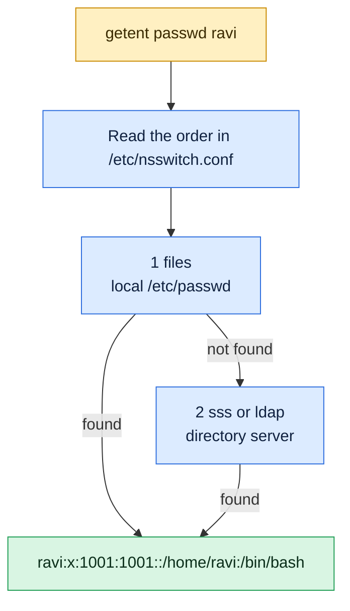

# getent

## What is it?
`getent` (get entries) reads entries from the **system databases**, through the same mechanism that all programs use: the **Name Service Switch** (NSS), configured in `/etc/nsswitch.conf`. That means that it sees users, groups and hosts from **all the sources**: the local files (`/etc/passwd`, `/etc/group`, `/etc/hosts`), and also **LDAP, SSSD, Active Directory, NIS and DNS**. This is the difference to `grep alice /etc/passwd`, which only reads one file. `getent passwd alice` finds `alice` also when she comes from the company directory. It is part of the GNU C library tools, and exists on all Linux distributions.

## Syntax
```bash
getent [OPTIONS] DATABASE [KEY]...
```
`DATABASE` is the name of a database (`passwd`, `group`, `hosts`, ...). `KEY` is a name or a number. Without a key, `getent` lists all the entries (if the source can list them).

### The databases
| Database | What it contains | Source file |
|----------|------------------|-------------|
| `passwd` | Users: `name:x:UID:GID:comment:home:shell` | `/etc/passwd` |
| `group` | Groups: `name:x:GID:member,member` | `/etc/group` |
| `shadow` | Password hashes and aging (**root only**) | `/etc/shadow` |
| `gshadow` | Group passwords and administrators (**root only**) | `/etc/gshadow` |
| `initgroups` | The list of group IDs of a user | `/etc/group` |
| `hosts` | Host names and IPv4/IPv6 addresses (like `gethostbyname`) | `/etc/hosts`, DNS |
| `ahosts`, `ahostsv4`, `ahostsv6` | All addresses of a host, with the socket types | `/etc/hosts`, DNS |
| `services` | Network services and ports | `/etc/services` |
| `protocols` | Network protocols and numbers | `/etc/protocols` |
| `networks` | Network names and numbers | `/etc/networks` |
| `aliases` | Mail aliases | `/etc/aliases` |
| `ethers` | Ethernet (MAC) addresses of hosts | `/etc/ethers` |
| `rpc` | RPC program names and numbers | `/etc/rpc` |
| `netgroup` | Network groups (NIS style) | `/etc/netgroup` |

### Exit status
| Code | Meaning |
|------|---------|
| `0` | Success |
| `1` | Missing arguments, or the database is unknown |
| `2` | One or more of the keys could not be found |
| `3` | Enumeration (a list without a key) is not supported for this database |

## Visual Overview
> `getent` asks the system's own lookup order, so it also finds users from LDAP or SSO. `cat /etc/passwd` sees only the local file.



## Options/Flags
| Flag | Description |
|------|-------------|
| `-s SERVICE` / `--service SERVICE` | Use only this NSS source for the lookup (`files`, `sss`, `ldap`, `dns`...). Also in the form `DATABASE:SERVICE` |
| `-i` / `--no-idn` | Do not use IDN (internationalized domain name) conversion for host names |
| `-?` / `--help` | Show the help text |
| `--usage` | Show a short usage message |
| `-V` / `--version` | Show the version |

### The file `/etc/nsswitch.conf` (an example)
```text
passwd:         files systemd sss
group:          files systemd sss
shadow:         files sss
hosts:          files dns
networks:       files
protocols:      db files
services:       db files
```
For each database, it lists the sources in the order in which they are used.

## Usage Examples

Let's say we are on the server `web01`. Today is `2026-10-12`. We are logged in as `deploy`. These are the local files:

**Input file** (`/etc/passwd`):
```text
root:x:0:0:root:/root:/bin/bash
www-data:x:33:33:www-data:/var/www:/usr/sbin/nologin
deploy:x:1001:1001:Deploy User,,,:/home/deploy:/bin/bash
alice:x:1002:1002:Alice Smith,,,:/home/alice:/bin/bash
```
**Input file** (`/etc/group`):
```text
root:x:0:
sudo:x:27:deploy,alice
www-data:x:33:deploy
docker:x:999:deploy
deploy:x:1001:
alice:x:1002:
```
**Input file** (`/etc/hosts`):
```text
127.0.0.1 localhost
10.0.0.12 web01
10.0.0.20 db01 database
```
The user `carol` (UID `20001`) exists only in the company directory (SSSD and LDAP). Each example starts again from this state.

### Example 1: Look up a user
**Command:**
```bash
getent passwd alice
```
**Sample Output:**
```text
alice:x:1002:1002:Alice Smith,,,:/home/alice:/bin/bash
```
The format is exactly the format of the file `/etc/passwd`.

### Example 2: Look up a user by number
**Command:**
```bash
getent passwd 1001
```
**Sample Output:**
```text
deploy:x:1001:1001:Deploy User,,,:/home/deploy:/bin/bash
```

### Example 3: A user from the directory
`grep carol /etc/passwd` finds nothing. `getent` finds her, because it uses SSSD too.

**Command:**
```bash
grep carol /etc/passwd; echo "grep exit code: $?"
getent passwd carol
```
**Sample Output:**
```text
grep exit code: 1
carol:*:20001:20001:Carol White:/home/carol:/bin/bash
```
Some directory services show `*` or `x` in the password field.

### Example 4: List all users
**Command:**
```bash
getent passwd | head -n 4
```
**Sample Output:**
```text
root:x:0:0:root:/root:/bin/bash
www-data:x:33:33:www-data:/var/www:/usr/sbin/nologin
deploy:x:1001:1001:Deploy User,,,:/home/deploy:/bin/bash
alice:x:1002:1002:Alice Smith,,,:/home/alice:/bin/bash
```
Directory users (like `carol`) often do **not** appear in the full list, because SSSD does not enumerate by default (`enumerate = false`). They are found only by name.

### Example 5: Look up several keys
**Command:**
```bash
getent passwd deploy alice nosuchuser; echo "exit code: $?"
```
**Sample Output:**
```text
deploy:x:1001:1001:Deploy User,,,:/home/deploy:/bin/bash
alice:x:1002:1002:Alice Smith,,,:/home/alice:/bin/bash
exit code: 2
```
Exit code `2` means that one of the keys was not found.

### Example 6: Look up a group
**Command:**
```bash
getent group sudo
getent group 33
```
**Sample Output:**
```text
sudo:x:27:deploy,alice
www-data:x:33:deploy
```

### Example 7: The home directory or the shell of a user (with `cut`)
**Command:**
```bash
getent passwd alice | cut -d: -f6
getent passwd alice | cut -d: -f7
```
**Sample Output:**
```text
/home/alice
/bin/bash
```
This is a safe way to find the home directory of any user, also of a directory user.

### Example 8: Test if a user exists (in a script)
**Command:**
```bash
getent passwd alice >/dev/null && echo "alice exists"
getent passwd nosuchuser >/dev/null || echo "nosuchuser does not exist"
```
**Sample Output:**
```text
alice exists
nosuchuser does not exist
```

### Example 9: The groups of a user (`initgroups`)
**Command:**
```bash
getent initgroups deploy
```
**Sample Output:**
```text
deploy 1001 27 33 999
```
The user name and then all the group IDs. The same as `id -G deploy`.

### Example 10: The password data (`shadow`, root only)
**Command:**
```bash
getent shadow alice
sudo getent shadow alice | cut -d: -f1,3-8
```
**Sample Output:**
```text
alice:20727:0:90:7:14:
```
The first command prints nothing (no right), and exits with `2`. The second one prints the aging fields of `alice`. The hash (field 2) is cut away in the example.

### Example 11: Group passwords and administrators (`gshadow`)
**Command:**
```bash
sudo getent gshadow sudo
```
**Sample Output:**
```text
sudo:*::deploy,alice
```
The fields are: name, password, administrators, members.

### Example 12: Look up a host (`hosts`)
`getent hosts` uses the same lookup as programs (first `/etc/hosts`, then DNS), which is different from `dig` or `nslookup`, which only ask DNS.

**Command:**
```bash
getent hosts web01
getent hosts database
getent hosts example.com
```
**Sample Output:**
```text
10.0.0.12       web01
10.0.0.20       db01 database
2606:2800:220:1:248:1893:25c8:1946 example.com
```
`database` is an alias of `db01`, found in `/etc/hosts`. For `example.com` only the first address is shown.

### Example 13: All addresses of a host (`ahosts`, `ahostsv4`, `ahostsv6`)
**Command:**
```bash
getent ahostsv4 example.com
```
**Sample Output:**
```text
93.184.216.34   STREAM example.com
93.184.216.34   DGRAM  
93.184.216.34   RAW    
```
`ahosts` shows both IPv4 and IPv6 addresses. `ahostsv6` shows only IPv6.

### Example 14: Use only one source (`-s`)
Ask only the local files, and not the directory.

**Command:**
```bash
getent -s files passwd carol; echo "exit code: $?"
getent -s sss passwd carol
```
**Sample Output:**
```text
exit code: 2
carol:*:20001:20001:Carol White:/home/carol:/bin/bash
```
The first command asks the files only, and does not find `carol`. The second one asks SSSD. This is a way to find out which source answers. The form `getent passwd:sss carol` is the same.

### Example 15: Services and ports (`services`)
**Command:**
```bash
getent services http
getent services 443/tcp
```
**Sample Output:**
```text
http                  80/tcp www
https                 443/tcp
```

### Example 16: Protocols (`protocols`)
**Command:**
```bash
getent protocols tcp
getent protocols 17
```
**Sample Output:**
```text
tcp                   6 TCP
udp                   17 UDP
```

### Example 17: Networks (`networks`)
**Command:**
```bash
getent networks loopback
```
**Sample Output:**
```text
loopback              127.0.0.0
```

### Example 18: Mail aliases (`aliases`)
**Command:**
```bash
getent aliases postmaster
```
**Sample Output:**
```text
postmaster: root
```

### Example 19: Skip the IDN conversion (`-i`)
**Command:**
```bash
getent -i hosts bücher.example
getent hosts bücher.example
```
**Sample Output:**
```text
getent: unrecognized hostname
10.0.0.30       xn--bcher-kva.example
```
With `-i`, the name is used as it is, and does not exist in DNS. Without `-i`, `bücher.example` is converted to `xn--bcher-kva.example` (Punycode) before the lookup.

### Example 20: A database that does not exist
**Command:**
```bash
getent nosuchdb; echo "exit code: $?"
```
**Sample Output:**
```text
Unknown database: nosuchdb
Try `getent --help' or `getent --usage' for more information.
exit code: 1
```

### Example 21: Check the version (`-V`)
**Command:**
```bash
getent -V | head -n 1
```
**Sample Output:**
```text
getent (Ubuntu GLIBC 2.35-0ubuntu3.8) 2.35
```

### Example 22: Show the help (`-?`)
**Command:**
```bash
getent --help | head -n 3
```
**Sample Output:**
```text
Usage: getent [OPTION...] database [key ...]
Get entries from administrative database.

```

## Pitfalls / Gotchas
- **Do not `grep /etc/passwd` when you want the truth.** The user may be in LDAP, SSSD or Active Directory. `getent` asks the same way as all other programs.
- **The full list can be incomplete.** `getent passwd` and `getent group` list only what the source can enumerate. SSSD and LDAP often do not enumerate (`enumerate = false`, for speed). A user can be found by name and still not be in the list.
- **Caches.** NSS uses `nscd`, `sssd` or `systemd-userdbd` caches. A new entry can take some seconds to appear. Clear it with `sss_cache -E` or `nscd -i passwd`.
- **`shadow` and `gshadow` need `root`.** Without it, you get no output and exit code `2`.
- **`getent hosts` shows only one address** for a name that has many. Use `ahosts` for all of them.
- **`getent hosts` is not DNS only.** It follows `/etc/nsswitch.conf` (`hosts: files dns`). That is a feature: `/etc/hosts` wins, which is how your applications see the name. `dig` shows what DNS says, and the two can differ.
- **Exit code `2` means "not found".** Keep it in mind in `set -e` scripts. Use `|| true` where it is fine.
- **The output is in file format.** For `passwd` and `group` it has colons. Cut fields with `cut -d: -f...` or `awk -F:`.
- **The databases are not the same everywhere.** `getent` on macOS, BSD and in musl (Alpine) has fewer databases and options. In Alpine containers `getent` is in the package `musl-utils`.
- **`-s` needs a source that is configured.** `getent -s sss passwd` fails with `Unknown service` if SSSD is not set up in `nsswitch.conf`.
- **Enumeration of a big directory can take long** and heavy load on the directory server. Avoid `getent passwd` in loops.

## DevOps Use Cases

### Use Case 1: Check that a user exists, before you change it
**Situation:** A script must change the user `alice`, but only if it exists, also if she comes from the directory.

**Command:**
```bash
if getent passwd alice >/dev/null; then
  echo "alice exists, continuing"
else
  echo "alice not found" >&2; exit 1
fi
```
**Output:**
```text
alice exists, continuing
```

### Use Case 2: Find the home directory of a user
**Situation:** A backup script needs the home directory of a user. `$HOME` is wrong inside `sudo` or `cron`, and `~user` works only in `bash`. `getent` is reliable.

**Command:**
```bash
home=$(getent passwd alice | cut -d: -f6)
echo "Backing up $home"
```
**Output:**
```text
Backing up /home/alice
```

### Use Case 3: List the members of a group
**Situation:** Who is in the `docker` group? (Users whose **primary** group is `docker` are not shown in the member list. Check `passwd` as well.)

**Command:**
```bash
getent group docker | cut -d: -f4 | tr ',' '\n'
getent passwd | awk -F: -v gid="$(getent group docker | cut -d: -f3)" '$4==gid {print $1}'
```
**Output:**
```text
deploy
```
The second command prints nothing, because nobody has `docker` as the primary group.

### Use Case 4: Troubleshoot a name that resolves differently
**Situation:** `curl http://db01` works, but `dig db01` finds nothing. Check what the system really uses.

**Command:**
```bash
dig +short db01
getent hosts db01
grep '^hosts' /etc/nsswitch.conf
```
**Output:**
```text
10.0.0.20       db01 database
hosts:          files dns
```
`dig` prints nothing (no DNS record). `getent` finds the name in `/etc/hosts`. Applications use the same path as `getent`.

### Use Case 5: Prove that the directory service works on a server
**Situation:** After a join to Active Directory or an LDAP server, check that the directory users and groups are visible.

**Command:**
```bash
getent passwd carol
getent group developers
id carol
```
**Output:**
```text
carol:*:20001:20001:Carol White:/home/carol:/bin/bash
developers:*:30001:carol,dave
uid=20001(carol) gid=20001(carol) groups=20001(carol),30001(developers)
```
If the first line is empty, check `sssd`, `/etc/nsswitch.conf` and the network (`systemctl status sssd`).

### Use Case 6: Find the port of a service name
**Situation:** A script gets a service name from a configuration, and needs the port.

**Command:**
```bash
getent services https | awk '{split($2,a,"/"); print a[1]}'
```
**Output:**
```text
443
```

### Use Case 7: Audit: all the local users with a login shell
**Situation:** List the real users, without the system accounts, with the shell.

**Command:**
```bash
getent passwd | awk -F: '$3>=1000 && $3<60000 && $7 !~ /(nologin|false)$/ {print $1" "$7}'
```
**Output:**
```text
deploy /bin/bash
alice /bin/bash
```

### Use Case 8: Check a user's groups in an Ansible or CI step
**Situation:** Validate that the build user has the groups that the pipeline needs.

**Command:**
```bash
need="docker www-data"
have=$(getent initgroups deploy | cut -d' ' -f2- | tr ' ' '\n' | xargs -I{} getent group {} | cut -d: -f1 | tr '\n' ' ')
for g in $need; do
  echo " $have" | grep -q " $g " && echo "OK: $g" || echo "MISSING: $g"
done
```
**Output:**
```text
OK: docker
OK: www-data
```

## Related Commands
- [`id`](id.md) - show the UID, GID and groups of a user
- [`groups`](groups.md) - show the group names of a user
- [`who`](who.md) / [`w`](w.md) - who is logged in
- [`useradd`](useradd.md) / [`usermod`](usermod.md) / [`userdel`](userdel.md) - change the local users
- [`groupadd`](groupadd.md) / [`groupmod`](groupmod.md) - change the local groups
- [`passwd`](passwd.md) / [`chage`](chage.md) - the password data that `getent shadow` shows
- [`dig`](../networking/dig.md) / [`nslookup`](../networking/nslookup.md) - ask DNS directly, without the NSS order
- [`cut`](../text-processing/cut.md) - take the fields of the `passwd` format
- [`awk`](../text-processing/awk.md) - filter users and groups by field
- `/etc/nsswitch.conf` - the order of the sources
- `sssd` / `sss_cache` - the directory client and its cache
