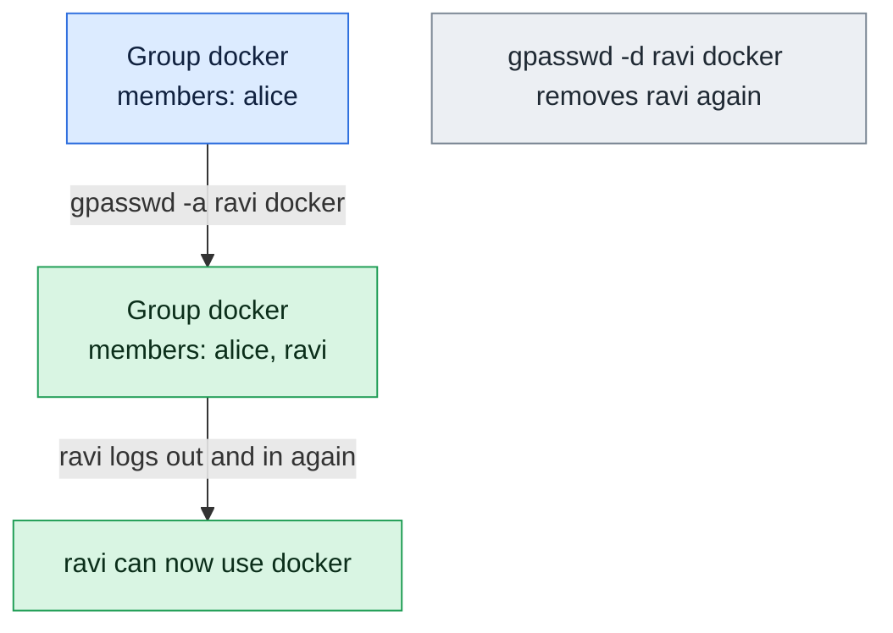

# gpasswd

## What is it?
`gpasswd` **administers groups**: it adds users to a group, removes users from a group, sets the **whole list** of members, names **group administrators**, and sets or removes the **group password**. It works on `/etc/group` and `/etc/gshadow`. It is part of the `shadow-utils` package and is the same on all distributions. `gpasswd -a USER GROUP` is a clean way to add a user to a group, and `gpasswd -d USER GROUP` is the **only standard way to remove a user from just one group** (`usermod` has no option for it). A **group administrator** can add and remove members of his group without being `root`.

## Syntax
```bash
gpasswd GROUP                        # set the group password (interactive)
gpasswd -a USER GROUP                # add a user
gpasswd -d USER GROUP                # remove a user
gpasswd -M USER,USER,... GROUP       # set the whole list of members
gpasswd -A USER,USER,... GROUP       # set the group administrators
gpasswd -r GROUP                     # remove the group password
gpasswd -R GROUP                     # restrict access to the group (newgrp)
```
You need `root` rights, or you must be an administrator of the group.

## Visual Overview
> `gpasswd -a` adds one user to a group. The user must log out and in again before the new group applies to their session.



## Options/Flags
| Flag | Description |
|------|-------------|
| `-a USER` / `--add` | Add `USER` to the group. The other members stay |
| `-d USER` / `--delete` | Remove `USER` from the group. The user and the group stay |
| `-M USER,...` / `--members` | **Replace** the whole list of members with this list (an empty list `""` removes all) |
| `-A USER,...` / `--administrators` | **Replace** the list of group administrators |
| `-r` / `--remove-password` | Remove the group password |
| `-R` / `--restrict` | Restrict access to the group to its **members**: `newgrp` is refused for others, even with the password |
| `-Q CHROOT_DIR` / `--root` | Apply the change in a chroot directory (newer versions) |
| `-h` / `--help` | Show the help text |

### The files
| File | Line format |
|------|-------------|
| `/etc/group` | `NAME:x:GID:MEMBER,MEMBER` |
| `/etc/gshadow` | `NAME:PASSWORD:ADMIN,ADMIN:MEMBER,MEMBER` (the password field is `!` for "no password", `*` for locked) |

### Exit status
| Code | Meaning |
|------|---------|
| `0` | Success |
| `1` | Syntax error, a user is not a member, or an invalid user or group |
| `3` | Not allowed, or the user or group does not exist |

## Usage Examples

Let's say we are on the server `web01` and work as `root` (or with `sudo`). Today is `2026-10-12`. These users and groups exist:

**Input file** (`/etc/group`):
```text
root:x:0:
sudo:x:27:deploy
docker:x:999:deploy
deploy:x:1001:
alice:x:1002:
bob:x:1003:
carol:x:1004:
devs:x:1005:deploy
```
**Input file** (`/etc/gshadow`, only the interesting line):
```text
devs:!::deploy
```
The group `devs` has the member `deploy`, no administrator, and no password. Each example starts again from this state.

### Example 1: Add a user to a group (`-a`)
**Command:**
```bash
sudo gpasswd -a alice devs
getent group devs
```
**Sample Output:**
```text
Adding user alice to group devs
devs:x:1005:deploy,alice
```
The other members stay. The user `alice` must log out and in again before the new group is active.

### Example 2: Remove a user from a group (`-d`)
**Command:**
```bash
sudo gpasswd -d deploy devs
getent group devs
id deploy
```
**Sample Output:**
```text
Removing user deploy from group devs
devs:x:1005:
uid=1001(deploy) gid=1001(deploy) groups=1001(deploy),27(sudo),999(docker)
```
Only one group was removed. This is the main reason to use `gpasswd`.

### Example 3: Remove a user who is not a member
**Command:**
```bash
sudo gpasswd -d alice devs; echo "exit code: $?"
```
**Sample Output:**
```text
gpasswd: user 'alice' is not a member of 'devs'
exit code: 3
```

### Example 4: Add a user who is already a member
**Command:**
```bash
sudo gpasswd -a deploy devs
getent group devs
```
**Sample Output:**
```text
Adding user deploy to group devs
devs:x:1005:deploy
```
Nothing is duplicated.

### Example 5: Set the whole list of members (`-M`)
`-M` **replaces** the list. The old members that are not in the new list are removed.

**Command:**
```bash
sudo gpasswd -M alice,bob,carol devs
getent group devs
```
**Sample Output:**
```text
devs:x:1005:alice,bob,carol
```
`deploy` is no longer a member. Use `-M` to make the group look exactly like a list.

### Example 6: Remove all members (`-M ""`)
**Command:**
```bash
sudo gpasswd -M "" devs
getent group devs
```
**Sample Output:**
```text
devs:x:1005:
```

### Example 7: Name a group administrator (`-A`)
A group administrator may add and remove members of this group, without being `root`.

**Command:**
```bash
sudo gpasswd -A alice devs
sudo getent gshadow devs
```
**Sample Output:**
```text
devs:!:alice:deploy
```
The third field of `/etc/gshadow` is the list of administrators. `-A` also **replaces** the list. An empty list (`-A ""`) removes all the administrators.

### Example 8: A group administrator manages the members
`alice` is the administrator of `devs`, and is not `root`. She adds `bob` and removes `deploy`.

**Command:**
```bash
gpasswd -a bob devs
gpasswd -d deploy devs
getent group devs
```
**Sample Output:**
```text
Adding user bob to group devs
Removing user deploy from group devs
devs:x:1005:bob
```
Without being the administrator, `gpasswd -a bob devs` gives `gpasswd: Permission denied.`

### Example 9: Set the group password (interactive)
**Command:**
```bash
sudo gpasswd devs
sudo getent gshadow devs | cut -d: -f1,2 | cut -c1-14
```
**Sample Output** (you type the password twice):
```text
Changing the password for group devs
New Password: 
Re-enter new password: 
devs:$6$Ab12cD34
```
With the password, any user can use the group for one shell with `newgrp devs`, and typing the password. It is a weak method. Prefer real membership.

### Example 10: Remove the group password (`-r`)
**Command:**
```bash
sudo gpasswd -r devs
sudo getent gshadow devs
```
**Sample Output:**
```text
devs:::deploy
```
The password field is empty, so only members (and the administrators) can use `newgrp devs`.

### Example 11: Restrict the group to its members (`-R`)
`-R` puts a `!` as the password. Even a user who knows an old password cannot use `newgrp devs`. Only members can.

**Command:**
```bash
sudo gpasswd -R devs
sudo getent gshadow devs
```
**Sample Output:**
```text
devs:!::deploy
```

### Example 12: Change a group in a chroot (`-Q`)
**Command:**
```bash
sudo gpasswd -Q /mnt/newroot -a alice devs
grep devs /mnt/newroot/etc/group
```
**Sample Output:**
```text
Adding user alice to group devs
devs:x:1005:alice
```
In older versions of `shadow-utils` the option is `-R`, and in the newest it is `-Q` (and `--root`). Check `gpasswd --help`.

### Example 13: A user or a group that does not exist
**Command:**
```bash
sudo gpasswd -a nosuchuser devs
sudo gpasswd -a alice nosuchgroup
```
**Sample Output:**
```text
gpasswd: user 'nosuchuser' does not exist
gpasswd: group 'nosuchgroup' does not exist
```

### Example 14: Not enough rights
**Command:**
```bash
gpasswd -a alice devs
```
**Sample Output:**
```text
gpasswd: Permission denied.
```

### Example 15: Check the change in a running session
A user who is added to a group does not have it in the session that is already running.

**Command:**
```bash
sudo gpasswd -a alice devs
sudo -u alice id
sudo -u alice -i id
```
**Sample Output:**
```text
Adding user alice to group devs
uid=1002(alice) gid=1002(alice) groups=1002(alice),1005(devs)
uid=1002(alice) gid=1002(alice) groups=1002(alice),1005(devs)
```
`sudo -u alice` starts a new process, so it already shows the new group. The login sessions of `alice` that were started before still use the old list.

### Example 16: Show the help (`-h`)
**Command:**
```bash
gpasswd -h | head -n 4
```
**Sample Output:**
```text
Usage: gpasswd [option] GROUP

Options:
  -a, --add USER                add USER to GROUP
```

## Pitfalls / Gotchas
- **`-M` and `-A` replace the lists.** `gpasswd -M alice devs` removes all the other members. Use `-a` to add one user.
- **The user must log in again.** The new group is read at login. Use `newgrp devs` to start a shell with the group at once, or log out and in.
- **`gpasswd -a` is safe, and `usermod -G` is not.** `usermod -G devs alice` replaces **all** the groups of `alice`. `gpasswd -a alice devs` and `usermod -aG devs alice` only add.
- **`gpasswd -d` is the way to remove one group.** `usermod` has no option for that. On Debian also `deluser USER GROUP`.
- **A user who has the group as the primary group** is not shown as a member in `/etc/group` (the primary group is in `/etc/passwd`). `gpasswd -d` cannot remove a primary group. Change it with `usermod -g`.
- **Group passwords are a weak and old idea.** Do not use them for security. They let a non-member use a group by knowing a shared password. Use `-R` to forbid it.
- **The administrator list is separate from the members.** An administrator is not automatically a member. Add him with `-a` too.
- **Group administrators are not often used,** but they let a team lead manage a team without `sudo`. Take care: an administrator can add himself or others to a powerful group (`docker`).
- **Do not give `docker` and `sudo` membership lightly.** Both are equal to `root` rights.
- **`gpasswd` works only for local groups.** For LDAP and Active Directory, use the tools of the directory.
- **Option names differ between old and new versions.** `-R` (restrict) is the same everywhere, but the chroot option (`-Q`) is new. Check `gpasswd -h`.
- **Debian has `adduser USER GROUP` and `deluser USER GROUP`,** which do the same as `gpasswd -a` and `gpasswd -d`, and print more.

## DevOps Use Cases

### Use Case 1: Give a user access to Docker and remove it later
**Situation:** `alice` needs Docker for a project. Add her to the group, and remove her when the project is done.

**Command:**
```bash
sudo gpasswd -a alice docker
id alice
sudo gpasswd -d alice docker
id alice
```
**Output:**
```text
Adding user alice to group docker
uid=1002(alice) gid=1002(alice) groups=1002(alice),999(docker)
Removing user alice from group docker
uid=1002(alice) gid=1002(alice) groups=1002(alice)
```

### Use Case 2: Make a group look exactly like a list (declarative)
**Situation:** The members of the group `devs` come from a file that HR keeps up to date. The group must always match it.

**Input file** (`devs.txt`):
```text
alice
bob
carol
```
**Command:**
```bash
members=$(paste -sd, devs.txt)
sudo gpasswd -M "$members" devs
getent group devs
```
**Output:**
```text
devs:x:1005:alice,bob,carol
```
Everybody who is not in the file loses the group. This is the same idea as the `groups` and `append: false` options in Ansible.

### Use Case 3: Let a team lead manage the team
**Situation:** `alice` is the lead of the team `devs`. She should add and remove members herself, with no `sudo`.

**Command:**
```bash
sudo gpasswd -A alice devs
sudo -u alice gpasswd -a bob devs
sudo getent gshadow devs
```
**Output:**
```text
Adding user bob to group devs
devs:!:alice:deploy,bob
```

### Use Case 4: Offboarding: remove a user from all the groups
**Situation:** `alice` leaves the team. Remove her from every supplementary group, but do not touch her account yet.

**Command:**
```bash
for g in $(id -Gn alice | tr ' ' '\n' | grep -vx alice); do
  sudo gpasswd -d alice "$g"
done
id alice
```
**Output:**
```text
Removing user alice from group sudo
Removing user alice from group devs
uid=1002(alice) gid=1002(alice) groups=1002(alice)
```
The shorter way is `sudo usermod -G "" alice`.

### Use Case 5: Check who can use a powerful group
**Situation:** A security review asks for all the members of `docker` and `sudo`.

**Command:**
```bash
getent group docker sudo | awk -F: '{print $1": "$4}'
```
**Output:**
```text
docker: deploy
sudo: deploy
```
Review the names. Remove everyone who does not need it: `sudo gpasswd -d NAME docker`.

### Use Case 6: Add users in a script and skip the ones that exist
**Situation:** Add a list of users to a group, and do not print errors for the ones who are already members.

**Input file** (`new-devs.txt`):
```text
alice
bob
```
**Command:**
```bash
while read -r u; do
  id -nG "$u" | tr ' ' '\n' | grep -qx devs && { echo "$u already in devs"; continue; }
  sudo gpasswd -a "$u" devs
done < new-devs.txt
```
**Output:**
```text
Adding user alice to group devs
Adding user bob to group devs
```

### Use Case 7: Prepare a group before a deployment (Ansible)
**Situation:** With infrastructure code, the module `user` with `append: true` has the same effect as `gpasswd -a`.

**Input file** (`playbook.yml`):
```text
- name: Add alice to devs
  ansible.builtin.user:
    name: alice
    groups: devs
    append: true
```
**Command:**
```bash
ansible-playbook -i web01, playbook.yml
getent group devs
```
**Output:**
```text
TASK [Add alice to devs] ***
changed: [web01]
devs:x:1005:deploy,alice
```

## Related Commands
- [`usermod`](usermod.md) - `usermod -aG` also adds a user to groups, `-G` replaces them
- [`groupadd`](groupadd.md) - create a group
- [`groupmod`](groupmod.md) - rename a group or change its GID (new versions can set members)
- [`groupdel`](groupdel.md) - remove a group
- [`adduser`](adduser.md) - on Debian, `adduser USER GROUP` adds a user to a group
- [`deluser`](deluser.md) - on Debian, `deluser USER GROUP` removes a user from a group
- [`useradd`](useradd.md) - `useradd -G` puts a new user into groups
- [`id`](id.md) / [`groups`](groups.md) - show the groups of a user
- [`getent`](getent.md) - read `group` and `gshadow` (also from LDAP)
- `newgrp` - open a shell with another group as the primary group
- `vigr` - edit `/etc/group` safely by hand

---
<!-- nav -->
[← Previous: `getent`](getent.md) | [Learning path](../README.md) | [Next: `groupdel` →](groupdel.md)
