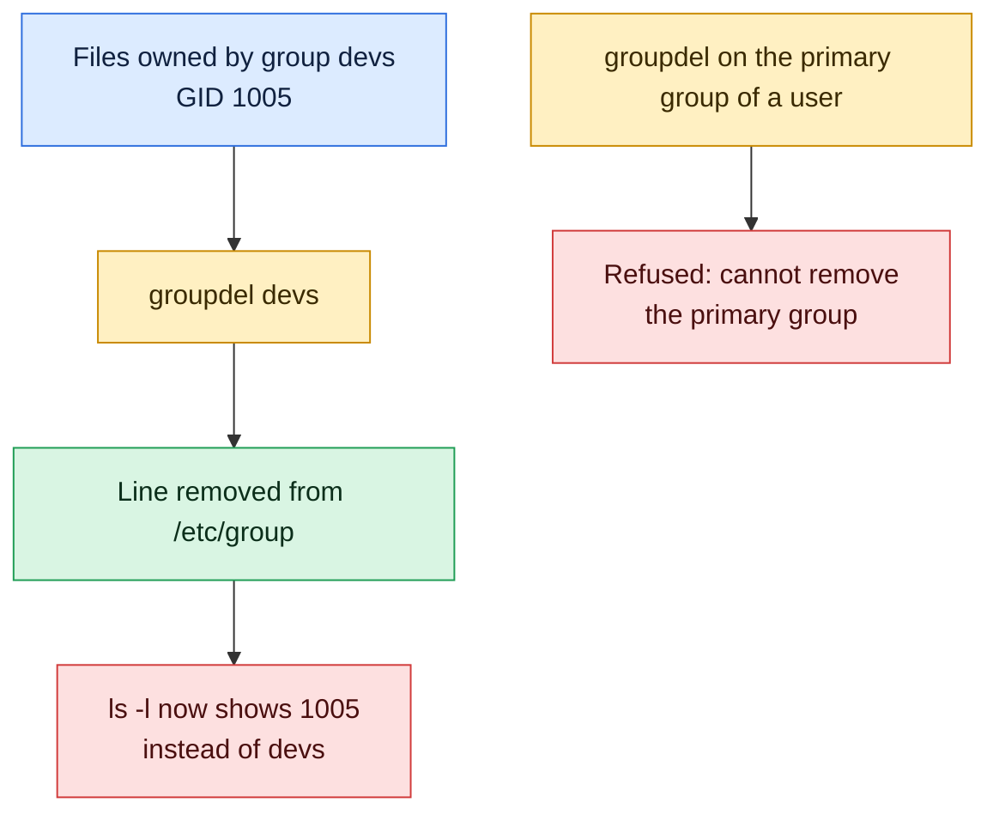

# groupdel

## What is it?
`groupdel` **deletes a group**. It removes the line of the group from `/etc/group` and `/etc/gshadow`. It does **not** remove the users who are members, and it does **not** change the files that belong to the group: those files keep the group **number** (GID), which then has no name. `groupdel` refuses to remove a group that is the **primary group** of a user. It is a low level program of the `shadow-utils` package, the same on all distributions, and not interactive, so it is the right command for scripts.

### `groupdel` and `delgroup`: the difference, and when to use which
There is a second command with a similar name, with a different behavior depending on the Linux family.

| | `groupdel` | `delgroup` |
|-|------------|------------|
| What it is | The low level program of the `shadow` package, on **all** distributions | **Debian, Ubuntu:** a friendly **Perl script** (the same script as `deluser`, in the package `adduser`) that removes groups. **RHEL, CentOS, Rocky, AlmaLinux, Fedora:** it **does not exist** (`delgroup: command not found`) |
| Interactive? | No | No, but it prints each step |
| Remove only if empty | No (it removes also a group with members) | `--only-if-empty` |
| Remove a group that is the primary group of a user | Refused. `-f` forces it | Refused |
| Remove a user from a group | No (use `gpasswd -d`) | `delgroup USER GROUP` is the same as `deluser USER GROUP` |
| System groups | No difference | `--system` (remove only if it is a system group) |
| Messages | Silent when it works | `Removing group 'devs' ... Done.` |
| Config file | `/etc/login.defs` | `/etc/deluser.conf` (`ONLY_IF_EMPTY`) |
| Good for | **Scripts and automation on every distribution** | **Debian and Ubuntu**, at the keyboard, and when "only if empty" is a safe default |

**When to use which:**
- **In scripts, Ansible, Docker or cloud-init, use `groupdel`** on every distribution.
- **At the keyboard on Debian or Ubuntu, `delgroup --only-if-empty GROUP` is the safest way** to clean up an empty group.
- **On RHEL, Rocky, Alma, CentOS or Fedora, only `groupdel` exists.**
- **To add a group, the matching commands are `groupadd` and (Debian) `addgroup`.**

## Syntax
```bash
groupdel [OPTIONS] GROUP
```
`GROUP` is the name of an existing group. You need `root` rights.

## Visual Overview
> `groupdel` removes the group line. Files that belonged to the group are not changed. They just show a bare number instead of a name.



## Options/Flags
| Flag | Description |
|------|-------------|
| `-f` / `--force` | Remove the group even if it is the primary group of a user (newer versions). The user is left with a GID that has no group |
| `-R CHROOT_DIR` / `--root` | Apply the change in a chroot directory |
| `-P PREFIX_DIR` / `--prefix` | Use a prefix directory for the files (newer versions) |
| `-h` / `--help` | Show the help text |

### Exit status
| Code | Meaning |
|------|---------|
| `0` | Success |
| `2` | Invalid command syntax |
| `6` | The group does not exist |
| `8` | Cannot remove the user's primary group |
| `10` | Cannot update the group file |

## Usage Examples

Let's say we are on the server `web01` and work as `root` (or with `sudo`). Today is `2026-10-12`. These groups and users exist:

**Input file** (`/etc/passwd`):
```text
root:x:0:0:root:/root:/bin/bash
deploy:x:1001:1001:Deploy User,,,:/home/deploy:/bin/bash
alice:x:1002:1002:Alice Smith,,,:/home/alice:/bin/bash
bob:x:1003:1005:Bob Jones,,,:/home/bob:/bin/bash
```
**Input file** (`/etc/group`):
```text
root:x:0:
sudo:x:27:deploy
docker:x:999:deploy
deploy:x:1001:
alice:x:1002:
devs:x:1004:alice,deploy
contractors:x:1005:bob
```
The group `contractors` (GID `1005`) is the **primary** group of `bob`. The group `devs` has two members, and owns the directory `/srv/shared`. Each example starts again from this state.

### Example 1: Remove a group
**Command:**
```bash
sudo groupdel devs
getent group devs; echo "exit code: $?"
id alice
```
**Sample Output:**
```text
exit code: 2
uid=1002(alice) gid=1002(alice) groups=1002(alice)
```
The group is gone, and `alice` and `deploy` are not members any more. The users themselves stay.

### Example 2: The files keep the old number
**Command:**
```bash
sudo groupdel devs
ls -ld /srv/shared
ls -ldn /srv/shared
```
**Sample Output:**
```text
drwxrwsr-x 2 root 1004 4096 Oct 12 10:00 /srv/shared
drwxrwsr-x 2 0 1004 4096 Oct 12 10:00 /srv/shared
```
The group of the directory is only a number (`1004`) now. If you create a new group that gets the number `1004`, it gets access to the old files, because the access is by number. Fix the files before you forget: `find / -xdev -gid 1004 -exec chgrp -h newgroup {} +`.

### Example 3: Find the files of the group before you remove it
**Command:**
```bash
sudo find / -xdev -group devs -ls 2>/dev/null
```
**Sample Output:**
```text
 262145      4 drwxrwsr-x   2 root     devs         4096 Oct 12 10:00 /srv/shared
 262150      4 -rw-rw-r--   1 alice    devs           40 Oct 12 10:00 /srv/shared/plan.txt
```
Move these files to another group, and then remove the group.

### Example 4: A group that does not exist
**Command:**
```bash
sudo groupdel nosuchgroup; echo "exit code: $?"
```
**Sample Output:**
```text
groupdel: group 'nosuchgroup' does not exist
exit code: 6
```

### Example 5: The primary group of a user cannot be removed
**Command:**
```bash
sudo groupdel contractors; echo "exit code: $?"
```
**Sample Output:**
```text
groupdel: cannot remove the primary group of user 'bob'
exit code: 8
```
Change the primary group of `bob` first (`sudo usermod -g users bob`) or remove the user.

### Example 6: Force the removal (`-f`)
`-f` removes the group, even if a user has it as the primary group. The user is then left with a GID with no name.

**Command:**
```bash
sudo groupdel -f contractors
id bob
```
**Sample Output:**
```text
uid=1003(bob) gid=1005 groups=1005
```
`bob` has `gid=1005` and no name. This can break the login, and file creation. Change his primary group at once: `sudo usermod -g users bob`. The option `-f` exists in `shadow-utils` 4.7 and later. On older systems the command prints `groupdel: invalid option -- 'f'`.

### Example 7: Remove a group in a chroot (`-R`)
**Command:**
```bash
sudo groupdel -R /mnt/newroot devs
grep devs /mnt/newroot/etc/group; echo "exit code: $?"
```
**Sample Output:**
```text
exit code: 1
```

### Example 8: A group with members
`groupdel` does not mind members. It removes the group anyway. Check the members first, if you want to be careful.

**Command:**
```bash
getent group devs | cut -d: -f4
sudo groupdel devs
```
**Sample Output:**
```text
alice,deploy
```
The first command shows the members. The second prints nothing, and the group is removed.

### Example 9: Remove a group only if it is empty (script)
A safe check that works on every distribution.

**Command:**
```bash
members=$(getent group contractors | cut -d: -f4)
if [ -z "$members" ]; then
  sudo groupdel contractors && echo "removed"
else
  echo "contractors still has members: $members"
fi
```
**Sample Output:**
```text
contractors still has members: bob
```

### Example 10: Not enough rights
**Command:**
```bash
groupdel devs
```
**Sample Output:**
```text
groupdel: Permission denied.
groupdel: cannot lock /etc/group; try again later.
```

### Example 11: What `delgroup` does on Debian and Ubuntu
**Command:**
```bash
sudo delgroup devs
sudo delgroup --only-if-empty contractors
sudo delgroup --system nosuchgroup
```
**Sample Output:**
```text
Removing group `devs' ...
Done.
/usr/sbin/delgroup: `contractors' still has `bob' as a member, not removing it.
/usr/sbin/delgroup: The group `nosuchgroup' does not exist.
```
`delgroup` prints each step. `--only-if-empty` protects groups that still have members. On RHEL and Rocky Linux: `sudo: delgroup: command not found`, so use `groupdel`.

### Example 12: Show the help (`-h`)
**Command:**
```bash
groupdel -h | head -n 4
```
**Sample Output:**
```text
Usage: groupdel [options] GROUP

Options:
  -f, --force                   delete group even if it is the primary group of a user
```

## Pitfalls / Gotchas
- **Files keep the group number.** After `groupdel`, files show a bare GID. A new group that gets the same GID inherits the access to them. Always look for the old files (`find / -xdev -gid N`), and move them first.
- **Check the members before you remove.** `groupdel` does not ask. Users lose the rights that the group gave them (sudo, docker, file access), and are not told.
- **Never remove system groups** (`sudo`, `wheel`, `docker`, `shadow`, `adm`, `www-data`, `root`). Packages, `sudoers` and system files depend on them.
- **Rules that use the group name stay.** `sudoers` lines (`%devs ALL=...`), `AllowGroups` in `sshd_config`, ACLs and polkit rules still have the name. They silently stop working, because the name does not match any group. Search for the name: `grep -r devs /etc`.
- **A user's primary group is protected.** Without `-f`, you cannot remove it, which protects you. With `-f`, the user is left in a bad state.
- **A running process keeps its groups** until it ends. A user who is logged in still has the removed group in the session.
- **`-f` is not available on old systems.** `shadow-utils` older than 4.7 (RHEL 7) do not have it.
- **`groupdel` changes only the local files.** Groups from LDAP or Active Directory cannot be removed with it.
- **`delgroup` is only on Debian and Ubuntu.** Use `groupdel` for portable scripts.
- **`delgroup USER GROUP` removes a user from a group,** it does not remove the group. This is a source of confusion on Debian: the number of arguments decides.

## DevOps Use Cases

### Use Case 1: Clean up a group when a project ends
**Situation:** The project group `project1` has finished. Find its files, give them to another group, and remove the group.

**Command:**
```bash
sudo find / -xdev -group project1 -exec chgrp -h devs {} + 2>/dev/null
sudo groupdel project1
getent group project1; echo "exit code: $?"
```
**Output:**
```text
exit code: 2
```

### Use Case 2: Remove empty groups from a server (audit)
**Situation:** An audit asks for groups with no members, that are not the primary group of anybody. Find them and review them.

**Command:**
```bash
getent group | awk -F: '$3>=1000 && $3<60000 && $4=="" {print $1":"$3}' | while IFS=: read -r g gid; do
  getent passwd | awk -F: -v gid="$gid" '$4==gid{f=1} END{exit !f}' || echo "$g (GID $gid) is empty and unused"
done
```
**Output:**
```text
oldproject (GID 1008) is empty and unused
temp (GID 1010) is empty and unused
```
Review each name, and remove with `sudo groupdel NAME`.

### Use Case 3: An idempotent removal in a script
**Situation:** A script must remove a group, and must not fail when it is already gone.

**Command:**
```bash
if getent group devs >/dev/null; then
  sudo groupdel devs && echo "devs removed"
else
  echo "devs does not exist, nothing to do"
fi
```
**Output:**
```text
devs removed
```
The Ansible module: `ansible.builtin.group: name=devs state=absent`.

### Use Case 4: Rename instead of remove and create
**Situation:** The group `devs` should be called `platform`. Do **not** remove and create a new group, because the files would lose their group. Rename it.

**Command:**
```bash
sudo groupmod -n platform devs
ls -ld /srv/shared
```
**Output:**
```text
drwxrwsr-x 2 root platform 4096 Oct 12 10:00 /srv/shared
```
`groupdel` and `groupadd` would give the group a new GID, and the old files would have a bare number.

### Use Case 5: Remove a group that is the primary group of a user (safe way)
**Situation:** The group `contractors` should go, and `bob` is its only user. Move `bob` to another group first.

**Command:**
```bash
sudo groupadd -f staff
sudo usermod -g staff bob
sudo find /home/bob -group contractors -exec chgrp -h staff {} +
sudo groupdel contractors
id bob
```
**Output:**
```text
uid=1003(bob) gid=1006(staff) groups=1006(staff)
```

### Use Case 6: Remove the groups of a temporary workshop
**Situation:** The training groups `team01` to `team10` are not needed any more.

**Command:**
```bash
for i in $(seq -w 1 10); do
  getent group "team$i" >/dev/null && sudo groupdel "team$i"
done
getent group | grep -c '^team'
```
**Output:**
```text
0
```

## Related Commands
- [`delgroup`](groupdel.md) - the Debian friendly command (described above)
- [`groupadd`](groupadd.md) - create a group (on Debian also `addgroup`)
- [`groupmod`](groupmod.md) - rename a group or change its GID instead of removing it
- [`gpasswd`](gpasswd.md) - remove one user from a group (`gpasswd -d`)
- [`deluser`](deluser.md) - on Debian, `deluser --group` removes a group, and `deluser USER GROUP` removes a member
- [`userdel`](userdel.md) - remove a user
- [`usermod`](usermod.md) - change the primary group of a user before you remove the group
- [`id`](id.md) / [`groups`](groups.md) - check the groups of a user
- [`getent`](getent.md) - read the group database
- [`chgrp`](../permissions/chgrp.md) - give the files to another group
- [`find`](../file-management/find.md) - find the files of the group (`-group`, `-gid`, `-nogroup`)
- `vigr` - edit `/etc/group` safely by hand
