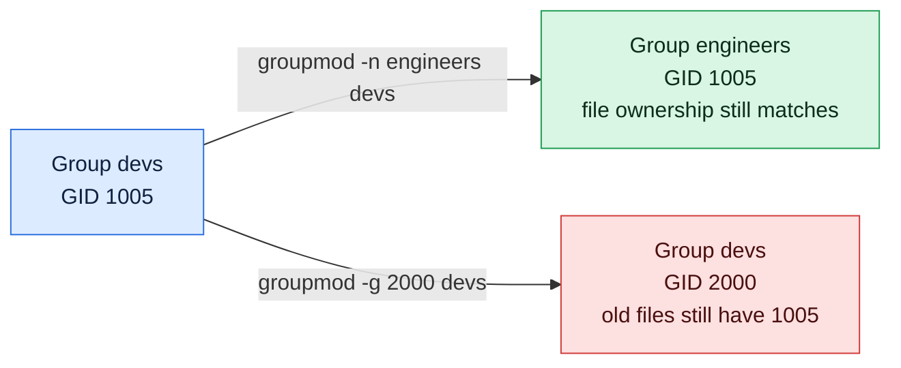

# groupmod

## What is it?
`groupmod` **modifies an existing group**: it can rename the group, change its group ID (GID), set its password and (in new versions) add members. It edits `/etc/group` and `/etc/gshadow`. It is the group version of `usermod`, from the `shadow-utils` package, and works the same on Debian, Ubuntu, RHEL and others. Important: when you change the **GID**, the files on the disk are **not** updated. Their group is stored as a **number**, so they keep the old number. You must fix them with `chgrp` or `find`. And when you change the **name**, the files are fine, because only the name changes, not the number.

> Debian and Ubuntu have **no** `groupmod` wrapper like `addgroup` or `delgroup`. There is only one `groupmod`. The Debian helpers `addgroup`/`delgroup` and `adduser USER GROUP` / `deluser USER GROUP` handle creating, removing and members. See `groupadd` and `groupdel` for the differences between the Debian helpers and the low level tools.

## Syntax
```bash
groupmod [OPTIONS] GROUP
```
`GROUP` is the **current** name of an existing group. You need `root` rights.

## Visual Overview
> Renaming a group is safe because the GID stays the same. Changing the GID is risky because old files keep the old number.



## Options/Flags
| Flag | Description |
|------|-------------|
| `-n NEW_NAME` / `--new-name` | Rename the group. The GID and the members stay the same |
| `-g NEW_GID` / `--gid` | Change the GID. The new number must be unique, unless `-o` is used |
| `-o` / `--non-unique` | With `-g`, allow a GID that is already in use |
| `-p PASSWORD` / `--password` | Set the encrypted group password (a hash) |
| `-U USER,...` / `--users` | Set the members of the group (newer `shadow-utils`, 4.14 and later). With `-a`, add them |
| `-a` / `--append` | With `-U`, add the users to the group, and keep the old members |
| `-R CHROOT_DIR` / `--root` | Apply the change in a chroot directory |
| `-P PREFIX_DIR` / `--prefix` | Use a prefix directory for the files (newer versions) |
| `-h` / `--help` | Show the help text |

### Exit status
| Code | Meaning |
|------|---------|
| `0` | Success |
| `2` | Invalid command syntax |
| `3` | Invalid argument to an option |
| `4` | GID not unique (when `-o` is not used) |
| `6` | The group does not exist |
| `9` | The new group name is not unique |
| `10` | Cannot update the group file |

## Usage Examples

Let's say we are on the server `web01` and work as `root` (or with `sudo`). Today is `2026-10-12`. These groups and users exist:

**Input file** (`/etc/passwd`):
```text
root:x:0:0:root:/root:/bin/bash
deploy:x:1001:1001:Deploy User,,,:/home/deploy:/bin/bash
alice:x:1002:1004:Alice Smith,,,:/home/alice:/bin/bash
```
**Input file** (`/etc/group`):
```text
root:x:0:
sudo:x:27:deploy
docker:x:999:deploy
deploy:x:1001:
devs:x:1004:alice,deploy
```
The user `alice` has the primary group `devs` (GID `1004`). The directory `/srv/shared` and the file `/srv/shared/plan.txt` have the group `devs`. Each example starts again from this state.

### Example 1: Rename a group (`-n`)
**Command:**
```bash
sudo groupmod -n developers devs
getent group developers
getent group devs; echo "exit code: $?"
id alice
ls -ld /srv/shared
```
**Sample Output:**
```text
developers:x:1004:alice,deploy
exit code: 2
uid=1002(alice) gid=1004(developers) groups=1004(developers)
drwxrwsr-x 2 root developers 4096 Oct 12 10:00 /srv/shared
```
The GID `1004`, the members and the files stay the same. Only the name changed, and all the tools show the new name at once. Update the places where the old name is written (`sudoers`, `AllowGroups` in `sshd_config`, scripts).

### Example 2: Change the GID (`-g`)
**Command:**
```bash
sudo groupmod -g 2500 devs
getent group devs
id alice
ls -ln /srv/shared/plan.txt
ls -l /srv/shared/plan.txt
```
**Sample Output:**
```text
devs:x:2500:alice,deploy
uid=1002(alice) gid=2500(devs) groups=2500(devs)
-rw-rw-r-- 1 1002 1004 40 Oct 12 10:00 /srv/shared/plan.txt
-rw-rw-r-- 1 alice 1004 40 Oct 12 10:00 /srv/shared/plan.txt
```
`groupmod` updated the primary group of `alice` in `/etc/passwd` (`1004` to `2500`), but the **file** `plan.txt` still has the **old number** `1004`, so it shows a number and no name. Fix it as in the next example.

### Example 3: Fix the files after a GID change
Remember the old number **before** the change, then search the files with the old number and give them the new group. Do it on **every** file system that holds files of the group.

**Command:**
```bash
old=$(getent group devs | cut -d: -f3)
sudo groupmod -g 2500 devs
sudo find / -xdev -gid "$old" -exec chgrp -h devs {} +
ls -l /srv/shared/plan.txt
```
**Sample Output:**
```text
-rw-rw-r-- 1 alice devs 40 Oct 12 10:00 /srv/shared/plan.txt
```
If another group gets the old number later, the search would also find the files of that group. So do the repair at once.

### Example 4: A GID that is already used
**Command:**
```bash
sudo groupmod -g 1001 devs
```
**Sample Output:**
```text
groupmod: GID '1001' already exists
```
The exit code is `4`.

### Example 5: Allow a duplicate GID (`-o`)
**Command:**
```bash
sudo groupmod -o -g 1001 devs
getent group 1001
```
**Sample Output:**
```text
deploy:x:1001:
devs:x:1001:alice,deploy
```
Two groups with one number are the same group for the kernel. Avoid it, unless it is on purpose.

### Example 6: A new name that is already used
**Command:**
```bash
sudo groupmod -n docker devs; echo "exit code: $?"
```
**Sample Output:**
```text
groupmod: group 'docker' already exists
exit code: 9
```

### Example 7: Change the name and the GID together
**Command:**
```bash
sudo groupmod -n developers -g 2500 devs
getent group developers
```
**Sample Output:**
```text
developers:x:2500:alice,deploy
```

### Example 8: Set the group password (`-p`)
**Command:**
```bash
hash=$(openssl passwd -6 'GroupPass1')
sudo groupmod -p "$hash" devs
sudo getent gshadow devs | cut -c1-22
```
**Sample Output:**
```text
devs:$6$aZ1xK8Qm$Pt4
```
A group password is old and rarely used. Prefer to add the users as members.

### Example 9: Set the members (`-U`)
Newer versions of `shadow-utils` (4.14 and later) can set the members. Without `-a` the list **replaces** the members.

**Command:**
```bash
sudo groupmod -U alice devs
getent group devs
```
**Sample Output:**
```text
devs:x:1004:alice
```
`deploy` is no longer a member.

### Example 10: Add members (`-a` with `-U`)
**Command:**
```bash
sudo groupmod -a -U bob,carol devs
getent group devs
```
**Sample Output:**
```text
devs:x:1004:alice,deploy,bob,carol
```
On older systems use `sudo gpasswd -a bob devs` or `sudo usermod -aG devs bob`.

### Example 11: Change a group in a chroot (`-R`)
**Command:**
```bash
sudo groupmod -R /mnt/newroot -n developers devs
grep developers /mnt/newroot/etc/group
```
**Sample Output:**
```text
developers:x:1004:alice,deploy
```

### Example 12: A group that does not exist
**Command:**
```bash
sudo groupmod -n x nosuchgroup; echo "exit code: $?"
```
**Sample Output:**
```text
groupmod: group 'nosuchgroup' does not exist
exit code: 6
```

### Example 13: A bad value
**Command:**
```bash
sudo groupmod -g abc devs
sudo groupmod -n "Bad Name" devs
```
**Sample Output:**
```text
groupmod: invalid group ID 'abc'
groupmod: invalid group name 'Bad Name'
```

### Example 14: Not enough rights
**Command:**
```bash
groupmod -n developers devs
```
**Sample Output:**
```text
groupmod: Permission denied.
groupmod: cannot lock /etc/group; try again later.
```

### Example 15: Show the help (`-h`)
**Command:**
```bash
groupmod -h | head -n 4
```
**Sample Output:**
```text
Usage: groupmod [options] GROUP

Options:
  -a, --append                  append the users mentioned by -U to the group
```

## Pitfalls / Gotchas
- **Changing the GID does not change the files.** The file system stores the number. After `groupmod -g`, the files keep the old number, and show `1004` and no name. Use `find / -xdev -gid OLD -exec chgrp -h NAME {} +` on **all** the file systems, also on NFS and in container volumes, and on backup scripts that use the number.
- **Changing the name is safe,** because the files hold the number. But every text file that uses the name must be updated: `/etc/sudoers`, `/etc/sudoers.d/*`, `sshd_config` (`AllowGroups`), `polkit` rules, Docker or Kubernetes manifests (`runAsGroup`), scripts, Ansible roles and ACL entries that use the name.
- **Do not change the GID of a system group** (`docker`, `sudo`, `www-data`, `shadow`). Packages and the kernel assume these numbers.
- **A GID change also changes the primary group of the users** in `/etc/passwd` for the group. Users who are logged in still use the old number in their session until they log in again.
- **A running service keeps the old GID in memory.** Restart it after a GID change.
- **`-o` makes confusing groups.** Two names for one GID make `ls` and `id` show only the first name.
- **The `-U` and `-a` options are new.** Older `shadow-utils` (for example on RHEL 8, Ubuntu 22.04) do not have them. They print `groupmod: invalid option -- 'U'`. Use `usermod -aG` or `gpasswd` for members.
- **There is no way to rename a group that is the primary group of a user without a problem.** It works. The user line in `/etc/passwd` has the number, not the name, so it is fine. But the home directory of the user may have the old name in its name (`/home/devs`), which you must fix yourself.
- **`groupmod` changes only the local files.** It does nothing for LDAP or Active Directory groups.
- **Take a backup of `/etc/group` and `/etc/passwd` first** on a production host (`cp -a /etc/group /etc/group.bak`).

## DevOps Use Cases

### Use Case 1: Rename a group after a reorganization
**Situation:** The team `devs` is now called `platform`. Rename the group and check the places where the old name is used.

**Command:**
```bash
sudo groupmod -n platform devs
grep -rn '\bdevs\b' /etc/sudoers /etc/sudoers.d /etc/ssh/sshd_config 2>/dev/null
getent group platform
```
**Output:**
```text
/etc/sudoers.d/90-devs:1:%devs ALL=(ALL) NOPASSWD:/usr/bin/systemctl restart myapp
platform:x:1004:alice,deploy
```
The `sudoers` file still has the old name, so the rights of the group are lost until you fix it (`sudo visudo -f /etc/sudoers.d/90-devs`).

### Use Case 2: Make the GID the same on all servers
**Situation:** The group `appdata` has the GID `1005` on `web01`, and `3000` on `web02`. NFS shows the wrong group. Make `web01` use `3000`, and fix the files.

**Command:**
```bash
old=$(getent group appdata | cut -d: -f3)
sudo groupmod -g 3000 appdata
sudo find /srv /var/lib/appdata -xdev -gid "$old" -exec chgrp -h appdata {} +
getent group appdata
sudo find / -xdev -nogroup 2>/dev/null | head -n 3
```
**Output:**
```text
appdata:x:3000:alice
```
The last command lists nothing, because every file has a valid group again.

### Use Case 3: Fix the group of files after a restore from a backup
**Situation:** A backup was restored from another server. The group is the number `1004`, which is called `devs` on the old server but does not exist here. Create the group with the number from the backup, or rename the group.

**Command:**
```bash
ls -ln /srv/restored | head -n 2
sudo groupmod -g 1004 devs
ls -l /srv/restored | head -n 2
```
**Output:**
```text
total 8
-rw-r--r-- 1 1002 1004 52 Oct 12 10:00 report.csv
total 8
-rw-r--r-- 1 alice devs 52 Oct 12 10:00 report.csv
```
Here the number `1004` was free, so `groupmod -g 1004 devs` matches the files. If the old GID is used by another group here, change the files with `chgrp` instead.

### Use Case 4: Rename the group of a service
**Situation:** The service group `myapp-old` should be called `myapp`. The unit file uses `Group=myapp-old`.

**Input file** (`/etc/systemd/system/myapp.service`):
```text
[Service]
User=myapp
Group=myapp-old
ExecStart=/usr/local/bin/myapp
```
**Command:**
```bash
sudo groupmod -n myapp myapp-old
sudo sed -i 's/^Group=myapp-old/Group=myapp/' /etc/systemd/system/myapp.service
sudo systemctl daemon-reload && sudo systemctl restart myapp
systemctl is-active myapp
```
**Output:**
```text
active
```

### Use Case 5: Replace the members of a team group in one step (new versions)
**Situation:** The team has changed. Set the members to exactly `alice` and `bob`.

**Command:**
```bash
sudo groupmod -U alice,bob devs
getent group devs
```
**Output:**
```text
devs:x:1004:alice,bob
```
On older systems, use `sudo gpasswd -M alice,bob devs`, which also sets the whole list.

### Use Case 6: Ansible
**Situation:** The same with infrastructure code. The module `group` changes the GID or the name of an existing group.

**Input file** (`playbook.yml`):
```text
- name: Set the GID of appdata
  ansible.builtin.group:
    name: appdata
    gid: 3000
```
**Command:**
```bash
ansible-playbook -i web01, playbook.yml
```
**Output:**
```text
TASK [Set the GID of appdata] ***
changed: [web01]
```
Ansible does not fix the files for you. Add a `find ... chgrp` task.

## Related Commands
- [`groupadd`](groupadd.md) - create a group (and the Debian `addgroup`)
- [`groupdel`](groupdel.md) - remove a group (and the Debian `delgroup`)
- [`gpasswd`](gpasswd.md) - change the members and the administrators of a group
- [`usermod`](usermod.md) - the same kind of command for users, `usermod -aG`
- [`chgrp`](../permissions/chgrp.md) - change the group of files after a GID change
- [`find`](../file-management/find.md) - find files by `-gid` and `-nogroup`
- [`id`](id.md) / [`groups`](groups.md) - check the result
- [`getent`](getent.md) - read the group database
- [`visudo`](visudo.md) - fix `sudoers` rules that use the group name
- `vigr` - edit `/etc/group` safely by hand
