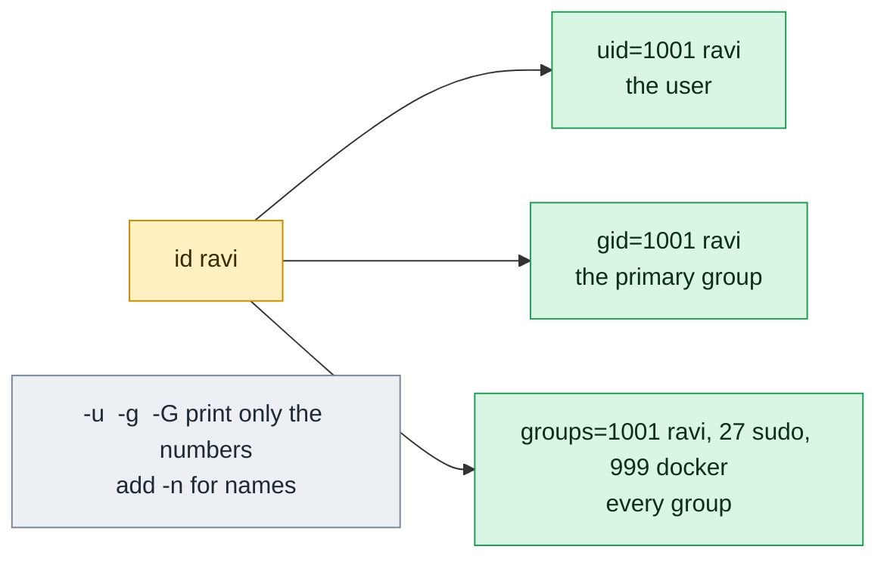

# id

## What is it?
`id` prints the **identity** of a user: the user ID (**UID**), the primary group ID (**GID**) and all the supplementary groups, with their names. Without a name, it shows the identity of the **current process** (you). It is the first command to run when you ask "who am I?", "am I `root`?" or "why do I have no access?". With options, it prints only one number or one name, which is ideal for **scripts** (for example `id -u`, to test if the script runs as `root`). It is part of GNU coreutils, and is on every distribution.

## Syntax
```bash
id [OPTIONS] [USER]...
```
Without `USER`, `id` shows the current user (the **effective** user: the one who is used for the access checks). With one or more names (or numeric IDs), it shows those users.

### The default output
```text
uid=1001(deploy) gid=1001(deploy) groups=1001(deploy),27(sudo),33(www-data),999(docker)
```
| Part | Meaning |
|------|---------|
| `uid=1001(deploy)` | The user ID and the name |
| `gid=1001(deploy)` | The primary group ID and the name (the group of new files) |
| `groups=...` | All the groups of the user, with the primary group first |
| `euid=`, `egid=` | Shown only when the effective ID is different from the real ID (for example in a setuid program) |
| `context=...` | Shown on SELinux systems |

## Visual Overview
> `id` shows the numbers behind a user: user id, primary group id and all group ids. Permissions are checked with these numbers, not with names.



## Options/Flags
| Flag | Description |
|------|-------------|
| `-u` / `--user` | Print only the user ID (the effective UID) |
| `-g` / `--group` | Print only the primary group ID (the effective GID) |
| `-G` / `--groups` | Print all the group IDs (primary and supplementary), separated by spaces |
| `-n` / `--name` | With `-u`, `-g` or `-G`: print the **name** and not the number |
| `-r` / `--real` | With `-u`, `-g` or `-G`: print the **real** ID, not the effective ID |
| `-z` / `--zero` | End the entries with a NUL character and not with a space or a newline (for scripts. Not allowed in the default format) |
| `-Z` / `--context` | Print only the security context (SELinux or AppArmor) of the process |
| `-a` | Ignored. Only for compatibility with other versions of `id` |
| `--help` | Show the help text |
| `--version` | Show the version |

### Exit status
| Code | Meaning |
|------|---------|
| `0` | Success |
| `1` | A user does not exist, or an error happened |

## Usage Examples

Let's say we are on the server `web01`. Today is `2026-10-12`. We are logged in as `deploy`. These accounts exist:

**Input file** (`/etc/passwd`):
```text
root:x:0:0:root:/root:/bin/bash
www-data:x:33:33:www-data:/var/www:/usr/sbin/nologin
deploy:x:1001:1001:Deploy User,,,:/home/deploy:/bin/bash
alice:x:1002:1002:Alice Smith,,,:/home/alice:/bin/bash
```
**Input file** (`/etc/group`):
```text
root:x:0:
sudo:x:27:deploy,alice
www-data:x:33:deploy
docker:x:999:deploy
deploy:x:1001:
alice:x:1002:
```
The user `deploy` is in the groups `sudo`, `www-data` and `docker`. `alice` is in `sudo`. Each example starts again from this state.

### Example 1: Who am I?
**Command:**
```bash
id
```
**Sample Output:**
```text
uid=1001(deploy) gid=1001(deploy) groups=1001(deploy),27(sudo),33(www-data),999(docker)
```

### Example 2: Show another user
**Command:**
```bash
id alice
```
**Sample Output:**
```text
uid=1002(alice) gid=1002(alice) groups=1002(alice),27(sudo)
```

### Example 3: Show several users at once
**Command:**
```bash
id alice www-data
```
**Sample Output:**
```text
uid=1002(alice) gid=1002(alice) groups=1002(alice),27(sudo)
uid=33(www-data) gid=33(www-data) groups=33(www-data)
```
Old versions of `id` (before coreutils 8.31) accept only one name.

### Example 4: A user by number
**Command:**
```bash
id 1002
```
**Sample Output:**
```text
uid=1002(alice) gid=1002(alice) groups=1002(alice),27(sudo)
```
If the number is not a UID, you get `id: ‘1002’: no such user`.

### Example 5: Only the user ID (`-u`)
**Command:**
```bash
id -u
id -u alice
```
**Sample Output:**
```text
1001
1002
```
The number `0` means `root`. This is how scripts test for `root`.

### Example 6: Only the primary group ID (`-g`)
**Command:**
```bash
id -g
id -g www-data
```
**Sample Output:**
```text
1001
33
```

### Example 7: All the group IDs (`-G`)
**Command:**
```bash
id -G
```
**Sample Output:**
```text
1001 27 33 999
```
The primary group comes first.

### Example 8: Names and not numbers (`-n`)
`-n` works with `-u`, `-g` and `-G`.

**Command:**
```bash
id -un
id -gn
id -Gn
```
**Sample Output:**
```text
deploy
deploy
deploy sudo www-data docker
```
`id -un` is the same as `whoami`, and `id -Gn` is the same as `groups`.

### Example 9: Real or effective ID (`-r`)
In a normal shell the real and the effective ID are the same. After `sudo`, or in a setuid program, they can differ.

**Command:**
```bash
id -u
id -ur
sudo id -u
sudo id -ur
```
**Sample Output:**
```text
1001
1001
0
0
```
With `sudo` both are `0`, because `sudo` sets the real and effective ID. A program with the setuid bit (like `passwd`) has the real UID of the caller, and the effective UID `0`: `id -u` prints `0`, and `id -ur` prints `1001`.

### Example 10: The groups of a user, as a list (`-Gn` and `tr`)
**Command:**
```bash
id -Gn deploy | tr ' ' '\n'
```
**Sample Output:**
```text
deploy
sudo
www-data
docker
```
One group in each line is easier to use with `grep` or a loop.

### Example 11: NUL separated output (`-z`)
For group names that could contain spaces (for example from Active Directory). `-z` needs one of `-u`, `-g` or `-G`.

**Command:**
```bash
id -Gnz | tr '\0' '|'
echo
```
**Sample Output:**
```text
deploy|sudo|www-data|docker|
```
In the default format `id -z` is an error: `id: option --zero not permitted in default format`.

### Example 12: The security context (`-Z`)
On SELinux systems (RHEL, Fedora). On other systems, it is not available.

**Command:**
```bash
id -Z
```
**Sample Output (RHEL with SELinux):**
```text
unconfined_u:unconfined_r:unconfined_t:s0-s0:c0.c1023
```
**Sample Output (Ubuntu without SELinux):**
```text
id: --context (-Z) works only on an SELinux-enabled kernel
```

### Example 13: Compatibility option (`-a`)
`-a` is ignored. It exists, so that scripts for other systems work.

**Command:**
```bash
id -a
```
**Sample Output:**
```text
uid=1001(deploy) gid=1001(deploy) groups=1001(deploy),27(sudo),33(www-data),999(docker)
```

### Example 14: A user who does not exist
**Command:**
```bash
id nosuchuser; echo "exit code: $?"
```
**Sample Output:**
```text
id: ‘nosuchuser’: no such user
exit code: 1
```

### Example 15: Wrong combinations
**Command:**
```bash
id -n
id -u -g
```
**Sample Output:**
```text
id: cannot print only names or real IDs in default format
id: cannot print "only" of more than one choice
```

### Example 16: Check the version (`--version`)
**Command:**
```bash
id --version | head -n 1
```
**Sample Output:**
```text
id (GNU coreutils) 8.32
```

### Example 17: Show the help (`--help`)
**Command:**
```bash
id --help | head -n 3
```
**Sample Output:**
```text
Usage: id [OPTION]... [USER]...
Print user and group information for the specified USER,
or (when USER omitted) for the current user.
```

## Pitfalls / Gotchas
- **A new group is not in the running session.** After `usermod -aG docker deploy`, the command `id` (in the old session) does not show `docker`, but `id deploy` (which reads the files) does. The user must log in again, or run `newgrp docker`. Use this difference to see why a user still has no access.
- **`id` without a name and `id NAME` read different data.** Without a name, it shows the groups of the **running process**. With a name, it reads the databases. They can differ.
- **`id -u` is the effective ID.** After `sudo` it is `0`. For the real user who started `sudo`, use `$SUDO_USER`, or `logname`, or `id -ur` in a setuid program.
- **`$UID` in `bash` is the real UID,** and is a read-only variable. `$EUID` is the effective one. In scripts, `id -u` works in all shells.
- **Names with the same number.** If two names have the same UID, `id` shows the first one in `/etc/passwd`.
- **Users from LDAP, SSSD or Active Directory** are shown, but the lookup can be slow, and the group list can be long and cut. Check with `getent`.
- **A maximum of 16 groups in old systems.** Very old NFS (version 3) servers use only 16 groups of a user. If a user with more than 16 groups loses access on NFS, this is the reason.
- **Container users.** In a container the numbers are the numbers of the user namespace. `id` can show `nobody` or only numbers for users that the image does not know (`uid=1000 gid=1000 groups=1000`, without names).
- **`-n` and `-r` need `-u`, `-g` or `-G`.** Alone they are errors.
- **`id` is not a security check.** It tells you who you are for the system. It does not say what you are allowed to do. For that use `sudo -l`, `namei -l` and `getfacl`.

## DevOps Use Cases

### Use Case 1: Make a script refuse to run as a normal user
**Situation:** A maintenance script changes the system. It must run as `root`.

**Command:**
```bash
if [ "$(id -u)" -ne 0 ]; then
  echo "ERROR: run this script as root (use sudo)" >&2
  exit 1
fi
echo "running as root"
```
**Output:**
```text
ERROR: run this script as root (use sudo)
```
With `sudo ./script.sh` it prints `running as root`.

### Use Case 2: Run a container with the files of the current user
**Situation:** A build in a container must write files that belong to you, and not to `root`. Pass your UID and GID.

**Command:**
```bash
docker run --rm -u "$(id -u):$(id -g)" -v "$PWD":/work -w /work alpine touch result.txt
ls -l result.txt
```
**Output:**
```text
-rw-r--r-- 1 deploy deploy 0 Oct 12 10:05 result.txt
```
Without `-u`, the file would belong to `root`, and you could not delete it without `sudo`.

### Use Case 3: Test if a user is in a group
**Situation:** A script must continue only when the user may use Docker.

**Command:**
```bash
if id -nG | tr ' ' '\n' | grep -qx docker; then
  echo "deploy may use docker"
else
  echo "deploy is NOT in the docker group"
fi
```
**Output:**
```text
deploy may use docker
```
`grep -qx` matches the whole line, so a group like `docker-users` does not match.

### Use Case 4: Find out why a user has no access to a file
**Situation:** `alice` gets `Permission denied` for `/srv/shared/plan.txt`. Compare her groups with the group of the file.

**Command:**
```bash
ls -l /srv/shared/plan.txt
id -Gn alice
```
**Output:**
```text
-rw-rw---- 1 root devs 40 Oct 12 10:00 /srv/shared/plan.txt
alice sudo
```
The file belongs to the group `devs`, and `alice` is not a member. Add her: `sudo usermod -aG devs alice`.

### Use Case 5: Check a service account before you start the service
**Situation:** A service must run as `www-data`, in the group `www-data` only.

**Command:**
```bash
id www-data
sudo -u www-data id -Gn
```
**Output:**
```text
uid=33(www-data) gid=33(www-data) groups=33(www-data)
www-data
```

### Use Case 6: Audit who has `root` rights
**Situation:** A security review needs all accounts with UID `0` (there should be only `root`) and the members of the group `sudo`.

**Command:**
```bash
getent passwd | awk -F: '$3==0 {print "UID 0:", $1}'
getent group sudo | cut -d: -f4
```
**Output:**
```text
UID 0: root
deploy,alice
```
A second account with UID `0` is a serious finding.

### Use Case 7: Know who you were before `sudo`
**Situation:** A script that runs with `sudo` must write the log to the home directory of the person who started it.

**Command:**
```bash
sudo bash -c 'echo "effective: $(id -un), started by: ${SUDO_USER:-unknown}"'
```
**Output:**
```text
effective: root, started by: deploy
```
`SUDO_USER` is set by `sudo`. `id -un` shows only the effective user.

### Use Case 8: Create the same UID on all hosts (a check)
**Situation:** Before you mount an NFS volume, check that the user has the same UID on all hosts.

**Command:**
```bash
for h in web01 web02 db01; do
  printf '%s: ' "$h"; ssh "$h" id -u alice
done
```
**Output:**
```text
web01: 1002
web02: 1002
db01: 1005
```
`db01` has another UID, so the files of `alice` will show the wrong owner. Fix it with `usermod -u` and `chown -h`.

## Related Commands
- [`groups`](groups.md) - print only the group names of a user (like `id -Gn`)
- [`whoami`](whoami.md) - print only the user name (like `id -un`)
- [`who`](who.md) / [`w`](w.md) - who is logged in
- [`getent`](getent.md) - read the user and group databases, also from LDAP
- [`usermod`](usermod.md) - change the groups of a user
- [`gpasswd`](gpasswd.md) - add and remove group members
- [`su`](su.md) / [`sudo`](sudo.md) - change the identity, and check it with `id`
- [`chown`](../permissions/chown.md) / [`chgrp`](../permissions/chgrp.md) - change the owner and the group of files
- [`ls`](../file-management/ls.md) - `ls -ln` shows the numeric owner and group
- `logname` - the name that was used at the login
- `newgrp` - start a shell with another primary group
- `stat` - show the numeric owner of a file (`stat -c '%u %g'`)

---
<!-- nav -->
[← Previous: `whoami`](whoami.md) | [Learning path](../README.md) | [Next: `who` →](who.md)
