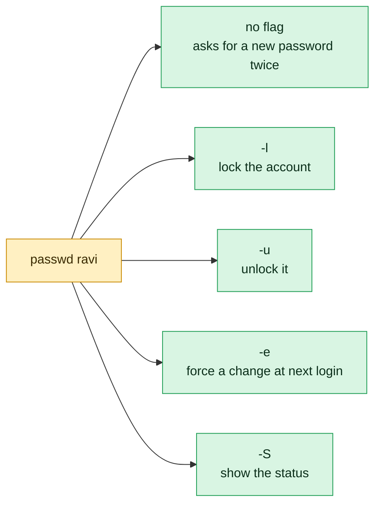

# passwd

## What is it?
`passwd` **changes the password of a user account**. A normal user changes his own password. `root` can change the password of any user, and can also **lock** and **unlock** accounts, **expire** passwords (to force a change at the next login), **delete** a password, set the **aging rules** (minimum and maximum age, warning and inactive days) and show the **status** of an account. It updates `/etc/shadow`, where the hash of the password is stored. It checks the new password with PAM (the password quality rules), so a weak password can be refused. `passwd` is part of the `shadow-utils` (Debian: `passwd`) package. The options are mostly the same on all distributions, with one important difference: `--stdin`, which exists on Red Hat only.

## Syntax
```bash
passwd [OPTIONS] [LOGIN]
```
Without `LOGIN`, `passwd` changes the password of the **current user**. With `LOGIN` you need `root` rights (or `sudo`).

### The status line of `passwd -S`
```text
alice P 2026-10-01 0 90 7 14
```
| Field | Meaning |
|-------|---------|
| 1 | The login name |
| 2 | `P` = usable password, `L` = locked, `NP` = no password |
| 3 | The date of the last password change (Debian prints `10/01/2026`, Red Hat prints `2026-10-01`) |
| 4 | The minimum age in days |
| 5 | The maximum age in days (`99999` means never) |
| 6 | The warning period in days |
| 7 | The inactivity period in days (`-1` means never) |

## Visual Overview
> `passwd` changes a password. The flags lock, unlock or expire an account without needing to know the password.



## Options/Flags

### Set and change
| Flag | Description |
|------|-------------|
| *(none)* | Change the password. A normal user must give the current password first |
| `-d` / `--delete` | **Delete** the password: the account then has an empty password (`NP`). Dangerous |
| `-e` / `--expire` | Expire the password at once. The user must choose a new one at the next login |
| `--stdin` | (Red Hat family only) Read the new password from standard input |

### Lock and unlock
| Flag | Description |
|------|-------------|
| `-l` / `--lock` | Lock the account: put a `!` in front of the hash |
| `-u` / `--unlock` | Unlock the account: remove the `!` (refused if the account would have no password) |

### Aging
| Flag | Description |
|------|-------------|
| `-n DAYS` / `--mindays` | The minimum number of days between password changes |
| `-x DAYS` / `--maxdays` | The maximum number of days that the password is valid |
| `-w DAYS` / `--warndays` | The number of days of warning before the password expires |
| `-i DAYS` / `--inactive` | The number of days after the expiry before the account is locked |

### Status and other
| Flag | Description |
|------|-------------|
| `-S` / `--status` | Show the status of the account (see the table above) |
| `-a` / `--all` | With `-S`, show the status of **all** accounts |
| `-k` / `--keep-tokens` | Change the password only if it has expired (for authentication tokens) |
| `-q` / `--quiet` | Be quiet |
| `-r REPOSITORY` / `--repository` | Change the password in this repository (`files`, `nis`...) |
| `-R CHROOT_DIR` / `--root` | Apply the change in a chroot directory |
| `-P PREFIX_DIR` / `--prefix` | Use a prefix directory for the files (newer versions) |
| `-h` / `--help` | Show the help text |

## Usage Examples

Let's say we are on the server `web01`. Today is `2026-10-12`. We have these accounts:

**Input file** (`/etc/passwd`):
```text
root:x:0:0:root:/root:/bin/bash
deploy:x:1001:1001:Deploy User,,,:/home/deploy:/bin/bash
alice:x:1002:1002:Alice Smith,,,:/home/alice:/bin/bash
bob:x:1003:1003:Bob Jones,,,:/home/bob:/bin/bash
```
**Input file** (`/etc/shadow`, the hash is shortened and only the fields that matter are shown):
```text
root:$6$...:20000:0:99999:7:::
deploy:$6$...:20727:0:99999:7:::
alice:$6$...:20727:0:90:7:14::
bob:!$6$...:20727:0:99999:7:::
```
`bob` is locked (`!` before the hash). Each example starts again from this state. The examples are written for **Ubuntu 22.04**, and the Red Hat differences are marked.

### Example 1: Change your own password
**Command:**
```bash
passwd
```
**Sample Output** (the passwords are typed by you, and are not shown):
```text
Changing password for deploy.
Current password: 
New password: 
Retype new password: 
passwd: password updated successfully
```
On RHEL: `Changing password for user deploy.` ... `passwd: all authentication tokens updated successfully.`

### Example 2: Change the password of another user (`root`)
`root` does not need the old password.

**Command:**
```bash
sudo passwd alice
```
**Sample Output:**
```text
New password: 
Retype new password: 
passwd: password updated successfully
```

### Example 3: A password that is too weak
**Command:**
```bash
passwd
```
**Sample Output:**
```text
Changing password for deploy.
Current password: 
New password: 
BAD PASSWORD: The password is shorter than 8 characters
New password: 
```
For a normal user the quality rules are binding. `root` sees the warning, but may use the weak password.

### Example 4: The two entries do not match
**Command:**
```bash
passwd
```
**Sample Output:**
```text
New password: 
Retype new password: 
Sorry, passwords do not match.
passwd: Authentication token manipulation error
passwd: password unchanged
```

### Example 5: Show the status of an account (`-S`)
**Command:**
```bash
sudo passwd -S alice
sudo passwd -S bob
```
**Sample Output:**
```text
alice P 10/01/2026 0 90 7 14
bob L 10/01/2026 0 99999 7 -1
```
`P` means a usable password. `L` means locked. On RHEL the date is `2026-10-01`, and the line has a text: `alice PS 2026-10-01 0 90 7 14 (Password set, SHA512 crypt.)`.

### Example 6: Show the status of every account (`-S -a`)
**Command:**
```bash
sudo passwd -S -a | head -n 5
```
**Sample Output:**
```text
root P 10/01/2026 0 99999 7 -1
daemon L 03/15/2026 0 99999 7 -1
www-data L 03/15/2026 0 99999 7 -1
deploy P 10/01/2026 0 99999 7 -1
alice P 10/01/2026 0 90 7 14
```
System accounts show `L`. This is how you find accounts with `NP` (no password).

### Example 7: Lock an account (`-l`)
**Command:**
```bash
sudo passwd -l alice
sudo passwd -S alice
```
**Sample Output:**
```text
passwd: password expiry information changed.
alice L 10/01/2026 0 90 7 14
```
On RHEL: `Locking password for user alice.` and `passwd: Success`. The hash gets a `!` in front. SSH keys still work.

### Example 8: Unlock an account (`-u`)
**Command:**
```bash
sudo passwd -u bob
sudo passwd -S bob
```
**Sample Output:**
```text
passwd: password expiry information changed.
bob P 10/01/2026 0 99999 7 -1
```
On RHEL: `Unlocking password for user bob.` and `passwd: Success`.

### Example 9: Unlock an account that has no password
`-u` refuses when it would leave the account **without** a password.

**Command:**
```bash
sudo useradd nopass
sudo passwd -l nopass
sudo passwd -u nopass
```
**Sample Output:**
```text
passwd: password expiry information changed.
passwd: unlocking the password would result in a passwordless account.
You should set a password with usermod -p to unlock this user's password.
```

### Example 10: Force a change at the next login (`-e`)
**Command:**
```bash
sudo passwd -e alice
sudo chage -l alice | head -n 2
```
**Sample Output:**
```text
passwd: password expiry information changed.
Last password change					: password must be changed
Password expires					: password must be changed
```
When `alice` logs in, she is asked for her old password and a new one. On RHEL: `Expiring password for user alice.` and `passwd: Success`.

### Example 11: Delete the password (`-d`)
This makes the account **passwordless**: anybody can log in without a password where PAM allows empty passwords. Avoid it.

**Command:**
```bash
sudo passwd -d alice
sudo passwd -S alice
```
**Sample Output:**
```text
passwd: password expiry information changed.
alice NP 10/01/2026 0 90 7 14
```
`NP` means "no password". To lock an account, use `-l` and not `-d`.

### Example 12: Set the maximum age of a password (`-x`)
**Command:**
```bash
sudo passwd -x 90 deploy
sudo passwd -S deploy
```
**Sample Output:**
```text
passwd: password expiry information changed.
deploy P 10/01/2026 0 90 7 -1
```
After 90 days, the user must change the password.

### Example 13: Set the minimum age (`-n`)
**Command:**
```bash
sudo passwd -n 1 deploy
sudo passwd -S deploy
```
**Sample Output:**
```text
passwd: password expiry information changed.
deploy P 10/01/2026 1 90 7 -1
```
The user cannot change the password more than once a day. This stops people from changing it several times, to get back to the old one.

### Example 14: Set the warning period (`-w`)
**Command:**
```bash
sudo passwd -w 14 deploy
sudo passwd -S deploy
```
**Sample Output:**
```text
passwd: password expiry information changed.
deploy P 10/01/2026 1 90 14 -1
```
The user gets a warning at login, 14 days before the password expires.

### Example 15: Lock the account after the expiry (`-i`)
**Command:**
```bash
sudo passwd -i 30 deploy
sudo passwd -S deploy
```
**Sample Output:**
```text
passwd: password expiry information changed.
deploy P 10/01/2026 1 90 14 30
```
30 days after the password expired, the account is locked.

### Example 16: Set the password from a script on Red Hat (`--stdin`)
`--stdin` exists on RHEL, Rocky, Alma and Fedora. It does **not** exist on Debian and Ubuntu.

**Command:**
```bash
echo 'Temp-Pass-123' | sudo passwd --stdin alice
```
**Sample Output (RHEL):**
```text
Changing password for user alice.
passwd: all authentication tokens updated successfully.
```
**Sample Output (Ubuntu):**
```text
passwd: unrecognized option '--stdin'
Usage: passwd [options] [LOGIN]
```
For code that works on both, use `echo 'alice:Temp-Pass-123' | sudo chpasswd`.

### Example 17: Change a password only if it has expired (`-k`)
Used by update tools for authentication tokens. The command changes the password only when it has already expired.

**Command:**
```bash
passwd -k
```
**Sample Output:**
```text
passwd: Authentication token manipulation error
```
Because the password of `deploy` has not expired, nothing is changed.

### Example 18: Quiet mode (`-q`)
**Command:**
```bash
sudo passwd -q -l alice
echo "exit code: $?"
```
**Sample Output:**
```text
exit code: 0
```

### Example 19: Work in a chroot (`-R`)
**Command:**
```bash
sudo passwd -R /mnt/newroot -l alice
sudo grep '^alice' /mnt/newroot/etc/shadow | cut -c1-12
```
**Sample Output:**
```text
passwd: password expiry information changed.
alice:!$6$Zt
```

### Example 20: A normal user and other users
**Command:**
```bash
passwd alice
passwd -S alice
```
**Sample Output:**
```text
passwd: You may not view or modify password information for alice.
passwd: Permission denied.
```
A normal user can only change and see his own account.

### Example 21: A user that does not exist
**Command:**
```bash
sudo passwd nosuchuser
```
**Sample Output:**
```text
passwd: user 'nosuchuser' does not exist
```

### Example 22: Show the help (`-h`)
**Command:**
```bash
passwd -h | head -n 4
```
**Sample Output:**
```text
Usage: passwd [options] [LOGIN]

Options:
  -a, --all                     report password status on all accounts
```

## Pitfalls / Gotchas
- **A locked account (`-l`) can still log in with an SSH key,** and `su` from `root`, and cron jobs still run. `passwd -l` only changes the password. To really block a user, also use `usermod -e 1 -s /usr/sbin/nologin`, and remove the keys.
- **`passwd -d` removes the password.** The account may then log in without one (on a console, or when PAM has `nullok`). It is never the right way to lock an account.
- **`--stdin` is only on Red Hat.** On Debian and Ubuntu, a script that uses it fails. Use `chpasswd` for both families.
- **Passwords on the command line are visible.** Do not put a password into an argument (`passwd`, `usermod -p`, `useradd -p`). Others can see it in `ps`, and the shell history keeps it. Use `chpasswd` with standard input, from a protected file or a secret store.
- **The expiry rules apply only to new passwords.** `passwd -x 90` sets the field, but the date of the last change decides when the password really expires. Use `chage -l` to see the exact dates.
- **`-e` (expire) does not log out users.** It applies at the next login. A user who is already logged in is asked at the next login only.
- **Quality rules are in PAM** (`pam_pwquality` or `pam_cracklib`, in `/etc/security/pwquality.conf`). They apply to normal users. `root` can override them, but `passwd` shows the warning.
- **The status line differs by distribution.** The date format (`10/01/2026` or `2026-10-01`) and the extra text (Red Hat) are different. Do not parse them without checking.
- **Service accounts normally have no password,** and are locked (`!` or `*`). Do not set a password for them. Use `sudo -u`.
- **A password change does not close existing SSH sessions.** A stolen session stays alive. End the sessions of the user (`pkill -KILL -u NAME`) when a password was leaked.
- **Changing the password of a user of LDAP or Active Directory** changes the directory password if PAM is set up for it. Otherwise it fails with `Authentication token manipulation error`.
- **`passwd` on a read-only file system fails.** Containers with a read-only root, or a full disk, give the same error. Check the free space.

## DevOps Use Cases

### Use Case 1: Force every new user to choose a password
**Situation:** Create an account with a temporary password and require a new one at the first login.

**Command:**
```bash
sudo useradd -m -s /bin/bash alice
echo 'alice:Temp-Pass-123' | sudo chpasswd
sudo passwd -e alice
sudo passwd -S alice
```
**Output:**
```text
passwd: password expiry information changed.
alice P 10/12/2026 0 99999 7 -1
```
At the first login `alice` is asked to choose a new password.

### Use Case 2: Lock a compromised account at once
**Situation:** An alert says that `deploy` is used from an unknown address. Lock the password, end the sessions and keep the data.

**Command:**
```bash
sudo passwd -l deploy
sudo pkill -KILL -u deploy
sudo passwd -S deploy
```
**Output:**
```text
passwd: password expiry information changed.
deploy L 10/01/2026 0 99999 7 -1
```
Also check the file `~/.ssh/authorized_keys` of the user, because keys still work.

### Use Case 3: A password policy for all human users
**Situation:** A company rule says: change the password every 90 days, no change twice in one day, a warning 14 days before, lock the account after 30 days. Apply it to all users with a UID of 1000 or more.

**Command:**
```bash
getent passwd | awk -F: '$3>=1000 && $3<60000 {print $1}' | while read -r u; do
  sudo passwd -n 1 -x 90 -w 14 -i 30 "$u" >/dev/null
done
sudo passwd -S deploy alice
```
**Output:**
```text
deploy P 10/01/2026 1 90 14 30
alice P 10/01/2026 1 90 14 30
```
Set the defaults for **new** users in `/etc/login.defs` (`PASS_MAX_DAYS`, `PASS_MIN_DAYS`, `PASS_WARN_AGE`).

### Use Case 4: Audit: accounts without a password
**Situation:** A security check asks for accounts that have an empty password, and can log in without it.

**Command:**
```bash
sudo passwd -S -a | awk '$2=="NP"'
sudo awk -F: '($2=="") {print $1" has an empty password"}' /etc/shadow
```
**Output:**
```text
tempuser has an empty password
```
Fix it with `sudo passwd -l tempuser`, or set a password.

### Use Case 5: List all the locked human accounts
**Situation:** Find the real users whose password is locked, for a report.

**Command:**
```bash
getent passwd | awk -F: '$3>=1000 && $3<60000 {print $1}' | while read -r u; do
  sudo passwd -S "$u"
done | awk '$2=="L"'
```
**Output:**
```text
bob L 10/01/2026 0 99999 7 -1
```

### Use Case 6: Rotate a service password from a script
**Situation:** A service user on a Red Hat system has a password for a legacy tool. Rotate it every month, and store the new one in a secret file (mode `600`).

**Command:**
```bash
newpass=$(openssl rand -base64 18)
echo "$newpass" | sudo passwd --stdin legacyapp
sudo install -m 600 /dev/null /root/legacyapp.pass
echo "$newpass" | sudo tee /root/legacyapp.pass >/dev/null
```
**Output (RHEL):**
```text
Changing password for user legacyapp.
passwd: all authentication tokens updated successfully.
```
For Debian and Ubuntu write `echo "legacyapp:$newpass" | sudo chpasswd`.

### Use Case 7: A fresh server: set the root password in a first-boot script
**Situation:** An image builder (for example `cloud-init` or Packer) sets the password of `root`, or disables it.

**Input file** (`user-data`, for `cloud-init`):
```text
#cloud-config
chpasswd:
  expire: true
  users:
    - {name: deploy, password: "Temp-Pass-123", type: text}
```
**Command:**
```bash
sudo cloud-init status --long | head -n 2
sudo passwd -S deploy
```
**Output:**
```text
status: done
deploy P 10/12/2026 0 99999 7 -1
```
`cloud-init` uses `chpasswd` internally. `expire: true` has the same effect as `passwd -e`.

### Use Case 8: Disable password login for a user, and use SSH keys only
**Situation:** The policy says: administrators log in with SSH keys. Lock the password, and keep the account usable.

**Command:**
```bash
sudo passwd -l alice
sudo grep -E '^(PasswordAuthentication|PubkeyAuthentication)' /etc/ssh/sshd_config
```
**Output:**
```text
PasswordAuthentication no
PubkeyAuthentication yes
```
With `PasswordAuthentication no` in `sshd_config`, the password is not used for SSH at all. The lock still matters for console, `su` and other PAM services.

## Related Commands
- [`chage`](chage.md) - see and set the aging dates in detail (`chage -l`, `-d`, `-E`)
- [`chpasswd`](chpasswd.md) - set many passwords from standard input, on every distribution
- [`usermod`](usermod.md) - `usermod -L` and `-U` lock and unlock, `-e` sets the account expiry
- [`useradd`](useradd.md) - create the account (no password until you run `passwd`)
- [`adduser`](adduser.md) - on Debian, asks for the password at the creation
- [`userdel`](userdel.md) - remove the account
- [`su`](su.md) / [`sudo`](sudo.md) - switch user, and use the password of the user
- [`who`](who.md) / [`last`](last.md) - see the logins of the user
- [`getent`](getent.md) - read `shadow` for the hash fields (`getent shadow NAME`)
- `/etc/login.defs` - the default aging values for new users
- `/etc/security/pwquality.conf` - the password quality rules
- `faillock` / `pam_tally2` - lock an account after failed logins
