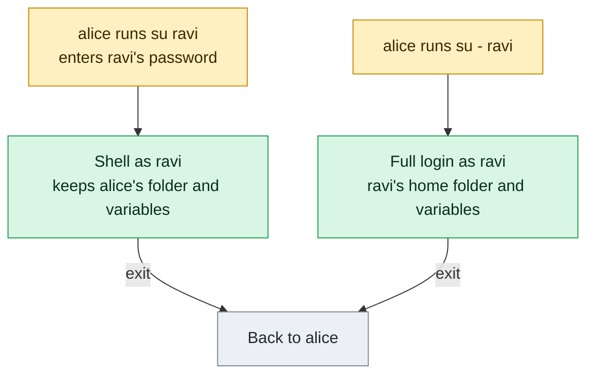

# su

## What is it?
`su` (substitute user, or switch user) starts a **shell, or a command, as another user**. Without a name, it means `root`. It asks for the **password of the target user**: `su` to `root` needs the password of `root`. This is the main difference from `sudo`, which asks for **your own** password and uses the rules of `sudoers`. `su` has two modes: `su USER` starts a shell with **most of your environment kept**, and `su - USER` (with the dash) starts a full **login shell** as the other user, with a clean environment, the home directory of the user and the user's start files (`.profile`, `.bash_profile`). It is part of the `util-linux` package (on some systems the `shadow` package), on every distribution.

> **On Ubuntu and Debian, `root` has no password by default,** so `su -` fails with `Authentication failure`. Use `sudo su -`, or better `sudo -i`, which asks for **your** password.

## Syntax
```bash
su [OPTIONS] [-] [USER [ARGUMENT]...]
su -                       # login shell of root
su - alice                 # login shell of alice
su -c 'COMMAND' USER       # run one command as USER
```
Without `USER`, the target is `root`. The dash `-` is the same as `-l` or `--login`, and must come **before** the user name.

### `su USER` and `su - USER`
| | `su alice` | `su - alice` (or `su -l alice`) |
|-|------------|---------------------------------|
| Type | A shell that is **not** a login shell | A **login shell** |
| Environment | Most variables of the old user are kept (`PATH`, your own variables...). Only `HOME`, `SHELL`, `USER` and `LOGNAME` are set for the new user | **Cleared**, then `HOME`, `SHELL`, `USER`, `LOGNAME` and `PATH` are set for the new user |
| Directory | The **current directory** stays | The **home directory** of the new user |
| Start files | `.bashrc` of the new user | `.profile` / `.bash_profile` of the new user, then `.bashrc` |
| Use it for | A quick check, when you want to stay in the directory | A clean, "real" session as that user. This is what you almost always want |

## Visual Overview
> `su` starts a shell as another user. The dash decides whether you get a clean login environment or keep your own.



## Options/Flags
| Flag | Description |
|------|-------------|
| `-` / `-l` / `--login` | Start a **login shell**: clean environment, home directory, the start files of the user |
| `-c COMMAND` / `--command COMMAND` | Run `COMMAND` with the shell of the user (`shell -c COMMAND`), and then return |
| `-s SHELL` / `--shell SHELL` | Use this shell. For a normal caller it must be listed in `/etc/shells`, and the shell of the target must not be restricted |
| `-m` / `-p` / `--preserve-environment` | Keep the whole environment. Do not set `HOME`, `SHELL`, `USER`, `LOGNAME`. Not allowed with `-` |
| `-g GROUP` / `--group GROUP` | Set the **primary group** (only `root` may use it) |
| `-G GROUP` / `--supp-group GROUP` | Add a **supplementary group** (only `root`; needs `-g`) |
| `-P` / `--pty` | Create a pseudo terminal for the session (protects against the `TIOCSTI` terminal attack when you run `-c`) |
| `-w LIST` / `--whitelist-environment LIST` | With `-m`, keep only the variables in the comma list. Others are removed |
| `-C COMMAND` / `--session-command COMMAND` | Like `-c`, but does not create a new session (the command can read the terminal; unsafe) |
| `-V` / `--version` | Show the version |
| `-h` / `--help` | Show the help text |

### Exit status
| Code | Meaning |
|------|---------|
| `0` | The shell or the command ended with success |
| `1` | `su` failed (a wrong password) |
| `125` / `126` / `127` | `su` itself failed, the command could not be started, the command was not found |
| Other | The exit code of the shell or the command |

## Usage Examples

Let's say we are on **Ubuntu 22.04** on the server `web01`. Today is `2026-10-12`. We are logged in as `deploy`, and our current directory is `/srv/myapp`. These accounts exist:

**Input file** (`/etc/passwd`):
```text
root:x:0:0:root:/root:/bin/bash
www-data:x:33:33:www-data:/var/www:/usr/sbin/nologin
deploy:x:1001:1001:Deploy User,,,:/home/deploy:/bin/bash
alice:x:1002:1002:Alice Smith,,,:/home/alice:/bin/bash
backup:x:998:998:Backup:/var/backups:/usr/sbin/nologin
```
`alice` has a password. `root` has **no** password on this Ubuntu system, as usual. `deploy` can use `sudo`. Each example starts again from this state.

### Example 1: Become another user (`su USER`)
**Command:**
```bash
su alice
pwd
id -un
echo "$HOME"
exit
```
**Sample Output:**
```text
Password: 
alice@web01:/srv/myapp$ 
/srv/myapp
alice
/home/alice
```
You give the password of `alice`. You stay in `/srv/myapp` (the current directory does not change), and `HOME` is set to the home of `alice`. Other variables, like `PATH` and your own ones, are kept. `exit` returns to `deploy`.

### Example 2: A clean login shell (`su -`)
**Command:**
```bash
su - alice
pwd
echo "$HOME"
exit
```
**Sample Output:**
```text
Password: 
alice@web01:~$ 
/home/alice
/home/alice
```
The login shell starts in the **home directory** of `alice`, with her own environment. This is almost always what you want. `su -l alice` and `su --login alice` are the same.

### Example 3: Become `root` (on a system where `root` has a password)
**Command:**
```bash
su -
id -un
exit
```
**Sample Output (RHEL, where `root` has a password):**
```text
Password: 
[root@web01 ~]# 
root
```
On **Ubuntu**, where `root` has no password, `su -` answers `su: Authentication failure`. See the next example.

### Example 4: `root` has no password (Ubuntu and Debian)
**Command:**
```bash
su -
sudo su -
sudo -i
```
**Sample Output:**
```text
Password: 
su: Authentication failure
root@web01:~# 
```
The first command fails. `sudo su -` asks for the password of `deploy` (not `root`), and gives a root login shell. `sudo -i` does the same without an extra program, and is the better choice.

### Example 5: Run one command as another user (`-c`)
**Command:**
```bash
su - alice -c 'id; pwd'
```
**Sample Output:**
```text
Password: 
uid=1002(alice) gid=1002(alice) groups=1002(alice)
/home/alice
```
The command runs in a login shell of `alice` (because of `-`), and then you are back. Put the whole command in quotes.

### Example 6: Run one command, with the old environment
**Command:**
```bash
su alice -c 'pwd'
```
**Sample Output:**
```text
Password: 
/srv/myapp
```
Without the dash the current directory stays.

### Example 7: A user with a `nologin` shell
**Command:**
```bash
sudo su - backup
sudo su backup -c 'whoami'
```
**Sample Output:**
```text
This account is currently not available.
This account is currently not available.
```
`su` uses the **shell of the user**, which is `nologin`. To run a command as a service account, use `sudo -u backup COMMAND`, or give a shell with `-s`.

### Example 8: Use another shell (`-s`)
**Command:**
```bash
sudo su -s /bin/bash backup -c 'whoami; echo $HOME'
```
**Sample Output:**
```text
backup
/var/backups
```
`-s /bin/bash` replaces the `nologin` shell for this one call. For a normal user, the shell must be listed in `/etc/shells`. `root` may use any shell. This is how admins "become" a service account to debug it.

### Example 9: Keep the whole environment (`-m` and `-p`)
As `root`, so that no password is asked. `-m` keeps `HOME`, `SHELL`, `USER` and `LOGNAME` of the caller too.

**Command:**
```bash
sudo -i
export MYVAR=hello
su -m alice -c 'echo "$MYVAR $HOME $USER"'
su alice -c 'echo "$MYVAR $HOME $USER"'
```
**Sample Output:**
```text
hello /root root
hello /home/alice alice
```
With `-m`, nothing is changed: `HOME` is `/root` and `USER` is still `root`. Without `-m`, `HOME` and `USER` are set for `alice`, and `MYVAR` is still kept. `-p` is the same as `-m`. With the dash, `-m` is not allowed.

### Example 10: Keep only some variables (`-w`)
**Command:**
```bash
sudo -i
export KEEP_ME=1 DROP_ME=2
su -m -w KEEP_ME alice -c 'echo "KEEP_ME=$KEEP_ME DROP_ME=$DROP_ME"'
```
**Sample Output:**
```text
KEEP_ME=1 DROP_ME=
```
`-w` (in util-linux 2.37 and later) works with `-m`. It is a good protection against variables that change the behavior of programs (`LD_PRELOAD`, `PATH`).

### Example 11: Set the group (`-g` and `-G`)
Only `root` may use these options.

**Command:**
```bash
sudo su -g www-data alice -c 'id'
sudo su -g www-data -G docker alice -c 'id'
```
**Sample Output:**
```text
uid=1002(alice) gid=33(www-data) groups=33(www-data),1002(alice)
uid=1002(alice) gid=33(www-data) groups=33(www-data),999(docker),1002(alice)
```
Files that `alice` creates in this session have the group `www-data`.

### Example 12: A pseudo terminal for `-c` (`-P`)
`-P` runs the command in a new terminal. It protects against a terminal injection attack. It is used when you run a command of a lower privileged user from a script as `root`.

**Command:**
```bash
sudo su -P alice -c 'tty'
```
**Sample Output:**
```text
/dev/pts/2
```
Without `-P`, the command shares the terminal of the caller (`/dev/pts/0`).

### Example 13: A session command (`-C`)
`-C` (`--session-command`) runs the command **in the same session**, which lets it read the terminal. `-c` creates a new session, and a program like `vim` that needs the terminal can fail. It is less safe than `-c`.

**Command:**
```bash
sudo su -C 'whoami' alice
```
**Sample Output:**
```text
alice
```

### Example 14: A wrong password
**Command:**
```bash
su - alice
```
**Sample Output:**
```text
Password: 
su: Authentication failure
```
A second try is possible only after you start the command again. After several failed attempts, the delay (a few seconds) grows, and the failures are logged in `/var/log/auth.log` (Debian) or `/var/log/secure` (RHEL).

### Example 15: A user that does not exist
**Command:**
```bash
su - nosuchuser
```
**Sample Output:**
```text
su: user nosuchuser does not exist or the user entry does not contain all the required fields
```
Older versions print `su: user nosuchuser does not exist`.

### Example 16: The home directory is missing
**Command:**
```bash
sudo su - newuser
```
**Sample Output:**
```text
su: warning: cannot change directory to /home/newuser: No such file or directory
$ 
```
You get a shell, but in `/` (or the current directory). This happens with a user that was created with `useradd` and no `-m`.

### Example 17: `su` is limited to a group (the `wheel` rule)
On many systems, `pam_wheel` in `/etc/pam.d/su` allows `su` only for members of the group `wheel` (or `sudo`).

**Command:**
```bash
su - alice
```
**Sample Output (when the line `auth required pam_wheel.so` is active, and the caller is not in the group):**
```text
su: Permission denied
```
It is a good hardening step: only administrators may use `su` at all.

### Example 18: Use `su` as `root` (no password)
`root` can become any user without a password.

**Command:**
```bash
sudo -i
su - alice
id -un
exit
exit
```
**Sample Output:**
```text
root@web01:~# 
alice@web01:~$ 
alice
```

### Example 19: Show who you are, and how you got there
**Command:**
```bash
su - alice
whoami
logname
echo "$0"
ps -o pid,ppid,user,cmd -p $$ -p $PPID
exit
```
**Sample Output:**
```text
Password: 
alice
deploy
-bash
    PID    PPID USER     CMD
   4421    4410 alice    -bash
   4410    2302 deploy   su - alice
```
`whoami` shows the new user. `logname` still shows who logged in (`deploy`). The leading `-` of `-bash` marks a login shell.

### Example 20: Check the version (`-V`)
**Command:**
```bash
su -V
```
**Sample Output:**
```text
su from util-linux 2.37.2
```

### Example 21: Show the help (`-h`)
**Command:**
```bash
su -h | head -n 4
```
**Sample Output:**
```text

Usage:
 su [options] [-] [<user> [<argument>...]]

```

## Pitfalls / Gotchas
- **Always use the dash: `su - USER`.** Without it you carry your own environment (`PATH`, `HOME`, variables) into the other account. This causes errors that are hard to see, such as files that are created in your directory, but owned by the other user, or commands that are found in your `PATH`, but not in his.
- **`su` asks for the password of the target, `sudo` asks for yours.** Sharing the `root` password between people is bad practice. `sudo` gives a log of who did what. On Ubuntu `root` has no password, so `su` to `root` does not work by design.
- **`sudo su -` is wasteful.** `sudo -i` does the same with a cleaner log, and `sudo -u USER -i` replaces `su - USER` (with your own password, if you are allowed in `sudoers`).
- **`su -c` takes one string.** `su - alice -c 'cd /srv && ls'` works. Without the quotes, `su` passes only the first word. Check the quotes of variables, because the **calling** shell expands the double-quoted ones before `su` starts.
- **A `nologin` user cannot be reached with `su`,** unless you give `-s`. This is by design.
- **`su -c` inside a script that runs as `root`** can be a security problem (`TIOCSTI` terminal injection) if the other user is untrusted. Add `-P` (util-linux 2.38+) or use `runuser`, `sudo -u` or `setpriv`.
- **`su` leaves a shell open.** In scripts do not use an interactive `su` without `-c`, or the script waits for input for ever.
- **Environment leaks with `-m`.** Variables such as `LD_PRELOAD`, `PATH`, `BASH_ENV` of an unsafe caller are carried over. Use `-w` with a short list.
- **The password prompt is on the terminal,** so `su` does not work well in cron or in a pipe. A `root` script should use `runuser -u USER -- COMMAND` or `sudo -u`.
- **Failed logins are logged.** Many wrong passwords cause an `faillock` (RHEL) or `pam_tally2` lock in some setups. The account may be locked afterwards.
- **`su` from a limited account to `root` may be forbidden** by `pam_wheel`. Check `/etc/pam.d/su`, and the group `wheel` or `sudo`.
- **`su` and `systemd`:** a `su` session is not a login session. `loginctl` does not show it as an own session, and `systemd-run --user` may not work. For a full session with `systemd` use `machinectl shell USER@` or a new SSH login.
- **Some versions differ.** The options `-g`, `-G`, `-w`, `-P` and `-C` are from `util-linux`. Debian's `su` before bookworm was from `shadow` and did not have them. BusyBox `su` (Alpine) has only `-`, `-c`, `-s` and `-m`.

## DevOps Use Cases

### Use Case 1: Debug a service account in a clean environment
**Situation:** The service `myapp` runs as the user `myapp` (shell `nologin`). A job fails only for this user. Start a shell as this user to test the command.

**Command:**
```bash
sudo su -s /bin/bash - myapp
id
pwd
```
**Output:**
```text
myapp@web01:~$ 
uid=998(myapp) gid=998(myapp) groups=998(myapp)
/var/lib/myapp
```
`sudo -u myapp -s` or `sudo -u myapp bash -l` do the same.

### Use Case 2: Run a database command as the database user
**Situation:** The command `psql` must run as `postgres`, which uses peer authentication.

**Command:**
```bash
sudo su - postgres -c 'psql -c "SELECT version();"' | head -n 3
```
**Output:**
```text
                                version
------------------------------------------------------------------------
 PostgreSQL 14.13 (Ubuntu 14.13-0ubuntu0.22.04.1) on x86_64-pc-linux-gnu
```
The shorter and more common way: `sudo -u postgres psql -c '...'`.

### Use Case 3: Test the access rights of a user without logging in as them
**Situation:** A user complains that he cannot read `/srv/shared/plan.txt`. Check as the user.

**Command:**
```bash
sudo su - alice -c 'cat /srv/shared/plan.txt'
sudo su - alice -c 'id -Gn'
```
**Output:**
```text
cat: /srv/shared/plan.txt: Permission denied
alice sudo
```
`alice` is not in the group of the file. Add her with `usermod -aG`.

### Use Case 4: Run a script as a limited user from a root script (safe way)
**Situation:** A root script must start the web application as `www-data`. Use `runuser`, which does not ask a password and does not use a new session in the wrong way.

**Command:**
```bash
runuser -u www-data -- /usr/local/bin/app --check
su -s /bin/sh -P www-data -c '/usr/local/bin/app --check'
```
**Output:**
```text
config OK
config OK
```
`runuser` is the right tool for scripts that already run as `root` (it comes with `util-linux`). `su -P` works too.

### Use Case 5: Become `root` safely on a server with `sudo`
**Situation:** You need a root shell for a maintenance job. Use `sudo -i`, and leave it afterwards.

**Command:**
```bash
sudo -i
whoami
pwd
exit
```
**Output:**
```text
root@web01:~# 
root
/root
```
The command `sudo` writes who did it to the log (`/var/log/auth.log`). With `su -`, the log only says that `su` was used.

### Use Case 6: Start a build as the CI user with its environment
**Situation:** A build must run in the login environment of the user `ci` (so `PATH` and `JAVA_HOME` are right).

**Command:**
```bash
sudo su - ci -c 'cd /srv/build && ./gradlew build -q && echo build ok'
```
**Output:**
```text
build ok
```
With `su - ci`, the file `/home/ci/.profile` sets `JAVA_HOME` and `PATH`.

### Use Case 7: Check the su logs after a security alert
**Situation:** Who used `su`, to which user, and did it fail?

**Command:**
```bash
sudo grep -E 'su(\[[0-9]+\])?:' /var/log/auth.log | tail -n 4
```
**Output:**
```text
Oct 12 10:01:12 web01 su[4410]: (to alice) deploy on pts/0
Oct 12 10:01:12 web01 su[4410]: pam_unix(su-l:session): session opened for user alice(uid=1002) by deploy(uid=1001)
Oct 12 10:03:40 web01 su[4455]: pam_unix(su:auth): authentication failure; logname=deploy uid=1001 euid=0 tty=/dev/pts/0 ruser=deploy rhost=  user=root
Oct 12 10:03:42 web01 su[4455]: FAILED SU (to root) deploy on pts/0
```
On Red Hat the file is `/var/log/secure`.

### Use Case 8: Limit `su` to administrators
**Situation:** Only members of the group `sudo` may use `su`. Turn on `pam_wheel` in the PAM file.

**Input file** (`/etc/pam.d/su`, the line is changed):
```text
auth       required   pam_wheel.so group=sudo
```
**Command:**
```bash
grep -n pam_wheel /etc/pam.d/su
sudo -u bob su -
```
**Output:**
```text
13:auth       required   pam_wheel.so group=sudo
su: Permission denied
```
`bob` is not in the group `sudo`, so he cannot use `su`.

## Related Commands
- [`sudo`](sudo.md) - run a command as another user with **your** password, and log it
- [`visudo`](visudo.md) - edit the `sudoers` rules safely
- [`id`](id.md) / [`whoami`](whoami.md) - check who you are after `su`
- [`who`](who.md) / [`w`](w.md) - see who is logged in
- [`passwd`](passwd.md) - set the password that `su` asks for
- [`usermod`](usermod.md) - set a shell (`usermod -s`) or lock the account
- [`chsh`](chsh.md) - the login shell that `su` uses
- [`getent`](getent.md) - read the user entry (home directory, shell)
- `runuser` - like `su`, for root scripts, with no password and no PAM session
- `login` - start a new login session as a user
- `newgrp` - start a shell with another primary group
- `machinectl shell` / `systemd-run` - a full systemd session as another user
