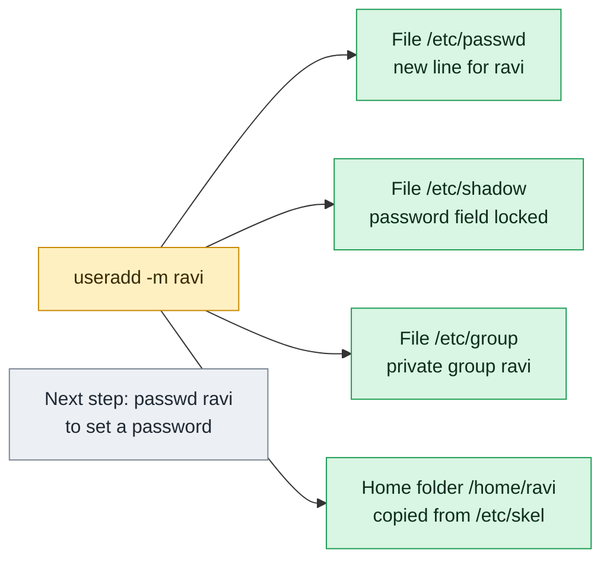

# useradd

## What is it?
`useradd` creates a new **user account**. It adds a line to `/etc/passwd` (the user database), a line to `/etc/shadow` (the password data) and, by default, a private group in `/etc/group`. It can also create the home directory and fill it with the files of `/etc/skel`. It is a **low level** program from the `shadow-utils` (`shadow`) package. It is **not interactive**, so it is the right tool for scripts, Ansible, Dockerfiles and cloud-init. A new account made with `useradd` has **no password**, so nobody can log in with a password until you run `passwd`.

### `useradd` and `adduser`: the difference, and when to use which
There are two commands with almost the same name, and they behave **differently** depending on the Linux family.

| | `useradd` | `adduser` |
|-|-----------|-----------|
| What it is | The low level program of the `shadow` package | **Debian, Ubuntu:** a friendly **Perl script** (package `adduser`) that calls `useradd`. **RHEL, CentOS, Rocky, AlmaLinux, Fedora, openSUSE:** a plain **symbolic link to `useradd`**, so it is exactly the same command |
| Same on all distributions? | Yes, but the **defaults** are different (see below) | **No.** The behavior is different on Debian and on Red Hat |
| Interactive? | No. It never asks anything | On Debian: yes. It asks for a password and the full name |
| Home directory | **Debian, Ubuntu:** **not created** unless you use `-m`. **RHEL family:** created by default (`CREATE_HOME yes` in `/etc/login.defs`) | **Debian, Ubuntu:** always created, with the files of `/etc/skel` |
| Password | None is set. The account is locked until `passwd` | **Debian:** asks for it (or `--disabled-password`) |
| Default login shell | **Debian, Ubuntu:** `/bin/sh` (a known trap). **RHEL family:** `/bin/bash` | **Debian:** `/bin/bash` (`DSHELL` in `/etc/adduser.conf`) |
| Home directory mode | Mode from `UMASK`/`HOME_MODE` in `/etc/login.defs` (RHEL: `700`, Debian: `755` or by `UMASK`) | `DIR_MODE` in `/etc/adduser.conf` (`755` on Ubuntu 22.04, `700` on Debian 12) |
| Creates a private group | Yes, if `USERGROUPS_ENAB yes` (the default) | Yes, a group with the same name (`USERGROUPS=yes`) |
| Messages | Silent when it works | Prints each step |
| Config files | `/etc/default/useradd`, `/etc/login.defs` | `/etc/adduser.conf` (and `useradd` underneath) |
| Can also make groups / add a user to a group | No (use `groupadd`, `usermod`) | Yes: `adduser --group`, `adduser USER GROUP` |
| Good for | **Scripts, automation, containers,** and when you must be **exact and portable** | **Humans** on Debian and Ubuntu who create a normal user at the prompt |

**When to use which:**
- **In a script, in Ansible, Docker, Terraform or cloud-init, use `useradd`** on every distribution. It is the same everywhere, never asks a question, and its options are the same. Always write the options that you need (`-m`, `-s /bin/bash`, `-G ...`), and do not rely on the defaults.
- **At the keyboard on Debian or Ubuntu, `adduser` is easier.** It creates the home directory, sets a good shell, asks for the password and the name.
- **On RHEL, Rocky, Alma, CentOS or Fedora, `adduser` and `useradd` are the same command.** There is no interactive mode. You must run `sudo passwd NAME` afterwards.
- **For portable documentation, write `useradd -m -s /bin/bash NAME`.** It works the same on both families.

## Syntax
```bash
useradd [OPTIONS] LOGIN
useradd -D [OPTIONS]            # show or change the defaults
```
`LOGIN` is the user name. It must start with a lower case letter or `_`, may contain lower case letters, digits, `_` and `-`, and should be at most 32 characters long.

## Visual Overview
> `useradd` is the low-level tool that creates an account. With `-m` it creates these four things. Without `-m` it creates no home folder.



## Options/Flags

### Account data
| Flag | Description |
|------|-------------|
| `-c COMMENT` / `--comment` | The comment (GECOS) field: usually the full name |
| `-d HOME_DIR` / `--home-dir` | The home directory (default: `BASE_DIR/LOGIN`) |
| `-m` / `--create-home` | Create the home directory and copy `/etc/skel` |
| `-M` / `--no-create-home` | Do **not** create the home directory (even if `CREATE_HOME` is `yes`) |
| `-k SKEL_DIR` / `--skel` | Copy the start files from this directory (needs `-m`) |
| `-b BASE_DIR` / `--base-dir` | The base directory of the home directories (default `/home`) |
| `-s SHELL` / `--shell` | The login shell |
| `-u UID` / `--uid` | The user ID. Must be unique, unless `-o` is used |
| `-o` / `--non-unique` | Allow a UID that is already in use (with `-u`) |
| `-r` / `--system` | Create a **system account** (low UID, no home, no aging) for a service |
| `-l` / `--no-log-init` | Do not add the user to the `lastlog` and `faillog` files (useful for a very high UID) |

### Groups
| Flag | Description |
|------|-------------|
| `-g GROUP` / `--gid` | The **primary** group (name or GID). It must exist |
| `-G GROUP,...` / `--groups` | The **supplementary** groups, separated by commas, without spaces |
| `-N` / `--no-user-group` | Do not create a private group with the name of the user. The group is `GROUP` from `useradd -D` (usually `users`, GID 100) |
| `-U` / `--user-group` | Create a private group with the name of the user (the default) |

### Password and expiry
| Flag | Description |
|------|-------------|
| `-p PASSWORD` / `--password` | The **encrypted** password (a hash from `openssl passwd -6`), **not** plain text |
| `-e YYYY-MM-DD` / `--expiredate` | The date when the account is disabled |
| `-f DAYS` / `--inactive` | Days after the password expired before the account is locked (`0` immediately, `-1` never) |

### Other
| Flag | Description |
|------|-------------|
| `-D` / `--defaults` | Show the defaults. With `-b`, `-g`, `-s`, `-e`, `-f`, change them in `/etc/default/useradd` |
| `-K KEY=VALUE` / `--key` | Overwrite a setting of `/etc/login.defs` for this one call (`UID_MIN`, `UID_MAX`, `UMASK`...) |
| `-R CHROOT_DIR` / `--root` | Apply the changes in a chroot directory (for images and installers) |
| `-P PREFIX_DIR` / `--prefix` | Use a prefix directory for the files (newer versions) |
| `-Z SELINUX_USER` / `--selinux-user` | The SELinux user of the new login |
| `--selinux-range RANGE` | The SELinux MLS range of the new login |
| `--btrfs-subvolume-home` | Create the home as a Btrfs subvolume |
| `-h` / `--help` | Show the help text |

### The defaults of `useradd` by distribution
| Setting | Ubuntu / Debian | RHEL / Rocky / Alma / Fedora |
|---------|-----------------|------------------------------|
| `useradd -D` shell | `/bin/sh` | `/bin/bash` |
| Home created without `-m`? | **No** (`CREATE_HOME` is not set) | **Yes** (`CREATE_HOME yes`) |
| Mail spool (`CREATE_MAIL_SPOOL`) | `no` | `yes` |
| Normal users start at UID | `1000` | `1000` |
| System accounts (`-r`) UID range | `100` to `999` | `201` to `999` |
| Private group per user | Yes | Yes |

## Usage Examples

Let's say we are on the server `web01` and work as `root` (or with `sudo`). Today is `2026-10-12`. These are the accounts that exist now:

**Input file** (`/etc/passwd`):
```text
root:x:0:0:root:/root:/bin/bash
www-data:x:33:33:www-data:/var/www:/usr/sbin/nologin
deploy:x:1001:1001:Deploy User,,,:/home/deploy:/bin/bash
```
**Input file** (`/etc/group`):
```text
root:x:0:
sudo:x:27:deploy
www-data:x:33:
docker:x:999:deploy
devs:x:1004:
deploy:x:1001:
```
The next free UID is `1002`. The examples are written for **Ubuntu 22.04**, and the differences for the Red Hat family are shown where they matter. Each example starts again from this state.

### Example 1: The simplest form
**Command:**
```bash
sudo useradd alice
grep alice /etc/passwd /etc/group
ls -ld /home/alice
```
**Sample Output:**
```text
/etc/passwd:alice:x:1002:1002::/home/alice:/bin/sh
/etc/group:alice:x:1002:
ls: cannot access '/home/alice': No such file or directory
```
On **Ubuntu or Debian** the user has the shell `/bin/sh`, and **no home directory**. On **RHEL** the same command creates `/home/alice` and gives the shell `/bin/bash`. The account has no password yet.

### Example 2: A normal user for a person (`-m` and `-s`)
**Command:**
```bash
sudo useradd -m -s /bin/bash alice
grep alice /etc/passwd
ls -ld /home/alice
```
**Sample Output:**
```text
alice:x:1002:1002::/home/alice:/bin/bash
drwxr-x--- 2 alice alice 4096 Oct 12 10:05 /home/alice
```
`-m` creates the home directory, `-s` sets the shell. This command is the same on every distribution. (The home mode is `750` on Ubuntu 22.04 with `HOME_MODE`, or `700` on RHEL.)

### Example 3: Set the full name (`-c`)
**Command:**
```bash
sudo useradd -m -s /bin/bash -c "Alice Smith" alice
getent passwd alice
```
**Sample Output:**
```text
alice:x:1002:1002:Alice Smith:/home/alice:/bin/bash
```

### Example 4: Choose the home directory (`-d`)
**Command:**
```bash
sudo useradd -m -d /srv/alice -s /bin/bash alice
getent passwd alice
```
**Sample Output:**
```text
alice:x:1002:1002::/srv/alice:/bin/bash
```
The directory `/srv/alice` is created. Without `-m`, `-d` only writes the name into `/etc/passwd`.

### Example 5: Change the base directory (`-b`)
**Command:**
```bash
sudo useradd -m -b /data/homes -s /bin/bash alice
getent passwd alice
```
**Sample Output:**
```text
alice:x:1002:1002::/data/homes/alice:/bin/bash
```
`-b` is the parent directory. `-d` is the whole path.

### Example 6: Choose the UID (`-u`)
**Command:**
```bash
sudo useradd -m -u 2000 -s /bin/bash alice
id alice
```
**Sample Output:**
```text
uid=2000(alice) gid=2000(alice) groups=2000(alice)
```
Use a fixed UID when files on shared storage (NFS) or in a container volume must have the same owner on all servers.

### Example 7: A UID that is already used (`-o`)
**Command:**
```bash
sudo useradd -u 1001 alice
sudo useradd -o -u 1001 alice
```
**Sample Output:**
```text
useradd: UID 1001 is not unique
```
The first command fails. With `-o`, the second command works, and `alice` shares the UID of `deploy`. That is almost never a good idea.

### Example 8: Put the user in supplementary groups (`-G`)
**Command:**
```bash
sudo useradd -m -s /bin/bash -G sudo,devs,docker alice
id alice
```
**Sample Output:**
```text
uid=1002(alice) gid=1002(alice) groups=1002(alice),27(sudo),999(docker),1004(devs)
```
The groups must exist, and are separated by commas **without spaces**. On RHEL, the administrators' group is `wheel`, not `sudo`.

### Example 9: Choose the primary group (`-g`)
**Command:**
```bash
sudo useradd -m -s /bin/bash -g devs alice
id alice
ls -ld /home/alice
```
**Sample Output:**
```text
uid=1002(alice) gid=1004(devs) groups=1004(devs)
drwxr-x--- 2 alice devs 4096 Oct 12 10:05 /home/alice
```
No private group `alice` was made, because a group was given.

### Example 10: Do not create a private group (`-N`)
**Command:**
```bash
sudo useradd -N -m -s /bin/bash alice
id alice
```
**Sample Output:**
```text
uid=1002(alice) gid=100(users) groups=100(users)
```
The primary group is the default group from `useradd -D` (here `users`, GID `100`).

### Example 11: Create a private group explicitly (`-U`)
This is the default on all modern systems. It matters if `USERGROUPS_ENAB` was turned off.

**Command:**
```bash
sudo useradd -U -m -s /bin/bash alice
getent group alice
```
**Sample Output:**
```text
alice:x:1002:
```

### Example 12: Skip the files of `/etc/skel` or use another template (`-k`)
`/etc/skel` holds the files that are copied into every new home (`.bashrc`, `.profile`). `-k` uses another directory.

**Command:**
```bash
ls -A /etc/skel
sudo useradd -m -k /etc/skel-dev -s /bin/bash alice
ls -A /home/alice
```
**Sample Output:**
```text
.bash_logout  .bashrc  .profile
.bashrc  .gitconfig  .vimrc
```
The new user got the files of `/etc/skel-dev` (with a company `.gitconfig`).

### Example 13: Do not create a home directory (`-M`)
On RHEL, a home is created by default. `-M` turns it off, for example for a mail or an application user.

**Command:**
```bash
sudo useradd -M -s /usr/sbin/nologin mailuser
getent passwd mailuser
ls -d /home/mailuser
```
**Sample Output:**
```text
mailuser:x:1002:1002::/home/mailuser:/usr/sbin/nologin
ls: cannot access '/home/mailuser': No such file or directory
```

### Example 14: A system account for a service (`-r`)
System accounts have a low UID, do not get a home directory or password aging, and are not shown on the login screen.

**Command:**
```bash
sudo useradd -r -s /usr/sbin/nologin -d /var/lib/myapp -c "MyApp service" myapp
getent passwd myapp
id myapp
```
**Sample Output:**
```text
myapp:x:998:998:MyApp service:/var/lib/myapp:/usr/sbin/nologin
uid=998(myapp) gid=998(myapp) groups=998(myapp)
```
Add `-m` to create `/var/lib/myapp`. The UID `998` is from the system range (`100` to `999` on Debian, `201` to `999` on RHEL).

### Example 15: Do not write the `lastlog` entry (`-l`)
For users with a very high UID (for example `1000000` from a directory service), the `lastlog` file would become huge and sparse. `-l` skips it.

**Command:**
```bash
sudo useradd -l -u 4000000 -m -s /bin/bash bigid
id bigid
```
**Sample Output:**
```text
uid=4000000(bigid) gid=4000000(bigid) groups=4000000(bigid)
```

### Example 16: Set the account expiry date (`-e`)
After this date the account is disabled.

**Command:**
```bash
sudo useradd -m -s /bin/bash -e 2026-12-31 contractor
sudo chage -l contractor | grep 'Account expires'
```
**Sample Output:**
```text
Account expires						: Dec 31, 2026
```

### Example 17: Lock the account after the password expired (`-f`)
**Command:**
```bash
sudo useradd -m -s /bin/bash -f 30 alice
sudo chage -l alice | grep inactive
```
**Sample Output:**
```text
Password inactive					: 30 days after password expires
```
`-f 0` locks the account at once when the password expires. `-f -1` turns the feature off.

### Example 18: Set a password at creation time (`-p`)
`-p` takes the **encrypted** hash. Never write a plain password after `-p`, because it would be stored as it is, and nobody could log in.

**Command:**
```bash
hash=$(openssl passwd -6 'S3cret-Pass')
sudo useradd -m -s /bin/bash -p "$hash" alice
sudo grep '^alice' /etc/shadow | cut -c1-30
```
**Sample Output:**
```text
alice:$6$Zt1w8dKq$Qk7V1b3mH2pLx
```
The command line (and so the hash) is visible in `ps` for a short time. For scripts, `chpasswd` (which reads standard input) is safer.

### Example 19: Show the defaults (`-D`)
**Command:**
```bash
useradd -D
```
**Sample Output** (Ubuntu 22.04):
```text
GROUP=100
HOME=/home
INACTIVE=-1
EXPIRE=
SHELL=/bin/sh
SKEL=/etc/skel
CREATE_MAIL_SPOOL=no
```
On RHEL the lines `SHELL=/bin/bash` and `CREATE_MAIL_SPOOL=yes` are different.

### Example 20: Change the defaults (`-D` with options)
Make `/bin/bash` the default shell of **all** future `useradd` calls on Ubuntu or Debian. The change is written to `/etc/default/useradd`.

**Command:**
```bash
sudo useradd -D -s /bin/bash
useradd -D | grep SHELL
sudo useradd -m bob
getent passwd bob
```
**Sample Output:**
```text
SHELL=/bin/bash
bob:x:1002:1002::/home/bob:/bin/bash
```
Other changeable defaults are `-b` (base directory), `-g` (default group), `-e` (expire date) and `-f` (inactive days).

### Example 21: Override a setting of `login.defs` for one call (`-K`)
Create a user with a UID in a special range, without changing `/etc/login.defs`.

**Command:**
```bash
sudo useradd -K UID_MIN=5000 -K UID_MAX=5999 -m -s /bin/bash svc1
id svc1
```
**Sample Output:**
```text
uid=5000(svc1) gid=5000(svc1) groups=5000(svc1)
```

### Example 22: Create the user in a chroot (`-R`)
Used to prepare an image or an installer root directory.

**Command:**
```bash
sudo useradd -R /mnt/newroot -m -s /bin/bash alice
grep alice /mnt/newroot/etc/passwd
```
**Sample Output:**
```text
alice:x:1002:1002::/home/alice:/bin/bash
```

### Example 23: Set the SELinux user (`-Z`)
On an SELinux system, map the new login to a SELinux user.

**Command:**
```bash
sudo useradd -m -s /bin/bash -Z staff_u alice
sudo semanage login -l | grep alice
```
**Sample Output:**
```text
alice                staff_u              s0-s0:c0.c1023       *
```

### Example 24: A user that already exists
**Command:**
```bash
sudo useradd deploy
```
**Sample Output:**
```text
useradd: user 'deploy' already exists
```

### Example 25: A group that does not exist
**Command:**
```bash
sudo useradd -G nosuchgroup alice
sudo useradd -g nosuchgroup alice
```
**Sample Output:**
```text
useradd: group 'nosuchgroup' does not exist
useradd: group 'nosuchgroup' does not exist
```

### Example 26: A bad user name
**Command:**
```bash
sudo useradd "Bad Name"
sudo useradd 1abc
```
**Sample Output:**
```text
useradd: invalid user name 'Bad Name'
useradd: invalid user name '1abc'
```
Some systems accept `1abc` with a warning, but names that start with a digit cause trouble in scripts.

### Example 27: Without `root` rights
**Command:**
```bash
useradd alice
```
**Sample Output:**
```text
useradd: Permission denied.
useradd: cannot lock /etc/passwd; try again later.
```

### Example 28: Show the help (`-h`)
**Command:**
```bash
useradd -h | head -n 4
```
**Sample Output:**
```text
Usage: useradd [options] LOGIN
       useradd -D
       useradd -D [options]

```

## Pitfalls / Gotchas
- **On Debian and Ubuntu, `useradd` does not create a home directory, and the shell is `/bin/sh`.** This is the classic surprise: the user logs in with no home and a bare shell. Always write `useradd -m -s /bin/bash NAME`.
- **On RHEL, `useradd` creates the home by default.** If you do not want it, add `-M`. A script that works on RHEL without `-m` breaks on Ubuntu.
- **No password means no login with a password.** `useradd` locks the new account (`!` in `/etc/shadow`). Set a password with `passwd`, or use an SSH key (create `~/.ssh/authorized_keys` with the right owner and mode).
- **`-p` needs a hash, not a password.** A plain text value is stored as is, and the account becomes unusable. Use `chpasswd` or `passwd` instead.
- **No space after the comma in `-G`.** `-G sudo, docker` is wrong. Write `-G sudo,docker`.
- **`-G` on `useradd` is safe.** The user is new. On `usermod`, `-G` **replaces** the list (see `usermod`).
- **The user is not in the `sudo` group by default.** Add `-G sudo` on Ubuntu or Debian, or `-G wheel` on RHEL.
- **The UID of a new user can be different on each server.** For NFS or shared volumes, give the same fixed `-u` on all servers, or use a directory service (LDAP, SSSD).
- **A name that was removed may leave files behind.** A new user can get the old UID and so owns the old files. See `userdel`.
- **User names are case sensitive,** and should be lower case. Digits in front, dots and `@` cause problems in some tools.
- **`useradd -r` does not create a home.** A service that needs one needs `-m` or `mkdir` and `chown` afterwards.
- **Two `useradd` commands at the same time** can fail with `cannot lock /etc/passwd`. The lock is short, so retry.
- **`adduser` is not the same on all systems.** See the table at the top: it is a symlink to `useradd` on RHEL, and a different interactive program on Debian.

## DevOps Use Cases

### Use Case 1: Create a deployment user for a server (script, all distributions)
**Situation:** A bootstrap script must create the user `deploy` with a home directory, `bash`, the `sudo` rights and the `docker` group. It must run on Ubuntu and on Rocky Linux.

**Command:**
```bash
admin_group=$(getent group sudo >/dev/null && echo sudo || echo wheel)
sudo useradd -m -s /bin/bash -G "$admin_group",docker -c "Deploy User" deploy
id deploy
```
**Output:**
```text
uid=1001(deploy) gid=1001(deploy) groups=1001(deploy),27(sudo),999(docker)
```
The script finds out if the admin group is `sudo` (Debian) or `wheel` (Red Hat).

### Use Case 2: Add an SSH key for the new user
**Situation:** The new user must log in with a key only. Create the `.ssh` directory with the right modes and the right owner.

**Input file** (`deploy.pub`):
```text
ssh-ed25519 AAAAC3NzaC1lZDI1NTE5AAAAIExample deploy@laptop
```
**Command:**
```bash
sudo useradd -m -s /bin/bash deploy
sudo install -d -m 700 -o deploy -g deploy /home/deploy/.ssh
sudo install -m 600 -o deploy -g deploy deploy.pub /home/deploy/.ssh/authorized_keys
sudo ls -l /home/deploy/.ssh
```
**Output:**
```text
total 4
-rw------- 1 deploy deploy 81 Oct 12 10:05 authorized_keys
```

### Use Case 3: A system account for a service
**Situation:** The application `myapp` must run under its own account that cannot log in, with a data directory.

**Command:**
```bash
sudo useradd -r -m -d /var/lib/myapp -s /usr/sbin/nologin myapp
sudo su - myapp
sudo -u myapp whoami
getent passwd myapp
```
**Output:**
```text
This account is currently not available.
myapp
myapp:x:998:998::/var/lib/myapp:/usr/sbin/nologin
```
`su - myapp` is refused, because the shell is `nologin`. `sudo -u myapp whoami` works, because `sudo` runs the command without using the login shell.

### Use Case 4: Create many users from a list
**Situation:** Onboard a team. Read the names from a file, and create the accounts, ignoring the ones that already exist.

**Input file** (`team.txt`):
```text
alice:Alice Smith
bob:Bob Jones
carol:Carol White
```
**Command:**
```bash
while IFS=: read -r user fullname; do
  id "$user" >/dev/null 2>&1 && { echo "$user exists, skipped"; continue; }
  sudo useradd -m -s /bin/bash -c "$fullname" "$user" && echo "$user created"
done < team.txt
```
**Output:**
```text
alice created
bob created
carol created
```
Run it a second time and it prints `... exists, skipped`: the script is idempotent.

### Use Case 5: Create the user in a Dockerfile
**Situation:** A container must not run as `root`. Create a user with a fixed UID, so that the UID is the same on every host and in every volume.

**Input file** (`Dockerfile`):
```text
FROM ubuntu:22.04
RUN useradd -m -u 10001 -s /bin/bash appuser
USER appuser
WORKDIR /home/appuser
CMD ["id"]
```
**Command:**
```bash
docker build -t myapp . && docker run --rm myapp
```
**Output:**
```text
uid=10001(appuser) gid=10001(appuser) groups=10001(appuser)
```
On Alpine Linux, `useradd` does not exist. Use `adduser -D -u 10001 appuser` (BusyBox `adduser`, which has different options).

### Use Case 6: Create a user with a one-time password that must be changed
**Situation:** Give a new colleague a temporary password and make them change it at the first login.

**Command:**
```bash
sudo useradd -m -s /bin/bash alice
echo 'alice:Temp-Pass-123' | sudo chpasswd
sudo chage -d 0 alice
sudo chage -l alice | head -n 1
```
**Output:**
```text
Last password change					: password must be changed
```

### Use Case 7: Cloud-init and Ansible
**Situation:** Create the same user with infrastructure code instead of a command.

**Input file** (`user.yml`, an Ansible task):
```text
- name: Create deploy user
  ansible.builtin.user:
    name: deploy
    shell: /bin/bash
    groups: sudo,docker
    append: true
    create_home: true
```
**Command:**
```bash
ansible web01 -m ansible.builtin.user -a "name=deploy shell=/bin/bash groups=sudo,docker append=true"
```
**Output:**
```text
web01 | CHANGED => {
    "changed": true,
    "name": "deploy",
    "shell": "/bin/bash",
    "uid": 1001
}
```
The Ansible module calls `useradd` or `usermod` for you, and it is idempotent.

### Use Case 8: Check what `useradd` did to the system files
**Situation:** After the creation, check all the places that `useradd` changed.

**Command:**
```bash
sudo useradd -m -s /bin/bash alice
getent passwd alice
sudo getent shadow alice | cut -d: -f1-2
getent group alice
sudo ls -la /home/alice | head -n 5
```
**Output:**
```text
alice:x:1002:1002::/home/alice:/bin/bash
alice:!
alice:x:1002:
total 20
drwxr-x--- 2 alice alice 4096 Oct 12 10:05 .
drwxr-xr-x 4 root  root  4096 Oct 12 10:05 ..
-rw-r--r-- 1 alice alice  220 Jan  6  2022 .bash_logout
```
The `!` in the shadow file means: no valid password, the account is locked for password logins.

## Related Commands
- [`adduser`](adduser.md) - the friendly Debian and Ubuntu command (a symlink to `useradd` on RHEL)
- [`usermod`](usermod.md) - change an existing user
- [`userdel`](userdel.md) - remove a user
- [`passwd`](passwd.md) - set the password of the new user
- [`chpasswd`](chpasswd.md) - set passwords from a script
- [`chage`](chage.md) - password and account aging
- [`groupadd`](groupadd.md) - create a group before you use it with `-G`
- [`id`](id.md) / [`groups`](groups.md) - check the result
- [`getent`](getent.md) - look up the user in the files or in LDAP
- [`su`](su.md) / [`sudo`](sudo.md) - work as the new user, or as `root`
- [`chsh`](chsh.md) - change the login shell later
- `newusers` - create many users from a file
- `/etc/default/useradd`, `/etc/login.defs`, `/etc/skel` - the defaults and the template
