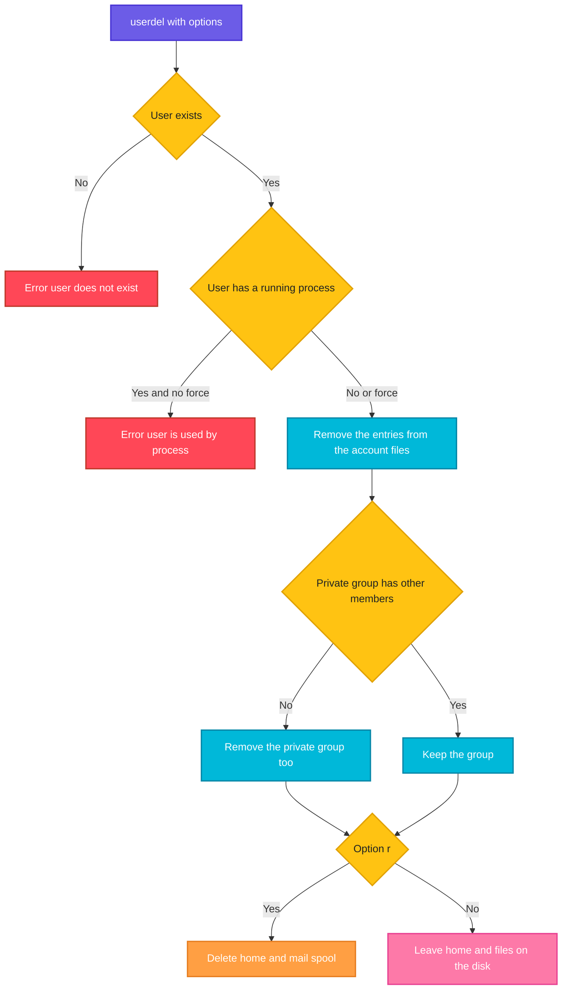

# userdel

## What is it?
`userdel` **deletes a user account**. It removes the user from `/etc/passwd`, `/etc/shadow`, `/etc/group` and `/etc/gshadow`. With `-r` it also deletes the **home directory** and the **mail spool**. By default, it removes the private group of the user too, if no other user is a member. It is the low level program of the `shadow-utils` package, the same on all distributions, and not interactive, so it is the right command for scripts. It does **not** delete files that the user owns **outside** of the home directory, and it does **not** delete the cron jobs.

### `userdel` and `deluser`: the difference, and when to use which
| | `userdel` | `deluser` |
|-|-----------|-----------|
| What it is | The low level program of the `shadow` package, on **all** Linux distributions | **Debian, Ubuntu:** a friendly **Perl script** (package `adduser`). **RHEL, CentOS, Rocky, AlmaLinux, Fedora:** it **does not exist** (unless you install it from another source) |
| Interactive? | No | No, but it prints each step |
| Remove the home directory | `-r` | `--remove-home` |
| Remove all files of the user on the system | No such option. Use `find / -user NAME` | `--remove-all-files` (scans the whole system, slow) |
| Make a backup first | No | `--backup` and `--backup-to DIR` (a `tar.gz` of the files that are removed) |
| Remove a user from a group | No (use `gpasswd -d`) | Yes: `deluser USER GROUP` |
| Remove a group | No (use `groupdel`) | Yes: `deluser --group GROUP` (and `delgroup GROUP`) |
| Remove only if the group is empty | No | `--only-if-empty` |
| Force removal of a logged in user | `-f` (dangerous) | No (it refuses) |
| Config file | `/etc/login.defs` (`USERDEL_CMD`, `USERGROUPS_ENAB`) | `/etc/deluser.conf` (`REMOVE_HOME`, `REMOVE_ALL_FILES`, `BACKUP`, `BACKUP_TO`, `ONLY_IF_EMPTY`, `EXCLUDE_FSTYPES`) |
| Good for | **Scripts and automation on every distribution** | **Debian and Ubuntu**, at the keyboard, when you want a backup or want to remove from a group |

**When to use which:**
- **In scripts, Ansible, Docker or any portable code, use `userdel -r NAME`.** It exists everywhere and behaves the same.
- **On Debian or Ubuntu, `deluser --remove-home NAME` (or with `--backup`) is more careful** and prints what it does.
- **On RHEL, Rocky, Alma, CentOS or Fedora, only `userdel` exists.**
- **Never rely on `REMOVE_HOME` of `/etc/deluser.conf` for portability.** Write the option you want (`--remove-home`) explicitly.

## Syntax
```bash
userdel [OPTIONS] LOGIN
```
`LOGIN` is the name of an existing user. You need `root` rights. `userdel` refuses to remove a user who has a running process (`userdel: user alice is currently used by process 4210`), unless you use `-f`.

## Visual Overview
> `userdel` locks the account files, removes the user and (if possible) the private group, and with `-r` deletes the home and the mail spool. Everything else that the user owns stays on the disk, as numbers.



## Options/Flags
| Flag | Description |
|------|-------------|
| `-r` / `--remove` | Also remove the home directory and its content, and the mail spool (`/var/mail/NAME`) |
| `-f` / `--force` | Force the removal, even if the user is logged in or has a process. Also removes a home directory that is shared by another user, and a group that is the primary group of someone else |
| `-R CHROOT_DIR` / `--root` | Apply the change in a chroot directory |
| `-P PREFIX_DIR` / `--prefix` | Use a prefix directory for the files (newer versions) |
| `-Z` / `--selinux-user` | Remove the SELinux user mapping of the login |
| `-h` / `--help` | Show the help text |

### Exit status
| Code | Meaning |
|------|---------|
| `0` | Success |
| `1` | Cannot update the password file |
| `2` | Invalid command syntax |
| `6` | The user does not exist |
| `8` | The user is currently logged in |
| `10` | Cannot update the group file |
| `12` | Cannot remove the home directory (the user is still removed) |

## Usage Examples

Let's say we are on the server `web01` and work as `root` (or with `sudo`). Today is `2026-10-12`. These accounts exist:

**Input file** (`/etc/passwd`):
```text
root:x:0:0:root:/root:/bin/bash
deploy:x:1001:1001:Deploy User,,,:/home/deploy:/bin/bash
alice:x:1002:1002:Alice Smith,,,:/home/alice:/bin/bash
bob:x:1003:1003:Bob Jones,,,:/home/bob:/bin/bash
```
**Input file** (`/etc/group`):
```text
root:x:0:
sudo:x:27:deploy,alice
devs:x:1004:bob
deploy:x:1001:
alice:x:1002:
bob:x:1003:
```
The user `alice` has a home `/home/alice` (with `notes.txt` inside), a mail file `/var/mail/alice`, a crontab `/var/spool/cron/crontabs/alice`, and a file `/srv/data/report.csv` that she owns. `alice` has no running process. `bob` has the private group `bob` and is also a member of the group `devs`. `deploy` is logged in. Each example starts again from this state.

### Example 1: Remove only the account (keep the files)
**Command:**
```bash
sudo userdel alice
getent passwd alice; echo "exit code: $?"
getent group alice; echo "exit code: $?"
ls -ld /home/alice
ls -ln /home/alice/notes.txt
```
**Sample Output:**
```text
exit code: 2
exit code: 2
drwxr-x--- 2 1002 1002 4096 Oct 12 10:00 /home/alice
-rw-r--r-- 1 1002 1002   40 Oct 12 10:00 /home/alice/notes.txt
```
The user and the private group are gone. The home directory stays, and its owner is only a number now (`1002`). A **new** user that gets the UID `1002` would own these files.

### Example 2: Remove the account and the home directory (`-r`)
**Command:**
```bash
sudo userdel -r alice
ls -d /home/alice /var/mail/alice
```
**Sample Output:**
```text
userdel: alice mail spool (/var/mail/alice) not found
ls: cannot access '/home/alice': No such file or directory
ls: cannot access '/var/mail/alice': No such file or directory
```
The home and the mail file are deleted. If the mail spool never existed, `userdel` prints a message, which is harmless. Files outside of the home (`/srv/data/report.csv`) and the crontab are **not** deleted.

### Example 3: The files that stay behind
**Command:**
```bash
sudo userdel -r alice
sudo find / -xdev -nouser -ls 2>/dev/null
```
**Sample Output:**
```text
  262150      4 -rw-r--r--   1 1002     1002           52 Oct 12 10:00 /srv/data/report.csv
  131080      4 -rw-------   1 1002     crontab        20 Oct 12 10:00 /var/spool/cron/crontabs/alice
```
`find -nouser` lists the files whose owner does not exist any more. Decide what to do: delete them, or give them to another user.

### Example 4: The user is logged in or runs a process
**Command:**
```bash
sudo userdel deploy
```
**Sample Output:**
```text
userdel: user deploy is currently used by process 2302
```
The exit code is `8`. First end the sessions: `sudo pkill -KILL -u deploy`. Then run `userdel` again.

### Example 5: Force the removal (`-f`)
`-f` removes the user even when a process is running, and it also removes the home if it is shared. The processes of the user continue to run with a UID that has no name.

**Command:**
```bash
sudo userdel -f -r deploy
ps -o pid,user,cmd -p 2302
```
**Sample Output:**
```text
    PID USER     CMD
   2302 1001     -bash
```
The shell `2302` still runs, with the number `1001`. Always kill the processes first, and do not use `-f` as a shortcut.

### Example 6: The user does not exist
**Command:**
```bash
sudo userdel nosuchuser; echo "exit code: $?"
```
**Sample Output:**
```text
userdel: user 'nosuchuser' does not exist
exit code: 6
```
In an idempotent script, test with `id nosuchuser` first, or accept the exit code `6`.

### Example 7: The user is also removed from the other groups
`bob` has the private group `bob` (GID `1003`), and is a member of `devs`. The private group is removed, and the name is taken out of `devs`.

**Command:**
```bash
sudo userdel bob
getent group bob devs
```
**Sample Output:**
```text
devs:x:1004:
```
`bob` was removed from the group `devs`, and the private group `bob` is gone.

### Example 8: A group that is the primary group of another user
If you delete `alice`, and her private group `alice` is the primary group of another user, `userdel` keeps the group.

**Command:**
```bash
sudo useradd -g alice carol
sudo userdel alice
getent group alice
```
**Sample Output:**
```text
userdel: group alice not removed because it is the primary group of user carol.
alice:x:1002:
```
The user is removed. The group stays, because `carol` uses it.

### Example 9: Apply the change in a chroot (`-R`)
**Command:**
```bash
sudo userdel -R /mnt/newroot -r alice
grep alice /mnt/newroot/etc/passwd; echo "exit code: $?"
```
**Sample Output:**
```text
exit code: 1
```

### Example 10: Remove the SELinux mapping (`-Z`)
**Command:**
```bash
sudo userdel -Z alice
sudo semanage login -l | grep alice; echo "exit code: $?"
```
**Sample Output:**
```text
exit code: 1
```

### Example 11: Not enough rights
**Command:**
```bash
userdel alice
```
**Sample Output:**
```text
userdel: Permission denied.
userdel: cannot lock /etc/passwd; try again later.
```

### Example 12: Show the help (`-h`)
**Command:**
```bash
userdel -h | head -n 4
```
**Sample Output:**
```text
Usage: userdel [options] LOGIN

Options:
  -f, --force                   force some actions that would fail otherwise
```

### Example 13: What happens on Debian with `deluser`
`deluser` is the Debian script. It keeps the home by default, and asks nothing.

**Command:**
```bash
sudo deluser alice
sudo deluser --remove-home bob
```
**Sample Output:**
```text
Removing user `alice' ...
Warning: group `alice' has no more members.
Done.
Looking for files to backup/remove ...
Removing files ...
Removing user `bob' ...
Warning: group `bob' has no more members.
Done.
```
See the page of `deluser` for the options `--backup`, `--remove-all-files` and the removal from groups.

## Pitfalls / Gotchas
- **Without `-r`, the home directory stays.** The files then belong to a UID without a name. If you create another user, which gets the same UID, they get access to the old files. Always decide on `-r`, or on a backup first.
- **`-r` does not remove everything.** Files that the user owns outside of the home (`/srv`, `/var`, `/tmp`), cron jobs, `at` jobs, mail aliases, sudoers entries, SSH keys in other accounts and print jobs stay. Search with `find / -xdev -user NAME` **before** you delete the user (after, use `-nouser`, or the numeric UID).
- **`-r` deletes the data for good.** There is no trash. Make a backup (`tar czf /backup/alice.tgz /home/alice`) before you delete. `deluser --backup` can do it for you on Debian.
- **`-r` follows the path in `/etc/passwd`.** If the home is `/` or a shared directory (a wrong entry), `userdel -r` can delete too much. Look at `getent passwd NAME` first. `userdel` refuses to remove a home that is not owned by the user.
- **A logged in user cannot be removed.** Stop the processes first (`pkill -KILL -u NAME`), and then run `userdel`. `-f` removes it anyway, but the running processes continue as a "ghost" user.
- **Users from LDAP or Active Directory cannot be removed by `userdel`.** It works only with local users.
- **Cron jobs stay.** Remove them with `crontab -r -u NAME` or delete `/var/spool/cron/crontabs/NAME` (Debian) or `/var/spool/cron/NAME` (RHEL).
- **Remove the user from `sudoers` files** (`/etc/sudoers.d/`) and from the SSH `AllowUsers` lines, or a new user with the same name gets the old rights.
- **Prefer to disable first.** `usermod -L -e 1 -s /usr/sbin/nologin NAME` closes the account without deleting. Delete later, when you are sure that nobody needs the data.
- **Do not use `userdel` for the owner of important services** (like `postgres`, `www-data`), because their files and their packages depend on them.
- **The mail spool message is harmless.** `userdel: alice mail spool (/var/mail/alice) not found` only means that the user never got any mail.
- **`deluser` is the Debian way, `userdel` is the portable way.** See the table at the top.

## DevOps Use Cases

### Use Case 1: Offboarding with a backup of the home directory
**Situation:** An employee has left. Keep a copy of their data for 90 days, and then remove the account and the files.

**Command:**
```bash
sudo tar czf /backup/offboarding/alice-2026-10-12.tgz -C /home alice
sudo chmod 600 /backup/offboarding/alice-2026-10-12.tgz
sudo pkill -KILL -u alice
sudo userdel -r alice
ls -l /backup/offboarding/
```
**Output:**
```text
userdel: alice mail spool (/var/mail/alice) not found
total 4
-rw------- 1 root root 1843 Oct 12 10:05 alice-2026-10-12.tgz
```

### Use Case 2: Find everything the user owned, and decide
**Situation:** Before you delete the user, make a list of all the files on the server that belong to them, so that nothing is forgotten.

**Command:**
```bash
sudo find / -xdev -user alice -not -path '/home/alice/*' -ls 2>/dev/null
sudo crontab -l -u alice
```
**Output:**
```text
  262150      4 -rw-r--r--   1 alice    alice          52 Oct 12 10:00 /srv/data/report.csv
  131080      4 -rw-------   1 alice    crontab        20 Oct 12 10:00 /var/spool/cron/crontabs/alice
0 2 * * * /srv/scripts/nightly.sh
```
After the check, move the files you need to another owner (`chown deploy /srv/data/report.csv`) and remove the cron job. Only then delete the user.

### Use Case 3: Hand the files over to somebody else
**Situation:** The files of the user in `/srv/data` must be kept, and belong to `deploy` from now on.

**Command:**
```bash
sudo find /srv -xdev -user alice -exec chown -h deploy:deploy {} +
sudo userdel -r alice
ls -l /srv/data/report.csv
```
**Output:**
```text
userdel: alice mail spool (/var/mail/alice) not found
-rw-r--r-- 1 deploy deploy 52 Oct 12 10:00 /srv/data/report.csv
```

### Use Case 4: Remove a user and the cron jobs in one go
**Situation:** An automation script must remove the user in a clean way.

**Command:**
```bash
user=alice
sudo crontab -r -u "$user" 2>/dev/null || true
sudo pkill -KILL -u "$user" 2>/dev/null || true
sudo userdel -r "$user"
id "$user" 2>&1
```
**Output:**
```text
userdel: alice mail spool (/var/mail/alice) not found
id: ‘alice’: no such user
```

### Use Case 5: A safe, idempotent removal for Ansible or a script
**Situation:** A script must succeed, even if the user is already gone.

**Command:**
```bash
if id alice >/dev/null 2>&1; then
  sudo userdel -r alice && echo "alice removed"
else
  echo "alice does not exist, nothing to do"
fi
```
**Output:**
```text
alice does not exist, nothing to do
```
The Ansible module: `ansible.builtin.user: name=alice state=absent remove=true`.

### Use Case 6: Remove a leftover home directory from an old user
**Situation:** A user was removed without `-r` last year. Files of the old UID `1002` are still there. Find the "orphaned" homes, and remove them after a check.

**Command:**
```bash
sudo find /home -maxdepth 1 -nouser -ls
sudo du -sh /home/alice
sudo rm -rf /home/alice
```
**Output:**
```text
 131074      4 drwxr-x---   2 1002     1002         4096 Oct 12 10:00 /home/alice
4.0K	/home/alice
```
`rm -rf` is final. Check the name and the size first.

### Use Case 7: Remove temporary users after a training course
**Situation:** 20 users `student01` ... `student20` were created for a workshop. Remove them all.

**Command:**
```bash
for i in $(seq -w 1 20); do
  sudo userdel -r "student$i" 2>/dev/null
done
getent passwd | grep -c '^student'
```
**Output:**
```text
0
```

### Use Case 8: Docker image: remove a user and clean the image
**Situation:** A build step created a user for compiling. Remove it at the end, to keep the final image clean.

**Input file** (`Dockerfile`):
```text
FROM ubuntu:22.04
RUN useradd -m builder && su builder -c 'echo build step' && userdel -r builder
CMD ["getent", "passwd", "builder"]
```
**Command:**
```bash
docker build -t cleanup . && docker run --rm cleanup; echo "exit code: $?"
```
**Output:**
```text
exit code: 2
```
`getent` exits with `2`, which means that the user `builder` is not found.

## Related Commands
- [`deluser`](deluser.md) - the Debian and Ubuntu partner, and the comparison with `userdel`
- [`useradd`](useradd.md) - create a user
- [`adduser`](adduser.md) - the friendly Debian command to create a user
- [`usermod`](usermod.md) - disable the account first (`-L`, `-e`, `-s`)
- [`groupdel`](groupdel.md) - remove a group
- [`gpasswd`](gpasswd.md) - remove a user from one group only
- [`chown`](../permissions/chown.md) - hand the files over to another user
- [`id`](id.md) - test if the user exists
- [`getent`](getent.md) - read the account databases
- [`find`](../file-management/find.md) - find the files of the user (`-user`, `-nouser`)
- [`pkill`](../process-management/pkill.md) - end the processes of the user (`pkill -u`)
- `crontab -r -u` - remove the cron jobs of the user
- `lastlog` / `last` - see when the user last logged in, before you delete
