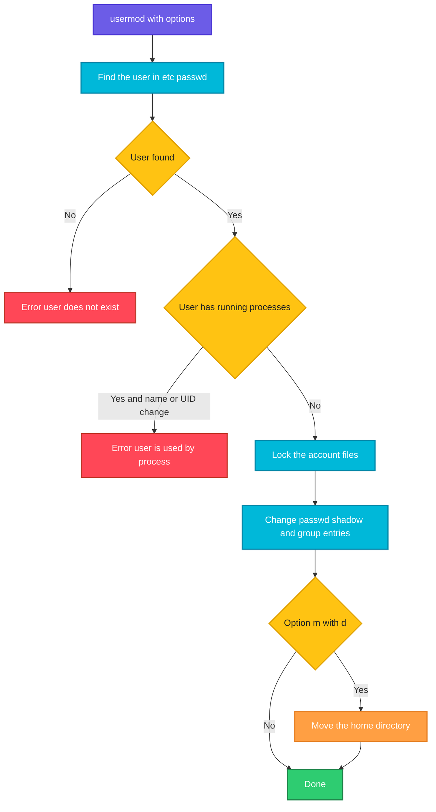

# usermod

## What is it?
`usermod` **modifies an existing user account**. You can change the login name, the UID, the home directory, the login shell, the comment, the primary and supplementary groups, the password hash, the expiry date, and you can **lock** or **unlock** the account. It edits the same files that `useradd` writes: `/etc/passwd`, `/etc/shadow` and `/etc/group`. It is part of the `shadow-utils` package, and works the same way on Debian, Ubuntu, RHEL and others. It is the tool for "add this user to a group", which is its most common use.

## Syntax
```bash
usermod [OPTIONS] LOGIN
```
`LOGIN` is the name of an existing user. You need `root` rights. `usermod` refuses to change a user who has a running process (it prints `user alice is currently used by process 4210`), when the change is the login name or the UID.

## Visual Overview
> `usermod` locks the account files, changes the fields that you ask for, and (with `-m`) moves the home directory. The lock makes sure that no other tool changes the same file at the same time.



## Options/Flags

### Groups (the most used part)
| Flag | Description |
|------|-------------|
| `-G GROUP,...` / `--groups` | Set the **supplementary** groups. **Without `-a`, the list replaces all the old ones!** |
| `-a` / `--append` | With `-G`: **add** the groups, keep the old ones. Always use `-aG` to add a user to a group |
| `-g GROUP` / `--gid` | Set the **primary** group (name or GID) |

### Account data
| Flag | Description |
|------|-------------|
| `-l NEW_LOGIN` / `--login` | Rename the user. The home directory and the mail spool are **not** renamed |
| `-c COMMENT` / `--comment` | Set the comment (GECOS) field, usually the full name |
| `-d HOME_DIR` / `--home` | Set a new home directory |
| `-m` / `--move-home` | With `-d`: move the content of the old home to the new one |
| `-s SHELL` / `--shell` | Set the login shell. An empty value selects the default |
| `-u UID` / `--uid` | Set a new UID. Files in the home directory are re-owned, but files elsewhere are not |
| `-o` / `--non-unique` | With `-u`, allow a UID that is already used |

### Password and lock
| Flag | Description |
|------|-------------|
| `-L` / `--lock` | **Lock** the account: put a `!` in front of the password hash. The password login does not work any more |
| `-U` / `--unlock` | **Unlock** the account: remove the `!` |
| `-p PASSWORD` / `--password` | Set the **encrypted** password hash (a hash, not a plain password) |

### Expiry
| Flag | Description |
|------|-------------|
| `-e YYYY-MM-DD` / `--expiredate` | The date when the account is disabled. An empty value (`-e ""` or `-e -1`) removes the date |
| `-f DAYS` / `--inactive` | Days after the password expired before the account is locked. `0` immediately, `-1` never |

### Sub IDs, SELinux and other
| Flag | Description |
|------|-------------|
| `-v FIRST-LAST` / `--add-subuids` | Add a range of sub UIDs (for rootless containers). Use `-w` for sub GIDs |
| `-V FIRST-LAST` / `--del-subuids` | Remove a range of sub UIDs. Use `-W` for sub GIDs |
| `-w FIRST-LAST` / `--add-subgids` | Add a range of sub GIDs |
| `-W FIRST-LAST` / `--del-subgids` | Remove a range of sub GIDs |
| `-Z SELINUX_USER` / `--selinux-user` | Set the SELinux user of the login |
| `-R CHROOT_DIR` / `--root` | Apply the change in a chroot directory |
| `-P PREFIX_DIR` / `--prefix` | Use a prefix directory for the files (newer versions) |
| `-h` / `--help` | Show the help text |

## Usage Examples

Let's say we are on the server `web01` and work as `root` (or with `sudo`). Today is `2026-10-12`. These accounts exist:

**Input file** (`/etc/passwd`):
```text
root:x:0:0:root:/root:/bin/bash
www-data:x:33:33:www-data:/var/www:/usr/sbin/nologin
deploy:x:1001:1001:Deploy User,,,:/home/deploy:/bin/bash
alice:x:1002:1002:Alice Smith,,,:/home/alice:/bin/bash
```
**Input file** (`/etc/group`):
```text
root:x:0:
sudo:x:27:deploy
www-data:x:33:
docker:x:999:deploy
devs:x:1004:
deploy:x:1001:
alice:x:1002:
```
The user `alice` has a home `/home/alice` that holds the file `notes.txt`, and has no running processes. The user `deploy` is logged in (the shell has the PID `2302`). Each example starts again from this state.

### Example 1: Add a user to a group (`-aG`)
This is the most common use. **Always write `-a` with `-G`.**

**Command:**
```bash
sudo usermod -aG devs alice
id alice
```
**Sample Output:**
```text
uid=1002(alice) gid=1002(alice) groups=1002(alice),1004(devs)
```
The user must log out and log in again to get the new group in the session.

### Example 2: Add a user to several groups
**Command:**
```bash
sudo usermod -aG sudo,docker,devs alice
id alice
```
**Sample Output:**
```text
uid=1002(alice) gid=1002(alice) groups=1002(alice),27(sudo),999(docker),1004(devs)
```
Groups are separated by commas, with **no spaces**. On RHEL use `wheel` and not `sudo`.

### Example 3: The danger of `-G` without `-a`
Without `-a`, the list **replaces** the groups. The user `deploy` has `sudo` and `docker`. The command below removes both.

**Command:**
```bash
id deploy
sudo usermod -G devs deploy
id deploy
```
**Sample Output:**
```text
uid=1001(deploy) gid=1001(deploy) groups=1001(deploy),27(sudo),999(docker)
uid=1001(deploy) gid=1001(deploy) groups=1001(deploy),1004(devs)
```
`deploy` lost the `sudo` right. If it was your own account, you may be locked out of administration.

### Example 4: Remove all supplementary groups
An empty list with `-G` removes the user from all the supplementary groups.

**Command:**
```bash
sudo usermod -G "" deploy
id deploy
```
**Sample Output:**
```text
uid=1001(deploy) gid=1001(deploy) groups=1001(deploy)
```
To remove only one group, use `gpasswd -d USER GROUP` (or `deluser USER GROUP` on Debian).

### Example 5: Set the primary group (`-g`)
**Command:**
```bash
sudo usermod -g devs alice
id alice
```
**Sample Output:**
```text
uid=1002(alice) gid=1004(devs) groups=1004(devs)
```
The primary group of new files that `alice` creates is now `devs`. Old files keep the old group.

### Example 6: Change the full name (`-c`)
**Command:**
```bash
sudo usermod -c "Alice Johnson" alice
getent passwd alice
```
**Sample Output:**
```text
alice:x:1002:1002:Alice Johnson:/home/alice:/bin/bash
```

### Example 7: Change the login shell (`-s`)
**Command:**
```bash
sudo usermod -s /bin/zsh alice
getent passwd alice
```
**Sample Output:**
```text
alice:x:1002:1002:Alice Smith,,,:/home/alice:/bin/zsh
```
The shell must be listed in `/etc/shells`. `usermod -s /usr/sbin/nologin alice` closes interactive logins.

### Example 8: Change the home directory, without moving files (`-d`)
**Command:**
```bash
sudo usermod -d /srv/alice alice
getent passwd alice
ls -d /srv/alice
```
**Sample Output:**
```text
alice:x:1002:1002:Alice Smith,,,:/srv/alice:/bin/bash
ls: cannot access '/srv/alice': No such file or directory
```
Only the entry in `/etc/passwd` changed. The directory does not exist. The old files are still in `/home/alice`.

### Example 9: Change the home directory and move the files (`-d` with `-m`)
**Command:**
```bash
sudo usermod -m -d /srv/alice alice
getent passwd alice
ls /srv/alice
ls -d /home/alice
```
**Sample Output:**
```text
alice:x:1002:1002:Alice Smith,,,:/srv/alice:/bin/bash
notes.txt
ls: cannot access '/home/alice': No such file or directory
```
The home was moved with its content, and the owner stays `alice`.

### Example 10: Rename a user (`-l`)
Only the login name changes. The group, the home directory and the mail spool keep the old names.

**Command:**
```bash
sudo usermod -l alicia alice
getent passwd alicia
getent group alice
ls -d /home/alice
```
**Sample Output:**
```text
alicia:x:1002:1002:Alice Smith,,,:/home/alice:/bin/bash
alice:x:1002:
/home/alice
```
To rename everything: `sudo groupmod -n alicia alice` and `sudo usermod -d /home/alicia -m alicia`. The user must not be logged in.

### Example 11: Change the UID (`-u`)
**Command:**
```bash
sudo usermod -u 2000 alice
id alice
ls -ln /home/alice/notes.txt
```
**Sample Output:**
```text
uid=2000(alice) gid=1002(alice) groups=1002(alice)
-rw-r--r-- 1 2000 1002 40 Oct 12 10:00 /home/alice/notes.txt
```
The files in the home directory get the new UID. Files elsewhere do **not**. Fix them with `sudo find / -xdev -uid 1002 -exec chown -h 2000 {} +` (run it **before** you change the UID, or search for the old number afterwards).

### Example 12: A UID that is already used (`-o`)
**Command:**
```bash
sudo usermod -u 1001 alice
sudo usermod -o -u 1001 alice
```
**Sample Output:**
```text
usermod: UID '1001' already exists
```
The first command is refused. With `-o`, the second command works, and `alice` shares the UID of `deploy`. Avoid it.

### Example 13: Lock the account (`-L`)
**Command:**
```bash
sudo usermod -L alice
sudo grep '^alice' /etc/shadow | cut -c1-24
sudo passwd -S alice
```
**Sample Output:**
```text
alice:!$6$Zt1w8dKq$Qk7V1b
alice L 10/01/2026 0 99999 7 -1
```
The `!` in front of the hash locks the password login. An **SSH key still works**. To stop all logins use `usermod -s /usr/sbin/nologin` and `usermod -e 1` as well, or `passwd -l` with `chage -E 0`.

### Example 14: Unlock the account (`-U`)
**Command:**
```bash
sudo usermod -U alice
sudo passwd -S alice
```
**Sample Output:**
```text
alice P 10/01/2026 0 99999 7 -1
```

### Example 15: Set an expiry date (`-e`)
**Command:**
```bash
sudo usermod -e 2026-12-31 alice
sudo chage -l alice | grep 'Account expires'
```
**Sample Output:**
```text
Account expires						: Dec 31, 2026
```

### Example 16: Disable the account at once, and remove the date
**Command:**
```bash
sudo usermod -e 1 alice
sudo chage -l alice | grep 'Account expires'
sudo usermod -e "" alice
sudo chage -l alice | grep 'Account expires'
```
**Sample Output:**
```text
Account expires						: Jan 02, 1970
Account expires						: never
```
A date in the past (`-e 1` is the day 1 after 1970) disables the account at once. An empty date (or `-1`) removes the limit.

### Example 17: Lock the account after the password expires (`-f`)
**Command:**
```bash
sudo usermod -f 14 alice
sudo chage -l alice | grep inactive
```
**Sample Output:**
```text
Password inactive					: 14 days after password expires
```

### Example 18: Set a password hash (`-p`)
`-p` needs the **hash**. Do not use a plain text password.

**Command:**
```bash
hash=$(openssl passwd -6 'N3w-Secret')
sudo usermod -p "$hash" alice
sudo grep '^alice' /etc/shadow | cut -c1-20
```
**Sample Output:**
```text
alice:$6$kP3xT9aB$Ve
```
The hash is visible in the process list for a moment. In scripts, `echo 'alice:pass' | chpasswd` is safer.

### Example 19: A user who is using the system (running processes)
**Command:**
```bash
sudo usermod -l dep deploy
sudo usermod -aG devs deploy
```
**Sample Output:**
```text
usermod: user deploy is currently used by process 2302
```
The first command is refused, because `deploy` is logged in. Changing the groups (second command) works while the user is logged in, but the running session sees the change only after a new login. To rename a logged-in user, log in as `root` from another account, end their sessions first (`sudo pkill -KILL -u deploy`), and then run `usermod`.

### Example 20: Add sub UIDs and sub GIDs for rootless containers (`-v` and `-w`)
**Command:**
```bash
sudo usermod -v 100000-165535 -w 100000-165535 alice
grep alice /etc/subuid /etc/subgid
```
**Sample Output:**
```text
/etc/subuid:alice:100000:65536
/etc/subgid:alice:100000:65536
```
Podman and rootless Docker use these ranges. `-V` and `-W` remove a range.

### Example 21: Remove sub UIDs (`-V` and `-W`)
**Command:**
```bash
sudo usermod -V 100000-165535 -W 100000-165535 alice
grep alice /etc/subuid /etc/subgid
```
**Sample Output:**
```text
```
Nothing is printed, because the lines are gone.

### Example 22: Change the SELinux user (`-Z`)
**Command:**
```bash
sudo usermod -Z staff_u alice
sudo semanage login -l | grep alice
```
**Sample Output:**
```text
alice                staff_u              s0-s0:c0.c1023       *
```

### Example 23: Change a user in a chroot (`-R`)
**Command:**
```bash
sudo usermod -R /mnt/newroot -s /bin/zsh alice
grep alice /mnt/newroot/etc/passwd
```
**Sample Output:**
```text
alice:x:1002:1002:Alice Smith,,,:/home/alice:/bin/zsh
```

### Example 24: Errors
**Command:**
```bash
sudo usermod -aG nosuchgroup alice
sudo usermod -s /bin/nosuchshell alice
sudo usermod -aG devs nosuchuser
sudo usermod -a alice
```
**Sample Output:**
```text
usermod: group 'nosuchgroup' does not exist
usermod: Warning: missing or non-executable shell '/bin/nosuchshell'
usermod: user 'nosuchuser' does not exist
usermod: option '-a' requires option '-G'
```
The warning for the shell is only a warning. The change is still done.

### Example 25: Show the help (`-h`)
**Command:**
```bash
usermod -h | head -n 3
```
**Sample Output:**
```text
Usage: usermod [options] LOGIN

Options:
```

## Pitfalls / Gotchas
- **`usermod -G` without `-a` replaces the groups.** This is the number one mistake. A user can lose `sudo` or `docker`. Always write `-aG`. If you lost the groups, restore them with `usermod -aG sudo,docker USER`.
- **`-aG` writes the groups at once, but sessions that are already running do not see it.** The user has to log out and in again (or use `newgrp`).
- **The comma list has no spaces.** `-aG devs, docker` is wrong.
- **`-l` renames only the login name.** The primary group, the home directory and the mail spool are not renamed, and files keep their owner (it is the UID, not the name). Rename them yourself: `groupmod -n`, and `usermod -d NEWHOME -m`.
- **A UID change does not fix the files outside the home.** Find the old files with `find / -xdev -uid OLD` and run `chown -h`. Files on other file systems, NFS and containers also keep the old number.
- **Do not change a user who is logged in** when you change the name, the UID or the home. `usermod` refuses, and `-f` does not exist. End the sessions first.
- **`-L` locks only the password.** SSH keys, `sudo -u`, `su` from `root`, cron jobs and running processes still work. To really block a user: `usermod -L -e 1 -s /usr/sbin/nologin`, remove the keys, and kill the sessions.
- **`-p` needs a hash.** A plain text value in `-p` makes the account unusable.
- **`-U` can unlock more than you want.** If the password field was only `!` (an account that never had a password), `-U` would leave an empty password on some versions. `usermod` refuses this ("unlocking the user's password would result in a passwordless account"), so set a password first.
- **`-d` without `-m` does not move anything.** The old files stay in the old directory.
- **On Debian, `adduser USER GROUP` and `deluser USER GROUP`** do the same as `usermod -aG` and `gpasswd -d`. They are friendlier, but not available on RHEL.
- **`usermod` is the same on all distributions.** Unlike `useradd`/`adduser`, there are no differences between Debian and Red Hat in the options.
- **Changes are done in the local files.** For a user from LDAP or Active Directory, `usermod` cannot change anything. Use the directory tools.

## DevOps Use Cases

### Use Case 1: Give a new engineer `sudo` and `docker`
**Situation:** `alice` joined the platform team. She needs administrator rights and access to Docker.

**Command:**
```bash
sudo usermod -aG sudo,docker alice
id alice
```
**Output:**
```text
uid=1002(alice) gid=1002(alice) groups=1002(alice),27(sudo),999(docker)
```
On RHEL: `sudo usermod -aG wheel,docker alice`.

### Use Case 2: Take rights away when somebody changes team
**Situation:** `alice` moved to another team and must lose the `docker` group, but keep her other groups.

**Command:**
```bash
sudo gpasswd -d alice docker
id alice
```
**Output:**
```text
Removing user alice from group docker
uid=1002(alice) gid=1002(alice) groups=1002(alice),27(sudo)
```
`usermod` has no option to remove one group. Use `gpasswd -d` (or `deluser alice docker` on Debian), or write the whole list again with `usermod -G`.

### Use Case 3: Offboarding: disable an account without deleting it
**Situation:** An employee leaves today. Disable all logins, but keep the files for 30 days, in case somebody needs them.

**Command:**
```bash
sudo usermod -L -e 1 -s /usr/sbin/nologin alice
sudo pkill -KILL -u alice
sudo mv /home/alice/.ssh/authorized_keys /home/alice/.ssh/authorized_keys.disabled
sudo chage -l alice | head -n 4
```
**Output:**
```text
Last password change					: Oct 01, 2026
Password expires					: never
Password inactive					: never
Account expires						: Jan 02, 1970
```
The password is locked, the account has expired, the shell is `nologin`, the sessions are ended, and the SSH key is disabled. Later remove the user with `userdel -r`.

### Use Case 4: Lock out an account after a security alert, and unlock it later
**Situation:** The account `deploy` was used from an unknown IP address. Lock it now, investigate, and unlock it later.

**Command:**
```bash
sudo usermod -L deploy
sudo passwd -S deploy
sudo usermod -U deploy
sudo passwd -S deploy
```
**Output:**
```text
deploy L 10/01/2026 0 99999 7 -1
deploy P 10/01/2026 0 99999 7 -1
```

### Use Case 5: Change the shell of a service account to `nologin`
**Situation:** An audit says that the service account `postgres` must not have an interactive shell. (`sudo -u postgres psql` still works.)

**Command:**
```bash
getent passwd postgres | cut -d: -f1,7
sudo usermod -s /usr/sbin/nologin postgres
getent passwd postgres | cut -d: -f1,7
```
**Output:**
```text
postgres:/bin/bash
postgres:/usr/sbin/nologin
```

### Use Case 6: Move a home directory to a bigger disk
**Situation:** `/home` is full. A mounted volume `/data` has space. Move the home of `alice`, and keep the permissions.

**Command:**
```bash
sudo mkdir -p /data/home
sudo usermod -m -d /data/home/alice alice
getent passwd alice | cut -d: -f6
ls -ld /data/home/alice
```
**Output:**
```text
/data/home/alice
drwxr-x--- 2 alice alice 4096 Oct 12 10:05 /data/home/alice
```
The user must not be logged in. Check the SELinux labels on RHEL (`restorecon -Rv /data/home/alice`) and the path in scripts.

### Use Case 7: Give a user the same UID on all servers (NFS)
**Situation:** `alice` has the UID `1002` on one server and `1005` on another one. NFS shows the wrong owner. Make both `2000`, and fix the files.

**Command:**
```bash
old=$(id -u alice)
sudo usermod -u 2000 alice
sudo find /srv /home -xdev -uid "$old" -exec chown -h 2000 {} +
id alice
```
**Output:**
```text
uid=2000(alice) gid=1002(alice) groups=1002(alice)
```

### Use Case 8: Prepare a user for rootless containers
**Situation:** `alice` wants to use Podman without `root`. The user needs ranges of sub UIDs and sub GIDs.

**Command:**
```bash
sudo usermod -v 100000-165535 -w 100000-165535 alice
sudo -u alice podman info --format '{{.Host.Security.Rootless}}'
```
**Output:**
```text
true
```

### Use Case 9: Rename a user completely
**Situation:** The account `alice` must become `alicia`, with the group and the home directory.

**Command:**
```bash
sudo pkill -KILL -u alice
sudo usermod -l alicia alice
sudo groupmod -n alicia alice
sudo usermod -d /home/alicia -m alicia
id alicia
ls -ld /home/alicia
```
**Output:**
```text
uid=1002(alicia) gid=1002(alicia) groups=1002(alicia)
drwxr-x--- 2 alicia alicia 4096 Oct 12 10:05 /home/alicia
```
Update `sudoers` files, cron files (`/var/spool/cron/alice`), mail aliases and SSH settings, because they still use the old name.

### Use Case 10: Ansible
**Situation:** The same changes with infrastructure code. The module `user` calls `usermod` when the user exists.

**Input file** (`playbook.yml`):
```text
- name: Add alice to groups without removing the others
  ansible.builtin.user:
    name: alice
    groups: sudo,docker
    append: true
    shell: /bin/bash
```
**Command:**
```bash
ansible-playbook -i web01, playbook.yml
```
**Output:**
```text
TASK [Add alice to groups without removing the others] ***
changed: [web01]
```
`append: true` is the same as `-a`. Without it, Ansible would replace the groups, like `usermod -G`.

## Related Commands
- [`useradd`](useradd.md) - create the user, and compare it with `adduser`
- [`adduser`](adduser.md) - on Debian, `adduser USER GROUP` adds a user to a group
- [`userdel`](userdel.md) - remove a user
- [`deluser`](deluser.md) - on Debian, `deluser USER GROUP` removes a user from a group
- [`gpasswd`](gpasswd.md) - add and remove group members
- [`groupmod`](groupmod.md) - rename a group or change its GID
- [`passwd`](passwd.md) - lock, unlock and change the password
- [`chage`](chage.md) - password and account aging
- [`chsh`](chsh.md) - a user changes his own shell
- [`id`](id.md) / [`groups`](groups.md) - check the groups
- [`getent`](getent.md) - read the account databases
- `newgrp` - use a new group without a new login
- `vipw` / `vigr` - edit the account files safely
