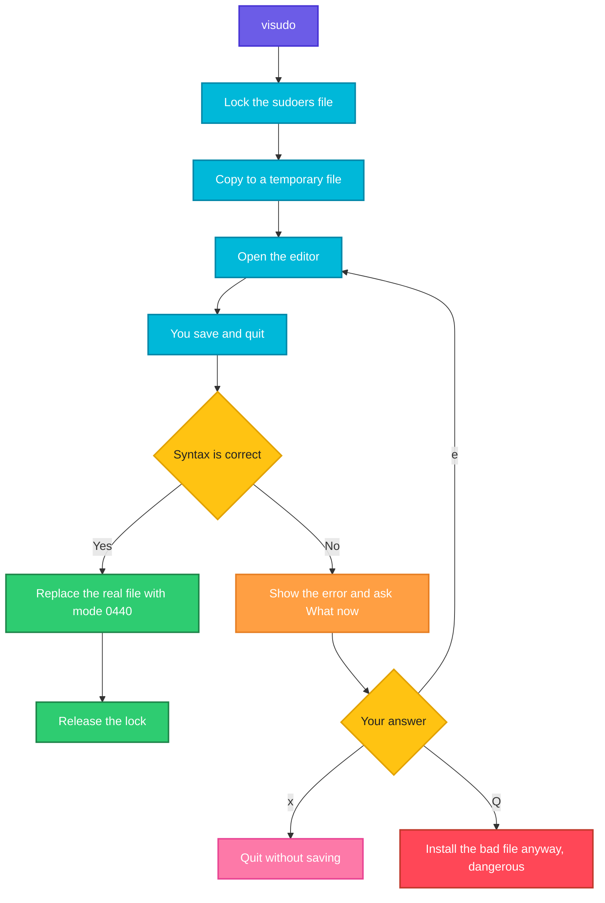

# visudo

## What is it?
`visudo` is the **safe editor for the `sudoers` file**. The file `/etc/sudoers` (and the files in `/etc/sudoers.d/`) defines **who may run which commands as which user** with `sudo`. A syntax error in this file can lock **all** administrators out of `sudo`, so you must never open it with a normal editor. `visudo` **locks** the file (so that two people cannot edit it at the same time), opens it in your editor, **checks the syntax** when you save, and refuses to install a file that has errors. It can also only **check** the files without editing (`visudo -c`). It is part of the `sudo` package, on every distribution.

## Syntax
```bash
visudo [OPTIONS]
visudo -f FILE            # edit another file, for example one in /etc/sudoers.d/
visudo -c                 # only check /etc/sudoers and the included files
visudo -cf FILE           # only check one file
```
You need `root` rights (use `sudo visudo`). The editor is chosen from the variables `SUDO_EDITOR`, `VISUAL`, then `EDITOR`, then the default of the system (`vi`, or `nano` on Ubuntu through `update-alternatives`). Example: `sudo EDITOR=nano visudo`.

### The format of a rule
```text
WHO    WHERE=(RUN_AS_USER:RUN_AS_GROUP)  OPTIONS:  COMMANDS
deploy ALL=(ALL:ALL) NOPASSWD: /usr/bin/systemctl restart myapp, /usr/bin/journalctl -u myapp
```
| Part | Meaning |
|------|---------|
| `WHO` | A user (`deploy`), a group (`%sudo`, with a percent sign), a numeric ID (`#1001`) or an alias |
| `WHERE` | The host names where the rule is valid. `ALL` is usual |
| `(RUN_AS_USER:RUN_AS_GROUP)` | The users and groups that `WHO` may become. `(ALL)` means any user, `(root)` only `root`, `(www-data)` only that user. `(ALL:ALL)` any user and group |
| `OPTIONS` | Tags: `NOPASSWD:` (no password), `PASSWD:`, `NOEXEC:` (the command cannot start others), `SETENV:`, `LOG_OUTPUT:` |
| `COMMANDS` | The full paths of the allowed commands, with their arguments, separated by commas. `ALL` means every command. `!command` removes a command |

### Other lines
| Line | Meaning |
|------|---------|
| `Defaults option` | A setting (`Defaults env_reset`, `Defaults timestamp_timeout=5`, `Defaults logfile=/var/log/sudo.log`) |
| `Defaults:deploy option` | A setting only for one user (`Defaults!COMMAND` for a command, `Defaults@HOST` for a host) |
| `User_Alias NAME = user1, user2` | A list of users (also `Runas_Alias`, `Host_Alias`, `Cmnd_Alias`) |
| `Cmnd_Alias RESTART = /usr/bin/systemctl restart myapp` | A named list of commands |
| `@includedir /etc/sudoers.d` | Include all the files of a directory (older form: `#includedir`) |
| `# text` | A comment (but `#includedir` and `#1001` are not comments) |

## Visual Overview
> `visudo` copies the file to a temporary file, locks the real one, opens the editor, checks the syntax of the saved copy, and only then replaces the real file. A bad edit never goes live.



## Options/Flags
| Flag | Description |
|------|-------------|
| `-c` / `--check` | Check the syntax only (and the mode and owner of the files), and exit. Exit code `0` if all is correct. Does not open an editor |
| `-f FILE` / `--file=FILE` | Edit (or check, with `-c`) `FILE` and not `/etc/sudoers`. Use it for `/etc/sudoers.d/` files |
| `-s` / `--strict` | Strict checking: also an error for an alias that is used but not defined, or defined but not used |
| `-q` / `--quiet` | Less output: do not print the "parsed OK" lines when the check passes |
| `-I` / `--no-includes` | Do not edit the included files (`@includedir`). Edit only the main file |
| `-O OWNER` / `--owner=OWNER` | Enforce the owner of the file (default `root`) |
| `-P PERMS` / `--perms=PERMS` | Enforce the mode of the file (default `0440`) |
| `-x FILE` / `--export=FILE` | Export the rules as **JSON** to `FILE` (`-` for the screen). Newer versions of `sudo` (1.9.7 and later) |
| `-V` / `--version` | Show the version and the defaults |
| `-h` / `--help` | Show the help text |

### The prompt after an error (`What now?`)
| Answer | Meaning |
|--------|---------|
| `e` | Edit the file again, and fix the error. **This is the right answer** |
| `x` | Exit and **throw away** your change. The old file stays |
| `Q` | Quit and **save the file with the error**. Dangerous. `sudo` may stop working |

### Exit status
| Code | Meaning |
|------|---------|
| `0` | The file is correct (with `-c`), or the edit was saved |
| `1` | A syntax error, a bad owner or mode, or the file is locked |

## Usage Examples

Let's say we are on **Ubuntu 22.04** on the server `web01`. Today is `2026-10-12`. We are logged in as `deploy`, and `deploy` is a member of the group `sudo`. The file `/etc/sudoers` has this content (the comments are removed):

**Input file** (`/etc/sudoers`):
```text
Defaults        env_reset
Defaults        mail_badpass
Defaults        secure_path="/usr/local/sbin:/usr/local/bin:/usr/sbin:/usr/bin:/sbin:/bin"
Defaults        use_pty

root    ALL=(ALL:ALL) ALL
%admin  ALL=(ALL) ALL
%sudo   ALL=(ALL:ALL) ALL

@includedir /etc/sudoers.d
```
The directory `/etc/sudoers.d/` has the file `README` (all comments) and the file `90-deploy-restart` with this content, mode `0440`:

**Input file** (`/etc/sudoers.d/90-deploy-restart`):
```text
%devs ALL=(root) NOPASSWD: /usr/bin/systemctl restart myapp
```
Each example starts again from this state.

### Example 1: Edit the main file
**Command:**
```bash
sudo visudo
```
**Sample Output** (the editor opens. Here is what you add at the end, and then save):
```text
deploy ALL=(ALL) NOPASSWD: /usr/bin/systemctl status *
```
When you save and quit, `visudo` checks the syntax. If it is correct, the file is installed. There is no message.

### Example 2: Choose the editor
**Command:**
```bash
sudo EDITOR=nano visudo
sudo SUDO_EDITOR=vim visudo
sudo update-alternatives --config editor
```
**Sample Output:**
```text
There are 3 choices for the alternative editor (providing /usr/bin/editor).

  Selection    Path                Priority   Status
------------------------------------------------------------
* 0            /bin/nano            40        auto mode
  1            /bin/ed             -100       manual mode
  2            /bin/nano            40        manual mode
  3            /usr/bin/vim.basic   30        manual mode

Press <enter> to keep the current choice[*], or type selection number:
```
The first two commands set the editor for one call (`SUDO_EDITOR` has priority over `VISUAL` and `EDITOR`). The third one changes the system default.

### Example 3: Edit a file in `sudoers.d` (`-f`)
The recommended way is a small file for each purpose, and not a change of the main file.

**Command:**
```bash
sudo visudo -f /etc/sudoers.d/91-deploy-logs
```
**Sample Output** (you type this line in the editor and save):
```text
deploy ALL=(root) NOPASSWD: /usr/bin/journalctl -u myapp
```
`visudo` creates the file with the mode `0440` and the owner `root`. The names of files in `sudoers.d` must not contain a dot (`.`) or end with a tilde (`~`), because those files are ignored.

### Example 4: Check the syntax (`-c`)
**Command:**
```bash
sudo visudo -c
echo "exit code: $?"
```
**Sample Output:**
```text
/etc/sudoers: parsed OK
/etc/sudoers.d/README: parsed OK
/etc/sudoers.d/90-deploy-restart: parsed OK
exit code: 0
```
Use it after every change that is made without `visudo` (for example from a script or from Ansible).

### Example 5: Check a single file (`-c` with `-f`)
**Command:**
```bash
sudo visudo -cf /etc/sudoers.d/90-deploy-restart
sudo visudo -cf /tmp/newrules
```
**Sample Output:**
```text
/etc/sudoers.d/90-deploy-restart: parsed OK
/tmp/newrules: parsed OK
```
This is the way to **test a file before you copy it** into `sudoers.d`.

### Example 6: A syntax error
Let's say that someone wrote `deploy ALL=(ALL) NOPASSWD /usr/bin/systemctl` (the colon after `NOPASSWD` is missing) at line 12.

**Command:**
```bash
sudo visudo -c
echo "exit code: $?"
```
**Sample Output:**
```text
/etc/sudoers: parsed OK
/etc/sudoers.d/90-deploy: syntax error near line 1 <<<
parse error in /etc/sudoers.d/90-deploy near line 1
exit code: 1
```
**A file with an error breaks `sudo` for everybody** (`sudo: parse error in /etc/sudoers.d/90-deploy near line 1`, `sudo: no valid sudoers sources found, quitting`). Fix it at once with `pkexec visudo -f ...`, or a root console.

### Example 7: The error dialog while editing
**Command:**
```bash
sudo visudo
```
**Sample Output** (you saved a file with a typo):
```text
>>> /etc/sudoers: syntax error near line 12 <<<
What now? e
```
Type `e` to open the editor again at the error. `x` throws the change away. `Q` saves the broken file: **never use it**.

### Example 8: Strict mode (`-s`)
`-s` also fails when an alias is used but not defined. Without it, `sudo` only prints a warning.

**Command:**
```bash
sudo visudo -cs
```
**Sample Output:**
```text
/etc/sudoers: parsed OK
/etc/sudoers.d/90-deploy-restart: parsed OK
/etc/sudoers.d/92-ops: unknown alias: WEB_SERVERS near line 1 <<<
```
The rule in `92-ops` uses `WEB_SERVERS`, which does not exist. Strict mode makes it an error (exit code `1`).

### Example 9: Quiet check (`-q`)
**Command:**
```bash
sudo visudo -cq
echo "exit code: $?"
```
**Sample Output:**
```text
exit code: 0
```
With `-q`, nothing is printed when the check succeeds. It is made for scripts.

### Example 10: Do not edit the included files (`-I`)
**Command:**
```bash
sudo visudo -I
```
**Sample Output:**
```text
(the editor opens only /etc/sudoers, and not the files of /etc/sudoers.d/)
```
Without `-I`, if you add a `@include` line, `visudo` also opens the files that it includes, one after the other.

### Example 11: Wrong mode or owner
`sudo` ignores files with the wrong mode. `visudo -c` finds them.

**Command:**
```bash
ls -l /etc/sudoers.d/90-deploy-restart
sudo chmod 644 /etc/sudoers.d/90-deploy-restart
sudo visudo -c
```
**Sample Output:**
```text
-r--r----- 1 root root 62 Oct 12 10:00 /etc/sudoers.d/90-deploy-restart
/etc/sudoers: parsed OK
/etc/sudoers.d/90-deploy-restart: bad permissions, should be mode 0440
```
Fix it with `sudo chmod 0440 /etc/sudoers.d/90-deploy-restart`.

### Example 12: Enforce the owner and the mode (`-O` and `-P`)
Check that the file has the right owner and mode (for example `root` and `0440`), or other values that the policy of your company asks for.

**Command:**
```bash
sudo visudo -c -O root -P 0440 -f /etc/sudoers.d/90-deploy-restart
```
**Sample Output:**
```text
/etc/sudoers.d/90-deploy-restart: parsed OK
```
If the owner or the mode is different, the output is `bad permissions, should be mode 0440` or `wrong owner (uid, gid) should be (0, 0)`.

### Example 13: Export the rules as JSON (`-x`)
**Command:**
```bash
sudo visudo -x - | head -n 12
```
**Sample Output:**
```text
{
    "Defaults": [
        { "Options": [ { "env_reset": true }, { "mail_badpass": true }, { "use_pty": true } ] }
    ],
    "User_Specs": [
        {
            "User_List": [ { "username": "root" } ],
            "Host_List": [ { "hostname": "ALL" } ],
            "Cmnd_Specs": [
                {
```
This is available in `sudo` 1.9.7 and later. It is useful for an audit with `jq`.

### Example 14: The file is locked
**Command:**
```bash
sudo visudo
```
**Sample Output** (when a colleague is editing it):
```text
visudo: /etc/sudoers busy, try again later
```
Wait for the other person. If the lock is stale (the other `visudo` crashed), look for the file `/etc/sudoers.tmp`, and check with `ps aux | grep visudo` before you remove it.

### Example 15: Not `root`
**Command:**
```bash
visudo
```
**Sample Output:**
```text
visudo: /etc/sudoers: Permission denied
```
Use `sudo visudo`.

### Example 16: Check the version and the defaults (`-V`)
**Command:**
```bash
sudo visudo -V | head -n 5
```
**Sample Output:**
```text
visudo version 1.9.9
sudoers policy plugin version 1.9.9
sudoers file grammar version 48

sudoers path: /etc/sudoers
```

### Example 17: Show the help (`-h`)
**Command:**
```bash
visudo -h | head -n 4
```
**Sample Output:**
```text
visudo - safely edit the sudoers file

usage: visudo [-chqsV] [[-f] sudoers ]

```

### Example 18: Show what a user may do (not `visudo`, but linked)
**Command:**
```bash
sudo -l -U deploy
```
**Sample Output:**
```text
Matching Defaults entries for deploy on web01:
    env_reset, mail_badpass, secure_path=/usr/local/sbin\:/usr/local/bin\:/usr/sbin\:/usr/bin\:/sbin\:/bin, use_pty

User deploy may run the following commands on web01:
    (ALL : ALL) ALL
```
Use it after you edit the rules, to see the result for a user.

## Pitfalls / Gotchas
- **Never edit `/etc/sudoers` with `vi` or `nano` directly.** A single wrong character can disable `sudo` for everybody. Always use `visudo`.
- **Never answer `Q` at the `What now?` prompt.** It installs the broken file. Use `e` to fix it, or `x` to leave.
- **Keep a root shell open while you test.** Open a second terminal with `sudo -i` before you edit. If you break `sudo`, you can still fix it from the root shell. On cloud servers, check that you have a console, or use `pkexec visudo`.
- **Prefer small files in `/etc/sudoers.d/`.** They are easier to manage with configuration tools, and a mistake in one does not hide the others. The names must not have a dot or end with `~`. The mode must be `0440`.
- **Check files before you install them.** Use `visudo -cf /tmp/file` and then `install -m 0440 -o root -g root /tmp/file /etc/sudoers.d/NAME`. Ansible's `copy` module has `validate: 'visudo -cf %s'`.
- **The last matching rule wins.** If two rules match, the **last one** in the file is used. A rule `%sudo ALL=(ALL) ALL` at the end can override an earlier `NOPASSWD:`. Put the specific rules last.
- **`NOPASSWD: ALL` is root without a password.** Anybody who gets the account of the user gets `root`. Use exact commands (`/usr/bin/systemctl restart myapp`), not `ALL`.
- **Wildcards are dangerous.** `/usr/bin/systemctl * myapp` can be misused (for example `systemctl edit`, or extra arguments). `/bin/cat /var/log/*` allows `cat /var/log/../../etc/shadow`. Allow only exact commands, and add `NOEXEC:` where you can.
- **A command that gives a shell is a full root.** `vi`, `less`, `find`, `awk`, `tar`, `docker`, `python` and many others have shell escapes. Do not allow them with `NOPASSWD`, or add `NOEXEC` and review them (check `gtfobins.github.io`).
- **Use full paths.** `systemctl` alone is not valid. Write `/usr/bin/systemctl` (on RHEL: `/usr/bin/systemctl` too, but `/bin` is a link to `/usr/bin`; use the path that `command -v` prints).
- **The group `sudo` (Debian) or `wheel` (Red Hat).** The line `%sudo ALL=(ALL:ALL) ALL` or `%wheel ALL=(ALL) ALL` gives administrator rights to the group. Check which one your system uses.
- **`#includedir` and `@includedir` are not comments,** although `#includedir` starts with `#`. Do not remove it by accident.
- **Aliases must be defined before they are used** in the file (in old versions). Use `-s` to find the problems.
- **Syntax is easy to get wrong.** Typical errors: a missing colon after `NOPASSWD`, a space around `=`, a missing path, `ALL=ALL` without parentheses (valid but means `(root)`), and a trailing backslash.
- **`visudo -c` is not a test of the rights.** It checks the syntax only. Test the result with `sudo -l -U USER`.

## DevOps Use Cases

### Use Case 1: Let a team restart one service, without a password
**Situation:** The group `devs` must restart `myapp`, and nothing else, with no password.

**Command:**
```bash
echo '%devs ALL=(root) NOPASSWD: /usr/bin/systemctl restart myapp, /usr/bin/systemctl status myapp' | sudo tee /tmp/90-devs-myapp
sudo visudo -cf /tmp/90-devs-myapp && sudo install -m 0440 -o root -g root /tmp/90-devs-myapp /etc/sudoers.d/90-devs-myapp
sudo -l -U alice | tail -n 3
```
**Output:**
```text
%devs ALL=(root) NOPASSWD: /usr/bin/systemctl restart myapp, /usr/bin/systemctl status myapp
/tmp/90-devs-myapp: parsed OK
User alice may run the following commands on web01:
    (root) NOPASSWD: /usr/bin/systemctl restart myapp, /usr/bin/systemctl status myapp
```
The file is **tested first** and only then installed.

### Use Case 2: Give an administrator group full rights
**Situation:** A new team of administrators must have `sudo`. On Red Hat the group is `wheel`. On Debian it is `sudo`.

**Command:**
```bash
grep -E '^%(sudo|wheel)' /etc/sudoers
sudo usermod -aG sudo alice
sudo -l -U alice | tail -n 2
```
**Output:**
```text
%sudo   ALL=(ALL:ALL) ALL
User alice may run the following commands on web01:
    (ALL : ALL) ALL
```
Adding the user to the group is usually better than a new rule for the user.

### Use Case 3: Install a rule file from Ansible, with validation
**Situation:** The infrastructure code installs a `sudoers.d` file, and must never install a bad one.

**Input file** (`playbook.yml`):
```text
- name: Allow devs to restart myapp
  ansible.builtin.copy:
    dest: /etc/sudoers.d/90-devs-myapp
    content: "%devs ALL=(root) NOPASSWD: /usr/bin/systemctl restart myapp\n"
    owner: root
    group: root
    mode: "0440"
    validate: "/usr/sbin/visudo -cf %s"
```
**Command:**
```bash
ansible-playbook -i web01, playbook.yml
```
**Output:**
```text
TASK [Allow devs to restart myapp] ***
changed: [web01]
```
If the content has an error, the task fails and the old file stays.

### Use Case 4: Check the rules in a CI pipeline
**Situation:** The repository has the files for `sudoers.d`. The pipeline must reject a bad file before it is deployed.

**Command:**
```bash
for f in sudoers.d/*; do
  visudo -cf "$f" || { echo "ERROR in $f"; exit 1; }
done
echo "all sudoers files are valid"
```
**Output:**
```text
sudoers.d/90-devs-myapp: parsed OK
sudoers.d/91-deploy-logs: parsed OK
all sudoers files are valid
```
`visudo -c` can run as a normal user for a file that you can read (it prints a warning about the owner).

### Use Case 5: Recover from a broken sudoers file
**Situation:** Someone saved a bad file with `Q`. `sudo` now says `parse error in /etc/sudoers.d/90-bad near line 1`, and nobody can use `sudo`. Use another way to become `root`.

**Command:**
```bash
pkexec visudo -f /etc/sudoers.d/90-bad
sudo -l
```
**Output:**
```text
User deploy may run the following commands on web01:
    (ALL : ALL) ALL
```
`pkexec` (polkit) works without `sudo`. Other ways: the `root` password with `su -`, the recovery mode, or the console of the cloud provider. After that: `rm /etc/sudoers.d/90-bad`.

### Use Case 6: Log all the `sudo` commands, and the output
**Situation:** An audit needs a record of the commands that are run with `sudo`.

**Command:**
```bash
echo 'Defaults logfile="/var/log/sudo.log", log_input, log_output, iolog_dir=/var/log/sudo-io' | sudo tee /tmp/95-log
sudo visudo -cf /tmp/95-log && sudo install -m 0440 /tmp/95-log /etc/sudoers.d/95-log
sudo whoami
sudo tail -n 1 /var/log/sudo.log
```
**Output:**
```text
/tmp/95-log: parsed OK
root
Oct 12 10:05:12 : deploy : TTY=pts/0 ; PWD=/home/deploy ; USER=root ; COMMAND=/usr/bin/whoami
```

### Use Case 7: Export the rules for an access review
**Situation:** The security team wants a list of all the `sudo` rules as data.

**Command:**
```bash
sudo visudo -x - | jq -r '.User_Specs[] | [ (.User_List[]|.username // .usergroup), (.Cmnd_Specs[]|.Commands[]|.command) ] | @tsv' 2>/dev/null | head -n 3
```
**Output:**
```text
root	ALL
sudo	ALL
devs	/usr/bin/systemctl restart myapp
```
Without `-x` (older `sudo`), use `sudo cat /etc/sudoers /etc/sudoers.d/*` and `grep -v '^#'`.

### Use Case 8: Time limit for the password
**Situation:** By default, `sudo` remembers the password for 15 minutes. A strict policy wants 2 minutes, and a password for every command of one user.

**Command:**
```bash
printf 'Defaults timestamp_timeout=2\nDefaults:alice timestamp_timeout=0\n' | sudo tee /tmp/96-timeout
sudo visudo -cf /tmp/96-timeout && sudo install -m 0440 /tmp/96-timeout /etc/sudoers.d/96-timeout
sudo -l -U alice | head -n 2
```
**Output:**
```text
/tmp/96-timeout: parsed OK
Matching Defaults entries for alice on web01:
    env_reset, mail_badpass, secure_path=..., use_pty, timestamp_timeout=2, timestamp_timeout=0
```
`timestamp_timeout=0` asks for the password every time.

## Related Commands
- [`sudo`](sudo.md) - run commands with the rules that `visudo` edits
- [`su`](su.md) - switch to another user with that user's password
- [`usermod`](usermod.md) - add a user to the group `sudo` or `wheel`
- [`gpasswd`](gpasswd.md) - add or remove a member of the admin group
- [`groupadd`](groupadd.md) - create a group for a `sudoers` rule
- [`id`](id.md) / [`groups`](groups.md) - check the groups of a user
- [`getent`](getent.md) - read the group members
- [`chmod`](../permissions/chmod.md) - the mode `0440` of `sudoers` files
- [`tee`](../text-processing/tee.md) - write a rule file as `root`
- `sudoedit` / `sudo -e` - edit a file as another user in a safe way
- `sudo -l` - list what the current user may run
- `visudo -c` - the check that belongs in every deployment
