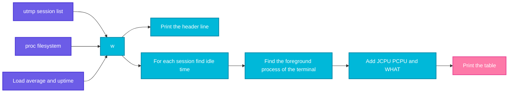

# w

## What is it?
`w` shows **who is logged in right now, and what each of them is doing**. It prints a header line (the time, how long the system is up, how many users are logged in, and the **load average**) and then one line for each session: the user, the terminal, the remote address, the login time, how long the terminal is **idle**, the CPU time that the session used, and the **command that is running now**. It is a combination of `uptime` and `who`, with the current command added. It reads `/var/run/utmp` and `/proc`. It is part of the `procps` package (`procps-ng`), on every distribution.

## Syntax
```bash
w [OPTIONS] [USER]
```
With a `USER`, `w` shows only the sessions of that user. The header line is the same as the output of `uptime`.

### The header line
```text
 10:05:01 up 7 days,  4:20,  2 users,  load average: 1.02, 0.85, 0.60
```
| Part | Meaning |
|------|---------|
| `10:05:01` | The current time |
| `up 7 days, 4:20` | How long the system is running since the last boot |
| `2 users` | The number of login sessions (**not** of different people) |
| `load average: 1.02, 0.85, 0.60` | The average number of processes that wait for the CPU (or for the disk), in the last 1, 5 and 15 minutes. Compare it with the number of CPU cores |

### The columns
| Column | Meaning |
|--------|---------|
| `USER` | The user name of the session |
| `TTY` | The terminal: `pts/N` (SSH or a terminal window), `tty1` (the console) |
| `FROM` | The remote host or address. `-` for a local session. `:0` for an X display |
| `LOGIN@` | The login time (the time of today, or the day and the hour for older sessions) |
| `IDLE` | The time since the last key press in the terminal. `0.00s` means active now |
| `JCPU` | The total CPU time that **all the processes** of the session have used (including background jobs) |
| `PCPU` | The CPU time of the **current process** (the one in the `WHAT` column) |
| `WHAT` | The command that runs in the foreground in the session now |

## Visual Overview
> `w` reads the list of sessions from `utmp`, and for each terminal it finds the foreground process in `/proc`. It adds the idle time and the CPU times, and prints the table under the header with the load average.



## Options/Flags
| Flag | Description |
|------|-------------|
| `-h` / `--no-header` | Do not print the header line (the uptime line and the column names) |
| `-s` / `--short` | Short format: do not show `LOGIN@`, `JCPU` and `PCPU` |
| `-f` / `--from` | Turn the `FROM` column **off** (or on, if it is off by default on your system) |
| `-i` / `--ip-addr` | Show the **IP address** in `FROM`, and not the host name |
| `-u` / `--no-current` | Ignore the user name when it compares the current process and the CPU times (it affects `JCPU` and `PCPU` if a process changed its user with `su`) |
| `-o` / `--old-style` | Old style output: the blank is kept in the columns, and the `IDLE` and `JCPU` times are shown in the old format |
| `-p` / `--pids` | Show the process IDs (in newer `procps-ng`) |
| `USER` | Show only the sessions of `USER` |
| `-V` / `--version` | Show the version |
| `--help` | Show the help text |

## Usage Examples

Let's say we are on the server `web01`. Now it is `2026-10-12 10:05:01`. The server runs since `Oct 5`, and its load is low. These sessions exist:

**Input (the sessions)**:

| User | Terminal | From | Login | Idle | Foreground command |
|------|----------|------|-------|------|--------------------|
| `deploy` | `pts/0` | `10.0.0.5` (host `workstation01`) | 09:45 | 0 s (you, running `w`) | `w` |
| `alice` | `pts/1` | `10.0.0.9` (host `laptop-alice`) | 08:10 | 1 h 20 min | `vim app.conf` |
| `bob` | `pts/2` | `10.0.0.7` (host `bob-pc`) | 09:50 | 4 min 12 s | `top` |

`alice` has run a heavy job in the session (`JCPU` 4 min 20 s). Each example starts again from this state.

### Example 1: Who is logged in, and what are they doing?
**Command:**
```bash
w
```
**Sample Output:**
```text
 10:05:01 up 7 days,  4:20,  3 users,  load average: 1.02, 0.85, 0.60
USER     TTY      FROM             LOGIN@   IDLE   JCPU   PCPU WHAT
deploy   pts/0    10.0.0.5         09:45    0.00s  0.15s  0.01s w
alice    pts/1    10.0.0.9         08:10    1:20m  4:20   0.30s vim app.conf
bob      pts/2    10.0.0.7         09:50    4:12   0.82s  0.60s top
```
`alice` has been idle for 1 hour and 20 minutes, and has `vim` open. `bob` runs `top` (a live view). `deploy` (the current user) runs `w`.

### Example 2: Only one user
**Command:**
```bash
w alice
```
**Sample Output:**
```text
 10:05:01 up 7 days,  4:20,  3 users,  load average: 1.02, 0.85, 0.60
USER     TTY      FROM             LOGIN@   IDLE   JCPU   PCPU WHAT
alice    pts/1    10.0.0.9         08:10    1:20m  4:20   0.30s vim app.conf
```
The header still shows all 3 users.

### Example 3: No header (`-h`)
Good for scripts.

**Command:**
```bash
w -h
```
**Sample Output:**
```text
deploy   pts/0    10.0.0.5         09:45    0.00s  0.15s  0.01s w
alice    pts/1    10.0.0.9         08:10    1:20m  4:20   0.30s vim app.conf
bob      pts/2    10.0.0.7         09:50    4:12   0.82s  0.60s top
```

### Example 4: Short format (`-s`)
It leaves out `LOGIN@`, `JCPU` and `PCPU`.

**Command:**
```bash
w -s
```
**Sample Output:**
```text
 10:05:01 up 7 days,  4:20,  3 users,  load average: 1.02, 0.85, 0.60
USER     TTY      FROM              IDLE WHAT
deploy   pts/0    10.0.0.5          0.00s w
alice    pts/1    10.0.0.9          1:20m vim app.conf
bob      pts/2    10.0.0.7          4:12  top
```

### Example 5: Hide or show the `FROM` column (`-f`)
**Command:**
```bash
w -f
```
**Sample Output:**
```text
 10:05:01 up 7 days,  4:20,  3 users,  load average: 1.02, 0.85, 0.60
USER     TTY      LOGIN@   IDLE   JCPU   PCPU WHAT
deploy   pts/0    09:45    0.00s  0.15s  0.01s w
alice    pts/1    08:10    1:20m  4:20   0.30s vim app.conf
bob      pts/2    09:50    4:12   0.82s  0.60s top
```
On Debian and Ubuntu the `FROM` column is shown by default, and `-f` removes it. On some older or Red Hat based systems the default is the opposite.

### Example 6: Show IP addresses (`-i`)
Without `-i`, `w` can show a **host name** if the login was saved with a name.

**Command:**
```bash
w -i -h
```
**Sample Output:**
```text
deploy   pts/0    10.0.0.5         09:45    0.00s  0.15s  0.01s w
alice    pts/1    10.0.0.9         08:10    1:20m  4:20   0.30s vim app.conf
bob      pts/2    10.0.0.7         09:50    4:12   0.82s  0.60s top
```
A DNS lookup is not done, so the command is fast.

### Example 7: Old style output (`-o`)
**Command:**
```bash
w -o -h
```
**Sample Output:**
```text
deploy   pts/0    10.0.0.5         09:45    0.00s  0.15s  0.01s w
alice    pts/1    10.0.0.9         08:10    1:20m  4:20s  0.30s vim app.conf
bob      pts/2    10.0.0.7         09:50    4:12m  0.82s  0.60s top
```
In the old style the units (`m`, `s`) are shown after all the times, and the `IDLE` time of a terminal that is not idle can be marked by an asterisk.

### Example 8: Ignore the user in the process match (`-u`)
`-u` is for the case where a user used `su` or `sudo`, and the foreground process has another owner. With `-u`, `w` counts the time of such processes for the session as well.

**Command:**
```bash
w -u -h
```
**Sample Output:**
```text
deploy   pts/0    10.0.0.5         09:45    0.00s  0.15s  0.01s w
alice    pts/1    10.0.0.9         08:10    1:20m  4:20   0.30s vim app.conf
bob      pts/2    10.0.0.7         09:50    4:12   0.82s  0.60s top
```
In this example no user switched, so the output is the same.

### Example 9: Show the process IDs (`-p`)
**Command:**
```bash
w -p
```
**Sample Output:**
```text
 10:05:01 up 7 days,  4:20,  3 users,  load average: 1.02, 0.85, 0.60
USER     TTY      FROM             LOGIN@   IDLE   JCPU   PCPU  PID WHAT
deploy   pts/0    10.0.0.5         09:45    0.00s  0.15s  0.01s 4502 w
alice    pts/1    10.0.0.9         08:10    1:20m  4:20   0.30s 3988 vim app.conf
bob      pts/2    10.0.0.7         09:50    4:12   0.82s  0.60s 4460 top
```
The PID is the one of the foreground process. It is available in the newer `procps-ng` (4.0 and later). Older versions say `w: invalid option -- 'p'`.

### Example 10: The load average only
The header of `w` is the same as `uptime`.

**Command:**
```bash
w -h -s | wc -l
uptime
```
**Sample Output:**
```text
3
 10:05:01 up 7 days,  4:20,  3 users,  load average: 1.02, 0.85, 0.60
```
The first command counts the sessions (3 lines without the header).

### Example 11: A user who is not logged in
**Command:**
```bash
w carol
```
**Sample Output:**
```text
 10:05:01 up 7 days,  4:20,  3 users,  load average: 1.02, 0.85, 0.60
USER     TTY      FROM             LOGIN@   IDLE   JCPU   PCPU WHAT
```
Only the header and the column names are shown. The exit code is `0`.

### Example 12: The idle time in detail
`IDLE` is shown as `0.00s`, `4:12` (minutes:seconds), `1:20m` (hours:minutes), or `2days`.

**Command:**
```bash
w -h | awk '{print $1, "idle", $5}'
```
**Sample Output:**
```text
deploy idle 0.00s
alice idle 1:20m
bob idle 4:12
```

### Example 13: Check the version (`-V`)
**Command:**
```bash
w -V
```
**Sample Output:**
```text
w from procps-ng 3.3.17
```

### Example 14: Show the help (`--help`)
**Command:**
```bash
w --help | head -n 4
```
**Sample Output:**
```text

Usage:
 w [options] [user]

```

## Pitfalls / Gotchas
- **`w` shows sessions, not people.** The user `alice` with 3 terminals is 3 lines, and counts as 3 in `3 users`. Count people with `w -h | awk '{print $1}' | sort -u | wc -l`.
- **Only login sessions with a terminal are shown.** Processes that are started by `cron` or `systemd`, and SSH commands without a terminal (`ssh host command`, `scp`, `rsync`) do not appear in `w` (and not in `who`). Use `ps`, `ss`, or `journalctl` for those.
- **`WHAT` is the foreground process only.** A user can have a background job (`nohup`, `tmux`, `screen`) that is not shown. `JCPU` is higher than `PCPU` when background jobs used CPU time.
- **A session in `tmux` or `screen` shows `tmux`, `screen` or the shell** as `WHAT`, and not the real work. Look in `ps` for the tree below it.
- **`IDLE` is the terminal idle time,** not the CPU idle time. A user can be `IDLE 1:20m` but have a long job that runs in the background.
- **The load average is not CPU use.** It counts also the processes that wait for the disk. On a 4-core server, a load of `4.0` means "full", and `1.0` means "one core is busy". Compare it with `nproc`.
- **`FROM` can be empty, `-` or `:0`.** `-` is a local login, `:0` an X display. For a session through `tmux` it is the address of the client that started the original login.
- **Stale entries:** after a crash or a `kill -9` of `sshd`, a user can stay in `utmp` ("ghost user"). `w` then shows a session where no process runs, with `-` as `WHAT`. Clean up with a reboot, or `utmpdump`.
- **A user can hide.** Sessions started with `ssh -T` or with `nologin` may not be recorded. Do not use `w` as a security tool. It is for the administrator to see who is around.
- **`w` is in `procps`, and not in all minimal containers.** In a container there are usually no login sessions at all (the list is empty).
- **Options are not the same on all versions.** `-p` and `-i` depend on the version of `procps-ng`. BSD and macOS `w` have other options (`-n`, `-d`, `-i`).
- **On `systemd` hosts** `loginctl list-sessions` and `loginctl show-session` give more data (the session ID, the service, the scope).

## DevOps Use Cases

### Use Case 1: Is it safe to reboot the server?
**Situation:** You want to restart a server for a kernel update. First see who is working on it.

**Command:**
```bash
w -h
```
**Output:**
```text
alice    pts/1    10.0.0.9         08:10    1:20m  4:20   0.30s vim app.conf
bob      pts/2    10.0.0.7         09:50    4:12   0.82s  0.60s top
```
`alice` has `vim` open (with an unsaved file, maybe). Warn the users first: `wall "Reboot in 10 minutes"`. For a timed warning use `shutdown -r +10 "Kernel update"`.

### Use Case 2: Find out who started a heavy load
**Situation:** The load average is 8. Check who has sessions with a lot of CPU time (`JCPU`).

**Command:**
```bash
w
```
**Output:**
```text
 10:05:01 up 7 days,  4:20,  3 users,  load average: 8.02, 6.85, 3.60
USER     TTY      FROM             LOGIN@   IDLE   JCPU   PCPU WHAT
deploy   pts/0    10.0.0.5         09:45    0.00s  0.15s  0.01s w
alice    pts/1    10.0.0.9         08:10    1:20m  1:04m  0.30s vim app.conf
bob      pts/2    10.0.0.7         09:50    4:12   0.82s  0.60s top
```
`alice` has `JCPU 1:04m`: processes in her session used more than an hour of CPU time, although her `vim` is idle. A job runs in the background. Find it with `ps -u alice --sort=-%cpu`.

### Use Case 3: A security check: logins from unexpected addresses
**Situation:** Show all the sessions that do not come from the company network `10.0.0.0/24`.

**Command:**
```bash
w -h -i | awk '$3 !~ /^10\.0\.0\./ && $3 != "-" {print}'
```
**Output:**
```text
deploy   pts/3    203.0.113.45     10:01    0.00s  0.04s  0.01s w
```
This is a login from the Internet. Compare it with `last -i`, and check `/var/log/auth.log`. Lock the account if it is a surprise (`usermod -L`, `pkill -KILL -t pts/3`).

### Use Case 4: Disconnect an idle session
**Situation:** The security policy says that sessions that are idle for more than 1 hour must be closed. List them and close the terminal.

**Command:**
```bash
w -h | awk '$5 ~ /^[0-9]+:[0-9]+m$|days/ {print $1, $2}'
sudo pkill -KILL -t pts/1
w -h | wc -l
```
**Output:**
```text
alice pts/1
2
```
A permanent solution: `ClientAliveInterval` and `ClientAliveCountMax` in `sshd_config`, or `TMOUT=3600` in `/etc/profile.d/`.

### Use Case 5: Count the number of different users that are logged in
**Situation:** A monitoring script reports the number of different people, and not the number of sessions.

**Command:**
```bash
w -h | awk '{print $1}' | sort -u | wc -l
```
**Output:**
```text
3
```

### Use Case 6: See what a colleague runs before you shut a service down
**Situation:** Before you restart the database, check if somebody runs a command that uses it.

**Command:**
```bash
w -h | grep -E 'psql|mysql|pg_dump'
```
**Output:**
```text
bob      pts/2    10.0.0.7         09:50    0.00s  2:10   2:09 pg_dump mydb
```
`bob` runs a dump now. Wait for it, or talk to `bob` first (`write bob pts/2`).

### Use Case 7: Check a server in a monitoring script (Nagios style)
**Situation:** A check returns a warning if more than 5 users are logged in.

**Command:**
```bash
n=$(w -h | wc -l)
if [ "$n" -gt 5 ]; then echo "WARNING: $n sessions"; exit 1; else echo "OK: $n sessions"; fi
```
**Output:**
```text
OK: 3 sessions
```
The built in plugin `check_users` does the same.

### Use Case 8: Send a message to the users who are logged in
**Situation:** Tell everybody about a maintenance window. `w` shows who gets it, and `wall` sends it.

**Command:**
```bash
w -h | awk '{print $1}' | sort -u | tr '\n' ' '
echo "Maintenance at 11:00, please save your work" | wall
```
**Output:**
```text
alice bob deploy 
Broadcast message from deploy@web01 (pts/0) (Mon Oct 12 10:05:01 2026):

Maintenance at 11:00, please save your work
```
Users with `mesg n` do not get the message (except from `root`).

## Related Commands
- [`who`](who.md) - the simpler list of logged in users, without the commands
- [`last`](last.md) - the history of the logins and the reboots
- [`id`](id.md) / [`whoami`](whoami.md) - your own identity
- [`ps`](../process-management/ps.md) - all the processes of a session or of a user
- [`top`](../process-management/top.md) - the live load of the system
- [`pkill`](../process-management/pkill.md) - end the session of a user (`pkill -KILL -t pts/N`)
- [`watch`](../process-management/watch.md) - repeat `w` every few seconds (`watch -n 5 w`)
- `uptime` - the header line alone
- `loginctl list-sessions` - the `systemd` view of the sessions
- `wall` / `write` - send messages to logged in users
- `tmux` / `screen` - sessions that stay after the user logs out
