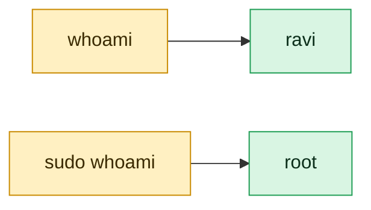

# whoami

## What is it?
`whoami` prints the user name of the effective user ID of the current process, which means the user the commands run as right now.

## Syntax
```bash
whoami [OPTION]
```

## Visual Overview
> `whoami` prints the user name you are running as right now. After `sudo` the answer changes.



## Options/Flags
| Flag | Description |
|------|-------------|
| `--help` | Show help and exit |
| `--version` | Show version and exit |

## Usage Examples

### Example 1: Show the current user
**Command:**
```bash
whoami
```
**Sample Output:**
```text
devops
```

### Example 2: Show the user when running with sudo
**Command:**
```bash
sudo whoami
```
**Sample Output:**
```text
root
```

### Example 3: Show help (`--help`)
**Command:**
```bash
whoami --help
```
**Sample Output:**
```text
Usage: whoami [OPTION]...
Print the user name associated with the current effective user ID.
Same as id -un.

      --help        display this help and exit
      --version     output version information and exit
```
(Extra lines with online help links are omitted.)

### Example 4: Show the version (`--version`)
**Command:**
```bash
whoami --version
```
**Sample Output:**
```text
whoami (GNU coreutils) 8.32
```
(The version number depends on your system, and licence lines are omitted.)

## Pitfalls / Gotchas
- `whoami` shows the effective user. After `su` or `sudo` it shows the new user, not the one who logged in. Use `logname` or `who am i` for the login user.
- `whoami` is the same as `id -un`.
- In containers it often prints `root`, even if you never logged in as root.

## Related Commands
- [`who`](who.md) - list logged in users
- [`sudo`](sudo.md) - run a command as another user
- `id` - show user and group IDs
- `logname` - show the login name

---
<!-- nav -->
[← Previous: `umask`](../permissions/umask.md) | [Learning path](../README.md) | [Next: `id` →](id.md)
