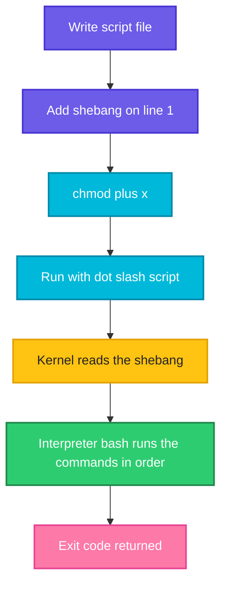

# What Is a Shell Script

## What is it?
A **shell script** is a text file that contains commands, one after another, exactly as you would type them at the prompt. The shell reads the file and runs the commands in order. Scripts turn a task you do by hand, such as "back up this folder, then check the disk, then send a message", into one command you can repeat, schedule with cron, or run in a CI pipeline.

A script is not compiled. There is no build step. You write the file, make it executable and run it.

## Syntax
```bash
#!/bin/bash
# a comment
command1
command2
```

Run it in one of three ways:

```bash
bash script.sh      # run with bash, the file does not need to be executable
./script.sh         # run directly, needs the execute permission and a shebang
source script.sh    # run inside the current shell (also written as . script.sh)
```

## Visual Overview
> The shell reads the first line to learn which program should run the file, then runs the commands from top to bottom, and finally returns an exit code.



## Options/Flags
**The parts of a script**

| Part | Example | Meaning |
|------|---------|---------|
| Shebang | `#!/bin/bash` | First line. Tells the kernel which program runs the file |
| Comment | `# note` | Ignored by the shell. Everything after `#` on a line |
| Command | `echo "hi"` | Any command you can type at the prompt |
| Blank line | | Ignored, use them to group steps |

**Common shebangs**

| Shebang | Meaning |
|---------|---------|
| `#!/bin/bash` | Run with bash at a fixed path |
| `#!/usr/bin/env bash` | Find `bash` in `PATH`, more portable (macOS, NixOS) |
| `#!/bin/sh` | Run with the POSIX shell, no bash features |
| `#!/usr/bin/env python3` | Works for other languages too |

**Ways to run a script**

| Way | Needs `chmod +x` | New process | Changes your current shell |
|-----|------------------|-------------|----------------------------|
| `bash script.sh` | No | Yes | No |
| `./script.sh` | Yes | Yes | No |
| `script.sh` (found in `PATH`) | Yes | Yes | No |
| `source script.sh` or `. script.sh` | No | No | **Yes** (variables, `cd`, functions stay) |

## Usage Examples

### Example 1: Your first script
Let's say we have this file `hello.sh`:

**Input file** (`hello.sh`):
```bash
#!/bin/bash
# My first script
echo "Hello, DevOps"
echo "Today is $(date +%Y)"
```

**Command:**
```bash
bash hello.sh
```
**Sample Output:**
```text
Hello, DevOps
Today is 2026
```
`$(date +%Y)` runs `date` and puts its output into the line. The year depends on when you run it.

### Example 2: Run it directly, it needs the execute bit
Using the `hello.sh` file from Example 1.

**Command:**
```bash
./hello.sh
chmod +x hello.sh
./hello.sh
ls -l hello.sh | awk '{print $1,$9}'
```
**Sample Output:**
```text
bash: ./hello.sh: Permission denied
Hello, DevOps
Today is 2026
-rwxr-xr-x hello.sh
```
The first run fails because the file is not executable. After `chmod +x` the `x` appears in the permissions.

### Example 3: Why the shebang matters
Let's say we have this file `t.sh`, which uses a bash array:

**Input file** (`t.sh`):
```bash
#!/bin/bash
x=(a b c)
echo "${x[1]}"
```

**Command:**
```bash
bash t.sh
sh t.sh
```
**Sample Output:**
```text
b
t.sh: 2: Syntax error: "(" unexpected
```
Arrays are a bash feature. On Ubuntu `sh` is `dash`, a smaller shell that does not know them. If you write `#!/bin/bash` and run it with `./t.sh` you always get bash.

### Example 4: A portable shebang (`env`)
Let's say we have this file `e.sh`:

**Input file** (`e.sh`):
```bash
#!/usr/bin/env bash
echo "env shebang"
```

**Command:**
```bash
chmod +x e.sh
./e.sh
```
**Sample Output:**
```text
env shebang
```
`env` looks up `bash` in `PATH`, so the script works even where bash is not in `/bin`.

### Example 5: A file with no shebang
Let's say we have this file `n.sh`:

**Input file** (`n.sh`):
```bash
echo "no shebang"
```

**Command:**
```bash
chmod +x n.sh
./n.sh
```
**Sample Output:**
```text
no shebang
```
It works because the calling shell guesses and runs it with itself. That guess is not reliable, for example when a Python program or cron starts it. Always write the shebang.

### Example 6: Put the script in `PATH` to run it by name
**Command:**
```bash
mkdir -p bin
cp hello.sh bin/hello
PATH="$PWD/bin:$PATH" hello | head -1
```
**Sample Output:**
```text
Hello, DevOps
```
Installing scripts into `/usr/local/bin` or `~/bin` makes them behave like normal commands.

### Example 7: Run versus `source`
Let's say we have these two files:

**Input file** (`cd.sh`):
```bash
cd /tmp
X=1
```
**Input file** (`lib.sh`):
```bash
MSG=loaded
func(){ echo "in func"; }
```

**Command:**
```bash
cd /tmp/ss1
bash cd.sh
echo "after run: $PWD"
. ./cd.sh
echo "after source: $PWD X=$X"
bash -c 'source lib.sh; echo $MSG; func'
```
**Sample Output:**
```text
after run: /tmp/ss1
after source: /tmp X=1
loaded
in func
```
A script run with `bash` is a **child process**. Its `cd` and variables disappear when it ends. `source` runs the lines in your own shell, so the directory and variables stay. Use `source` for libraries of functions and for `venv/bin/activate`.

### Example 8: Windows line endings break the shebang
Let's say we have this file `crlf.sh`, saved on Windows with CRLF line endings:

**Input file** (`crlf.sh`, the `^M` is a carriage return before each line break):
```text
#!/bin/bash^M
echo hi^M
```

**Command:**
```bash
chmod +x crlf.sh
./crlf.sh
file crlf.sh | cut -d: -f2
sed -i 's/\r$//' crlf.sh
./crlf.sh
```
**Sample Output:**
```text
bash: ./crlf.sh: /bin/bash^M: bad interpreter: No such file or directory
 Bourne-Again shell script, ASCII text executable, with CRLF line terminators
hi
```
The kernel looked for a program called `bash` followed by a carriage return. `sed -i 's/\r$//'` removes them. Configure your editor or Git (`core.autocrlf`) to keep `LF` endings for scripts.

### Example 9: Comments
Let's say we have this file `c.sh`:

**Input file** (`c.sh`):
```bash
#!/bin/bash
# full line comment
echo "visible"   # trailing comment
: <<'COMMENT'
echo "hidden block"
COMMENT
echo "end"
```

**Command:**
```bash
bash c.sh
```
**Sample Output:**
```text
visible
end
```
The `: <<'COMMENT' ... COMMENT` trick turns a block into a here document that nobody reads, a way to comment several lines.

### Example 10: Which bash do I have
**Command:**
```bash
bash --version | head -1 | cut -c1-35
command -v bash
```
**Sample Output:**
```text
GNU bash, version 5.1.16(1)-release
/usr/bin/bash
```
Your version may differ. macOS ships bash 3.2 by default, which lacks newer features such as associative arrays.

## Sample Output
The smallest complete script and its result:

```bash
#!/bin/bash
echo "ready"
```
```text
ready
```

## Pitfalls / Gotchas
- **Always write the shebang** on line 1, with no space before `#` and no blank line above it.
- `#!/bin/sh` scripts must not use bash features such as `[[ ]]`, arrays or `${var,,}`. Test them with `sh script.sh`.
- Running with `bash script.sh` ignores the shebang, running with `./script.sh` uses it.
- **Permission denied** when running `./script.sh` means the file is not executable. Use `chmod +x`.
- `cd` or `export` inside a normal script does not change your shell. Use `source` if that is what you want.
- Do not name a script `test`, `time` or the name of an existing command. The built-in wins and your script is never run.
- Running `script.sh` without `./` only works when its folder is in `PATH`. Not having `.` in `PATH` is a safety feature.
- Windows line endings (`CRLF`) cause `bad interpreter` errors. Fix with `sed -i 's/\r$//'` or `dos2unix`.
- Spaces matter in the shell. `x = 1` is not an assignment, it runs a command called `x`.
- Make a script **idempotent** when you can: running it twice should not break anything. Check before you create, `mkdir -p` is safe to repeat.

## DevOps Use Cases

### Use Case 1: A repeatable health check
**Situation:** The on-call engineer runs the same four checks after every deploy.

Let's say we have this file `check.sh`:

**Input file** (`check.sh`):
```bash
#!/bin/bash
echo "host: $(hostname | sed 's/.*/HOST/')"
echo "kernel: $(uname -s)"
echo "root disk used: $(df -P / | awk 'NR==2 {print $5}' | sed 's/[0-9]*%/N%/')"
echo "check complete"
```

**Command:**
```bash
bash check.sh
```
**Sample Output:**
```text
host: HOST
kernel: Linux
root disk used: N%
check complete
```
Here the hostname and the disk percentage are masked by `sed` so that the sample is stable. In real use you print the real values.

### Use Case 2: Share functions between scripts with `source`
**Situation:** Many deploy scripts need the same `log` function.

Let's say we have this file `lib.sh` (from Example 7) and a script that uses it:

**Input file** (`deploy.sh`):
```bash
#!/bin/bash
source ./lib.sh
func
echo "message is $MSG"
```

**Command:**
```bash
bash deploy.sh
```
**Sample Output:**
```text
in func
message is loaded
```
Keep shared code in one file and `source` it, instead of copying it into every script.

## Related Commands
- [`source`](../linux/shell-basics/source.md) - run a file in the current shell
- [`chmod`](../linux/permissions/chmod.md) - make a script executable
- [`echo`](../linux/shell-basics/echo.md) - print text
- [The permission model](../linux/fundamentals/10-permission-model.md) - what the execute bit means
- [Terminal, shell and bash](../linux/fundamentals/03-terminal-shell-bash.md) - the difference between terminal, shell and bash
- [Variables and strings](02-variables-and-strings.md) - the next page
