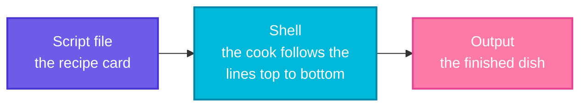
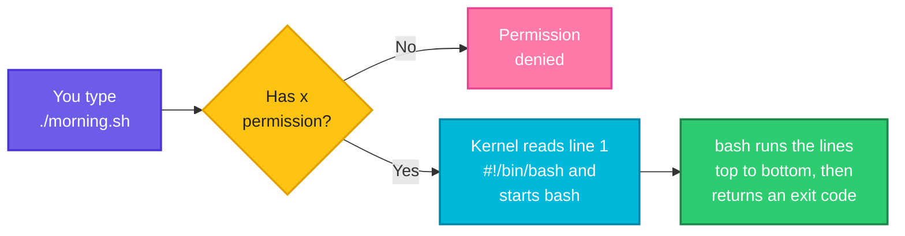

# What Is a Shell Script?

> **By the end of this page** you will have written your own shell script, run it in three different ways, and understood *why* it works. You only need to know how to open a terminal and use `cd` and `ls`. No programming experience is required.

---

## 1. Start with a problem, not a definition

Imagine you are a junior DevOps engineer. Every morning, before anything else, your manager wants you to check the server. So you open the terminal and type:

```bash
date
pwd
df -h /
```

Three small commands. Easy. But tomorrow you must type them again. And the day after. And next month the checklist grows to ten commands, and a colleague asks you to do the same checks on twenty servers.

Now you have a real problem:

- It is **boring**. Typing the same thing every day wastes your time.
- It is **easy to get wrong**. One day you forget a command or make a typo.
- It **cannot be shared**. The checklist lives in your head, not somewhere a teammate can use it.
- It **cannot run while you sleep**. A computer cannot type commands for you at 3 a.m.

What you really want is to say: *"Computer, here are my commands. Remember them. Run them whenever I say."*

**That is exactly what a shell script is.**

---

## 2. The big idea: a recipe card for the computer

Think about cooking. If you cook a dish every day, you do not rely on memory. You write the steps on a **recipe card**, and anyone can follow the card and get the same dish.

A shell script is a recipe card for your computer.

| In the kitchen | In Linux |
|----------------|----------|
| The recipe card | The **script file** (a plain text file) |
| One step on the card | One **command** (`date`, `ls`, `cp`...) |
| The cook who reads the card | The **shell** (usually `bash`) |
| "Follow the steps from top to bottom" | The shell runs the lines **in order, top to bottom** |
| The finished dish | The **output** (or the work done: files copied, servers checked...) |

So here is the definition, in plain words:

> **A shell script is a plain text file that contains commands, one per line. When you run the file, the shell reads it from top to bottom and runs each command, exactly as if you had typed them yourself.**

That is all. Two things worth noticing:

1. **There is nothing new to learn to start.** Every command you already know (`ls`, `cd`, `cp`, `grep`) can go inside a script. If you can type it, you can script it.
2. **A script is just text.** You can open it in any editor. There is no compiler and no special software. You write it, and you run it.

**Read it left to right:** you write the steps once (the recipe card), the shell follows them in order (the cook), and you get the result (the dish).



---

## 3. Write your first script (do this with me)

Open a terminal. First, make an empty folder to practise in, so you cannot break anything important:

```bash
mkdir ~/practice
cd ~/practice
```

Now create a file called `hello.sh`. We will use the `nano` editor, which is available on most Linux systems:

```bash
nano hello.sh
```

Type these two lines exactly as written. Then press **Ctrl+O**, **Enter** (save) and **Ctrl+X** (exit).

Let's say we have this file `hello.sh`:

**Input file** (`hello.sh`):
```bash
echo "Hello! I am a shell script."
echo "Today is $(date +%A)."
```

Now run it. We ask `bash` (the cook) to read our file (the recipe):

**Command:**
```bash
bash hello.sh
```
**Sample Output:**
```text
Hello! I am a shell script.
Today is Tuesday.
```

Congratulations, you just ran a shell script. The day name on your screen will be different, because it is generated at the moment you run the script.

### What exactly just happened?

`bash` opened `hello.sh`, took **line 1**, ran it, then took **line 2**, ran it, and then reached the end of the file and stopped. Nothing more.

Let's read each piece:

| Piece | What it means |
|-------|---------------|
| `echo` | A command that prints text on the screen |
| `"Hello! I am a shell script."` | The text to print. Quotes keep it together as one piece |
| `$( ... )` | "Run the command inside, and paste its answer here" |
| `date +%A` | The `date` command, asking only for the name of the weekday |
| line 1, then line 2 | The shell goes **one line at a time, in order** |

So `$(date +%A)` was replaced by the word `Tuesday` *before* `echo` printed the line. This trick of pasting a command's answer into a line is used in almost every real script.

---

## 4. Make it useful: your morning check

Remember the three commands from the story? Let us put them in a script, and add notes for our future self.

A line that starts with `#` is a **comment**. The shell ignores it completely. It is only for humans. Blank lines are also ignored, so use them to group steps and keep things readable.

Let's say we have this file `morning.sh`:

**Input file** (`morning.sh`):
```bash
# morning.sh - my daily checks, written once, used every day

echo "Good morning!"
echo "Folder : $(pwd)"
echo "Date   : $(date +%d-%b-%Y)"
echo "Disk   :"
df -h / | tail -1
```

**Command:**
```bash
bash morning.sh
```
**Sample Output:**
```text
Good morning!
Folder : /home/devops/practice
Date   : 20-Oct-2026
Disk   :
/dev/sdd       1007G   16G  940G   2% /
```

Your folder name and disk numbers will be different, but the shape is the same. Look at what we gained: **five commands became one**. Tomorrow you type `bash morning.sh` and you are done. A new teammate can run the same file and get the same checks.

Notice the last line: `df -h / | tail -1` uses a pipe (`|`), just like on the command line. Anything that works at the prompt works in a script.

---

## 5. Run it like a real command

Typing `bash` before the file name works, but real tools such as `ls` or `git` do not need it. You can make your script behave the same way. This needs two small things.

### Step 1: Try the obvious way, and see it fail

**Command:**
```bash
./morning.sh
```
**Sample Output:**
```text
bash: ./morning.sh: Permission denied
```

This is the most common beginner moment, so do not worry. Linux does not allow a file to be *run* just because it contains commands. That is a safety rule: a random text file should not be able to run itself. You must explicitly say "this file is allowed to run".

(`./` simply means *"in this folder"*. We will come back to it below.)

### Step 2: Give the file the execute permission

**Command:**
```bash
ls -l morning.sh
chmod +x morning.sh
ls -l morning.sh
```
**Sample Output:**
```text
-rw-r--r-- 1 devops devops 174 Oct 20 10:15 morning.sh
-rwxr-xr-x 1 devops devops 174 Oct 20 10:16 morning.sh
```

`chmod +x` means "change mode, add **x**ecute". Compare the first column before and after: `-rw-r--r--` became `-rwxr-xr-x`. Three `x` letters appeared, and they are the permission to run.

### Step 3: Tell Linux who should read the recipe (the shebang)

When you run `./morning.sh`, Linux needs to know *which program* should read the file. Is it a bash script? A Python script? Something else? You tell it on the **very first line**:

Let's say we now edit `morning.sh` and add one new line at the top:

**Input file** (`morning.sh`):
```bash
#!/bin/bash
# morning.sh - my daily checks, written once, used every day

echo "Good morning!"
echo "Folder : $(pwd)"
echo "Date   : $(date +%d-%b-%Y)"
echo "Disk   :"
df -h / | tail -1
```

That first line, `#!/bin/bash`, is called the **shebang** (from "hash" `#` and "bang" `!`). It means: *"use the program at `/bin/bash` to run this file."*

It looks like a comment because it starts with `#`, but on line **1 only** it has a special meaning. It must be the first line, with nothing above it, not even an empty line.

### Step 4: Run it

**Command:**
```bash
./morning.sh
```
**Sample Output:**
```text
Good morning!
Folder : /home/devops/practice
Date   : 20-Oct-2026
Disk   :
/dev/sdd       1007G   16G  940G   2% /
```

It worked, and you ran your script like a proper command. This is the full picture of what just happened:

**Follow the arrows from the left.** The yellow diamond is the one place it can stop early: no execute permission.



### Why do we write `./` in front of the name?

If you type just `morning.sh`, the shell searches only a fixed list of "system" folders for commands, and your practice folder is not on that list:

**Command:**
```bash
morning.sh
```
**Sample Output:**
```text
bash: morning.sh: command not found
```

`./` says: *"Do not search. The file is right here, in the current folder."* The list of folders the shell searches is called `PATH`, and you will learn it in [page 08](08-environment-variables-and-path.md). For now, remember: **`./name.sh` to run a script from the current folder.**

### The three ways to run a script, side by side

| How you run it | Needs `chmod +x`? | Needs a shebang? | Use it when |
|----------------|-------------------|------------------|-------------|
| `bash morning.sh` | No | No | Quick test, or the file is not executable |
| `./morning.sh` | Yes | Yes | The normal way to run your own scripts |
| `source morning.sh` | No | No | You want the script to change **your current shell** (see section 8) |

---

## 6. Important rule: the shell does not stop when something fails

Here is something that surprises almost every beginner. The shell runs your lines **in order**, and by default it **does not stop** when one of them fails. It prints the error and carries on to the next line.

Let's say we have this file `steps.sh`. Line 2 deliberately asks for a folder that does not exist:

**Input file** (`steps.sh`):
```bash
echo "Step 1: start"
ls /folder-that-does-not-exist
echo "Step 3: still running"
```

**Command:**
```bash
bash steps.sh
echo "exit code: $?"
```
**Sample Output:**
```text
Step 1: start
ls: cannot access '/folder-that-does-not-exist': No such file or directory
Step 3: still running
exit code: 0
```

Look closely at three things:

1. Step 2 failed with an error message.
2. Step 3 **still ran** anyway.
3. `$?` shows the "result" of the last command in the script. `0` means success. So the script reported **success** even though a step in the middle failed. (Because the last line, `echo`, worked fine.)

Why does this matter? Imagine a deploy script where step 2 is "copy the new version" and step 3 is "delete the old version". If the copy fails and the script carries on, you have deleted your only working copy. In later pages you will learn to make scripts stop at the first error ([page 07, exit codes](07-exit-codes.md) and [page 10, safe scripts](10-debugging-and-safe-scripts.md)). For now, just remember: **a script is only a list of commands, and it is as careful as you make it.**

---

## 7. A small taste of what comes next

So far our scripts only ran commands in a straight line. The real power of scripting comes when a script can **repeat** things and **make decisions**. Here is a very small peek. Do not worry about understanding every word; the next pages explain each part slowly.

Let's say we have this file `servers.sh`:

**Input file** (`servers.sh`):
```bash
for server in web1 web2 db1; do
  echo "Checking $server ..."
done
```

**Command:**
```bash
bash servers.sh
```
**Sample Output:**
```text
Checking web1 ...
Checking web2 ...
Checking db1 ...
```

The `for` line says: *"for each name in this list, do the lines between `do` and `done`."* Replace the `echo` with a real health check and you can check 100 servers with the same three lines.

Here is the road ahead:

| You will learn | So that your script can... | Page |
|----------------|---------------------------|------|
| Variables | Remember values (a name, a path, a number) | [02](02-variables-and-strings.md) |
| Conditionals (`if`) | Make decisions: "if the disk is full, send an alert" | [03](03-conditionals.md) |
| Loops (`for`, `while`) | Repeat work for many servers or files | [04](04-loops.md) |
| Functions | Reuse a block of steps under one name | [05](05-functions.md) |
| Arguments | Accept input, like `./deploy.sh production` | [06](06-arguments-and-input.md) |

---

## 8. One more idea: running a script versus sourcing it

When you run `bash script.sh` or `./script.sh`, the shell does not run the lines itself. It hires an **assistant**: a brand new, separate shell (a *child process*) that reads the file, does the work and then disappears. Anything the assistant changes (variables, the folder it moved into) disappears with it.

`source` is different. It means: *"Do not hire an assistant. I will read these lines myself."* So the changes **stay** in your shell.

Let's say we have this file `settool.sh`:

**Input file** (`settool.sh`):
```bash
TOOL=docker
```

**Command:**
```bash
bash settool.sh
echo "after bash   : TOOL is [$TOOL]"
source settool.sh
echo "after source : TOOL is [$TOOL]"
```
**Sample Output:**
```text
after bash   : TOOL is []
after source : TOOL is [docker]
```

With `bash`, the assistant set `TOOL` and then vanished, so your shell never knew about it. With `source`, your own shell set it, so it is still there afterwards.

You will meet `source` in real life constantly: `source venv/bin/activate` (Python), `source ~/.bashrc` (reload your terminal settings), and files full of reusable functions.

By the way, `~/.bashrc` is itself a shell script. Every time you open a terminal, bash runs it for you. You have been using a shell script all along.

---

## 9. Where DevOps engineers use shell scripts

You will find scripts everywhere in real systems:

| Place | What the script does |
|-------|----------------------|
| **Cron jobs** | Backups, log cleanup and reports at fixed times, with nobody logged in |
| **CI/CD pipelines** | Every `run:` or `script:` step in GitHub Actions or GitLab CI is shell commands |
| **Docker** | An `entrypoint.sh` prepares the container (config, waiting for a database) before the app starts |
| **Cloud servers** | "User data" scripts run once at first boot to install and configure the machine |
| **Deployments** | Pull the new code, stop the service, switch the version, start it again, check it is healthy |
| **Server onboarding** | Create users, set permissions, install the standard tools on every new server |
| **Monitoring** | Check disk, memory or a website, and send an alert if something is wrong |
| **Your own shell** | `.bashrc` and `.profile` run each time you open a terminal |

Even tools that are not shell scripts, such as Ansible, Terraform or Kubernetes, are very often started from one.

---

## 10. Common mistakes (and what they look like)

| What you see | Why it happens | How to fix it |
|--------------|----------------|---------------|
| `Permission denied` when running `./script.sh` | The file has no execute permission | `chmod +x script.sh` |
| `command not found` when running `script.sh` | The shell does not search the current folder | Run it as `./script.sh` |
| `bad interpreter: No such file or directory` with a strange `^M` | The file was saved on Windows with CRLF line endings | `sed -i 's/\r$//' script.sh` (or `dos2unix script.sh`) |
| The shebang seems ignored | It is not on line 1 (even an empty line above breaks it) | Make `#!/bin/bash` the very first line |
| `name = value` does not work | Spaces around `=` are not allowed | Write `name=value` (explained on the next page) |
| Your script named `test` does nothing | `test` is already a built-in command and wins | Pick another name, like `run-test.sh` |
| You edited the file but the old behaviour remains | You forgot to save, or you are running a different copy | Save the file, and check with `pwd` and `ls` |

---

## 11. Words to remember

| Word | Simple meaning |
|------|----------------|
| **Script** | A text file full of commands |
| **Shell** | The program that reads your commands and runs them |
| **Bash** | The most common shell on Linux |
| **Comment** | A line starting with `#`. Ignored by the shell, written for humans |
| **Shebang** | `#!/bin/bash` on line 1. Says which program should run the file |
| **Executable** | A file that has the `x` permission and is allowed to run |
| **`./`** | "In the current folder" |
| **Exit code** | A number a script returns when it ends. `0` means success |
| **Child process** | A separate helper shell that runs your script and then disappears |
| **`source`** | Run a file inside your *current* shell instead of a helper |

---

## 12. Try it yourself

Do these in your `~/practice` folder. Breaking a script on purpose teaches more than reading it.

1. **Say hello.** Write `me.sh` that prints your name, today's date and your current folder. Run it with `bash me.sh`, then make it run as `./me.sh`.
2. **Break it.** Remove the execute permission with `chmod -x me.sh` and run `./me.sh`. Read the error. Fix it again.
3. **Watch it keep going.** Write a script with three `echo` lines and one wrong command in the middle (for example `lss`). Predict what prints, then run it and check.
4. **Make a tool.** Write `diskcheck.sh` that prints the date and the output of `df -h /`. Give it a shebang and run it as `./diskcheck.sh`.

<details>
<summary>Hint for exercise 4 (open only after trying)</summary>

```bash
#!/bin/bash
# diskcheck.sh - show the date and the root disk usage
echo "Checked on: $(date)"
df -h /
```

Remember `chmod +x diskcheck.sh` before running `./diskcheck.sh`.
</details>

---

## 13. Quick recap

- A **shell script** is a text file of commands that the shell runs from **top to bottom**.
- Anything you can type at the prompt can go into a script.
- Start the file with `#!/bin/bash` (the **shebang**), save it, then `chmod +x` to allow it to run.
- Run it with `./script.sh` (or `bash script.sh`).
- Lines starting with `#` are **comments**, written for humans.
- By default a script **keeps going after an error**, so you must make it careful.
- `source script.sh` runs the file inside your own shell, so its changes stay.

**Next page:** [02 Variables and strings](02-variables-and-strings.md), where your script learns to remember things.
