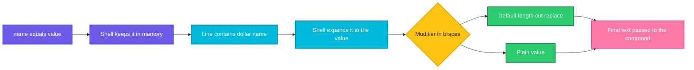

# Variables and Strings

## What is it?
A **variable** is a named place that holds a value, usually text. You store a value with `name=value` and read it back with `$name`. Bash treats almost everything as a **string**, and numbers are strings that you calculate with when you ask for arithmetic. Variables, string tools and arrays are the memory of every script.

## Syntax
```bash
name=value              # assign, no spaces around =
echo "$name"            # read, always in double quotes
echo "${name}"          # braces mark where the name ends
count=$((count + 1))    # arithmetic
today=$(date +%Y)       # command substitution
arr=(a b c)             # indexed array
declare -A map          # associative array (bash 4+)
```

## Visual Overview
> The shell replaces `$name` with the stored value, then runs the line. Different `${...}` forms change the value on the way.



## Options/Flags
**Rules for variable names:** letters, digits and `_`, not starting with a digit. Use `lower_case` for your own variables and `UPPER_CASE` for exported and environment variables.

**Defaults and checks**

| Form | Result |
|------|--------|
| `${v:-default}` | Use `default` if `v` is unset **or empty** |
| `${v-default}` | Use `default` only if `v` is **unset** |
| `${v:=default}` | Like `:-`, and also assign it to `v` |
| `${v:+text}` | `text` if `v` is set and not empty, otherwise nothing |
| `${v:?message}` | Stop with an error message if `v` is unset or empty |

**String operations**

| Form | Result |
|------|--------|
| `${#v}` | Length |
| `${v:pos:len}` | Substring, starts at 0 |
| `${v: -5}` | Last 5 characters (note the space before `-`) |
| `${v#pat}` / `${v##pat}` | Remove the shortest / longest match from the **start** |
| `${v%pat}` / `${v%%pat}` | Remove the shortest / longest match from the **end** |
| `${v/old/new}` | Replace the first match |
| `${v//old/new}` | Replace all matches |
| `${v^^}` / `${v,,}` / `${v^}` | Upper case, lower case, capitalize first letter |

**Arithmetic**

| Form | Meaning |
|------|---------|
| `$((a + b))` | Add, also `-`, `*`, `/`, `%`, `**` |
| `((i++))`, `((i+=3))` | Change a variable, no `$` needed inside |
| `let c=a*2` | Older way, same idea |
| `echo "scale=2; 7/2" \| bc` | Decimal math, bash itself has only integers |

**Arrays and declarations**

| Form | Meaning |
|------|---------|
| `arr=(a b c)` | Indexed array |
| `${arr[1]}` / `${arr[-1]}` | One element / the last one |
| `${arr[@]}` | All elements, each as its own word when quoted |
| `${#arr[@]}` | Number of elements |
| `${!arr[@]}` | The indexes (or keys) |
| `arr+=(x)` | Append |
| `declare -A m` | Associative array, use `m[key]=value` |
| `readonly V=1` / `declare -r V=1` | Constant |
| `declare -i n` | Integer variable |
| `local v` | Variable visible only inside a function |
| `export V` | Pass the variable to child processes |

**Special variables**

| Variable | Meaning |
|----------|---------|
| `$0` | Name of the script |
| `$1` ... `$9` | Arguments |
| `$#` | Number of arguments |
| `$@` / `$*` | All arguments |
| `$?` | Exit code of the last command |
| `$$` | PID of the current shell |
| `$!` | PID of the last background job |

## Usage Examples

### Example 1: Assign and read
Let's say we have this file `v.sh`:

**Input file** (`v.sh`):
```bash
#!/bin/bash
name="devops"
count=3
echo "name=$name count=$count"
echo "braces: ${name}ops"
echo "no braces: $nameops|"
readonly PI=3
PI=4
echo "unset test: [${undefined}]"
unset name; echo "after unset: [$name]"
```

**Command:**
```bash
bash v.sh
```
**Sample Output:**
```text
name=devops count=3
braces: devopsops
no braces: |
v.sh: line 8: PI: readonly variable
unset test: []
after unset: []
```
`$nameops` is a different, empty variable, so use braces `${name}ops`. Changing a `readonly` variable prints an error and the script goes on (in a non interactive shell). Unset variables expand to an empty string, which is a common source of bugs.

### Example 2: Default values (`:-`, `:=`, `:+`, `:?`)
**Command:**
```bash
unset a
echo "${a:-fallback}"
echo "a is [$a]"
echo "${a:=assigned}"
echo "a is [$a]"
echo "${a:+set}"
unset c
( : "${c:?c is required}" )
```
**Sample Output:**
```text
fallback
a is []
assigned
a is [assigned]
set
bash: line 1: c: c is required
```
`:-` only supplies a value, `:=` also stores it. `:?` stops a script that is missing a required value.

### Example 3: Unset versus empty (`:-` and `-`)
**Command:**
```bash
b=""
echo "[${b:-empty-uses-default}]"
echo "[${b-empty-keeps-empty}]"
```
**Sample Output:**
```text
[empty-uses-default]
[]
```
`:-` treats an empty variable like an unset one. `-` does not.

### Example 4: Length and substrings
**Command:**
```bash
f="/var/log/app/server.log"
echo "${#f}"
echo "${f:5:3}"
```
**Sample Output:**
```text
23
log
```

### Example 5: Cut parts of a path (`#`, `##`, `%`, `%%`)
**Command:**
```bash
f="/var/log/app/server.log"
echo "${f##*/}"
echo "${f%/*}"
echo "${f%.log}.bak"
echo "${f#/var}"
echo "${f##*.}"
```
**Sample Output:**
```text
server.log
/var/log/app
/var/log/app/server.bak
/log/app/server.log
log
```
`${f##*/}` is the file name (like `basename`), `${f%/*}` is the folder (like `dirname`), `${f##*.}` is the extension. `#` works from the left, `%` from the right, and the doubled form takes the longest match.

### Example 6: Search and replace
**Command:**
```bash
f="/var/log/app/server.log"
echo "${f/log/LOG}"
echo "${f//log/LOG}"
```
**Sample Output:**
```text
/var/LOG/app/server.log
/var/LOG/app/server.LOG
```

### Example 7: Change case
**Command:**
```bash
s="Hello World"
echo "${s^^}"
echo "${s,,}"
echo "${s^}"
echo "${s: -5}"
echo "${s:0:5}"
```
**Sample Output:**
```text
HELLO WORLD
hello world
Hello World
World
Hello
```

### Example 8: Command substitution (`$( )`)
**Command:**
```bash
today=$(date +%Y)
echo "len=${#today}"
n=$(ls /etc | wc -l)
[ "$n" -gt 10 ] && echo "many files"
echo "files: `echo old-style`"
```
**Sample Output:**
```text
len=4
many files
files: old-style
```
`$( )` runs a command and puts its output into the line. Backticks do the same but cannot be nested, so prefer `$( )`.

### Example 9: Integer arithmetic (`$(( ))`)
**Command:**
```bash
a=7; b=2
echo $((a+b)) $((a-b)) $((a*b)) $((a/b)) $((a%b)) $((a**b))
((a++))
echo $a
let c=a*2
echo $c
i=5; ((i+=3)); echo $i
echo $(( (3+4)*2 ))
```
**Sample Output:**
```text
9 5 14 3 1 49
8
16
8
14
```
Division drops the decimals: `7/2` is `3`.

### Example 10: Decimals need `bc`, and leading zeros are octal
**Command:**
```bash
echo "7/2 = $((7/2))"
echo "scale: $(echo "scale=2; 7/2" | bc)"
echo $((10#08 + 1))
```
**Sample Output:**
```text
7/2 = 3
scale: 3.50
9
```
A number starting with `0` is read as octal, so `$((08 + 1))` is an error. Write `10#08` to force decimal.

### Example 11: Indexed arrays
**Command:**
```bash
arr=(web db cache)
echo "${arr[0]} ${arr[2]}"
echo "${arr[@]}"
echo "${#arr[@]}"
arr+=(queue)
echo "${arr[@]}"
echo "${arr[-1]}"
echo "${!arr[@]}"
unset "arr[1]"
echo "${arr[@]}"
echo "${arr[@]:1:2}"
```
**Sample Output:**
```text
web cache
web db cache
3
web db cache queue
queue
0 1 2 3
web cache queue
cache queue
```
After `unset "arr[1]"` the index `1` is a gap. The indexes become `0 2 3`, and the slice `:1:2` counts elements, so it starts from `cache`.

### Example 12: Associative arrays (key and value)
**Command:**
```bash
declare -A port
port[http]=80
port[ssh]=22
echo "${port[ssh]}"
for k in "${!port[@]}"; do echo "$k=${port[$k]}"; done | sort
echo "${#port[@]}"
```
**Sample Output:**
```text
22
http=80
ssh=22
2
```
The order of keys is not fixed, so sort when the order matters. This needs bash 4 or newer, macOS ships bash 3.2.

### Example 13: Special variables
Let's say we have this file `sp.sh`:

**Input file** (`sp.sh`):
```bash
#!/bin/bash
echo "script=$0 args=$# first=$1 all=$@"
echo "pid ok: $([ $$ -gt 0 ] && echo yes)"
false; echo "last exit: $?"
sleep 0.1 & echo "bg pid ok: $([ -n "$!" ] && echo yes)"
```

**Command:**
```bash
bash sp.sh a b c
```
**Sample Output:**
```text
script=sp.sh args=3 first=a all=a b c
pid ok: yes
last exit: 1
bg pid ok: yes
```

### Example 14: Local and global variables
Let's say we have this file `sc.sh`:

**Input file** (`sc.sh`):
```bash
#!/bin/bash
g="global"
f() { local l="local"; g="changed"; echo "inside: $l $g"; }
f
echo "outside: [$l] $g"
```

**Command:**
```bash
bash sc.sh
```
**Sample Output:**
```text
inside: local changed
outside: [] changed
```
`local` keeps `l` inside the function. Without `local`, a variable set in a function is global, and so is `g`.

### Example 15: Shell variables and `export`
**Command:**
```bash
A=1
export B=2
bash -c 'echo A=[$A] B=[$B]'
```
**Sample Output:**
```text
A=[] B=[2]
```
A child process sees only exported variables. See [Environment variables and PATH](08-environment-variables-and-path.md).

### Example 16: Quote variables or they split
**Command:**
```bash
f="my file.txt"
for x in $f; do echo "word: $x"; done
for x in "$f"; do echo "one: $x"; done
```
**Sample Output:**
```text
word: my
word: file.txt
one: my file.txt
```
Without quotes the value is split at spaces (and `*` in it would expand to file names). Quoting `"$var"` is the single most important habit in shell scripting.

### Example 17: Multi line values
**Command:**
```bash
msg="line1
line2"
echo "$msg"
echo $msg
```
**Sample Output:**
```text
line1
line2
line1 line2
```
The unquoted form squeezes the line break into a space.

### Example 18: Formatted text with `printf`
**Command:**
```bash
printf "%s has %d items (%.1f%%)\n" "cart" 3 42.567
printf "%05d|%-6s|%6s|\n" 42 ab cd
```
**Sample Output:**
```text
cart has 3 items (42.6%)
00042|ab    |    cd|
```
Use `printf` instead of `echo` when you need padding, number formats or predictable output.

## Sample Output
A small script that uses several of the features above:

```bash
env_name="${1:-staging}"
file="/etc/app/${env_name}.conf"
echo "config: $file, name length: ${#env_name}"
```
```text
config: /etc/app/staging.conf, name length: 7
```

## Pitfalls / Gotchas
- **No spaces around `=`.** `x = 5` runs a command named `x`. Write `x=5`.
- **Quote every expansion**: `"$var"`, `"$@"`, `"$(cmd)"`. Unquoted values split on spaces and expand `*`.
- Use `${name}` when text follows the variable, `$name_file` is read as the variable `name_file`.
- Variables set in a pipeline's right side or in `$( )` do not survive in the parent shell: `echo hi | read x` leaves `x` empty. Use `read x <<< "hi"` or process substitution.
- Plain `var=value` is **not** passed to child processes. Use `export` or `VAR=value command` for one command.
- Arithmetic is integer only, and numbers with a leading `0` are octal.
- `${v:-x}` and `${v-x}` differ for empty values, use `:-` unless you really need the other.
- Names like `PATH`, `HOME`, `USER`, `PWD` and `IFS` are special. Do not reuse them by accident.
- An unset variable inside `rm -rf "$DIR/"` becomes `rm -rf /`. Use `${DIR:?}` or `set -u`, see [Debugging and safe scripts](10-debugging-and-safe-scripts.md).
- Arrays are bash only. `#!/bin/sh` scripts cannot use them.
- `${s: -5}` needs the space, `${s:-5}` means "default value 5".

## DevOps Use Cases

### Use Case 1: A required setting with a safe default
**Situation:** A deploy script takes the environment name from the first argument and falls back to `staging`.

**Command:**
```bash
set -- ""
env_name="${1:-staging}"
echo "deploying to $env_name"
set -- production
env_name="${1:-staging}"
echo "deploying to $env_name"
```
**Sample Output:**
```text
deploying to staging
deploying to production
```
`set --` sets the positional arguments for the demonstration. In a real script `$1` is the first argument you pass.

### Use Case 2: Build a backup file name with the date
**Situation:** Each backup needs a unique name.

**Command:**
```bash
src="/var/log/app/server.log"
base="${src##*/}"
stamp="$(date +%Y%m%d | sed 's/[0-9]/N/g')"
echo "${base%.log}-${stamp}.log.bak"
```
**Sample Output:**
```text
server-NNNNNNNN.log.bak
```
The `sed` only masks the digits so that the sample output does not depend on the day. Real scripts leave `stamp="$(date +%Y%m%d)"`.

### Use Case 3: Loop over a list of services
**Situation:** Check the same thing for several services.

**Command:**
```bash
services=(web db cache)
for s in "${services[@]}"; do echo "checking $s"; done
echo "total: ${#services[@]}"
```
**Sample Output:**
```text
checking web
checking db
checking cache
total: 3
```

### Use Case 4: Map a service name to a port
**Situation:** A health check needs the port of each service.

**Command:**
```bash
declare -A port=([web]=80 [ssh]=22 [db]=5432)
for s in web ssh db; do echo "$s listens on ${port[$s]}"; done
```
**Sample Output:**
```text
web listens on 80
ssh listens on 22
db listens on 5432
```

### Use Case 5: Take a file name apart
**Situation:** Rename `app-1.4.2.tar.gz` to `app-1.4.2.bak` without calling `basename` or `sed`.

**Command:**
```bash
f="/srv/releases/app-1.4.2.tar.gz"
name="${f##*/}"
echo "$name"
echo "${name%.tar.gz}.bak"
echo "${f%/*}"
```
**Sample Output:**
```text
app-1.4.2.tar.gz
app-1.4.2.bak
/srv/releases
```

## Related Commands
- [What is a shell script](01-what-is-a-shell-script.md) - the previous page
- [Conditionals](03-conditionals.md) - the next page
- [Quoting](../linux/fundamentals/07-quoting.md) - why `"$var"` matters
- [`echo`](../linux/shell-basics/echo.md) - print variables
- [`printf`](../linux/text-processing/printf.md) - formatted output
- [`export`](../linux/shell-basics/export.md) / [`env`](../linux/shell-basics/env.md) - environment variables
- [`set`](../linux/shell-basics/set.md) - shell options and positional arguments
- [`read`](../linux/shell-basics/read.md) - read a value from the user or a file
