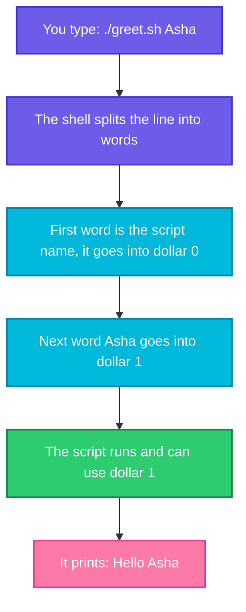

# Input: Arguments and `read`

> **Before this page:** you should have read [01 What is a shell script](01-what-is-a-shell-script.md) and [02 Variables](02-variables.md). You know how to write a script, run it with `./script.sh`, and store values in variables.
>
> **By the end of this page** your script will be able to take different values every time you run it, without anyone editing the file.

---

## 1. Start with a problem

In the last page you made `morning.sh` check a disk, with the disk stored in a variable at the top:

```bash
DISK="/"
```

That was a big improvement. But look at what it takes to check a **different** disk today:

1. Open the file in an editor.
2. Find the line.
3. Change `/` to `/var`.
4. Save.
5. Run the script.

And tomorrow you change it back. If five teammates use the script, each one keeps their own edited copy, and soon nobody knows which copy is the right one.

It is like a coffee machine where you have to open it up and rewire it each time you want tea instead of coffee. A good machine has **buttons**. You press a button, and the machine does the rest. What we want is:

```bash
./morning.sh /var
./morning.sh /home
```

Same script, different input, no editing. **That is what arguments give you.**

---

## 2. The big idea: placing an order

Imagine ordering at a coffee shop. You do not walk into the kitchen. You tell the person at the counter:

> *"A latte, large."*

The staff already know *how* to make drinks. Your words are only the **details of this order**. The shell works the same way. After the name of your script you can type extra words. Those words are called **arguments**, and the shell hands them to your script as ready-made variables:

```text
./order.sh   latte   large
    |          |       |
   $0         $1      $2
```

| Part of the line | Becomes the variable | Meaning |
|------------------|----------------------|---------|
| `./order.sh` | `$0` | The name of the script itself |
| `latte` | `$1` | The **first** argument |
| `large` | `$2` | The **second** argument |

You already know variables from page 02. Arguments are simply variables that are **filled in by whoever runs the script**, not by the script itself.



---

## 3. Your first argument (do this with me)

Go to your practice folder (`cd ~/practice`) and create `greet.sh`.

Let's say we have this file `greet.sh`:

**Input file** (`greet.sh`):
```bash
#!/bin/bash
echo "Hello, $1"
```

**Command:**
```bash
chmod +x greet.sh
./greet.sh Asha
./greet.sh Ravi
```
**Sample Output:**
```text
Hello, Asha
Hello, Ravi
```

One file, two different results. We never opened the script to change a name. The word we typed after the script name became `$1`.

---

## 4. More than one argument

Arguments are numbered in the order you type them: `$1`, `$2`, `$3` and so on. They are separated by spaces.

Let's say we have this file `order.sh`:

**Input file** (`order.sh`):
```bash
#!/bin/bash
echo "Drink : $1"
echo "Size  : $2"
```

**Command:**
```bash
chmod +x order.sh
./order.sh latte large
```
**Sample Output:**
```text
Drink : latte
Size  : large
```

### The special variables that come with arguments

You get a few extra variables for free. Let's see all of them at once.

Let's say we have this file `args.sh`:

**Input file** (`args.sh`):
```bash
#!/bin/bash
echo "Script name : $0"
echo "First       : $1"
echo "Second      : $2"
echo "Third       : $3"
echo "How many    : $#"
echo "All of them : $@"
```

**Command:**
```bash
chmod +x args.sh
./args.sh apple banana cherry
```
**Sample Output:**
```text
Script name : ./args.sh
First       : apple
Second      : banana
Third       : cherry
How many    : 3
All of them : apple banana cherry
```

| Variable | What it holds | Easy way to remember |
|----------|---------------|----------------------|
| `$0` | The script's own name | "zero" is the script itself |
| `$1`, `$2`, ... | The first, second... argument | The order slip |
| `$#` | **How many** arguments were given | `#` means "number of" |
| `$@` | **All** the arguments together | `@` means "all of them" |

You will use `$#` to check that the user gave enough arguments, once you learn decisions (`if`) in a few pages. And `$@` becomes powerful with loops, where you can say "do this for every argument".

---

## 5. Arguments with spaces need quotes

The shell separates arguments at **spaces**. So what if a single value contains a space, like a full name?

**Command:**
```bash
./greet.sh Asha Rao
./greet.sh "Asha Rao"
```
**Sample Output:**
```text
Hello, Asha
Hello, Asha Rao
```

Without quotes, `Asha` became `$1` and `Rao` became `$2`. Our script only prints `$1`, so `Rao` was ignored. With quotes, the shell keeps `Asha Rao` together as **one** argument.

> **Two places for quotes, two different jobs.**
> - On the **command line**, `"Asha Rao"` keeps the words together as one argument.
> - **Inside the script**, `"$1"` keeps the value together when it is used. (This is the habit from page 02.) Always write `"$1"`, not bare `$1`, in anything that really matters.

---

## 6. What if the user forgets the argument?

Run `greet.sh` with nothing after it.

**Command:**
```bash
./greet.sh
```
**Sample Output:**
```text
Hello, 
```

No error. `$1` simply does not exist, so it is empty, exactly like the misspelled variable in page 02. A script that expects a server name and receives nothing can do something dangerous with an empty value.

The proper fix is to *check* and refuse to continue. That needs decisions (`if`), which come in a later page. But there is a gentle trick you can use right now: **a default value.**

```bash
${1:-friend}
```

Read it as: *"Use `$1`. But if it is missing or empty, use `friend` instead."*

Let's say we have this file `greet3.sh`:

**Input file** (`greet3.sh`):
```bash
#!/bin/bash
name="${1:-friend}"
echo "Hello, $name"
```

**Command:**
```bash
chmod +x greet3.sh
./greet3.sh
./greet3.sh Asha
```
**Sample Output:**
```text
Hello, friend
Hello, Asha
```

With a default, the script behaves sensibly even when the user types nothing. The shape is always `${something:-default}`.

---

## 7. Upgrade `morning.sh`: no more editing

Now we can fix the problem from the start of this page. The disk becomes an argument, with `/` as the default.

Let's say we now have this file `morning.sh`:

**Input file** (`morning.sh`):
```bash
#!/bin/bash
# morning.sh - usage: ./morning.sh [disk]

DISK="${1:-/}"
today=$(date +%d-%b-%Y)

echo "Date : $today"
echo "Disk : $DISK"
df -h "$DISK" | tail -1
```

**Command:**
```bash
chmod +x morning.sh
./morning.sh
./morning.sh /run
```
**Sample Output:**
```text
Date : 20-Oct-2026
Disk : /
/dev/sdd       1007G   16G  940G   2% /
Date : 20-Oct-2026
Disk : /run
none            3.8G  1.2M  3.8G   1% /run
```

Run with no argument, it checks `/` as before. Run with `/run`, it checks that location instead. Your numbers will look different, but the idea is the same: **one script, many uses.**

The comment on line 2, `usage: ./morning.sh [disk]`, is a good habit. It tells the next person how to run the script. The square brackets mean "optional".

---

## 8. Asking a question while the script runs: `read`

Arguments are given **before** the script starts. Sometimes a script should instead **stop and ask** the person in front of the keyboard. For that there is the `read` command.

`read` waits for the user to type something and press **Enter**, then puts the typed text in a variable. Think of it as a form field: *"Please fill in your name here."*

Let's say we have this file `ask.sh`:

**Input file** (`ask.sh`):
```bash
#!/bin/bash
read -p "What is your name? " name
echo "Hello, $name"
```

**Command:**
```bash
chmod +x ask.sh
./ask.sh
```
**What you see in the terminal** (the `Asha` after the question is typed by you):
```text
What is your name? Asha
Hello, Asha
```

Two pieces:

- `-p "What is your name? "` shows a **prompt**, the question on the screen.
- `name` is the variable that receives your answer. Note that it is written **without** `$`, because we are filling it, not reading it. (Rule 2 from page 02.)

### Asking more than one thing

Let's say we have this file `ask2.sh`:

**Input file** (`ask2.sh`):
```bash
#!/bin/bash
read -p "Server name: " server
read -p "Port: " port
echo "Connecting to $server on port $port"
```

**Command:**
```bash
chmod +x ask2.sh
./ask2.sh
```
**What you see in the terminal** (you type `web1` and `8080`):
```text
Server name: web1
Port: 8080
Connecting to web1 on port 8080
```

### A default answer

You can combine `read` with the default trick from section 6, so pressing **Enter** alone means "use the usual one".

Let's say we have this file `ask3.sh`:

**Input file** (`ask3.sh`):
```bash
#!/bin/bash
read -p "Environment [dev]: " env
env="${env:-dev}"
echo "Deploying to $env"
```

**Command:**
```bash
chmod +x ask3.sh
./ask3.sh
```
**What you see in the terminal** (you only press Enter):
```text
Environment [dev]: 
Deploying to dev
```

### Secret input: `read -s`

For a password, you do not want the characters to appear on the screen. The `-s` option means **silent**.

Let's say we have this file `secret.sh`:

**Input file** (`secret.sh`):
```bash
#!/bin/bash
read -s -p "Password: " pw
echo
echo "You typed ${#pw} characters"
```

**Command:**
```bash
chmod +x secret.sh
./secret.sh
```
**What you see in the terminal** (you type `hunter22`, which stays invisible):
```text
Password: 
You typed 8 characters
```

The extra `echo` just moves to a new line after the invisible typing. `${#pw}` means "the length of `pw`", and we print only the length, never the secret itself.

---

## 9. Arguments or `read`: which one should I use?

They solve the same problem in different ways, and the choice matters a lot in DevOps.

| | Arguments (`$1`) | `read` |
|---|------------------|--------|
| Values come from | The command line, before the script starts | The person at the keyboard, while it runs |
| Best for | **Automation**: cron, CI/CD pipelines, other scripts | **Humans**: a one-time wizard or a confirmation |
| Works with nobody watching | Yes | **No** |
| Easy to repeat | Yes, you can save the exact command | You have to type the answers again |

The most important line is **"works with nobody watching"**. A cron job at 3 a.m. and a CI pipeline have no keyboard. If your script stops to ask a question, nobody can answer, and it hangs or fails. Let's see what `read` gets when there is no one to type:

**Command:**
```bash
./ask.sh < /dev/null
```
**Sample Output:**
```text
Hello, 
```

`< /dev/null` means "input from nowhere" (the empty device from the filesystem page). `read` got nothing and moved on with an empty name. This is exactly what happens in an unattended job.

> **A good rule:** let your script take values from **arguments**. Use `read` only for things a human must decide, like "Are you sure you want to delete this? (yes/no)".

> **A safety note:** do not pass secrets such as passwords as arguments (`./login.sh myPassword`). Anyone on the machine can see a running command's arguments with tools like `ps`, and they also end up in your shell history. Use `read -s`, or a proper secrets tool, for sensitive values.

---

## 10. Common mistakes at a glance

| What you did | What goes wrong | Fix |
|--------------|-----------------|-----|
| Forgot `chmod +x` | `Permission denied` | `chmod +x script.sh` (page 01) |
| Typed `./greet.sh Asha Rao` | `Rao` is `$2`, not part of the name | Quote it: `"Asha Rao"` |
| Wrote `echo $1` in the middle of a command, unquoted | Values with spaces split apart | Quote it: `"$1"` |
| Ran with no argument | `$1` is empty and the script silently continues | Give it a default `${1:-value}`, or check (a later page) |
| Used `$name` in `read -p "..." $name` | `read` needs the bare name | `read -p "..." name` |
| Put a script with `read` in cron | It hangs or reads nothing | Use arguments for automation |
| Passed a password as an argument | It is visible to others and kept in history | `read -s` |
| Expected `$1` to be the script's name | `$0` is the script, `$1` is the first argument | Count from `$1` |

---

## 11. Words to remember

| Word | Simple meaning |
|------|----------------|
| **Argument** | A word typed after the script name, handed to the script |
| **`$1`, `$2`...** | The first, second... argument |
| **`$0`** | The name of the script itself |
| **`$#`** | How many arguments were given |
| **`$@`** | All the arguments together |
| **`${1:-default}`** | "Use the first argument, or the default if it is missing" |
| **`read`** | Pause and let the user type an answer into a variable |
| **Prompt** | The question shown to the user (`read -p "..."`) |
| **Interactive** | A person is at the keyboard answering |
| **Unattended** | Nobody is watching, like cron and CI |

---

## 12. Try it yourself

1. **Say hello to anyone.** Write `hello.sh` that prints `Hello, <name>!` using `$1`. Run it with two different names. Then run it with no name and add a default.
2. **Do some maths.** Write `square.sh` so that `./square.sh 7` prints `49`. (Hint: page 02, section 10.)
3. **Add two numbers.** Write `add.sh` so that `./add.sh 4 9` prints `4 + 9 = 13`.
4. **Count the words.** Write `count.sh` that prints how many arguments it received. Run `./count.sh a b c d` and then `./count.sh "a b c d"`. Explain why the answers differ.
5. **A tiny interview.** Write `profile.sh` that uses `read` to ask for a name and a city, then prints a sentence. Pressing Enter on the city should default to `Pune`.
6. **Upgrade your report.** Take your `morning.sh` and add a second argument for the team name, with a default of `Platform team`.

<details>
<summary>Answer for exercise 4 (open only after trying)</summary>

```bash
#!/bin/bash
echo "I received $# arguments"
```

`./count.sh a b c d` prints `4`, because the shell splits at the spaces into four arguments. `./count.sh "a b c d"` prints `1`, because the quotes keep it together as a single argument.
</details>

---

## 13. Quick recap

- **Arguments** are words typed after the script name. The shell hands them over as `$1`, `$2`, `$3`...
- `$0` is the script's own name, `$#` is how many arguments there are, `$@` is all of them.
- Quote arguments that contain spaces on the command line (`"Asha Rao"`), and quote variables inside the script (`"$1"`).
- A missing argument is silently **empty**. Use `${1:-default}` to give it a safe default.
- `read -p "Question? " variable` pauses the script and lets a human type an answer. `read -s` hides the typing.
- Use **arguments** for anything that must run unattended. Use `read` only when a person is present to answer.
- Never pass secrets as arguments.

**Next page:** [04 Exit codes](04-exit-codes.md), where you will learn how a script knows whether a command worked, and how your own script reports success or failure.
