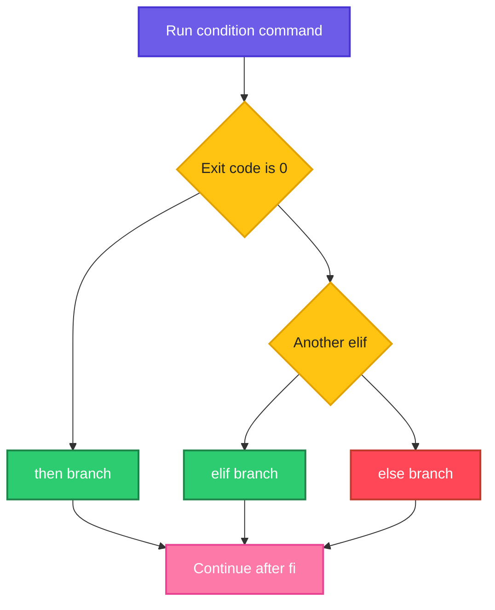

# Conditionals

## What is it?
A **conditional** lets a script choose what to do. The shell runs a command, looks at its **exit code**, and treats `0` as true and anything else as false. `if`, `case`, `&&` and `||` all work this way. The tests `[ ]`, `[[ ]]` and `(( ))` are just commands that return `0` or `1`, built to compare strings, numbers and files.

## Syntax
```bash
if CONDITION; then
  commands
elif OTHER; then
  commands
else
  commands
fi

case "$var" in
  pattern1)  commands ;;
  pattern2|pattern3) commands ;;
  *)  default ;;
esac

command1 && command2     # run command2 only if command1 succeeded
command1 || command2     # run command2 only if command1 failed
```

## Visual Overview
> The shell runs the condition command. Exit code 0 takes the `then` branch, any other code takes `elif` or `else`.



## Options/Flags
**Three kinds of test**

| Form | Use for | Notes |
|------|---------|-------|
| `[ expr ]` | Strings, numbers, files in any POSIX shell | Same as `test expr`. Needs spaces inside and **quotes** around variables |
| `[[ expr ]]` | Same in bash, plus patterns and regex | No word splitting, supports `&&`, `\|\|`, `==` glob, `=~` regex |
| `(( expr ))` | Integer math | Variables need no `$`, `<`, `>`, `%`, `&&` behave like in C |

**Numbers** (use inside `[ ]` and `[[ ]]`)

| Test | Meaning |
|------|---------|
| `-eq` / `-ne` | Equal / not equal |
| `-lt` / `-le` | Less than / less or equal |
| `-gt` / `-ge` | Greater than / greater or equal |

**Strings**

| Test | Meaning |
|------|---------|
| `"$a" = "$b"` | Equal (`==` also works in bash) |
| `"$a" != "$b"` | Not equal |
| `-z "$a"` | Empty |
| `-n "$a"` | Not empty |
| `[[ $a == pat* ]]` | Glob pattern match |
| `[[ $a =~ regex ]]` | Regular expression match, see [Regular expressions](../linux/fundamentals/12-regular-expressions.md) |
| `[[ $a < $b ]]` | Alphabetical order (not numeric) |
| `-v name` | Variable is set (bash 4.2+) |

**Files**

| Test | True if |
|------|---------|
| `-e p` | Exists |
| `-f p` | Is a regular file |
| `-d p` | Is a directory |
| `-L p` | Is a symbolic link |
| `-s p` | Exists and is not empty (size greater than 0) |
| `-r p` / `-w p` / `-x p` | Readable / writable / executable by you |
| `a -nt b` / `a -ot b` | `a` is newer / older than `b` |

**Combining**

| Form | Meaning |
|------|---------|
| `! cond` | Not |
| `[ a ] && [ b ]` or `[[ a && b ]]` | And |
| `[ a ] \|\| [ b ]` or `[[ a \|\| b ]]` | Or |
| `{ cmd1; cmd2; }` | Group commands without a sub shell |
| `:` | A command that does nothing and returns 0 |

## Usage Examples

### Example 1: `if`, `elif`, `else`
Let's say we have this file `if.sh`:

**Input file** (`if.sh`):
```bash
#!/bin/bash
n=$1
if [ "$n" -gt 10 ]; then
  echo "$n is big"
elif [ "$n" -eq 10 ]; then
  echo "$n is ten"
else
  echo "$n is small"
fi
```

**Command:**
```bash
bash if.sh 20
bash if.sh 10
bash if.sh 3
```
**Sample Output:**
```text
20 is big
10 is ten
3 is small
```

### Example 2: Number comparisons
**Command:**
```bash
a=5; b=9
[ $a -lt $b ] && echo lt
[ $a -le 5 ] && echo le
[ $a -ne $b ] && echo ne
[ $b -ge 9 ] && echo ge
(( a < b )) && echo "arith lt"
```
**Sample Output:**
```text
lt
le
ne
ge
arith lt
```

### Example 3: `<` and `>` compare text, not numbers
**Command:**
```bash
[ 10 -gt 9 ] && echo "10>9 numeric"
[[ 10 > 9 ]] && echo "10 sorts after 9 as text"
[[ 2 > 10 ]] && echo "2 > 10 as strings"
```
**Sample Output:**
```text
10>9 numeric
2 > 10 as strings
```
As text, `10` sorts **before** `9` (because `1` comes before `9`), so the second test is false and prints nothing. And `2` sorts after `10`, so the third is true. Use `-gt` or `(( ))` for numbers.

### Example 4: String tests
**Command:**
```bash
s="abc"
[ "$s" = "abc" ] && echo eq
[ "$s" != "x" ] && echo ne
[ -n "$s" ] && echo nonempty
[ -z "" ] && echo empty
[[ $s == a* ]] && echo glob
[[ $s =~ ^a.c$ ]] && echo regex
[[ "$s" < "abd" ]] && echo less
```
**Sample Output:**
```text
eq
ne
nonempty
empty
glob
regex
less
```

### Example 5: File tests
Let's say we have a folder with a directory `d`, an empty file `f.txt`, a file `g.txt` that contains `data`, and a link `l` to `f.txt`:

**Input file** (listing):
```text
d/
f.txt      (empty)
g.txt      (contains: data)
l -> f.txt
```

**Command:**
```bash
for p in f.txt d g.txt l nope; do
  printf "%s:" $p
  [ -e $p ] && printf " exists"
  [ -f $p ] && printf " file"
  [ -d $p ] && printf " dir"
  [ -L $p ] && printf " link"
  [ -s $p ] && printf " nonempty"
  [ -r $p ] && printf " readable"
  [ -w $p ] && printf " writable"
  [ -x $p ] && printf " exec"
  echo
done
```
**Sample Output:**
```text
f.txt: exists file readable writable
d: exists dir nonempty readable writable exec
g.txt: exists file nonempty readable writable
l: exists file link readable writable
nope:
```
A link is both `-f` (tests follow links) and `-L`. A directory counts as `-s` because its own size is greater than zero, so use `-s` only for files. `f.txt` is not `-s` because it is empty.

### Example 6: Compare file ages (`-nt`, `-ot`)
Let's say we have `old.txt` dated 2026-01-01 and `new.txt` dated 2026-06-01.

**Command:**
```bash
[ new.txt -nt old.txt ] && echo "new is newer"
[ old.txt -ot new.txt ] && echo "old is older"
```
**Sample Output:**
```text
new is newer
old is older
```

### Example 7: And, or, not
**Command:**
```bash
x=5
[ $x -gt 1 ] && [ $x -lt 10 ] && echo "between"
[[ $x -gt 1 && $x -lt 10 ]] && echo "between2"
[ $x -lt 1 ] || echo "not below"
[ ! -f nofile ] && echo "no such file"
! [ -f nofile ] && echo bang
```
**Sample Output:**
```text
between
between2
not below
no such file
bang
```

### Example 8: `||` inside an `if`
**Command:**
```bash
x=3
if [ "$x" -lt 1 ] || [ "$x" -gt 5 ]; then echo out; else echo in; fi
```
**Sample Output:**
```text
in
```

### Example 9: `case` with patterns
Let's say we have this file `case.sh`:

**Input file** (`case.sh`):
```bash
#!/bin/bash
case "$1" in
  start)   echo "starting" ;;
  stop|halt) echo "stopping" ;;
  restart) echo "restarting" ;;
  [0-9]*)  echo "starts with a digit" ;;
  *.log)   echo "a log file" ;;
  "")      echo "empty" ;;
  *)       echo "unknown: $1" ;;
esac
```

**Command:**
```bash
for a in start halt restart 7up app.log x ""; do bash case.sh "$a"; done
```
**Sample Output:**
```text
starting
stopping
restarting
starts with a digit
a log file
unknown: x
empty
```
`case` uses **glob patterns**, not regexes. `|` means "or" and `*` is the catch all. Each branch ends with `;;`, and the first match wins.

### Example 10: A `case` can continue with `;&` and `;;&`
**Command:**
```bash
case "a" in a) echo one ;;& a|b) echo two ;; esac
```
**Sample Output:**
```text
one
two
```
`;;&` keeps testing the next patterns. A plain `;;` stops at the first match.

### Example 11: Integer tests with `(( ))`
**Command:**
```bash
x=7
if (( x % 2 )); then echo odd; else echo even; fi
(( x > 5 && x < 10 )) && echo range
```
**Sample Output:**
```text
odd
range
```
`(( ))` is true when the result is not zero, so `x % 2` is true for odd numbers.

### Example 12: Use any command as the condition
**Command:**
```bash
if grep -q root /etc/passwd; then echo "root exists"; fi
if ! grep -q nosuchuser /etc/passwd; then echo "no such user"; fi
if ls /nonexistent >/dev/null 2>&1; then echo yes; else echo "ls failed"; fi
if command -v bash >/dev/null; then echo "bash installed"; fi
```
**Sample Output:**
```text
root exists
no such user
ls failed
bash installed
```
`grep -q` is silent and only returns an exit code, which makes it ideal for `if`. This is the most common shape of conditional in real scripts.

### Example 13: A one line choice
**Command:**
```bash
x=4
r=$(( x > 3 ? 1 : 0 )); echo $r
[ $x -gt 3 ] && echo big || echo small
[ $x -gt 9 ] && echo big || echo small
```
**Sample Output:**
```text
1
big
small
```

### Example 14: The `&& ||` trap
**Command:**
```bash
true && false || echo "ran else"
[ 1 -eq 1 ] && { echo first; false; } || echo "else runs even though condition true"
```
**Sample Output:**
```text
ran else
first
else runs even though condition true
```
`A && B || C` is **not** `if A then B else C`. If `B` fails, `C` runs too. Use a real `if` when `B` can fail.

### Example 15: A branch that does nothing (`:`)
**Command:**
```bash
if true; then :; fi
echo ok
```
**Sample Output:**
```text
ok
```
An empty branch is a syntax error in bash. `:` is the "do nothing" command.

### Example 16: `[` is a command, spaces are required
**Command:**
```bash
[ 1 -eq 1]
echo rc=$?
[1 -eq 1]
echo rc=$?
```
**Sample Output:**
```text
bash: line 1: [: missing `]'
rc=2
bash: line 1: [1: command not found
rc=127
```
`[` is a command and `]` is its last argument, so both need a space on each side.

### Example 17: Unquoted empty variable breaks `[ ]`
**Command:**
```bash
x=""
[ $x = a ]
echo rc=$?
[ "$x" = a ]
echo rc=$?
[[ $x = a ]]
echo rc=$?
```
**Sample Output:**
```text
bash: line 1: [: =: unary operator expected
rc=2
rc=1
rc=1
```
Unquoted, `[ $x = a ]` becomes `[ = a ]`, which is a syntax error. Quote the variable in `[ ]`, or use `[[ ]]`, which needs no quotes.

### Example 18: `[` and `[[` are different things
**Command:**
```bash
type [
type [[
```
**Sample Output:**
```text
[ is a shell builtin
[[ is a shell keyword
```
`[` is a command, so it follows the normal rules for arguments. `[[` is part of the shell syntax.

### Example 19: Is a variable set (`-v`) or just empty (`-z`)
**Command:**
```bash
unset v
[ -v v ] || echo "v unset"
v=""
[ -v v ] && echo "v set but empty"
[ -z "${v}" ] && echo "v empty"
```
**Sample Output:**
```text
v unset
v set but empty
v empty
```

### Example 20: Case insensitive comparison
**Command:**
```bash
a=Yes
[[ ${a,,} == yes ]] && echo ci-match
shopt -s nocasematch
[[ $a == YES ]] && echo nocase
```
**Sample Output:**
```text
ci-match
nocase
```

### Example 21: Several checks at once
**Command:**
```bash
f=/etc/passwd
if [[ -f $f && -r $f && -s $f ]]; then echo "usable"; fi
```
**Sample Output:**
```text
usable
```

### Example 22: Am I root
**Command:**
```bash
if [ "$(id -u)" -eq 0 ]; then echo root; else echo "not root"; fi
```
**Sample Output:**
```text
not root
```
Run it with `sudo` to see `root`.

### Example 23: Is input coming from a pipe
**Command:**
```bash
echo "hello" | bash -c '[ -t 0 ] && echo tty || echo "stdin is a pipe"'
```
**Sample Output:**
```text
stdin is a pipe
```
`-t 0` is true when standard input is a terminal. Scripts use it to decide whether to ask questions.

## Sample Output
The standard shape of a guarded step:

```bash
if [ -f /etc/passwd ]; then
  echo "file found"
else
  echo "file missing"
fi
```
```text
file found
```

## Pitfalls / Gotchas
- **Spaces are required**: `[ "$a" = "$b" ]`. `["$a"="$b"]` is a different, broken command.
- **Quote variables inside `[ ]`**. An empty or spaced value changes the number of arguments. In `[[ ]]` quoting is not needed on the left.
- Use `=` or `==` for strings and `-eq` for numbers. `[ "01" = "1" ]` is false, `[ 01 -eq 1 ]` is true.
- `<` and `>` inside `[ ]` are **redirections** unless you escape them (`\<`). Use `[[ ]]` or `(( ))`.
- `[[ ]]`, `(( ))` and `=~` are bash only. A script with `#!/bin/sh` must use `[ ]`.
- Do not quote the right side of `=~`, and do not quote the pattern in `[[ $a == pat* ]]` if you want a glob.
- `A && B || C` is not an if/else, see Example 14.
- Exit code `0` is **true** in the shell, the opposite of most languages.
- `[ -f $file ]` with an empty `$file` becomes `[ -f ]`, which is **true** (it tests whether `-f` is a non empty string). Always quote.
- `if` takes any command, so a typo such as `if [ -z $x]` is a command error, not a false.
- `-s` on a directory is true. Use `-f` first.
- A `case` pattern list uses globs: `*.log` matches names, `[0-9]*` matches text that begins with a digit.
- Forgetting `;;` at the end of a `case` branch is a syntax error.

## DevOps Use Cases

### Use Case 1: Run a step only if a file exists
**Situation:** A deploy script loads local overrides when the file is there.

**Command:**
```bash
cfg=/etc/passwd
[ -r "$cfg" ] && echo "loading $cfg" || echo "using defaults"
cfg=/nonexistent.conf
[ -r "$cfg" ] && echo "loading $cfg" || echo "using defaults"
```
**Sample Output:**
```text
loading /etc/passwd
using defaults
```

### Use Case 2: Refuse to run as the wrong user
**Situation:** An install script needs root.

Let's say we have this file `need-root.sh`:

**Input file** (`need-root.sh`):
```bash
#!/bin/bash
if [ "$(id -u)" -ne 0 ]; then
  echo "run as root" >&2
  exit 1
fi
echo "installing"
```

**Command:**
```bash
bash need-root.sh
echo "exit code: $?"
```
**Sample Output:**
```text
run as root
exit code: 1
```

### Use Case 3: Check that a required tool is installed
**Situation:** A CI job needs `curl` and `jq` before it starts.

**Command:**
```bash
for tool in bash definitely-not-installed; do
  if command -v "$tool" >/dev/null 2>&1; then
    echo "ok: $tool"
  else
    echo "missing: $tool"
  fi
done
```
**Sample Output:**
```text
ok: bash
missing: definitely-not-installed
```

### Use Case 4: A service control script with `case`
**Situation:** One script for `start`, `stop` and `restart`, like an init script.

Using the `case.sh` file shown in Example 9.

**Command:**
```bash
bash case.sh start
bash case.sh restart
bash case.sh bogus
```
**Sample Output:**
```text
starting
restarting
unknown: bogus
```
Real service scripts exit with an error and print a usage line in the `*)` branch.

### Use Case 5: Alert when the disk is almost full
**Situation:** A cron job warns when `/` is above a limit.

**Command:**
```bash
used=$(df -P / | awk 'NR==2 {gsub("%",""); print $5}')
limit=101
if [ "$used" -ge "$limit" ]; then echo "ALERT disk full"; else echo "disk ok (limit $limit)"; fi
```
**Sample Output:**
```text
disk ok (limit 101)
```
The limit `101` makes the demonstration always pass. A real alert uses `80` or `90`.

## Related Commands
- [Variables and strings](02-variables-and-strings.md) - the previous page
- [Loops](04-loops.md) - the next page
- [`test`](../linux/shell-basics/test.md) - the command behind `[ ]`
- [`grep`](../linux/text-processing/grep.md) - `grep -q` as a condition
- [`id`](../linux/user-management/id.md) - check who is running the script
- [Regular expressions](../linux/fundamentals/12-regular-expressions.md) - used with `[[ =~ ]]`
- [Exit codes](07-exit-codes.md) - what true and false really are
