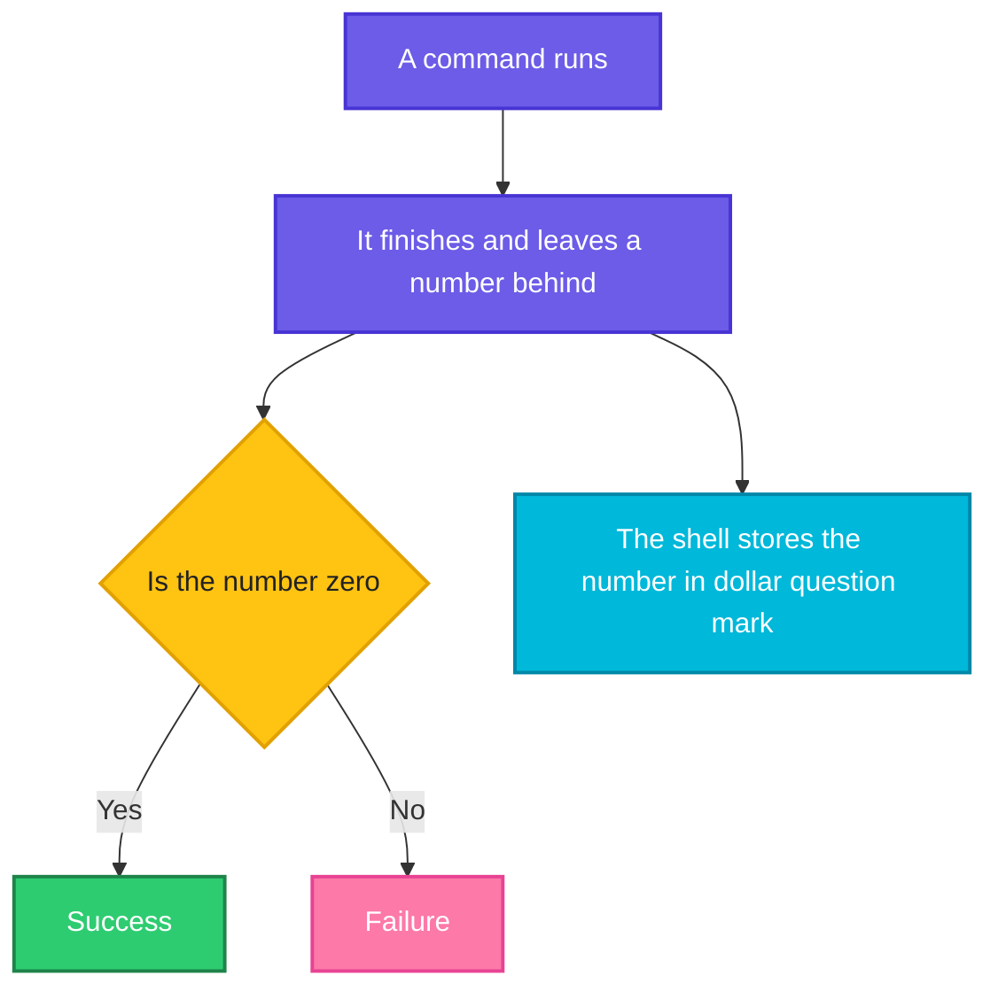

# Exit Codes: Did It Work?

> **Before this page:** you have read pages [01](01-what-is-a-shell-script.md), [02](02-variables.md) and [03](03-arguments-and-input.md). You can write a script, use variables and take arguments.
>
> **By the end of this page** your script will know whether each command worked, and it will be able to tell the world whether *it* worked.

---

## 1. Start with a problem: the script that lies

Remember page 01, section 6? A script kept running after a step failed, and then reported success. Let's look at that problem in a script that looks more like real life.

Let's say we have this file `lie.sh`. It is meant to copy a file to a backup folder and then announce that it is finished. The file `missing.txt` does **not** exist, and the folder `backup` does:

**Input file** (`lie.sh`):
```bash
#!/bin/bash
echo "Step 1: copy the file"
cp missing.txt backup/
echo "Step 2: Deploy complete!"
```

**Command:**
```bash
chmod +x lie.sh
./lie.sh
echo "code: $?"
```
**Sample Output:**
```text
Step 1: copy the file
cp: cannot stat 'missing.txt': No such file or directory
Step 2: Deploy complete!
code: 0
```

The copy **failed**. The script still said "Deploy complete!". And the final `code: 0` is the script telling the world "everything went well".

That is a script that lies. If this ran in a CI/CD pipeline, the pipeline would turn **green**, the team would believe the deploy worked, and the broken release would go live.

To fix it we need two abilities:

1. **Find out** whether a command worked.
2. **Tell others** whether our script worked.

Both use the same small idea: the **exit code**.

---

## 2. The big idea: the thumbs-up number

Whenever any command finishes, it leaves behind a small **number**, like a receipt, to say how it went. This number is the **exit code** (also called the *exit status* or *return code*).

| Number | Meaning |
|--------|---------|
| `0` | **Success.** Everything went fine |
| `1` to `255` | **Something went wrong.** The exact number hints at what |

> **Remember this, it surprises everyone at first: `0` means success.**
> Think of it as "zero problems". Any other number is "this many kinds of trouble".

You never see this number on screen, because it is handed quietly to the shell. But the shell stores it in a special variable you already met in page 01: **`$?`** (read it as "the result of the last command").

Let's check it with two commands, one that works and one that fails:

**Command:**
```bash
ls /etc/hostname
echo "exit code: $?"
ls /nope
echo "exit code: $?"
```
**Sample Output:**
```text
/etc/hostname
exit code: 0
ls: cannot access '/nope': No such file or directory
exit code: 2
```

`ls` on a real file gave `0`. `ls` on a missing path gave a non-zero number. The exact number (here `2`) depends on the command, so **never rely on the specific number unless the command's manual says so**. The only rule that always holds is `0` versus not `0`.



### `$?` only remembers the LAST command

The number is overwritten after **every** command, including `echo`. So read it immediately, or copy it into a variable.

**Command:**
```bash
ls /nope 2>/dev/null
echo "first: $?"
echo "second: $?"
```
**Sample Output:**
```text
first: 2
second: 0
```

The first `echo` printed the result of `ls` (`2`). But that `echo` itself succeeded, so by the time the second one ran, `$?` was `0`. If you need the number later, save it: `result=$?`.

(`2>/dev/null` just hides the error message so the output stays short. You met these redirections in the Linux fundamentals.)

---

## 3. The numbers you will actually meet

You do not need to memorise a table of hundreds. These few appear all the time:

| Code | Meaning | Typical cause |
|------|---------|---------------|
| `0` | Success | It worked |
| `1` | General failure | The most common "something went wrong" |
| `2` | Wrong usage or a missing file | `ls` or `grep` on a path that does not exist |
| `126` | Found it, but cannot run it | Forgot `chmod +x` |
| `127` | Command not found | A typo, or a program that is not installed |

You can see the last two for yourself.

**Command:**
```bash
lss
echo "code: $?"
```
**Sample Output:**
```text
bash: lss: command not found
code: 127
```

Let's say we have a plain file `plain.sh` that was never made executable:

**Input file** (`plain.sh`):
```bash
echo hi
```

**Command:**
```bash
./plain.sh
echo "code: $?"
```
**Sample Output:**
```text
bash: ./plain.sh: Permission denied
code: 126
```

When a pipeline fails in CI, the exit code is often the first clue. `127` almost always means "that tool is not installed on this machine".

### A surprise: "not found" can be a non-zero code, too

`grep` searches text. Its code means: `0` = found a match, `1` = **no match**, `2` = real error. "No match" is not an error, but it is not "success" either.

Let's say we have this file `app.log`:

**Input file** (`app.log`):
```text
INFO started
ERROR disk full
INFO done
```

**Command:**
```bash
grep ERROR app.log
echo "code: $?"
grep CRITICAL app.log
echo "code: $?"
grep ERROR missing.log
echo "code: $?"
```
**Sample Output:**
```text
ERROR disk full
code: 0
code: 1
grep: missing.log: No such file or directory
code: 2
```

Three different answers from the same command: *found it*, *nothing there*, and *something is really wrong*. Reading the exit code is how scripts tell these apart.

---

## 4. Act on the result: `&&` and `||`

You now know a command leaves a number. How does the script *use* it? The simplest tools are two little operators. Read them in plain English:

| Operator | Read it as | The second command runs when... |
|----------|------------|----------------------------------|
| `A && B` | "A, **and then** B" | A **succeeded** (code 0) |
| `A \|\| B` | "A, **or else** B" | A **failed** (non-zero) |

**Command:**
```bash
ls /etc/hostname > /dev/null && echo "found it"
ls /nope 2>/dev/null || echo "not found"
```
**Sample Output:**
```text
found it
not found
```

`> /dev/null` and `2>/dev/null` hide the noise, so you only see our own messages.

A very common real-life use is "create a folder, **and then** say so", or "try this, **or else** explain":

**Command:**
```bash
mkdir backup && echo "created backup folder"
mkdir backup || echo "could not create it"
```
**Sample Output:**
```text
created backup folder
mkdir: cannot create directory ‘backup’: File exists
could not create it
```

The first `mkdir` worked, so the `echo` after `&&` ran. The second failed because the folder already exists, so the `echo` after `||` ran.

### `&&` versus the plain semicolon `;`

A semicolon means "next command, no matter what". `&&` means "next command, **only if it worked**". The difference can save you from a disaster:

**Command:**
```bash
cd /nope ; echo "I still ran"
cd /nope && echo "I will not run"
```
**Sample Output:**
```text
bash: cd: /nope: No such file or directory
I still ran
bash: cd: /nope: No such file or directory
```

Imagine the second command was `rm -rf *` instead of `echo`. With `;`, if the `cd` fails, you delete everything in the folder **you were already in**. With `&&`, nothing is deleted. **When the second step depends on the first, join them with `&&`.**

---

## 5. Give your script an exit code: `exit`

Now the second ability: telling others how *your* script went. The command is **`exit`**, followed by a number. It stops the script immediately and hands that number to whoever ran it.

Let's say we have this file `fail.sh`:

**Input file** (`fail.sh`):
```bash
#!/bin/bash
echo "working..."
exit 3
```

**Command:**
```bash
chmod +x fail.sh
./fail.sh
echo "code: $?"
```
**Sample Output:**
```text
working...
code: 3
```

You chose `3`. Use `exit 0` for success and `exit 1` (or another non-zero number) for failure.

**What if you write no `exit` at all?** The script returns the exit code of its **last command**. That is exactly why `lie.sh` returned `0`: the last line was an `echo`, which always works.

### Fix the lying script

We can now make the script stop at the first failure, using `||` and `exit`. Read the key line as *"copy the file, **or else** exit with failure"*:

Let's say we have this file `careful.sh`:

**Input file** (`careful.sh`):
```bash
#!/bin/bash
echo "Step 1: copy the file"
cp missing.txt backup/ || exit 1
echo "Step 2: Deploy complete!"
```

**Command:**
```bash
chmod +x careful.sh
./careful.sh
echo "code: $?"
```
**Sample Output:**
```text
Step 1: copy the file
cp: cannot stat 'missing.txt': No such file or directory
code: 1
```

Compare it with `lie.sh`:

- "Deploy complete!" is **never printed**, because the script stopped.
- The exit code is `1`, so a pipeline would turn **red** and the team would know something broke.

Adding `|| exit 1` after an important command is the simplest way to make a script honest. You do not need `if` for it.

---

## 6. Upgrade `morning.sh`: refuse a bad disk

Last page, `morning.sh` took a disk as an argument. But what if someone types a disk that does not exist? Let's make the script stop with a clear failure.

Let's say we now have this file `morning.sh`:

**Input file** (`morning.sh`):
```bash
#!/bin/bash
# morning.sh - usage: ./morning.sh [disk]

DISK="${1:-/}"

# Stop right away if the disk does not exist
df "$DISK" > /dev/null || exit 1

echo "Date : $(date +%d-%b-%Y)"
echo "Disk : $DISK"
df -h "$DISK" | tail -1
```

**Command:**
```bash
./morning.sh
echo "code: $?"
./morning.sh /nope
echo "code: $?"
```
**Sample Output:**
```text
Date : 20-Oct-2026
Disk : /
/dev/sdd       1007G   16G  940G   2% /
code: 0
df: /nope: No such file or directory
code: 1
```

The check line runs `df` just to see if it works. `> /dev/null` throws away its normal output, so nothing extra is printed, but an **error message** still appears. If `df` fails, `|| exit 1` ends the script with code `1`. With a good disk the script runs normally and finishes with `0`.

---

## 7. A trap: pipes report only the last command

A pipe (`|`) connects commands in a chain. The exit code of the whole chain is the code of the **last** command only. A failure earlier in the chain is hidden.

**Command:**
```bash
ls /nope 2>/dev/null | wc -l
echo "code: $?"
```
**Sample Output:**
```text
0
code: 0
```

`ls` failed, but the chain's code is that of `wc`, which counted zero lines successfully. This is why a failing step inside a pipeline can slip through unnoticed. Later in the series you will learn a setting (`set -o pipefail`) that fixes this. For now: **do not trust `$?` blindly after a pipe.**

---

## 8. Why DevOps engineers care so much

Exit codes are the universal way programs talk to each other. Everything in DevOps listens to them:

| Who listens | What they do with a non-zero code |
|-------------|-----------------------------------|
| **CI/CD pipelines** (GitHub Actions, GitLab CI, Jenkins) | Mark the job **red** and stop the pipeline |
| **cron** | Records or emails the failure |
| **systemd** | Can restart a failed service automatically |
| **Docker** | `docker run` returns the container's exit code, so a script can react |
| **Kubernetes** | A container that exits non-zero is restarted, and may show `CrashLoopBackOff` |
| **Other scripts** | Use `&&`, `\|\|` and `if` to decide what to do next |

That is why a script that always exits `0`, like `lie.sh`, is dangerous: it removes the one signal the whole toolchain depends on.

---

## 9. Looking ahead

You can now **ask** a command "did you work?" with `$?`, and react using `&&` and `||`. In the next page you will learn the proper tool for making decisions, **`if`**, which also works by looking at exit codes. Where you wrote:

```bash
cp missing.txt backup/ || exit 1
```

you will soon be able to write a longer, more flexible version with several branches, messages and checks. You will also learn a handy switch that makes a script stop at the first failure automatically.

---

## 10. Common mistakes at a glance

| What you did | What goes wrong | Fix |
|--------------|-----------------|-----|
| Expected `0` to mean "false" | It means **success**. This one trips everybody | Read `0` as "zero problems" |
| Ran `echo` before reading `$?` | The `echo` replaced the value with `0` | Read `$?` immediately, or save it: `result=$?` |
| Used `;` where steps depend on each other | The second step runs even after a failure | Use `&&` |
| Ended a script without `exit` after an error | The script returns the last command's code, often `0` | Add `\|\| exit 1`, or `exit 1` |
| Trusted `$?` after a pipe | Only the last command counts | Check steps separately (more later) |
| Relied on a specific number like `2` | Different commands use different numbers | Test only "zero or not zero" |
| Treated `grep` code `1` as a crash | `1` just means "no match" | Check the manual for the command |
| Used `exit 256` or higher | Codes wrap around between 0 and 255 | Stay in the range 0 to 255 |

---

## 11. Words to remember

| Word | Simple meaning |
|------|----------------|
| **Exit code** | The number a command leaves behind to say how it went |
| **`0`** | Success |
| **Non-zero** | Failure, the number hints at the reason |
| **`$?`** | The exit code of the last command |
| **`&&`** | "And then" - run the next command only if this one worked |
| **`\|\|`** | "Or else" - run the next command only if this one failed |
| **`exit N`** | Stop the script now and report the code `N` |
| **127** | Command not found |
| **126** | Found, but not allowed to run |

---

## 12. Try it yourself

1. **Read the numbers.** Run `true`, then `echo $?`. Run `false`, then `echo $?`. What are the two codes?
2. **Success and failure.** Write `check.sh` that runs `ls /etc/hostname` and finishes with `exit 0`, then a second script `check2.sh` that runs `ls /nope` and finishes with `exit 1`. Run each and print `$?`.
3. **Honest copy.** Write `copy.sh` that takes a file name as `$1`, copies it into a folder called `backup`, and exits with `1` if the copy fails. Run it with a real file and with a missing one, and print `$?` both times.
4. **Safe cd.** Write one line that moves into `/nope` **and only then** prints `deleting...`. Show that "deleting..." never appears.
5. **Find the problem.** What is wrong with this one-liner, and what is the fix?
   ```bash
   cd /var/backups ; rm -rf *
   ```
6. **Compare two searches.** Run `grep root /etc/passwd` and then `grep zzzzz /etc/passwd`, printing `$?` after each. Which one gives `0` and which gives `1`? Which one printed nothing, and why is that not a crash?

<details>
<summary>Answer for exercise 5 (open only after trying)</summary>

If `cd /var/backups` fails (for example, the folder does not exist), the `;` makes the shell run `rm -rf *` anyway, **in whatever folder you were in**, and deletes everything there. Use `&&` so the delete only runs if the `cd` worked:

```bash
cd /var/backups && rm -rf *
```
</details>

---

## 13. Quick recap

- Every command leaves an **exit code**. **`0` means success**, anything else means failure.
- Read it with **`$?`**, immediately, because the next command replaces it.
- `A && B` runs B only if A **worked**. `A || B` runs B only if A **failed**.
- Use `&&` instead of `;` when the next step depends on the previous one.
- **`exit N`** ends your script and reports `N`. With no `exit`, the script returns the code of its last command, which can be a lie.
- `command || exit 1` is the simplest way to make a script stop at a failure.
- A pipe only reports the code of its **last** command.
- CI pipelines, cron, systemd, Docker and Kubernetes all react to exit codes.

**Next page:** [05 Operators](05-operators.md), where you will learn the symbols and words used to calculate and compare, so that the decisions in the page after it are easy.
