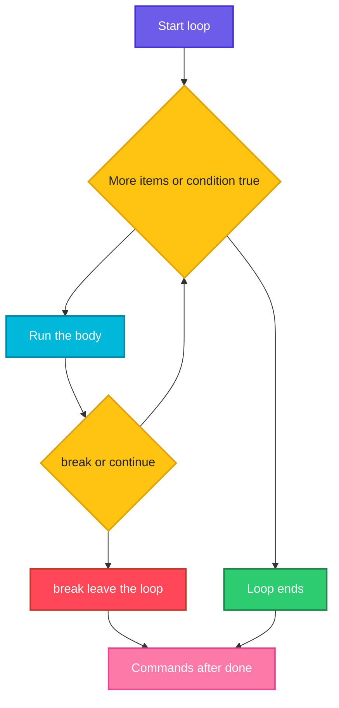

# Loops

## What is it?
A **loop** repeats a block of commands. Use `for` when you have a list of things to go through (files, servers, numbers), `while` to repeat as long as a condition is true (read a file line by line, wait for a service), and `until` to repeat until a condition becomes true (retry until it works). `break` leaves a loop early and `continue` skips to the next round.

## Syntax
```bash
for item in LIST; do
  commands
done

for ((i=0; i<5; i++)); do      # C style
  commands
done

while CONDITION; do
  commands
done

until CONDITION; do
  commands
done

while read -r line; do         # read a file line by line
  commands
done < file
```

## Visual Overview
> A loop checks its condition (or takes the next item from the list), runs the body, and goes back to the start until it has nothing left or a condition stops it.



## Options/Flags
**Loop forms**

| Form | Use for |
|------|---------|
| `for x in a b c` | A fixed list of words |
| `for x in {1..5}` / `{0..20..5}` / `{a..e}` | Number and letter ranges (the second form has a step) |
| `for x in "${arr[@]}"` | Every element of an array |
| `for f in *.log` | Every file matching a pattern |
| `for a in "$@"` | Every script argument |
| `for ((i=0; i<n; i++))` | A counter, C style |
| `while CMD` | Repeat while the command succeeds |
| `until CMD` | Repeat until the command succeeds |
| `while read -r line` | Every line of a file or command output |

**Control words**

| Word | Meaning |
|------|---------|
| `break` | Leave the loop |
| `break 2` | Leave two nested loops |
| `continue` | Skip to the next round |
| `continue 2` | Continue the outer loop |
| `:` | Do nothing (an empty loop body) |
| `true` / `false` | Always success / always failure, used as `while true` |

**Helpful tools for loops**

| Tool | Use |
|------|-----|
| `seq A B C` | Print a number sequence (`seq 2 2 8`) |
| `read -r a b` | Read a line into variables, `-r` keeps backslashes |
| `IFS=: read -r a b` | Split the line on another separator |
| `mapfile -t arr < file` | Read a file into an array, one element per line |
| `wait` | Wait for background jobs |
| `shopt -s nullglob` | Make an unmatched pattern expand to nothing |
| `$SECONDS` | Seconds since the shell started, handy for time limits |

For the examples let's say we have these files in the current directory:

**Input file** (`users.txt`):
```text
alice 30
bob 25
carol 41
```
**Input file** (`hosts.txt`, the third line is empty):
```text
web
db

cache
```
**Input file** (`pw.txt`):
```text
root:x:0:0
bin:x:1:1
```
**Input file** (listing of other files, all empty):
```text
a.log
b.log
my file.log
c.txt
```

## Usage Examples

### Example 1: `for` over a list
**Command:**
```bash
for s in web db cache; do echo "service: $s"; done
```
**Sample Output:**
```text
service: web
service: db
service: cache
```

### Example 2: Ranges and sequences
**Command:**
```bash
for i in {1..5}; do printf "$i "; done; echo
for i in {0..20..5}; do printf "$i "; done; echo
for c in {a..e}; do printf "$c"; done; echo
for i in $(seq 3); do printf "$i "; done; echo
seq 2 2 8 | tr "\n" " "; echo
```
**Sample Output:**
```text
1 2 3 4 5 
0 5 10 15 20 
abcde
1 2 3 
2 4 6 8 
```
`{1..5}` is expanded by the shell and cannot use variables. For `1..$n` use `seq 1 "$n"` or the C style loop.

### Example 3: C style loop
**Command:**
```bash
for ((i=1; i<=3; i++)); do echo "i=$i"; done
for ((i=10; i>0; i-=4)); do printf "$i "; done; echo
```
**Sample Output:**
```text
i=1
i=2
i=3
10 6 2 
```

### Example 4: Loop over files
**Command:**
```bash
for f in *.log; do echo "log: $f"; done
for f in *.txt; do echo "txt: ${f%.txt}"; done
```
**Sample Output:**
```text
log: a.log
log: b.log
log: my file.log
txt: c
txt: hosts
txt: users
```
The pattern is expanded **before** the loop, so file names with spaces stay in one piece. `${f%.txt}` removes the extension, see [Variables and strings](02-variables-and-strings.md).

### Example 5: A pattern that matches nothing
**Command:**
```bash
for f in *.nomatch; do echo "got: $f"; done
shopt -s nullglob
for f in *.nomatch; do echo "got: $f"; done
echo "after nullglob"
```
**Sample Output:**
```text
got: *.nomatch
after nullglob
```
With no match, bash keeps the pattern as plain text, so the loop runs once with the text `*.nomatch`. `nullglob` makes the loop run zero times.

### Example 6: Never loop over `$(ls)`
**Command:**
```bash
for f in $(ls *.log); do echo "[$f]"; done
```
**Sample Output:**
```text
[a.log]
[b.log]
[my]
[file.log]
```
The output of `ls` is split at spaces, so `my file.log` becomes two items. Use `for f in *.log` instead.

### Example 7: Read a file line by line (`while read`)
**Command:**
```bash
while read -r name age; do echo "$name is $age"; done < users.txt
```
**Sample Output:**
```text
alice is 30
bob is 25
carol is 41
```
`read` splits each line into the variables you name. The last variable takes the rest of the line.

### Example 8: A loop after a pipe runs in a sub shell
**Command:**
```bash
n=0
cat users.txt | while read -r l; do n=$((n+1)); done
echo "n after pipe: $n"
n=0
while read -r l; do n=$((n+1)); done < users.txt
echo "n after redirect: $n"
```
**Sample Output:**
```text
n after pipe: 0
n after redirect: 3
```
Each side of a pipe is a **sub shell**, so changes to `n` inside the loop are lost. Redirect the file into the loop (`done < file`) when you need the variables afterwards.

### Example 9: Skip empty lines
**Command:**
```bash
while read -r h; do
  [ -z "$h" ] && continue
  echo "host: $h"
done < hosts.txt
```
**Sample Output:**
```text
host: web
host: db
host: cache
```

### Example 10: Split on a different character (`IFS`)
**Command:**
```bash
while IFS=: read -r user x uid gid; do echo "$user has uid $uid"; done < pw.txt
```
**Sample Output:**
```text
root has uid 0
bin has uid 1
```
`IFS=:` applies only to that `read`. This is how `/etc/passwd` is parsed.

### Example 11: The last line without a newline
Let's say we have this file `nonl.txt`, whose last line has no line break:

**Input file** (`nonl.txt`):
```text
one
two
```
(the file ends right after `two`, without a newline)

**Command:**
```bash
while read -r l; do echo "got $l"; done < nonl.txt
echo "--"
while read -r l || [ -n "$l" ]; do echo "got $l"; done < nonl.txt
```
**Sample Output:**
```text
got one
--
got one
got two
```
`read` returns failure at the end of input, even when it did read text. The `|| [ -n "$l" ]` check keeps the final partial line.

### Example 12: `while` with a counter
**Command:**
```bash
n=3
while [ $n -gt 0 ]; do echo "countdown $n"; n=$((n-1)); done
echo liftoff
```
**Sample Output:**
```text
countdown 3
countdown 2
countdown 1
liftoff
```

### Example 13: `until`
**Command:**
```bash
n=0
until [ $n -ge 3 ]; do echo "n=$n"; ((n++)); done
```
**Sample Output:**
```text
n=0
n=1
n=2
```

### Example 14: `break` and `continue`
**Command:**
```bash
for i in 1 2 3 4 5 6; do
  [ $i -eq 2 ] && continue
  [ $i -eq 5 ] && break
  echo "i=$i"
done
echo "after loop i=$i"
```
**Sample Output:**
```text
i=1
i=3
i=4
after loop i=5
```
The loop variable keeps its last value after the loop.

### Example 15: Leave nested loops (`break 2`, `continue 2`)
**Command:**
```bash
for i in 1 2 3; do
  for j in a b c; do
    [ $j = b ] && continue 2
    echo "$i$j"
  done
done
echo "---"
for i in 1 2; do
  for j in a b; do
    [ $i = 1 ] && [ $j = b ] && break 2
    echo "$i$j"
  done
done
```
**Sample Output:**
```text
1a
2a
3a
---
1a
```
`continue 2` jumps to the next round of the outer loop. `break 2` leaves both loops.

### Example 16: Retry until success
Let's say we have this file `retry.sh`:

**Input file** (`retry.sh`):
```bash
#!/bin/bash
attempt=1
max=4
until [ "$attempt" -gt "$max" ]; do
  echo "attempt $attempt"
  if [ "$attempt" -eq 3 ]; then echo "success"; exit 0; fi
  attempt=$((attempt+1))
  sleep 0.1
done
echo "gave up"; exit 1
```

**Command:**
```bash
bash retry.sh
echo "rc=$?"
```
**Sample Output:**
```text
attempt 1
attempt 2
attempt 3
success
rc=0
```
In a real script the check inside the loop is the command that may fail, for example `curl -fs URL`, and `sleep` is a few seconds long.

### Example 17: An endless loop with an exit
**Command:**
```bash
i=0
while true; do ((i++)); [ $i -ge 3 ] && break; done
echo "stopped at $i"
```
**Sample Output:**
```text
stopped at 3
```

### Example 18: Arrays and quotes
**Command:**
```bash
a=("one two" three)
for x in "${a[@]}"; do echo "[$x]"; done
for x in ${a[@]}; do echo "<$x>"; done
```
**Sample Output:**
```text
[one two]
[three]
<one>
<two>
<three>
```
Always write `"${a[@]}"` with quotes, so that an element with a space stays one item.

### Example 19: Loop over the script arguments
Let's say we have this file `args.sh`:

**Input file** (`args.sh`):
```bash
#!/bin/bash
for a in "$@"; do echo "arg: $a"; done
echo "count: $#"
```

**Command:**
```bash
bash args.sh x "y z" w
```
**Sample Output:**
```text
arg: x
arg: y z
arg: w
count: 3
```

### Example 20: Files with spaces, safely (`find -print0`)
Let's say we have a folder `t` with the files `a b.txt` and `c.txt`.

**Command:**
```bash
while IFS= read -r -d "" f; do echo "found: $f"; done < <(find t -type f -print0 | sort -z)
```
**Sample Output:**
```text
found: t/a b.txt
found: t/c.txt
```
`-print0` and `read -d ""` separate names with a NUL byte, which no file name can contain. `< <(...)` feeds a command's output into the loop without a pipe, so variables survive.

### Example 21: Read a file into an array (`mapfile`)
**Command:**
```bash
mapfile -t lines < users.txt
echo "${#lines[@]} lines"
echo "${lines[1]}"
```
**Sample Output:**
```text
3 lines
bob 25
```

### Example 22: Add up a column
**Command:**
```bash
sum=0
while read -r n a; do sum=$((sum+a)); done < users.txt
echo "total age: $sum"
```
**Sample Output:**
```text
total age: 96
```

### Example 23: Start jobs in parallel and wait
**Command:**
```bash
for i in 1 2 3; do ( sleep 0.2; echo "job $i done" ) & done
wait
echo "all done"
```
**Sample Output:**
```text
job 1 done
job 2 done
job 3 done
all done
```
`wait` makes sure that `all done` is printed after every job has finished. The order of the three job lines is not guaranteed, they run at the same time.

### Example 24: Stop after a time limit with `$SECONDS`
**Command:**
```bash
start=$SECONDS
while [ $((SECONDS-start)) -lt 1 ]; do sleep 0.3; done
echo "waited about $((SECONDS-start))s"
```
**Sample Output:**
```text
waited about 1s
```

### Example 25: Redirect a whole loop
**Command:**
```bash
for i in 1 2 3; do echo "line $i"; done > out.txt
cat out.txt
for i in 1 2; do echo "row $i"; done | wc -l
```
**Sample Output:**
```text
line 1
line 2
line 3
2
```
The redirection after `done` applies to everything the loop prints. The file is opened once, not once per round.

## Sample Output
The most common loop in scripts, one action per file:

```bash
for f in *.log; do echo "processing $f"; done
```
```text
processing a.log
processing b.log
processing my file.log
```

## Pitfalls / Gotchas
- **Quote the variable inside the loop**: `"$f"`, not `$f`, or file names with spaces break.
- **Do not parse `ls`.** Use `for f in *.log` or `find ... -print0`.
- A pattern that matches nothing is passed on literally. Check `[ -e "$f" ] || continue` or use `shopt -s nullglob`.
- `{1..$n}` does not work, brace expansion happens before variables are expanded. Use `seq` or `for ((...))`.
- Variables changed inside `cmd | while read ...` are lost, the loop ran in a sub shell. Use `< file` or `< <(cmd)`.
- Without `-r`, `read` treats a backslash as an escape. Without `IFS=`, it trims leading and trailing spaces.
- A `while true` loop without a way out hangs the script. Add a limit or a `break`.
- An `until` loop without a delay can hammer a service. Add `sleep` and a maximum count.
- `for i in $(cat file)` splits on **every** whitespace, not on lines. Use `while read`.
- Do not modify a list while you loop over it.
- `break` and `continue` apply to the innermost loop unless you give a number.
- Loops over thousands of files that start a process each time (`sed`, `grep`) are slow. Let one command handle all files: `grep -l pattern *.log`.
- `read` consumes standard input. A command inside the loop that also reads stdin (for example `ssh`) swallows the rest of the file. Use `ssh -n` or `< /dev/null`.

## DevOps Use Cases

### Use Case 1: Run a check on a list of hosts from a file
**Situation:** A file lists hostnames, one per line, and a blank line may appear.

Using the `hosts.txt` file shown above.

**Command:**
```bash
while read -r h; do
  [ -z "$h" ] && continue
  echo "would ping $h"
done < hosts.txt
```
**Sample Output:**
```text
would ping web
would ping db
would ping cache
```
Replace `echo "would ping $h"` with `ping -c1 "$h"`. Add `ssh -n` if you run `ssh` inside the loop.

### Use Case 2: Wait for a service to come up
**Situation:** A pipeline must wait up to a minute for a port or file to appear.

**Command:**
```bash
for i in $(seq 1 5); do
  if [ -e /etc/passwd ]; then echo "ready after $i try"; break; fi
  sleep 1
done
```
**Sample Output:**
```text
ready after 1 try
```
In practice the test is `curl -fs http://localhost:8080/health` or `nc -z host port`, and the loop ends with an error message when it never succeeds.

### Use Case 3: Rotate old logs
**Situation:** Rename each `.log` file by adding a date.

Using the `a.log`, `b.log` and `my file.log` files shown above.

**Command:**
```bash
for f in *.log; do echo "mv \"$f\" \"${f%.log}-20261014.log\""; done
```
**Sample Output:**
```text
mv "a.log" "a-20261014.log"
mv "b.log" "b-20261014.log"
mv "my file.log" "my file-20261014.log"
```
The loop prints the commands first, a good habit before running a bulk rename. Remove `echo` once the output looks right.

### Use Case 4: Add up a column in a report
**Situation:** Total a number column from a file.

Using the `users.txt` file shown above.

**Command:**
```bash
sum=0
while read -r n a; do sum=$((sum+a)); done < users.txt
echo "total age: $sum"
```
**Sample Output:**
```text
total age: 96
```
For large files `awk '{s+=$2} END {print s}' users.txt` is much faster.

### Use Case 5: Run jobs in parallel
**Situation:** Backups of several databases should run at the same time.

Using the example from Example 23.

**Command:**
```bash
for i in 1 2 3; do ( sleep 0.2; echo "job $i done" ) & done
wait
echo "all done"
```
**Sample Output:**
```text
job 1 done
job 2 done
job 3 done
all done
```
The three jobs finish in about 0.2 seconds instead of 0.6. Real scripts limit the number of parallel jobs with `xargs -P` or `wait -n`.

## Related Commands
- [Conditionals](03-conditionals.md) - the previous page
- [Functions](05-functions.md) - the next page
- [Wildcards and globbing](../linux/fundamentals/06-wildcards-globbing.md) - how `*.log` is expanded
- [`read`](../linux/shell-basics/read.md) - read a line into variables
- [`find`](../linux/file-management/find.md) - list files safely
- [`xargs`](../linux/text-processing/xargs.md) - run a command for many inputs, also in parallel
- [`sleep`](../linux/shell-basics/sleep.md) - pause between retries
- `seq` - print a number sequence (see `man seq`)
