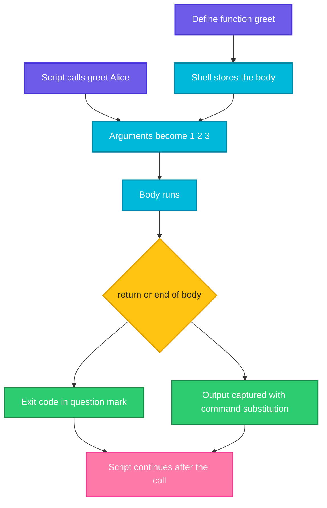

# Functions

## What is it?
A **function** is a named block of commands that you define once and call many times. It is the way to avoid copying the same lines into a script again and again, to give a step a clear name (`backup_database`) and to make a long script readable. A function behaves like a small command: it receives arguments in `$1`, `$2`, ..., it can print output, and it ends with an exit code.

## Syntax
```bash
name() {
  commands
}

name arg1 arg2        # call it like any command

function name {       # bash only form, same thing
  commands
}
```

## Visual Overview
> The shell reads the definition and stores it. When you call the name, the shell runs the stored commands with your arguments, then continues after the call.



## Options/Flags
**Inside a function**

| Item | Meaning |
|------|---------|
| `$1`, `$2`, ... | The function's own arguments (not the script's) |
| `$#` | Number of arguments |
| `"$@"` | All arguments, each one quoted |
| `$0` | Still the name of the **script** |
| `local v` | Variable that exists only inside the function |
| `return N` | End the function with exit code `N` (0 to 255) |
| `exit N` | End the **whole script**, not only the function |
| `${1:-x}` / `${1:?msg}` | Default value / required argument |

**Tools to manage functions**

| Command | Meaning |
|---------|---------|
| `declare -f name` | Print the definition of a function |
| `declare -F` | List the names of all functions |
| `unset -f name` | Remove a function |
| `command ls` | Run the real command and skip a function or alias with the same name |
| `local -n ref=$1` | Name reference, lets a function fill a variable of the caller (bash 4.3+) |

**Three ways to get a result out of a function**

| Way | Use for |
|-----|---------|
| Exit code (`return N`, read with `$?`) | Success or failure, true or false |
| Output (`echo`, captured with `$(f)`) | A string or a number |
| Global variable (`RESULT=...`) | When you must avoid the sub shell, simple but easy to misuse |

## Usage Examples

### Example 1: Define and call
Let's say we have this file `f1.sh`:

**Input file** (`f1.sh`):
```bash
#!/bin/bash
greet() {
  echo "Hello, $1"
}
greet Alice
greet "Bob Smith"
echo "args in script: [$1]"
```

**Command:**
```bash
bash f1.sh script-arg
```
**Sample Output:**
```text
Hello, Alice
Hello, Bob Smith
args in script: [script-arg]
```
Inside `greet`, `$1` is the function's argument. Outside, `$1` is still the script's first argument.

### Example 2: Arguments (`$#`, `$@`)
Let's say we have this file `f2.sh`:

**Input file** (`f2.sh`):
```bash
#!/bin/bash
show() {
  echo "count=$# first=$1 all=$*"
  for a in "$@"; do echo "  [$a]"; done
}
show a "b c" d
show
```

**Command:**
```bash
bash f2.sh
```
**Sample Output:**
```text
count=3 first=a all=a b c d
  [a]
  [b c]
  [d]
count=0 first= all=
```
`"$@"` keeps `b c` as one item.

### Example 3: Return an exit code
Let's say we have this file `f3.sh`:

**Input file** (`f3.sh`):
```bash
#!/bin/bash
is_even() { (( $1 % 2 == 0 )); }
file_ok() { [ -f "$1" ] || return 3; echo "found $1"; return 0; }
is_even 4 && echo "4 even"
is_even 5 || echo "5 odd"
file_ok /etc/passwd; echo "rc=$?"
file_ok /nope; echo "rc=$?"
```

**Command:**
```bash
bash f3.sh
```
**Sample Output:**
```text
4 even
5 odd
found /etc/passwd
rc=0
rc=3
```
A function that ends without `return` returns the exit code of its **last command**. `is_even` needs no `return`, because `(( ))` already sets the code.

### Example 4: Return a value with output
Let's say we have this file `f4.sh`:

**Input file** (`f4.sh`):
```bash
#!/bin/bash
add() { echo $(( $1 + $2 )); }
sum=$(add 4 5)
echo "sum=$sum"
bad() { return 300; }
bad; echo "return 300 gives $?"
```

**Command:**
```bash
bash f4.sh
```
**Sample Output:**
```text
sum=9
return 300 gives 44
```
`return` only carries numbers from 0 to 255 (`300` wraps to `44`). To return text or a big number, `echo` it and capture it with `$( )`.

### Example 5: `local` protects the caller's variables
Let's say we have this file `f5.sh`:

**Input file** (`f5.sh`):
```bash
#!/bin/bash
x="global"
with_local() { local x="local"; echo "in: $x"; }
without_local() { x="modified"; echo "in: $x"; }
with_local; echo "after local: $x"
without_local; echo "after no-local: $x"
```

**Command:**
```bash
bash f5.sh
```
**Sample Output:**
```text
in: local
after local: global
in: modified
after no-local: modified
```
Without `local`, the function silently changes the script's variable.

### Example 6: Default and required arguments
Let's say we have this file `f6.sh`:

**Input file** (`f6.sh`):
```bash
#!/bin/bash
backup() {
  local src="${1:?source required}"
  local dest="${2:-/tmp/backup}"
  echo "copy $src to $dest"
}
backup /data
backup /data /mnt/usb
( backup ) 2>&1
```

**Command:**
```bash
bash f6.sh
```
**Sample Output:**
```text
copy /data to /tmp/backup
copy /data to /mnt/usb
f6.sh: line 3: 1: source required
```
The last call has no argument, so `:?` prints an error and stops that call.

### Example 7: Recursion
Let's say we have this file `f7.sh`:

**Input file** (`f7.sh`):
```bash
#!/bin/bash
fact() { local n=$1; if (( n <= 1 )); then echo 1; else echo $(( n * $(fact $((n-1))) )); fi; }
echo "5! = $(fact 5)"
```

**Command:**
```bash
bash f7.sh
```
**Sample Output:**
```text
5! = 120
```
A function can call itself. Use `local` so each call keeps its own `n`.

### Example 8: A small library with `source`
Let's say we have these two files:

**Input file** (`lib.sh`):
```bash
log()  { echo "[$(date +%H:%M | sed 's/[0-9]/N/g')] $*"; }
die()  { echo "ERROR: $*" >&2; exit 1; }
require() { command -v "$1" >/dev/null || die "$1 is not installed"; }
```
**Input file** (`app.sh`):
```bash
#!/bin/bash
source ./lib.sh
log "starting"
require bash
require no-such-tool
log "never reached"
```

**Command:**
```bash
bash app.sh
echo "rc=$?"
```
**Sample Output:**
```text
[NN:NN] starting
ERROR: no-such-tool is not installed
rc=1
```
`die` uses `exit`, so the whole script stops. The `sed` hides the time so that the sample is stable, real scripts print the real time. Putting `log`, `die` and `require` in one file and sourcing it is how teams share helpers.

### Example 9: Show and remove a function
**Command:**
```bash
hi() { echo hi; }
declare -f hi
unset -f hi
hi
```
**Sample Output:**
```text
hi ()
{
    echo hi
}
bash: line 1: hi: command not found
```

### Example 10: A function that changes the directory
**Command:**
```bash
f() { cd /tmp; }
f
pwd
g() ( cd /var; )
g
pwd
```
**Sample Output:**
```text
/tmp
/tmp
```
A function runs in the current shell, so `f` changed the directory. `g` uses `( )` instead of `{ }`, which runs the body in a **sub shell**, so its `cd` is lost. That is a handy way to keep side effects out.

### Example 11: Override a command, then use the real one
**Command:**
```bash
ls() { echo "my ls"; }
ls
command ls /dev/null
unset -f ls
ls /dev/null
```
**Sample Output:**
```text
my ls
/dev/null
/dev/null
```
A function with the same name as a command wins. `command ls` skips it. This is a common way to wrap `ssh`, `kubectl` and `git` with extra options.

### Example 12: Pass an array and join strings
Let's say we have this file `f8.sh`:

**Input file** (`f8.sh`):
```bash
#!/bin/bash
count_items() { echo "$# items: $*"; }
list=(a b "c d")
count_items "${list[@]}"
join_by() { local IFS="$1"; shift; echo "$*"; }
join_by , a b c
```

**Command:**
```bash
bash f8.sh
```
**Sample Output:**
```text
3 items: a b c d
a,b,c
```
Pass arrays as `"${list[@]}"`. `"$*"` joins the arguments with the first character of `IFS`, which makes `join_by` possible.

### Example 13: Use a function in a pipeline
**Command:**
```bash
double() { while read -r n; do echo $((n*2)); done; }
printf "1\n2\n3\n" | double
```
**Sample Output:**
```text
2
4
6
```

### Example 14: Fill a variable of the caller (`local -n`)
**Command:**
```bash
fill() { local -n out=$1; out=("x" "y"); }
fill myarr
echo "${myarr[@]}"
```
**Sample Output:**
```text
x y
```
`out` is a name reference to the variable whose **name** you pass. This is the clean way to return an array.

### Example 15: A `usage` function and argument check
Let's say we have this file `f10.sh`:

**Input file** (`f10.sh`):
```bash
#!/bin/bash
usage() { echo "Usage: $0 <name>" >&2; exit 2; }
[ $# -eq 1 ] || usage
echo "hello $1"
```

**Command:**
```bash
bash f10.sh
echo "rc=$?"
bash f10.sh bob
```
**Sample Output:**
```text
Usage: f10.sh <name>
rc=2
hello bob
```
Exit code `2` is the usual code for "wrong usage". The message goes to stderr.

### Example 16: A `main` function
Let's say we have this file `f11.sh`:

**Input file** (`f11.sh`):
```bash
#!/bin/bash
set -eu
step_one() { echo "step one"; }
step_two() { echo "step two"; }
main() { step_one; step_two; echo "done"; }
main "$@"
```

**Command:**
```bash
bash f11.sh
```
**Sample Output:**
```text
step one
step two
done
```
Defining all helpers first and ending the script with `main "$@"` makes a long script easy to read and test. Functions only have to exist by the time they are **called**, so the order of the definitions does not matter.

### Example 17: A function must be defined before the call runs
Let's say we have this file `late.sh`:

**Input file** (`late.sh`):
```bash
#!/bin/bash
main() { helper; }
main
helper() { echo "helper ok"; }
main
```

**Command:**
```bash
bash late.sh
```
**Sample Output:**
```text
late.sh: line 2: helper: command not found
helper ok
```
The first call failed because `helper` was not defined yet. The second call works.

## Sample Output
The smallest useful function:

```bash
say() { echo "[$1] $2"; }
say INFO "service started"
```
```text
[INFO] service started
```

## Pitfalls / Gotchas
- **Use `local`** for every variable you create in a function. Without it you overwrite variables of the caller.
- `return` only carries `0` to `255`. Use `echo` plus `$( )` for text and larger numbers.
- A function called as `$(f)` runs in a **sub shell**: variables it sets and `cd` do not stay, and `exit` leaves only the sub shell.
- `exit` inside a function ends the whole script. Use `return` to leave only the function.
- A function that ends with a failing `echo ... | grep` command returns that failure code. Add an explicit `return 0` if success is meant.
- Define the function before you **call** it, not necessarily before you define the caller.
- Always quote: `"$1"`, `"$@"`.
- Names must not collide with commands you still need. Prefix your own helpers (`my_log`), or use `command name` to reach the real one.
- Functions are not exported to child scripts unless you `export -f name`.
- `function name()` with both the word and the parentheses is not POSIX. Use `name() { ... }` for portable scripts.
- Recursion is limited by memory and has no tail call optimisation. Do not use it for loops over large data.
- `$0` inside a function is the script name, not the function name. Use `${FUNCNAME[0]}` for the function name.

## DevOps Use Cases

### Use Case 1: A logging helper with levels
**Situation:** Every message in a deploy script should have a level, and errors go to stderr.

**Command:**
```bash
log()   { echo "[INFO] $*"; }
error() { echo "[ERROR] $*" >&2; }
log "deploy started"
error "disk is full" 2>&1
```
**Sample Output:**
```text
[INFO] deploy started
[ERROR] disk is full
```

### Use Case 2: A guard that stops the script
**Situation:** Stop with a clear message when a required tool is missing.

Using the `lib.sh` and `app.sh` files from Example 8.

**Command:**
```bash
bash app.sh
echo "rc=$?"
```
**Sample Output:**
```text
[NN:NN] starting
ERROR: no-such-tool is not installed
rc=1
```
A CI job that calls this script fails with exit code `1` and shows the reason.

### Use Case 3: Retry a command
**Situation:** A network call is flaky and should be tried up to three times.

**Command:**
```bash
n=0
flaky() { n=$((n+1)); [ "$n" -ge 3 ]; }
retry() {
  local tries=$1; shift
  local i
  for ((i=1; i<=tries; i++)); do
    if "$@"; then echo "ok on try $i"; return 0; fi
    echo "try $i failed"
  done
  return 1
}
retry 5 flaky
```
**Sample Output:**
```text
try 1 failed
try 2 failed
ok on try 3
```
`"$@"` runs the command that was passed as arguments, so `retry 3 curl -fs URL` works for any command.

### Use Case 4: Clean up in one place
**Situation:** A script creates a temporary file and must remove it, also when it fails.

**Command:**
```bash
cleanup() { echo "removing temp files"; }
trap cleanup EXIT
echo "working"
```
**Sample Output:**
```text
working
removing temp files
```
`trap ... EXIT` runs the function when the script ends for any reason. See [Signals and trap](09-signals-and-trap.md).

### Use Case 5: Validate input in a function
**Situation:** Only accept `dev`, `staging` or `prod` as the target.

**Command:**
```bash
valid_env() {
  case "$1" in
    dev|staging|prod) return 0 ;;
    *) return 1 ;;
  esac
}
for e in prod test; do valid_env "$e" && echo "$e ok" || echo "$e rejected"; done
```
**Sample Output:**
```text
prod ok
test rejected
```

## Related Commands
- [Loops](04-loops.md) - the previous page
- [Arguments and input](06-arguments-and-input.md) - the next page
- [Variables and strings](02-variables-and-strings.md) - `local`, defaults and `"$@"`
- [Signals and trap](09-signals-and-trap.md) - run a function on exit
- [`source`](../linux/shell-basics/source.md) - load a library of functions
- [`alias`](../linux/shell-basics/alias.md) - a simpler shortcut, without arguments
- [`type`](../linux/shell-basics/type.md) - tells whether a name is a function
