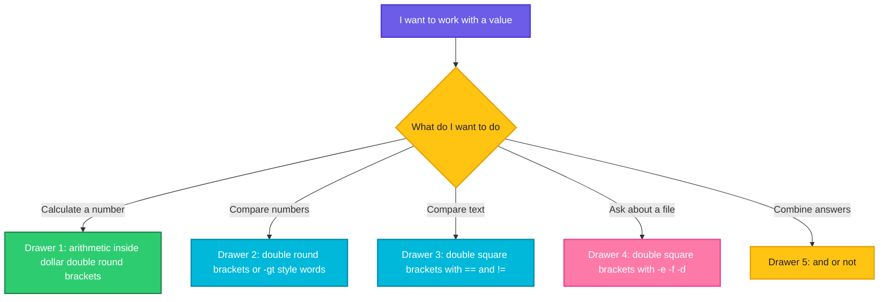

# Operators: The Symbols and Words of Maths and Questions

> **Before this page:** you have read pages [01](01-what-is-a-shell-script.md) to [04](04-exit-codes.md). You know variables, arguments, `read`, and exit codes.
>
> **By the end of this page** you will know what every common operator does, which family it belongs to, and **how to decide which one to use**. This is the page that makes the next one (`if`) easy.

---

## 1. Start with a problem: the same symbol, three meanings

Look at these three lines. They all use the symbol `>`:

```bash
echo "hello" > file.txt        # 1
[[ $a > $b ]]                  # 2
(( a > b ))                    # 3
```

- In line 1, `>` means **"send the output into this file"**.
- In line 2, `>` means **"comes later in the alphabet"**.
- In line 3, `>` means **"is a bigger number"**.

Same symbol, three jobs. And that is not even the whole story. To ask the question "is `a` bigger than `b`?" the shell gives you `-gt`, `>`, `[[ ]]`, `(( ))`... which one is right? Pick the wrong one, and your script will not complain. It will quietly give a **wrong answer**.

You will see exactly how that happens in this page. First, the good news: there are only **five families** of operators, and once you know which family you need, the choice is easy.

---

## 2. The big idea: a toolbox with five drawers

An **operator** is a small symbol or word that **does something to values**: it adds them, compares them, checks them or combines them. Think of a toolbox with five drawers, one for each kind of job:

| Drawer | The job | Everyday example | A taste |
|--------|---------|------------------|---------|
| **1. Arithmetic** | Calculate with numbers | "What is 17 plus 5?" | `+` `-` `*` `/` `%` |
| **2. Number comparison** | Compare two numbers | "Is 10 bigger than 9?" | `-gt` or `>` |
| **3. Text comparison** | Compare two pieces of text | "Is the name exactly `mango`?" | `==` `!=` `-z` |
| **4. File tests** | Ask about a file or folder | "Does this file exist?" | `-e` `-f` `-d` |
| **5. Logical** | Combine yes/no answers | "Is it raining **and** cold?" | `&&` `\|\|` `!` |

Rule of the toolbox: **first decide which drawer you need, then pick the tool.** Most mistakes happen when people grab a tool from the wrong drawer, for example using a text tool to compare numbers.

There is also a second thing to know. The shell has three kinds of brackets for working with operators, and each one **changes the meaning** of what is inside:

| Brackets | What they do | What goes inside |
|----------|--------------|------------------|
| `$(( ... ))` | **Calculate** and give back a number | Arithmetic: `$(( 17 + 5 ))` |
| `(( ... ))` | Ask a **yes/no question** about numbers | Number maths and comparisons: `(( a > b ))` |
| `[[ ... ]]` | Ask a **yes/no question** about text, files and numbers | Words like `-eq`, `==`, `-f` |



Now let us open the drawers one by one.

---

## 3. Drawer 1: Arithmetic operators (calculating)

These do **maths**. You write them inside `$(( ... ))`, which means *"calculate this and give me the answer"*. (You met this in page 02.)

| Operator | Meaning | Example | Result |
|----------|---------|---------|--------|
| `+` | Add | `$((17 + 5))` | `22` |
| `-` | Subtract | `$((17 - 5))` | `12` |
| `*` | Multiply | `$((17 * 5))` | `85` |
| `/` | Divide (whole numbers only) | `$((17 / 5))` | `3` |
| `%` | **Remainder** after dividing (called *modulo*) | `$((17 % 5))` | `2` |
| `**` | Power | `$((2 ** 10))` | `1024` |

Let's say we have this file `arith.sh`:

**Input file** (`arith.sh`):
```bash
#!/bin/bash
a=17
b=5
echo "$a + $b = $((a + b))"
echo "$a - $b = $((a - b))"
echo "$a * $b = $((a * b))"
echo "$a / $b = $((a / b))"
echo "$a % $b = $((a % b))"
echo "2 ** 10 = $((2 ** 10))"
```

**Command:**
```bash
chmod +x arith.sh
./arith.sh
```
**Sample Output:**
```text
17 + 5 = 22
17 - 5 = 12
17 * 5 = 85
17 / 5 = 3
17 % 5 = 2
2 ** 10 = 1024
```

Notice that `17 / 5` gives `3`, not `3.4`. The shell only works with **whole numbers**, and it simply throws away the decimal part. The remainder operator `%` gives you what was thrown away: 17 divided by 5 is 3, **remainder 2**.

> **Why is `%` useful?** It answers "is this number even?" (`n % 2` is `0` for even numbers), and "does this happen every 10th time?" (`n % 10 == 0`). You will use it in loops.

### Brackets change the order

Just like in school maths, multiplication happens before addition. Round brackets override that.

Let's say we have this file `prec.sh`:

**Input file** (`prec.sh`):
```bash
#!/bin/bash
echo "2 + 3 * 4   = $((2 + 3 * 4))"
echo "(2 + 3) * 4 = $(( (2 + 3) * 4 ))"
```

**Command:**
```bash
chmod +x prec.sh
./prec.sh
```
**Sample Output:**
```text
2 + 3 * 4   = 14
(2 + 3) * 4 = 20
```

### Changing a variable: the short forms

Adding one to a counter is so common that there are shortcuts.

| Long form | Short form | Meaning |
|-----------|------------|---------|
| `count=$((count + 1))` | `((count++))` | Add 1 |
| `count=$((count - 1))` | `((count--))` | Subtract 1 |
| `count=$((count + 5))` | `((count += 5))` | Add 5 |
| `count=$((count * 2))` | `((count *= 2))` | Multiply by 2 |

Let's say we have this file `counter.sh`:

**Input file** (`counter.sh`):
```bash
#!/bin/bash
count=10
count=$((count + 1))
echo "after count=\$((count + 1)) : $count"
((count++))
echo "after ((count++))        : $count"
((count += 5))
echo "after ((count += 5))     : $count"
((count--))
echo "after ((count--))        : $count"
```

**Command:**
```bash
chmod +x counter.sh
./counter.sh
```
**Sample Output:**
```text
after count=$((count + 1)) : 11
after ((count++))        : 12
after ((count += 5))     : 17
after ((count--))        : 16
```

(The backslash in `\$` just stops the shell from calculating that part, so it prints as text.)

### Three limits to remember

**1. You cannot divide by zero.** The shell stops with an error:

**Command:**
```bash
echo $((5 / 0))
```
**Sample Output:**
```text
bash: 5 / 0: division by 0 (error token is "0")
```

**2. No decimals.** For fractions, hand the job to another tool such as `bc` or `awk`:

**Command:**
```bash
echo "scale=2; 10 / 3" | bc
awk 'BEGIN { printf "%.2f\n", 10/3 }'
```
**Sample Output:**
```text
3.33
3.33
```

(`bc` is a calculator program, and `scale=2` means "two digits after the decimal point". Both tools are commonly installed, but on a minimal server you may need to install one.)

**3. A leading zero means "octal".** A number that starts with `0` is read in a different counting system, so `010` is **eight**, not ten. And `08` is not a valid octal number at all.

**Command:**
```bash
echo $((010 + 1))
echo $((08 + 1))
```
**Sample Output:**
```text
9
bash: 08: value too great for base (error token is "08")
```

If your numbers come from dates or file names (`08`, `09`), strip the leading zero before calculating. This surprise has caused real bugs in scheduled scripts that worked fine for seven months and broke every August.

---

## 4. Drawer 2: Number comparison operators

These answer a **yes/no question** about two numbers. They do not give a number back, they give back an **exit code** (`0` for yes, non-zero for no, as you learned in page 04).

Here is the key fact of this whole page: **there are two spellings, and each lives in its own brackets.**

| Question | Word style, inside `[[ ]]` | Symbol style, inside `(( ))` |
|----------|---------------------------|------------------------------|
| Is a **equal** to b? | `[[ $a -eq $b ]]` | `(( a == b ))` |
| Is a **not equal** to b? | `[[ $a -ne $b ]]` | `(( a != b ))` |
| Is a **greater than** b? | `[[ $a -gt $b ]]` | `(( a > b ))` |
| Is a **greater or equal** to b? | `[[ $a -ge $b ]]` | `(( a >= b ))` |
| Is a **less than** b? | `[[ $a -lt $b ]]` | `(( a < b ))` |
| Is a **less or equal** to b? | `[[ $a -le $b ]]` | `(( a <= b ))` |

The letters are short for English: **eq**ual, **n**ot **e**qual, **g**reater **t**han, **g**reater or **e**qual, **l**ess **t**han, **l**ess or **e**qual.

Both styles give the same answer. Let's check:

Let's say we have this file `threeways.sh`:

**Input file** (`threeways.sh`):
```bash
#!/bin/bash
a=10
b=9
[[ $a -gt $b ]] && echo "[[ -gt ]]  says 10 is bigger than 9"
(( a > b ))     && echo "(( >  )) says 10 is bigger than 9"
[[ $a > $b ]]   || echo "[[ >   ]] says 10 is NOT bigger than 9 (it compares text)"
```

**Command:**
```bash
chmod +x threeways.sh
./threeways.sh
```
**Sample Output:**
```text
[[ -gt ]]  says 10 is bigger than 9
(( >  )) says 10 is bigger than 9
[[ >   ]] says 10 is NOT bigger than 9 (it compares text)
```

Lines 1 and 2 are correct. **Line 3 is the trap.** It uses the symbol `>` inside `[[ ]]`, and in there `>` compares **text** alphabetically, not numbers. As text, `"10"` comes *before* `"9"` (because `1` comes before `9`), so the shell says 10 is *not* bigger than 9. The script ran without any error and gave the wrong answer.

### The rule that prevents the trap

> **Numbers: use `-gt -lt ...` words inside `[[ ]]`, or the symbols `> <` inside `(( ))`.**
> **Never use the symbols `<` or `>` inside `[[ ]]` for numbers.**

We can prove it with `<`:

Let's say we have this file `lttext.sh`:

**Input file** (`lttext.sh`):
```bash
#!/bin/bash
[[ 10 < 9 ]]    && echo "[[ 10 < 9 ]]    is TRUE  (text order)"
[[ 10 -lt 9 ]]  || echo "[[ 10 -lt 9 ]]  is FALSE (number order)"
(( 10 < 9 ))    || echo "(( 10 < 9 ))    is FALSE (number order)"
```

**Command:**
```bash
chmod +x lttext.sh
./lttext.sh
```
**Sample Output:**
```text
[[ 10 < 9 ]]    is TRUE  (text order)
[[ 10 -lt 9 ]]  is FALSE (number order)
(( 10 < 9 ))    is FALSE (number order)
```

### Why do the words exist at all?

You might wonder why the shell has awkward words like `-gt` when `>` is right there. The reason is history: in the shell, `<` and `>` were **already taken** for redirection (sending files in and out of commands). The old single-bracket test `[ ]` therefore could not use them. Let's see what happens if you try:

Let's say we have this file `trapgt.sh`:

**Input file** (`trapgt.sh`):
```bash
#!/bin/bash
[ 5 > 3 ]
echo "exit code: $?"
ls
```

**Command** (in a folder that contains only `trapgt.sh`):
```bash
chmod +x trapgt.sh
./trapgt.sh
```
**Sample Output:**
```text
exit code: 0
3
trapgt.sh
```

The shell never compared anything. It read `> 3` as *"send the output into a file called `3`"*, and **created a file named `3`**. The test then had only `5` left inside it, and "a single non-empty word" counts as true, so the exit code is `0`. It always says yes, whatever the numbers. This is the kind of bug that can survive for years.

### Which style should I choose?

Both are correct. Choose one and stay with it:

- **`(( a > b ))`** reads like school maths and is easy to remember. A good choice for number checks.
- **`[[ $a -gt $b ]]`** is the style you will see in most existing scripts, so you need to be able to read it.

Inside `(( ))` you do not need the `$` in front of variable names, as shown above.

### `==` with numbers: careful

Inside `[[ ]]`, the symbols `==` and `!=` compare **text**, not numbers. Two numbers that look different as text can still be equal as numbers.

Let's say we have this file `zero.sh`:

**Input file** (`zero.sh`):
```bash
#!/bin/bash
[[ 5 == 05 ]]  || echo "5 == 05   is FALSE (different text)"
[[ 5 -eq 05 ]] && echo "5 -eq 05  is TRUE  (same number)"
```

**Command:**
```bash
chmod +x zero.sh
./zero.sh
```
**Sample Output:**
```text
5 == 05   is FALSE (different text)
5 -eq 05  is TRUE  (same number)
```

So for numbers, use `-eq`, not `==`, when you are inside `[[ ]]`.

---

## 5. Drawer 3: Text (string) operators

Text, called a **string** in programming, is compared with a different set of tools, all inside `[[ ]]`.

| Operator | Meaning | True when |
|----------|---------|-----------|
| `==` | Equal (exact match) | The two texts are identical |
| `!=` | Not equal | The two texts differ |
| `<` | Comes **before** (alphabetical) | `apple < banana` |
| `>` | Comes **after** (alphabetical) | `banana > apple` |
| `-z` | **z**ero length | The text is empty |
| `-n` | **n**on-zero length | The text is not empty |
| `==` with a pattern | Matches a wildcard | `[[ $f == *.txt ]]` |
| `=~` | Matches a **regular expression** | `[[ $v =~ ^[0-9]+$ ]]` |

Let's say we have this file `str.sh`:

**Input file** (`str.sh`):
```bash
#!/bin/bash
fruit="mango"
[[ $fruit == "mango" ]]  && echo "== exact match"
[[ $fruit != "apple" ]]  && echo "!= not equal"
[[ apple < banana ]]     && echo "apple comes before banana"
[[ -n $fruit ]]          && echo "-n not empty"
empty=""
[[ -z $empty ]]          && echo "-z empty"
```

**Command:**
```bash
chmod +x str.sh
./str.sh
```
**Sample Output:**
```text
== exact match
!= not equal
apple comes before banana
-n not empty
-z empty
```

Here `<` is exactly right, because we really do want alphabetical order for words.

### Wildcard matching: quotes change the meaning

Inside `[[ ]]`, the thing on the **right** of `==` can be a pattern with wildcards like `*`. But **if you put it in quotes, the wildcard becomes a plain character**.

Let's say we have this file `pat.sh`:

**Input file** (`pat.sh`):
```bash
#!/bin/bash
file="report.txt"
[[ $file == *.txt ]]    && echo "unquoted *.txt  : matches as a pattern"
[[ $file == "*.txt" ]]  || echo "quoted \"*.txt\"  : compared as literal text"
```

**Command:**
```bash
chmod +x pat.sh
./pat.sh
```
**Sample Output:**
```text
unquoted *.txt  : matches as a pattern
quoted "*.txt"  : compared as literal text
```

**The rule:** quote the right side when you want an **exact** match. Leave it unquoted when you want a **pattern** match.

### Regular expressions: `=~`

For more powerful matching, the `=~` operator checks text against a **regular expression** (you will meet these in the Linux fundamentals page on regular expressions). Do not quote the pattern.

Let's say we have this file `rx.sh`:

**Input file** (`rx.sh`):
```bash
#!/bin/bash
for v in 3.14 abc 10.5.1; do
  if [[ $v =~ ^[0-9]+\.[0-9]+$ ]]; then
    echo "$v looks like a version number"
  else
    echo "$v does not"
  fi
done
```

(The `for` loop just repeats the check for three values. You will learn it in a later page.)

**Command:**
```bash
chmod +x rx.sh
./rx.sh
```
**Sample Output:**
```text
3.14 looks like a version number
abc does not
10.5.1 does not
```

The pattern means: *"start, one or more digits, a dot, one or more digits, end"*.

### The most common beginner error: `=` versus `==`

The words **assign** and **compare** both use an equals sign, but they are different jobs:

| You write | What it does | Example |
|-----------|--------------|---------|
| `a=5` (no spaces) | **Assigns**: puts 5 in the variable | `a=5` |
| `[[ $a == 5 ]]` (spaces) | **Compares**: asks "is `a` equal to 5?" | `[[ $a == 5 ]]` |

Let's say we have this file `eqtrap.sh`:

**Input file** (`eqtrap.sh`):
```bash
#!/bin/bash
a=5
echo "a is $a"
if [[ $a == 5 ]]; then echo "comparison: a is 5"; fi
(( a = 9 ))
echo "after (( a = 9 )) a is $a"
```

**Command:**
```bash
chmod +x eqtrap.sh
./eqtrap.sh
```
**Sample Output:**
```text
a is 5
comparison: a is 5
after (( a = 9 )) a is 9
```

Inside `(( ))`, a single `=` is an **assignment** (it changed `a` to 9). A comparison needs `==`. If you ever write `(( a = 5 ))` thinking you are testing, you have silently changed your variable.

---

## 6. Drawer 4: File test operators

These ask a **question about a file or folder**. They are written inside `[[ ]]`, with a **dash and one letter** before the path. This is the drawer a DevOps engineer opens most often.

| Operator | Reads as | True when |
|----------|----------|-----------|
| `-e path` | **e**xists | Anything exists at the path |
| `-f path` | **f**ile | It is a regular file |
| `-d path` | **d**irectory | It is a folder |
| `-L path` | **L**ink | It is a symbolic link |
| `-r path` | **r**eadable | You may read it |
| `-w path` | **w**ritable | You may write to it |
| `-x path` | e**x**ecutable | You may run it |
| `-s path` | **s**ize | It exists and is **not empty** |
| `a -nt b` | **n**ewer **t**han | File `a` was changed more recently than `b` |
| `a -ot b` | **o**lder **t**han | File `a` was changed longer ago than `b` |

Let's say we have a file `notes.txt` that contains the word `hello`, an empty file `empty.txt`, a folder `logs`, a symbolic link `link.txt` pointing to `notes.txt`, and two files `old.txt` (dated January) and `new.txt` (dated June):

**Input file** (`notes.txt`):
```text
hello
```

And this script:

**Input file** (`ft.sh`):
```bash
#!/bin/bash
[[ -e notes.txt ]]            && echo "-e   notes.txt exists"
[[ -f notes.txt ]]            && echo "-f   notes.txt is a regular file"
[[ -d logs ]]                 && echo "-d   logs is a directory"
[[ -L link.txt ]]             && echo "-L   link.txt is a symbolic link"
[[ -r notes.txt ]]            && echo "-r   notes.txt is readable"
[[ -w notes.txt ]]            && echo "-w   notes.txt is writable"
[[ -x notes.txt ]]            || echo "-x   notes.txt is NOT executable"
[[ -s notes.txt ]]            && echo "-s   notes.txt has content"
[[ -s empty.txt ]]            || echo "-s   empty.txt has no content"
[[ new.txt -nt old.txt ]]     && echo "-nt  new.txt is newer than old.txt"
[[ old.txt -ot new.txt ]]     && echo "-ot  old.txt is older than new.txt"
```

**Command:**
```bash
chmod +x ft.sh
./ft.sh
```
**Sample Output:**
```text
-e   notes.txt exists
-f   notes.txt is a regular file
-d   logs is a directory
-L   link.txt is a symbolic link
-r   notes.txt is readable
-w   notes.txt is writable
-x   notes.txt is NOT executable
-s   notes.txt has content
-s   empty.txt has no content
-nt  new.txt is newer than old.txt
-ot  old.txt is older than new.txt
```

A common detail: `-e` is true for **both** files and folders, while `-f` is only for regular files and `-d` only for folders. If your script is about to read a file, `-f` is usually more precise than `-e`.

---

## 7. Drawer 5: Logical operators (combining answers)

Once you have several yes/no answers, you combine them with three small words.

| Operator | Name | Read it as | True when |
|----------|------|------------|-----------|
| `&&` | AND | "both" | **Both** sides are true |
| `\|\|` | OR | "either" | **At least one** side is true |
| `!` | NOT | "the opposite" | The thing after it is **false** |

They work in **two places**:

- **Between commands** (page 04): `mkdir logs && echo "created"`. The answers are exit codes.
- **Inside brackets**: `[[ $age -ge 18 && $age -lt 65 ]]`. The answers are the tests.

Let's say we have this file `logic.sh`:

**Input file** (`logic.sh`):
```bash
#!/bin/bash
age=30
[[ $age -ge 18 && $age -lt 65 ]] && echo "AND : both are true"
[[ $age -lt 18 || $age -ge 65 ]] || echo "OR  : neither is true, so OR is false"
[[ ! -d /nope ]]                 && echo "NOT : /nope is not a directory"
```

**Command:**
```bash
chmod +x logic.sh
./logic.sh
```
**Sample Output:**
```text
AND : both are true
OR  : neither is true, so OR is false
NOT : /nope is not a directory
```

### The shell is lazy (on purpose)

For `A && B`, if `A` is already false, the answer must be false, so the shell **does not even run `B`**. For `A || B`, if `A` is already true, it does not run `B`. This is called **short-circuiting**, and it is why `mkdir x && cd x` is safe: the `cd` only runs if the `mkdir` worked.

Let's see it with a function that announces when it runs. (A function is a named block of commands. You will learn them later; here it only prints a note.)

Let's say we have this file `short.sh`:

**Input file** (`short.sh`):
```bash
#!/bin/bash
check() { echo "  (checking $1)"; return "$2"; }
echo "AND with a false left side:"
check first 1 && check second 0
echo "OR with a true left side:"
check first 0 || check second 0
```

**Command:**
```bash
chmod +x short.sh
./short.sh
```
**Sample Output:**
```text
AND with a false left side:
  (checking first)
OR with a true left side:
  (checking first)
```

Only `first` was ever checked. `second` never ran, because the answer was already decided.

### Mixing AND and OR: use brackets

When you mix `&&` and `||`, `&&` binds tighter (like multiplication before addition). Round brackets, written with spaces inside `[[ ]]`, make your meaning clear.

Let's say we have this file `group.sh`:

**Input file** (`group.sh`):
```bash
#!/bin/bash
a=5; b=0; c="ok"
if [[ $a -gt 1 || $b -gt 1 && $c == "bad" ]]; then echo "without brackets: TRUE"; else echo "without brackets: FALSE"; fi
if [[ ( $a -gt 1 || $b -gt 1 ) && $c == "bad" ]]; then echo "with brackets   : TRUE"; else echo "with brackets   : FALSE"; fi
```

**Command:**
```bash
chmod +x group.sh
./group.sh
```
**Sample Output:**
```text
without brackets: TRUE
with brackets   : FALSE
```

Same three tests, different answers. Without brackets, the shell does `b > 1 AND c is bad` first, then ORs that with `a > 1`. With brackets, we force the OR to go first. **When in doubt, add brackets.** They cost nothing and remove the guesswork.

The logical operators also work inside `(( ))`:

Let's say we have this file `arith2.sh`:

**Input file** (`arith2.sh`):
```bash
#!/bin/bash
x=7
(( x % 2 == 1 )) && echo "$x is odd"
(( x > 5 && x < 10 )) && echo "$x is between 5 and 10"
```

**Command:**
```bash
chmod +x arith2.sh
./arith2.sh
```
**Sample Output:**
```text
7 is odd
7 is between 5 and 10
```

This also shows the remainder operator from drawer 1 doing real work: `x % 2 == 1` means "odd".

---

## 8. The big cheat sheet

Keep this table. It is the answer to *"which one do I use?"*.

| I want to... | Use | Example |
|--------------|-----|---------|
| **Calculate** a number | `$(( ))` | `total=$((a + b))` |
| Add one to a counter | `(( ))` | `((count++))` |
| Compare **numbers** (symbols) | `(( ))` | `(( a >= b ))` |
| Compare **numbers** (words) | `[[ ]]` with `-eq -ne -gt -ge -lt -le` | `[[ $a -ge $b ]]` |
| Compare **text** for equality | `[[ ]]` with `==` or `!=` | `[[ $name == "Asha" ]]` |
| Compare text **alphabetically** | `[[ ]]` with `<` or `>` | `[[ $a < $b ]]` |
| Check text is **empty** or **not** | `[[ ]]` with `-z` or `-n` | `[[ -z $name ]]` |
| Match a **wildcard pattern** | `[[ ]]` with unquoted `==` | `[[ $f == *.log ]]` |
| Match a **regex** | `[[ ]]` with `=~` | `[[ $v =~ ^[0-9]+$ ]]` |
| Ask about a **file or folder** | `[[ ]]` with `-e -f -d -r -w -x -s` | `[[ -f config.txt ]]` |
| Compare **file ages** | `[[ ]]` with `-nt` `-ot` | `[[ a -nt b ]]` |
| **Combine** answers | `&&` `\|\|` `!` | `[[ -d x && -w x ]]` |

### A three-question method

When you are unsure, ask yourself, in order:

1. **Am I calculating a number, or asking a yes/no question?**
   Calculating: `$(( ))`. Asking: continue.
2. **What am I asking about?**
   Numbers: `(( ))` or the `-gt` words. Text: `==`, `!=`, `-z`. A file: `-f`, `-d`, `-e`.
3. **Do I need to combine several answers?**
   Yes: `&&`, `||`, `!`, and add brackets if you mix them.

### The "never do this" list

| Never | Because | Do this instead |
|-------|---------|-----------------|
| `[[ $a > $b ]]` for numbers | Compares text, `10` comes before `9` | `(( a > b ))` or `[[ $a -gt $b ]]` |
| `[ $a > $b ]` | `>` becomes a redirection and creates a file | `[[ ]]` with `-gt` |
| `[[ $a == $b ]]` for numbers like `5` and `05` | Compares text | `-eq` |
| `(( a = 5 ))` to test | Assigns instead of comparing | `(( a == 5 ))` |
| `[[ $f == "*.txt" ]]` for a pattern | Quotes make `*` literal | `[[ $f == *.txt ]]` |
| `$((08 + 1))` | Leading zero means octal | Remove the zero first |

---

## 9. Common mistakes at a glance

| What you wrote | What happens | Fix |
|----------------|--------------|-----|
| `[[ $a > $b ]]` with numbers | Silently wrong answer | `-gt`, or `(( a > b ))` |
| `[ 5 > 3 ]` | Creates a file called `3`, always true | Never use `>` or `<` in `[ ]` |
| `$((17 / 5))` expecting 3.4 | Gives `3` | Use `bc` or `awk` for decimals |
| `$((5 / 0))` | Error, script stops | Check the divisor first |
| `$((08 + 1))` | `value too great for base` | Strip the leading zero |
| `[[ $f == "*.txt" ]]` | Never matches | Remove the quotes |
| `[[ $x =~ "^[0-9]+$" ]]` | Quoted regex is treated as literal text | Remove the quotes around the regex |
| `(( a = 5 ))` as a test | Changes `a` | `==` |
| `[[ $a -eq abc ]]` | Not a number, error or wrong result | Check the value is numeric first |
| `[[ -f $file ]]` with `$file` unset | Tests an empty name and fails | Check the variable is set first |
| `[[ A \|\| B && C ]]` | `&&` goes first, not what you meant | Add brackets |
| `$a+$b` | Prints text like `5+3` | `$((a + b))` |

---

## 10. Words to remember

| Word | Simple meaning |
|------|----------------|
| **Operator** | A symbol or word that works on values: adds, compares, checks, combines |
| **Arithmetic** | Calculating with numbers |
| **Modulo `%`** | The remainder after dividing |
| **Comparison** | A yes/no question about two values |
| **String** | Plain text |
| **File test** | A question about a file or folder, like `-f` or `-d` |
| **Logical operator** | `&&` (and), `\|\|` (or), `!` (not) |
| **Short-circuit** | The shell stops early when the answer is already decided |
| **Octal** | A different number system, where a leading `0` is a trap |
| **Pattern** | A wildcard such as `*.txt` |
| **Regular expression** | A powerful text-matching recipe, used with `=~` |

---

## 11. Try it yourself

1. **Calculator.** Write `calc.sh` that takes two numbers and prints their sum, difference, product, quotient and remainder, each with a label.
2. **Predict, then run.** What does each print? `echo $((7 / 2))`, `echo $((7 % 2))`, `echo $((2 ** 3 + 1))`, `echo $(( (2 + 3) * 2 ))`.
3. **Catch the trap.** Run `[[ 100 > 99 ]]; echo $?` and `[[ 100 -gt 99 ]]; echo $?`. Explain why the answers differ.
4. **Even or odd.** Using only `(( ))` and `%`, print `even` or `odd` for a number given as an argument.
5. **Text checks.** Write `name.sh` that takes a name and prints: `empty` if nothing is given, `starts with A` if it begins with `A` (use `==` and a wildcard), and `other` for everything else.
6. **File inspector.** Write `inspect.sh` that takes a path and prints whether it exists, whether it is a file or a folder, and whether you can read and write it.
7. **Combine.** Print `ok to run` only if `/tmp` is a directory **and** is writable **and** the number of arguments is exactly 1.
8. **Brackets matter.** Write the condition "number is 1, or number is 2, and also the word is `go`". Test it with and without brackets, with values where the answers differ.
9. **Fix it.** What is wrong here, and how do you fix it?
   ```bash
   if [ $count > 10 ]; then
     echo "too many"
   fi
   ```

<details>
<summary>Answers for exercises 3 and 9 (open only after trying)</summary>

**Exercise 3:** `[[ 100 > 99 ]]` compares **text**. As text, `100` starts with `1` and `99` starts with `9`, so `100` comes first and the answer is `1` (false). `[[ 100 -gt 99 ]]` compares **numbers** and gives `0` (true).

**Exercise 9:** In single brackets, `>` is a **redirection**. The shell creates a file called `10` and the test is always true. Fix:

```bash
if (( count > 10 )); then
  echo "too many"
fi
```

Remember to delete the accidental file named `10`.
</details>

---

## 12. Quick recap

- An **operator** works on values. They fall into **five families**: arithmetic, number comparison, text comparison, file tests, and logical.
- **Arithmetic** lives in `$(( ))`: `+ - * / % **`. It works on whole numbers only. `%` gives the remainder.
- **Number comparison** has two spellings: words (`-eq -ne -gt -ge -lt -le`) inside `[[ ]]`, or symbols (`== != > >= < <=`) inside `(( ))`.
- **Never use `<` or `>` for numbers inside `[[ ]]`.** They compare text. And never inside `[ ]`, where they become redirection.
- **Text** uses `==`, `!=`, `-z`, `-n`, patterns and `=~`. Quotes on the right side switch off wildcards.
- **File tests** (`-e -f -d -r -w -x -s -nt -ot`) are the DevOps engineer's favourite drawer.
- **Logical** operators `&&`, `||`, `!` combine answers. The shell short-circuits. Add brackets when you mix them.
- One `=` assigns, `==` compares.
- Use the **three-question method**: calculate or ask? about what? combine?

**Next page:** [06 Decisions: `if`, `else` and `elif`](06-if-conditions.md), where you will use all of these tools to make your scripts choose what to do.
