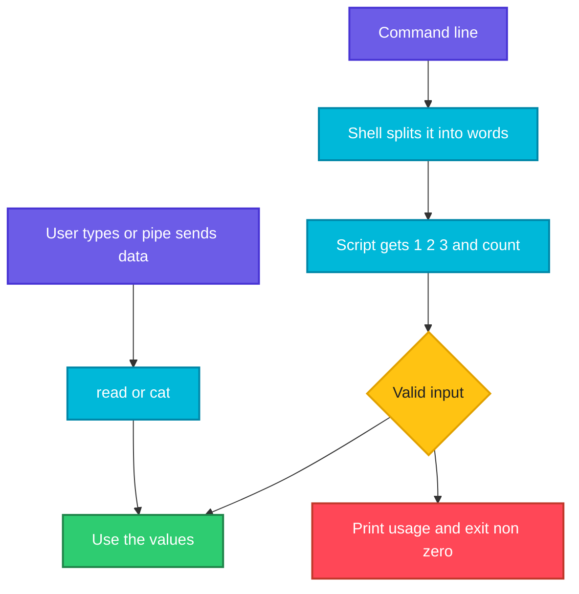

# Arguments and Input

## What is it?
A script becomes useful when it can take **input**: arguments you type after its name (`./deploy.sh prod web`), options such as `-v` or `--env prod`, answers to questions it asks, and data it reads from a pipe or a file. This page covers all four: positional parameters (`$1`, `$@`), `shift`, `getopts`, `read` and here documents.

## Syntax
```bash
./script.sh arg1 "arg two" arg3     # $1 $2 $3
echo "$#"                           # how many
for a in "$@"; do ...; done         # every argument
shift                               # drop $1, move the rest down
getopts ":vn:" opt                  # parse -v and -n value
read -r -p "Name: " name            # ask the user
cat <<EOF ... EOF                   # here document
```

## Visual Overview
> The shell splits the command line into words and hands them to the script as numbered parameters. The script reads them, validates them, and then uses them.



## Options/Flags
**Positional parameters**

| Variable | Meaning |
|----------|---------|
| `$0` | Name of the script as it was called |
| `$1` ... `$9`, `${10}` | The arguments (braces needed from 10 on) |
| `$#` | Number of arguments |
| `"$@"` | All arguments, each one kept as a separate word |
| `"$*"` | All arguments joined into one word |
| `shift [n]` | Remove the first `n` arguments (default 1) |
| `${@:2}` | All arguments from the second one |
| `${!#}` | The last argument |
| `set -- a b` | Replace the arguments |
| `--` | End of options: everything after it is an argument |

**`getopts`**

| Piece | Meaning |
|-------|---------|
| `getopts ":vn:c:h" opt` | Options `-v`, `-n VALUE`, `-c VALUE`, `-h`. A `:` after a letter means a value follows. A leading `:` gives quiet error handling |
| `$OPTARG` | The value of the current option |
| `$OPTIND` | Index of the next argument, use `shift $((OPTIND-1))` after the loop |
| `:)` / `\?)` | Cases for a missing value and an unknown option |

**`read`**

| Flag | Meaning |
|------|---------|
| `-r` | Do not treat backslash as an escape (always use it) |
| `-p "text"` | Show a prompt (only when input is a terminal) |
| `-s` | Silent, do not echo what is typed (passwords) |
| `-t N` | Time out after `N` seconds (exit code above 128) |
| `-n N` | Read exactly `N` characters |
| `-a arr` | Split into an array |
| `-d ""` | Read until a NUL byte (see [Loops](04-loops.md)) |
| `IFS=: read -r a b` | Split on a different character |

**Common exit codes for bad usage:** `2` is widely used for wrong usage, `64` is the BSD `EX_USAGE` code. Pick one and use it everywhere.

## Usage Examples

### Example 1: The positional parameters
Let's say we have this file `a1.sh`:

**Input file** (`a1.sh`):
```bash
#!/bin/bash
echo "script: $0"
echo "count: $#"
echo "first: $1, second: $2, tenth: ${10}"
echo "all with @:"; for a in "$@"; do echo "  [$a]"; done
echo "all with *:"; for a in "$*"; do echo "  [$a]"; done
```

**Command:**
```bash
bash a1.sh one "two words" three
```
**Sample Output:**
```text
script: a1.sh
count: 3
first: one, second: two words, tenth: 
all with @:
  [one]
  [two words]
  [three]
all with *:
  [one two words three]
```
`"$@"` keeps `two words` as one item. `"$*"` glues everything into a single string. Use `"$@"` almost always.

### Example 2: No arguments
Using the `a1.sh` file from Example 1.

**Command:**
```bash
bash a1.sh | head -3
```
**Sample Output:**
```text
script: a1.sh
count: 0
first: , second: , tenth: 
```
Missing arguments are empty strings, they are not an error. Your script has to check.

### Example 3: Take a command word, then the rest (`shift`)
Let's say we have this file `a2.sh`:

**Input file** (`a2.sh`):
```bash
#!/bin/bash
cmd=$1; shift
echo "command: $cmd"
echo "remaining: $# -> $*"
while [ $# -gt 0 ]; do echo "item: $1"; shift; done
```

**Command:**
```bash
bash a2.sh deploy web db cache
```
**Sample Output:**
```text
command: deploy
remaining: 3 -> web db cache
item: web
item: db
item: cache
```

### Example 4: Slices of the arguments
**Command:**
```bash
set -- a b c d e
echo "${@:2}"
echo "${@:2:2}"
echo "${@: -1}"
echo "last: ${!#}"
```
**Sample Output:**
```text
b c d e
b c
e
last: e
```

### Example 5: Check the number of arguments
Let's say we have this file `a3.sh`:

**Input file** (`a3.sh`):
```bash
#!/bin/bash
if [ $# -ne 2 ]; then
  echo "Usage: ${0##*/} <source> <dest>" >&2
  exit 64
fi
echo "copy $1 -> $2"
```

**Command:**
```bash
bash a3.sh
echo "rc=$?"
bash a3.sh a b
```
**Sample Output:**
```text
Usage: a3.sh <source> <dest>
rc=64
copy a -> b
```
Print the usage to stderr (`>&2`), and exit with a non zero code so that callers and CI jobs notice.

### Example 6: Options with `getopts`
Let's say we have this file `g1.sh`:

**Input file** (`g1.sh`):
```bash
#!/bin/bash
verbose=0; name="world"; count=1
while getopts ":vn:c:h" opt; do
  case $opt in
    v) verbose=1 ;;
    n) name=$OPTARG ;;
    c) count=$OPTARG ;;
    h) echo "usage: $0 [-v] [-n name] [-c count] [files...]"; exit 0 ;;
    :) echo "option -$OPTARG needs a value" >&2; exit 2 ;;
    \?) echo "unknown option -$OPTARG" >&2; exit 2 ;;
  esac
done
shift $((OPTIND-1))
echo "verbose=$verbose name=$name count=$count files=[$*]"
```

**Command:**
```bash
bash g1.sh
bash g1.sh -v -n alice -c 3 f1 f2
bash g1.sh -vn bob
bash g1.sh -x
echo "rc=$?"
bash g1.sh -n
echo "rc=$?"
bash g1.sh -h
```
**Sample Output:**
```text
verbose=0 name=world count=1 files=[]
verbose=1 name=alice count=3 files=[f1 f2]
verbose=1 name=bob count=1 files=[]
unknown option -x
rc=2
option -n needs a value
rc=2
usage: g1.sh [-v] [-n name] [-c count] [files...]
```
`-vn bob` works because short options can be grouped. After the loop, `shift $((OPTIND-1))` leaves only the non option arguments (`f1 f2`). `getopts` handles **short** options only.

### Example 7: Long options with a `case` loop
Let's say we have this file `l1.sh`:

**Input file** (`l1.sh`):
```bash
#!/bin/bash
env=staging; dry=0; files=()
while [ $# -gt 0 ]; do
  case "$1" in
    --env)     env=$2; shift 2 ;;
    --env=*)   env=${1#*=}; shift ;;
    -n|--dry-run) dry=1; shift ;;
    --)        shift; files+=("$@"); break ;;
    -*)        echo "unknown option: $1" >&2; exit 2 ;;
    *)         files+=("$1"); shift ;;
  esac
done
echo "env=$env dry=$dry files=${files[*]}"
```

**Command:**
```bash
bash l1.sh
bash l1.sh --env prod -n a b
bash l1.sh --env=dev x -- -weird
bash l1.sh --bad
echo "rc=$?"
```
**Sample Output:**
```text
env=staging dry=0 files=
env=prod dry=1 files=a b
env=dev dry=0 files=x -weird
unknown option: --bad
rc=2
```
After `--`, even `-weird` is treated as a plain argument. This hand written loop is the usual way to support `--long` options in bash.

### Example 8: Ask a question (`read`)
**Command:**
```bash
read -r -p "Name: " n
echo "hello $n"
```
**Sample Output (the user typed `Alice`):**
```text
Name: Alice
hello Alice
```
In a terminal the prompt is printed and your typing is echoed. When the input comes from a pipe, `read -p` does **not** print the prompt, so a test with `printf 'Alice\n' | ...` shows only `hello Alice`.

### Example 9: A default answer
**Command:**
```bash
read -r ans
ans=${ans:-yes}
echo "answer=$ans"
```
**Sample Output (the user pressed Enter):**
```text
answer=yes
```

### Example 10: A time limit (`-t`)
**Command:**
```bash
read -t 0.5 -r x < <(sleep 2)
echo "rc=$? x=[$x]"
```
**Sample Output:**
```text
rc=142 x=[]
```
An exit code above 128 means the read timed out. Use it for "press a key within 10 seconds" prompts.

### Example 11: A password without echo (`-s`)
**Command:**
```bash
read -rs pw
echo
echo "got ${#pw} chars"
```
**Sample Output (the user typed `s3cret`, which stays invisible):**
```text

got 6 chars
```
The blank line is the `echo` that moves to a new line after the hidden typing.

### Example 12: Split into several variables
**Command:**
```bash
echo "a b c d" | { read -r x y rest; echo "x=$x y=$y rest=$rest"; }
echo "w x y" | { read -ra arr; echo "${#arr[@]} items, second=${arr[1]}"; }
```
**Sample Output:**
```text
x=a y=b rest=c d
3 items, second=x
```
The last variable collects the rest of the line.

### Example 13: A yes or no confirmation
Let's say we have this file `c1.sh`:

**Input file** (`c1.sh`):
```bash
#!/bin/bash
read -r -p "Delete everything? [y/N] " ans
case "${ans,,}" in
  y|yes) echo "deleting" ;;
  *)     echo "cancelled" ;;
esac
```

**Command:**
```bash
printf 'y\n' | bash c1.sh
printf 'n\n' | bash c1.sh
printf '\n' | bash c1.sh
```
**Sample Output:**
```text
deleting
cancelled
cancelled
```
The capital `N` in `[y/N]` tells the user that **no** is the default. Anything except `y` or `yes` cancels, which is the safe choice for destructive actions.

### Example 14: Read from a file or from a pipe
Let's say we have this file `s1.sh`, which counts lines in a file argument or in piped data, and this input file `in.txt`:

**Input file** (`s1.sh`):
```bash
#!/bin/bash
if [ -t 0 ] && [ $# -eq 0 ]; then echo "usage: $0 file or pipe data" >&2; exit 1; fi
cat "${1:--}" | wc -l
```
**Input file** (`in.txt`):
```text
x
y
```

**Command:**
```bash
printf 'a\nb\nc\n' | bash s1.sh
bash s1.sh in.txt
```
**Sample Output:**
```text
3
2
```
`-` means standard input for `cat`, and `${1:--}` is "the first argument, or `-`". This is how `grep`, `sort` and `cat` behave too.

### Example 15: Here document (`<<EOF`)
Let's say we have this file `h1.sh`:

**Input file** (`h1.sh`):
```bash
#!/bin/bash
name=devops
cat <<EOF
Hello $name
Today is not shown here
EOF
cat <<'EOF'
Literal $name stays
EOF
```

**Command:**
```bash
bash h1.sh
```
**Sample Output:**
```text
Hello devops
Today is not shown here
Literal $name stays
```
Quoting the marker (`<<'EOF'`) turns off variable expansion inside. Here documents are used to write config files and multi line messages from a script.

### Example 16: Here string (`<<<`)
**Command:**
```bash
read -r a b <<< "x y"
echo "$b $a"
wc -w <<< "one two three"
```
**Sample Output:**
```text
y x
3
```
`<<<` feeds a string to stdin without a pipe, so variables survive.

### Example 17: Options from environment variables
Let's say we have this file `e1.sh`:

**Input file** (`e1.sh`):
```bash
#!/bin/bash
echo "LEVEL=${LOG_LEVEL:-info}"
```

**Command:**
```bash
bash e1.sh
LOG_LEVEL=debug bash e1.sh
```
**Sample Output:**
```text
LEVEL=info
LEVEL=debug
```
`VAR=value command` sets the variable for that one command only. CI systems pass settings this way.

### Example 18: A required environment variable
Let's say we have this file `r1.sh`:

**Input file** (`r1.sh`):
```bash
#!/bin/bash
: "${TOKEN:?TOKEN must be set}"
echo "token ok"
```

**Command:**
```bash
bash r1.sh
TOKEN=x bash r1.sh
```
**Sample Output:**
```text
r1.sh: line 2: TOKEN: TOKEN must be set
token ok
```
The first run stops at the check and prints the message. Never put real secrets in the command line, other users can see it in `ps`.

### Example 19: Check that an argument is a number
**Command:**
```bash
for v in 42 4x2 "" -7; do
  [[ $v =~ ^-?[0-9]+$ ]] && echo "[$v] number" || echo "[$v] not a number"
done
```
**Sample Output:**
```text
[42] number
[4x2] not a number
[] not a number
[-7] number
```

### Example 20: Replace the arguments (`set --`)
**Command:**
```bash
set -- x "y z"
echo "$#: $1 | $2"
set --
echo "$#"
```
**Sample Output:**
```text
2: x | y z
0
```

## Sample Output
A script called with two arguments:

```bash
echo "deploying $1 to $2 ($# args)"
```
```text
deploying app to prod (2 args)
```
This line, when run in a script called as `./deploy.sh app prod`.

## Pitfalls / Gotchas
- **Quote `"$@"`**. Unquoted `$@` splits arguments with spaces into pieces.
- **Always validate**: check `$#`, check that files exist, check that numbers are numbers. A missing argument is just an empty string.
- `$10` is `$1` followed by `0`. Write `${10}`.
- `getopts` stops at the first non option argument. Put options before file names.
- `getopts` does not understand `--long` options. Use a `case` loop or an external tool.
- `shift` with too few arguments fails. Check `$#` first.
- `read` without `-r` eats backslashes, and without `IFS=` trims spaces. For exact input use `IFS= read -r line`.
- `read -p` prints its prompt only when input is a terminal.
- A command that reads stdin inside a `while read` loop (for example `ssh`, `mysql`) swallows the rest of the file. Add `< /dev/null` or `ssh -n`.
- **Never pass secrets as arguments.** `ps` and `/proc/PID/cmdline` show them. Use environment variables, files with mode `600`, or `read -s`.
- Do not use `eval` on user input. It runs whatever the user typed.
- Filenames starting with `-` look like options. Use `--` (`rm -- -f`) or `./-f`.
- Exit with a non zero code after a usage error, otherwise a pipeline treats the bad call as success.
- When a script is run through `sudo` or cron, environment variables and the working directory can differ from your shell.

## DevOps Use Cases

### Use Case 1: A deploy script with options and a safe default
**Situation:** `deploy.sh --env prod --dry-run web` must show what it would do, and default to staging.

Using the `l1.sh` file from Example 7.

**Command:**
```bash
bash l1.sh --env prod --dry-run web
```
**Sample Output:**
```text
env=prod dry=1 files=web
```

### Use Case 2: Refuse to run without the right arguments in CI
**Situation:** A pipeline step must fail loudly when a parameter is missing.

Using the `a3.sh` file from Example 5.

**Command:**
```bash
bash a3.sh only-one
echo "rc=$?"
```
**Sample Output:**
```text
Usage: a3.sh <source> <dest>
rc=64
```
The pipeline marks the step failed because of the non zero code.

### Use Case 3: Confirm before a dangerous action, skip in automation
**Situation:** A cleanup script asks for confirmation but must also work in a pipeline with `--yes`.

**Command:**
```bash
set -- --yes
force=0
[ "$1" = "--yes" ] && force=1
if [ "$force" -eq 1 ]; then echo "deleting without asking"; else echo "would ask"; fi
```
**Sample Output:**
```text
deleting without asking
```
In a real script `--yes` arrives as `$1` from the command line, here `set --` simulates it.

### Use Case 4: Process a list of files given as arguments
**Situation:** `./clean.sh a.log "my file.log"` must handle every file.

**Command:**
```bash
set -- a.log "my file.log"
for f in "$@"; do echo "cleaning [$f]"; done
echo "total: $#"
```
**Sample Output:**
```text
cleaning [a.log]
cleaning [my file.log]
total: 2
```

### Use Case 5: Generate a config file from a template
**Situation:** Write a small config file with values from variables.

**Command:**
```bash
host=db1; port=5432
cat <<EOF
[database]
host = $host
port = $port
EOF
```
**Sample Output:**
```text
[database]
host = db1
port = 5432
```
Add `> app.conf` after `EOF` to write it to a file.

## Related Commands
- [Functions](05-functions.md) - the previous page
- [Exit codes](07-exit-codes.md) - the next page
- [`read`](../linux/shell-basics/read.md) - read input
- [`set`](../linux/shell-basics/set.md) - `set --` replaces the arguments
- `shift` - built-in, see `help shift`
- [`cat`](../linux/file-management/cat.md) - `-` means standard input
- [Redirection and pipes](../linux/fundamentals/08-redirection-and-pipes.md) - here documents and strings
- [Regular expressions](../linux/fundamentals/12-regular-expressions.md) - validate input with `=~`
