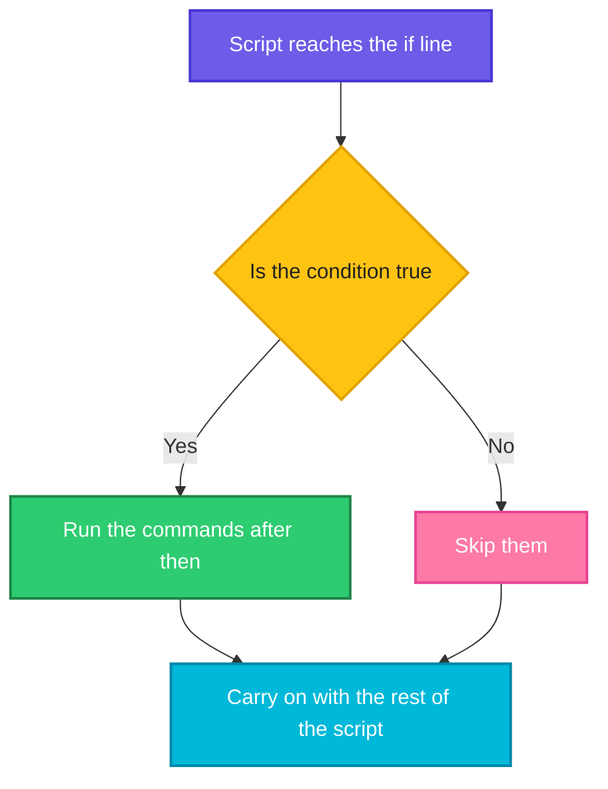
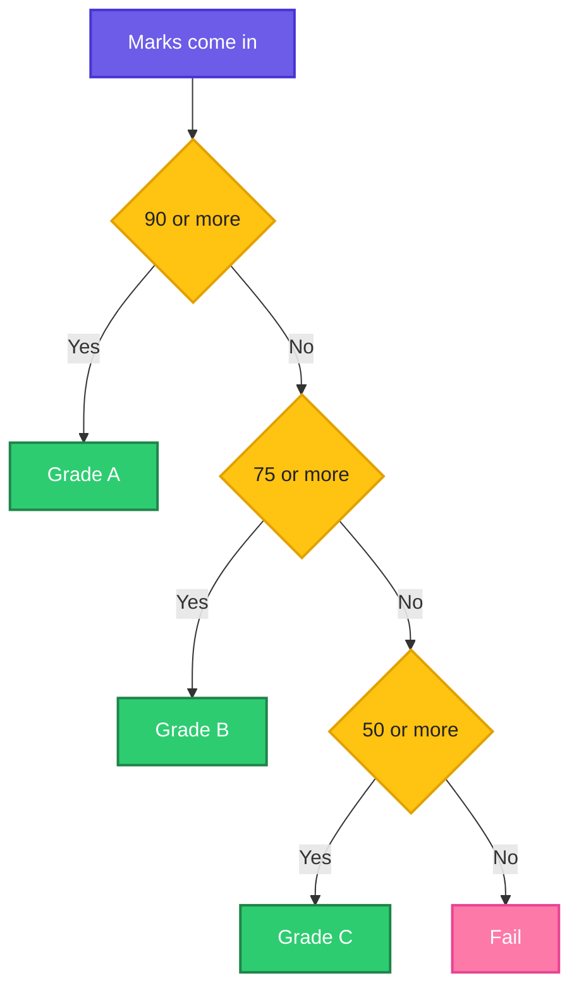

# Making Decisions: `if`, `else` and `elif`

> **Before this page:** you have read pages [01](01-what-is-a-shell-script.md) to [05](05-operators.md). You know variables, arguments, `read`, exit codes (`0` means success), and the operators used to calculate and compare.
>
> **By the end of this page** your script will be able to look at a situation and choose what to do, instead of blindly running every line.

---

## 1. Start with a problem: the script that never thinks

So far, every script you wrote runs **every line, every time**. It cannot look around and say *"hmm, is that really a good idea?"*

Think about `morning.sh`. It prints the disk usage, and that is all. A real engineer reads the number and reacts:

- 2% full? *Fine, carry on.*
- 85% full? *Warn the team.*
- 95% full? *Raise the alarm now.*

The same number leads to three different actions. Your script must be able to **choose**.

---

## 2. The big idea: a fork in the road

You make decisions all day without noticing:

> **If** it is raining, take an umbrella. **Otherwise**, leave it at home.

A decision always has the same three parts:

| Part | Everyday example | In a script |
|------|------------------|-------------|
| **A question** that can only be answered yes or no | "Is it raining?" | A **condition** |
| **What to do if yes** | "Take an umbrella" | Commands in the `then` part |
| **What to do if no** (optional) | "Leave it at home" | Commands in the `else` part |

In the shell, the word for this is **`if`**.



---

## 3. Your first `if` (do this with me)

Go to your practice folder (`cd ~/practice`) and create `umbrella.sh`.

Let's say we have this file `umbrella.sh`:

**Input file** (`umbrella.sh`):
```bash
#!/bin/bash
rain="yes"
if [[ $rain == "yes" ]]; then
  echo "Take an umbrella"
fi
echo "Have a nice day"
```

**Command:**
```bash
chmod +x umbrella.sh
./umbrella.sh
```
**Sample Output:**
```text
Take an umbrella
Have a nice day
```

Now change line 2 to `rain="no"` and run it again:

**Sample Output:**
```text
Have a nice day
```

The umbrella line disappeared, but "Have a nice day" stayed, because that line is **outside** the `if`. Same script, different situation, different behaviour.

### The anatomy of an `if`

```text
if [[ $rain == "yes" ]]; then      <- the question
  echo "Take an umbrella"          <- runs only when the answer is yes
fi                                 <- "end of the if"
```

| Piece | Meaning |
|-------|---------|
| `if` | Starts the decision |
| `[[ ... ]]` | The **condition**, the yes/no question |
| `;` | Separates the condition from `then` (you can put `then` on the next line instead) |
| `then` | "If yes, do the following" |
| `fi` | **`if` written backwards**. It closes the block |

Two things beginners forget: the **spaces** just inside `[[` and `]]`, and the closing `fi`. We will come back to both.

---

## 4. What is a condition, really?

Here is the secret that connects this page to the last one. **An `if` does not look at "true" and "false". It looks at an exit code.**

> **Exit code `0` means yes (true). Any other number means no (false).**

Remember: `0` means success. So `if` really asks: *"Did this command succeed?"*

That means you can put **any command** after `if`.

Let's say we have this file `app.log`:

**Input file** (`app.log`):
```text
INFO started
ERROR disk full
```

And this file `cmdif.sh`:

**Input file** (`cmdif.sh`):
```bash
#!/bin/bash
if grep -q ERROR app.log; then
  echo "Errors found in the log"
fi

if ls /nope 2>/dev/null; then
  echo "unreachable"
else
  echo "That folder does not exist"
fi
```

**Command:**
```bash
chmod +x cmdif.sh
./cmdif.sh
```
**Sample Output:**
```text
Errors found in the log
That folder does not exist
```

- `grep -q ERROR app.log` searches quietly (`-q`). It succeeds (code `0`) if it finds the word, so the first message appears.
- `ls /nope` fails with a non-zero code, so the `then` part is skipped and the `else` part runs. (We will meet `else` in a moment.)

### So what are the `[[ ... ]]` brackets?

They are a **test**: a tiny tool whose only job is to answer a question about numbers, text or files, and **return an exit code**. We can see that directly:

**Command:**
```bash
[[ 5 -gt 3 ]]
echo "5 -gt 3 gives: $?"
[[ 2 -gt 3 ]]
echo "2 -gt 3 gives: $?"
```
**Sample Output:**
```text
5 -gt 3 gives: 0
2 -gt 3 gives: 1
```

`-gt` means "greater than". Five is greater than three, so the test returns `0` (yes). Two is not, so it returns `1` (no). Everything in `if [[ ... ]]` is just that.

> **About the brackets.** You will see two styles in the wild: `[[ ... ]]` (what we use here) and the older `[ ... ]`. In a bash script, prefer `[[ ... ]]`. It is safer, because it copes with empty values and spaces, and it allows `&&` and `||` inside. The single-bracket one works in every shell but has more traps.

---

## 5. The toolbox: a quick reminder

You met every one of these in [page 05, Operators](05-operators.md), where each is explained and tested. Here is the short version, so you can keep it beside you while you read this page.

| I want to ask... | Write | Example |
|------------------|-------|---------|
| Are two **numbers** equal? bigger? smaller? | `[[ $a -eq $b ]]`, `-ne`, `-gt`, `-ge`, `-lt`, `-le` (or `(( a > b ))`) | `[[ $age -ge 18 ]]` |
| Is a **text** exactly this? | `[[ $s == "abc" ]]` or `!=` | `[[ $rain == "yes" ]]` |
| Is a text **empty**? **not empty**? | `[[ -z $s ]]`, `[[ -n $s ]]` | `[[ -z $name ]]` |
| Does a path **exist**? Is it a **file**? a **folder**? | `[[ -e p ]]`, `-f`, `-d` | `[[ -d logs ]]` |
| Can I **read**, **write**, **run** it? Is it **non-empty**? | `[[ -r p ]]`, `-w`, `-x`, `-s` | `[[ -w /backup ]]` |
| Do I need **both**, **either**, or the **opposite**? | `&&`, `\|\|`, `!` | `[[ -d x && -w x ]]` |

The two traps from page 05 matter most here: **never use `<` or `>` for numbers inside `[[ ]]`** (use `-lt`, `-gt`, or `(( ))`), and **one `=` assigns while `==` compares**.

---

## 6. The five shapes of an `if`

Now let's learn every shape a decision can take. We will go from the simplest to the most flexible.

### Shape 1: the simple `if` (do something, or do nothing)

You have already seen this one. When the answer is no, **nothing happens**.

```bash
if [[ condition ]]; then
  commands
fi
```

Use it when there is only one thing to do, and only in one situation. Example from above: *"if the log has errors, print a warning."*

---

### Shape 2: `if` ... `else` (two paths)

Sometimes "no" should also do something. Add an `else`. Exactly **one** of the two paths always runs.

```bash
if [[ condition ]]; then
  commands for yes
else
  commands for no
fi
```

Let's say we have this file `age.sh`:

**Input file** (`age.sh`):
```bash
#!/bin/bash
age="${1:-0}"
if [[ $age -ge 18 ]]; then
  echo "Adult"
else
  echo "Minor"
fi
```

**Command:**
```bash
chmod +x age.sh
./age.sh 20
./age.sh 15
```
**Sample Output:**
```text
Adult
Minor
```

Think of it as a road that splits in two, with every traveller taking exactly one of them. (We used the default trick `${1:-0}` from page 03, so the script works even without an argument.)

---

### Shape 3: the `elif` ladder (many paths)

What if there are **more than two** outcomes, like a grade: A, B, C or Fail? Use `elif` (short for *else if*) as many times as you need.

```bash
if [[ first condition ]]; then
  ...
elif [[ second condition ]]; then
  ...
elif [[ third condition ]]; then
  ...
else
  ...
fi
```

The shell works **down the ladder, one rung at a time**, and stops at the **first** condition that is true. The `else` at the bottom catches everything that did not match.



Let's say we have this file `grade.sh`:

**Input file** (`grade.sh`):
```bash
#!/bin/bash
marks="${1:-0}"
if [[ $marks -ge 90 ]]; then
  echo "Grade A"
elif [[ $marks -ge 75 ]]; then
  echo "Grade B"
elif [[ $marks -ge 50 ]]; then
  echo "Grade C"
else
  echo "Fail"
fi
```

**Command:**
```bash
chmod +x grade.sh
./grade.sh 95
./grade.sh 85
./grade.sh 60
./grade.sh 20
```
**Sample Output:**
```text
Grade A
Grade B
Grade C
Fail
```

Look at `95`. It is also at least 75 and at least 50, so three rungs would be true. But the shell stops at the **first** true one and prints only `Grade A`. That is why **the order of the rungs matters**: put the strictest condition first. If you had put `-ge 50` first, everyone with 50 or more would get `Grade C`.

---

### Shape 4: nested `if` (a decision inside a decision)

Sometimes the second question only makes sense after the first answer is yes. For example, you can only ask *"can I read this file?"* once you know it exists. Put one `if` **inside** another, and indent the inner one so you can see the nesting.

Let's say we have a file `notes.txt` that contains the word `hello`, and this script:

**Input file** (`notes.txt`):
```text
hello
```

And the script:

**Input file** (`nested.sh`):
```bash
#!/bin/bash
file="$1"
if [[ -e $file ]]; then
  if [[ -r $file ]]; then
    echo "$file exists and I can read it"
  else
    echo "$file exists but I cannot read it"
  fi
else
  echo "$file does not exist"
fi
```

**Command:**
```bash
chmod +x nested.sh
./nested.sh notes.txt
./nested.sh ghost.txt
```
**Sample Output:**
```text
notes.txt exists and I can read it
ghost.txt does not exist
```

Every `if` needs its own `fi`. Count them: two `if`, two `fi`. A good habit is to write the `fi` right after you write the `if`, then fill in the middle.

#### How to read a nested `if`: the pairing rule

With one `if` inside another, a beginner's first worry is: *"which `else` belongs to which `if`?"* The rule is simple:

> **Every `else`, `elif` and `fi` belongs to the closest `if` above it that is still open.**

```text
if A; then            # if number 1 opens
  if B; then          #   if number 2 opens
    ...
  else                #   this else belongs to if number 2 (the closest open one)
    ...
  fi                  #   this fi closes if number 2
else                  # this else belongs to if number 1 (number 2 is now closed)
  ...
fi                    # this fi closes if number 1
```

Indentation is only for **your** eyes. The shell ignores it completely and pairs things purely by `if` and `fi`. That is why one forgotten `fi` is so easy to miss. Let's see it.

Let's say we have this file `missingfi.sh`, where the outer `if` was never closed:

**Input file** (`missingfi.sh`):
```bash
#!/bin/bash
if [[ -d /tmp ]]; then
  if [[ -w /tmp ]]; then
    echo "writable"
  fi
```

**Command:**
```bash
bash missingfi.sh
```
**Sample Output:**
```text
missingfi.sh: line 6: syntax error: unexpected end of file
```

The shell reached the end of the file (line 6) still waiting for a `fi`. It cannot tell you **which** `if` is unclosed, only that something is. Count your `if` words against your `fi` words, and work from the inside out.

#### When nesting goes wrong: the arrow problem

Nesting is fine for two levels. But watch what happens when a script has **four** things to check before it does its real job. This script backs up one file into a folder called `backup`. Before copying it must check: an argument was given, the file exists, it can be read, and the `backup` folder exists.

Let's say we have these files and folders to test with: a file `notes.txt` containing `hello`, a file `locked.txt` that nobody can read (`chmod 000 locked.txt`; this only works as a normal user, because root can read anything), and an empty folder `backup`:

**Input file** (`notes.txt`):
```text
hello
```

And this script, written with nested `if` statements:

**Input file** (`backup_nested.sh`):
```bash
#!/bin/bash
src="$1"
dest="backup"
if [[ -n $src ]]; then
  if [[ -f $src ]]; then
    if [[ -r $src ]]; then
      if [[ -d $dest ]]; then
        cp "$src" "$dest"/
        echo "Backed up $src"
      else
        echo "Error: folder $dest does not exist"
      fi
    else
      echo "Error: cannot read $src"
    fi
  else
    echo "Error: $src is not a file"
  fi
else
  echo "Usage: $0 <file>"
fi
```

**Command:**
```bash
chmod +x backup_nested.sh
./backup_nested.sh ghost.txt
echo "code: $?"
./backup_nested.sh locked.txt
echo "code: $?"
./backup_nested.sh notes.txt
echo "code: $?"
```
**Sample Output:**
```text
Error: ghost.txt is not a file
code: 0
Error: cannot read locked.txt
code: 0
Backed up notes.txt
code: 0
```

It works, but look at the shape of the code. It drifts to the right like an arrow pointing at the real work. That causes four problems:

1. **The real job is buried.** The one line that matters, `cp`, sits at the deepest level.
2. **Questions and answers are far apart.** The `else` that explains the first check (`Usage: ...`) is 15 lines below it. You have to scroll to understand which message belongs to which check.
3. **It is easy to get the `fi` count wrong**, as you just saw.
4. **It lies about failing.** Look at the codes: every run printed `code: 0`, even for the two errors. This is the "lying script" from page 04. A pipeline would think the backup worked every time.

#### Fix 1: flatten with `&&`

If all you need is a single "something is wrong" message, combine the checks into one condition with `&&`:

Let's say we have this file `backup_flat.sh`:

**Input file** (`backup_flat.sh`):
```bash
#!/bin/bash
src="$1"
dest="backup"
if [[ -n $src && -f $src && -r $src && -d $dest ]]; then
  cp "$src" "$dest"/
  echo "Backed up $src"
else
  echo "Error: cannot back up '$src' (something is wrong)"
fi
```

**Command:**
```bash
chmod +x backup_flat.sh
./backup_flat.sh ghost.txt
./backup_flat.sh notes.txt
```
**Sample Output:**
```text
Error: cannot back up 'ghost.txt' (something is wrong)
Backed up notes.txt
```

Much shorter, one `if` and one `fi`. But the price is a **vague error**: the user is told "something is wrong" and has to guess which of the four checks failed. Use this when one message is enough.

#### Fix 2: guard clauses (check the bad thing first, and leave early)

The best fix for the arrow problem is to **flip the thinking**. Instead of "if everything is fine, then keep going deeper", ask each question the other way round: *"if this is wrong, say so and stop right here."* Each check is a **guard** that stands at the door and turns bad input away. When all guards are passed, the real work happens at the left margin.

Let's say we have this file `backup_guard.sh`:

**Input file** (`backup_guard.sh`):
```bash
#!/bin/bash
src="$1"
dest="backup"

if [[ -z $src ]]; then
  echo "Usage: $0 <file>"
  exit 1
fi
if [[ ! -f $src ]]; then
  echo "Error: $src is not a file"
  exit 1
fi
if [[ ! -r $src ]]; then
  echo "Error: cannot read $src"
  exit 1
fi
if [[ ! -d $dest ]]; then
  echo "Error: folder $dest does not exist"
  exit 1
fi

cp "$src" "$dest"/
echo "Backed up $src"
```

**Command:**
```bash
chmod +x backup_guard.sh
./backup_guard.sh ghost.txt
echo "code: $?"
./backup_guard.sh locked.txt
echo "code: $?"
./backup_guard.sh notes.txt
echo "code: $?"
```
**Sample Output:**
```text
Error: ghost.txt is not a file
code: 1
Error: cannot read locked.txt
code: 1
Backed up notes.txt
code: 0
```

Compare it with the nested version:

- Every `if` is **one level deep**. No arrow.
- Each check and its own message sit **together**, so you read the script like a checklist.
- Every failure ends with `exit 1`, so the exit code is now **honest**: `1` for errors and `0` for success.
- The real job (`cp`) is at the bottom, on its own, easy to find.

Notice the `!` (not) and `-z` (is empty) doing the flipping. `[[ ! -f $src ]]` reads *"if it is NOT a file"*.

There is also a popular one-line shorthand that you will see in other people's scripts: `[[ -f $src ]] || { echo "Error: $src is not a file"; exit 1; }`. It means *"if the test fails, run these commands"*. It does the same job as the longer `if` form. Use whichever you find easier to read.

#### So, which should I use?

| | Nested `if` | One combined `if` with `&&` | Guard clauses |
|---|-------------|------------------------------|---------------|
| Looks like | An arrow to the right | One short `if` | A flat checklist |
| Specific error for each problem | Yes, but far from the check | **No**, one vague message | **Yes**, right beside each check |
| Honest exit code | Only if you add `exit` | Only if you add `exit` | **Yes**, built in |
| Easy to add a new check | Awkward, deeper again | Easy | **Easy**, add one more block |
| Best for | Two levels, where **both** branches do real work | One message is enough | **Validating inputs** at the top of a script |

**A good rule of thumb:**

- **Nest** when the inner question depends on the outer answer **and** both branches have real work to do, like the two-level `nested.sh` above. Stay at two levels, rarely three.
- **Combine with `&&`** when one message covers every failure.
- **Use guard clauses** at the start of any script that takes input: check the arguments, check the files, bail out early, then do the real work.

> **Tip:** if you ever find yourself nesting more than two or three levels deep, stop. Reach for guard clauses.

---

### Shape 5: combining conditions: `&&`, `||` and `!`

Instead of nesting, you can ask **several questions at once**, inside the double brackets:

| Write | Read it as | True when |
|-------|------------|-----------|
| `[[ A && B ]]` | A **and** B | **both** are true |
| `[[ A \|\| B ]]` | A **or** B | **at least one** is true |
| `[[ ! A ]]` | **not** A | A is false |

Let's say we have this file `combine.sh`:

**Input file** (`combine.sh`):
```bash
#!/bin/bash
age="${1:-0}"
if [[ $age -ge 18 && $age -lt 65 ]]; then
  echo "Working age"
elif [[ $age -lt 18 || $age -ge 65 ]]; then
  echo "Not in the working age group"
fi
if [[ ! $age -ge 18 ]]; then
  echo "(and you are under 18)"
fi
```

**Command:**
```bash
chmod +x combine.sh
./combine.sh 30
./combine.sh 70
./combine.sh 10
```
**Sample Output:**
```text
Working age
Not in the working age group
Not in the working age group
(and you are under 18)
```

- `30` is both 18 or more **and** under 65, so "Working age".
- `70` fails the first test, but passes the **or** in the second.
- `10` passes the second test, and the `!` (not) at the bottom turns "is it 18 or more?" into "is it **not** 18 or more?".

**Real-life version:** *"Run the backup only if the folder exists **and** I can write to it."*

```bash
if [[ -d /backup && -w /backup ]]; then
  echo "Backing up..."
fi
```

---

## 7. A friendlier way to compare numbers: `(( ))`

The `-gt`, `-ge`, `-lt` letters are easy to mix up. For **numbers only**, bash offers double round brackets where you can write the maths symbols you already know:

Let's say we have this file `arith.sh`:

**Input file** (`arith.sh`):
```bash
#!/bin/bash
age="${1:-0}"
if (( age >= 18 )); then
  echo "Adult"
else
  echo "Minor"
fi
```

**Command:**
```bash
chmod +x arith.sh
./arith.sh 20
```
**Sample Output:**
```text
Adult
```

Inside `(( ))` you can write `>=`, `<`, `==`, `!=` and use variable names without the `$`. Use `[[ ]]` for text and files, and `(( ))` for number comparisons. Both are correct. Choose whichever you find easier to read.

---

## 8. Upgrade `morning.sh`: react to the disk usage

Now we can fix the problem from the start of the page. The script will read the disk usage and **choose** between OK, WARNING and CRITICAL, using an `elif` ladder, and report it through its **exit code** (page 04).

Let's say we now have this file `morning.sh`:

**Input file** (`morning.sh`):
```bash
#!/bin/bash
# morning.sh - usage: ./morning.sh [disk] [warn] [critical]

DISK="${1:-/}"
WARN="${2:-80}"
CRIT="${3:-90}"

df "$DISK" > /dev/null || exit 1

# Pull the "Use%" number out of df, for example 2% becomes 2
usage=$(df --output=pcent "$DISK" | tail -1 | tr -dc '0-9')

echo "Disk $DISK is $usage% full"

if [[ $usage -ge $CRIT ]]; then
  echo "CRITICAL: free some space now"
  exit 2
elif [[ $usage -ge $WARN ]]; then
  echo "WARNING: getting full"
  exit 1
else
  echo "OK"
fi
```

The line that sets `usage` looks scary, but it only does one thing: `df --output=pcent` prints a heading and a value like `2%`, `tail -1` keeps the last line, and `tr -dc '0-9'` keeps only the digits. You can treat it as a recipe for now.

Our real disk is only 2% full, so to see the other branches we lower the warning and critical limits. The second argument is the warning level, the third is the critical level.

**Command:**
```bash
chmod +x morning.sh
./morning.sh
echo "code: $?"
./morning.sh / 1 50
echo "code: $?"
./morning.sh / 1 2
echo "code: $?"
```
**Sample Output:**
```text
Disk / is 2% full
OK
code: 0
Disk / is 2% full
WARNING: getting full
code: 1
Disk / is 2% full
CRITICAL: free some space now
code: 2
```

- Normal limits (80 and 90): 2% is fine, so `OK` and code `0`.
- Warning at 1, critical at 50: 2% is above the warning level, so `WARNING` and code `1`.
- Warning at 1, critical at 2: 2% reaches the critical level, so `CRITICAL` and code `2`.

This is a real monitoring script now. A cron job, a CI pipeline or a monitoring tool can look at the exit code and decide whether to send you an alert.

---

## 9. Real patterns you will use all the time

| Pattern | What it does |
|---------|--------------|
| `[[ -d reports ]] \|\| mkdir reports` | Create a folder **only if it is missing** |
| `[[ -f config.txt ]] \|\| exit 1` | Stop the script if a needed file is not there |
| `[[ -z $1 ]] && { echo "Usage: ..."; exit 1; }` | Refuse to run without an argument |
| `if [[ $EUID -ne 0 ]]; then ... fi` | Check that the script is running as root |
| `if grep -q "ERROR" app.log; then ... fi` | React to something found in a log |
| `if ping -c 1 web1 > /dev/null; then ... fi` | React to whether a server answers |

Let's try the "run as root" check, which almost every installer script starts with.

Let's say we have this file `needroot.sh`:

**Input file** (`needroot.sh`):
```bash
#!/bin/bash
if [[ $EUID -ne 0 ]]; then
  echo "Please run this script as root"
  exit 1
fi
echo "Running as root"
```

**Command** (run as a normal user, not root):
```bash
chmod +x needroot.sh
./needroot.sh
echo "code: $?"
```
**Sample Output:**
```text
Please run this script as root
code: 1
```

`$EUID` is a ready-made variable holding your user number. Root's number is `0`, so anything else means "not root". The script explains the problem and stops with code `1`.

And here is the "create only if missing" pattern, run twice to show it is safe to repeat:

Let's say we have this file `ensure.sh`:

**Input file** (`ensure.sh`):
```bash
#!/bin/bash
[[ -d reports ]] || mkdir reports
echo "reports folder is ready"
```

**Command:**
```bash
chmod +x ensure.sh
./ensure.sh
./ensure.sh
```
**Sample Output:**
```text
reports folder is ready
reports folder is ready
```

The second run does not fail with "File exists", because the `mkdir` was skipped. A script that can safely be run again and again is called **idempotent**, and DevOps engineers love them.

---

## 10. Common mistakes (and the errors they cause)

Let's break things on purpose, so you recognise the messages when you meet them.

### Mistake 1: no space after `[` or before `]`

Let's say we have this file `nospace.sh`:

**Input file** (`nospace.sh`):
```bash
#!/bin/bash
if [5 -gt 3]; then
  echo "yes"
fi
```

**Command:**
```bash
bash nospace.sh
```
**Sample Output:**
```text
nospace.sh: line 2: [5: command not found
```

`[[` is not magic punctuation, it is a keyword that needs spaces around it. `[5` looks like one strange word, so the shell hunts for a command called `[5`. **Always leave a space inside the brackets:** `[[ 5 -gt 3 ]]`.

### Mistake 2: forgetting `then`

Let's say we have this file `nothen.sh`:

**Input file** (`nothen.sh`):
```bash
#!/bin/bash
if [[ 5 -gt 3 ]]
  echo "yes"
fi
```

**Command:**
```bash
bash nothen.sh
```
**Sample Output:**
```text
nothen.sh: line 4: syntax error near unexpected token `fi'
nothen.sh: line 4: `fi'
```

A *syntax error* means the shell could not even understand the shape of your script, so it runs **nothing**. The error is reported at line 4, where the shell finally gave up, not at line 2 where the mistake is. When you see an error near `fi`, look **above** it for a missing `then`, or a missing `fi` somewhere.

### Mistake 3: comparing numbers as text

Inside `[[ ]]`, the symbols `<` and `>` compare **text** (alphabetical order), not numbers. Use `-lt` and `-gt` for numbers.

Let's say we have this file `strnum.sh`:

**Input file** (`strnum.sh`):
```bash
#!/bin/bash
if [[ 9 > 10 ]]; then
  echo "9 is bigger than 10?!"
fi
if [[ 9 -gt 10 ]]; then
  echo "9 -gt 10"
else
  echo "9 is not bigger than 10"
fi
```

**Command:**
```bash
bash strnum.sh
```
**Sample Output:**
```text
9 is bigger than 10?!
9 is not bigger than 10
```

As text, `9` comes after `10` alphabetically (because `9` sorts after `1`), so `9 > 10` is "true". Numbers need `-gt`, or the `(( ))` brackets from section 7.

### Mistake 4: an empty variable in single brackets

Let's say we have this file `emptyvar.sh`:

**Input file** (`emptyvar.sh`):
```bash
#!/bin/bash
x=""
if [ $x -gt 3 ]; then echo "big"; else echo "not big (single brackets)"; fi
if [[ $x -gt 3 ]]; then echo "big"; else echo "not big (double brackets)"; fi
```

**Command:**
```bash
bash emptyvar.sh
```
**Sample Output:**
```text
emptyvar.sh: line 3: [: -gt: unary operator expected
not big (single brackets)
not big (double brackets)
```

With the old single brackets, an empty `$x` vanishes and the test becomes `[ -gt 3 ]`, which makes no sense, so you get an error. The double brackets cope. This is one of the main reasons we recommend `[[ ]]`.

### Mistake 5: the `A && B || C` trap

The one-line form `test && yes-action || no-action` looks like a tidy `if`/`else`. It is not the same thing.

Let's say we have this file `trap.sh`:

**Input file** (`trap.sh`):
```bash
#!/bin/bash
[[ 1 -eq 1 ]] && false || echo "this ran even though the test was true"
```

**Command:**
```bash
bash trap.sh
```
**Sample Output:**
```text
this ran even though the test was true
```

The test was true, so the shell moved to the middle command, `false`. That one **failed**, so the `||` part ran too. In a real `if ... then ... else`, the `else` can never run when the condition is true. **Use the one-liner only for simple single actions. Use a proper `if`/`else` when you need two paths.**

### The full list at a glance

| Mistake | Symptom | Fix |
|---------|---------|-----|
| `[5 -gt 3]` | `[5: command not found` | Spaces: `[[ 5 -gt 3 ]]` |
| Forgot `then` | `syntax error near unexpected token` | Add `; then` |
| Forgot `fi` | `unexpected end of file` | Close every `if` with `fi` |
| `[[ 9 > 10 ]]` | Wrong answer with no error | `-gt`, or `(( 9 > 10 ))` |
| `[ $x -gt 3 ]` with empty `$x` | `unary operator expected` | Use `[[ ]]` |
| `if [[ $a = 5 ]]` vs `-eq` | `=` and `==` compare **text**; `-eq` compares **numbers** | Use `-eq` for numbers |
| `A && B \|\| C` as an `if`/`else` | `C` also runs when `B` fails | Write a real `if`/`else` |
| Forgetting that `elif` order matters | The wrong rung matches first | Strictest condition first |

---

## 11. Words to remember

| Word | Simple meaning |
|------|----------------|
| **Condition** | A yes/no question the script asks |
| **`if` ... `then` ... `fi`** | "If yes, do this." `fi` closes it |
| **`else`** | "Otherwise, do this" |
| **`elif`** | "Otherwise, if this is true instead..." |
| **Nested `if`** | An `if` inside another `if` |
| **`[[ ]]`** | The test brackets for text, files and numbers |
| **`(( ))`** | Brackets for number maths and comparisons |
| **`-eq -ne -gt -ge -lt -le`** | Number comparisons |
| **`-z` / `-n`** | Text is empty / not empty |
| **`-e -f -d`** | Exists / is a file / is a folder |
| **`&&` `\|\|` `!`** | And / or / not |
| **Idempotent** | Safe to run again and again with the same result |

---

## 12. Try it yourself

1. **Even or odd.** Write `parity.sh` that takes a number and prints `even` or `odd`. (Hint: `$(( $1 % 2 ))` gives the remainder.)
2. **Temperature.** Write `weather.sh` that takes a number. Print `Freezing` if it is 0 or below, `Cold` if below 15, `Pleasant` if below 30, and `Hot` otherwise.
3. **File checker.** Write `check.sh` that takes a path. Print whether it is a file, a folder, or does not exist.
4. **Guard.** Write `guard.sh` that stops with an error message and exit code `1` when no argument is given, and otherwise prints `Hello, <argument>`.
5. **Smart backup.** Write a script that creates a `backup` folder only if it is missing, then copies `notes.txt` into it only if `notes.txt` exists.
6. **Upgrade `morning.sh`.** Add a check near the top: if the warning level is bigger than the critical level, print `Usage: ./morning.sh [disk] [warn] [critical]` and exit with `1`.
7. **Predict first.** Without running it, what does `./grade.sh 90` print? And `./grade.sh 89`? Then run it.
8. **Count the `fi`.** How many `fi` words does this script need? Add them, then run it with `./count.sh /tmp` and `./count.sh /nope`:
   ```bash
   #!/bin/bash
   if [[ -d $1 ]]; then
     if [[ -w $1 ]]; then
       echo "writable folder"
     else
       echo "read-only folder"
   else
     echo "not a folder"
   ```
9. **Flatten the arrow.** Rewrite `nested.sh` (from Shape 4) using guard clauses, so that it has no `else` at all and every error ends with `exit 1`.
10. **Pick a shape.** Write a script `deploy-check.sh` that takes a folder name. It must stop with a clear message for each problem (no argument, not a folder, not writable), and only then print `Ready to deploy`. Which shape did you choose, and why?

<details>
<summary>Answer for exercise 1 (open only after trying)</summary>

```bash
#!/bin/bash
if [[ $(( $1 % 2 )) -eq 0 ]]; then
  echo "even"
else
  echo "odd"
fi
```

`$(( $1 % 2 ))` is the remainder after dividing by 2: `0` for even numbers and `1` for odd ones.
</details>

<details>
<summary>Answers for exercises 8 and 9 (open only after trying)</summary>

**Exercise 8:** two `if` words need two `fi` words. The inner `fi` goes after the `else` branch of the inner `if`, and the outer `fi` goes at the very end:

```bash
#!/bin/bash
if [[ -d $1 ]]; then
  if [[ -w $1 ]]; then
    echo "writable folder"
  else
    echo "read-only folder"
  fi
else
  echo "not a folder"
fi
```

**Exercise 9:** check each bad case first and leave early:

```bash
#!/bin/bash
file="$1"
if [[ ! -e $file ]]; then
  echo "$file does not exist"
  exit 1
fi
if [[ ! -r $file ]]; then
  echo "$file exists but I cannot read it"
  exit 1
fi
echo "$file exists and I can read it"
```
</details>

---

## 13. Quick recap

- An **`if`** lets a script choose. The shape is `if [[ condition ]]; then ... fi`.
- A condition is really a command, and **exit code `0` means yes**.
- `else` adds a second path. `elif` adds more. The shell stops at the **first** true condition, so order the rungs carefully.
- You can nest an `if` inside another, or combine conditions with `&&`, `||` and `!`.
- Use `-eq -gt -lt` (or `(( ))`) for **numbers**, `==` for **text**, and `-e -f -d` for **files**.
- Always leave **spaces** inside `[[ ]]`, and close every `if` with `fi`.
- `test && a || b` is **not** the same as `if/else`.
- A script can report its decision to the outside world with `exit`.

**Next page:** [07 The `case` statement](07-case-statements.md), a neater way to choose when you are matching **one value** against **many possible answers**, and a guide to when to use `if` and when to use `case`.
