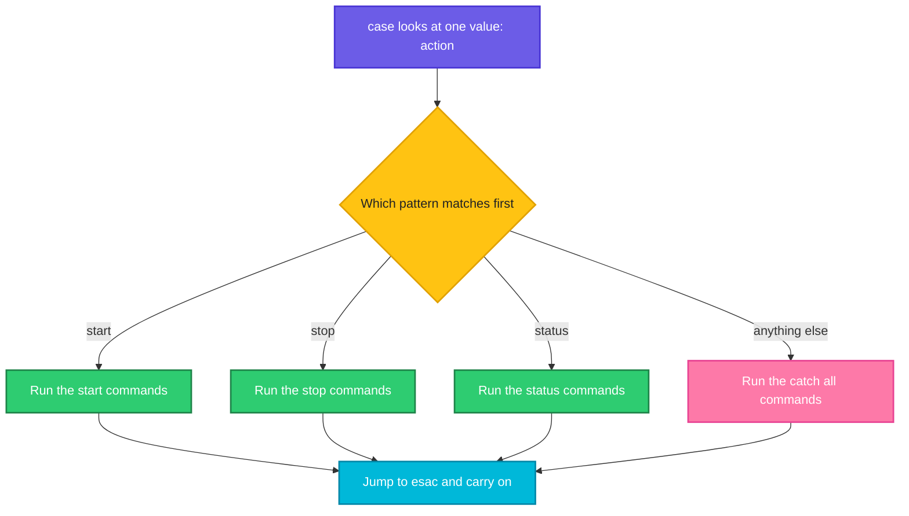
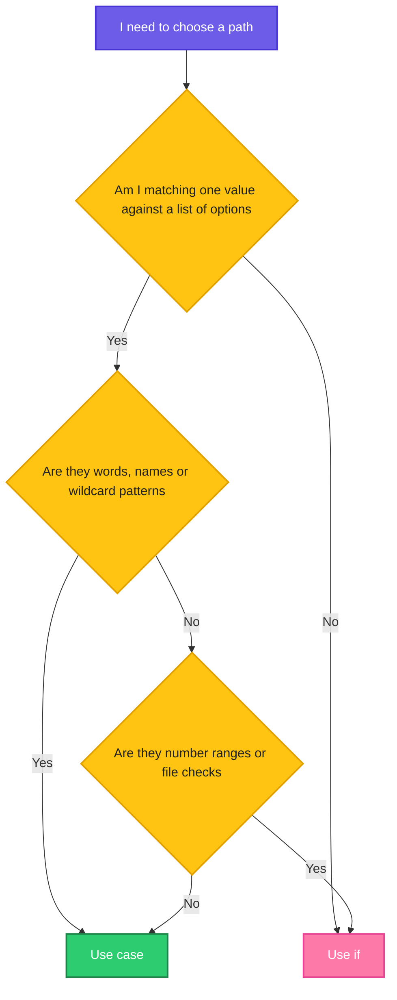

# The `case` Statement: One Value, Many Answers

> **Before this page:** you have read [06 Decisions: `if`, `else` and `elif`](06-if-conditions.md). You know how a script chooses between paths with a condition.
>
> **By the end of this page** you will know a second, neater way to choose, and you will know exactly **when to use `if` and when to use `case`**.

---

## 1. Start with a problem: the endless ladder

Imagine a script called `svc.sh` that controls a service. The user types the action they want:

```bash
./svc.sh start
./svc.sh stop
./svc.sh restart
./svc.sh status
```

With what you know from the last page, you would write an `elif` ladder.

Let's say we have this file `svc_if.sh`:

**Input file** (`svc_if.sh`):
```bash
#!/bin/bash
action="$1"
if [[ $action == "start" ]]; then
  echo "Starting the service..."
elif [[ $action == "stop" ]]; then
  echo "Stopping the service..."
elif [[ $action == "restart" ]]; then
  echo "Restarting the service..."
elif [[ $action == "status" ]]; then
  echo "The service is running"
else
  echo "Unknown action: $action"
fi
```

**Command:**
```bash
chmod +x svc_if.sh
./svc_if.sh stop
```
**Sample Output:**
```text
Stopping the service...
```

It works. But read it again. Look at how many times we repeat `[[ $action == ... ]]`. We are asking the **same question** (*"what is `$action`?"*) again and again, with a different answer each time. Add ten more actions and the script becomes a wall of repetition, where it is easy to make a typo in one `elif`.

There is a tool made exactly for this situation.

---

## 2. The big idea: the phone menu

You have used this on a phone call:

> *"Press 1 for sales. Press 2 for support. Press 3 for billing. Press anything else to hear this menu again."*

The machine does not ask a new question for each option. It looks at **one thing**, the key you pressed, and **jumps to the matching option**. If nothing matches, it falls to the "anything else" option.

That is the **`case` statement**:

| Phone menu | `case` in a script |
|------------|--------------------|
| The key you pressed | The **value** being examined (`$action`) |
| "Press 1 for sales" | A **pattern** and its commands |
| "Anything else" | The catch-all pattern `*` |
| Hang up after the option | `;;` ends that option |



---

## 3. Your first `case` (do this with me)

Here is the same script as in section 1, rewritten with `case`.

Let's say we have this file `svc.sh`:

**Input file** (`svc.sh`):
```bash
#!/bin/bash
action="$1"
case "$action" in
  start)
    echo "Starting the service..."
    ;;
  stop)
    echo "Stopping the service..."
    ;;
  restart)
    echo "Restarting the service..."
    ;;
  status)
    echo "The service is running"
    ;;
  *)
    echo "Unknown action: $action"
    ;;
esac
```

**Command:**
```bash
chmod +x svc.sh
./svc.sh start
./svc.sh status
./svc.sh dance
```
**Sample Output:**
```text
Starting the service...
The service is running
Unknown action: dance
```

Compare it with the ladder: the question (`"$action"`) is asked **once**, at the top, and every option is a neat little block. It is shorter and easier to scan.

### The anatomy of a `case`

```text
case "$action" in        <- look at this value
  start)                 <- if it matches "start"...
    echo "Starting..."   <-    run these commands
    ;;                   <-    ...and stop here (jump to esac)
  *)                     <- anything else
    echo "Unknown"
    ;;
esac                     <- "case" written backwards: the end
```

| Piece | Meaning |
|-------|---------|
| `case "$action" in` | "Look at this value. Here are the options." |
| `start)` | A **pattern**. The closing bracket `)` ends the pattern (by convention there is no opening bracket) |
| commands | Anything you could write in a normal script |
| `;;` | **Two semicolons.** "This option is finished, jump to `esac`." |
| `*)` | A pattern that matches **everything**, so it catches what nothing else did. Always put it **last** |
| `esac` | **`case` written backwards.** It closes the block, just like `fi` closes an `if` |

What happens when no argument is given? `$action` is empty, which matches nothing except `*`, so the "Unknown action" option runs:

**Command:**
```bash
./svc.sh
```
**Sample Output:**
```text
Unknown action: 
```

---

## 4. The superpowers of patterns

The real strength of `case` is that each option is a **pattern**, not just a fixed word. You can do much more than the `if` ladder in the same space.

### Power 1: several words for one option, with `|`

A pipe `|` between patterns means **"or"**. Use it when different words should do the same thing. This is also a perfect place to show a proper "usage" message with an exit code, using what you learned in page 04.

Let's say we have this file `svc2.sh`:

**Input file** (`svc2.sh`):
```bash
#!/bin/bash
case "$1" in
  start|begin|up)
    echo "Starting..."
    ;;
  stop|end|down)
    echo "Stopping..."
    ;;
  *)
    echo "Usage: $0 start|stop"
    exit 1
    ;;
esac
```

**Command:**
```bash
chmod +x svc2.sh
./svc2.sh up
./svc2.sh down
./svc2.sh wrong
echo "code: $?"
```
**Sample Output:**
```text
Starting...
Stopping...
Usage: ./svc2.sh start|stop
code: 1
```

`up`, `begin` and `start` all lead to the same option. The catch-all prints how to use the script and **exits with code `1`**, so anything that called the script knows it failed.

### Power 2: wildcards

Patterns understand the same wildcards you met in the Linux file-matching page: `*` for "anything", `?` for "one character" and `[...]` for "one of these characters". This is wonderful for sorting files by their name.

Let's say we have this file `ftype.sh`:

**Input file** (`ftype.sh`):
```bash
#!/bin/bash
case "$1" in
  *.txt)
    echo "$1 is a text file"
    ;;
  *.jpg|*.png)
    echo "$1 is an image"
    ;;
  *.sh)
    echo "$1 is a shell script"
    ;;
  *)
    echo "$1 is something I do not know"
    ;;
esac
```

**Command:**
```bash
chmod +x ftype.sh
./ftype.sh notes.txt
./ftype.sh photo.png
./ftype.sh run.sh
./ftype.sh data.xyz
```
**Sample Output:**
```text
notes.txt is a text file
photo.png is an image
run.sh is a shell script
data.xyz is something I do not know
```

`*.txt` means "anything that ends with `.txt`". Doing this with `if` would need more complicated tricks. With `case` it is natural.

### Power 3: forgiving answers (yes / no)

When you ask a person a question with `read` (page 03), they might type `y`, `Y`, `yes`, `YES` or `Yes`. Character sets `[Yy]` handle this tidily.

Let's say we have this file `yn.sh`:

**Input file** (`yn.sh`):
```bash
#!/bin/bash
read -p "Continue? " answer
case "$answer" in
  [Yy]|[Yy][Ee][Ss])
    echo "Okay, continuing"
    ;;
  [Nn]|[Nn][Oo])
    echo "Okay, stopping"
    ;;
  *)
    echo "Please answer yes or no"
    ;;
esac
```

**Command:**
```bash
chmod +x yn.sh
./yn.sh
```
**What you see in the terminal** (run four times, typing a different answer each time):
```text
Continue? yes
Okay, continuing

Continue? Y
Okay, continuing

Continue? no
Okay, stopping

Continue? maybe
Please answer yes or no
```

`[Yy]` means "a capital or small `y`". `[Yy][Ee][Ss]` accepts `yes`, `YES`, `Yes` and all other mixes.

### Power 4: a real DevOps example, choosing the environment

A script that deploys software must behave differently for each environment, and it must **refuse** a name it does not know. That is exactly what `case` is good at.

Let's say we have this file `deploy.sh`:

**Input file** (`deploy.sh`):
```bash
#!/bin/bash
# deploy.sh - usage: ./deploy.sh dev|staging|prod

env="$1"

case "$env" in
  dev)
    echo "Deploying to the DEV server. No questions asked."
    ;;
  staging)
    echo "Deploying to STAGING. Running smoke tests too."
    ;;
  prod)
    echo "Deploying to PRODUCTION. Be careful!"
    ;;
  *)
    echo "Usage: $0 dev|staging|prod"
    exit 1
    ;;
esac
echo "Finished"
```

**Command:**
```bash
chmod +x deploy.sh
./deploy.sh staging
./deploy.sh qa
echo "code: $?"
./deploy.sh
echo "code: $?"
```
**Sample Output:**
```text
Deploying to STAGING. Running smoke tests too.
Finished
Usage: ./deploy.sh dev|staging|prod
code: 1
Usage: ./deploy.sh dev|staging|prod
code: 1
```

Notice two things:

- A **typo** like `qa`, or a **missing** argument, is caught by the `*)` option. The script stops with code `1` before it can deploy anywhere by accident.
- On `staging`, the "Finished" line is printed because the script **continues after `esac`**. After the `exit 1`, it never gets there.

### Power 5: a menu for humans

Combine `read` (page 03) with `case`, and you have a menu.

Let's say we have this file `menu.sh`:

**Input file** (`menu.sh`):
```bash
#!/bin/bash
echo "1) Show date"
echo "2) Show disk"
echo "3) Quit"
read -p "Choose: " choice

case "$choice" in
  1)
    date +%d-%b-%Y
    ;;
  2)
    df -h / | tail -1
    ;;
  3)
    echo "Bye"
    ;;
  *)
    echo "Invalid choice: $choice"
    ;;
esac
```

**Command:**
```bash
chmod +x menu.sh
./menu.sh
```
**What you see in the terminal** (run once, typing `2`):
```text
1) Show date
2) Show disk
3) Quit
Choose: 2
/dev/sdd       1007G   16G  940G   2% /
```

With other answers, the script printed these results: `1` gives `20-Oct-2026`, `3` gives `Bye`, and `9` gives `Invalid choice: 9`. (Your date and disk numbers will differ.)

Patterns can be plain numbers like `1)`, too.

### Power 6: the host system

A script often needs to behave differently on Linux and on a Mac. The `uname -s` command prints the system name.

Let's say we have this file `os.sh`:

**Input file** (`os.sh`):
```bash
#!/bin/bash
case "$(uname -s)" in
  Linux)
    echo "This is Linux"
    ;;
  Darwin)
    echo "This is macOS"
    ;;
  *)
    echo "Some other system"
    ;;
esac
```

**Command:**
```bash
chmod +x os.sh
./os.sh
```
**Sample Output:**
```text
This is Linux
```

`case` can examine the output of a command too, because `"$(uname -s)"` is replaced by its answer first.

---

## 5. When to use `if` and when to use `case`

Now the question you have been waiting for. Both choose between paths, so which should you pick?

### The one-sentence rule

> **Use `case` when you are matching ONE value against MANY possible answers. Use `if` for everything else.**

Think of it like this. `case` is a **switchboard**: one incoming line, many outlets. `if` is a **checkpoint**: you can ask any question you like, in any shape.

### Side by side

| | `if` / `elif` | `case` |
|---|---------------|--------|
| **Question it asks** | Anything: comparisons, file checks, combinations | "Which of these does this one value match?" |
| **Compares numbers** (`>=`, `<`) | Yes, easily | Not really (only matching patterns) |
| **Checks files** (exists, readable) | Yes (`-e`, `-f`, `-d`) | No |
| **Uses an exit code** (`if grep -q ...`) | Yes | No |
| **Combines different questions** (`A && B`) | Yes | No |
| **Matches by wildcard** (`*.txt`) | Awkward | **Natural** |
| **Several words, one result** (`start\|up`) | Needs `\|\|` repeated | **Natural** (`start\|up)`) |
| **Reads best when** | Few paths, or different kinds of tests | Many options on one value |

### Which one wins in each situation?

| Situation | Best choice | Why |
|-----------|-------------|-----|
| The user types `start`, `stop`, `restart` or `status` | **`case`** | One value, many options |
| Choosing `dev`, `staging` or `prod` | **`case`** | One value, fixed list |
| A menu with options 1, 2, 3 | **`case`** | One value, many options |
| Yes or no, in any capital letters | **`case`** | Patterns like `[Yy]*` |
| Decide by file extension (`*.log`, `*.zip`) | **`case`** | Wildcards |
| Is the disk 90% full or more? | **`if`** | It is a number comparison |
| Does this file exist? | **`if`** | It is a file test |
| Is the folder writable **and** not empty? | **`if`** | Two different questions combined |
| Did the last command succeed? | **`if`** | Exit code |
| Did `grep` find something in a log? | **`if`** | Exit code from a command |
| Just two paths: yes or no | **`if`** | `case` would be overkill |

### The proof: numbers

Can `case` handle numbers? It only matches **patterns**, so for ranges it gets awkward. Let's try to detect teenagers (13 to 19) with `case`:

Let's say we have this file `teens.sh`:

**Input file** (`teens.sh`):
```bash
#!/bin/bash
case "$1" in
  1[3-9])
    echo "$1 is a teenager"
    ;;
  *)
    echo "$1 is not a teenager"
    ;;
esac
```

**Command:**
```bash
chmod +x teens.sh
./teens.sh 15
./teens.sh 20
./teens.sh 113
```
**Sample Output:**
```text
15 is a teenager
20 is not a teenager
113 is not a teenager
```

It works here, because the pattern `1[3-9]` happens to describe "a `1` followed by a digit from 3 to 9". But try to describe "90 or more" this way and it becomes a puzzle of patterns. With `if` it is one clear line. This is the same disk check from the last page:

Let's say we have this file `big.sh`:

**Input file** (`big.sh`):
```bash
#!/bin/bash
if [[ $1 -ge 90 ]]; then echo "critical"; elif [[ $1 -ge 80 ]]; then echo "warning"; else echo "ok"; fi
```

**Command:**
```bash
chmod +x big.sh
./big.sh 95
./big.sh 85
./big.sh 3
```
**Sample Output:**
```text
critical
warning
ok
```

**So numbers and thresholds belong to `if`.** Words and names belong to `case`.



### Can I use both together?

Yes, and good scripts often do. Use `case` to pick the **action** the user asked for, and use `if` **inside** an option to check something specific. For example, in a `prod` option of `deploy.sh`, you might add an `if` to confirm that a required file exists before going on.

---

## 6. The mistakes that bite

### Mistake 1: putting `*)` first

Patterns are checked **from top to bottom**, and the **first match wins**. A catch-all at the top swallows everything.

Let's say we have this file `order.sh`:

**Input file** (`order.sh`):
```bash
#!/bin/bash
case "$1" in
  *)
    echo "catch-all"
    ;;
  start)
    echo "start"
    ;;
esac
```

**Command:**
```bash
chmod +x order.sh
./order.sh start
```
**Sample Output:**
```text
catch-all
```

We typed `start`, but the `*)` above it matched first, so `start)` can never run. **Always put `*)` last.**

### Mistake 2: forgetting `esac`

Let's say we have this file `noesac.sh`:

**Input file** (`noesac.sh`):
```bash
#!/bin/bash
case "$1" in
  a) echo "A" ;;
```

**Command:**
```bash
bash noesac.sh a
```
**Sample Output:**
```text
noesac.sh: line 4: syntax error: unexpected end of file
```

The shell reached the end of the file still waiting for `esac`. Whenever you see *unexpected end of file*, count your `esac`, `fi` and `done` words.

### Mistake 3: forgetting `;;`

Let's say we have this file `nodsemi.sh`:

**Input file** (`nodsemi.sh`):
```bash
#!/bin/bash
case "$1" in
  a) echo "A"
  b) echo "B" ;;
esac
```

**Command:**
```bash
bash nodsemi.sh a
```
**Sample Output:**
```text
nodsemi.sh: line 4: syntax error near unexpected token `)'
nodsemi.sh: line 4: `  b) echo "B" ;;'
```

Without `;;` after the first option, the shell thinks `b)` is still part of option `a`, and gets confused by the `)`. The error points at the **next** option, not at the one with the missing `;;`. Look at the line above.

### The full list at a glance

| Mistake | Symptom | Fix |
|---------|---------|-----|
| `*)` is not last | Later options never run | Put `*)` at the bottom |
| Forgot `esac` | `unexpected end of file` | Close with `esac` |
| Forgot `;;` | `syntax error near unexpected token ')'` | End every option with `;;` |
| Wrote `start:` by habit from other languages | Syntax error | The form is `start)` |
| Expected a number range to work like `if` | Hard-to-read patterns, wrong matches | Use `if` for ranges |
| Typed `Start` and expected `start` to match | Patterns are **case sensitive** | `[Ss]tart)` or lower-case the value first |
| Used a regular expression (`^st.*`) | Patterns are **wildcards**, not regex | Use `st*)` |
| Forgot a catch-all | Typos silently do nothing | Always end with `*)` and an error or usage message |

---

## 7. Words to remember

| Word | Simple meaning |
|------|----------------|
| **`case`** | Look at one value and jump to the matching option |
| **`esac`** | `case` backwards, closes the block |
| **Pattern** | What an option must match, like `start` or `*.txt` |
| **`)`** | Ends a pattern |
| **`;;`** | Ends an option's commands |
| **`*)`** | The catch-all: matches anything left over |
| **`a\|b)`** | Matches `a` **or** `b` |
| **`[Yy]`** | One character: `Y` or `y` |
| **Switchboard** | The picture of `case`: one line in, many outlets |
| **Checkpoint** | The picture of `if`: ask any question you like |

---

## 8. Try it yourself

1. **Traffic light.** Write `light.sh` that takes `red`, `yellow` or `green` and prints `Stop`, `Get ready` or `Go`. Anything else should print an error and exit with `1`.
2. **Day type.** Write `day.sh` that takes a day name (`Mon`, `Tue`...). Print `Weekday` for Mon to Fri and `Weekend` for Sat and Sun. (Hint: use `|` between patterns.)
3. **Be forgiving.** Make `day.sh` also work when the user types `mon`, `MON` or `Mon`. (Hint: `[Mm][Oo][Nn]`, or convert the input first.)
4. **File sorter.** Write `sort.sh` that takes a file name and prints `log`, `archive` or `unknown`, based on `*.log`, `*.zip|*.tar|*.gz`, or anything else.
5. **Menu.** Write a menu with `read` and `case` that offers 1) show date, 2) show current folder, 3) list files, 4) quit.
6. **Choose the tool.** For each, say whether you would use `if` or `case`, and why:
   - the CPU load is above 4
   - the user passes `--help`, `--version` or `--run`
   - the file `config.txt` exists
   - the environment name is one of `dev`, `qa`, `prod`
7. **Spot the bug.** Why does this never print `Stopping`?
   ```bash
   case "$1" in
     *) echo "unknown" ;;
     stop) echo "Stopping" ;;
   esac
   ```

<details>
<summary>Answers for exercises 6 and 7 (open only after trying)</summary>

**Exercise 6:**
- CPU load above 4: **`if`** (a number comparison).
- `--help`, `--version`, `--run`: **`case`** (one value, many fixed options).
- `config.txt` exists: **`if`** (a file test).
- `dev`, `qa`, `prod`: **`case`** (one value, a fixed list).

**Exercise 7:** The `*)` catch-all is first, so it matches everything, including `stop`. Move it to the bottom.
</details>

---

## 9. Quick recap

- **`case`** looks at **one value** and jumps to the first matching pattern. It is a switchboard.
- The shape is `case "$value" in pattern) commands ;; esac`.
- Every option ends with **`;;`**. The whole block ends with **`esac`**.
- Patterns can be words, several words with `|`, wildcards like `*.txt`, and character sets like `[Yy]`.
- Always add **`*)` last** as the catch-all, and use it to print a usage message and `exit 1`.
- **Use `case`** for one value against many answers: actions, environments, menus, file extensions, yes/no.
- **Use `if`** for numbers and ranges, file tests, exit codes, and anything that combines different questions.
- Both can live in the same script, and you can put an `if` inside a `case` option.

**Next page:** [08 Arrays](08-arrays.md), where your script learns to keep a whole list in one variable, the perfect preparation for loops, which repeat work for every item in a list.
