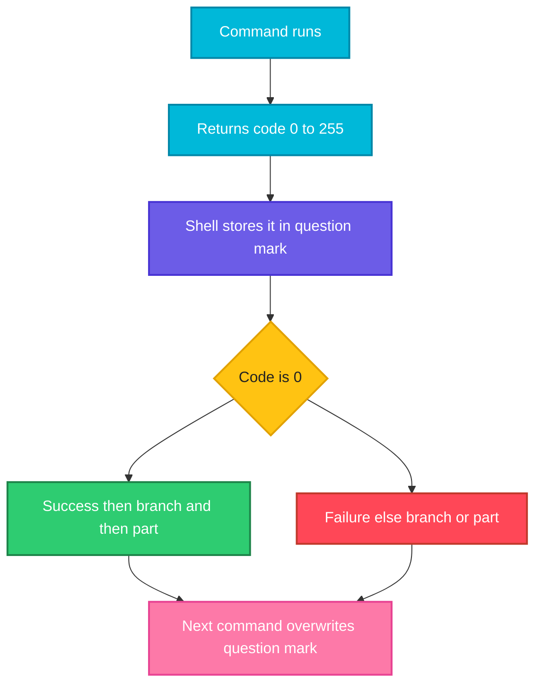

# Exit Codes

## What is it?
Every command ends with a number between `0` and `255`, the **exit code** (or exit status). **`0` means success, anything else means failure.** The number is how one program tells another what happened. The shell stores the code of the last command in the variable `$?`, and `if`, `&&`, `||`, `while`, `set -e` and CI systems all make their decisions from it.

This is the opposite of most programming languages, where `0` is false. In the shell `0` is **true** (success).

## Syntax
```bash
command
echo "$?"               # exit code of the last command

exit N                  # end the script with code N
return N                # end a function with code N

cmd1 && cmd2            # cmd2 runs only if cmd1 returned 0
cmd1 || cmd2            # cmd2 runs only if cmd1 returned non zero
if cmd; then ...; fi    # then branch runs if cmd returned 0
```

## Visual Overview
> A command runs and returns a number. The shell keeps it in `$?` until the next command, and the control structures read it to decide what to do.



## Options/Flags
**Well known exit codes**

| Code | Meaning | Example |
|------|---------|---------|
| `0` | Success | `true`, `grep` found a match |
| `1` | General failure | `false`, `grep` found nothing |
| `2` | Wrong usage, or a serious error | `grep` on a missing file, `ls` on a missing path |
| `64` | Command line usage error (`EX_USAGE`) | A script run with the wrong arguments |
| `124` | Command timed out | `timeout 5 cmd` |
| `126` | Found, but cannot be executed | File without the `x` bit |
| `127` | Command not found | A typo, or a missing tool |
| `128 + n` | Killed by signal `n` | See the next table |
| `255` | Exit code out of range, or `ssh` error | `exit -1`, `ssh` cannot connect |

**Signal codes (`128 + signal number`)**

| Code | Signal | Cause |
|------|--------|-------|
| `130` | `SIGINT` (2) | You pressed `Ctrl+C` |
| `137` | `SIGKILL` (9) | `kill -9`, or the kernel's out of memory killer |
| `139` | `SIGSEGV` (11) | Segmentation fault, a crash |
| `143` | `SIGTERM` (15) | `kill PID`, `docker stop`, `systemctl stop` |

**Ways to use a code**

| Tool | Meaning |
|------|---------|
| `$?` | Code of the last command (only until the next command runs) |
| `${PIPESTATUS[@]}` | Codes of **every** command in the last pipeline |
| `! cmd` | Negate: success becomes failure and the other way |
| `cmd1 && cmd2` / `cmd1 \|\| cmd2` | Run conditionally |
| `cmd \|\| true` | Ignore a failure |
| `set -e` | Exit the script when a command fails |
| `set -o pipefail` | A pipeline fails if **any** command in it fails |
| `trap '...' ERR` | Run a handler when a command fails |
| `wait PID` | Wait for a background job and get its code |

For the examples let's say we have this file:

**Input file** (`f.txt`):
```text
alpha
beta
```

## Usage Examples

### Example 1: Read `$?`
**Command:**
```bash
true; echo "true: $?"
false; echo "false: $?"
ls f.txt >/dev/null; echo "ls ok: $?"
ls nofile 2>/dev/null; echo "ls missing: $?"
```
**Sample Output:**
```text
true: 0
false: 1
ls ok: 0
ls missing: 2
```

### Example 2: `grep` uses three different codes
**Command:**
```bash
grep -q alpha f.txt; echo "found: $?"
grep -q zzz f.txt; echo "not found: $?"
grep -q alpha nofile 2>/dev/null; echo "error: $?"
```
**Sample Output:**
```text
found: 0
not found: 1
error: 2
```
`1` means "no match", which is not an error. `2` means something really went wrong. Many tools follow this convention. Always read the **Exit status** section of the man page of a tool you depend on.

### Example 3: `$?` is overwritten by the next command
**Command:**
```bash
ls nofile 2>/dev/null; echo "first: $?"
echo "second: $?"
ls nofile 2>/dev/null; rc=$?
echo "saved: $rc"
echo "again: $rc"
```
**Sample Output:**
```text
first: 2
second: 0
saved: 2
again: 2
```
The `echo` itself succeeded, so the second `$?` is `0`. Copy the code into a variable at once if you need it later.

### Example 4: Special codes from the shell
**Command:**
```bash
bash -c 'nosuchcmd' 2>/dev/null; echo "not found: $?"
printf 'echo hi\n' > noexec.sh; ./noexec.sh 2>/dev/null; echo "not executable: $?"
bash -c 'exit 3'; echo "exit 3: $?"
timeout 0.2 sleep 5; echo "timeout: $?"
```
**Sample Output:**
```text
not found: 127
not executable: 126
exit 3: 3
timeout: 124
```

### Example 5: Killed by a signal (`128 + n`)
**Command:**
```bash
bash -c 'kill -TERM $$'; echo "SIGTERM: $?"
bash -c 'kill -KILL $$'; echo "SIGKILL: $?"
bash -c 'kill -INT $$' 2>/dev/null; echo "SIGINT: $?"
```
**Sample Output:**
```text
Terminated
SIGTERM: 143
bash: line 6:  1726 Killed                  bash -c 'kill -KILL $$'
SIGKILL: 137
SIGINT: 130
```
`143 - 128 = 15` is `SIGTERM`, `137 - 128 = 9` is `SIGKILL`. If a container exits with `137`, it was killed, often for running out of memory (`OOMKilled`).

### Example 6: Codes only go from 0 to 255
**Command:**
```bash
bash -c 'exit 256'; echo "256 -> $?"
bash -c 'exit 257'; echo "257 -> $?"
bash -c 'exit -1'; echo "-1 -> $?"
```
**Sample Output:**
```text
256 -> 0
257 -> 1
-1 -> 255
```
The code wraps around modulo 256. Never `exit 256` to mean "error".

### Example 7: `exit` without a number
**Command:**
```bash
bash -c 'false; exit'; echo "exit uses last: $?"
bash -c 'true; exit'; echo "after true: $?"
```
**Sample Output:**
```text
exit uses last: 1
after true: 0
```
A script's exit code is the code of its **last command** unless you call `exit N`.

### Example 8: `&&` and `||`
**Command:**
```bash
true && echo "and-then"
false || echo "or-else"
false && echo never
true || echo never
```
**Sample Output:**
```text
and-then
or-else
```
`&&` runs the right side only after success. `||` only after failure.

### Example 9: `if` and `!`
**Command:**
```bash
if grep -q alpha f.txt; then echo "if sees 0 as true"; fi
if ! grep -q zzz f.txt; then echo "negated"; fi
```
**Sample Output:**
```text
if sees 0 as true
negated
```

### Example 10: In a pipeline, the last command decides
**Command:**
```bash
false | true; echo "last wins: $?"
true | false; echo "last fails: $?"
```
**Sample Output:**
```text
last wins: 0
last fails: 1
```
A failure in the middle of a pipeline is hidden.

### Example 11: `PIPESTATUS` and `pipefail`
**Command:**
```bash
false | true
echo "PIPESTATUS: ${PIPESTATUS[@]}"
false | true; echo "plain: $?"
set -o pipefail
false | true; echo "pipefail: $?"
```
**Sample Output:**
```text
PIPESTATUS: 1 0
plain: 0
pipefail: 1
```
`PIPESTATUS` lists every command's code. With `pipefail` the pipeline returns the code of the **last failing** command. Use it in scripts together with `set -e`.

### Example 12: `set -e` stops at the first failure
Let's say we have this file `e1.sh`:

**Input file** (`e1.sh`):
```bash
#!/bin/bash
set -e
echo "step 1"
false
echo "step 2"
```

**Command:**
```bash
bash e1.sh
echo "rc=$?"
```
**Sample Output:**
```text
step 1
rc=1
```
`step 2` never ran, and the script exited with the code of the failing command.

### Example 13: Where `set -e` does **not** stop
Let's say we have this file `e2.sh`:

**Input file** (`e2.sh`):
```bash
#!/bin/bash
set -e
false || echo "handled by ||"
if false; then :; fi
echo "after if"
false && echo never
echo "after &&"
x=$(false) || echo "handled x"
echo "end"
```

**Command:**
```bash
bash e2.sh
echo "rc=$?"
```
**Sample Output:**
```text
handled by ||
after if
after &&
handled x
end
rc=0
```
A failure that is **tested** (in `if`, `&&`, `||`, `while`, `!`) does not trigger `set -e`. That is why `set -e` alone is not a full safety net.

### Example 14: Allow a failure on purpose (`|| true`)
Let's say we have this file `e3.sh`:

**Input file** (`e3.sh`):
```bash
#!/bin/bash
set -e
grep -q zzz f.txt || true
echo "continued"
count=$(grep -c zzz f.txt || true)
echo "count=$count"
```

**Command:**
```bash
bash e3.sh
```
**Sample Output:**
```text
continued
count=0
```
`grep` returns `1` when it finds nothing, which would stop the script. `|| true` turns that into success.

### Example 15: `local v=$(cmd)` hides the failure
Let's say we have this file `e4.sh`:

**Input file** (`e4.sh`):
```bash
#!/bin/bash
f() { local v=$(false); echo "local masks: $?"; local w; w=$(false); echo "separate: $?"; }
f
```

**Command:**
```bash
bash e4.sh
```
**Sample Output:**
```text
local masks: 0
separate: 1
```
`local` itself succeeds and replaces the code of the command substitution. Declare first and assign on the next line.

### Example 16: Report errors with `trap ... ERR`
Let's say we have this file `t1.sh`:

**Input file** (`t1.sh`):
```bash
#!/bin/bash
set -eE
trap 'echo "failed at line $LINENO with code $?" >&2' ERR
echo start
ls /nonexistent 2>/dev/null
echo unreachable
```

**Command:**
```bash
bash t1.sh
echo "rc=$?"
```
**Sample Output:**
```text
start
failed at line 5 with code 2
rc=2
```
The trap tells you **where** the script failed. See [Signals and trap](09-signals-and-trap.md).

### Example 17: `return` in a function
**Command:**
```bash
f() { return 5; }
f; echo "func: $?"
g() { false; }
g; echo "implicit: $?"
```
**Sample Output:**
```text
func: 5
implicit: 1
```
A function without `return` gives the code of its last command.

### Example 18: A script's own exit code
Let's say we have these two files:

**Input file** (`s1.sh`):
```bash
#!/bin/bash
ls /nonexistent 2>/dev/null
echo "script ends"
```
**Input file** (`s2.sh`):
```bash
#!/bin/bash
if ls /nonexistent 2>/dev/null; then exit 0; else exit 4; fi
```

**Command:**
```bash
bash s1.sh; echo "script rc (last cmd): $?"
bash s2.sh; echo "explicit rc: $?"
```
**Sample Output:**
```text
script ends
script rc (last cmd): 0
explicit rc: 4
```
In `s1.sh` the last command is `echo`, which succeeds, so the failure of `ls` is lost. Call `exit` yourself when the result matters.

### Example 19: Your own meaningful codes
Let's say we have this file `s3.sh`:

**Input file** (`s3.sh`):
```bash
#!/bin/bash
E_OK=0; E_USAGE=2; E_MISSING=3; E_NOPERM=4
[ $# -eq 1 ] || { echo "usage" >&2; exit $E_USAGE; }
[ -e "$1" ] || { echo "missing: $1" >&2; exit $E_MISSING; }
[ -r "$1" ] || { echo "no permission" >&2; exit $E_NOPERM; }
echo "ok"; exit $E_OK
```

**Command:**
```bash
bash s3.sh; echo "rc=$?"
bash s3.sh nofile; echo "rc=$?"
bash s3.sh f.txt; echo "rc=$?"
```
**Sample Output:**
```text
usage
rc=2
missing: nofile
rc=3
ok
rc=0
```
Different codes let the caller (a CI job or another script) react differently. Document them in the usage text.

### Example 20: React to different codes (`case $?`)
**Command:**
```bash
grep -q alpha f.txt
case $? in 0) echo found ;; 1) echo "not found" ;; *) echo error ;; esac
grep -q alpha nofile 2>/dev/null
case $? in 0) echo found ;; 1) echo "not found" ;; *) echo error ;; esac
```
**Sample Output:**
```text
found
error
```

### Example 21: Sub shells and background jobs
**Command:**
```bash
( exit 7 ); echo "subshell: $?"
$(exit 9); echo "subst: $?"
sleep 0.1 & wait $!; echo "wait: $?"
(sleep 0.1; exit 6) & wait $!; echo "wait failing: $?"
```
**Sample Output:**
```text
subshell: 7
subst: 9
wait: 0
wait failing: 6
```
`wait PID` returns the code of that background job.

### Example 22: Tests and `command -v`
**Command:**
```bash
[ 1 -eq 1 ]; echo "true test: $?"
[ 1 -eq 2 ]; echo "false test: $?"
command -v bash >/dev/null; echo "found: $?"
command -v nosuch >/dev/null; echo "missing: $?"
! true; echo "bang: $?"
! false; echo "bang false: $?"
```
**Sample Output:**
```text
true test: 0
false test: 1
found: 0
missing: 1
bang: 1
bang false: 0
```
`[ ]` is a command that returns `0` for true and `1` for false.

## Sample Output
The two lines every script writer needs to know:

```bash
ls /etc/hostname >/dev/null; echo $?
ls /no/such/path 2>/dev/null; echo $?
```
```text
0
2
```

## Pitfalls / Gotchas
- **`0` is success (true).** `if [ $? -eq 0 ]` is correct, but `if command; then` is shorter and does not risk the code being overwritten.
- `$?` changes after **every** command, including `echo` and `[ ]`. Save it first: `rc=$?`.
- A script's exit code is the code of its **last command**. Add `exit "$rc"` or use `set -e` so that failures are not lost.
- Do not exit with values above `255` or below `0`, they wrap around.
- Do not pick `126`, `127` or `128+` for your own codes, they have fixed meanings. Use `1` to `125`, with `2` for usage errors.
- `set -e` has many exceptions (Example 13) and surprises in functions and sub shells. Use it with `set -o pipefail` and `set -u`, and still check critical commands yourself.
- A pipeline hides failures of every command but the last, unless `pipefail` is set.
- `grep` returns `1` for "no match", which `set -e` treats as an error.
- `local v=$(cmd)` and `export v=$(cmd)` hide the exit code of `cmd`.
- `cmd || true` swallows **all** failures of `cmd`, also real ones. Use it only where you mean it.
- `exit` inside a function or `( )` ends only the sub shell in some cases, and ends the **whole script** in others. Prefer `return` in functions.
- CI systems (GitHub Actions, GitLab, Jenkins) mark a step failed on any non zero exit code. A final `echo` can turn a failed script into a green one.
- A container that exits with `137` was killed (often out of memory) and `143` was stopped with `SIGTERM`.

## DevOps Use Cases

### Use Case 1: Fail a pipeline step with a clear code
**Situation:** A health check script must tell the pipeline whether a file is present, missing or unreadable.

Using the `s3.sh` file from Example 19.

**Command:**
```bash
bash s3.sh nofile
echo "pipeline sees: $?"
```
**Sample Output:**
```text
missing: nofile
pipeline sees: 3
```
The pipeline fails on any non zero code, and the number tells you which check failed.

### Use Case 2: Check if a service answers, with a timeout
**Situation:** Probe a port, but never hang for more than a moment.

**Command:**
```bash
timeout 0.2 sleep 5
rc=$?
if [ $rc -eq 124 ]; then echo "timed out"; fi
```
**Sample Output:**
```text
timed out
```
`timeout` returns `124` when it had to stop the command. Replace `sleep 5` with `curl`, `nc` or `ping`.

### Use Case 3: A safe script header
**Situation:** Every automation script should stop on errors, on unset variables and on hidden pipeline failures.

Let's say we have this file `safe.sh`:

**Input file** (`safe.sh`):
```bash
#!/bin/bash
set -euo pipefail
echo "start"
count=$(grep -c zzz f.txt || true)
echo "count=$count"
false | true
echo "not reached"
```

**Command:**
```bash
bash safe.sh
echo "rc=$?"
```
**Sample Output:**
```text
start
count=0
rc=1
```
`pipefail` makes `false | true` fail, and `set -e` stops the script there.

### Use Case 4: Find out why a container exited
**Situation:** `docker ps -a` shows `Exited (137)`.

**Command:**
```bash
code=137
echo "signal: $((code - 128))"
kill -l $((code - 128))
```
**Sample Output:**
```text
signal: 9
KILL
```
`137` is `128 + 9`, so the process got `SIGKILL`. The usual causes are the OOM killer, `docker kill` or a stop timeout. `143` is `SIGTERM`, a normal stop.

### Use Case 5: Retry until a command succeeds
**Situation:** Wait for a flaky command to work, up to three times.

**Command:**
```bash
n=0
until [ $n -ge 2 ]; do n=$((n+1)); echo "try $n"; done; echo "done after $n"
```
**Sample Output:**
```text
try 1
try 2
done after 2
```
In real use the `until` condition is the command itself, for example `until curl -fs URL; do sleep 2; done`.

## Related Commands
- [Arguments and input](06-arguments-and-input.md) - the previous page
- [Environment variables and PATH](08-environment-variables-and-path.md) - the next page
- [Conditionals](03-conditionals.md) - `if`, `&&` and `||` use exit codes
- [`set`](../linux/shell-basics/set.md) - `set -e`, `-u` and `-o pipefail`
- [`test`](../linux/shell-basics/test.md) - returns 0 or 1
- [`exit`](../linux/shell-basics/exit.md) - leave with a code
- [`kill`](../linux/process-management/kill.md) / [`timeout`](../linux/process-management/timeout.md) - codes 128+n and 124
- [`grep`](../linux/text-processing/grep.md) - 0, 1 and 2
- [Terminal, shell and bash](../linux/fundamentals/03-terminal-shell-bash.md) - the first look at `$?`
