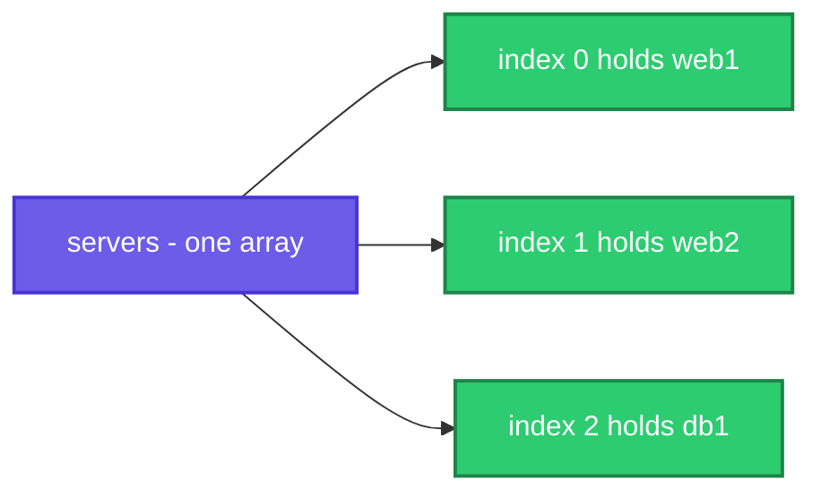

# Arrays: One Name, Many Values

> **Before this page:** you have read pages [01](01-what-is-a-shell-script.md) to [07](07-case-statements.md). You know variables, arguments, exit codes, operators, `if` and `case`.
>
> **By the end of this page** you will be able to keep a whole **list** in one variable, add to it and read from it, and use a **lookup table** that finds a value by its name. Arrays are what the next pages on loops (and many pages after) are built on.

---

## 1. Start with a problem: a variable holds only one thing

Imagine your script must check three servers: `web1`, `web2` and `db1`. With what you know, you would write:

```bash
server1="web1"
server2="web2"
server3="db1"
```

It works... until the questions start:

- **How many servers do I have?** You would have to count the variables by hand.
- **What if a fourth server arrives?** You must invent `server4`, and change every line that mentions the others.
- **How do I do the same thing to every server?** There is no way to say "for each server variable". You copy and paste a line per server.

You need **one variable that holds many values**, can be counted, can grow, and can be walked through item by item.

**That is what an array is.**

---

## 2. The big idea: an egg carton

Think of an **egg carton**. It is one object, but it has **numbered holes**, and each hole holds one egg. You can say "give me the egg in hole 2". You can count the holes. You can add an egg or take one out.

An array is a carton for values:

| Egg carton | Shell array |
|------------|-------------|
| The carton | The **array** (one name: `servers`) |
| A hole | An **element** (one value) |
| The hole's number | The **index** |
| The egg | The **value** (`web1`) |
| "How many eggs?" | `${#servers[@]}` |

**The most surprising rule:** the numbering starts at **0**, not 1. The first hole is hole `0`, the second is hole `1`, and so on. (Programmers count from zero. You get used to it quickly.)



There are two kinds of arrays in bash, and we will learn both:

| Kind | Hole labels | Real-life picture | Example |
|------|-------------|-------------------|---------|
| **Indexed array** | Numbers: 0, 1, 2... | A numbered shelf | `servers[0]` is `web1` |
| **Associative array** | Words you choose | A phone book: look up a name, get a number | `ports[web]` is `80` |

We start with the indexed array, which you will use ten times more often.

---

## 3. Your first array (do this with me)

Go to your practice folder (`cd ~/practice`). To create an array, put the values in **round brackets**, separated by **spaces**, with **no spaces around the `=`** (the same rule as page 02):

```bash
servers=(web1 web2 db1)
```

To read one element, give its number inside **square brackets**, and wrap the whole thing in **curly braces**: `${servers[0]}`.

Let's say we have this file `a1.sh`:

**Input file** (`a1.sh`):
```bash
#!/bin/bash
servers=(web1 web2 db1)
echo "First  : ${servers[0]}"
echo "Second : ${servers[1]}"
echo "Third  : ${servers[2]}"
echo "Last   : ${servers[-1]}"
echo "Empty slot: [${servers[5]}]"
```

**Command:**
```bash
chmod +x a1.sh
./a1.sh
```
**Sample Output:**
```text
First  : web1
Second : web2
Third  : db1
Last   : db1
Empty slot: []
```

Four things to notice:

- `${servers[0]}` is the **first** element. Zero is the first number.
- `${servers[-1]}` is a handy shortcut for the **last** element. `-2` would be the second from the end. (This works in bash 4.3 and newer.)
- Asking for a hole that does not exist (`[5]`) is **not an error**. You just get an empty value, like the misspelled variable in page 02.
- The curly braces are **required**. Let's see what happens without them.

Let's say we have this file `a5.sh`:

**Input file** (`a5.sh`):
```bash
#!/bin/bash
servers=(web1 web2 db1)
echo "$servers[1]"
echo "${servers[1]}"
echo "$servers"
```

**Command:**
```bash
chmod +x a5.sh
./a5.sh
```
**Sample Output:**
```text
web1[1]
web2
web1
```

Without braces, the shell read `$servers` as "the first element" (`web1`) and then printed `[1]` as plain text. And a bare `$servers` gives only the **first** element, not the whole list. **Always use `${name[index]}` for array elements.**

---

## 4. All the elements, the count, and the indexes

Three tools you will use constantly:

| Write | You get |
|-------|---------|
| `"${servers[@]}"` | **All** the elements |
| `${#servers[@]}` | **How many** elements (`#` means "number of", as in `$#` from page 03) |
| `${!servers[@]}` | The **indexes** (the hole numbers) |

Let's say we have this file `a2.sh`:

**Input file** (`a2.sh`):
```bash
#!/bin/bash
servers=(web1 web2 db1)
echo "All     : ${servers[@]}"
echo "Count   : ${#servers[@]}"
echo "Indexes : ${!servers[@]}"
echo "One per line:"
printf '%s\n' "${servers[@]}"
```

**Command:**
```bash
chmod +x a2.sh
./a2.sh
```
**Sample Output:**
```text
All     : web1 web2 db1
Count   : 3
Indexes : 0 1 2
One per line:
web1
web2
db1
```

`printf '%s\n' "${servers[@]}"` is a neat trick: `printf` repeats its pattern (`%s` then a newline) once for **every** element, so you get one element per line.

The `@` in `[@]` means "every element, kept separate". You will see why that matters in section 6.

---

## 5. Changing an array: set, add, remove, slice

Arrays are not frozen. You can change, grow and shrink them.

| Job | Write |
|-----|-------|
| Change one element | `servers[1]="web9"` |
| Add one at the end | `servers+=("cache1")` |
| Add several at the end | `servers+=(app1 app2)` |
| Take a slice (start, how many) | `"${servers[@]:1:2}"` |
| Remove one element | `unset 'servers[0]'` |

Let's say we have this file `a3.sh`:

**Input file** (`a3.sh`):
```bash
#!/bin/bash
servers=(web1 web2 db1)
servers[1]="web9"
echo "After change : ${servers[@]}"
servers+=("cache1")
echo "After append : ${servers[@]}"
servers+=(app1 app2)
echo "Append many  : ${servers[@]} (count ${#servers[@]})"
echo "Slice (from 1, take 2): ${servers[@]:1:2}"
unset 'servers[0]'
echo "After unset  : ${servers[@]}"
echo "Indexes now  : ${!servers[@]}"
echo "Count now    : ${#servers[@]}"
```

**Command:**
```bash
chmod +x a3.sh
./a3.sh
```
**Sample Output:**
```text
After change : web1 web9 db1
After append : web1 web9 db1 cache1
Append many  : web1 web9 db1 cache1 app1 app2 (count 6)
Slice (from 1, take 2): web9 db1
After unset  : web9 db1 cache1 app1 app2
Indexes now  : 1 2 3 4 5
Count now    : 5
```

Look closely at the last two lines. After `unset 'servers[0]'`, the indexes are `1 2 3 4 5`. **The remaining items did not shift down to fill the gap.** The hole at `0` is simply empty and gone. This is how bash arrays work (they are "sparse"). If you need a tidy list again, rebuild it: `servers=("${servers[@]}")` renumbers from zero.

Note also that `+=` **adds** to the array. Writing `servers=(new)` would **replace** everything with one element.

### An empty array

You can start with an empty array and fill it as the script runs. This is a very common pattern (you will use it in the next page to collect results). To test whether an array is empty, check its count:

Let's say we have this file `a7.sh`:

**Input file** (`a7.sh`):
```bash
#!/bin/bash
list=()
echo "Count: ${#list[@]}"
if [[ ${#list[@]} -eq 0 ]]; then
  echo "The list is empty"
fi
list+=("first")
echo "Count: ${#list[@]}"
```

**Command:**
```bash
chmod +x a7.sh
./a7.sh
```
**Sample Output:**
```text
Count: 0
The list is empty
Count: 1
```

---

## 6. The big gotcha: items that contain spaces

So far every value was one word. What if a value has a **space** in it, like a full name? This is where beginners get hurt, and the cure is the quotes you learned in page 02.

Put quotes around each item that contains a space, and **always** use `"${array[@]}"` with double quotes when reading.

Let's say we have this file `a4.sh`:

**Input file** (`a4.sh`):
```bash
#!/bin/bash
people=("Asha Rao" "Ravi Kumar" "Meena")
echo "Count: ${#people[@]}"
echo "Quoted [@]:"
printf '  [%s]\n' "${people[@]}"
echo "Unquoted [@] (broken):"
printf '  [%s]\n' ${people[@]}
echo "Quoted [*] (one big string):"
printf '  [%s]\n' "${people[*]}"
```

**Command:**
```bash
chmod +x a4.sh
./a4.sh
```
**Sample Output:**
```text
Count: 3
Quoted [@]:
  [Asha Rao]
  [Ravi Kumar]
  [Meena]
Unquoted [@] (broken):
  [Asha]
  [Rao]
  [Ravi]
  [Kumar]
  [Meena]
Quoted [*] (one big string):
  [Asha Rao Ravi Kumar Meena]
```

The square brackets in the output show where each separate item starts and ends. Compare the three forms:

| Form | What you get | Verdict |
|------|--------------|---------|
| `"${people[@]}"` | Three items, each intact | **Always use this** |
| `${people[@]}` (no quotes) | Five pieces: the names are **split at every space** | Broken |
| `"${people[*]}"` | **One** big string with everything joined | Only for printing the whole list in one line |

> **Memorise this:** **`"${array[@]}"`**, with the double quotes, is the correct way to say *"all the elements, each kept as its own item"*. `@` is for "all of them, separately". `*` is for "all of them, glued together".

---

## 7. Arrays from the real world

You will rarely type every value by hand. Often the list comes from somewhere else. Here are the four common sources.

### Source 1: lines of a file (`mapfile`)

`mapfile -t name < file` reads a file and puts **each line into one element**. (`-t` removes the newline at the end of each line.)

Let's say we have this file `hosts.txt`:

**Input file** (`hosts.txt`):
```text
web1
web2
db1
```

And this script:

**Input file** (`a9.sh`):
```bash
#!/bin/bash
mapfile -t hosts < hosts.txt
echo "Read ${#hosts[@]} lines"
echo "Second host: ${hosts[1]}"
```

**Command:**
```bash
chmod +x a9.sh
./a9.sh
```
**Sample Output:**
```text
Read 3 lines
Second host: web2
```

This is perfect for "a list of servers kept in a text file".

### Source 2: files that match a wildcard

Put a wildcard (page 06 of the Linux fundamentals) inside the brackets, and the shell fills the array with every matching file name.

Let's say we have three empty files in the folder: `app.log`, `db.log` and `notes.txt` (only their names matter here):

**Command:**
```bash
logs=(*.log)
echo "Found ${#logs[@]} log files: ${logs[@]}"
```
**Sample Output:**
```text
Found 2 log files: app.log db.log
```

File names with spaces stay intact this way, which makes it **much safer** than building a list from the output of `ls`.

### Source 3: splitting a piece of text

`IFS=',' read -ra parts <<< "a,b,c"` cuts a string at every comma. (`IFS` is "the separator", `-a` means "into an array", and `<<<` feeds the text in.)

Let's say we have this file `a11.sh`:

**Input file** (`a11.sh`):
```bash
#!/bin/bash
line="web1,web2,db1"
IFS=',' read -ra parts <<< "$line"
echo "Parts: ${#parts[@]}"
echo "Second: ${parts[1]}"
```

**Command:**
```bash
chmod +x a11.sh
./a11.sh
```
**Sample Output:**
```text
Parts: 3
Second: web2
```

### Source 4: your script's own arguments

Remember the arguments `$1`, `$2`, `$@` from page 03? **They are an array already.** `"$@"` means "all arguments, each kept intact". You can copy them into a named array, and slice them.

Let's say we have this file `a12.sh`:

**Input file** (`a12.sh`):
```bash
#!/bin/bash
args=("$@")
echo "I got ${#args[@]} arguments"
echo "First  : ${args[0]}"
echo "Last   : ${args[-1]}"
echo "All but the first: ${@:2}"
```

**Command:**
```bash
chmod +x a12.sh
./a12.sh start web1 web2
```
**Sample Output:**
```text
I got 3 arguments
First  : start
Last   : web2
All but the first: web1 web2
```

`${@:2}` means "everything from the second argument on". This is how a script takes a command word first (`start`) and then a list of targets (`web1 web2`).

---

## 8. A peek at loops: walking through an array

The whole point of a list is to do something with **every item**. You will learn loops properly on the next pages, but here is a very short preview so you can see why arrays matter. Read `for s in "${servers[@]}"` as *"for each server in the list, one at a time, call it `s` and do the following"*.

Let's say we have this file `a8.sh`:

**Input file** (`a8.sh`):
```bash
#!/bin/bash
servers=(web1 web2 db1)
for s in "${servers[@]}"; do
  echo "Checking $s ..."
done
for i in "${!servers[@]}"; do
  echo "Server number $((i + 1)) is ${servers[$i]}"
done
```

**Command:**
```bash
chmod +x a8.sh
./a8.sh
```
**Sample Output:**
```text
Checking web1 ...
Checking web2 ...
Checking db1 ...
Server number 1 is web1
Server number 2 is web2
Server number 3 is db1
```

- The first loop walks through the **values**.
- The second loop walks through the **indexes** (`"${!servers[@]}"`), so it can also use the number. We added 1 with `$((i + 1))`, because humans count from 1.

Add a fourth server to the array and **both loops pick it up automatically**. That is the problem from section 1, solved.

---

## 9. Associative arrays: the phone book

An indexed array finds things by **position** (hole number). Sometimes you would rather find things by a **name**: "what is the port for `web`?" That is an **associative array**, also called a *map*, *dictionary* or *key-value* store.

| Part | Phone book | Associative array |
|------|-----------|-------------------|
| What you look up | A person's name | The **key** (`web`) |
| What you get back | Their number | The **value** (`80`) |

> **Important:** you **must** declare it first with `declare -A`. The capital `-A` tells bash "this one is a phone book, not a numbered shelf". Associative arrays need **bash 4 or newer**. Linux has this; the Mac's built-in bash is old (3.2) and does not.

Let's say we have this file `b1.sh`:

**Input file** (`b1.sh`):
```bash
#!/bin/bash
declare -A ports
ports[web]=80
ports[ssh]=22
ports[db]=5432
echo "web  port: ${ports[web]}"
echo "db   port: ${ports[db]}"
echo "How many : ${#ports[@]}"
echo "Keys     : ${!ports[@]}"
echo "Values   : ${ports[@]}"
ports[web]=8080
echo "web changed to ${ports[web]}"
echo "unknown key  : [${ports[ftp]}]"
if [[ -v ports[ssh] ]]; then echo "ssh is in the map"; fi
if [[ ! -v ports[ftp] ]]; then echo "ftp is NOT in the map"; fi
unset 'ports[ssh]'
echo "After unset  : ${#ports[@]} left"
```

**Command:**
```bash
chmod +x b1.sh
./b1.sh
```
**Sample Output:**
```text
web  port: 80
db   port: 5432
How many : 3
Keys     : db web ssh
Values   : 5432 80 22
web changed to 8080
unknown key  : []
ssh is in the map
ftp is NOT in the map
After unset  : 2 left
```

The tools are the same shape as before, but now the "hole label" is a word:

| Job | Write |
|-----|-------|
| Set a value | `ports[web]=80` |
| Read a value | `${ports[web]}` |
| All the **keys** | `${!ports[@]}` |
| All the **values** | `${ports[@]}` |
| How many entries | `${#ports[@]}` |
| Does a key exist? | `[[ -v ports[web] ]]` |
| Remove an entry | `unset 'ports[web]'` |

Look at the line `Keys : db web ssh`. We added them in the order `web, ssh, db`, but they came out as `db web ssh`. **An associative array has no reliable order.** If you need a tidy order, sort the keys when you print them.

You can also create and fill it in **one line**:

Let's say we have this file `b2.sh`:

**Input file** (`b2.sh`):
```bash
#!/bin/bash
declare -A ports=([web]=80 [ssh]=22 [db]=5432)
for name in "${!ports[@]}"; do
  echo "$name -> ${ports[$name]}"
done | sort
```

**Command:**
```bash
chmod +x b2.sh
./b2.sh
```
**Sample Output:**
```text
db -> 5432
ssh -> 22
web -> 80
```

(`| sort` puts the lines in alphabetical order, because the loop itself gives no promised order.)

### What goes wrong without `declare -A`

This is the single most common mistake with maps. Watch what happens when you forget the declaration:

Let's say we have this file `b3.sh`:

**Input file** (`b3.sh`):
```bash
#!/bin/bash
ports[web]=80
ports[db]=5432
echo "web: ${ports[web]}"
echo "db : ${ports[db]}"
echo "count: ${#ports[@]}"
echo "keys : ${!ports[@]}"
```

**Command:**
```bash
chmod +x b3.sh
./b3.sh
```
**Sample Output:**
```text
web: 5432
db : 5432
count: 1
keys : 0
```

With no `declare -A`, bash made an **indexed** array, and it read the words `web` and `db` as variable names, which are empty and therefore count as the number `0`. So both writes went into hole `0`, and the second overwrote the first. No error message, just wrong data. **Always `declare -A` first.**

---

## 10. Real DevOps uses of arrays

| Use | How the array helps |
|-----|---------------------|
| A list of servers to check or deploy to | `servers=(web1 web2 db1)` |
| A list of disks or folders to monitor | `folders=(/var /home /tmp)` |
| Files to process | `logs=(*.log)` |
| Collect the **failures** while checking many things | `failed+=("$server")`, then report them all at the end |
| Map an environment to a server | `declare -A host=([dev]=dev1 [prod]=prod1)` |
| Map a service name to its port | `declare -A ports=([web]=80 [db]=5432)` |
| Take the script's arguments as a list | `targets=("$@")` |

### Worked example: check many folders and collect the failures

Instead of stopping at the first problem, a good health check **checks everything and then reports every problem together**. That needs an array that grows.

Let's say we have this file `check.sh`:

**Input file** (`check.sh`):
```bash
#!/bin/bash
folders=(/etc /tmp /nope /var /ghost)
missing=()
for f in "${folders[@]}"; do
  if [[ ! -d $f ]]; then
    missing+=("$f")
  fi
done
echo "Checked ${#folders[@]} folders"
if [[ ${#missing[@]} -gt 0 ]]; then
  echo "Missing ${#missing[@]}: ${missing[*]}"
  exit 1
fi
echo "All present"
```

**Command:**
```bash
chmod +x check.sh
./check.sh
echo "code: $?"
```
**Sample Output:**
```text
Checked 5 folders
Missing 2: /nope /ghost
code: 1
```

The script starts with an empty `missing` array, adds each bad folder with `+=`, and at the end prints the **count** and the **names**, and exits with code `1` (page 04) so a pipeline can see something is wrong. This "collect, then report" pattern is everywhere in real monitoring scripts.

---

## 11. Upgrade `morning.sh`: check as many disks as you like

In page 03, `morning.sh` took one disk. With arrays it can take **any number**: `./morning.sh / /var /home`. It collects the disks that do not exist and reports them at the end.

Let's say we now have this file `morning.sh`:

**Input file** (`morning.sh`):
```bash
#!/bin/bash
# morning.sh - usage: ./morning.sh [disk ...]

disks=("$@")
if [[ ${#disks[@]} -eq 0 ]]; then
  disks=(/)
fi

echo "Date : $(date +%d-%b-%Y)"
echo "Checking ${#disks[@]} disk(s): ${disks[*]}"

bad=()
for disk in "${disks[@]}"; do
  if df "$disk" > /dev/null 2>&1; then
    df -h "$disk" | tail -1
  else
    bad+=("$disk")
  fi
done

if [[ ${#bad[@]} -gt 0 ]]; then
  echo "Not found: ${bad[*]}"
  exit 1
fi
```

**Command:**
```bash
chmod +x morning.sh
./morning.sh
echo "code: $?"
./morning.sh / /run /nope
echo "code: $?"
```
**Sample Output:**
```text
Date : 20-Oct-2026
Checking 1 disk(s): /
/dev/sdd       1007G   16G  940G   2% /
code: 0
Date : 20-Oct-2026
Checking 3 disk(s): / /run /nope
/dev/sdd       1007G   16G  940G   2% /
none            3.8G  1.2M  3.8G   1% /run
Not found: /nope
code: 1
```

Walk through what the script does:

1. `disks=("$@")` copies all arguments into an array.
2. If there were none (count is 0), it falls back to a default list with one disk, `/`.
3. It loops over the disks. A disk that `df` can read gets its usage line printed. A disk that fails (`/nope`) is added to `bad`.
4. At the end it reports the bad ones and exits with `1`.

The `2>&1` after `/dev/null` hides the error message from `df` too, because we print our own summary instead.

(We dropped the warning and critical levels from page 06 to keep this example short. In a later page we will bring everything together.)

---

## 12. Common mistakes at a glance

| What you wrote | What goes wrong | Fix |
|----------------|-----------------|-----|
| `arr = (a b c)` | `syntax error near unexpected token '('` | No spaces around `=`: `arr=(a b c)` |
| `arr=(a, b, c)` | The commas stay **inside** the values: the first is `a,` | Separate with spaces only |
| `echo $arr[1]` | Prints the first item, then `[1]` as text | `echo "${arr[1]}"` |
| `echo $arr` | Only the **first** element | `echo "${arr[@]}"` |
| `${arr[@]}` without quotes | Items with spaces are split into pieces | `"${arr[@]}"` |
| `"${arr[*]}"` when you wanted separate items | Everything glued into one string | `"${arr[@]}"` |
| Expecting the first element at `[1]` | Counting starts at **0** | First is `[0]`, last is `[-1]` |
| Associative array without `declare -A` | Keys read as `0`, data overwritten | `declare -A map` first |
| `unset 'arr[0]'` and expecting a shift | Holes stay, indexes do not renumber | `arr=("${arr[@]}")` to renumber |
| `arr=(new)` to add an item | **Replaces** the whole array | `arr+=(new)` |
| Using arrays in `#!/bin/sh` scripts | `Syntax error: "(" unexpected` | Use `#!/bin/bash` (arrays are a bash feature) |
| Building a list from `$(ls)` | Names with spaces break | `arr=(*.log)` or `mapfile` |
| Trusting key order in a map | The order is not guaranteed | Sort the keys when printing |

Let's see one of those errors for real.

Let's say we have this file `sp.sh`:

**Input file** (`sp.sh`):
```bash
#!/bin/bash
arr = (a b c)
```

**Command:**
```bash
bash sp.sh
```
**Sample Output:**
```text
sp.sh: line 2: syntax error near unexpected token `('
sp.sh: line 2: `arr = (a b c)'
```

With spaces, the shell sees a command called `arr` followed by `=` and a bracket, and the bracket confuses it.

And the commas:

Let's say we have this file `a6.sh`:

**Input file** (`a6.sh`):
```bash
#!/bin/bash
colors=(red, green, blue)
echo "Count: ${#colors[@]}"
echo "First: ${colors[0]}"
```

**Command:**
```bash
chmod +x a6.sh
./a6.sh
```
**Sample Output:**
```text
Count: 3
First: red,
```

Three items, as hoped, but the first one is `red,` with the comma stuck to it. Array items are separated by **spaces**, not commas.

And arrays do not work in plain `sh`:

Let's say we have this file `sh1.sh`:

**Input file** (`sh1.sh`):
```bash
#!/bin/sh
x=(a b c)
echo "${x[1]}"
```

**Command:**
```bash
chmod +x sh1.sh
./sh1.sh
```
**Sample Output:**
```text
./sh1.sh: 2: Syntax error: "(" unexpected
```

On Ubuntu, `sh` is a smaller shell (`dash`) that has no arrays. If you want arrays, the shebang must say `bash`.

---

## 13. Words to remember

| Word | Simple meaning |
|------|----------------|
| **Array** | One variable that holds many values (an egg carton) |
| **Element** | One value inside the array |
| **Index** | The number of a hole in the carton. Starts at **0** |
| **Indexed array** | An array found by number: `arr[0]` |
| **Associative array** | A phone book found by key: `ports[web]` (needs `declare -A`) |
| **Key / value** | The name you look up / what you get back |
| **`${arr[@]}`** | All elements, kept separate (use with double quotes) |
| **`${#arr[@]}`** | How many elements |
| **`${!arr[@]}`** | The indexes or keys |
| **`+=`** | Add to the end of an array |
| **`unset`** | Remove an element |
| **`mapfile`** | Read a file into an array, one line per element |
| **Slice** | A piece of an array: `${arr[@]:1:2}` |

---

## 14. Try it yourself

1. **Make a list.** Create an array `fruits` with `apple banana cherry`. Print the first, the last and the count.
2. **Grow it.** Add `date` and `elderberry`. Print all the fruits on one line, then one per line with `printf`.
3. **Names with spaces.** Create `names=("Asha Rao" "Ravi Kumar")`. Print the count. Then try the unquoted `${names[@]}` with `printf '[%s]\n'` and explain the difference.
4. **Read a file.** Put three server names in `hosts.txt`. Use `mapfile` to load them, and print how many there are and the last one.
5. **Wildcards.** Make an array of all `.txt` files in the current folder and print how many there are.
6. **A phone book.** Create an associative array `capital` with `France=Paris`, `India=Delhi`, `Japan=Tokyo`. Print the capital of India, then list every country (keys).
7. **Spot the bug.** What does this print, and how do you fix it?
   ```bash
   declare colors
   colors[red]=1
   colors[blue]=2
   echo "${#colors[@]}"
   ```
8. **Collect failures.** Write a script with an array of three file names. Print which of them **do not exist**, collected into a second array, and exit with `1` if any are missing.
9. **Upgrade `morning.sh`.** Add a check that prints a warning for any disk whose usage is above 80%, using the `if` and operator skills from the earlier pages.

<details>
<summary>Answer for exercise 7 (open only after trying)</summary>

It prints `1`. Without the capital `-A`, `declare colors` makes a plain indexed array, and the words `red` and `blue` are both read as the number `0`, so the second write overwrites the first. The fix is `declare -A colors`, which gives `2`.
</details>

---

## 15. Quick recap

- An **array** is one variable with many numbered slots, like an egg carton. Create it with `arr=(a b c)`.
- Numbering starts at **0**. `${arr[0]}` is the first, `${arr[-1]}` is the last.
- Always use **curly braces** for elements, and **`"${arr[@]}"` in double quotes** for "all items, each kept intact".
- `${#arr[@]}` is the **count**, `${!arr[@]}` the **indexes**.
- `arr+=(x)` **adds**, `arr[1]=x` **changes**, `unset 'arr[1]'` **removes** (and leaves a gap).
- Arrays can come from **files** (`mapfile`), **wildcards** (`(*.log)`), **split text** (`read -ra`) and the script's **arguments** (`"$@"`).
- An **associative array** (`declare -A`) finds values by a **key**: `ports[web]=80`. Forgetting `declare -A` silently corrupts your data.
- The **collect, then report** pattern (`failed+=("$x")`) is a favourite in monitoring scripts.
- Arrays are a **bash** feature, not available in plain `sh`.

**Next page:** [09 `for` loops](09-for-loops.md), where you will learn to repeat work for every item in a list, which is exactly what arrays were made for.
