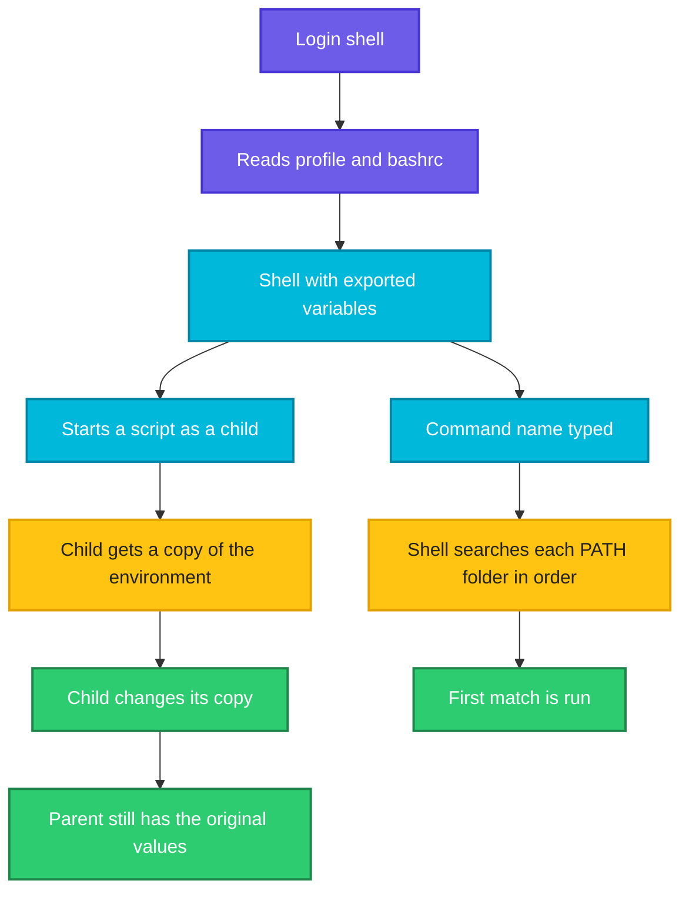

# Environment Variables and PATH

## What is it?
Every process has an **environment**: a list of `NAME=value` pairs that the kernel copies from a parent to its children. Programs read it to find out the user's home directory (`HOME`), the language (`LANG`), where to look for commands (`PATH`), and any setting you choose to pass in, such as `DB_HOST` or `API_TOKEN`.

There are two kinds of variables in a shell:

- **Shell variables** exist only inside the current shell (`x=1`).
- **Environment variables** are shell variables that were **exported** (`export x=1`). Every command you start receives a copy.

`PATH` is the most important environment variable. It is a list of folders, separated by `:`. When you type `ls`, the shell looks for a file called `ls` in each folder of `PATH`, in order, and runs the first one it finds.

## Syntax
```bash
NAME=value                # shell variable, not passed on
export NAME=value         # environment variable, passed to children
NAME=value command        # set it for one command only
env                       # list the environment
printenv NAME             # print one variable
unset NAME                # remove it
export PATH="$PATH:/new/dir"   # add a folder to PATH
```

## Visual Overview
> A child process gets a **copy** of the exported variables of its parent. Changes in the child never travel back up.



## Options/Flags
**Commands**

| Command | Meaning |
|---------|---------|
| `export NAME=value` | Set and export |
| `export NAME` | Export an existing shell variable |
| `export -n NAME` | Stop exporting it (the value stays in the shell) |
| `export -p` / `declare -x` | List the exported variables |
| `env` / `printenv` | Print the environment |
| `printenv NAME` | Print one value, exit code `1` if it is not set |
| `env -i cmd` | Run a command with an **empty** environment |
| `env -u NAME cmd` | Run a command without `NAME` |
| `env NAME=value cmd` | Run a command with an extra variable |
| `unset NAME` | Remove a variable |
| `set -a` / `set +a` | Export every variable that is assigned in between |
| `source file` | Run a file in the current shell, to load variables |

**Common variables**

| Variable | Meaning |
|----------|---------|
| `PATH` | Folders searched for commands |
| `HOME` | Your home directory |
| `USER` / `LOGNAME` | Your user name |
| `SHELL` | Your login shell |
| `PWD` / `OLDPWD` | Current and previous folder |
| `LANG` / `LC_ALL` | Language and sorting rules |
| `EDITOR` / `VISUAL` | Editor used by `git commit`, `crontab -e`, `sudoedit` |
| `TERM` | Terminal type |
| `TMPDIR` | Folder for temporary files |
| `SHLVL` | How many shells are nested |
| `PS1` | The prompt |
| `IFS` | The characters that split words |
| `HISTSIZE` | Size of the command history |
| `http_proxy`, `https_proxy`, `no_proxy` | Proxy settings used by curl, apt, pip |

**Start up files**

| File | Read when |
|------|-----------|
| `/etc/profile`, `~/.profile`, `~/.bash_profile` | **Login** shells (`ssh`, `bash -l`, a text console) |
| `~/.bashrc` | **Interactive** non login shells (a new terminal window) |
| `/etc/environment` | Read by the system at login, plain `NAME=value` lines |
| `~/.bash_logout` | When a login shell ends |
| *nothing* | `bash script.sh`, cron jobs and systemd units start without these files |

## Usage Examples

### Example 1: Shell variable versus environment variable
**Command:**
```bash
X=shell
export Y=env
bash -c 'echo X=[$X] Y=[$Y]'
printenv Y
printenv X
echo "printenv X rc=$?"
```
**Sample Output:**
```text
X=[] Y=[env]
env
printenv X rc=1
```
The child `bash` sees only the exported `Y`. `printenv X` prints nothing and returns `1` because `X` is not in the environment.

### Example 2: A variable for one command only
**Command:**
```bash
LEVEL=debug bash -c 'echo inside=$LEVEL'
echo "after=[$LEVEL]"
```
**Sample Output:**
```text
inside=debug
after=[]
```

### Example 3: A child cannot change its parent
Let's say we have this file `child.sh`:

**Input file** (`child.sh`):
```bash
#!/bin/bash
echo "child sees NAME=$NAME"
NAME=changed
export NEW=fromchild
```

**Command:**
```bash
export NAME=original
bash child.sh
echo "parent NAME=$NAME NEW=[$NEW]"
```
**Sample Output:**
```text
child sees NAME=original
parent NAME=original NEW=[]
```
The child worked on a copy. To make a script change your own shell, `source` it, see [What is a shell script](01-what-is-a-shell-script.md).

### Example 4: Ways to export
**Command:**
```bash
declare -x A=1
export B
B=2
export -n A
bash -c 'echo A=[$A] B=[$B]'
export -p | grep -E 'declare -x (A|B)=' | sort
```
**Sample Output:**
```text
A=[] B=[2]
declare -x B="2"
```
`export B` first and assigning afterwards also works, the flag stays on the variable. `export -n A` took `A` out of the environment again.

### Example 5: Look at the environment
**Command:**
```bash
export FOO=bar
env | grep ^FOO
printenv FOO
```
**Sample Output:**
```text
FOO=bar
bar
```

### Example 6: A tiny, clean environment (`env -i`)
**Command:**
```bash
env -i A=1 B=2 C=3 bash -c 'env | sort'
```
**Sample Output:**
```text
A=1
B=2
C=3
PWD=/tmp/ss8
SHLVL=0
_=/usr/bin/env
```
`env -i` removed everything. Bash added `PWD`, `SHLVL` and `_` by itself. The `PWD` value is the folder you ran it in.

### Example 7: The folders in `PATH`
**Command:**
```bash
echo "$PATH" | tr ":" "\n" | head -3
```
**Sample Output:**
```text
/usr/local/sbin
/usr/local/bin
/usr/sbin
```
Your list may be longer, for example WSL also appends the Windows folders.

### Example 8: The first match wins
Let's say we have two scripts with the same name in two folders:

**Input file** (`bin1/tool`):
```bash
#!/bin/bash
echo "tool from bin1"
```
**Input file** (`bin2/tool`):
```bash
#!/bin/bash
echo "tool from bin2"
```
Both files are executable.

**Command:**
```bash
PATH=$PWD/bin1:$PWD/bin2:$PATH
tool
type -a tool
PATH=$PWD/bin2:$PWD/bin1:$PATH
hash -r
tool
```
**Sample Output:**
```text
tool from bin1
tool is ./bin1/tool
tool is ./bin2/tool
tool from bin2
```
`type -a` lists every match in the order the shell would find them. `hash -r` clears the shell's memory of where commands were found, otherwise the old location is reused.

### Example 9: Command not found when `PATH` is wrong
**Command:**
```bash
PATH=/nonexistent
ls
echo "rc=$?"
/bin/ls /dev/null
```
**Sample Output:**
```text
bash: line 1: ls: command not found
rc=127
/dev/null
```
With an empty `PATH` nothing is found, but a **full path** still works.

### Example 10: Add a folder to `PATH`
**Command:**
```bash
PATH="$PATH:/opt/tool/bin"
echo "$PATH" | tr ":" "\n" | tail -1
PATH="/opt/first/bin:$PATH"
echo "$PATH" | tr ":" "\n" | head -1
```
**Sample Output:**
```text
/opt/tool/bin
/opt/first/bin
```
Add at the **end** to be safe, add at the **front** only when you want your version to win. Put the line in `~/.bashrc` or `~/.profile` to keep it.

### Example 11: Edit a path string
**Command:**
```bash
P="/a:/b:/c"
echo "${P/:\/b/}"
echo "${P//:/ }"
```
**Sample Output:**
```text
/a:/c
/a /b /c
```

### Example 12: Do not add a folder twice
**Command:**
```bash
p=/usr/bin
case ":$PATH:" in
  *":$p:"*) echo "$p already in PATH" ;;
  *) echo "adding"; PATH="$PATH:$p" ;;
esac
```
**Sample Output:**
```text
/usr/bin already in PATH
```
The extra colons make the match work for the first and last entry too.

### Example 13: Scripts run by cron have a tiny `PATH`
Let's say we have this file `cronjob.sh`:

**Input file** (`cronjob.sh`):
```bash
#!/bin/bash
echo "PATH=$PATH"
command -v tool >/dev/null && echo "tool found" || echo "tool NOT found"
```

**Command:**
```bash
PATH=$PWD/bin1:$PATH
bash cronjob.sh | tail -1
env -i HOME=/tmp PATH=/usr/bin:/bin bash cronjob.sh
```
**Sample Output:**
```text
tool found
PATH=/usr/bin:/bin
tool NOT found
```
`env -i ... PATH=/usr/bin:/bin` imitates what **cron** gives your job. Your normal shell finds `tool` because your `PATH` is longer. This is the number one reason why a script works in a terminal and fails in cron. Use full paths or set `PATH` at the top of the script.

### Example 14: Where is a command (`type`, `command -v`, `which`)
**Command:**
```bash
type -t ls
type -t cd
type -p bash
command -v bash
which bash
```
**Sample Output:**
```text
file
builtin
/usr/bin/bash
/usr/bin/bash
/usr/bin/bash
```
`type -t` says what kind of command it is. Prefer `command -v` in scripts, it is built in and portable.

### Example 15: The shell remembers where commands are (`hash`)
**Command:**
```bash
hash -r
ls > /dev/null
hash
hash -r
hash
```
**Sample Output:**
```text
hits	command
   1	/usr/bin/ls
hash: hash table empty
```
After you install a new version of a tool, run `hash -r` if the shell still starts the old one.

### Example 16: Login and non login shells
**Command:**
```bash
bash -lc 'shopt -q login_shell && echo login'
bash -c 'shopt -q login_shell && echo login || echo "non-login"'
```
**Sample Output:**
```text
login
non-login
```

### Example 17: Which start up file is read
Let's say we have a fake home folder `h` with two files:

**Input file** (`h/.bashrc`):
```bash
export FROM_BASHRC=yes
```
**Input file** (`h/.profile`):
```bash
export FROM_PROFILE=yes
```

**Command:**
```bash
HOME=$PWD/h bash -ic 'echo "interactive: bashrc=[$FROM_BASHRC] profile=[$FROM_PROFILE]"'
HOME=$PWD/h bash -lc 'echo "login: bashrc=[$FROM_BASHRC] profile=[$FROM_PROFILE]"'
HOME=$PWD/h bash -c 'echo "plain: bashrc=[$FROM_BASHRC] profile=[$FROM_PROFILE]"'
```
**Sample Output:**
```text
interactive: bashrc=[yes] profile=[]
login: bashrc=[] profile=[yes]
plain: bashrc=[] profile=[]
```
An interactive shell reads `~/.bashrc`, a login shell reads `~/.profile` (or `~/.bash_profile`), and a plain `bash -c` or a script reads neither. On most distros the default `~/.profile` also loads `~/.bashrc`, which is not the case in this tiny test. A shell started with `-i` may print a short `sudo` hint on some systems, it is not part of the result.

### Example 18: Load a `.env` file
Let's say we have this file `.env`:

**Input file** (`.env`):
```text
DB_HOST=db1
DB_PORT=5432
# comment
```

**Command:**
```bash
set -a
source .env
set +a
echo "$DB_HOST:$DB_PORT"
bash -c 'echo child: $DB_HOST'
```
**Sample Output:**
```text
db1:5432
child: db1
```
`set -a` exports everything that is assigned until `set +a`.

### Example 19: Without `set -a` the variables stay in the shell
Using the `.env` file from Example 18, in a fresh shell.

**Command:**
```bash
source .env
bash -c 'echo child: [$DB_HOST]'
```
**Sample Output:**
```text
child: []
```

### Example 20: Secrets in the environment are visible
**Command:**
```bash
export SECRET=hunter2
sleep 5 &
P=$!
sleep 0.2
tr "\0" "\n" < /proc/$P/environ | grep ^SECRET
kill $P
```
**Sample Output:**
```text
SECRET=hunter2
```
Anyone who can read `/proc/PID/environ` (the same user and root) sees the value, and child processes and crash dumps inherit it. Do not export secrets that you do not need to pass on.

### Example 21: Remove a variable for one command (`env -u`)
**Command:**
```bash
export Z=1
env -u Z bash -c 'echo Z=[$Z]'
```
**Sample Output:**
```text
Z=[]
```

### Example 22: Sub shells and read only variables
Let's say we have this file `ro.sh`:

**Input file** (`ro.sh`):
```bash
v=1
( v=2; echo "in subshell $v" )
echo "outside $v"
readonly R=1
export R
bash -c 'echo child R=$R'
R=2
```

**Command:**
```bash
bash ro.sh
```
**Sample Output:**
```text
in subshell 2
outside 1
child R=1
ro.sh: line 7: R: readonly variable
```
A sub shell, like a child process, works on a copy. A `readonly` variable cannot be changed or removed in the shell that set it, but children still receive it.

### Example 23: A harmful `PATH` change
Let's say we have this file `evil/ls`:

**Input file** (`evil/ls`):
```bash
#!/bin/bash
echo "evil ls"
```
The file is executable.

**Command:**
```bash
PATH=$PWD/evil:$PATH
ls
/bin/ls /dev/null
```
**Sample Output:**
```text
evil ls
/dev/null
```
Whoever controls the **first** folder in `PATH` controls what you run. That is why `.` or a world writable folder at the front of `PATH` is dangerous, and why scripts run with `sudo` should use full paths.

### Example 24: `sudo` resets the environment
**Command:**
```bash
sudo -n true
```
**Sample Output:**
```text
sudo: a password is required
```
On the machine used here `sudo` needs a password. When it runs, it replaces most of your environment and sets a safe `PATH` (`secure_path` in `/etc/sudoers`). Use `sudo -E` or `sudo VAR=value cmd` to pass variables, if the policy allows it.

## Sample Output
A short check of what a script will see:

```bash
echo "home=${HOME:+set} user=${USER:+set} path_entries>0: $([ -n "$PATH" ] && echo yes)"
```
```text
home=set user=set path_entries>0: yes
```

## Pitfalls / Gotchas
- A variable without `export` is **invisible** to child processes and scripts. A script cannot see your shell variables.
- Changes in a child (a script, a sub shell, `$( )`) never reach the parent. Use `source` or return the value as output.
- **cron and systemd start with a tiny environment.** Set `PATH` and any variables inside the script, use full paths, or define `Environment=` in the unit file.
- `PATH` entries are searched in order. A new folder at the **front** can hide a system command. At the end it is safe.
- Never put `.` or an empty entry (`::` or a trailing `:`) in `PATH`. The current folder then counts, and a stray `ls` file can be run by mistake.
- A trailing `:` in `PATH="$PATH:"` is an empty entry. Check with `echo "$PATH" | tr ':' '\n'`.
- After `PATH` changes, run `hash -r` if the shell still uses an old location.
- Names are case sensitive. `path` is not `PATH`. By convention exported variables are UPPER_CASE.
- Spaces in `export A="x y"` need quotes. Values with `$` or backticks are expanded, use single quotes for literal text.
- The environment has a size limit, and very large values can cause `Argument list too long`.
- Secrets in the environment are visible in `/proc/PID/environ`, in `docker inspect` and in many crash reports. Prefer files with mode `600` or a secret manager.
- `~/.bashrc` is **not** read by scripts or by login shells on its own. Put exports for SSH logins in `~/.profile`, and make `~/.profile` source `~/.bashrc`.
- Editing `~/.bashrc` changes nothing in the shells that are already open. Run `source ~/.bashrc` or open a new terminal.
- `sudo` and `su` change the environment. `su -` gives a full login environment, plain `su` keeps most of yours.
- `export` in a Docker `RUN` line does not survive to the next `RUN`. Use `ENV`.

## DevOps Use Cases

### Use Case 1: Pass configuration to a deploy script without arguments
**Situation:** CI passes the target and tokens as environment variables.

Let's say we have this file `deploy-env.sh`:

**Input file** (`deploy-env.sh`):
```bash
#!/bin/bash
: "${DEPLOY_ENV:?DEPLOY_ENV is required}"
echo "deploying to $DEPLOY_ENV with log level ${LOG_LEVEL:-info}"
```

**Command:**
```bash
DEPLOY_ENV=prod bash deploy-env.sh
DEPLOY_ENV=prod LOG_LEVEL=debug bash deploy-env.sh
bash deploy-env.sh
```
**Sample Output:**
```text
deploying to prod with log level info
deploying to prod with log level debug
deploy-env.sh: line 2: DEPLOY_ENV: DEPLOY_ENV is required
```

### Use Case 2: Debug a cron job that "works in my terminal"
**Situation:** A job fails under cron with `command not found`.

Using the `cronjob.sh` file from Example 13.

**Command:**
```bash
env -i HOME=/tmp PATH=/usr/bin:/bin bash cronjob.sh
```
**Sample Output:**
```text
PATH=/usr/bin:/bin
tool NOT found
```
Run the job with the same stripped environment to reproduce the failure. Fix it with a full path (`/opt/tool/bin/tool`), or with `PATH=...` as the first line of the crontab.

### Use Case 3: Load a `.env` file safely in a script
**Situation:** An application script reads its settings from a file next to it.

Using the `.env` file from Example 18.

**Command:**
```bash
set -a
. ./.env
set +a
echo "connecting to $DB_HOST on port $DB_PORT"
```
**Sample Output:**
```text
connecting to db1 on port 5432
```
Make sure that `.env` is in `.gitignore` and has mode `600`.

### Use Case 4: Install a tool into a private `bin` folder
**Situation:** A pipeline downloads a tool into `$HOME/bin` and wants to call it by name.

Using the `bin1/tool` file from Example 8.

**Command:**
```bash
export PATH="$PWD/bin1:$PATH"
tool
command -v tool | sed "s#$PWD#.#"
```
**Sample Output:**
```text
tool from bin1
./bin1/tool
```
In GitHub Actions the equivalent is `echo "$HOME/bin" >> $GITHUB_PATH`.

### Use Case 5: Run a command with a clean environment for testing
**Situation:** Prove that a script does not depend on your personal settings.

**Command:**
```bash
env -i PATH=/usr/bin:/bin bash -c 'echo "HOME=[${HOME:-unset}] USER=[${USER:-unset}]"'
```
**Sample Output:**
```text
HOME=[unset] USER=[unset]
```
If your script fails here, it relies on a variable that cron, systemd or a container will not provide.

## Related Commands
- [Exit codes](07-exit-codes.md) - the previous page
- [Signals and trap](09-signals-and-trap.md) - the next page
- [`env`](../linux/shell-basics/env.md) - run a command with changed variables
- [`export`](../linux/shell-basics/export.md) - pass a variable to children
- [`which`](../linux/shell-basics/which.md) / [`type`](../linux/shell-basics/type.md) - find a command
- [`source`](../linux/shell-basics/source.md) - load a file into the current shell
- [`set`](../linux/shell-basics/set.md) - `set -a` exports every assignment
- [Hidden files](../linux/fundamentals/05-paths.md) - where `.bashrc` and `.profile` live
- [Filesystem hierarchy](../linux/fundamentals/04-filesystem-hierarchy.md) - `/usr/bin`, `/usr/local/bin` and friends
