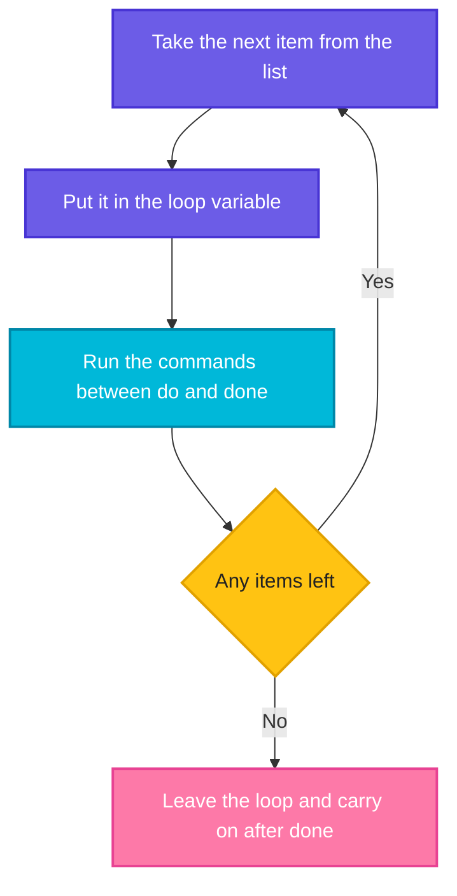

# `for` Loops: Doing the Same Job for Every Item

> **Before this page:** you have read pages [01](01-what-is-a-shell-script.md) to [08](08-arrays.md). You know variables, arguments, exit codes, operators, `if`, `case` and arrays.
>
> **By the end of this page** you will be able to make your script repeat a job for every server, file, argument or number in a list, without copying and pasting a single line.

---

## 1. Start with a problem: copy, paste, repeat

You have three servers to check. With what you know so far, you would write:

```bash
echo "Checking web1 ..."
echo "Checking web2 ..."
echo "Checking db1 ..."
```

That is three lines for three servers, and each real check would be several lines. Now your manager says: *"We have 50 servers now."*

- You would paste the block **50 times**, and change the name each time.
- If the check itself changes (say, a new step), you must fix **50 places**.
- Miss one name and one server is **never checked**, and nobody notices.

What you really want to say is: *"Here is my list of servers. Here is the job. Do the job for every server on the list."*

**That is what a `for` loop does.**

---

## 2. The big idea: the conveyor belt

Imagine a worker at a factory conveyor belt. Boxes arrive **one at a time**. The worker does the **same job** on each box (stick a label, say), and when the belt is empty, the work is done.

| The factory | The `for` loop |
|-------------|----------------|
| The belt full of boxes | The **list** of items |
| The box in front of the worker right now | The **loop variable** (it holds the current item) |
| The worker's job | The **commands** between `do` and `done` |
| Taking the next box | The loop moves to the next item **automatically** |
| The belt is empty | The loop **ends**, and the script carries on after `done` |

One list, one job, done once per item. You write the job **once**.



---

## 3. Your first loop (do this with me)

Go to your practice folder (`cd ~/practice`).

Let's say we have this file `f1.sh`:

**Input file** (`f1.sh`):
```bash
#!/bin/bash
for server in web1 web2 db1; do
  echo "Checking $server ..."
done
echo "Finished. The variable still holds: $server"
```

**Command:**
```bash
chmod +x f1.sh
./f1.sh
```
**Sample Output:**
```text
Checking web1 ...
Checking web2 ...
Checking db1 ...
Finished. The variable still holds: db1
```

The `echo` line was written **once**, yet it ran three times, once per server. Add `cache1` to the list and it runs four times.

### The anatomy of a `for` loop

```text
for server in web1 web2 db1; do     <- "for each server in this list, do:"
  echo "Checking $server ..."       <- the job (the loop body)
done                                <- end of the loop
```

| Piece | Meaning |
|-------|---------|
| `for` | Start the loop |
| `server` | The **loop variable**. You choose the name. It holds the current item |
| `in web1 web2 db1` | The **list**, separated by spaces |
| `;` | Separates the list from `do` (or put `do` on its own line) |
| `do` | "Here begins the job" |
| `done` | **Ends** the loop. Every `for` needs its own `done` |

You read the loop variable with `$server`, exactly like any variable from page 02. After the loop ends, the variable **keeps the last value**, which is why the last line printed `db1`.

---

## 4. Where does the list come from?

You can put **anything that makes a list of words** after `in`. The following eight sources cover almost every real script.

### Source 1: words you type

You have just seen this: `for server in web1 web2 db1`.

### Source 2: a range of numbers or letters

Curly braces with two dots make a sequence for you: `{1..5}`.

| Write | You get |
|-------|---------|
| `{1..5}` | `1 2 3 4 5` |
| `{a..e}` | `a b c d e` |
| `{5..1}` | `5 4 3 2 1` (counting down) |
| `{0..20..5}` | `0 5 10 15 20` (the last number is the **step**) |

Let's say we have this file `f2.sh`, which prints the lists themselves, with a variable-based attempt at the end:

**Input file** (`f2.sh`):
```bash
#!/bin/bash
echo "1 to 5     :" {1..5}
echo "a to e     :" {a..e}
echo "countdown  :" {5..1}
echo "step of 5  :" {0..20..5}
n=3
echo "with variable (broken):" {1..$n}
echo "with seq   :" $(seq 1 $n)
```

**Command:**
```bash
chmod +x f2.sh
./f2.sh
```
**Sample Output:**
```text
1 to 5     : 1 2 3 4 5
a to e     : a b c d e
countdown  : 5 4 3 2 1
step of 5  : 0 5 10 15 20
with variable (broken): {1..3}
with seq   : 1 2 3
```

Look at the broken line. **A range cannot contain a variable.** `{1..$n}` is printed as plain text, because the shell builds the range before it reads the variable. When the end of your range is in a variable, use the `seq` command (`seq 1 $n` prints the numbers 1 to n), or the counting loop in section 5.

Using a range in a loop:

Let's say we have this file `f3.sh`:

**Input file** (`f3.sh`):
```bash
#!/bin/bash
for i in {1..3}; do
  echo "Round $i"
done
```

**Command:**
```bash
chmod +x f3.sh
./f3.sh
```
**Sample Output:**
```text
Round 1
Round 2
Round 3
```

### Source 3: files that match a wildcard

Write a wildcard such as `*.log` after `in`, and the shell replaces it with every matching file name. This is the most useful source for DevOps work.

Let's say we have two files, `app.log` and `db.log`:

**Input file** (`app.log`):
```text
INFO start
ERROR disk
INFO done
```

**Input file** (`db.log`):
```text
INFO start
INFO ok
```

And this script:

**Input file** (`f4.sh`):
```bash
#!/bin/bash
for f in *.log; do
  echo "$f has $(wc -l < "$f") lines"
done
```

**Command:**
```bash
chmod +x f4.sh
./f4.sh
```
**Sample Output:**
```text
app.log has 3 lines
db.log has 2 lines
```

`wc -l` counts lines, and `< "$f"` hands it the file, so only the number is printed. **Always quote `"$f"`** (page 02), in case a file name contains a space.

### Source 4: the script's own arguments

`"$@"` (page 03) is "all the arguments, each kept intact". A loop over it handles **any number** of arguments.

Let's say we have this file `f5.sh`:

**Input file** (`f5.sh`):
```bash
#!/bin/bash
echo "Got $# arguments:"
for arg in "$@"; do
  echo "  - $arg"
done
```

**Command:**
```bash
chmod +x f5.sh
./f5.sh start "web server" db1
```
**Sample Output:**
```text
Got 3 arguments:
  - start
  - web server
  - db1
```

Notice `"web server"` stayed together as one item, because we quoted both on the command line and in `"$@"`.

### Source 5: an array

You learned in page 08 that `"${array[@]}"` means "all elements, each kept intact". It is the perfect partner for a loop, and the most common way to hold a server list.

Let's say we have this file `f6.sh`:

**Input file** (`f6.sh`):
```bash
#!/bin/bash
servers=(web1 web2 db1)
for s in "${servers[@]}"; do
  echo "Deploying to $s"
done
```

**Command:**
```bash
chmod +x f6.sh
./f6.sh
```
**Sample Output:**
```text
Deploying to web1
Deploying to web2
Deploying to db1
```

(To loop over an array's **indexes**, write `for i in "${!servers[@]}"`, as in the preview in page 08.)

### Source 6: the output of a command

`$(command)` pastes the command's output, and the loop walks over it word by word.

Let's say we want the first three user names from the system's user file:

**Input file** (`/etc/passwd`, first three lines):
```text
root:x:0:0:root:/root:/bin/bash
daemon:x:1:1:daemon:/usr/sbin:/usr/sbin/nologin
bin:x:2:2:bin:/bin:/usr/sbin/nologin
```

**Input file** (`f7.sh`):
```bash
#!/bin/bash
for user in $(cut -d: -f1 /etc/passwd | head -3)
do
  echo "User: $user"
done
```

**Command:**
```bash
chmod +x f7.sh
./f7.sh
```
**Sample Output:**
```text
User: root
User: daemon
User: bin
```

`cut -d: -f1` keeps only the first column (the name), and `head -3` keeps three lines. This works well **only when each item is a single word without spaces**. The next section shows why that matters. (Here `do` is on its own line instead of after a `;`. Both styles are fine.)

### The classic trap: never loop over `$(ls)`

It is tempting to write `for f in $(ls)`. Do not. File names with spaces break it.

Let's say we have two files, `my notes.txt` and `plain.txt`:

**Input file** (`f8.sh`):
```bash
#!/bin/bash
echo "Wrong way, using ls:"
for f in $(ls *.txt); do
  echo "  [$f]"
done
echo "Right way, using the wildcard:"
for f in *.txt; do
  echo "  [$f]"
done
```

**Command:**
```bash
chmod +x f8.sh
./f8.sh
```
**Sample Output:**
```text
Wrong way, using ls:
  [my]
  [notes.txt]
  [plain.txt]
Right way, using the wildcard:
  [my notes.txt]
  [plain.txt]
```

With `$(ls)`, the shell split `my notes.txt` at the space into **two pieces**, `my` and `notes.txt`, neither of which is a real file. With the wildcard, each name arrives whole. If that loop were deleting files (`rm $f`), the wrong way could remove files you never meant to touch.

> **The rule:** for files, always loop over a **wildcard** (`*.log`) or an **array**, never over `$(ls)`.

### Which source should I use?

| The list is... | Use |
|----------------|-----|
| A few fixed names | Type them: `for s in web1 web2` |
| A sequence of numbers | `{1..10}` (or `seq`, if a variable is involved) |
| Files in a folder | A wildcard: `*.log` |
| What the user passed in | `"$@"` |
| A list you built or read earlier | An array: `"${arr[@]}"` |
| Words produced by a command | `$(command)`, only for simple one-word items |

---

## 5. The counting loop (C-style `for`)

Sometimes you do not have a list. You just want to **count**: "do this 5 times", or "go from 10 down to 1". The shell has a second kind of `for` for this, with three parts inside double round brackets:

```bash
for (( start; keep-going-while; step )); do
  ...
done
```

| Part | Example | Meaning |
|------|---------|---------|
| Start | `i = 1` | Where the counter begins |
| Condition | `i <= 5` | **Keep looping while** this is true (page 05) |
| Step | `i++` | What to do after each round: add 1 |

Let's say we have this file `c1.sh`:

**Input file** (`c1.sh`):
```bash
#!/bin/bash
for (( i = 1; i <= 5; i++ )); do
  echo "Count: $i"
done
echo "--- countdown"
for (( i = 3; i >= 1; i-- )); do
  echo "$i..."
done
echo "Liftoff!"
echo "--- step of 2"
for (( i = 0; i <= 10; i += 2 )); do
  echo -n "$i "
done
echo
n=4
echo "--- variable limit"
for (( i = 1; i <= n; i++ )); do
  echo -n "[$i]"
done
echo
```

**Command:**
```bash
chmod +x c1.sh
./c1.sh
```
**Sample Output:**
```text
Count: 1
Count: 2
Count: 3
Count: 4
Count: 5
--- countdown
3...
2...
1...
Liftoff!
--- step of 2
0 2 4 6 8 10 
--- variable limit
[1][2][3][4]
```

(`echo -n` prints without a new line at the end, so the items stay on one row. A plain `echo` at the end finishes the line.)

Two nice things about the C-style loop:

- The **limit can be a variable** (`i <= n`), which the `{1..n}` range cannot do.
- Inside `(( ))` you use the **symbol** comparisons from page 05 (`<=`, `>=`) and may leave out the `$`.

### Adding things up

A very common job is to build a **running total**. Start a variable at zero, and add to it each round:

Let's say we have this file `c2.sh`:

**Input file** (`c2.sh`):
```bash
#!/bin/bash
total=0
for (( i = 1; i <= 10; i++ )); do
  total=$((total + i))
done
echo "Sum of 1 to 10 is $total"
```

**Command:**
```bash
chmod +x c2.sh
./c2.sh
```
**Sample Output:**
```text
Sum of 1 to 10 is 55
```

### The off-by-one mistake

The difference between `<` and `<=` is the most common counting error:

Let's say we have this file `c3.sh`:

**Input file** (`c3.sh`):
```bash
#!/bin/bash
for (( i = 1; i < 5; i++ )); do echo -n "$i "; done; echo "  (using < 5)"
for (( i = 1; i <= 5; i++ )); do echo -n "$i "; done; echo "  (using <= 5)"
```

**Command:**
```bash
chmod +x c3.sh
./c3.sh
```
**Sample Output:**
```text
1 2 3 4   (using < 5)
1 2 3 4 5   (using <= 5)
```

`< 5` stops **before** 5. `<= 5` includes 5. When a loop runs one time too few or too many, check this first.

### List loop or counting loop?

| | `for x in list` | `for (( ; ; ))` |
|---|----------------|------------------|
| Best when | You have **items** (names, files, arguments) | You need to **count** or use the number |
| Example | `for s in web1 web2` | `for (( i=1; i<=n; i++ ))` |
| Limit can be a variable | Only with `seq` or an array | Yes |

---

## 6. A loop inside a loop (nesting)

The job inside a loop can be **another loop**. The inner loop runs **completely** for each single round of the outer loop. Think of a clock: for each hour (outer), the minutes go all the way round (inner).

Let's say we want a small multiplication table:

**Input file** (`n1.sh`):
```bash
#!/bin/bash
for i in 1 2 3; do
  for j in 1 2 3; do
    echo -n "$((i * j))	"
  done
  echo
done
```

(The gap inside the quotes is a **tab** character, which lines up the columns.)

**Command:**
```bash
chmod +x n1.sh
./n1.sh
```
**Sample Output:**
```text
1    2    3
2    4    6
3    6    9
```

Row `i=2` shows `2 4 6`: for `i=2`, the inner loop ran through `j=1,2,3`.

A far more practical use in DevOps is checking **every port on every server**:

Let's say we have this file `n2.sh`:

**Input file** (`n2.sh`):
```bash
#!/bin/bash
for server in web1 web2; do
  for port in 80 443; do
    echo "Would check $server:$port"
  done
done
```

**Command:**
```bash
chmod +x n2.sh
./n2.sh
```
**Sample Output:**
```text
Would check web1:80
Would check web1:443
Would check web2:80
Would check web2:443
```

Two servers times two ports gives four checks. Keep nesting to two levels where you can: the work multiplies quickly (50 servers times 20 ports is 1000 rounds).

---

## 7. Put decisions inside the loop

The loop body can contain anything you have learned: `if`, `case`, counters, anything. This is where loops become powerful.

### `case` inside a loop

Let's sort files by their extension, using the `case` from page 07:

Let's say we have this file `l1.sh`:

**Input file** (`l1.sh`):
```bash
#!/bin/bash
for f in notes.txt photo.png run.sh data.xyz; do
  case "$f" in
    *.txt)        echo "$f -> text" ;;
    *.png|*.jpg)  echo "$f -> image" ;;
    *.sh)         echo "$f -> script" ;;
    *)            echo "$f -> unknown" ;;
  esac
done
```

**Command:**
```bash
chmod +x l1.sh
./l1.sh
```
**Sample Output:**
```text
notes.txt -> text
photo.png -> image
run.sh -> script
data.xyz -> unknown
```

(Each option is written on one line here, with `;;` at the end. That is perfectly valid and keeps short options neat.)

### A running total across files

Let's use `app.log` and `db.log` from before. We add each file's line count to a total:

Let's say we have this file `l2.sh`:

**Input file** (`l2.sh`):
```bash
#!/bin/bash
total=0
for f in *.log; do
  lines=$(wc -l < "$f")
  echo "$f: $lines lines"
  total=$((total + lines))
done
echo "Total: $total lines"
```

**Command:**
```bash
chmod +x l2.sh
./l2.sh
```
**Sample Output:**
```text
app.log: 3 lines
db.log: 2 lines
Total: 5 lines
```

The pattern is always the same: **start a counter before the loop**, **update it inside**, **report it after**.

### `if` inside a loop: count the problem files

Let's say we have this file `l3.sh`:

**Input file** (`l3.sh`):
```bash
#!/bin/bash
bad=0
for f in *.log; do
  if grep -q ERROR "$f"; then
    echo "$f has errors"
    ((bad++))
  fi
done
echo "$bad file(s) with errors"
```

**Command:**
```bash
chmod +x l3.sh
./l3.sh
```
**Sample Output:**
```text
app.log has errors
1 file(s) with errors
```

Only `app.log` contains the word `ERROR`, so only that file is flagged and counted.

### Save or sort the output of a whole loop

You can attach a redirect (`>`) or a pipe (`|`) after `done`, and it applies to **everything the loop printed**.

Let's say we have this file `l4.sh`:

**Input file** (`l4.sh`):
```bash
#!/bin/bash
for f in *.log; do
  echo "$f: $(wc -l < "$f") lines"
done > report.txt
echo "Saved. The report contains:"
cat report.txt
echo "--- sorted in reverse:"
for n in 3 1 2; do
  echo "item $n"
done | sort -r
```

**Command:**
```bash
chmod +x l4.sh
./l4.sh
```
**Sample Output:**
```text
Saved. The report contains:
app.log: 3 lines
db.log: 2 lines
--- sorted in reverse:
item 3
item 2
item 1
```

---

## 8. A real DevOps example: are my tools installed?

Before a pipeline runs, it often needs to check that the required programs exist. The command `command -v name` succeeds if a program is found. Combine it with an array, a loop, an `if`, and the "collect, then report" pattern from page 08:

Let's say we have this file `t1.sh`:

**Input file** (`t1.sh`):
```bash
#!/bin/bash
tools=(git curl nosuchtool)
missing=()
for tool in "${tools[@]}"; do
  if command -v "$tool" > /dev/null; then
    echo "$tool: installed"
  else
    echo "$tool: MISSING"
    missing+=("$tool")
  fi
done
if [[ ${#missing[@]} -gt 0 ]]; then
  echo "Please install: ${missing[*]}"
  exit 1
fi
```

**Command:**
```bash
chmod +x t1.sh
./t1.sh
echo "code: $?"
```
**Sample Output:**
```text
git: installed
curl: installed
nosuchtool: MISSING
Please install: nosuchtool
code: 1
```

Every concept so far is in this one short script: an array, a loop, a decision, a collected list, and an honest exit code.

---

## 9. Upgrade `morning.sh`: a full disk report

Now we can bring the warning and critical levels from page 06 back, **for every disk**. The script loops through the disks, picks OK, WARNING or CRITICAL for each, and exits with the **worst** result it saw (so one bad disk is enough to raise the alarm).

Let's say we now have this file `morning.sh`:

**Input file** (`morning.sh`):
```bash
#!/bin/bash
# morning.sh - usage: ./morning.sh [disk ...]

WARN=2     # use 80 in real life
CRIT=50    # use 90 in real life

disks=("$@")
if [[ ${#disks[@]} -eq 0 ]]; then
  disks=(/)
fi

echo "Date : $(date +%d-%b-%Y)"

worst=0
for disk in "${disks[@]}"; do
  if ! df "$disk" > /dev/null 2>&1; then
    echo "$disk: NOT FOUND"
    code=2
  else
    usage=$(df --output=pcent "$disk" | tail -1 | tr -dc '0-9')
    if [[ $usage -ge $CRIT ]]; then
      echo "$disk: CRITICAL ($usage%)"
      code=2
    elif [[ $usage -ge $WARN ]]; then
      echo "$disk: WARNING ($usage%)"
      code=1
    else
      echo "$disk: OK ($usage%)"
      code=0
    fi
  fi
  if [[ $code -gt $worst ]]; then
    worst=$code
  fi
done

exit "$worst"
```

The limits are set very low here (`WARN=2`, `CRIT=50`), so that our nearly empty test disks show different results. Use the usual 80 and 90 on a real server.

**Command:**
```bash
chmod +x morning.sh
./morning.sh / /run /nope
echo "code: $?"
./morning.sh /run
echo "code: $?"
```
**Sample Output:**
```text
Date : 20-Oct-2026
/: WARNING (2%)
/run: OK (1%)
/nope: NOT FOUND
code: 2
Date : 20-Oct-2026
/run: OK (1%)
code: 0
```

Follow the logic:

- **Each disk** gets its own verdict, so you see all of them, not just the first problem.
- `worst` remembers the highest code (0 OK, 1 warning, 2 critical or not found). The `if [[ $code -gt $worst ]]` line keeps the larger one.
- `exit "$worst"` reports it. The first run exits `2` because `/nope` is not found. The second, with only a healthy disk, exits `0`.

This is a genuine monitoring script that cron or a CI job could run, reading only the exit code.

---

## 10. The mistakes that bite

Let's break loops on purpose, so you recognise the symptoms.

### Mistake 1: `1..3` instead of `{1..3}`

Let's say we have this file `m1.sh`:

**Input file** (`m1.sh`):
```bash
#!/bin/bash
for i in 1..3; do
  echo "Round $i"
done
```

**Command:**
```bash
bash m1.sh
```
**Sample Output:**
```text
Round 1..3
```

Without the curly braces, `1..3` is just one word, so the loop runs **once** with the text `1..3`. No error, wrong behaviour. Write `{1..3}`.

### Mistake 2: a wildcard that matches nothing

If no file matches, the shell leaves the pattern **as plain text**, and the loop runs once with that text.

Let's say there are no `.csv` files in the folder, and we have this file `m2.sh`:

**Input file** (`m2.sh`):
```bash
#!/bin/bash
for f in *.csv; do
  echo "Processing $f"
done
```

**Command:**
```bash
bash m2.sh
```
**Sample Output:**
```text
Processing *.csv
```

The script "processed" a file literally called `*.csv`. The cure is to check that the item really exists:

Let's say we have this file `m3.sh`:

**Input file** (`m3.sh`):
```bash
#!/bin/bash
for f in *.csv; do
  if [[ -e $f ]]; then
    echo "Processing $f"
  fi
done
echo "Done (no error, nothing processed)"
```

**Command:**
```bash
bash m3.sh
```
**Sample Output:**
```text
Done (no error, nothing processed)
```

`[[ -e $f ]]` (page 05) is true only for a real file, so the fake `*.csv` is skipped.

### Mistake 3: forgetting `do`

Let's say we have this file `m4.sh`:

**Input file** (`m4.sh`):
```bash
#!/bin/bash
for i in 1 2 3
  echo "Round $i"
done
```

**Command:**
```bash
bash m4.sh
```
**Sample Output:**
```text
m4.sh: line 3: syntax error near unexpected token `echo'
m4.sh: line 3: `  echo "Round $i"'
```

The shell expected `do` and found `echo`. When an error complains about the line **after** your `for`, check for a missing `do`.

### Mistake 4: forgetting `done`

Let's say we have this file `m5.sh`:

**Input file** (`m5.sh`):
```bash
#!/bin/bash
for i in 1 2 3; do
  echo "Round $i"
```

**Command:**
```bash
bash m5.sh
```
**Sample Output:**
```text
m5.sh: line 4: syntax error: unexpected end of file
```

Same message as a missing `fi` or `esac`. Every opener needs its closer: `if`/`fi`, `case`/`esac`, `for`/`done`.

### Mistake 5: unquoted arrays

Let's say we have this file `m6.sh`:

**Input file** (`m6.sh`):
```bash
#!/bin/bash
people=("Asha Rao" "Ravi Kumar")
echo "Unquoted:"
for p in ${people[@]}; do echo "  [$p]"; done
echo "Quoted:"
for p in "${people[@]}"; do echo "  [$p]"; done
```

**Command:**
```bash
bash m6.sh
```
**Sample Output:**
```text
Unquoted:
  [Asha]
  [Rao]
  [Ravi]
  [Kumar]
Quoted:
  [Asha Rao]
  [Ravi Kumar]
```

Exactly the page 08 lesson, now with a loop. Always write `"${people[@]}"`.

### The full list at a glance

| Mistake | Symptom | Fix |
|---------|---------|-----|
| `for i in 1..5` | Runs once with the text `1..5` | `{1..5}` |
| `{1..$n}` | Runs once with the text `{1..3}` | `$(seq 1 $n)` or `for (( i=1; i<=n; i++ ))` |
| `for f in $(ls)` | Names with spaces split apart | `for f in *` |
| `for f in *.csv` with no csv files | Runs once with the text `*.csv` | Check `[[ -e $f ]]` inside |
| `for f in $files` unquoted | Splits on spaces | Use an array and `"${files[@]}"` |
| `rm $f` in a loop | Spaces in names break the delete | `rm "$f"` |
| Forgot `do` | `syntax error near unexpected token` | Add `; do` |
| Forgot `done` | `unexpected end of file` | Close with `done` |
| `i < 5` when you wanted 5 included | Off by one | `i <= 5` |
| Counter variable not reset before the loop | Totals carry over from before | Set `total=0` before the loop |
| `for i in $(cat file)` for lines | Splits at every **space**, not every line | Use `while read` (next page) |
| Changing the array while looping over it | Confusing, skipped items | Build a new array instead |

---

## 11. Words to remember

| Word | Simple meaning |
|------|----------------|
| **Loop** | Code that repeats |
| **`for ... in`** | "For each item in this list, do the job" |
| **Loop variable** | The variable that holds the current item |
| **Loop body** | The commands between `do` and `done` |
| **`do` / `done`** | Start and end of the loop body |
| **Iteration** | One trip through the loop body |
| **List** | What the loop walks through |
| **Range** | A sequence like `{1..5}` |
| **`seq`** | A command that prints a sequence of numbers |
| **C-style loop** | The counting loop: `for (( i=1; i<=5; i++ ))` |
| **Nested loop** | A loop inside a loop |
| **Counter / accumulator** | A variable you start before the loop and update inside it |

---

## 12. Try it yourself

1. **Greeter.** Write a loop that prints `Hello, <name>!` for `Asha`, `Ravi` and `Meena`.
2. **Count.** Print the numbers from 1 to 10 using a range. Then print only the even ones, using a counting loop with a step of 2.
3. **Countdown.** Print `10`, `9`, ... `1`, then `Go!`.
4. **File report.** Create three small `.txt` files. Loop over `*.txt` and print each file's name and its number of lines.
5. **Arguments.** Write `shout.sh` that prints each of its arguments in capital letters. (Hint: `echo "${arg^^}"`.) Run it as `./shout.sh hello "big world" bye`.
6. **Total.** Loop over the numbers 1 to 100 and print their sum. (Expected: 5050.)
7. **Array of servers.** Put four server names in an array. Loop over it and print `Server 1: ...`, `Server 2: ...`, using the **indexes** and adding 1 for human counting.
8. **Tool checker.** Adapt `t1.sh` to check for `bash`, `awk`, `sed`, `docker` and `kubectl`. Does the script exit with `1` on your machine?
9. **Spot the bug.** Why does this script behave badly, and how do you fix it?
   ```bash
   for f in $(ls)
   do
     echo "File: $f"
   done
   ```
10. **Multiplication table.** Print the 7 times table from 1 to 10 in the form `7 x 3 = 21`.
11. **Upgrade `morning.sh`.** Make the script also print the **total** number of disks checked, and how many were OK, WARNING and CRITICAL (use four counters, as in `l3.sh`).

<details>
<summary>Answers for exercises 6 and 9 (open only after trying)</summary>

**Exercise 6:**

```bash
#!/bin/bash
total=0
for (( i = 1; i <= 100; i++ )); do
  total=$((total + i))
done
echo "$total"
```

**Exercise 9:** `$(ls)` splits file names at spaces, so `my notes.txt` becomes two items, `my` and `notes.txt`. Loop over a wildcard instead, and quote the variable:

```bash
for f in *
do
  echo "File: $f"
done
```
</details>

---

## 13. Quick recap

- A **`for` loop** repeats a job for **every item** in a list. You write the job **once**.
- The shape is `for item in list; do ... done`. The loop variable holds the current item, and the loop ends with `done`.
- The list can be **typed words**, a **range** (`{1..5}`), **files** (`*.log`), **arguments** (`"$@"`), an **array** (`"${arr[@]}"`), or **command output**.
- A range cannot contain a variable. Use `seq`, or the **counting loop** `for (( i=1; i<=n; i++ ))`.
- **Never loop over `$(ls)`.** Use a wildcard or an array, and always quote `"$f"`.
- A wildcard that matches nothing stays as plain text, so check with `[[ -e $f ]]`.
- Put `if`, `case` and **counters** inside loops. The counter pattern is: start before, update inside, report after.
- Put a `>` or `|` after `done` to save or sort everything the loop printed.
- Every `for` needs its `do` and its `done`.

**Next page:** [10 `while` and `until` loops](10-while-until-loops.md), for the jobs where you do not know in advance how many times to repeat: reading a file line by line, waiting for a service to start, and retrying something that fails.
