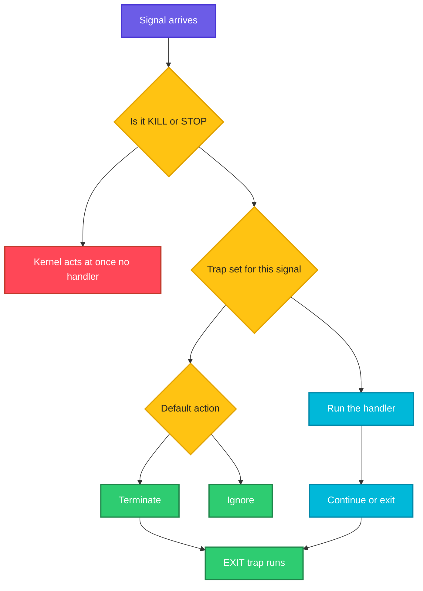

# Signals and trap

## What is it?
A **signal** is a short message that the kernel (or another process) sends to a process to tell it that something happened: the user pressed `Ctrl+C`, `kill` was run, the terminal closed, a child ended. Every signal has a number and a name, such as `15` and `SIGTERM`. A process can let the default action happen (usually: end), **ignore** the signal, or run its own code, a **handler**.

In a shell script the handler is set with **`trap`**. It is the tool for cleaning up (delete temporary files, remove a lock, stop child processes) and for shutting down gracefully when a container or a service manager asks the script to stop.

A **daemon** is a long running background process, such as `sshd` or `nginx`. Daemons react to signals too: `SIGTERM` stops them, `SIGHUP` often means "reload your configuration".

## Syntax
```bash
trap 'commands' SIGNAL [SIGNAL...]    # run commands when the signal arrives
trap - SIGNAL                         # restore the default action
trap '' SIGNAL                        # ignore the signal
trap -p                               # print the current traps
kill -SIGNAL PID                      # send a signal
kill -l                               # list the signals
```

## Visual Overview
> A signal arrives. If the script set a trap, its handler runs, otherwise the default action happens. `EXIT` is a pseudo signal that runs whenever the script ends.



## Options/Flags
**Common signals**

| Number | Name | Default | Typical cause and use |
|--------|------|---------|-----------------------|
| `1` | `SIGHUP` | Terminate | Terminal closed. Daemons use it for "reload config" |
| `2` | `SIGINT` | Terminate | `Ctrl+C` |
| `3` | `SIGQUIT` | Terminate and core dump | `Ctrl+\` |
| `9` | `SIGKILL` | Terminate | `kill -9`. **Cannot be caught or ignored** |
| `10` | `SIGUSR1` | Terminate | Free for programs to use, for example "re-open the log file" |
| `12` | `SIGUSR2` | Terminate | Free for programs to use |
| `13` | `SIGPIPE` | Terminate | Writing to a closed pipe (`yes \| head -1`) |
| `15` | `SIGTERM` | Terminate | `kill PID`, `docker stop`, `systemctl stop`. The polite request |
| `17` | `SIGCHLD` | Ignore | A child process ended |
| `18` | `SIGCONT` | Continue | Resume a stopped process |
| `19` | `SIGSTOP` | Stop | **Cannot be caught or ignored** |
| `20` | `SIGTSTP` | Stop | `Ctrl+Z` |

(The numbers are the Linux x86 ones. Use `kill -l` on your machine.)

**Pseudo signals used with `trap` in bash**

| Name | Runs when |
|------|-----------|
| `EXIT` (or `0`) | The script ends, for any reason: normal end, `exit`, an error under `set -e`, or a catchable signal |
| `ERR` | A command fails (like `set -e`, but it only reports) |
| `DEBUG` | Before every command, used by debuggers |
| `RETURN` | A function or sourced file returns |

**Sending signals**

| Command | Meaning |
|---------|---------|
| `kill PID` | Send `SIGTERM` |
| `kill -SIGNAL PID` | Send a named signal, for example `kill -HUP 1234`, `kill -USR1 1234` |
| `kill -9 PID` | `SIGKILL`, the last resort |
| `kill -0 PID` | Send nothing, only test that the process exists |
| `kill -- -PGID` | Signal a whole process group |
| `pkill -f name` / `killall name` | By name |
| `timeout -s TERM -k 5 30 cmd` | Stop `cmd` after 30 seconds with `TERM`, and `KILL` after 5 more |
| `nohup cmd &` | Run a command that ignores `SIGHUP` |

## Usage Examples

### Example 1: Names and numbers
**Command:**
```bash
kill -l 15
kill -l TERM
kill -l 9
kill -l 130
```
**Sample Output:**
```text
TERM
15
KILL
INT
```
Pass a number and you get the name, pass a name and you get the number. An **exit code** of `130` is `128 + 2`, the process was ended by `SIGINT`, see [Exit codes](07-exit-codes.md).

### Example 2: Clean up with `trap ... EXIT`
Let's say we have this file `t1.sh`:

**Input file** (`t1.sh`):
```bash
#!/bin/bash
trap 'echo "cleanup runs on exit"' EXIT
echo "working"
exit 3
```

**Command:**
```bash
bash t1.sh
echo "rc=$?"
```
**Sample Output:**
```text
working
cleanup runs on exit
rc=3
```
The `EXIT` trap ran before the script ended, and the exit code `3` was kept.

### Example 3: `EXIT` also runs when `set -e` stops the script
Let's say we have this file `t2.sh`:

**Input file** (`t2.sh`):
```bash
#!/bin/bash
set -e
trap 'echo "cleanup (rc=$?)"' EXIT
echo "step 1"
false
echo "step 2"
```

**Command:**
```bash
bash t2.sh
echo "rc=$?"
```
**Sample Output:**
```text
step 1
cleanup (rc=1)
rc=1
```
Inside the handler `$?` is the code the script is about to exit with.

### Example 4: Remove temporary files
Let's say we have this file `t6.sh`:

**Input file** (`t6.sh`):
```bash
#!/bin/bash
tmp=$(mktemp -d)
trap 'rm -rf "$tmp"; echo "removed temp dir"' EXIT
echo "tmp exists: $([ -d "$tmp" ] && echo yes)"
echo data > "$tmp/work.txt"
echo "$tmp" > tmpname
```

**Command:**
```bash
bash t6.sh
[ -d "$(cat tmpname)" ] && echo "still there" || echo "gone"
```
**Sample Output:**
```text
tmp exists: yes
removed temp dir
gone
```
`mktemp -d` creates a private folder with a random name. The trap deletes it however the script ends. This is the most common use of `trap`.

### Example 5: Catch `SIGINT` (`Ctrl+C`)
Let's say we have this file `i1.sh`, which sends itself the signal that `Ctrl+C` creates:

**Input file** (`i1.sh`):
```bash
#!/bin/bash
trap 'echo "caught SIGINT"' INT
echo "ready"
kill -INT $$
echo "still alive"
```

**Command:**
```bash
bash i1.sh
echo "rc=$?"
```
**Sample Output:**
```text
ready
caught SIGINT
still alive
rc=0
```
Without the trap the script would have ended with code `130`. Without a trap, `bash -c 'kill -INT $$'` gives exactly that:

```bash
bash -c 'kill -INT $$'
echo "rc=$?"
```
```text
rc=130
```

### Example 6: Shut down gracefully on `SIGTERM`
Let's say we have this file `t4.sh`:

**Input file** (`t4.sh`):
```bash
#!/bin/bash
stop=0
trap 'echo "SIGTERM received, finishing current job"; stop=1' TERM
echo "started"
while [ $stop -eq 0 ]; do sleep 0.1; done
echo "clean shutdown"
```

**Command:**
```bash
bash t4.sh &
P=$!
sleep 0.4
kill -TERM $P
wait $P
echo "rc=$?"
```
**Sample Output:**
```text
started
SIGTERM received, finishing current job
clean shutdown
rc=0
```
The handler only sets a flag. The main loop notices it, finishes its work and exits normally. This is the pattern for workers that must not drop a job halfway.

### Example 7: One handler for several signals
Let's say we have this file `i3.sh`:

**Input file** (`i3.sh`):
```bash
#!/bin/bash
handler() { echo "got $1"; exit 0; }
trap 'handler INT' INT
trap 'handler TERM' TERM
trap 'handler HUP' HUP
kill -$1 $$
sleep 2
```

**Command:**
```bash
for sig in INT TERM HUP; do bash i3.sh $sig; done
```
**Sample Output:**
```text
got INT
got TERM
got HUP
```

### Example 8: `SIGKILL` cannot be caught
Let's say we have this file `t5.sh`:

**Input file** (`t5.sh`):
```bash
#!/bin/bash
trap 'echo "exit trap does not run on SIGKILL"' EXIT
sleep 5 &
wait
```

**Command:**
```bash
bash t5.sh &
P=$!
sleep 0.3
kill -KILL $P
wait $P 2>/dev/null
echo "rc=$?"
```
**Sample Output:**
```text
rc=137
```
No message, no cleanup. `SIGKILL` (and `SIGSTOP`) are handled by the kernel itself. Always try `SIGTERM` first and give the process time to clean up, then use `kill -9` only as a last resort.

### Example 9: Ignore a signal (`trap ''`)
Let's say we have this file `i2.sh`:

**Input file** (`i2.sh`):
```bash
#!/bin/bash
trap '' TERM
echo "ignoring TERM"
sleep 0.6 &
wait
echo "finished normally"
```

**Command:**
```bash
bash i2.sh &
P=$!
sleep 0.2
kill -TERM $P
wait $P
echo "survived rc=$?"
```
**Sample Output:**
```text
ignoring TERM
finished normally
survived rc=0
```
The `TERM` signal was ignored and the script ran to the end. Ignoring `SIGTERM` makes a service hard to stop. Use it only for short, critical sections.

### Example 10: Show and reset traps
**Command:**
```bash
trap 'echo bye' EXIT
trap -p EXIT
trap - EXIT
trap -p EXIT
echo 'after reset'
```
**Sample Output:**
```text
trap -- 'echo bye' EXIT
after reset
```
After `trap - EXIT` the second `trap -p` prints nothing.

### Example 11: A signal waits for the foreground command
Let's say we have this file `t10.sh`:

**Input file** (`t10.sh`):
```bash
#!/bin/bash
trap 'echo "trap ran"' TERM
sleep 1
echo "sleep finished"
```

**Command:**
```bash
bash t10.sh &
P=$!
sleep 0.2
kill -TERM $P
wait $P
echo "rc=$?"
```
**Sample Output:**
```text
trap ran
sleep finished
rc=0
```
Bash runs the trap only **after** the foreground `sleep 1` finished. The signal was not lost, but it was late. To react at once, start the long command in the background and `wait` for it (as in the scripts above), because `wait` is interrupted by signals.

### Example 12: Reload on `SIGUSR1`
Let's say we have this file `t9.sh`:

**Input file** (`t9.sh`):
```bash
#!/bin/bash
count=0
trap 'count=$((count+1)); echo "reload #$count"' USR1
trap 'echo "exit after $count reloads"; exit 0' TERM
while true; do sleep 0.05; done
```

**Command:**
```bash
bash t9.sh &
P=$!
sleep 0.3; kill -USR1 $P
sleep 0.2; kill -USR1 $P
sleep 0.2; kill -TERM $P
wait $P
```
**Sample Output:**
```text
reload #1
reload #2
exit after 2 reloads
```
Real daemons do the same: `kill -HUP $(pidof nginx)` or `systemctl reload nginx` makes `nginx` re-read its configuration without dropping connections.

### Example 13: A lock so that a job cannot run twice
Let's say we have this file `t11.sh`:

**Input file** (`t11.sh`):
```bash
#!/bin/bash
lock=/tmp/job.lock
if ! mkdir "$lock" 2>/dev/null; then echo "already running"; exit 1; fi
trap 'rmdir "$lock"' EXIT
echo "doing work"
sleep 0.5
```

**Command:**
```bash
bash t11.sh &
sleep 0.2
bash t11.sh
echo "second rc=$?"
wait
bash t11.sh
```
**Sample Output:**
```text
doing work
already running
second rc=1
doing work
```
`mkdir` is atomic: it succeeds for exactly one process. The `EXIT` trap removes the lock, even after a crash or `Ctrl+C`. The last run works because the lock is gone. `flock` is an alternative.

### Example 14: Report where a script failed (`ERR`)
Let's say we have this file `t12.sh`:

**Input file** (`t12.sh`):
```bash
#!/bin/bash
set -Eeuo pipefail
trap 'echo "error on line $LINENO: $BASH_COMMAND" >&2' ERR
echo before
ls /nonexistent-dir 2>/dev/null
echo after
```

**Command:**
```bash
bash t12.sh
echo "rc=$?"
```
**Sample Output:**
```text
before
error on line 5: ls /nonexistent-dir 2> /dev/null
rc=2
```
`$LINENO` and `$BASH_COMMAND` say what failed. `-E` makes the `ERR` trap also work inside functions.

### Example 15: Traps are not inherited by sub shells
**Command:**
```bash
trap "echo parent trap" EXIT
( echo "in subshell"; trap -p EXIT | wc -l )
```
**Sample Output:**
```text
in subshell
1
parent trap
```
Inside the `( )` the line count is `1`, it only shows that `trap -p` lists the inherited line for `EXIT`, but the trap does **not** run when the sub shell ends. The message `parent trap` appears once, when the main shell exits.

### Example 16: `SIGHUP` kills a background job
**Command:**
```bash
sleep 5 &
P=$!
kill -HUP $P
wait $P
echo "sleep killed by HUP rc=$?"
```
**Sample Output:**
```text
bash: line 1:  4063 Hangup                  sleep 5
sleep killed by HUP rc=129
```
`129 = 128 + 1`. When you close a terminal, every job that was started from it receives `SIGHUP`. `nohup cmd &`, `setsid cmd &`, `disown` or a systemd service keeps a process alive after logout.

### Example 17: Stop and continue (`SIGSTOP`, `SIGCONT`)
**Command:**
```bash
sleep 5 &
P=$!
sleep 0.2
kill -STOP $P
sleep 0.1
ps -o stat= -p $P
kill -CONT $P
sleep 0.1
ps -o stat= -p $P
kill $P
```
**Sample Output:**
```text
T+
S+
```
`T` is stopped, `S` sleeping again. This is what `Ctrl+Z`, `fg` and `bg` do.

### Example 18: Time limits (`timeout`)
**Command:**
```bash
timeout -s TERM 0.2 sleep 5
echo "timeout rc=$?"
timeout -k 0.1 0.2 bash -c 'trap "" TERM; sleep 5'
echo "after -k rc=$?"
```
**Sample Output:**
```text
timeout rc=124
bash: line 29:  4374 Killed                  timeout -k 0.1 0.2 bash -c 'trap "" TERM; sleep 5'
after -k rc=137
```
`124` means "timed out". The second command ignored `SIGTERM`, so `-k 0.1` sent `SIGKILL` after another 0.1 seconds (exit code `137`). The line number in the message depends on where you run it.

### Example 19: How a container stop works
Let's say we have this file `t13.sh`, the main process of a container:

**Input file** (`t13.sh`):
```bash
#!/bin/bash
echo "main process started"
trap 'echo "SIGTERM: draining connections"; exit 0' TERM
sleep 30 &
wait $!
```

**Command:**
```bash
bash t13.sh &
P=$!
sleep 0.3
kill -TERM $P
wait $P
echo "exit code: $?"
```
**Sample Output:**
```text
main process started
SIGTERM: draining connections
exit code: 0
```
`docker stop` sends `SIGTERM` to the main process, waits (10 seconds by default), and then sends `SIGKILL`. A script without this trap gets killed hard, and its child `sleep` may linger.

### Example 20: Background jobs ignore `Ctrl+C`
Let's say we have this file `i4.sh`:

**Input file** (`i4.sh`):
```bash
#!/bin/bash
trap 'echo "caught INT"' INT
sleep 0.5 &
wait
echo "done"
```

**Command:**
```bash
bash i4.sh &
P=$!
sleep 0.1
kill -INT $P
wait $P
echo "rc=$?"
```
**Sample Output:**
```text
done
rc=0
```
When a script runs in the background (`&`), a non interactive shell sets `SIGINT` to **ignored** before it starts, and a trap cannot change a signal that was ignored on entry. `SIGTERM`, `SIGHUP` and `SIGUSR1` are not affected.

## Sample Output
The standard template for a script that needs cleanup:

```bash
cleanup() { echo "cleaning up"; }
trap cleanup EXIT
echo "working"
```
```text
working
cleaning up
```

## Pitfalls / Gotchas
- **`SIGKILL` and `SIGSTOP` cannot be trapped.** A process killed with `-9` gets no cleanup. Use `kill PID` (`SIGTERM`) first and wait.
- `trap` handlers run **between** commands. A long foreground command (`sleep 60`, a big `rsync`) delays them. Run it in the background and `wait`.
- A handler that does not `exit` lets the script **continue**. For `TERM` and `INT` you normally want `exit`.
- The `EXIT` trap runs once, at the end. Defining another `trap ... EXIT` **replaces** the first one. Call both commands from one handler.
- Traps are not inherited by sub shells (`( )`, `$( )`, pipelines) or by child scripts. Set them again where needed.
- Use **single quotes** for the handler (`trap 'echo $x' EXIT`), so the variable is read when the trap runs, not when it is defined.
- Do not do heavy work in a handler. A second signal can arrive while it runs.
- `kill` with no signal is polite (`TERM`). Jumping straight to `kill -9` can leave lock files, half written files and orphaned children.
- Stopping a script does **not** stop its children. Kill the process group (`kill -- -PGID`) or have the handler `kill $(jobs -p)`.
- A PID can be reused. A stale PID file plus `kill $(cat pid)` can hit the wrong process. Check with `kill -0` and `ps` first.
- A zombie process cannot be killed, its parent must `wait` for it, see [Processes](../linux/os-internals/04-processes.md).
- A process in state `D` (uninterruptible sleep) does not react to any signal until the I/O completes.
- `Ctrl+C` is `SIGINT` to the whole foreground process group, so a script **and** its children get it.
- Daemons in containers must run as PID 1 with a signal handler, or use `docker run --init`.
- `SIGPIPE` is why `yes | head -1` ends: `head` closes the pipe and `yes` is killed by the signal. In a script with `pipefail` this can turn into exit code `141`.

## DevOps Use Cases

### Use Case 1: Always release a lock and temp files
**Situation:** A nightly backup script must not leave `/tmp` files or a lock behind when it fails.

Using the `t6.sh` file from Example 4 and the lock from Example 13.

**Command:**
```bash
bash t6.sh
```
**Sample Output:**
```text
tmp exists: yes
removed temp dir
```
Combine them in one handler: `trap 'rm -rf "$tmp"; rmdir "$lock"' EXIT`.

### Use Case 2: Make a service stop cleanly under systemd or Docker
**Situation:** `systemctl stop app` and `docker stop app` send `SIGTERM`. The app must finish its current job.

Using the `t4.sh` file from Example 6.

**Command:**
```bash
bash t4.sh &
P=$!
sleep 0.4
kill -TERM $P
wait $P
echo "exit code: $?"
```
**Sample Output:**
```text
started
SIGTERM received, finishing current job
clean shutdown
exit code: 0
```
In a unit file add `TimeoutStopSec=30` to give the app time before `SIGKILL`.

### Use Case 3: Reload configuration without a restart
**Situation:** An agent re-reads its config on `SIGHUP`, so you do not need to drop connections.

Using the `t9.sh` file from Example 12 (it uses `USR1`, the idea is the same).

**Command:**
```bash
bash t9.sh &
P=$!
sleep 0.3; kill -USR1 $P
sleep 0.2; kill -TERM $P
wait $P
```
**Sample Output:**
```text
reload #1
exit after 1 reloads
```
For real services use `systemctl reload name`, or `kill -HUP $(cat /run/name.pid)`.

### Use Case 4: Stop a hung command, then force it
**Situation:** A CI step sometimes hangs. Give it a time limit, ask politely with `SIGTERM`, then kill it hard.

Let's say we have this file `uc4.sh`, where the command ignores `SIGTERM`:

**Input file** (`uc4.sh`):
```bash
timeout -k 0.1 0.2 bash -c 'trap "" TERM; sleep 5'
echo "rc=$?"
```

**Command:**
```bash
bash uc4.sh
```
**Sample Output:**
```text
rc=137
uc4.sh: line 1:  1834 Killed                  timeout -k 0.1 0.2 bash -c 'trap "" TERM; sleep 5'
```
After 0.2 seconds `timeout` sent `SIGTERM`, which was ignored. After another 0.1 seconds it sent `SIGKILL` (exit code `137`). The PID in the message differs on every run. In real jobs use values like `timeout -k 30 1200 ./long-job.sh`.

### Use Case 5: Find a process, test it, signal it
**Situation:** A script must stop another job that it started.

**Command:**
```bash
sleep 30 &
P=$!
kill -0 $P && echo "running"
kill $P
wait $P 2>/dev/null
echo "exit code: $?"
kill -0 $P 2>/dev/null || echo "gone"
```
**Sample Output:**
```text
running
exit code: 143
gone
```
`143 = 128 + 15`: the job ended because of `SIGTERM`.

## Related Commands
- [Environment variables and PATH](08-environment-variables-and-path.md) - the previous page
- [Debugging and safe scripts](10-debugging-and-safe-scripts.md) - the next page
- [`kill`](../linux/process-management/kill.md) / [`pkill`](../linux/process-management/pkill.md) / [`killall`](../linux/process-management/killall.md) - send signals
- [`nohup`](../linux/process-management/nohup.md) - ignore `SIGHUP`
- [`timeout`](../linux/process-management/timeout.md) - stop a command after a time
- [`jobs`](../linux/process-management/jobs.md) / [`bg`](../linux/process-management/bg.md) / [`fg`](../linux/process-management/fg.md) - jobs and `Ctrl+Z`
- [`ps`](../linux/process-management/ps.md) - process states
- [Processes](../linux/os-internals/04-processes.md) - zombies, orphans and PID 1
- [System calls](../linux/os-internals/03-system-calls.md) - `kill` and `wait` are system calls
- [Exit codes](07-exit-codes.md) - `128 + n` for signals
