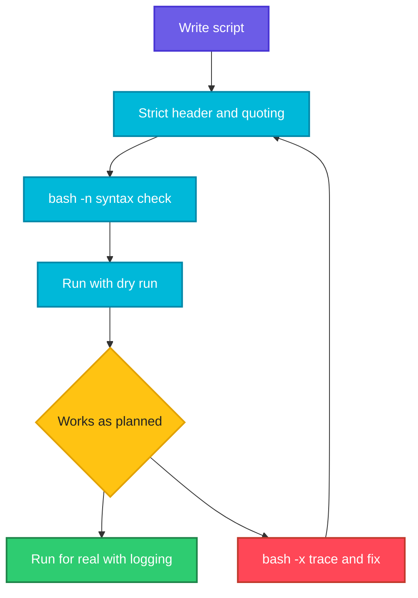

# Debugging and Safe Scripts

## What is it?
A script that works on your laptop can delete the wrong folder, hide an error or hang in a pipeline. This page covers two skills: **debugging** (finding out what a script really does with `bash -n`, `bash -x`, `set -x`) and **writing safe scripts** (a strict header with `set -euo pipefail`, quoting, temporary files, dry runs, logging, and scripts you can safely run twice).

## Syntax
```bash
#!/usr/bin/env bash
set -Eeuo pipefail          # the strict header

bash -n script.sh           # check the syntax, run nothing
bash -x script.sh           # run and print every command
bash -v script.sh           # print each line as it is read
set -x ... set +x           # trace only a part
```

## Visual Overview
> Write the script with a strict header, check the syntax, trace it when it misbehaves, and add guards so that a mistake stops the script before it does damage.



## Options/Flags
**Safety switches (`set` options)**

| Option | Long name | Effect |
|--------|-----------|--------|
| `set -e` | `errexit` | Stop when a command fails (with many exceptions, see [Exit codes](07-exit-codes.md)) |
| `set -u` | `nounset` | Treat an unset variable as an error |
| `set -o pipefail` | | A pipeline fails if **any** command in it fails |
| `set -E` | `errtrace` | Let `trap ... ERR` work inside functions |
| `set -x` | `xtrace` | Print each command before it runs |
| `set -n` | `noexec` | Read the commands but do not run them |
| `set -v` | `verbose` | Print each line as it is read |
| `set -C` | `noclobber` | `>` refuses to overwrite an existing file |
| `set -f` | `noglob` | Turn off `*` expansion |
| `set +x` | | The `+` turns an option **off** |

**Debugging helpers**

| Tool | Use |
|------|-----|
| `bash -n file` | Syntax check only |
| `bash -x file` | Trace |
| `PS4='+ ${BASH_SOURCE##*/}:${LINENO}: '` | Make the trace show the file and line number |
| `trap 'cmd' DEBUG` | Run something before every command |
| `$LINENO`, `$BASH_COMMAND` | Current line and the last command |
| `${FUNCNAME[0]}` | Name of the current function |
| `set -x` + `set +x` | Trace a few lines only |
| `shellcheck file` | Static checker that finds many common bugs (a separate package, install it with your package manager) |
| `shfmt` | Formatter, keeps a team's style the same |

**Safe habits**

| Habit | How |
|-------|-----|
| Quote everything | `"$var"`, `"$@"`, `"$(cmd)"` |
| Require values | `${VAR:?message}` |
| Temporary files | `mktemp` and `trap ... EXIT`, never `/tmp/myfile` |
| Check `cd` | `cd dir \|\| exit 1` |
| Test before you delete | a **dry run** mode, `echo rm ...` first |
| Idempotent steps | `mkdir -p`, `grep -q ... \|\| append`, `ln -sfn` |
| Log | timestamps, levels, errors to stderr |
| Limit permissions | `chmod 700` for scripts with secrets, `umask 077` |

## Usage Examples

### Example 1: Check the syntax without running (`bash -n`)
Let's say we have this file `bad.sh`, whose `if` has no `fi`:

**Input file** (`bad.sh`):
```bash
#!/bin/bash
if [ 1 -eq 1 ]; then
  echo ok
```

**Command:**
```bash
bash -n bad.sh
echo "rc=$?"
```
**Sample Output:**
```text
bad.sh: line 4: syntax error: unexpected end of file
rc=2
```
`bash -n` finds missing `fi`, `done` and quotes, and runs nothing. Put it in a pre commit hook or a CI step.

### Example 2: Trace a script (`bash -x`)
Let's say we have this file `x1.sh`:

**Input file** (`x1.sh`):
```bash
#!/bin/bash
name="devops"
count=2
for i in $(seq 1 $count); do
  echo "$name $i"
done
```

**Command:**
```bash
bash -x x1.sh 2>&1
```
**Sample Output:**
```text
+ name=devops
+ count=2
++ seq 1 2
+ for i in $(seq 1 $count)
+ echo 'devops 1'
devops 1
+ for i in $(seq 1 $count)
+ echo 'devops 2'
devops 2
```
Lines starting with `+` are the commands after expansion, `++` marks a command inside `$( )`. The trace goes to **stderr**, which is why `2>&1` puts it in order with the output.

### Example 3: Show the file and line (`PS4`)
Using the `x1.sh` file from Example 2.

**Command:**
```bash
PS4='+ ${BASH_SOURCE##*/}:${LINENO}: ' bash -x x1.sh 2>&1 | head -4
```
**Sample Output:**
```text
+ x1.sh:2: name=devops
+ x1.sh:3: count=2
++ x1.sh:4: seq 1 2
+ x1.sh:4: for i in $(seq 1 $count)
```
`PS4` is the prefix of every trace line.

### Example 4: Trace only a part (`set -x` and `set +x`)
Let's say we have this file `x2.sh`:

**Input file** (`x2.sh`):
```bash
#!/bin/bash
echo "before"
set -x
echo "traced"
set +x
echo "after"
```

**Command:**
```bash
bash x2.sh 2>&1
```
**Sample Output:**
```text
before
+ echo traced
traced
+ set +x
after
```

### Example 5: `set -u` catches typos
Let's say we have this file `u1.sh`:

**Input file** (`u1.sh`):
```bash
#!/bin/bash
set -u
echo "start"
echo "value: $UNDEFINED_VAR"
echo "end"
```

**Command:**
```bash
bash u1.sh
echo "rc=$?"
```
**Sample Output:**
```text
start
u1.sh: line 4: UNDEFINED_VAR: unbound variable
rc=1
```
Without `set -u` the script prints an empty value and goes on.

### Example 6: Allow an optional variable with `set -u`
**Command:**
```bash
set -u
echo "${MAYBE:-default}"
echo "${1:-noarg}"
```
**Sample Output:**
```text
default
noarg
```
Use `${var:-}` when a variable is allowed to be empty or unset.

### Example 7: The empty variable that deletes `/`
Let's say we have these two files:

**Input file** (`d1.sh`):
```bash
#!/bin/bash
DIR=""
echo "would run: rm -rf $DIR/"
```
**Input file** (`d2.sh`):
```bash
#!/bin/bash
set -u
DIR=""
echo "would run: rm -rf ${DIR:?DIR is empty}/"
```

**Command:**
```bash
bash d1.sh
bash d2.sh
echo "rc=$?"
```
**Sample Output:**
```text
would run: rm -rf /
d2.sh: line 4: DIR: DIR is empty
rc=1
```
The scripts only `echo` the command. With a real `rm -rf "$DIR/"`, an empty `DIR` would be `rm -rf /`. `${DIR:?message}` stops the script when the value is missing.

### Example 8: `pipefail` finds hidden failures
Let's say we have this file `p1.sh`:

**Input file** (`p1.sh`):
```bash
#!/bin/bash
set -eo pipefail
ls /nonexistent 2>/dev/null | sort > /dev/null
echo "not reached"
```

**Command:**
```bash
bash p1.sh
echo "rc=$?"
```
**Sample Output:**
```text
rc=2
```
`sort` succeeds, but `ls` fails. With `pipefail` the pipeline fails and `set -e` stops the script.

### Example 9: Unquoted variable with a space
Let's say we have this file `s1.sh`:

**Input file** (`s1.sh`):
```bash
#!/bin/bash
f="my report.txt"
touch "$f"
rm $f 2>&1 | sed 's/^rm: //'
ls "$f"
rm "$f"
```

**Command:**
```bash
bash s1.sh
```
**Sample Output:**
```text
cannot remove 'my': No such file or directory
cannot remove 'report.txt': No such file or directory
my report.txt
```
`rm $f` got two arguments. With the quotes (`rm "$f"`) it removes the right file. Imagine the same bug with `rm -rf $DIR/*`.

### Example 10: A strict header
Let's say we have this file `h1.sh`:

**Input file** (`h1.sh`):
```bash
#!/usr/bin/env bash
set -Eeuo pipefail
IFS=$'\n\t'
echo "strict mode on"
```

**Command:**
```bash
bash h1.sh
```
**Sample Output:**
```text
strict mode on
```
`IFS=$'\n\t'` makes word splitting use only newlines and tabs, so a space in a name no longer splits it. Good defaults for most automation scripts.

### Example 11: A dry run mode
Let's say we have this file `dr.sh`:

**Input file** (`dr.sh`):
```bash
#!/bin/bash
DRY_RUN=${DRY_RUN:-1}
run() { if [ "$DRY_RUN" = 1 ]; then echo "[dry-run] $*"; else "$@"; fi; }
run mkdir -p /tmp/ss10/out
run touch /tmp/ss10/out/a.txt
```

**Command:**
```bash
bash dr.sh
ls out
DRY_RUN=0 bash dr.sh
ls out
```
**Sample Output:**
```text
[dry-run] mkdir -p /tmp/ss10/out
[dry-run] touch /tmp/ss10/out/a.txt
ls: cannot access 'out': No such file or directory
a.txt
```
The first run only **prints** what it would do. The second run does it. Make the safe mode the default.

### Example 12: Safe temporary files (`mktemp`)
**Command:**
```bash
f=$(mktemp)
echo "$f" | sed "s#/tmp/tmp\..*#/tmp/tmp.XXXXXXXXXX#"
ls -l "$f" | cut -c1-10
rm "$f"
d=$(mktemp -d /tmp/ss10/work.XXXX)
ls -ld "$d" | cut -c1-10
rmdir "$d"
```
**Sample Output:**
```text
/tmp/tmp.XXXXXXXXXX
-rw-------
drwx------
```
The real name has random letters in place of the `X`s (the `sed` only hides them). `mktemp` makes the file with mode `600` and a name that nobody can guess. A fixed name like `/tmp/data` can be hijacked by another user. Pair it with `trap ... EXIT` to remove it.

### Example 13: Logging with levels and stderr
Let's say we have this file `l1.sh`:

**Input file** (`l1.sh`):
```bash
#!/bin/bash
log() { printf '%s %s\n' "LEVEL=$1" "${*:2}"; }
log INFO "starting"
log ERROR "something failed" >&2
```

**Command:**
```bash
bash l1.sh 2>/dev/null
echo "---"
bash l1.sh 2>&1 >/dev/null
```
**Sample Output:**
```text
LEVEL=INFO starting
---
LEVEL=ERROR something failed
```
Normal messages go to stdout, errors to stderr, so the caller can separate them.

### Example 14: Send everything to the screen **and** a log file
Let's say we have this file `l2.sh`:

**Input file** (`l2.sh`):
```bash
#!/bin/bash
exec > >(tee -a run2.log) 2>&1
echo "to screen and file"
ls /nonexistent
```

**Command:**
```bash
bash l2.sh
sleep 0.2
cat run2.log
```
**Sample Output:**
```text
to screen and file
ls: cannot access '/nonexistent': No such file or directory
to screen and file
ls: cannot access '/nonexistent': No such file or directory
```
The first two lines are the screen output, the last two come from `cat run2.log`. `exec > >(tee ...)` redirects all later output of the script. The short `sleep` lets `tee` finish writing.

### Example 15: Make a script safe to run twice (idempotent)
Let's say we have this file `i1.sh`:

**Input file** (`i1.sh`):
```bash
#!/bin/bash
mkdir -p /tmp/ss10/app
[ -f /tmp/ss10/app/state ] || { echo created > /tmp/ss10/app/state; echo "first run: created"; }
grep -qx 'line1' /tmp/ss10/app/cfg 2>/dev/null || { echo line1 >> /tmp/ss10/app/cfg; echo "added line1"; }
echo "state ok"
```

**Command:**
```bash
bash i1.sh
bash i1.sh
wc -l < app/cfg
```
**Sample Output:**
```text
first run: created
added line1
state ok
state ok
1
```
The second run changed nothing. The config file still has a single `line1`. Without the `grep -q ... ||` check it would have two.

### Example 16: Word splitting bug in a loop
Let's say we have this file `q1.sh`:

**Input file** (`q1.sh`):
```bash
#!/bin/bash
for f in $(printf 'a b\nc\n'); do echo "[$f]"; done
```

**Command:**
```bash
bash q1.sh
```
**Sample Output:**
```text
[a]
[b]
[c]
```
The line `a b` was split into two items. See [Loops](04-loops.md) for `while read` and `find -print0`.

### Example 17: Check that `cd` worked
Let's say we have this file `c1.sh`:

**Input file** (`c1.sh`):
```bash
#!/bin/bash
cd /nonexistent 2>/dev/null || { echo "cannot cd, stopping" >&2; exit 1; }
echo "safe to continue"
```

**Command:**
```bash
bash c1.sh
echo "rc=$?"
```
**Sample Output:**
```text
cannot cd, stopping
rc=1
```
A failed `cd` followed by `rm -rf *` removes the files of the **current** folder. Always `cd dir || exit`.

### Example 18: Run a function in the debugger style (`DEBUG` trap)
**Command:**
```bash
trap 'echo "> $BASH_COMMAND"' DEBUG
x=1
y=2
```
**Sample Output:**
```text
> x=1
> y=2
```
The `DEBUG` trap runs before each command. It is a small step tracer.

### Example 19: Print each line as it is read (`bash -v`)
Let's say we have this file `good.sh`:

**Input file** (`good.sh`):
```bash
#!/bin/bash
echo ok
```

**Command:**
```bash
bash -v good.sh
```
**Sample Output:**
```text
#!/bin/bash
echo ok
ok
```
`-v` shows the **source** as it is read, `-x` shows the **expanded** command.

### Example 20: Where am I (`LINENO`, `FUNCNAME`)
**Command:**
```bash
echo "line $LINENO"
f() { echo "in ${FUNCNAME[0]} called from ${FUNCNAME[1]:-main}"; }
f
```
**Sample Output:**
```text
line 1
in f called from main
```
Use them in error messages: `echo "error in ${FUNCNAME[0]} line $LINENO" >&2`.

### Example 21: `set -e` is switched off inside a tested function
**Command:**
```bash
set -e
f() { false; echo "after false in f"; }
f || echo "f failed (set -e is off inside ||)"
```
**Sample Output:**
```text
after false in f
```
When a function is used in `||`, `if` or `&&`, `set -e` is **ignored** inside it, so `false` did not stop the function and `||` never ran. This is one of the reasons not to rely on `set -e` alone.

### Example 22: Protect a script file
**Command:**
```bash
chmod 600 good.sh
ls -l good.sh | cut -c1-10
chmod 755 good.sh
ls -l good.sh | cut -c1-10
```
**Sample Output:**
```text
-rw-------
-rwxr-xr-x
```
Scripts with passwords or API keys should be `700` or `600`, readable only by their owner. Better still, keep secrets out of scripts.

## Sample Output
The recommended opening of a new script:

```bash
#!/usr/bin/env bash
set -Eeuo pipefail
trap 'echo "error on line $LINENO" >&2' ERR
echo "script body here"
```
```text
script body here
```

## Pitfalls / Gotchas
- `set -e` is **not** a complete safety net. It does nothing inside `if`, `&&`, `||`, `while` conditions, a function called there, or for `local x=$(cmd)`. Check important commands yourself.
- `set -u` also complains about empty **arrays** in older bash (before 4.4): `"${arr[@]}"` fails when `arr` is empty. Use `${arr[@]+"${arr[@]}"}`.
- `set -o pipefail` is a bash feature, not POSIX `sh`.
- `bash -x` prints **secrets**: passwords in variables and arguments show up in CI logs. Disable it (`set +x`) around sensitive lines.
- The trace goes to stderr. Send it to a file with `exec 2>trace.log` or `BASH_XTRACEFD=3`.
- `bash -n` only finds syntax errors, not mistakes in logic or in command names.
- `shellcheck` finds many mistakes (unquoted variables, useless `cat`, wrong tests). It was **not installed** on the machine used for this page, so no output is shown here. Install it with `sudo apt install shellcheck` and run `shellcheck script.sh`.
- Quote `"$@"`, `"$var"` and `"$(cmd)"`. A missing quote is the number one source of script bugs.
- Never `rm -rf "$DIR"/*` without making sure `DIR` is set and is the folder you mean. Use `${DIR:?}` and `set -u`.
- Never use a fixed temporary name. Use `mktemp`, and a trap that removes it.
- Do not parse the output of `ls`. Use globs, `find -print0` or `stat`.
- Do not `eval` or `source` data you do not control, and do not build commands as strings.
- Prefer `[[ ]]` over `[ ]` in bash scripts, and `$(...)` over backticks.
- `#!/bin/sh` scripts must work on `dash` (Ubuntu) or `ash` (Alpine). Test with `sh script.sh`.
- Do not run a script as root unless it must. Check with `[ "$(id -u)" -eq 0 ]` when it **needs** root.
- Test on a copy of the data, and make destructive scripts print before they act.

## DevOps Use Cases

### Use Case 1: Fail fast in CI
**Situation:** A pipeline script must not go green when a step in the middle failed.

Let's say we have this file `ci.sh`:

**Input file** (`ci.sh`):
```bash
#!/usr/bin/env bash
set -Eeuo pipefail
trap 'echo "FAILED at line $LINENO: $BASH_COMMAND" >&2' ERR
echo "build"
grep -q needle /etc/hostname
echo "deploy"
```

**Command:**
```bash
bash ci.sh
echo "pipeline rc=$?"
```
**Sample Output:**
```text
build
FAILED at line 5: grep -q needle /etc/hostname
pipeline rc=1
```
`deploy` never ran. The ERR trap shows the failing command, which saves a lot of time when reading CI logs.

### Use Case 2: Find a bug by tracing only the broken function
**Situation:** One function misbehaves in a 500 line script.

**Command:**
```bash
f() {
  set -x
  local a=1 b=2
  echo $((a + b))
  set +x
}
f 2>&1
```
**Sample Output:**
```text
+ local a=1 b=2
+ echo 3
3
+ set +x
```

### Use Case 3: Preview a cleanup before running it
**Situation:** Delete old files, but first show what would be deleted.

Let's say we have these files `old1.log`, `old2.log` and `keep.txt` in a folder.

**Command:**
```bash
DRY=1
for f in old*.log; do
  if [ "$DRY" = 1 ]; then echo "would delete: $f"; else rm -- "$f"; fi
done
```
**Sample Output:**
```text
would delete: old1.log
would delete: old2.log
```
Set `DRY=0` after you have looked at the list.

### Use Case 4: A script that is safe to run from cron every minute
**Situation:** A job might still be running when cron starts the next one.

Using the lock pattern from [Signals and trap](09-signals-and-trap.md), Example 13.

**Command:**
```bash
lock=/tmp/ss10/cron.lock
if ! mkdir "$lock" 2>/dev/null; then echo "previous run still active"; exit 0; fi
trap 'rmdir "$lock"' EXIT
echo "working"
```
**Sample Output:**
```text
working
```
When the previous run is still going, the script prints `previous run still active` and exits quietly.

### Use Case 5: Review a script before you run it (a short checklist)
**Situation:** A colleague sends you a script.

**Command:**
```bash
bash -n good.sh && echo "syntax ok"
grep -nE 'rm -rf|sudo|curl .*\| *(ba)?sh|eval ' good.sh || echo "no risky patterns found"
```
**Sample Output:**
```text
syntax ok
no risky patterns found
```
Read it, search for `rm -rf`, `sudo`, `curl | sh` and `eval`, then run it in a throwaway folder or container first.

## Related Commands
- [Signals and trap](09-signals-and-trap.md) - the previous page
- [Example scripts](11-example-scripts.md) - the next page
- [Exit codes](07-exit-codes.md) - how `set -e` decides
- [`set`](../linux/shell-basics/set.md) - the safety switches
- `mktemp` - creates safe temporary files, see `man mktemp`
- [`tee`](../linux/text-processing/tee.md) - log and show output at the same time
- [`chmod`](../linux/permissions/chmod.md) - protect scripts that hold secrets
- [`umask`](../linux/permissions/umask.md) - permissions of new files
- [Processes](../linux/os-internals/04-processes.md) - what happens when a script is stopped
