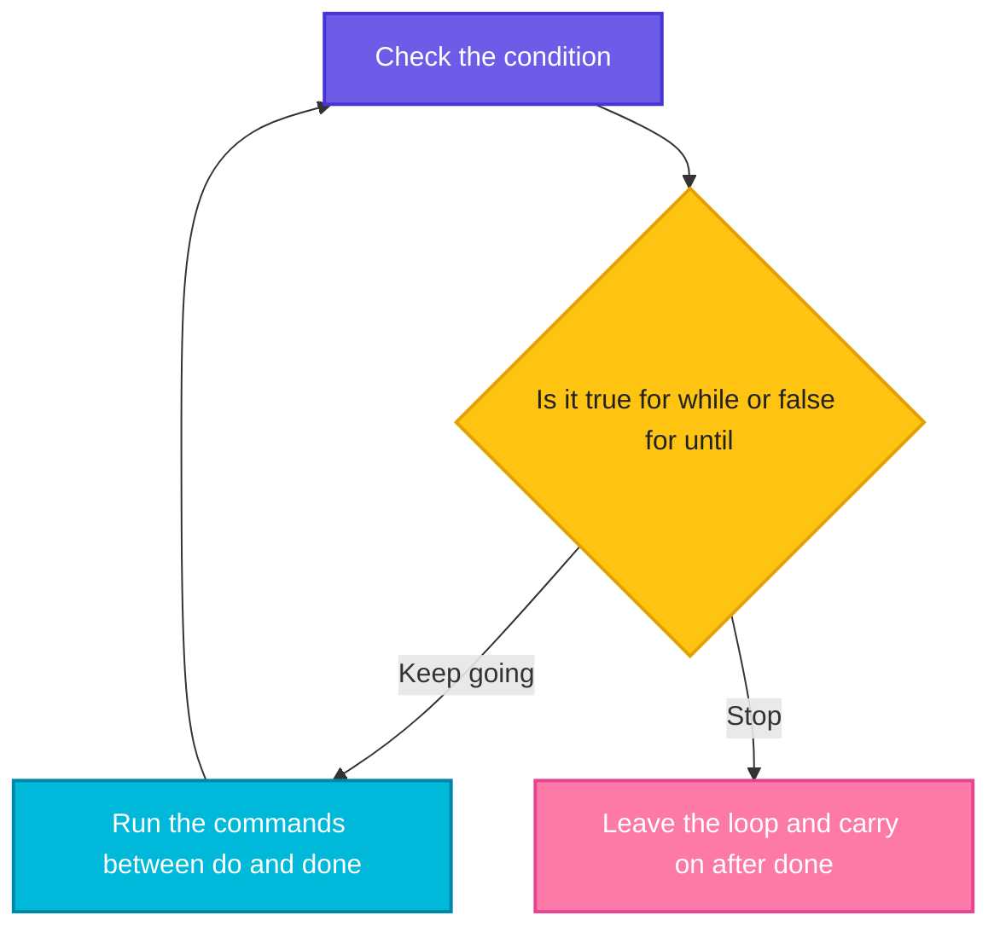
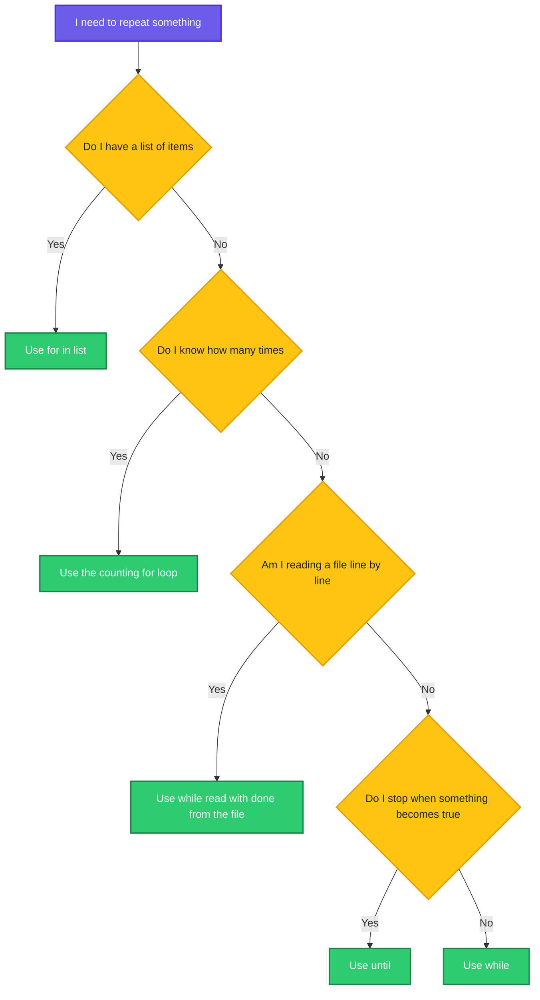

# `while` and `until` Loops: Repeat Until Something Changes

> **Before this page:** you have read pages [01](01-what-is-a-shell-script.md) to [09](09-for-loops.md). You know variables, arguments, exit codes, operators, `if`, `case`, arrays and `for` loops.
>
> **By the end of this page** you will be able to make your script repeat when you **do not know in advance how many times**: read a file line by line, wait for something to become ready, and retry a command that sometimes fails.

---

## 1. Start with a problem: "I do not know how many times"

The `for` loop from the last page is perfect when you **have a list**: three servers, ten files, five arguments. But think about these jobs:

- *"Wait until the database is ready."* Maybe it is ready in 2 seconds, maybe in 40. You cannot write a list for that.
- *"Read every line of this file."* The file might have 3 lines or 3 million.
- *"Try to connect. If it fails, try again, up to 5 times."* You do not know which attempt will work.
- *"Keep asking until the user gives a valid answer."* The user may get it right first time or never.

In each case you do not have a list. You have a **condition**: *"keep going while this is still true"*, or *"keep going until this becomes true"*.

**That is what `while` and `until` loops do.**

---

## 2. The big idea: waiting for the kettle

You put a kettle on the stove. What do you do?

> **While** the water is **not** boiling, keep waiting.

Or you can say the same thing the other way round:

> Keep waiting **until** the water is boiling.

You do not count how many minutes. You **keep checking one condition**, and the moment it changes, you stop. Those two sentences are the two loops:

| Loop | Read it as | Keeps repeating while the condition is... |
|------|------------|-------------------------------------------|
| **`while`** | "Keep going **as long as** this is **true**" | **True** (stops when it becomes false) |
| **`until`** | "Keep going **until** this becomes **true**" | **False** (stops when it becomes true) |

They are mirror images of each other. And here is the neat connection: the condition is **exactly the same kind of condition you wrote for `if`** in pages 05 and 06. Anything that works after `if` works after `while` or `until`.



Notice that the check happens **first**, before each round, not after.

---

## 3. Your first `while` loop (do this with me)

Go to your practice folder (`cd ~/practice`).

Let's say we have this file `w1.sh`:

**Input file** (`w1.sh`):
```bash
#!/bin/bash
count=1
while [[ $count -le 3 ]]; do
  echo "Round $count"
  count=$((count + 1))
done
echo "Loop finished, count is now $count"
```

**Command:**
```bash
chmod +x w1.sh
./w1.sh
```
**Sample Output:**
```text
Round 1
Round 2
Round 3
Loop finished, count is now 4
```

Read it as: *"While `count` is less than or equal to 3, print the round and add one to `count`."*

### The anatomy of a `while` loop

```text
while [[ $count -le 3 ]]; do     <- "keep going while this is true"
  echo "Round $count"            <- the body
  count=$((count + 1))           <- IMPORTANT: change something, so the condition can become false
done                             <- end of the loop
```

| Piece | Meaning |
|-------|---------|
| `while` | Start the loop |
| `[[ $count -le 3 ]]` | The **condition**. Any test or command from earlier pages |
| `do` ... `done` | The body, as in a `for` loop |
| `count=$((count + 1))` | The line that **moves the loop towards its end** |

That last line is the most important one on this page.

### The check happens first, so the body may never run

If the condition is false right from the start, the body is skipped completely.

Let's say we have this file `w0.sh`:

**Input file** (`w0.sh`):
```bash
#!/bin/bash
count=10
while [[ $count -le 3 ]]; do
  echo "This never prints"
done
echo "Skipped the loop completely"
```

**Command:**
```bash
chmod +x w0.sh
./w0.sh
```
**Sample Output:**
```text
Skipped the loop completely
```

### The danger: the endless loop

What happens if you forget to change anything inside the loop? The condition never becomes false, and the loop runs **forever**.

Let's say we have this file `inf.sh`, where the `count=...` line was forgotten:

**Input file** (`inf.sh`):
```bash
#!/bin/bash
count=1
while [[ $count -le 3 ]]; do
  echo "Round $count"
done
```

**Command** (we use `timeout 1` to stop it after a second, and `head -4` to keep only four lines):
```bash
chmod +x inf.sh
timeout 1 ./inf.sh | head -4
```
**Sample Output:**
```text
Round 1
Round 1
Round 1
Round 1
```

It printed `Round 1` again and again, because `count` never changed. If this happens to you in a real terminal, press **Ctrl+C**, which stops a running command. When a script seems to "hang" and spam the screen, the first suspect is a `while` loop that does not update its own condition.

### `while` or `for`?

| | `for` | `while` |
|---|-------|---------|
| You know... | The **items** | The **condition** to keep going |
| Count of rounds | Fixed by the list | Not known in advance |
| Moves forward by itself | **Yes**, takes the next item | **No**, you must change something |
| Typical use | Servers, files, arguments | Waiting, retrying, reading lines |

---

## 4. `until`: the mirror image

`until` repeats **while the condition is false**, and stops the moment it becomes true. Same loop as before, written the other way:

Let's say we have this file `u1.sh`:

**Input file** (`u1.sh`):
```bash
#!/bin/bash
count=1
until [[ $count -gt 3 ]]; do
  echo "Round $count"
  count=$((count + 1))
done
```

**Command:**
```bash
chmod +x u1.sh
./u1.sh
```
**Sample Output:**
```text
Round 1
Round 2
Round 3
```

The output is identical to `w1.sh`. Compare the two conditions:

- `while [[ $count -le 3 ]]`: keep going **while** count is at most 3.
- `until [[ $count -gt 3 ]]`: keep going **until** count is more than 3.

**Which should you use?** Whichever reads like plain English for the job:

| Say it like this | Use |
|------------------|-----|
| "Keep processing **while** there are lines left" | `while` |
| "Keep trying **until** it works" | `until` |
| "Wait **until** the service is ready" | `until` |
| "Repeat **while** the disk is above 80%" | `while` |

### Waiting for something to be ready

This is the classic use of `until`. Real scripts wait for a database, a web server, or a file to appear. Here we **pretend** the service becomes ready on the third check:

Let's say we have this file `wait.sh`:

**Input file** (`wait.sh`):
```bash
#!/bin/bash
# Pretend the service becomes ready on the third check
checks=0
until [[ $checks -ge 3 ]]; do
  checks=$((checks + 1))
  echo "Check $checks: service not ready yet"
done
echo "Service is ready after $checks checks"
```

**Command:**
```bash
chmod +x wait.sh
./wait.sh
```
**Sample Output:**
```text
Check 1: service not ready yet
Check 2: service not ready yet
Check 3: service not ready yet
Service is ready after 3 checks
```

(In a real script, the condition would be a real test, such as a file appearing with `[[ -f ready.flag ]]`, and the loop body would include `sleep 1` to wait a second between checks, so it does not hammer the machine.)

---

## 5. The most useful `while`: reading a file line by line

This is the use you will meet most often in real scripts. The shape is a bit special, so learn it as a unit:

```bash
while read -r line; do
  ... use "$line" ...
done < file.txt
```

`read` (page 03) normally reads what a person types. Here it reads from the **file** instead, because of `< file.txt` after `done`. Each round, `read` takes **one line** into the variable `line`. When the file runs out, `read` fails (exit code non-zero, page 04), and the `while` stops. Everything you learned fits together.

Let's say we have this file `hosts.txt`:

**Input file** (`hosts.txt`):
```text
web1
web2
db1
```

And this script:

**Input file** (`r1.sh`):
```bash
#!/bin/bash
n=0
while read -r line; do
  n=$((n + 1))
  echo "Line $n: $line"
done < hosts.txt
echo "Read $n lines"
```

**Command:**
```bash
chmod +x r1.sh
./r1.sh
```
**Sample Output:**
```text
Line 1: web1
Line 2: web2
Line 3: db1
Read 3 lines
```

The `-r` option should always be there. We will see why in section 8.

### Why not a `for` loop over `$(cat file)`?

A `for` loop splits on **every space**, not every line. A file with spaces breaks it.

Let's say we have this file `names.txt`:

**Input file** (`names.txt`):
```text
Asha Rao
Ravi Kumar
```

And this script:

**Input file** (`r2.sh`):
```bash
#!/bin/bash
echo "for loop over \$(cat):"
for line in $(cat names.txt); do
  echo "  [$line]"
done
echo "while read loop:"
while read -r line; do
  echo "  [$line]"
done < names.txt
```

**Command:**
```bash
chmod +x r2.sh
./r2.sh
```
**Sample Output:**
```text
for loop over $(cat):
  [Asha]
  [Rao]
  [Ravi]
  [Kumar]
while read loop:
  [Asha Rao]
  [Ravi Kumar]
```

Two lines in the file, but the `for` loop saw **four** pieces. The `while read` loop gives you exactly **one line at a time**. **To go through a file line by line, always use `while read -r`.** (Use `mapfile` from page 08 if you want all the lines in an array.)

### Splitting each line into fields

If each line holds several values separated by a character, `read` can split them straight into separate variables. Put `IFS=','` (the separator, as in page 08) in front of `read`:

Let's say we have this file `servers.csv`, with a name, an address and a port on each line:

**Input file** (`servers.csv`):
```text
web1,10.0.0.11,80
web2,10.0.0.12,80
db1,10.0.0.21,5432
```

And this script:

**Input file** (`r3.sh`):
```bash
#!/bin/bash
while IFS=',' read -r name ip port; do
  echo "$name is at $ip on port $port"
done < servers.csv
```

**Command:**
```bash
chmod +x r3.sh
./r3.sh
```
**Sample Output:**
```text
web1 is at 10.0.0.11 on port 80
web2 is at 10.0.0.12 on port 80
db1 is at 10.0.0.21 on port 5432
```

Each line was cut at the commas, and the three pieces landed in `name`, `ip` and `port`. This is how scripts process CSV files, `/etc/passwd`, inventory lists and many other tables.

---

## 6. Keep watching: the deliberate endless loop

Sometimes you **want** a loop that never ends, such as a monitor that checks something every few seconds. The condition `true` is always true (it is a command that always succeeds, exit code `0`), so `while true` runs until someone stops it. Put a `sleep` inside, so it does not eat all the CPU.

Let's say we have this file `tick.sh`:

**Input file** (`tick.sh`):
```bash
#!/bin/bash
n=1
while true; do
  echo "tick $n"
  n=$((n + 1))
  sleep 0.2
done
```

**Command** (`head -3` shows the first three lines and then stops the script):
```bash
chmod +x tick.sh
./tick.sh | head -3
```
**Sample Output:**
```text
tick 1
tick 2
tick 3
```

On its own, `./tick.sh` would print a line every fifth of a second **forever**, until you press **Ctrl+C**. A real monitor would check a disk or a service in the body and `sleep 30` or `sleep 60` between checks. (In the next page you will learn `break`, which lets a loop leave itself from the inside.)

---

## 7. The retry pattern: the most useful loop in DevOps

Networks fail for a moment. A server is restarting. An API says "try again". A good script **retries a few times before giving up**. The pattern is:

1. Try the command.
2. If it works, we are done.
3. If it fails, count the attempt. If we used up all attempts, **give up** with an error. Otherwise wait a moment and try again.

Here, a pretend command called `flaky` fails twice and then works. (`flaky() { ... }` defines a **function**, a named block of commands. You will learn functions in a later page. For now, read `flaky` as "the command that is unreliable".)

Let's say we have this file `retry.sh`:

**Input file** (`retry.sh`):
```bash
#!/bin/bash
# usage: ./retry.sh [max_attempts]
max="${1:-5}"
calls=0

# A pretend command that fails twice, then works
flaky() {
  calls=$((calls + 1))
  [[ $calls -ge 3 ]]
}

attempt=1
until flaky; do
  if [[ $attempt -ge $max ]]; then
    echo "Giving up after $max attempts"
    exit 1
  fi
  echo "Attempt $attempt failed, trying again..."
  attempt=$((attempt + 1))
  sleep 1
done
echo "Succeeded on attempt $attempt"
```

**Command:**
```bash
chmod +x retry.sh
./retry.sh
echo "code: $?"
./retry.sh 2
echo "code: $?"
```
**Sample Output:**
```text
Attempt 1 failed, trying again...
Attempt 2 failed, trying again...
Succeeded on attempt 3
code: 0
Attempt 1 failed, trying again...
Giving up after 2 attempts
code: 1
```

Walk through it:

- **First run** (5 attempts allowed): `flaky` fails on attempts 1 and 2, and works on attempt 3. The script succeeds and exits with `0`.
- **Second run** (only 2 allowed): after attempt 2 fails, the limit is reached, so the script **gives up and exits with `1`**, so a pipeline would see the failure (page 04).

Notice that `until flaky` uses a **command** as the condition, not a `[[ ]]` test. If the command succeeds (exit code `0`), the condition is true and the loop ends. In a real script, replace `flaky` with something like `curl -s http://web1/health` or `ping -c 1 db1`.

> **Two safety rules for every retry loop:** always set a **maximum number of attempts**, and always **`sleep`** between them. Without a limit, a permanently broken service makes your script wait forever.

### Ask until you get a valid answer

`until` is also a natural fit for asking a person a question. It keeps asking until the answer is acceptable.

Let's say we have this file `ans.sh`:

**Input file** (`ans.sh`):
```bash
#!/bin/bash
answer=""
until [[ $answer == "yes" || $answer == "no" ]]; do
  read -p "Please answer yes or no: " answer
done
echo "You said: $answer"
```

**Command:**
```bash
chmod +x ans.sh
./ans.sh
```
**What you see in the terminal** (you type `maybe`, then `perhaps`, then `yes`):
```text
Please answer yes or no: maybe
Please answer yes or no: perhaps
Please answer yes or no: yes
You said: yes
```

The condition combines two tests with `||` (page 05): the loop ends only when the answer is `yes` **or** `no`.

---

## 8. The mistakes that bite

### Mistake 1: a loop that never updates its condition

You saw it in section 3. The loop spins forever. **Check that something inside the body moves the condition towards "stop".**

### Mistake 2: the pipe trap (the vanishing counter)

This is the most famous `while` bug. Feeding a loop through a **pipe** runs it in a separate helper shell (a *subshell*, like the "assistant" in page 01). Anything the loop changes disappears when it ends.

Let's say we use `hosts.txt` (3 lines) again, with this script:

**Input file** (`p1.sh`):
```bash
#!/bin/bash
count=0
cat hosts.txt | while read -r line; do
  count=$((count + 1))
done
echo "With a pipe, count is: $count"
count=0
while read -r line; do
  count=$((count + 1))
done < hosts.txt
echo "With < file, count is: $count"
```

**Command:**
```bash
chmod +x p1.sh
./p1.sh
```
**Sample Output:**
```text
With a pipe, count is: 0
With < file, count is: 3
```

With the pipe, the loop counted to 3 **inside the helper shell**, but your script's own `count` stayed `0`. With `< hosts.txt` (a redirect), the loop runs in your main script, and the count survives.

> **The rule:** to read a file in a loop and **keep variables** afterwards, use **`done < file`**, not `cat file | while`.

### Mistake 3: the last line has no newline

If a file's last line does not end with a newline character, the plain `while read` loop **silently drops that last line**.

Let's say we have a file `nonl.txt` whose last line, `three`, has no newline at the end:

**Input file** (`nonl.txt`):
```text
one
two
three
```

(The file is the three lines above, with no new line after `three`.)

**Input file** (`nl.sh`):
```bash
#!/bin/bash
echo "Plain while read:"
while read -r line; do echo "  [$line]"; done < nonl.txt
echo "With the safety check:"
while read -r line || [[ -n $line ]]; do echo "  [$line]"; done < nonl.txt
```

**Command:**
```bash
chmod +x nl.sh
./nl.sh
```
**Sample Output:**
```text
Plain while read:
  [one]
  [two]
With the safety check:
  [one]
  [two]
  [three]
```

`read` fails when it hits the end of the file without seeing a newline, so the loop stopped before using `three`. Adding `|| [[ -n $line ]]` says "or the variable still holds something", which rescues the last line. Files made by hand or by some tools often end this way.

### Mistake 4: forgetting `-r`

Without `-r`, `read` treats a backslash as a special escape character and **eats** it.

Let's say we have this file `win.txt`, which contains a Windows-style path:

**Input file** (`win.txt`):
```text
C:\temp\new
```

And this script:

**Input file** (`bs.sh`):
```bash
#!/bin/bash
echo "without -r:"
while read line; do echo "  $line"; done < win.txt
echo "with -r:"
while read -r line; do echo "  $line"; done < win.txt
```

**Command:**
```bash
chmod +x bs.sh
./bs.sh
```
**Sample Output:**
```text
without -r:
  C:tempnew
with -r:
  C:\temp\new
```

Without `-r`, the backslashes vanished. **Make `read -r` a habit.**

### Mistake 5: leading spaces disappear

`read` also trims spaces at the start and end of each line.

Let's say we have this file `ind.txt`, whose line starts with three spaces:

**Input file** (`ind.txt`):
```text
   indented line
```

**Input file** (`ind.sh`):
```bash
#!/bin/bash
while read -r line; do echo "[$line]"; done < ind.txt
while IFS= read -r line; do echo "[$line]"; done < ind.txt
```

**Command:**
```bash
chmod +x ind.sh
./ind.sh
```
**Sample Output:**
```text
[indented line]
[   indented line]
```

Setting `IFS=` (empty) in front of `read` keeps the spaces. For indentation-sensitive files such as YAML, use `while IFS= read -r line`.

### Mistake 6: syntax errors

| Mistake | Symptom |
|---------|---------|
| Forgot `do` | `syntax error near unexpected token` |
| Forgot `done` | `syntax error: unexpected end of file` |

Let's see one of them for real.

Let's say we have this file `m1.sh`, which forgot `do`:

**Input file** (`m1.sh`):
```bash
#!/bin/bash
x=5
while [ $x -lt 3 ]
  echo hi
done
```

**Command:**
```bash
bash m1.sh
```
**Sample Output:**
```text
m1.sh: line 5: syntax error near unexpected token `done'
m1.sh: line 5: `done'
```

### The full list at a glance

| Mistake | Symptom | Fix |
|---------|---------|-----|
| Nothing inside the body changes the condition | Endless loop, screen spam | Update the variable. Ctrl+C to stop |
| `cat file \| while read ...` | Variables set in the loop are lost | `done < file` |
| `for line in $(cat file)` | Splits at every space | `while read -r line` |
| Last line has no newline | Last line is skipped | `while read -r line \|\| [[ -n $line ]]` |
| `read` without `-r` | Backslashes disappear | `read -r` |
| `read` without `IFS=` | Leading spaces are trimmed | `IFS= read -r` |
| Forgot `< file` after `done` | The script waits for the keyboard | Add `< file` |
| Retry loop with no limit | Waits forever on a broken service | Count attempts and `exit 1` |
| Retry loop with no `sleep` | Hammers the server | `sleep 1` between tries |
| `while [ $x -lt 5 ]` with `x` empty | `unary operator expected` | Use `[[ ]]` and set `x` first |
| Forgot `do` or `done` | Syntax error | Add it |

---

## 9. Upgrade `morning.sh`: wait for a late disk

Cloud servers sometimes attach a data disk a few seconds **after** boot. If the check runs too early, the disk "does not exist" yet, and your alert fires for nothing. Let's teach `morning.sh` to **wait a little** before declaring a disk missing, using the retry idea.

Let's say we now have this file `morning.sh`:

**Input file** (`morning.sh`):
```bash
#!/bin/bash
# morning.sh - usage: ./morning.sh [disk ...]

WARN=2      # use 80 in real life
CRIT=50     # use 90 in real life
TRIES=2     # how many times to wait for a missing disk

disks=("$@")
if [[ ${#disks[@]} -eq 0 ]]; then
  disks=(/)
fi

echo "Date : $(date +%d-%b-%Y)"

worst=0
for disk in "${disks[@]}"; do
  tries=0
  while ! df "$disk" > /dev/null 2>&1 && [[ $tries -lt $TRIES ]]; do
    tries=$((tries + 1))
    echo "$disk: not found yet, waiting (try $tries of $TRIES)"
    sleep 1
  done

  if ! df "$disk" > /dev/null 2>&1; then
    echo "$disk: NOT FOUND"
    code=2
  else
    usage=$(df --output=pcent "$disk" | tail -1 | tr -dc '0-9')
    if [[ $usage -ge $CRIT ]]; then
      echo "$disk: CRITICAL ($usage%)"
      code=2
    elif [[ $usage -ge $WARN ]]; then
      echo "$disk: WARNING ($usage%)"
      code=1
    else
      echo "$disk: OK ($usage%)"
      code=0
    fi
  fi
  if [[ $code -gt $worst ]]; then
    worst=$code
  fi
done

exit "$worst"
```

**Command:**
```bash
chmod +x morning.sh
./morning.sh / /nope
echo "code: $?"
```
**Sample Output:**
```text
Date : 20-Oct-2026
/: WARNING (2%)
/nope: not found yet, waiting (try 1 of 2)
/nope: not found yet, waiting (try 2 of 2)
/nope: NOT FOUND
code: 2
```

The new part is the `while` loop. Read it as: *"While the disk **cannot be read** **and** we still have tries left, add one to `tries`, say we are waiting, and sleep one second."* If the disk appears during the wait, the loop ends early and the normal checks go ahead. If it never appears, the script waits twice and then reports it missing, with exit code `2`.

Notice how everything works together: a `for` loop over an array of disks, a `while` loop **inside** it for the waiting, an `if`/`elif` ladder for the verdicts, and the exit code for the final result. `/` is checked at once, and only the missing `/nope` is made to wait.

---

## 10. Which loop should I use?

You now know three kinds of loop. Use this as your guide:

| The situation | Best loop |
|---------------|-----------|
| I have a **list** of things (servers, files, arguments, an array) | `for item in list` |
| I want to **count** a number of times | `for (( i=1; i<=n; i++ ))` |
| I want to repeat **while a condition holds** | `while` |
| I want to repeat **until something becomes true** (wait, retry) | `until` |
| I need to read a **file line by line** | `while read -r line; do ... done < file` |
| I want something to run **forever** (a monitor) | `while true` with `sleep` |



---

## 11. Words to remember

| Word | Simple meaning |
|------|----------------|
| **`while`** | Repeat **as long as** the condition is true |
| **`until`** | Repeat **until** the condition becomes true |
| **Condition** | The test checked **before** each round |
| **Endless loop** | A loop whose condition never becomes false |
| **Ctrl+C** | Stops a running command |
| **`while true`** | A deliberate endless loop (needs a `sleep`) |
| **`sleep N`** | Pause for N seconds |
| **`read -r line`** | Read one line into a variable, keeping backslashes |
| **`done < file`** | Feed a file into the loop |
| **`IFS`** | The separator `read` splits on |
| **Retry** | Try again after a failure, up to a limit |
| **Subshell** | A helper shell. Variables changed in it are lost (the pipe trap) |

---

## 12. Try it yourself

1. **Countdown.** Use a `while` loop to print `5`, `4`, `3`, `2`, `1`, `Liftoff!`.
2. **Same thing, other loop.** Rewrite the countdown with `until`.
3. **Sum.** Use a `while` loop to add the numbers 1 to 50. (Expected: 1275.)
4. **Line numbers.** Write `numbered.sh` that prints each line of a file with its line number in front, like `1: web1`. The file name comes from `$1`.
5. **Count the long lines.** Count how many lines of a file are longer than 20 characters. (Hint: `${#line}` is the length of `line`. Remember the pipe trap!)
6. **Parse the CSV.** Using `servers.csv`, print only the servers whose port is `80`.
7. **Wait for a file.** Write a script that waits until a file called `ready.flag` appears, checking once per second. In a second terminal, `touch ready.flag` to release it. (Add a limit of 10 tries.)
8. **Retry a real command.** Write a script that tries `ls /nope` up to 3 times, with a one second pause, and prints `giving up` and exits `1` at the end.
9. **Spot the bug.** What is wrong here?
   ```bash
   i=1
   while [[ $i -le 5 ]]
   do
     echo "$i"
   done
   ```
10. **Upgrade `morning.sh`.** Change it to read the list of disks from a file called `disks.txt` (one per line), using `while read -r`. Keep the worst exit code.

<details>
<summary>Answers for exercises 3 and 9 (open only after trying)</summary>

**Exercise 3:**

```bash
#!/bin/bash
i=1
total=0
while [[ $i -le 50 ]]; do
  total=$((total + i))
  i=$((i + 1))
done
echo "$total"
```

**Exercise 9:** Nothing changes `i` inside the loop, so the condition `i -le 5` is true forever and the script prints `1` endlessly. Add `i=$((i + 1))` before `done`.
</details>

---

## 13. Quick recap

- **`while`** repeats **as long as** a condition is true. **`until`** repeats **until** it becomes true. They are mirror images.
- The condition is the same kind you use with `if`: a test in `[[ ]]`, or any command (exit code `0` means true).
- The check happens **first**, so the body may never run.
- Something inside the loop **must change** the condition, or the loop never ends. **Ctrl+C** stops a runaway loop.
- Read a file line by line with **`while read -r line; do ... done < file`**. Use `IFS=','` to split fields.
- Feed a loop with **`< file`**, not with `cat file | while`, or variables vanish (the pipe trap).
- `while true` plus `sleep` makes a monitor that runs until stopped.
- The **retry pattern**: try, count the attempts, `sleep`, and give up with `exit 1` after a limit.
- Always use **`read -r`**, and `IFS=` when leading spaces matter.

**Next page:** [11 Loop control and real patterns](11-loop-control-and-patterns.md), where you will learn `break` and `continue` to leave or skip rounds, and build complete real-world scripts such as a server health checker and a log analyser.
