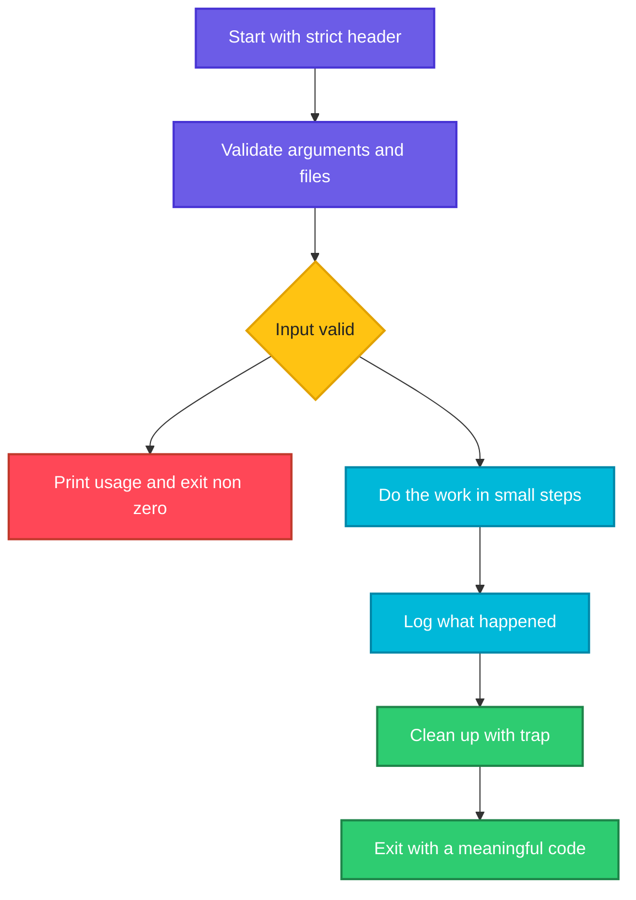

# Example Scripts

## What is it?
This page puts everything from the earlier pages together in six complete scripts that a DevOps engineer writes in real life: a **backup with retention**, a **log analyzer**, a **health check**, **user onboarding from a CSV file**, a **bulk rename with a dry run**, and a **deploy skeleton** with a lock, a log and cleanup. Each script has a strict header, validated arguments, clear messages and meaningful exit codes. Read them, run them on test data, and then change them for your own tasks.

## Syntax
```bash
#!/usr/bin/env bash
set -Eeuo pipefail                     # strict mode
arg=${1:?usage: script.sh <arg>}       # required argument with a usage message
```

## Visual Overview
> Every script here follows the same shape: validate the input, do the work in small steps, report what happened, and exit with a code that a pipeline can use.



## Options/Flags
**Which feature each script teaches**

| Script | Topics from this series |
|--------|-------------------------|
| `backup.sh` | Arguments with defaults, `tar`, `mapfile`, retention, [Variables](02-variables-and-strings.md) |
| `analyze.sh` | `awk`, `sort`, `uniq -c`, integer maths, [Regular expressions](../linux/fundamentals/12-regular-expressions.md) |
| `health.sh` | Functions, [exit codes](07-exit-codes.md), `/dev/tcp`, `printf` formatting |
| `onboard.sh` | `while read` with `IFS`, [loops](04-loops.md), generating commands instead of running them |
| `rename.sh` | Parameter expansion, `nullglob`, dry run mode, [safe scripts](10-debugging-and-safe-scripts.md) |
| `deploy.sh` | `case`, lock directory, `mktemp`, `trap ... EXIT`, [signals](09-signals-and-trap.md) |

## Usage Examples

### Example 1: A backup script with retention
Let's say we have this folder `data` and the script `backup.sh`:

**Input file** (`data/app.conf`):
```text
config
```
**Input file** (`data/notes.txt`):
```text
notes
```
**Input file** (`backup.sh`):
```bash
#!/usr/bin/env bash
set -Eeuo pipefail
src=${1:?usage: backup.sh <source-dir> <backup-dir> [keep]}
dest=${2:?usage: backup.sh <source-dir> <backup-dir> [keep]}
keep=${3:-3}
[ -d "$src" ] || { echo "source not found: $src" >&2; exit 1; }
mkdir -p "$dest"
stamp=${STAMP:-$(date +%Y%m%d-%H%M%S)}
archive="$dest/$(basename "$src")-$stamp.tar.gz"
tar -czf "$archive" -C "$(dirname "$src")" "$(basename "$src")"
echo "created $(basename "$archive")"
# retention: keep only the newest $keep archives
mapfile -t old < <(ls -1t "$dest"/"$(basename "$src")"-*.tar.gz | tail -n +$((keep+1)))
for f in "${old[@]}"; do rm -- "$f"; echo "removed $(basename "$f")"; done
```

**Command:**
```bash
for s in 20261010-010000 20261011-010000 20261012-010000 20261013-010000 20261014-010000; do
  STAMP=$s bash backup.sh data backups 3
  sleep 1.1
done
ls backups
tar -tzf backups/data-20261014-010000.tar.gz | sort
```
**Sample Output:**
```text
created data-20261010-010000.tar.gz
created data-20261011-010000.tar.gz
created data-20261012-010000.tar.gz
created data-20261013-010000.tar.gz
removed data-20261010-010000.tar.gz
created data-20261014-010000.tar.gz
removed data-20261011-010000.tar.gz
data-20261012-010000.tar.gz
data-20261013-010000.tar.gz
data-20261014-010000.tar.gz
data/
data/app.conf
data/notes.txt
```
The `STAMP` variable fixes the archive name for the demonstration, and a real run uses the current time. The short `sleep` gives each archive a different modification time, because `ls -t` sorts by time. After five runs only the newest three archives are left.

### Example 2: The backup script checks its input
Using the `backup.sh` file from Example 1.

**Command:**
```bash
bash backup.sh
bash backup.sh nodir backups
echo "rc=$?"
```
**Sample Output:**
```text
backup.sh: line 3: 1: usage: backup.sh <source-dir> <backup-dir> [keep]
source not found: nodir
rc=1
```
A missing argument stops the script with a usage message, a missing folder stops it with exit code `1`.

### Example 3: A log analyzer
Let's say we have this file `access.log`:

**Input file** (`access.log`):
```text
10.0.0.5 - - [14/Oct/2026:10:01:05] "GET /index.html HTTP/1.1" 200 512
10.0.0.9 - - [14/Oct/2026:10:01:09] "GET /login HTTP/1.1" 200 128
10.0.0.5 - - [14/Oct/2026:10:02:11] "POST /api/upload HTTP/1.1" 500 64
192.168.1.20 - - [14/Oct/2026:10:03:42] "GET /index.html HTTP/1.1" 200 512
10.0.0.5 - - [14/Oct/2026:10:04:00] "GET /missing HTTP/1.1" 404 32
10.0.0.7 - - [14/Oct/2026:10:04:30] "GET /index.html HTTP/1.1" 200 512
10.0.0.9 - - [14/Oct/2026:10:05:30] "POST /api/upload HTTP/1.1" 500 64
```
**Input file** (`analyze.sh`):
```bash
#!/usr/bin/env bash
set -euo pipefail
log=${1:?usage: analyze.sh <access.log>}
[ -r "$log" ] || { echo "cannot read $log" >&2; exit 1; }
total=$(wc -l < "$log")
echo "total requests: $total"
echo "--- status codes"
awk '{print $8}' "$log" | sort | uniq -c | sort -rn | awk '{printf "%s: %s\n", $2, $1}'
echo "--- top clients"
awk '{print $1}' "$log" | sort | uniq -c | sort -rn | head -2 | awk '{printf "%s (%s requests)\n", $2, $1}'
echo "--- error rate"
errors=$(awk '$8 >= 500' "$log" | wc -l)
echo "5xx errors: $errors of $total ($((errors * 100 / total))%)"
echo "--- paths with 5xx errors"
awk '$8 >= 500 {print $6}' "$log" | sort | uniq -c | sort -rn | awk '{printf "%s: %s\n", $2, $1}'
```

**Command:**
```bash
bash analyze.sh access.log
```
**Sample Output:**
```text
total requests: 7
--- status codes
200: 4
500: 2
404: 1
--- top clients
10.0.0.5 (3 requests)
10.0.0.9 (2 requests)
--- error rate
5xx errors: 2 of 7 (28%)
--- paths with 5xx errors
/api/upload: 2
```
The field numbers (`$8` is the status code, `$6` is the path) depend on the log format. Check them with `awk '{print NF, $0}'` first. The famous `sort | uniq -c | sort -rn` combination counts and ranks any list.

### Example 4: The analyzer rejects bad input
Using the `analyze.sh` file from Example 3.

**Command:**
```bash
bash analyze.sh nofile
echo "rc=$?"
bash analyze.sh
```
**Sample Output:**
```text
cannot read nofile
rc=1
analyze.sh: line 3: 1: usage: analyze.sh <access.log>
```

### Example 5: A health check with a report and an exit code
Let's say we have this file `health.sh`:

**Input file** (`health.sh`):
```bash
#!/usr/bin/env bash
set -uo pipefail
disk_limit=${DISK_LIMIT:-90}
fail=0
check() { # name, command...
  local name=$1; shift
  if "$@" >/dev/null 2>&1; then printf '%-12s OK\n' "$name"; else printf '%-12s FAIL\n' "$name"; fail=1; fi
}
disk_ok() { local used; used=$(df -P / | awk 'NR==2 {gsub("%",""); print $5}'); [ "$used" -lt "$disk_limit" ]; }
port_open() { (exec 3<>/dev/tcp/127.0.0.1/"$1") 2>/dev/null; }
check disk disk_ok
check hostsfile test -r /etc/hosts
check bash command -v bash
check nosuchtool command -v definitely-not-here
check port-65000 port_open 65000
if [ "$fail" -eq 0 ]; then echo "all checks passed"; else echo "some checks failed"; fi
exit "$fail"
```

**Command:**
```bash
bash health.sh
echo "rc=$?"
DISK_LIMIT=1 bash health.sh | head -1
```
**Sample Output:**
```text
disk         OK
hostsfile    OK
bash         OK
nosuchtool   FAIL
port-65000   FAIL
some checks failed
rc=1
disk         FAIL
```
`check` runs any command (function or program), prints `OK` or `FAIL`, and remembers a failure. It does **not** use `set -e`, because the script must run **all** checks before it reports. `/dev/tcp/host/port` is a bash feature that tests a TCP port without `nc`. The last line shows that a very low disk limit makes the disk check fail.

### Example 6: Create users from a CSV file (preview only)
Let's say we have this file `users.csv`:

**Input file** (`users.csv`):
```text
name,group,shell
alice,dev,/bin/bash
bob,ops,/bin/zsh
carol,dev,
```
**Input file** (`onboard.sh`):
```bash
#!/usr/bin/env bash
set -euo pipefail
csv=${1:?usage: onboard.sh users.csv}
{ read -r _header
  while IFS=, read -r name group shell; do
    [ -z "$name" ] && continue
    shell=${shell:-/bin/bash}
    echo "groupadd -f $group"
    echo "useradd -m -g $group -s $shell $name"
  done
} < "$csv"
```

**Command:**
```bash
bash onboard.sh users.csv
```
**Sample Output:**
```text
groupadd -f dev
useradd -m -g dev -s /bin/bash alice
groupadd -f ops
useradd -m -g ops -s /bin/zsh bob
groupadd -f dev
useradd -m -g dev -s /bin/bash carol
```
The script **prints** the commands instead of running them, so you can read the plan first. When it looks right, pipe it to `sudo bash`. The empty shell of `carol` falls back to `/bin/bash`. The braces `{ ...; } < "$csv"` give the header `read` and the loop the same input, so the header line is skipped.

### Example 7: Bulk rename with a dry run
Let's say we have a folder `photos` with the files `IMG 001.JPG`, `IMG 002.JPG` and `notes.txt`, and this script:

**Input file** (`rename.sh`):
```bash
#!/usr/bin/env bash
set -euo pipefail
dir=${1:?usage: rename.sh <dir> [--apply]}
apply=${2:-}
shopt -s nullglob
for f in "$dir"/*.JPG; do
  base=${f##*/}
  new=${base,,}          # lower case
  new=${new// /_}        # spaces to underscores
  if [ "$apply" = "--apply" ]; then mv -- "$f" "$dir/$new"; echo "renamed: $base -> $new"
  else echo "would rename: $base -> $new"; fi
done
```

**Command:**
```bash
bash rename.sh photos
bash rename.sh photos --apply
ls photos
```
**Sample Output:**
```text
would rename: IMG 001.JPG -> img_001.jpg
would rename: IMG 002.JPG -> img_002.jpg
renamed: IMG 001.JPG -> img_001.jpg
renamed: IMG 002.JPG -> img_002.jpg
img_001.jpg
img_002.jpg
notes.txt
```
The default is the **safe** mode, you need `--apply` to change anything. The quotes make file names with spaces work.

### Example 8: A deploy skeleton with lock, log and cleanup
Let's say we have this file `deploy.sh`:

**Input file** (`deploy.sh`):
```bash
#!/usr/bin/env bash
set -Eeuo pipefail
APP=${APP:-demo}
ENVIRONMENT=${1:?usage: deploy.sh <dev|staging|prod>}
case "$ENVIRONMENT" in dev|staging|prod) ;; *) echo "unknown environment: $ENVIRONMENT" >&2; exit 2 ;; esac
lock=/tmp/ss11/deploy-$APP.lock
log() { echo "[$(basename "$0")] $*"; }
mkdir "$lock" 2>/dev/null || { log "another deploy is running"; exit 1; }
tmp=$(mktemp -d)
cleanup() { rc=$?; rm -rf "$tmp"; rmdir "$lock"; [ $rc -eq 0 ] && log "finished ok" || log "FAILED with code $rc"; }
trap cleanup EXIT
log "deploying $APP to $ENVIRONMENT"
echo "build artifact" > "$tmp/app.tar"
log "uploaded $(wc -c < "$tmp/app.tar") bytes"
[ "$ENVIRONMENT" = prod ] && [ "${FORCE_FAIL:-0}" = 1 ] && false
log "release switched"
```

**Command:**
```bash
bash deploy.sh staging
echo "rc=$?"
bash deploy.sh test
echo "rc=$?"
FORCE_FAIL=1 bash deploy.sh prod
echo "rc=$?"
bash deploy.sh
```
**Sample Output:**
```text
[deploy.sh] deploying demo to staging
[deploy.sh] uploaded 15 bytes
[deploy.sh] release switched
[deploy.sh] finished ok
rc=0
unknown environment: test
rc=2
[deploy.sh] deploying demo to prod
[deploy.sh] uploaded 15 bytes
[deploy.sh] FAILED with code 1
rc=1
deploy.sh: line 4: 1: usage: deploy.sh <dev|staging|prod>
```
The `case` accepts only three environments. `mkdir` is the atomic lock. The `EXIT` trap removes the temporary folder and the lock **whatever happens** and reports success or failure, which is visible in the third run where the script failed on purpose (`FORCE_FAIL=1`). Use a lock folder such as `/var/lock/` or `/run/` in a real script instead of `/tmp/ss11`.

## Sample Output
How a pipeline step uses such a script:

```bash
bash deploy.sh staging > /dev/null && echo "step passed" || echo "step failed"
```
```text
step passed
```

## Pitfalls / Gotchas
- Test every script on **sample data** first, and add a **dry run** mode to everything that deletes, renames or creates accounts.
- The scripts above are teaching examples. Before you use them in production add error messages that tell the user what to do, log to a file, and think about concurrency (cron may start a second copy).
- Field numbers in `awk` (`$8`) break when the log format changes. Check the format first.
- `ls -t` sorts by modification time. Do not use it with file names that contain newlines, and use a date in the file name when the order matters.
- `useradd` and friends need root. Preview the commands (Example 6) and review them before `sudo bash`.
- `/dev/tcp` works only in bash, not in `sh`, and not on every distribution build.
- A health check that **passes** on a path you never test is a false comfort. Check real behaviour (an HTTP request, a login) not only that a process exists.
- A lock directory in `/tmp` is writable by everyone. Use `/run/lock` or a folder owned by the service user.
- Do not store secrets in the script. Read them from the environment or a protected file.
- Keep scripts in Git, review them like code, and run `bash -n` and `shellcheck` in CI.

## DevOps Use Cases

### Use Case 1: Nightly backup from cron
**Situation:** Back up `/srv/data` at 02:00 and keep seven days.

**Command:**
```bash
echo '0 2 * * * /usr/local/bin/backup.sh /srv/data /backup 7 >> /var/log/backup.log 2>&1'
```
**Sample Output:**
```text
0 2 * * * /usr/local/bin/backup.sh /srv/data /backup 7 >> /var/log/backup.log 2>&1
```
This is the line you would add with `crontab -e`. It runs `backup.sh` with full paths, because cron has a tiny `PATH`, and appends both output and errors to a log, see [Redirection and pipes](../linux/fundamentals/08-redirection-and-pipes.md).

### Use Case 2: Fail a pipeline when the error rate is too high
**Situation:** After a deploy a CI step must fail if more than 20 percent of the requests are errors.

Using the `access.log` file from Example 3.

**Command:**
```bash
total=$(wc -l < access.log)
errors=$(awk '$8 >= 500' access.log | wc -l)
rate=$((errors * 100 / total))
echo "error rate: ${rate}%"
if [ "$rate" -gt 20 ]; then echo "too many errors"; exit 1; fi
```
**Sample Output:**
```text
error rate: 28%
too many errors
```
The command exits with code `1`, so the pipeline step fails.

### Use Case 3: Smoke test after a deploy
**Situation:** Check a few endpoints, and exit with a non zero code when one fails.

Using the `check` function idea from Example 5.

**Command:**
```bash
check() { local n=$1; shift; if "$@" >/dev/null 2>&1; then echo "$n OK"; else echo "$n FAIL"; return 1; fi; }
check config test -r /etc/hosts
check missing test -r /etc/no-such-file || echo "smoke test failed"
```
**Sample Output:**
```text
config OK
missing FAIL
smoke test failed
```
In real use the checks are `curl -fs http://localhost:8080/health` commands.

### Use Case 4: Show the plan before changing anything
**Situation:** Preview the user creation that Example 6 would do, count the commands, and only then execute it.

Using the `users.csv` and `onboard.sh` files from Example 6.

**Command:**
```bash
bash onboard.sh users.csv | wc -l
bash onboard.sh users.csv | grep -c '^useradd'
```
**Sample Output:**
```text
6
3
```
Six lines are produced, three of them create users. After a human review, run `bash onboard.sh users.csv | sudo bash`.

### Use Case 5: Rotate a log on a schedule without `logrotate`
**Situation:** A small application writes `app.log` and you need dated copies. Run this in an empty folder.

**Command:**
```bash
f=app.log
echo "line" > $f
stamp=20261014
cp "$f" "${f%.log}-$stamp.log" && : > "$f"
ls
```
**Sample Output:**
```text
app-20261014.log
app.log
```
The copy is made first, then the original is **truncated** (`: > file`) so that the program keeps its open file handle. For real systems prefer `logrotate`.

## Related Commands
- [Debugging and safe scripts](10-debugging-and-safe-scripts.md) - the previous page
- [What is a shell script](01-what-is-a-shell-script.md) - back to the start of the series
- [`tar`](../linux/archiving/tar.md) - the archives in `backup.sh`
- [`awk`](../linux/text-processing/awk.md) / [`sort`](../linux/text-processing/sort.md) / [`uniq`](../linux/text-processing/uniq.md) - the log analysis
- [`find`](../linux/file-management/find.md) - alternatives to `ls -t` for retention
- [`useradd`](../linux/user-management/useradd.md) / [`groupadd`](../linux/user-management/groupadd.md) - the commands that `onboard.sh` prints
- [`systemctl`](../linux/services-logging/systemctl.md) - check services in health checks
- [`curl`](../linux/networking/curl.md) - HTTP checks
