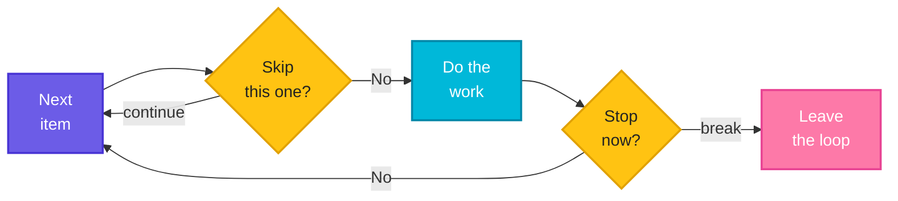

# Loop Control and Real Patterns: `break`, `continue` and Complete Scripts

> **Before this page:** you have read pages [01](01-what-is-a-shell-script.md) to [10](10-while-until-loops.md). You know variables, arguments, exit codes, operators, `if`, `case`, arrays, and the `for`, `while` and `until` loops.
>
> **By the end of this page** you will be able to stop a loop early, skip an item, leave nested loops, build a menu, and put everything you have learned into three complete, realistic scripts.

---

## 1. Start with a problem: the loop that cannot stop and cannot skip

All the loops so far run **from start to finish**. But real jobs are messier:

- You are searching ten log files for an error. You find it in the **second** file. Do you really need to open the other eight?
- You read a config file line by line, and some lines are **blank** or **comments**. You want to ignore them, not process them.
- A health check finds a serious problem on the first server. Checking 49 more servers is pointless. You want out, **now**.

You need two controls for the inside of a loop:

| I want to... | Use |
|--------------|-----|
| **Leave the loop completely**, right now | **`break`** |
| **Skip this one item** and move on to the next | **`continue`** |

---

## 2. The big idea: the fire alarm and the wave-through

Picture a security guard checking people at a door, one at a time:

- A person with a **missing badge**? The guard waves them aside and calls the **next** person. That is **`continue`**: *skip this one, carry on with the loop.*
- A **fire alarm** goes off? The guard stops checking **everyone** and leaves the building. That is **`break`**: *stop the whole loop.*

**Follow the arrows:** `continue` sends you back for the next item, and `break` sends you out of the loop.



In the diagram, the `continue` arrow loops **back** to take the next item, and the `break` arrow goes **out** of the loop.

---

## 3. `break`: leave the loop right now

### Without `break`

Let's say we have three log files:

**Input file** (`a.log`):
```text
INFO start
INFO ok
```

**Input file** (`b.log`):
```text
INFO start
ERROR disk full
INFO done
```

**Input file** (`c.log`):
```text
ERROR timeout
```

And this script, which reports every file with an error:

**Input file** (`nb.sh`):
```bash
#!/bin/bash
for f in *.log; do
  echo "Checking $f"
  if grep -q ERROR "$f"; then
    echo "  found an error in $f"
  fi
done
```

**Command:**
```bash
chmod +x nb.sh
./nb.sh
```
**Sample Output:**
```text
Checking a.log
Checking b.log
  found an error in b.log
Checking c.log
  found an error in c.log
```

It checks **every** file. Now suppose we only need to know whether there is **any** error, and the first one is enough.

### With `break`

Let's say we have this file `br.sh`:

**Input file** (`br.sh`):
```bash
#!/bin/bash
for f in *.log; do
  echo "Checking $f"
  if grep -q ERROR "$f"; then
    echo "  found an error in $f, stopping the search"
    break
  fi
done
echo "Search finished"
```

**Command:**
```bash
chmod +x br.sh
./br.sh
```
**Sample Output:**
```text
Checking a.log
Checking b.log
  found an error in b.log, stopping the search
Search finished
```

`c.log` was never opened. When `break` ran, the loop ended on the spot and the script carried on with the line **after `done`** ("Search finished"). With thousands of files, stopping early saves a lot of time.

### `break` in an endless loop

In the last page you made a deliberate endless loop with `while true`, and I promised you a way out from the inside. This is it:

Let's say we have this file `wb.sh`:

**Input file** (`wb.sh`):
```bash
#!/bin/bash
n=1
while true; do
  echo "Round $n"
  if [[ $n -ge 3 ]]; then
    break
  fi
  n=$((n + 1))
done
echo "Out of the loop"
```

**Command:**
```bash
chmod +x wb.sh
./wb.sh
```
**Sample Output:**
```text
Round 1
Round 2
Round 3
Out of the loop
```

`while true` never ends by itself, so the exit condition lives **inside**, in an `if` with a `break`. This shape (`while true` plus `if ... break`) is the most common way to write monitors, menus and retry loops.

### The retry loop, rewritten with `break`

Here is the retry pattern from page 10, now written with a `for` loop and `break`. We try up to 5 times, and **leave the loop as soon as we succeed**. A variable `ok` remembers what happened.

(Again, `flaky` is a pretend command that fails twice and then works.)

Let's say we have this file `rb.sh`:

**Input file** (`rb.sh`):
```bash
#!/bin/bash
calls=0
flaky() { calls=$((calls + 1)); [[ $calls -ge 3 ]]; }
ok=no
for attempt in 1 2 3 4 5; do
  if flaky; then
    ok=yes
    break
  fi
  echo "Attempt $attempt failed"
done
if [[ $ok == yes ]]; then
  echo "Worked on attempt $attempt"
else
  echo "All attempts failed"
  exit 1
fi
```

**Command:**
```bash
chmod +x rb.sh
./rb.sh
echo "code: $?"
```
**Sample Output:**
```text
Attempt 1 failed
Attempt 2 failed
Worked on attempt 3
code: 0
```

The loop ran three times and stopped at the first success, so attempts 4 and 5 were never used. After the loop, `ok` tells us whether we got out because of success or because we ran out of attempts.

---

## 4. `continue`: skip this item and move on

`continue` ends the **current round** only, and jumps straight to the next item. The loop itself carries on.

### Skip blank lines and comments

Config and inventory files are full of blank lines and `#` comments. A script should ignore them.

Let's say we have this file `inventory.txt`:

**Input file** (`inventory.txt`):
```text
# Production servers
web1

web2
# db1 is being rebuilt, skip it
db2
```

And this script:

**Input file** (`co.sh`):
```bash
#!/bin/bash
while read -r line; do
  if [[ -z $line ]]; then
    continue
  fi
  if [[ $line == \#* ]]; then
    continue
  fi
  echo "Checking $line"
done < inventory.txt
```

**Command:**
```bash
chmod +x co.sh
./co.sh
```
**Sample Output:**
```text
Checking web1
Checking web2
Checking db2
```

- `[[ -z $line ]]` is true for a **blank** line, so it is skipped.
- `[[ $line == \#* ]]` is true when the line **starts with `#`**. The backslash makes the `#` an ordinary character, and `*` means "anything after it".
- Everything else reaches the `echo`. The two comments and the empty line never do.

This is the "guard clause" idea from page 06, now inside a loop: **check for the unwanted case first, skip it, and keep the real work un-indented at the bottom.**

### Skip a file that is not really there

Remember page 09, where a wildcard that matched nothing stayed as plain text (`*.csv`)? `continue` is the neatest cure.

Let's say there are no `.csv` files here, and we have this file `cg.sh`:

**Input file** (`cg.sh`):
```bash
#!/bin/bash
for f in *.csv; do
  [[ -e $f ]] || continue
  echo "Processing $f"
done
echo "Done"
```

**Command:**
```bash
chmod +x cg.sh
./cg.sh
```
**Sample Output:**
```text
Done
```

Read the guard as *"the file exists, **or else** skip it"*. The fake `*.csv` is skipped, and nothing is processed.

### The trap: `continue` in a `while` loop can skip the counter update

In a `for` loop, `continue` safely moves to the next item. In a `while` loop, it jumps straight back to the **condition check**, skipping everything below it, **including your counter update**. If the update was below the `continue`, the counter never moves, and you have an endless loop.

Let's say we have this file `ct.sh`, where the counter is updated **after** the `continue`:

**Input file** (`ct.sh`):
```bash
#!/bin/bash
i=0
while [[ $i -lt 5 ]]; do
  if [[ $i -eq 2 ]]; then
    continue
  fi
  echo "i=$i"
  i=$((i + 1))
done
```

**Command** (`timeout 1` stops it after one second):
```bash
chmod +x ct.sh
timeout 1 ./ct.sh
```
**Sample Output:**
```text
i=0
i=1
```

It printed `i=0` and `i=1`, then went silent and **hung**. When `i` reached 2, `continue` jumped back to the check, `i` was still 2, so it hit `continue` again, forever, printing nothing. A script that stops printing and never finishes is the classic sign.

The fix: **update the counter before the `continue`.**

Let's say we have this file `ct2.sh`:

**Input file** (`ct2.sh`):
```bash
#!/bin/bash
i=0
while [[ $i -lt 5 ]]; do
  i=$((i + 1))
  if [[ $i -eq 2 ]]; then
    continue
  fi
  echo "i=$i"
done
```

**Command:**
```bash
chmod +x ct2.sh
./ct2.sh
```
**Sample Output:**
```text
i=1
i=3
i=4
i=5
```

Now `i` moves first, then `2` is skipped, and the loop finishes normally.

### `break` or `continue`?

| | `break` | `continue` |
|---|---------|------------|
| Effect | **Ends the whole loop** | **Ends this round only** |
| Script goes next to | The line after `done` | The next item (or the condition check) |
| Picture | Fire alarm | Waving one person aside |
| Typical use | "I found it", "fatal error" | "Not interested in this one" |

---

## 5. Leaving nested loops: `break 2`

A plain `break` leaves only the **innermost** loop. To leave more, give it a number: `break 2` leaves two levels at once. (`continue 2` similarly skips to the next round of the outer loop.)

Let's check servers and ports, and stop **everything** when we hit a problem on `web2:443`.

Let's say we have this file `b2.sh`:

**Input file** (`b2.sh`):
```bash
#!/bin/bash
for server in web1 web2 db1; do
  for port in 80 443; do
    echo "Checking $server:$port"
    if [[ $server == web2 && $port -eq 443 ]]; then
      echo "  PROBLEM, stopping everything"
      break 2
    fi
  done
done
echo "Stopped"
```

**Command:**
```bash
chmod +x b2.sh
./b2.sh
```
**Sample Output:**
```text
Checking web1:80
Checking web1:443
Checking web2:80
Checking web2:443
  PROBLEM, stopping everything
Stopped
```

For comparison, here is the same script with a plain `break`, which only leaves the inner (port) loop:

Let's say we have this file `b1.sh`:

**Input file** (`b1.sh`):
```bash
#!/bin/bash
for server in web1 web2 db1; do
  for port in 80 443; do
    echo "Checking $server:$port"
    if [[ $server == web2 && $port -eq 443 ]]; then
      echo "  PROBLEM, leaving only the inner loop"
      break
    fi
  done
done
echo "Stopped"
```

**Command:**
```bash
chmod +x b1.sh
./b1.sh
```
**Sample Output:**
```text
Checking web1:80
Checking web1:443
Checking web2:80
Checking web2:443
  PROBLEM, leaving only the inner loop
Checking db1:80
Checking db1:443
Stopped
```

With a plain `break`, the outer loop **carried on** to `db1`. With `break 2`, it did not. Decide whether "stop" means "stop this server" or "stop everything".

---

## 6. `break` versus `exit`: leave the loop, or leave the script?

Beginners often mix these up. They sound similar but do very different things:

| | `break` | `exit` |
|---|---------|--------|
| Leaves | The **loop** | The whole **script** |
| The script then | Carries on after `done` | Ends immediately |
| Sets an exit code? | No | **Yes**: `exit 1` (page 04) |

Let's say we have this file `be.sh`:

**Input file** (`be.sh`):
```bash
#!/bin/bash
for n in 1 2 3; do
  if [[ $n -eq 2 ]]; then
    break
  fi
  echo "n=$n"
done
echo "after break: the script carries on"
for n in 1 2 3; do
  if [[ $n -eq 2 ]]; then
    exit 1
  fi
  echo "n=$n"
done
echo "this line is never reached"
```

**Command:**
```bash
chmod +x be.sh
./be.sh
echo "code: $?"
```
**Sample Output:**
```text
n=1
after break: the script carries on
n=1
code: 1
```

The first loop was left by `break`, so the script went on. The second loop hit `exit 1`, so the whole script stopped with code `1` and "never reached" was never printed.

**When to use which?** If the problem is fatal for the whole script (a required file is missing), use `exit 1`. If you only want to stop looking, use `break`.

### What exit code does a loop itself return?

A loop's own exit status is the status of the **last command that ran inside it**:

**Command:**
```bash
for i in 1 2; do false; done; echo "status after loop of false: $?"
for i in 1 2; do true; done; echo "status after loop of true: $?"
```
**Sample Output:**
```text
status after loop of false: 1
status after loop of true: 0
```

Do not rely on this. If the result matters, track it yourself in a variable such as `ok` or `worst`, as in the examples above.

---

## 7. A ready-made menu: `select`

Bash has one more loop built just for menus. `select` prints a **numbered list** of choices, asks the user for a number, and puts the chosen text in a variable. It repeats until you `break`.

Let's say we have this file `sel.sh`:

**Input file** (`sel.sh`):
```bash
#!/bin/bash
PS3="Choose an option: "
select choice in "Show date" "Show disk" "Quit"; do
  case "$choice" in
    "Show date") date +%d-%b-%Y ;;
    "Show disk") df -h / | tail -1 ;;
    "Quit")      echo "Bye"; break ;;
    *)           echo "Invalid choice: $REPLY" ;;
  esac
done
```

**Command:**
```bash
chmod +x sel.sh
./sel.sh
```
**What you see in the terminal** (you type `1`, then `2`, then `9`, then `3`):
```text
1) Show date
2) Show disk
3) Quit
Choose an option: 1
20-Oct-2026
Choose an option: 2
/dev/sdd       1007G   16G  940G   2% /
Choose an option: 9
Invalid choice: 9
Choose an option: 3
Bye
```

- The special variable **`PS3`** is the prompt text.
- The menu numbers are made for you. You never write `1)`, `2)` yourself.
- `$choice` holds the **text** of the option. `$REPLY` holds what the user **typed** (useful for the "invalid" message).
- It loops forever until `break`, so every `select` needs a way out. Here, `Quit` calls `break`.
- It combines the **`case`** from page 07 with a **loop** and **`break`**, so you already know all the parts.

Use `select` for quick admin menus. For anything you automate, prefer arguments (page 03), because a menu waits for a human.

---

## 8. Real pattern 1: a log analyser

Now we put everything together. This script reads a log file, **counts the lines per level** (INFO, WARN, ERROR) and reports an overall result. It uses a `while read` loop, `continue` to skip blanks and comments, an **associative array** to count, and an **exit code**.

Let's say we have this file `app.log`:

**Input file** (`app.log`):
```text
# application log
INFO  service started
INFO  listening on port 8080
WARN  disk usage at 85%

ERROR cannot reach database
INFO  retrying
ERROR cannot reach database
WARN  slow response
INFO  connected
```

And this script:

**Input file** (`analyse.sh`):
```bash
#!/bin/bash
# analyse.sh - usage: ./analyse.sh logfile
file="$1"
if [[ ! -f $file ]]; then
  echo "Usage: $0 <logfile>"
  exit 1
fi

declare -A count
total=0

while read -r level message; do
  [[ -z $level ]] && continue
  [[ $level == \#* ]] && continue
  count[$level]=$(( ${count[$level]:-0} + 1 ))
  total=$((total + 1))
done < "$file"

echo "Lines analysed: $total"
for level in ERROR WARN INFO; do
  echo "$level: ${count[$level]:-0}"
done

if [[ ${count[ERROR]:-0} -gt 0 ]]; then
  echo "Result: PROBLEMS FOUND"
  exit 1
fi
echo "Result: clean"
```

**Command:**
```bash
chmod +x analyse.sh
./analyse.sh app.log
echo "code: $?"
./analyse.sh nope.log
echo "code: $?"
```
**Sample Output:**
```text
Lines analysed: 8
ERROR: 2
WARN: 2
INFO: 4
Result: PROBLEMS FOUND
code: 1
Usage: ./analyse.sh <logfile>
code: 1
```

How it works, step by step:

1. **Guard clause** (page 06): if the file is not a real file, print usage and `exit 1`.
2. `declare -A count` creates the counting table (page 08). `total` is a plain counter.
3. `while read -r level message` reads each line and **splits it**: the first word goes into `level`, the rest into `message`.
4. The two `continue` lines skip blank lines and comments. (`[[ test ]] && continue` is the short form of an `if`.)
5. `count[$level]=$(( ${count[$level]:-0} + 1 ))` means: *take the current count for this level, or `0` if there is none yet, add 1, and store it back.* The `:-0` is the default-value trick from page 03.
6. After the loop, a `for` loop prints the three levels in a fixed order. `${count[$level]:-0}` shows `0` for a level that never appeared.
7. The script **exits `1` if any errors were found**, so a pipeline or cron job knows the log has problems.

This is a real, useful script. Change the level names, and it counts anything.

---

## 9. Real pattern 2: a safe bulk rename with a dry run

Scripts that **change** things (rename, move, delete) should offer a **dry run**: a mode that only *says* what it would do. You check the list, and only then run it for real. This habit prevents disasters.

The script renames every `.txt` file to `.bak`. To build the new name, it needs a small new tool.

### A new tool: cutting a piece off a variable

`${variable%pattern}` removes the **shortest match of the pattern from the end** of the value:

Let's say we have this file `cut.sh`:

**Input file** (`cut.sh`):
```bash
#!/bin/bash
f="report.final.txt"
echo "Original         : $f"
echo "Remove .txt      : ${f%.txt}"
echo "Remove last extension: ${f%.*}"
echo "Remove up to the first dot : ${f#*.}"
echo "Remove up to the last dot  : ${f##*.}"
```

**Command:**
```bash
bash cut.sh
```
**Sample Output:**
```text
Original         : report.final.txt
Remove .txt      : report.final
Remove last extension: report.final
Remove up to the first dot : final.txt
Remove up to the last dot  : txt
```

A memory trick: `#` cuts from the **start**, because a hash sign sits at the **front** of a number (`#1`). `%` cuts from the **end**, because a percent sign sits at the **end** of a number (`50%`). A single symbol removes the **shortest** match, and a doubled one (`##` or `%%`) the **longest**. For file names, the two you will use most are `${f%.txt}` (remove the extension) and `${f##*.}` (get only the extension).

### The rename script

Let's say we have three empty files, `one.txt`, `two.txt` and `three.txt`, and this script:

**Input file** (`ren.sh`):
```bash
#!/bin/bash
# ren.sh - rename every .txt file to .bak
# usage: ./ren.sh [--dry-run]
dry=no
if [[ $1 == "--dry-run" ]]; then
  dry=yes
fi

for f in *.txt; do
  [[ -e $f ]] || continue
  new="${f%.txt}.bak"
  if [[ $dry == yes ]]; then
    echo "would rename $f -> $new"
  else
    mv "$f" "$new"
    echo "renamed $f -> $new"
  fi
done
```

**Command:**
```bash
chmod +x ren.sh
ls
./ren.sh --dry-run
ls
./ren.sh
ls
```
**Sample Output:**
```text
one.txt
ren.sh
three.txt
two.txt
would rename one.txt -> one.bak
would rename three.txt -> three.bak
would rename two.txt -> two.bak
one.txt
ren.sh
three.txt
two.txt
renamed one.txt -> one.bak
renamed three.txt -> three.bak
renamed two.txt -> two.bak
one.bak
ren.sh
three.bak
two.bak
```

- The **dry run** printed what it *would* do, and the files were **unchanged** afterwards.
- The **real run** did the renames.
- `[[ -e $f ]] || continue` protects against the "no `.txt` files" case from page 09.
- Notice every `$f` is **quoted**, so file names with spaces are safe.

---

## 10. Real pattern 3: doing jobs at the same time (a first taste)

So far every loop does one thing at a time. If each round takes a second (checking a slow server), checking 50 servers takes 50 seconds. But the servers are independent, so they can be checked **at the same time**.

Two small tools make this possible:

| Tool | Meaning |
|------|---------|
| `command &` | Start the command **in the background** and carry on at once |
| `wait` | Pause until **all** background jobs have finished |

Let's compare. Here, `sleep 1` stands in for "a check that takes one second". The special variable `SECONDS` counts the seconds since you set it to `0`.

Let's say we have this file `seq.sh`:

**Input file** (`seq.sh`):
```bash
#!/bin/bash
SECONDS=0
for s in web1 web2 db1; do
  sleep 1
  echo "$s done"
done
echo "Sequential took $SECONDS seconds"
```

And this one, with the loop body in the background:

**Input file** (`par.sh`):
```bash
#!/bin/bash
SECONDS=0
for s in web1 web2 db1; do
  ( sleep 1; echo "$s done" ) &
done
wait
echo "Parallel took $SECONDS seconds"
```

**Command:**
```bash
chmod +x seq.sh par.sh
./seq.sh
./par.sh | sort
```
**Sample Output:**
```text
web1 done
web2 done
db1 done
Sequential took 3 seconds
Parallel took 1 seconds
db1 done
web1 done
web2 done
```

- The sequential version took **3 seconds**: one after another.
- The parallel version took **1 second**: all three at once. The `( ... ) &` runs each round in the background, and `wait` holds the script until all three are finished before printing the total.
- The jobs finish in **no fixed order**, so the order of the "done" lines can change from run to run. We piped through `sort` just to get a steady order for this page.

This is a powerful idea, and also a dangerous one: starting hundreds of jobs at once can overload a machine. Treat this as a **first taste**. For now, use it for a handful of independent, slow tasks.

---

## 11. Upgrade `morning.sh`: a `--fast` switch and empty names

Let's use `break` and `continue` on our running script. We add two things:

- **`continue`**: an empty disk name (`""`) is skipped politely instead of being reported as missing.
- **`break`**: a new `--fast` switch stops at the **first critical problem**, instead of checking every disk.

The `--fast` switch is the first argument. After reading it, we use **`shift`**, a command that **removes the first argument** and slides the others down, so `"$@"` then holds only the disks.

Let's say we now have this file `morning.sh`:

**Input file** (`morning.sh`):
```bash
#!/bin/bash
# morning.sh - usage: ./morning.sh [--fast] [disk ...]

WARN=2      # use 80 in real life
CRIT=50     # use 90 in real life
TRIES=1     # how many times to wait for a missing disk

fast=no
if [[ $1 == "--fast" ]]; then
  fast=yes
  shift
fi

disks=("$@")
if [[ ${#disks[@]} -eq 0 ]]; then
  disks=(/)
fi

echo "Date : $(date +%d-%b-%Y)"

worst=0
for disk in "${disks[@]}"; do
  if [[ -z $disk ]]; then
    echo "(skipping an empty name)"
    continue
  fi

  tries=0
  while ! df "$disk" > /dev/null 2>&1 && [[ $tries -lt $TRIES ]]; do
    tries=$((tries + 1))
    echo "$disk: not found yet, waiting (try $tries of $TRIES)"
    sleep 1
  done

  if ! df "$disk" > /dev/null 2>&1; then
    echo "$disk: NOT FOUND"
    code=2
  else
    usage=$(df --output=pcent "$disk" | tail -1 | tr -dc '0-9')
    if [[ $usage -ge $CRIT ]]; then
      echo "$disk: CRITICAL ($usage%)"
      code=2
    elif [[ $usage -ge $WARN ]]; then
      echo "$disk: WARNING ($usage%)"
      code=1
    else
      echo "$disk: OK ($usage%)"
      code=0
    fi
  fi

  if [[ $code -gt $worst ]]; then
    worst=$code
  fi
  if [[ $fast == yes && $code -eq 2 ]]; then
    echo "Stopping early (--fast): a critical problem was found"
    break
  fi
done

exit "$worst"
```

**Command:**
```bash
chmod +x morning.sh
./morning.sh "" /run /nope /
echo "code: $?"
./morning.sh --fast "" /run /nope /
echo "code: $?"
```
**Sample Output:**
```text
Date : 20-Oct-2026
(skipping an empty name)
/run: OK (1%)
/nope: not found yet, waiting (try 1 of 1)
/nope: NOT FOUND
/: WARNING (2%)
code: 2
Date : 20-Oct-2026
(skipping an empty name)
/run: OK (1%)
/nope: not found yet, waiting (try 1 of 1)
/nope: NOT FOUND
Stopping early (--fast): a critical problem was found
code: 2
```

- In both runs, the empty name `""` was skipped by `continue`.
- **Without `--fast`**, every disk was checked, including `/` at the end.
- **With `--fast`**, the script stopped right after `/nope` was reported, so `/` was **never checked**. The exit code is `2` either way.

(We also lowered `TRIES` to 1, so that the page output stays short.)

---

## 12. The mistakes that bite

| Mistake | Symptom | Fix |
|---------|---------|-----|
| `continue` in a `while` **before** the counter update | The script hangs, printing nothing new | Update the counter **before** `continue` |
| `break` when you meant `exit` | The loop ends, but the script carries on | `exit 1` for fatal problems |
| `exit` when you meant `break` | The whole script dies | `break` to leave only the loop |
| `break` in the inner loop only | The outer loop carries on | `break 2` |
| `select` without a `break` | The menu never ends | Add a `Quit` option with `break` |
| `[[ -e $f ]]` forgotten with a wildcard | A fake file name like `*.csv` is processed | `[[ -e $f ]] \|\| continue` |
| Background jobs without `wait` | The script ends before the jobs finish | Add `wait` |
| Too many background jobs | The machine becomes overloaded | Limit how many you start at once |
| Rename or delete with no dry run | A wrong pattern destroys files | Add a `--dry-run` mode |
| `$f` not quoted in `mv`, `rm` | File names with spaces break it | `"$f"` |
| Lines of a log counted with `cat file \| while` | The counters vanish (page 10) | `done < file` |

One more, to see for yourself: `break` outside any loop.

Let's say we have this file `bo.sh`:

**Input file** (`bo.sh`):
```bash
#!/bin/bash
echo "before"
break
echo "after"
```

**Command:**
```bash
bash bo.sh
```
**Sample Output:**
```text
before
bo.sh: line 3: break: only meaningful in a `for', `while', or `until' loop
after
```

Bash just complains and **carries on**. A stray `break` is harmless but a sign that your script structure is wrong.

---

## 13. Words to remember

| Word | Simple meaning |
|------|----------------|
| **`break`** | Leave the loop completely |
| **`break 2`** | Leave two nested loops at once |
| **`continue`** | Skip the rest of this round, go to the next |
| **`exit`** | Leave the whole **script** (with an exit code) |
| **`select`** | A built-in numbered menu loop |
| **`PS3`** | The prompt shown by `select` |
| **`$REPLY`** | What the user typed in a `select` menu |
| **Dry run** | A mode that only prints what it would do |
| **`${f%.txt}`** | Remove `.txt` from the end of a value |
| **`${f##*.}`** | Keep only what is after the last dot |
| **`&`** | Run a command in the background |
| **`wait`** | Pause until the background jobs finish |
| **`shift`** | Remove the first argument and slide the rest down |
| **`SECONDS`** | A variable that counts seconds since you reset it |

---

## 14. Try it yourself

1. **Find the first.** Loop over `*.log` and stop at the first file that contains the word `ERROR`, printing its name.
2. **Skip the odd.** Print the numbers 1 to 10, but use `continue` to skip the odd ones.
3. **Clean the config.** Write a script that reads a file line by line and prints only the lines that are neither blank nor start with `#`.
4. **A guessing game.** Make `guess.sh` pick a secret number (`secret=7`). Use `while true` and `read -p` to ask for a guess. Use `break` when the guess is right, and print `Too low` or `Too high` otherwise.
5. **Nested exit.** Loop over three folders and, inside, over two file names. Stop **everything** when `folder2/fileB` is reached, using `break 2`.
6. **Dry run.** Write `cleanup.sh` that deletes every `*.tmp` file in the current folder, but only prints `would delete ...` when called with `--dry-run`.
7. **Extension finder.** Loop over the files in a folder and print only the extension of each, using `${f##*.}`.
8. **A menu.** Build a `select` menu with four options (`List files`, `Show date`, `Show user`, `Quit`).
9. **Parallel or not?** For each case, say whether you would run the jobs in parallel, and why: (a) pinging 100 servers, (b) copying a big file to one disk and then deleting the original, (c) running 3 independent test suites.
10. **Upgrade `analyse.sh`.** Print the **percentage** of lines that are errors. (Hint: whole numbers, `$(( errors * 100 / total ))`.)
11. **Upgrade `morning.sh`.** Let it read the disks from a file (`--file disks.txt`) with `while read -r`, skipping blank lines and `#` comments.

<details>
<summary>Answers for exercises 2 and 9 (open only after trying)</summary>

**Exercise 2:**

```bash
#!/bin/bash
for n in {1..10}; do
  if (( n % 2 == 1 )); then
    continue
  fi
  echo "$n"
done
```

**Exercise 9:** (a) **Yes**: the pings are independent and mostly wait on the network. (b) **No**: the delete must only happen **after** the copy succeeds, so the order matters. (c) **Yes**, if the suites do not share files or a database. Run them in parallel and `wait`, then check each result.
</details>

---

## 15. Quick recap

- **`break`** leaves the loop. **`continue`** skips to the next round. Think fire alarm and wave-through.
- `while true` with an `if ... break` inside is the standard shape for monitors, menus and retries.
- `continue` in a `while` loop jumps to the condition check, so **update the counter first**.
- **`break 2`** leaves two nested loops. A plain `break` leaves only the inner one.
- **`break`** ends a loop. **`exit`** ends the whole script and sets the exit code.
- **`select`** builds a numbered menu. It needs a `break` to end.
- `${f%.txt}` and `${f##*.}` cut pieces off a variable, which is handy for file names.
- Anything that changes files should have a **`--dry-run`** mode.
- `command &` plus `wait` runs independent jobs at the same time. Use it with care.
- A guard clause with `continue` (`[[ -e $f ]] || continue`) keeps the real work easy to read.

You now know every kind of loop in shell scripting, and how to combine them with variables, arguments, `if`, `case`, arrays and exit codes. That is the core of the language.

**Next page:** [12 Functions](12-functions.md), where you will give a block of commands a name, so that you can use it again and again instead of copying it. You have already seen small functions in this series (`flaky`, `check`), and the next page explains them properly.
