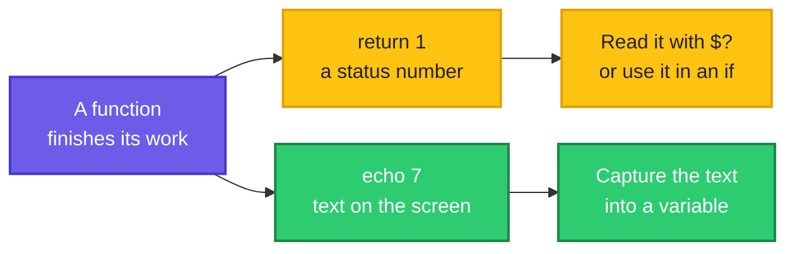

# Functions: Give a Block of Commands a Name

> **Before this page:** you have read pages [01](01-what-is-a-shell-script.md) to [11](11-loop-control-and-patterns.md). You know variables, arguments, exit codes, operators, `if`, `case`, arrays and loops.
>
> **By the end of this page** you will be able to write a block of commands **once**, give it a name, and use it as many times as you like, with different inputs each time. Your scripts will become shorter, tidier and much easier to fix.

---

## 1. Start with a problem: the same lines, again and again

You are writing a deploy script. Before each server, you want to print a banner so the output is easy to read. With what you know so far, you write:

```bash
echo "=============================="
echo "  Deploying web1"
echo "=============================="
echo "=============================="
echo "  Deploying web2"
echo "=============================="
echo "=============================="
echo "  Deploying db1"
echo "=============================="
```

Nine lines for three servers, and the same three-line pattern pasted three times. Now your manager says: *"Make the banner use `#` instead of `=`."*

- You must change **six lines**, and miss one at your peril.
- With 20 servers, it is 40 lines.
- Every copy is a chance for a typo, and the copies slowly drift apart.

Your loops can repeat work for a **list**. But this is different: the banner is something you want to call **from different places**, with a different server name each time. You need a way to say:

> *"Here is a recipe called `banner`. Whenever I say `banner web1`, follow the recipe for `web1`."*

**That is what a function is.**

---

## 2. The big idea: a recipe in a cookbook

A cookbook says: *"For the sauce, see page 40."* You do not rewrite the sauce recipe every time a dish needs it. You write it **once**, in one place, and every dish just **points** to it. If you improve the sauce, every dish improves.

| The cookbook | The shell script |
|--------------|------------------|
| Writing the sauce recipe on page 40 | **Defining** a function: `banner() { ... }` |
| The recipe's name | The **function name**: `banner` |
| "Use 2 onions this time" | The **argument**: `banner web1` |
| "See page 40" inside a dish | **Calling** the function: `banner web1` |
| Improving the recipe once | Changing the function body **once** |

A function is simply **a named block of commands**. Defining it does **nothing yet**. The commands only run when you **call** it by name.

**Read it left to right:** the script calls the function by name, the shell jumps into the function's block, runs it with the arguments you gave, and then comes back to the next line of the script.


---

## 3. Your first function (do this with me)

Go to your practice folder (`cd ~/practice`). Here is the banner script from section 1, rewritten with a function.

Let's say we have this file `fn1.sh`:

**Input file** (`fn1.sh`):
```bash
#!/bin/bash
banner() {
  echo "=============================="
  echo "  Deploying $1"
  echo "=============================="
}

banner web1
banner web2
banner db1
```

**Command:**
```bash
chmod +x fn1.sh
./fn1.sh
```
**Sample Output:**
```text
==============================
  Deploying web1
==============================
==============================
  Deploying web2
==============================
==============================
  Deploying db1
==============================
```

The three lines were written **once**, inside `banner() { ... }`, and used three times. To change the style, edit them in one place.

### The anatomy of a function

```text
banner() {                            <- the name, then ( ) and an opening brace
  echo "  Deploying $1"               <- the body: any commands you like
}                                     <- the closing brace

banner web1                           <- CALL it, just like a command
```

| Piece | Meaning |
|-------|---------|
| `banner` | The function's **name**. You choose it, like a variable name |
| `()` | Always empty. It tells the shell "this is a function definition" |
| `{` ... `}` | The **body**. The opening brace needs a **space** after it |
| `$1` | The first argument given when the function is **called** |
| `banner web1` | The **call**. A function is used exactly like any other command |

Two things to remember:

- A function **runs only when called**. Writing the definition alone prints nothing.
- You **call it by its name alone**, with **no** brackets: `banner web1`, not `banner(web1)`.

### You must define it before you call it

A script is read **from top to bottom** (page 01). When the shell reaches a call, it must already have seen the definition.

Let's say we have this file `late.sh`, which calls the function before defining it:

**Input file** (`late.sh`):
```bash
#!/bin/bash
hello
hello() {
  echo "Hello from the function"
}
hello
```

**Command:**
```bash
chmod +x late.sh
./late.sh
```
**Sample Output:**
```text
./late.sh: line 2: hello: command not found
Hello from the function
```

The first call failed with `command not found`, because the shell had not met `hello` yet. The second call worked. **Put your function definitions at the top of the script**, and the commands that use them below.

### Two ways to write the same thing

Let's say we have this file `styles.sh`:

**Input file** (`styles.sh`):
```bash
#!/bin/bash
hello1() { echo "style 1"; }
function hello2 { echo "style 2"; }
hello1
hello2
```

**Command:**
```bash
chmod +x styles.sh
./styles.sh
```
**Sample Output:**
```text
style 1
style 2
```

Both work in bash. The first form, `name() { ... }`, is the one used almost everywhere, and it also works in plain `sh`. Use it. Note that a one-line function needs a `;` before the closing `}`.

---

## 4. Functions take arguments, just like scripts

You learned in page 03 that a script receives `$1`, `$2`, `$#` and `"$@"`. A function receives **its own set of the same variables**.

Let's say we have this file `fn2.sh`:

**Input file** (`fn2.sh`):
```bash
#!/bin/bash
greet() {
  echo "Hello, $1! You are number $2."
}
greet Asha 1
greet Ravi 2
```

**Command:**
```bash
chmod +x fn2.sh
./fn2.sh
```
**Sample Output:**
```text
Hello, Asha! You are number 1.
Hello, Ravi! You are number 2.
```

### The function's `$1` is not the script's `$1`

This surprises everyone once. Inside a function, `$1` means "the first argument **given to the function**", not "the first argument given to the script".

Let's say we have this file `fn3.sh`:

**Input file** (`fn3.sh`):
```bash
#!/bin/bash
show() {
  echo "inside the function : first argument is $1, count is $#"
}
echo "outside the function: first argument is $1, count is $#"
show apple banana
```

**Command:**
```bash
chmod +x fn3.sh
./fn3.sh start web1
```
**Sample Output:**
```text
outside the function: first argument is start, count is 2
inside the function : first argument is apple, count is 2
```

Outside, `$1` is `start` (the script's first argument). Inside `show`, `$1` is `apple` (what the function was called with). **If a function needs a value from the script's arguments, pass it in explicitly**: `show "$1"`.

Everything from page 03 works inside a function: `$#` counts the function's arguments, `"$@"` is all of them, and `${1:-default}` gives a default.

---

## 5. Getting a result out of a function

A function often has to **report something back**: "was it successful?", or "here is the number I calculated". Bash gives you **two different channels**, and choosing the right one is the key skill.

**Follow the two arrows from the function.** The top one carries a yes/no status. The bottom one carries text.



| Channel | How the function sends it | How you receive it | Best for |
|---------|---------------------------|--------------------|----------|
| **1. Status** | `return 0` (success) or `return 1` (failure) | `$?`, or directly in an `if` | A **yes/no** answer: "is it healthy?" |
| **2. Output** | `echo` a value | `result=$(function_name args)` | **Data**: a number, a name, a path |

### Channel 1: the status, with `return`

`return N` ends the function and sets its **exit status** (page 04): `0` means success, anything else means failure. And because a status is just an exit code, you can use a function **directly as the condition of an `if`**, exactly like `grep -q` in page 06.

Let's say we have this file `fn4.sh`:

**Input file** (`fn4.sh`):
```bash
#!/bin/bash
is_even() {
  if (( $1 % 2 == 0 )); then
    return 0
  else
    return 1
  fi
}

for n in 3 4; do
  if is_even "$n"; then
    echo "$n is even"
  else
    echo "$n is odd"
  fi
done
is_even 7
echo "status of is_even 7: $?"
```

**Command:**
```bash
chmod +x fn4.sh
./fn4.sh
```
**Sample Output:**
```text
3 is odd
4 is even
status of is_even 7: 1
```

Read `if is_even "$n"` as *"if `is_even` succeeds"*. Notice how readable it is: the function name says what it checks. This is one of the biggest gifts of functions: your `if` lines read like English.

`return` only carries a **number from 0 to 255**. It is a status, not a data container. Let's see what happens when you misuse it:

Let's say we have this file `fn6.sh`:

**Input file** (`fn6.sh`):
```bash
#!/bin/bash
bad() {
  return "hello"
}
bad
echo "status: $?"
big() { return 300; }
big
echo "return 300 gives: $?"
```

**Command:**
```bash
chmod +x fn6.sh
./fn6.sh
```
**Sample Output:**
```text
./fn6.sh: line 3: return: hello: numeric argument required
status: 2
return 300 gives: 44
```

Text is rejected, and `300` silently wraps around (300 minus 256 is 44). **Never use `return` to send back data.** That is what the second channel is for.

### Channel 2: the output, with `echo` and `$( )`

To send back a **value**, the function simply **prints** it with `echo`. The caller captures the printed text with `$( ... )`, the same trick you have used since page 02.

Let's say we have this file `fn5.sh`:

**Input file** (`fn5.sh`):
```bash
#!/bin/bash
add() {
  echo $(( $1 + $2 ))
}
total=$(add 3 4)
echo "3 + 4 = $total"
echo "Doubled: $(add "$total" "$total")"
```

**Command:**
```bash
chmod +x fn5.sh
./fn5.sh
```
**Sample Output:**
```text
3 + 4 = 7
Doubled: 14
```

`add 3 4` printed `7`, and `$( ... )` caught it into `total`. A function used like this behaves like a little calculator.

### The danger: stray output pollutes the result

**Everything** the function prints goes into the captured value. If you add a debugging `echo`, it becomes part of your answer.

Let's say we have this file `pol.sh`:

**Input file** (`pol.sh`):
```bash
#!/bin/bash
get_count() {
  echo "debug: counting..."
  echo 5
}
n=$(get_count)
echo "n is: [$n]"
get_count2() {
  echo "debug: counting..." >&2
  echo 5
}
n=$(get_count2 2>/dev/null)
echo "n is: [$n]"
```

**Command:**
```bash
chmod +x pol.sh
./pol.sh
```
**Sample Output:**
```text
n is: [debug: counting...
5]
n is: [5]
```

In the first version, `n` captured **both lines**. In the second, the debug message is sent to **standard error** with `>&2` ("send this to the error channel, not the normal output"). The `$( )` only captures normal output, so `n` is clean. **Messages for humans (logs, warnings, errors) belong on `>&2`. Only the result goes to normal output.**

### `return` versus `exit` inside a function

They look alike, but their reach is different:

| | `return` | `exit` |
|---|----------|--------|
| Ends | The **function** only | The **whole script** |
| The script then | Carries on after the call | Stops immediately |

Let's say we have this file `fn7.sh`:

**Input file** (`fn7.sh`):
```bash
#!/bin/bash
stop_here() {
  echo "about to exit from inside the function"
  exit 3
}
echo "start"
stop_here
echo "this line is never reached"
```

**Command:**
```bash
chmod +x fn7.sh
./fn7.sh
echo "code: $?"
```
**Sample Output:**
```text
start
about to exit from inside the function
code: 3
```

`exit` inside a function ends the **entire script**. Use `return` when you want to leave only the function, and `exit` when the whole script must stop (a fatal error).

---

## 6. Local variables: keep the function's mess inside

Here is a trap. A variable you set inside a function is, by default, **global**: it changes the variable of the same name **everywhere in the script**.

Let's say we have this file `fn8.sh`:

**Input file** (`fn8.sh`):
```bash
#!/bin/bash
count=100

without_local() {
  count=1
}
with_local() {
  local count=1
}

with_local
echo "after with_local    : count is $count"
without_local
echo "after without_local : count is $count"
```

**Command:**
```bash
chmod +x fn8.sh
./fn8.sh
```
**Sample Output:**
```text
after with_local    : count is 100
after without_local : count is 1
```

- `with_local` used the word **`local`**, so its `count` lived only inside the function and disappeared when it ended. The script's `count` stayed `100`.
- `without_local` changed the script's own `count` to `1`. A bug like this is painful, because the function and the script silently trample each other's variables.

> **The rule:** inside a function, declare every variable you create with **`local`**. The function then cannot break anything outside it.

### A subtle trap: `local` hides the exit status

When you capture a command's result **on the same line** as `local`, the exit status of the command is lost, because `local` itself succeeds.

Let's say we have this file `mask.sh`:

**Input file** (`mask.sh`):
```bash
#!/bin/bash
f() {
  local out=$(false)
  echo "local out=\$(false) gave status: $?"
  local out2
  out2=$(false)
  echo "split into two lines gave status: $?"
}
f
```

**Command:**
```bash
chmod +x mask.sh
./mask.sh
```
**Sample Output:**
```text
local out=$(false) gave status: 0
split into two lines gave status: 1
```

The failing command `false` was reported as success (`0`) when written on one line with `local`. **Declare with `local` on one line, assign on the next**, if you care about the status.

---

## 7. Functions work with everything you know

A function is just a block of commands, so it can use loops, `if`, arrays, even other functions.

### Call a function once per item

Let's say we have this file `fn9.sh`:

**Input file** (`fn9.sh`):
```bash
#!/bin/bash
check_folder() {
  if [[ -d $1 ]]; then
    echo "$1: found"
  else
    echo "$1: MISSING"
    return 1
  fi
}

missing=0
for f in /etc /tmp /nope; do
  check_folder "$f" || missing=$((missing + 1))
done
echo "$missing folder(s) missing"
```

**Command:**
```bash
chmod +x fn9.sh
./fn9.sh
```
**Sample Output:**
```text
/etc: found
/tmp: found
/nope: MISSING
1 folder(s) missing
```

`check_folder "$f" || missing=...` reads: *"check the folder, **or else** add one to the missing counter"* (page 04). The function returns `1` for a missing folder, so the `||` part runs.

### Name clash: your function can hide a real command

If you name a function after an existing command, **your function wins**.

Let's say we have this file `clash.sh`:

**Input file** (`clash.sh`):
```bash
#!/bin/bash
ls() {
  echo "my own ls function"
}
ls /etc
command ls -d /etc
```

**Command:**
```bash
chmod +x clash.sh
./clash.sh
```
**Sample Output:**
```text
my own ls function
/etc
```

The first call ran the function, not the real `ls`. The word `command` in front (`command ls`) skips functions and runs the real program. Avoid naming your functions like real commands (`ls`, `test`, `cd`, `echo`...). A good habit is a clear verb phrase: `check_disk`, `print_banner`, `log_info`.

---

## 8. Share functions between scripts: a library file

Remember `source` from page 01? It runs a file **inside your current shell**, so the functions it defines become available. That lets you keep useful functions in **one** file and reuse them in **many** scripts.

Let's say we have this file `lib.sh`, with two helper functions:

**Input file** (`lib.sh`):
```bash
#!/bin/bash
# lib.sh - shared helper functions
log() {
  echo "[$1] $2"
}
die() {
  echo "[ERROR] $1" >&2
  exit 1
}
```

And a script that uses them:

**Input file** (`useit.sh`):
```bash
#!/bin/bash
source ./lib.sh

log INFO "starting"
[[ -f config.txt ]] || die "config.txt is missing"
log INFO "this line is never reached"
```

**Command:**
```bash
chmod +x useit.sh
./useit.sh
echo "code: $?"
./useit.sh 2>/dev/null
echo "code: $?"
```
**Sample Output:**
```text
[INFO] starting
[ERROR] config.txt is missing
code: 1
[INFO] starting
code: 1
```

- `log INFO "starting"` prints a tidy prefixed line. Every script that sources `lib.sh` gets the **same** log format.
- `die "message"` prints an error and stops the script with code `1`. This tiny function is in **almost every serious script**.
- On the **second run**, `2>/dev/null` threw away the error channel, so the `[ERROR]` line vanished. That is the effect of `>&2` in `die`: errors travel on their own channel, separate from normal output, so you can hide or save them separately (and a pipeline can show them in red).
- `[[ -f config.txt ]] || die "..."` is the guard-clause shorthand from page 06, now much more readable.

---

## 9. The `main` pattern: a tidy script structure

As scripts grow, a good habit is to put **everything into functions** and finish with **one line** that starts the work. By convention the starting function is called `main`.

Let's say we have this file `mainp.sh`:

**Input file** (`mainp.sh`):
```bash
#!/bin/bash
usage() {
  echo "Usage: $0 <name>"
}

greet() {
  echo "Hello, $1!"
}

main() {
  if [[ $# -eq 0 ]]; then
    usage
    return 1
  fi
  greet "$1"
}

main "$@"
```

**Command:**
```bash
chmod +x mainp.sh
./mainp.sh Asha
echo "code: $?"
./mainp.sh
echo "code: $?"
```
**Sample Output:**
```text
Hello, Asha!
code: 0
Usage: ./mainp.sh <name>
code: 1
```

Look at the structure:

1. **Small functions first**, each doing one clear job.
2. A **`main`** function that reads like a short story of what the script does.
3. The last line, **`main "$@"`**, passes all the script's arguments into `main` and starts everything.

Because `main "$@"` is the **last command**, the script's exit code is whatever `main` returned. Here, `return 1` for missing input becomes the script's exit code `1`. Notice that `"$@"` (page 03) carries the arguments **into** the function, so that `$1` inside `main` is the script's first argument.

The benefits: the script is easy to read from the bottom up, each function can be tested on its own, and nothing runs until the last line.

---

## 10. Upgrade `morning.sh`: from one long block to named pieces

This is the biggest payoff yet. `morning.sh` had grown into one long block with loops inside loops. Let's **break it into named functions**, each with one job. The behaviour is **exactly the same** as in page 11. Only the structure changes.

Let's say we now have this file `morning.sh`:

**Input file** (`morning.sh`):
```bash
#!/bin/bash
# morning.sh - usage: ./morning.sh [--fast] [disk ...]

WARN=2      # use 80 in real life
CRIT=50     # use 90 in real life
TRIES=1     # how many times to wait for a missing disk

disk_exists() {
  df "$1" > /dev/null 2>&1
}

wait_for_disk() {
  local disk="$1"
  local tries=0
  while ! disk_exists "$disk" && [[ $tries -lt $TRIES ]]; do
    tries=$((tries + 1))
    echo "$disk: not found yet, waiting (try $tries of $TRIES)"
    sleep 1
  done
}

disk_usage() {
  df --output=pcent "$1" | tail -1 | tr -dc '0-9'
}

# Prints a verdict and returns 0 (OK), 1 (warning) or 2 (critical or missing)
check_disk() {
  local disk="$1"
  if ! disk_exists "$disk"; then
    echo "$disk: NOT FOUND"
    return 2
  fi
  local usage
  usage=$(disk_usage "$disk")
  if [[ $usage -ge $CRIT ]]; then
    echo "$disk: CRITICAL ($usage%)"
    return 2
  elif [[ $usage -ge $WARN ]]; then
    echo "$disk: WARNING ($usage%)"
    return 1
  fi
  echo "$disk: OK ($usage%)"
  return 0
}

main() {
  local fast=no
  if [[ $1 == "--fast" ]]; then
    fast=yes
    shift
  fi

  local disks=("$@")
  if [[ ${#disks[@]} -eq 0 ]]; then
    disks=(/)
  fi

  echo "Date : $(date +%d-%b-%Y)"

  local worst=0 code disk
  for disk in "${disks[@]}"; do
    if [[ -z $disk ]]; then
      echo "(skipping an empty name)"
      continue
    fi

    wait_for_disk "$disk"
    check_disk "$disk"
    code=$?

    if [[ $code -gt $worst ]]; then
      worst=$code
    fi
    if [[ $fast == yes && $code -eq 2 ]]; then
      echo "Stopping early (--fast): a critical problem was found"
      break
    fi
  done
  return "$worst"
}

main "$@"
```

**Command:**
```bash
chmod +x morning.sh
./morning.sh "" /run /nope /
echo "code: $?"
./morning.sh --fast "" /run /nope /
echo "code: $?"
```
**Sample Output:**
```text
Date : 20-Oct-2026
(skipping an empty name)
/run: OK (1%)
/nope: not found yet, waiting (try 1 of 1)
/nope: NOT FOUND
/: WARNING (2%)
code: 2
Date : 20-Oct-2026
(skipping an empty name)
/run: OK (1%)
/nope: not found yet, waiting (try 1 of 1)
/nope: NOT FOUND
Stopping early (--fast): a critical problem was found
code: 2
```

The output is **identical** to page 11. Now read the new structure:

| Function | Its one job | How it reports back |
|----------|-------------|---------------------|
| `disk_exists` | Can `df` read this disk? | **Status** (`0` yes, non-zero no): used in `if` and `while` |
| `wait_for_disk` | Wait a little for a late disk | Just prints, and returns when done |
| `disk_usage` | Print the usage number | **Output** (captured with `$( )`) |
| `check_disk` | Print the verdict for one disk | **Status**: `0` OK, `1` warning, `2` critical or missing |
| `main` | Run the whole check across all disks | **Status**: the worst code seen |

All the techniques of this page are here:

- A function used as a **condition**: `while ! disk_exists "$disk"`.
- A function **returning data** by output: `usage=$(disk_usage "$disk")`.
- A function **returning a status**, read with `code=$?`.
- **`local`** for every variable inside the functions.
- A **`main`** function started by the last line, `main "$@"`, so the script's exit code is main's `return`.

And the payoff: the `main` function now reads like a plain-English summary. Want to change how a verdict is decided? Only `check_disk` changes. Want a different way to read usage? Only `disk_usage` changes. Nobody has to hunt through a 60-line block.

---

## 11. The mistakes that bite

| Mistake | Symptom | Fix |
|---------|---------|-----|
| Calling a function **before** defining it | `command not found` | Define functions at the **top** |
| Writing `banner(web1)` to call it | Syntax error | `banner web1` |
| No space after `{` (`banner(){echo hi}`) | Syntax error | `banner() { echo hi; }` |
| Forgetting `;` before `}` in a one-line function | Syntax error | `f() { echo hi; }` |
| Expecting the script's `$1` inside a function | You get the function's `$1` | Pass it in: `f "$1"` |
| Variables without `local` | They leak and change globals | `local name=...` |
| `local out=$(cmd)` on one line | The status of `cmd` is lost | `local out` then `out=$(cmd)` |
| `return "text"` or `return 300` | Error, or a wrapped number | Use `echo` for data, `return` for 0 to 255 status |
| `echo` for debugging in a function whose output you capture | The debug text ends up in the result | Send it to `>&2` |
| `exit` when you meant `return` | The whole script dies | `return` to leave only the function |
| A function named like a command (`ls`, `test`) | It hides the real command | Choose a clearer name, or use `command ls` |
| Forgetting the quotes in `f $1` | Splits on spaces | `f "$1"` |
| Never calling `main` | Nothing runs, no error | Add `main "$@"` as the last line |
| Using functions with `#!/bin/sh` and `local` | Differs between shells | Use `#!/bin/bash` |

---

## 12. Words to remember

| Word | Simple meaning |
|------|----------------|
| **Function** | A named block of commands you can run by calling its name |
| **Define** | Write the function: `name() { ... }` |
| **Call** | Use the function: `name arg1 arg2` |
| **Body** | The commands between `{` and `}` |
| **Argument** | A value given when calling. Read inside as `$1`, `$2` |
| **`return N`** | Leave the function with status `N` (0 to 255) |
| **Status** | The function's exit code, read with `$?` or used in an `if` |
| **Output** | Text printed by the function, captured with `$( )` |
| **`local`** | Make a variable exist only inside the function |
| **Global** | A variable visible everywhere in the script |
| **`>&2`** | Send a message to the error channel |
| **Library** | A file of functions, loaded with `source` |
| **`main`** | The conventional function that starts the work |
| **Guard clause** | A check at the top that stops early on bad input |

---

## 13. Try it yourself

1. **Say hello.** Write a function `hello` that prints `Hello, <name>!` for the name you pass in. Call it three times.
2. **Banner.** Write `banner` that takes a text and prints it between two lines of `=` signs. Use it in a loop over three server names.
3. **Maths.** Write `square` that prints the square of its argument. Capture the result: `result=$(square 9)` and print it.
4. **Yes or no.** Write `is_file` that returns `0` if its argument is a regular file and `1` otherwise. Use it in an `if`.
5. **Scope.** What does this print? Run it, then fix it with `local`.
   ```bash
   total=10
   add_five() { total=$((total + 5)); }
   add_five
   echo "$total"
   ```
6. **Log helper.** Write `log` so that `log WARN "disk low"` prints `[WARN] disk low`. Then write `die` that prints an error on `>&2` and exits with `1`.
7. **A library.** Put `log` and `die` in `lib.sh` and use them from a second script with `source`.
8. **Structure.** Rewrite one of your earlier scripts with a `usage` function, one or two small helper functions, and a `main`.
9. **Spot the bug.** Why does `n` hold two lines here, and how do you fix it?
   ```bash
   count_files() {
     echo "counting..."
     ls | wc -l
   }
   n=$(count_files)
   ```
10. **Upgrade `morning.sh`.** Add a function `print_summary` that is called at the end of `main` and prints how many disks were checked and the worst code.

<details>
<summary>Answers for exercises 5 and 9 (open only after trying)</summary>

**Exercise 5:** It prints `15`. The function changed the global `total`. Using `local` would hide that, but here you actually want the function to change the script's variable, so a better design is to **return the result by output** and assign it:

```bash
total=10
add_five() { echo $(( $1 + 5 )); }
total=$(add_five "$total")
echo "$total"
```

**Exercise 9:** The `echo "counting..."` line is also captured, so `n` holds both lines. Send the message to the error channel with `>&2` (or delete it):

```bash
count_files() {
  echo "counting..." >&2
  ls | wc -l
}
```
</details>

---

## 14. Quick recap

- A **function** is a named block of commands. Write it **once**, call it **many** times: `name() { ... }`, then `name args`.
- **Define before you call.** A script is read from top to bottom.
- Inside a function, `$1`, `$2`, `$#` and `"$@"` belong to the **function's** arguments, not the script's. Pass values in explicitly.
- A function reports back in **two ways**: a **status** with `return` (0 to 255, used in `if` and `$?`) and **output** with `echo` (captured by `$( )`).
- Use `return` for yes/no. Use `echo` for data. Never `return` text.
- Send logs and errors to **`>&2`**, so they never pollute captured output.
- `return` leaves the **function**. `exit` leaves the **script**.
- Use **`local`** for every variable inside a function. Put `local x` and `x=$(...)` on **separate lines** if you need the status.
- Keep shared functions in a **library file** and `source` it.
- Finish a tidy script with **`main "$@"`**. Its return value becomes the script's exit code.

**Next page:** [13 Environment variables and PATH](13-environment-variables-and-path.md), where you will learn why a script that works in your terminal can fail in cron, and how `export` and `PATH` fix it.
