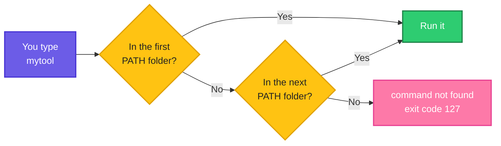

# Environment Variables and PATH: Why "It Works on My Terminal" Fails

> **Before this page:** you have read pages [01](01-what-is-a-shell-script.md) to [12](12-functions.md). You can write scripts with variables, arguments, `if`, loops, arrays and functions.
>
> **By the end of this page** you will understand why a script that works perfectly in your terminal can fail in cron, in a CI pipeline or for another user, and you will know exactly how to fix it.

---

## 1. Start with a problem: it works by hand, it breaks at 2 a.m.

You wrote a nightly script. It calls a tool of yours, `mytool`, which sits in your own `bin` folder. You test it by hand and it works perfectly.

Let's say we have this tool `bin/mytool`:

**Input file** (`bin/mytool`):
```bash
#!/bin/bash
echo "mytool is running"
```

And this script:

**Input file** (`nightly.sh`):
```bash
#!/bin/bash
echo "nightly job starting"
mytool
echo "nightly job finished"
```

**Command** (in your terminal, where `bin` is already known to the shell):
```bash
chmod +x nightly.sh bin/mytool
./nightly.sh
```
**Sample Output:**
```text
nightly job starting
mytool is running
nightly job finished
```

Perfect. You put it in cron, go to sleep, and in the morning the job has not done its work. Here is what cron actually ran. (We imitate cron with `env -i`, which starts the script in an almost **empty** environment, with only a short `PATH`.)

**Command:**
```bash
env -i PATH=/usr/bin:/bin ./nightly.sh
echo "exit: $?"
```
**Sample Output:**
```text
nightly job starting
./nightly.sh: line 3: mytool: command not found
nightly job finished
exit: 0
```

Two painful things happened:

1. `mytool` was **not found**. The same script, the same file, but a different environment.
2. The script said "finished" and exited `0` (success) anyway. This is the **lying script** from page 04. Nothing alerted you.

Why did `mytool` vanish? Because every program runs inside an **environment**: a set of named settings it inherits from whoever started it. Your terminal's environment knew where `bin` was. Cron's did not. Understanding the environment, and especially the variable called `PATH`, is what this page is about.

---

## 2. The big idea: the backpack

Every program, when it is started, is handed a **backpack** full of labelled settings by the program that started it (its *parent*). Inside the backpack are things like `HOME` (your home folder), `USER` (your name) and `PATH` (where to look for commands). That backpack is the **environment**, and the settings in it are **environment variables**.

Two rules make everything else easy:

| Rule | Picture |
|------|---------|
| **Only exported variables go in the backpack** | A variable you did not `export` stays in **your pocket**. The child never sees it |
| **The child gets a copy, not the original** | The child can scribble on its copy, and your backpack stays unchanged |

So a normal variable (everything you wrote in pages 02 to 12) lives in your pocket. `export` moves it into the backpack, so every program you start can read it.

**Read it left to right:** your shell has two variables, but only the exported one goes into the backpack. The child script starts with a copy of the backpack, so it sees `GREETING` and knows nothing about `count`.


---

## 3. `export`: putting a variable in the backpack

Let's see the difference between a plain variable and an exported one. The "child" here is a new `bash` started with `bash -c '...'`.

Let's say we have this file `ex1.sh`:

**Input file** (`ex1.sh`):
```bash
#!/bin/bash
GREETING="hello"
bash -c 'echo "child sees (not exported): [$GREETING]"'
export GREETING
bash -c 'echo "child sees (exported)    : [$GREETING]"'
```

**Command:**
```bash
chmod +x ex1.sh
./ex1.sh
```
**Sample Output:**
```text
child sees (not exported): []
child sees (exported)    : [hello]
```

The same variable, the same value. Before `export`, the child saw nothing. After `export GREETING`, it saw `hello`. You can also do both in one line: `export GREETING="hello"`.

### The child gets a copy, not the original

Let's say we have this file `ex2.sh`:

**Input file** (`ex2.sh`):
```bash
#!/bin/bash
export COLOR="blue"
bash -c 'COLOR="red"; echo "child changed it to: $COLOR"'
echo "parent still has    : $COLOR"
```

**Command:**
```bash
chmod +x ex2.sh
./ex2.sh
```
**Sample Output:**
```text
child changed it to: red
parent still has    : blue
```

The child changed `COLOR` to `red`, but only in **its own copy**. The parent kept `blue`. Information flows **down** (parent to child) and never back **up**.

### This is why `source` exists

Remember page 01, where `bash script.sh` could not change your shell's variables, but `source script.sh` could? Now you can see why. A script run normally is a **child**, so even an `export` inside it dies with it.

Let's say we have this file `child.sh`:

**Input file** (`child.sh`):
```bash
#!/bin/bash
export PROJECT="shop"
echo "inside the child script: PROJECT=$PROJECT"
```

And this script, which runs it two ways:

**Input file** (`scope.sh`):
```bash
#!/bin/bash
bash child.sh
echo "after running it   : PROJECT=[$PROJECT]"
source ./child.sh
echo "after source it    : PROJECT=[$PROJECT]"
```

**Command:**
```bash
chmod +x scope.sh
./scope.sh
```
**Sample Output:**
```text
inside the child script: PROJECT=shop
after running it   : PROJECT=[]
inside the child script: PROJECT=shop
after source it    : PROJECT=[shop]
```

Running `child.sh` made a child, whose `export` never reached us. `source` ran the lines in **our own shell**, so the variable stayed. This is exactly why you `source venv/bin/activate` and `source ~/.bashrc` instead of running them.

---

## 4. Looking at the environment

| Command | What it shows |
|---------|---------------|
| `env` | Every variable in the environment (the whole backpack) |
| `printenv NAME` | The value of one variable, and **exit code `1` if it is not set** |
| `echo "$NAME"` | The value of a variable (environment **or** pocket) |
| `export` with no arguments | Everything exported, in a special format |

Let's say we run `printenv` for one variable that exists and one that does not:

**Command:**
```bash
FRUIT=mango printenv FRUIT
echo "exit: $?"
printenv NOPE_NOT_SET
echo "exit: $?"
```
**Sample Output:**
```text
mango
exit: 0
exit: 1
```

(`FRUIT=mango` in front of the command is a one-time variable. You will see it in section 5.) `printenv` is handy in scripts, because its exit code tells you whether the variable exists.

### Ready-made variables you meet everywhere

| Variable | What it holds | Example |
|----------|---------------|---------|
| `HOME` | Your home folder | `/home/devops` |
| `USER` | Your login name | `devops` |
| `PATH` | Folders searched for commands | `/usr/local/bin:/usr/bin:/bin` |
| `SHELL` | Your login shell | `/bin/bash` |
| `PWD` | Your current folder | `/home/devops/practice` |
| `LANG` | Language and character set | `en_US.UTF-8` |
| `EDITOR` | Your preferred text editor | `nano` |
| `TERM` | The type of terminal | `xterm-256color` |

By convention, **environment variables are written in CAPITAL LETTERS** (page 02), so they are easy to tell from your own lower-case variables.

---

## 5. Passing settings into a script

The environment is the standard way to **configure a script from outside** without editing it. You have already used the tool for it: the default value `${NAME:-default}` from page 03.

Let's say we have this file `show.sh`:

**Input file** (`show.sh`):
```bash
#!/bin/bash
DISK="${DISK:-/}"
echo "Checking disk: $DISK"
```

**Command:**
```bash
chmod +x show.sh
./show.sh
DISK=/run ./show.sh
./show.sh
```
**Sample Output:**
```text
Checking disk: /
Checking disk: /run
Checking disk: /
```

The line `DISK=/run ./show.sh` sets `DISK` **for this one command only**. Put `NAME=value` straight in front of a command, with no `export`, and the command receives it in its environment. The very next run, without the prefix, used the default `/` again, because nothing stayed behind.

This is how CI pipelines and Docker pass settings: `LOG_LEVEL=debug ./deploy.sh`, `docker run -e DB_HOST=db1 ...`.

To remove a variable, use `unset NAME`.

---

## 6. `PATH`: how the shell finds your commands

When you type `ls`, how does the shell know where the program `ls` lives? It does not search the whole disk. It looks through a **list of folders**, one after another, held in the variable **`PATH`**. The folders are separated by a **colon** (`:`).

Let's look at a `PATH` and split it into one folder per line:

**Command:**
```bash
PATH=/usr/local/bin:/usr/bin:/bin bash -c 'echo "$PATH"; echo "$PATH" | tr ":" "\n"'
```
**Sample Output:**
```text
/usr/local/bin:/usr/bin:/bin
/usr/local/bin
/usr/bin
/bin
```

(`PATH=... bash -c '...'` uses a fixed `PATH` for the demo, so the output is the same on every machine. On your own terminal, `echo $PATH` will show your own, probably longer, list.) Here the shell looks in `/usr/local/bin`, then `/usr/bin`, then `/bin`, **in that order**, and runs the **first match** it finds.

**Follow the arrows from the left:** the shell tries each folder in order. The first folder that contains the command wins. If none does, you get the famous error.



(The diagram shows two folders to keep it small. A real `PATH` can have many, and the shell checks them all.)

The command `type` (page 01) tells you what the shell found:

**Command:**
```bash
PATH=/usr/bin:/bin bash -c 'type ls; type cd; type -a echo'
```
**Sample Output:**
```text
ls is /usr/bin/ls
cd is a shell builtin
echo is a shell builtin
echo is /usr/bin/echo
echo is /bin/echo
```

- `ls` is a program found in `/usr/bin`.
- `cd` is a **builtin**, part of the shell itself, so `PATH` is not involved.
- `type -a` lists **every** match, not just the first. `echo` exists three times: as a builtin and in two folders. The builtin wins.

### Your own tool: not found, then found

Go back to `bin/mytool` from section 1. Its folder is not in a plain `PATH`, so the shell cannot find it. Add the folder to `PATH`, and it works:

**Command:**
```bash
PATH=/usr/bin:/bin bash -c 'mytool; echo "exit: $?"'
PATH="$PWD/bin:/usr/bin:/bin" bash -c 'mytool; echo "exit: $?"; command -v mytool'
```
**Sample Output:**
```text
bash: line 1: mytool: command not found
exit: 127
mytool is running
exit: 0
/home/devops/practice/bin/mytool
```

- Without `bin` in `PATH`: **`command not found`**, exit code **`127`** (page 04).
- With `"$PWD/bin:..."`: found and run. `command -v mytool` prints the full path that was found.

This is also why you must write `./script.sh` for a script in the current folder (page 01): the current folder is **not** in `PATH`, and that is a good thing.

### Order matters: the first match wins

What if two folders both contain a command called `greet`? The folder that comes **first** in `PATH` wins.

Let's say we have two small scripts with the same name in two folders: `a/greet` prints `greet from folder a`, and `b/greet` prints `greet from folder b`:

**Input file** (`a/greet`):
```bash
#!/bin/bash
echo "greet from folder a"
```

**Input file** (`b/greet`):
```bash
#!/bin/bash
echo "greet from folder b"
```

**Command:**
```bash
chmod +x a/greet b/greet
PATH="$PWD/a:$PWD/b:/usr/bin:/bin" bash -c 'greet'
PATH="$PWD/b:$PWD/a:/usr/bin:/bin" bash -c 'greet'
PATH="$PWD/a:$PWD/b:/usr/bin:/bin" bash -c 'type -a greet'
```
**Sample Output:**
```text
greet from folder a
greet from folder b
greet is /home/devops/practice/a/greet
greet is /home/devops/practice/b/greet
```

Swap the folders in `PATH`, and a different `greet` runs. **When the wrong version of a tool runs, check `type -a toolname`.** Two installs of Python, Java or Node in different folders is one of the most common causes of "it uses the wrong version".

### Adding a folder to `PATH` permanently

Changing `PATH` in a terminal only lasts until you close it. To make it permanent, add a line to your shell's start-up file, `~/.bashrc`. The usual form puts **the new folder first**, and **keeps the old `PATH`** at the end:

Let's say the last lines of `~/.bashrc` are these (you would add them with an editor):

**Input file** (last lines of `~/.bashrc`):
```bash
# my own tools
export PATH="$HOME/bin:$PATH"
```

New terminals will now find anything in `~/bin` by name. (To apply it to your current terminal without closing it, run `source ~/.bashrc`, as you learned in section 3.) The part `:$PATH` at the end is important, as the next section shows.

### What goes wrong with `PATH`

**1. Replacing it instead of adding to it.** Writing `PATH=/nowhere` throws away the old list, and **every command stops being found**:

**Command:**
```bash
bash -c 'PATH=/nowhere; ls; echo "exit: $?"'
bash -c 'PATH=/nowhere; /usr/bin/ls -d /etc; echo "exit: $?"'
```
**Sample Output:**
```text
bash: line 1: ls: command not found
exit: 127
/etc
exit: 0
```

Even `ls` vanished. Giving the **full path** (`/usr/bin/ls`) still works, because that skips the `PATH` search completely. Always add to the old value: `PATH="/new/folder:$PATH"`.

**2. The tilde inside quotes.** The shortcut `~` for your home folder is expanded only **outside** quotes:

Let's say we have this file `tilde.sh`:

**Input file** (`tilde.sh`):
```bash
#!/bin/bash
dir="~/bin"
echo "quoted tilde stays literal: $dir"
dir2=~/bin
echo "unquoted tilde expands    : $dir2"
```

**Command:**
```bash
chmod +x tilde.sh
./tilde.sh
```
**Sample Output:**
```text
quoted tilde stays literal: ~/bin
unquoted tilde expands    : /home/devops/bin
```

In `PATH`, always write `$HOME/bin`, never `"~/bin"`.

**3. A dot in `PATH`.** Adding `.` (the current folder), or an empty entry such as a trailing colon, makes the shell run programs from whatever folder you happen to be in. An attacker only has to leave a file named `ls` in a folder you visit. Never do it.

---

## 7. Why cron and CI break your scripts

Now we can answer the question from the start. A program's environment depends on **who started it and how**. Your terminal has a rich environment because of the files your shell reads when it starts. Cron and many pipelines start your script with almost **nothing**.

| How the script is started | Start-up files read | `PATH` you get |
|---------------------------|---------------------|----------------|
| You type it in a terminal | `~/.bashrc` (and `~/.profile` at login) | Your full, personalised `PATH` |
| `ssh server 'command'` | Little or nothing | A short default |
| **cron** | **None** | Very short, typically `/usr/bin:/bin` |
| A CI job or Docker `RUN` | Depends on the tool | Often short and different |
| `sudo ./script.sh` | Depends on the `sudo` settings | Often replaced with a secure default |

**Cron does not read `~/.bashrc`.** That is why your tool in `~/bin` was invisible.

You saw the effect in section 1. There is more, too. Here is `HOME` and `USER` in an empty environment:

**Command:**
```bash
env -i PATH=/usr/bin:/bin bash -c 'echo "HOME=[$HOME] USER=[$USER]"'
```
**Sample Output:**
```text
HOME=[] USER=[]
```

Both are empty. A script that does `cd "$HOME"` or writes to `"$HOME/backup"` would misbehave in such an environment.

### Three fixes, from best to simplest

**Fix 1: set `PATH` at the top of the script.** The script then does not depend on who started it:

Let's say we have this file `nightly2.sh`:

**Input file** (`nightly2.sh`):
```bash
#!/bin/bash
export PATH="/home/devops/practice/bin:/usr/bin:/bin"
echo "nightly job starting"
mytool
echo "nightly job finished"
```

**Command:**
```bash
chmod +x nightly2.sh
env -i PATH=/usr/bin:/bin ./nightly2.sh
echo "exit: $?"
```
**Sample Output:**
```text
nightly job starting
mytool is running
nightly job finished
exit: 0
```

Even with the tiny cron-like environment, the script found its tool, because it set its own `PATH` first.

**Fix 2: use the full path to the tool.** No search is needed:

Let's say we have this file `nightly3.sh`:

**Input file** (`nightly3.sh`):
```bash
#!/bin/bash
/home/devops/practice/bin/mytool
```

**Command:**
```bash
chmod +x nightly3.sh
env -i PATH=/usr/bin:/bin ./nightly3.sh
```
**Sample Output:**
```text
mytool is running
```

**Fix 3: set the variables in the cron file itself.** A crontab can start with lines like `PATH=/home/devops/practice/bin:/usr/bin:/bin`, and cron applies them to every job. (You will learn crontab in a later page.)

For a script that must work everywhere, **combine fixes 1 and 2**: set a known `PATH`, and use full paths for anything unusual.

> **Remember the lying script?** In section 1, the missing tool did **not** stop the script, and the exit code was `0`. In the next page you will learn `set -e`, a switch that stops a script at the first failure, so that a missing tool is never ignored.

---

## 8. Demanding a setting: stop if it is missing

A script that needs `DB_HOST` should **refuse to run** without it, instead of continuing with an empty value. The form `${NAME:?message}` does exactly this: it stops with your message if the variable is unset or empty.

Let's say we have this file `needvar.sh`:

**Input file** (`needvar.sh`):
```bash
#!/bin/bash
: "${DB_HOST:?DB_HOST is not set}"
echo "Connecting to $DB_HOST"
```

(The colon `:` is a do-nothing command. It is only there so the shell evaluates the check.)

**Command:**
```bash
chmod +x needvar.sh
./needvar.sh
echo "exit: $?"
DB_HOST=db1 ./needvar.sh
echo "exit: $?"
```
**Sample Output:**
```text
./needvar.sh: line 2: DB_HOST: DB_HOST is not set
exit: 1
Connecting to db1
exit: 0
```

Without the variable, the script stopped with a clear message and exit code `1`. With it, the script ran. Compare that with the silent empty value of page 02.

### Settings in a file: the `.env` pattern

Many projects keep settings in a small file, usually named `.env`, with one `NAME=value` per line.

Let's say we have this file `.env`:

**Input file** (`.env`):
```text
DB_HOST=db1.internal
DB_PORT=5432
```

And this script:

**Input file** (`env1.sh`):
```bash
#!/bin/bash
source .env
echo "in the script         : $DB_HOST"
bash -c 'echo "in a child (no set -a): [$DB_HOST]"'
set -a
source .env
set +a
bash -c 'echo "in a child (set -a)   : [$DB_HOST]"'
```

**Command:**
```bash
chmod +x env1.sh
./env1.sh
```
**Sample Output:**
```text
in the script         : db1.internal
in a child (no set -a): []
in a child (set -a)   : [db1.internal]
```

`source .env` loaded the values, but as **plain variables** (in the pocket), so a child program could not see them. Wrapping it in `set -a` ... `set +a` means *"automatically export everything that is assigned while this is on"*, so everything in `.env` reached the backpack.

### A word about secrets

Passwords and API keys are very often passed as environment variables, and that is normal. But treat them with care:

- **Never print them** (`echo "$DB_PASSWORD"`) in logs. Pipeline logs are widely readable.
- **Never commit** a `.env` file with real secrets into Git. Add it to `.gitignore`.
- Remember that **every child program inherits** the backpack, so do not export a secret into the environment of a program that does not need it.
- Environment variables can be inspected by other processes of the same user (and by root). For high-value secrets, a proper secrets manager is safer than a plain file.

---

## 9. Upgrade `morning.sh`: settings from outside, and a safe `PATH`

Time to use this page on our running script. Two changes:

- The limits `WARN`, `CRIT` and `TRIES` now **come from the environment**, with defaults. No more editing the file to test: `WARN=2 CRIT=50 ./morning.sh`. The real defaults are back to 80 and 90.
- The script sets its own **`PATH`** at the top, so it behaves the same in cron and in a terminal.

Everything else is exactly the page 12 version.

Let's say we now have this file `morning.sh`:

**Input file** (`morning.sh`):
```bash
#!/bin/bash
# morning.sh - usage: [WARN=80] [CRIT=90] ./morning.sh [--fast] [disk ...]

# A tiny, known PATH so the script behaves the same in cron and in a terminal
export PATH=/usr/local/sbin:/usr/local/bin:/usr/sbin:/usr/bin:/sbin:/bin

# Settings: use the environment if given, otherwise these defaults
WARN="${WARN:-80}"
CRIT="${CRIT:-90}"
TRIES="${TRIES:-1}"

disk_exists() {
  df "$1" > /dev/null 2>&1
}

wait_for_disk() {
  local disk="$1"
  local tries=0
  while ! disk_exists "$disk" && [[ $tries -lt $TRIES ]]; do
    tries=$((tries + 1))
    echo "$disk: not found yet, waiting (try $tries of $TRIES)"
    sleep 1
  done
}

disk_usage() {
  df --output=pcent "$1" | tail -1 | tr -dc '0-9'
}

check_disk() {
  local disk="$1"
  if ! disk_exists "$disk"; then
    echo "$disk: NOT FOUND"
    return 2
  fi
  local usage
  usage=$(disk_usage "$disk")
  if [[ $usage -ge $CRIT ]]; then
    echo "$disk: CRITICAL ($usage%)"
    return 2
  elif [[ $usage -ge $WARN ]]; then
    echo "$disk: WARNING ($usage%)"
    return 1
  fi
  echo "$disk: OK ($usage%)"
  return 0
}

main() {
  local fast=no
  if [[ $1 == "--fast" ]]; then
    fast=yes
    shift
  fi

  local disks=("$@")
  if [[ ${#disks[@]} -eq 0 ]]; then
    disks=(/)
  fi

  echo "Date : $(date +%d-%b-%Y)"

  local worst=0 code disk
  for disk in "${disks[@]}"; do
    if [[ -z $disk ]]; then
      echo "(skipping an empty name)"
      continue
    fi

    wait_for_disk "$disk"
    check_disk "$disk"
    code=$?

    if [[ $code -gt $worst ]]; then
      worst=$code
    fi
    if [[ $fast == yes && $code -eq 2 ]]; then
      echo "Stopping early (--fast): a critical problem was found"
      break
    fi
  done
  return "$worst"
}

main "$@"
```

**Command:**
```bash
chmod +x morning.sh
./morning.sh / /run
echo "code: $?"
WARN=2 CRIT=50 ./morning.sh / /run
echo "code: $?"
WARN=1 CRIT=2 ./morning.sh / /run
echo "code: $?"
```
**Sample Output:**
```text
Date : 20-Oct-2026
/: OK (2%)
/run: OK (1%)
code: 0
Date : 20-Oct-2026
/: WARNING (2%)
/run: OK (1%)
code: 1
Date : 20-Oct-2026
/: CRITICAL (2%)
/run: WARNING (1%)
code: 2
```

- **First run:** the normal limits (80 and 90). Both disks are nearly empty, so both are OK.
- **Second run:** `WARN=2 CRIT=50` in front of the command. The file was not touched, but `/` at 2% now counts as a warning.
- **Third run:** even stricter limits, so `/` is critical.

Now the cron test. We run it in the empty cron-like environment:

**Command:**
```bash
env -i ./morning.sh /
echo "code: $?"
```
**Sample Output:**
```text
Date : 20-Oct-2026
/: OK (2%)
code: 0
```

With **no environment at all**, the script still works, because it sets its own `PATH` and has defaults for every setting. That is a script you can safely hand to cron.

---

## 10. The mistakes that bite

| Mistake | Symptom | Fix |
|---------|---------|-----|
| Forgetting `export` | A child program sees an empty value | `export NAME` |
| Expecting a child script to change your variable | The change disappears when it ends | `source` the script |
| Script works in a terminal, fails in cron | `command not found` | Set `PATH` in the script, or use full paths |
| `PATH=/new/folder` | Every command vanishes | `PATH="/new/folder:$PATH"` |
| `export PATH="~/bin:$PATH"` | `~` is not expanded in quotes | `"$HOME/bin:$PATH"` |
| `.` or a trailing `:` in `PATH` | Security risk | Never |
| The wrong version of a tool runs | An earlier folder in `PATH` wins | `type -a tool`, then fix the order |
| Relying on `HOME`, `USER` in cron | They may be empty | Set or check them, or use full paths |
| Variable name in lower-case for an environment setting | Confusing, clashes by accident | Use `UPPER_CASE` for exported settings |
| Printing secrets in logs | Passwords leak | Never `echo` them |
| Committing `.env` with secrets | Passwords in Git history | Use `.gitignore` |
| Spaces around `=` in `export A = 1` | `not a valid identifier` | `export A=1` |
| Missing required setting | A silent empty value later | `${NAME:?message}` |
| Expecting arrays to be exported | They cannot be | Pass values as arguments or a string |

Let's see the spaces error for real.

**Command:**
```bash
export A = 1
```
**Sample Output:**
```text
bash: export: `=': not a valid identifier
bash: export: `1': not a valid identifier
```

With spaces, `export` sees **three** separate words (`A`, `=` and `1`), and complains that `=` and `1` are not valid variable names. As always, glue it together: `export A=1`.

---

## 11. Words to remember

| Word | Simple meaning |
|------|----------------|
| **Environment** | The set of named settings a program receives from its parent (the backpack) |
| **Environment variable** | One setting in that backpack, such as `HOME` |
| **`export`** | Put a variable into the backpack, so child programs see it |
| **Child process** | A program started by another. It gets a **copy** of the environment |
| **`env`, `printenv`** | Show the environment |
| **`unset`** | Remove a variable |
| **`NAME=value command`** | Give `command` a variable for that one run only |
| **`PATH`** | The colon-separated folders searched for commands, in order |
| **`type -a`** | Show every place a command name is found |
| **`command -v`** | Show the path of a command, or nothing if it is not found |
| **`127`** | Exit code for `command not found` |
| **`~/.bashrc`** | The file your interactive terminal reads when it starts |
| **`env -i`** | Run a command with an empty environment (to imitate cron) |
| **`${NAME:?msg}`** | Stop with a message if `NAME` is unset or empty |
| **`set -a`** | Automatically export every variable assigned |
| **`.env` file** | A small file of `NAME=value` settings |

---

## 12. Try it yourself

1. **Pocket or backpack.** Set `X=1` in your terminal. Run `bash -c 'echo [$X]'`. Then `export X` and run it again. Explain the two results.
2. **One-shot.** Write `hello.sh` that prints `Hello, $NAME` (default `world`). Run it with and without `NAME=Asha ./hello.sh`.
3. **Read your `PATH`.** Print your `PATH`, one folder per line, using `tr`. How many folders do you have?
4. **Find the winner.** Run `type -a python3` (or `type -a ls`). Which one runs, and why?
5. **Your own tool.** Create a `bin` folder with a small script `hi`. Make it run by name by adding the folder to `PATH` for one command: `PATH="$PWD/bin:$PATH" hi`.
6. **Break it, then fix it.** In a subshell, run `bash -c 'PATH=/nowhere; ls'`. Fix it using the full path to `ls`.
7. **Imitate cron.** Take one of your earlier scripts and run it with `env -i PATH=/usr/bin:/bin ./yourscript.sh`. Does it still work? If not, fix it using one of the three fixes.
8. **Require a setting.** Write `connect.sh` that stops with a message unless `API_KEY` is set.
9. **A `.env` file.** Make a `.env` with two settings. Write a script that loads it with `set -a` and prints both from a **child** `bash -c`.
10. **Spot the bug.** Why does the second line print nothing, and how do you fix it?
    ```bash
    GREETING="hello"
    bash -c 'echo "$GREETING"'
    ```
11. **Upgrade `morning.sh`.** Let the script also read its disk list from an environment variable `DISKS` (space-separated) when no arguments are given.

<details>
<summary>Answers for exercises 6 and 10 (open only after trying)</summary>

**Exercise 6:** `bash -c 'PATH=/nowhere; /usr/bin/ls -d /etc'` works, because a full path skips the `PATH` search. A cleaner fix is to add to the old value: `PATH="/nowhere:$PATH"`.

**Exercise 10:** `GREETING` was never exported, so the child `bash` does not receive it. Use `export GREETING="hello"`, or give it to that one command: `GREETING="hello" bash -c 'echo "$GREETING"'`.
</details>

---

## 13. Quick recap

- Every program runs with an **environment**, a backpack of named settings inherited from its parent.
- A normal variable stays in your pocket. **`export`** moves it into the backpack so children see it.
- A child gets a **copy**. It can never change its parent's variables. That is why you **`source`** a script when you want it to change your shell.
- **`NAME=value command`** gives a variable to one command only. Default values `${NAME:-default}` make a script configurable from outside.
- **`PATH`** is the colon-separated list of folders searched, **in order**, for commands. The first match wins. `command not found` is exit code **`127`**.
- Add to `PATH`, never replace it: `PATH="$HOME/bin:$PATH"`. Use `$HOME`, not a quoted `~`.
- **Cron and CI have a tiny environment** and do not read `~/.bashrc`. Fix scripts by setting `PATH` at the top and using full paths for special tools. Test with **`env -i`**.
- Stop early when a setting is missing: `${NAME:?message}`.
- Load a `.env` file with `set -a` ... `set +a` to export everything in it, and keep secrets out of logs and Git.

**Next page:** [14 Safe and debuggable scripts](14-safe-and-debuggable-scripts.md), where you will learn `set -e`, `set -u` and `pipefail` so that scripts stop at the first problem, and `bash -x` to see exactly what a script is doing when it misbehaves.
