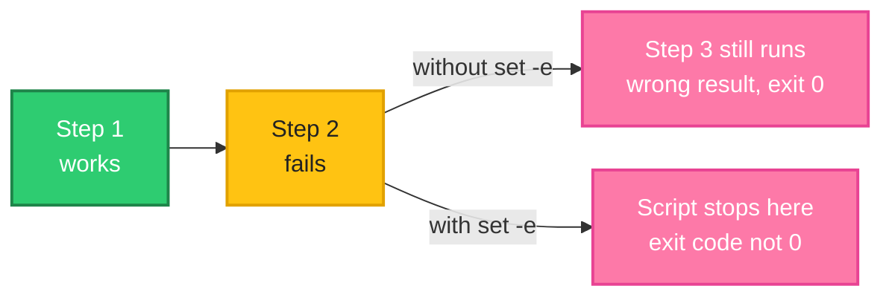
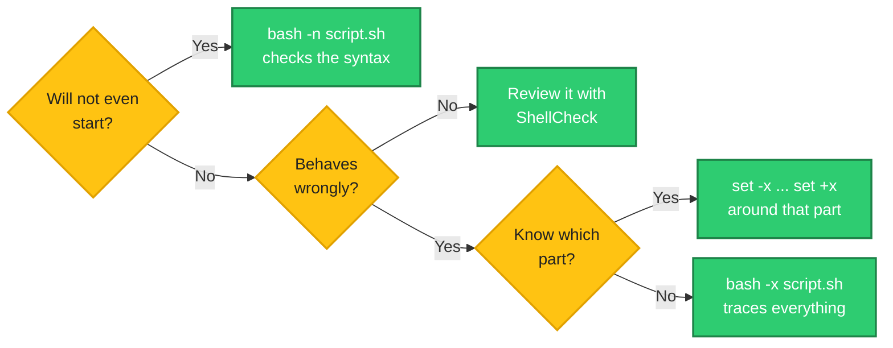

# Safe and Debuggable Scripts: Seatbelts and a Dashcam

> **Before this page:** you have read pages [01](01-what-is-a-shell-script.md) to [13](13-environment-variables-and-path.md). You can write scripts with variables, input, decisions, loops, arrays, functions and environment settings.
>
> **By the end of this page** your scripts will stop at the first sign of trouble instead of carrying on and doing damage, and you will know how to see exactly what a misbehaving script is doing.

---

## 1. Start with a problem: scripts fail quietly, and then keep going

Everything you have written so far shares one habit: **when something goes wrong, the script carries on**. You saw it in pages 01 and 04. Now see how far that can go.

### The script that lies

Let's say we have this file `e0.sh`, which should copy a file and then announce success. The file `missing.txt` does not exist:

**Input file** (`e0.sh`):
```bash
#!/bin/bash
echo "Step 1: copy the file"
cp missing.txt backup/
echo "Step 2: Deploy complete!"
```

**Command:**
```bash
chmod +x e0.sh
./e0.sh
echo "exit: $?"
```
**Sample Output:**
```text
Step 1: copy the file
cp: cannot stat 'missing.txt': No such file or directory
Step 2: Deploy complete!
exit: 0
```

The copy failed, and the script said "Deploy complete!" and exited `0`.

### The script that can destroy things

Now a much more dangerous cousin. A script wants to empty a folder held in a variable `DIR`. But `DIR` was never filled (a typo, a missing setting, a failed step earlier). **We will only print the command, never run it**, to see what the shell would build:

Let's say we have this file `danger.sh`:

**Input file** (`danger.sh`):
```bash
#!/bin/bash
DIR=""          # imagine this was meant to be set earlier
echo "The command that would run:"
echo rm -rf $DIR/
```

**Command:**
```bash
chmod +x danger.sh
./danger.sh
```
**Sample Output:**
```text
The command that would run:
rm -rf /
```

An **empty** variable turned `rm -rf $DIR/` into `rm -rf /`: *"delete everything, starting from the top of the filesystem."* Real servers have lost real data to exactly this kind of mistake. (Modern `rm` refuses to remove `/` itself, but the same pattern with `$DIR/*` or a subfolder path is just as deadly.)

So the question is: **how do we make a script stop *before* it does harm, and how do we find out what went wrong when it misbehaves?**

---

## 2. The big idea: seatbelts and a dashcam

A car has two kinds of help:

- **Seatbelts and airbags** protect you when something goes wrong. They work **automatically**.
- A **dashcam** records what happened, so you can **see** the cause afterwards.

Bash gives you both:

| In a car | In a script | The tools |
|----------|-------------|-----------|
| **Seatbelts** (stop before damage) | Make the script **stop** at the first problem | `set -e`, `set -u`, `set -o pipefail` |
| **Dashcam** (see what happened) | Make the script **show** every step it takes | `bash -x`, `set -x`, `bash -n` |
| **Good habits** (drive carefully) | Write code that is hard to misuse | quoting, `${VAR:?}`, dry runs, `mktemp` |

This page covers all three. Start with the seatbelts.

---

## 3. Seatbelt 1: `set -e` (stop at the first failure)

Put `set -e` near the top of a script, and bash **exits immediately** when any command fails (returns a non-zero code, page 04).

Let's say we have this file `e1.sh`, the same as before with one extra line:

**Input file** (`e1.sh`):
```bash
#!/bin/bash
set -e
echo "Step 1: copy the file"
cp missing.txt backup/
echo "Step 2: Deploy complete!"
```

**Command:**
```bash
chmod +x e1.sh
./e1.sh
echo "exit: $?"
```
**Sample Output:**
```text
Step 1: copy the file
cp: cannot stat 'missing.txt': No such file or directory
exit: 1
```

"Deploy complete!" never printed, and the exit code is `1`, so a pipeline would turn red. That is an **honest** script.

**Follow the arrows from the failing step.** Without the seatbelt, the script carries on to a wrong result. With it, the script stops.



### When `set -e` does NOT stop the script

`set -e` is smart enough **not** to stop in places where a failure is expected and handled. A failing command does **not** trigger it when:

- it is the **condition of an `if` or `while`** (that is just a question being answered "no"),
- it is on the **left side of `&&` or `||`**,
- you add `|| true` to say "I accept this failure".

Let's see all four in one script.

Let's say we have this file `e2.sh`:

**Input file** (`e2.sh`):
```bash
#!/bin/bash
set -e
if grep -q nothing /etc/hostname; then echo "found"; else echo "if: a failing test did not stop the script"; fi
false || echo "||: the failure was handled, script continues"
false && echo "never printed"
echo "&&: a failing left side did not stop the script either"
grep -q nothing /etc/hostname || true
echo "|| true: failure ignored on purpose"
echo "now a real failure:"
false
echo "never reached"
```

**Command:**
```bash
chmod +x e2.sh
./e2.sh
echo "exit: $?"
```
**Sample Output:**
```text
if: a failing test did not stop the script
||: the failure was handled, script continues
&&: a failing left side did not stop the script either
|| true: failure ignored on purpose
now a real failure:
exit: 1
```

Only the last, **unhandled** `false` stopped the script. `|| true` is the standard way to say *"this command may fail, and that is fine"*.

### A famous trap: `((count++))`

A command that **succeeds in doing its job** can still return a non-zero code. The arithmetic command `((count++))` returns the **old value** of `count` as its status, and a value of `0` means "false", which is a failure code!

Let's say we have this file `e3.sh`:

**Input file** (`e3.sh`):
```bash
#!/bin/bash
set -e
count=0
((count++))
echo "this line is never reached"
```

**Command:**
```bash
chmod +x e3.sh
./e3.sh
echo "exit: $?"
```
**Sample Output:**
```text
exit: 1
```

The script **silently died** on the line that just added 1 to a counter. Nothing was printed. The safe way to count is the longer form, which always succeeds:

Let's say we have this file `e4.sh`:

**Input file** (`e4.sh`):
```bash
#!/bin/bash
set -e
count=0
count=$((count + 1))
echo "count is $count"
```

**Command:**
```bash
chmod +x e4.sh
./e4.sh
echo "exit: $?"
```
**Sample Output:**
```text
count is 1
exit: 0
```

**In scripts that use `set -e`, write `count=$((count + 1))`, not `((count++))`.** (Page 09 used `((bad++))` in a script without `set -e`, where it is harmless.)

---

## 4. Seatbelt 2: `set -u` (an unset variable is an error)

Remember the silent typo from page 02? `$sever` instead of `$server`, treated as an empty value with no complaint? `set -u` makes it a **loud error**.

Let's say we have this file `u1.sh`, without the seatbelt:

**Input file** (`u1.sh`):
```bash
#!/bin/bash
server="web1"
echo "Deploying to $sever"
```

**Command:**
```bash
chmod +x u1.sh
./u1.sh
echo "exit: $?"
```
**Sample Output:**
```text
Deploying to 
exit: 0
```

It "deployed" to nothing and reported success. Now with `set -u`:

Let's say we have this file `u2.sh`:

**Input file** (`u2.sh`):
```bash
#!/bin/bash
set -u
server="web1"
echo "Deploying to $sever"
echo "never reached"
```

**Command:**
```bash
chmod +x u2.sh
./u2.sh
echo "exit: $?"
```
**Sample Output:**
```text
./u2.sh: line 4: sever: unbound variable
exit: 1
```

The error names the guilty variable and the line. That one word of typo is found in a second, instead of during an outage.

### Variables that are allowed to be missing

Some variables are **meant** to be optional, such as the arguments in page 03. With `set -u`, reading a missing `$1` is an error:

Let's say we have this file `u4.sh`:

**Input file** (`u4.sh`):
```bash
#!/bin/bash
set -u
echo "first argument: $1"
```

**Command** (run with no arguments):
```bash
chmod +x u4.sh
./u4.sh
echo "exit: $?"
```
**Sample Output:**
```text
./u4.sh: line 3: $1: unbound variable
exit: 1
```

For optional values, give them a **default**, even an empty one: `${1:-}` means "use `$1`, or an empty string if it is missing". You already know this trick from page 03.

Let's say we have this file `u3.sh`:

**Input file** (`u3.sh`):
```bash
#!/bin/bash
set -u
name="${1:-}"
if [[ -z $name ]]; then
  echo "No name given, using friend"
  name="friend"
fi
echo "Hello, $name"
```

**Command:**
```bash
chmod +x u3.sh
./u3.sh
./u3.sh Asha
```
**Sample Output:**
```text
No name given, using friend
Hello, friend
Hello, Asha
```

`set -u` pushes you to be **explicit** about which variables may be empty, which is exactly what makes a script safe.

---

## 5. Seatbelt 3: `set -o pipefail` (a pipe fails if any part fails)

In page 04 you learned a trap: the exit code of a pipe is the code of its **last** command only, so a failure earlier in the pipe is hidden. `pipefail` fixes that.

Let's say we have this file `p2.sh`:

**Input file** (`p2.sh`):
```bash
#!/bin/bash
false | true
echo "without pipefail: $?"
set -o pipefail
false | true
echo "with pipefail   : $?"
```

**Command:**
```bash
chmod +x p2.sh
./p2.sh
```
**Sample Output:**
```text
without pipefail: 0
with pipefail   : 1
```

The first part of the pipe (`false`) failed both times. Only with `pipefail` did the pipe as a whole report it.

---

## 6. The standard header: all three together

Most professional bash scripts start with this one line:

```bash
set -euo pipefail
```

| Letter | Stands for | Effect |
|--------|------------|--------|
| `-e` | **e**xit on error | Stop at the first unhandled failing command |
| `-u` | **u**nset is an error | Stop on a variable that was never set |
| `-o pipefail` | pipe fails if any part fails | A broken step inside a pipe is not hidden |

Let's see them working together.

Let's say we have this file `safe.sh`:

**Input file** (`safe.sh`):
```bash
#!/bin/bash
set -euo pipefail

echo "Step 1: list a folder that does not exist"
count=$(ls /nope | wc -l)
echo "Step 2: this never runs (count=$count)"
```

**Command:**
```bash
chmod +x safe.sh
./safe.sh
echo "exit: $?"
```
**Sample Output:**
```text
Step 1: list a folder that does not exist
ls: cannot access '/nope': No such file or directory
exit: 2
```

Without `pipefail`, the pipe `ls /nope | wc -l` would have succeeded (because `wc` did), and Step 2 would have run with `count=0`. With the header, the script stopped on the failing `ls`, and passed on `ls`'s exit code, `2`.

### An honest warning: seatbelts have rules

`set -euo pipefail` is a great default, **but it is not magic**, and adding it to an old script can break it. It changes how your whole script behaves, so:

- Add it **from the start** of a new script, and test the script properly.
- You must **handle expected failures** yourself (`|| true`, or an `if`), as you saw.
- It does not replace **checking your inputs** and writing clear error messages.

Section 9 shows a real case, where adding the header to `morning.sh` broke it in two different ways.

---

## 7. The dashcam: seeing what your script is doing

A script has stopped, or does something strange. You are staring at it. The fastest way to understand it is to watch it **run line by line**.

**Start at the left** and answer each question until you reach a green box.



### `bash -x`: trace every command

`bash -x script.sh` prints **each command, after the shell has filled in the variables**, with a `+` in front, just before running it. You see exactly what the shell sees.

Let's say we have this file `dbg.sh`:

**Input file** (`dbg.sh`):
```bash
#!/bin/bash
name="Asha"
count=3
echo "Hello, $name"
total=$((count * 2))
echo "Total: $total"
```

**Command:**
```bash
bash -x dbg.sh
```
**Sample Output:**
```text
+ name=Asha
+ count=3
+ echo 'Hello, Asha'
Hello, Asha
+ total=6
+ echo 'Total: 6'
Total: 6
```

The lines starting with `+` are the **trace**. The others are the script's normal output. Notice that `echo "Hello, $name"` appears as `echo 'Hello, Asha'`: the variable has already been **replaced by its value**. When a command does the wrong thing, the trace shows you the exact words it received. (The trace goes to the **error channel**, `>&2`, so it does not mix into captured output.)

### Add line numbers with `PS4`

The `+` is controlled by a variable called `PS4`. Set it to show the **line number** of each command:

**Command:**
```bash
PS4='+ line ${LINENO}: ' bash -x dbg.sh
```
**Sample Output:**
```text
+ line 2: name=Asha
+ line 3: count=3
+ line 4: echo 'Hello, Asha'
Hello, Asha
+ line 5: total=6
+ line 6: echo 'Total: 6'
Total: 6
```

Now every step says which line of your file it came from. (Use single quotes around the `PS4` value, so `${LINENO}` is filled in for **each** line and not once at the start.)

### Trace only one part: `set -x` and `set +x`

A long script produces a long trace. If you know where the trouble is, switch tracing **on** just before it with `set -x`, and **off** just after with `set +x`.

Let's say we have this file `dbg2.sh`:

**Input file** (`dbg2.sh`):
```bash
#!/bin/bash
name="Asha"
echo "before the traced part"
set -x
total=$((3 * 2))
echo "Total: $total"
set +x
echo "after the traced part"
```

**Command:**
```bash
chmod +x dbg2.sh
./dbg2.sh
```
**Sample Output:**
```text
before the traced part
+ total=6
+ echo 'Total: 6'
Total: 6
+ set +x
after the traced part
```

Only the lines between `set -x` and `set +x` were traced. (The `+ set +x` line is the shell tracing the command that turns tracing off.)

### `bash -n`: check the syntax without running anything

If a script will not even start, `bash -n script.sh` **reads it without running it**, and reports syntax errors such as a missing `fi`. It is safe even for dangerous scripts, because **nothing is executed**.

Let's say we have this file `syn.sh`, with a missing `fi`:

**Input file** (`syn.sh`):
```bash
#!/bin/bash
echo "this would print"
if [[ 1 -eq 1 ]]; then
  echo "oops, no fi"
```

**Command:**
```bash
bash -n syn.sh
echo "exit: $?"
bash -n dbg.sh
echo "exit for a good script: $?"
```
**Sample Output:**
```text
syn.sh: line 5: syntax error: unexpected end of file
exit: 2
exit for a good script: 0
```

The broken script was **not run** ("this would print" never appeared), and the good one passed silently with exit `0`. Many teams run `bash -n` on every script in their CI pipeline.

### ShellCheck: a spell-checker for scripts

`shellcheck` is a separate free tool (installed with your package manager, for example `apt install shellcheck`) that **reads your script and warns about likely mistakes**: unquoted variables, a missing `then`, `[ ]` pitfalls, and many more. Each warning has a code such as `SC2086` (*"double quote to prevent globbing and word splitting"*) and a link that explains it. You run it with:

```bash
shellcheck script.sh
```

It is not part of bash, and it was not installed on the machine I used for this series, so there is no output shown here. But it is the single most useful habit after `set -euo pipefail`. Run it on every script you write, and many of the mistakes in pages 02 to 13 will be flagged for you.

---

## 8. Safe habits: write scripts that are hard to misuse

The seatbelts catch problems. These habits **prevent** them.

### Habit 1: quote everything

You have heard it in nearly every page. Once more, because it matters: **`"$var"`, always** (page 02). Unquoted variables split on spaces and expand wildcards.

### Habit 2: refuse to run on an empty variable (`${VAR:?}`)

The danger from section 1 came from an empty `DIR`. The form `${DIR:?message}` (page 13) **stops** if the variable is empty. Again, we only `echo` the command:

Let's say we have this file `guard.sh`:

**Input file** (`guard.sh`):
```bash
#!/bin/bash
DIR=""
echo rm -rf "${DIR:?DIR is empty, refusing to continue}"/*
echo "never reached"
```

**Command:**
```bash
chmod +x guard.sh
./guard.sh
echo "exit: $?"
```
**Sample Output:**
```text
./guard.sh: line 3: DIR: DIR is empty, refusing to continue
exit: 1
```

The script stopped **before** building the dangerous command. Whenever a variable is used to build a path for `rm`, `mv` or `cp -r`, guard it like this.

### Habit 3: a dry run for anything that changes things

A **dry run** prints what the script *would* do without doing it. With the function skills from page 12, one small helper makes it easy: wrap every changing command in `run`.

Let's say we have this file `dry.sh`:

**Input file** (`dry.sh`):
```bash
#!/bin/bash
# usage: DRY_RUN=1 ./dry.sh
run() {
  if [[ ${DRY_RUN:-0} -eq 1 ]]; then
    echo "[dry run] $*"
  else
    "$@"
  fi
}

run mkdir -p reports
run touch reports/today.txt
echo "done"
```

**Command:**
```bash
chmod +x dry.sh
DRY_RUN=1 ./dry.sh
ls -d reports
./dry.sh
ls reports
```
**Sample Output:**
```text
[dry run] mkdir -p reports
[dry run] touch reports/today.txt
done
ls: cannot access 'reports': No such file or directory
done
today.txt
```

The first run (with `DRY_RUN=1`, page 13) only **described** the actions: no `reports` folder appeared, as the failing `ls -d reports` shows. The second run did them for real (it printed `done`), and `ls reports` then showed the new file. `"$@"` (page 03) runs the command with its arguments intact.

### Habit 4: make scripts repeatable (idempotent)

A good script can be run **twice** and leave things in the same good state. Use commands that do not mind repeats: `mkdir -p` (no error if it exists), `ln -sf` (replace the link), `[[ -d x ]] || mkdir x`.

Let's say we have this file `idem.sh`:

**Input file** (`idem.sh`):
```bash
#!/bin/bash
set -e
mkdir -p data
ln -sf data current
echo "ran OK"
```

**Command:**
```bash
chmod +x idem.sh
./idem.sh
./idem.sh
ls -l current | awk '{print $9, $10, $11}'
```
**Sample Output:**
```text
ran OK
ran OK
current -> data
```

With plain `mkdir data`, the second run would fail with "File exists", and `set -e` would stop the script. This matters most for scripts that cron or a pipeline may run more than once.

### Habit 5: `--` protects against file names that look like options

What if a file is called `-rf`? Commands take it for an **option**, not a file. The double dash `--` means *"options end here, everything after is a name"*.

Let's say the folder holds one file, named `-rf`:

**Command:**
```bash
ls
rm -rf
echo "exit: $?"
ls
rm -- -rf
ls
```
**Sample Output:**
```text
-rf
exit: 0
-rf
```

- `ls` shows the file `-rf`.
- `rm -rf` read `-rf` as **options**, so it removed nothing, said nothing, and exited `0`. The file is **still there**.
- `rm -- -rf` treated `-rf` as a file name and deleted it. The last `ls` printed nothing, because the folder is now empty.

In scripts that handle names from outside (user input, downloaded files), write `rm -- "$file"` and `cp -- "$src" "$dest"`.

### Habit 6: temporary files with `mktemp`, and clean up

Never make up a temp file name like `/tmp/work.txt`. Two copies of your script would clash, and other people can guess the name. `mktemp` creates a **unique** one:

- `mktemp` makes a unique **file**, `mktemp -d` makes a unique **folder**.
- `trap '...' EXIT` runs a command **whenever the script ends**, however it ends. (A full page on `trap` is coming next. For now, read it as *"when you finish, do this cleanup"*.)

Let's say we have this file `tmp.sh`:

**Input file** (`tmp.sh`):
```bash
#!/bin/bash
set -euo pipefail
tmp=$(mktemp -d)
trap 'rm -rf "$tmp"' EXIT
echo "work folder exists: $([[ -d $tmp ]] && echo yes || echo no)"
echo "data" > "$tmp/work.txt"
echo "$tmp" > last_tmp.txt
echo "script finished"
```

**Command:**
```bash
chmod +x tmp.sh
./tmp.sh
echo "after the script, the folder still exists? $([[ -d $(cat last_tmp.txt) ]] && echo yes || echo no)"
```
**Sample Output:**
```text
work folder exists: yes
script finished
after the script, the folder still exists? no
```

The script created a private work folder, used it, and the `trap` removed it automatically at the end, even though we never wrote a cleanup line at the bottom. (The folder name looks like `/tmp/tmp.` followed by ten random characters, different each time.) Even if the script had failed halfway through with `set -e`, the cleanup would still have run.

---

## 9. Upgrade `morning.sh`: adding the seatbelts (and what breaks)

Let's add `set -euo pipefail` to `morning.sh`. First, the **naive** way: add the one line and change nothing else. (This is the page 13 script, with `set -euo pipefail` inserted at the top.) We run it two ways:

**Command** (naive version, with no arguments):
```bash
./naive.sh
echo "exit: $?"
```
**Sample Output:**
```text
./naive.sh: line 52: $1: unbound variable
exit: 1
```

**Break 1: `set -u`.** With no arguments, the line `if [[ $1 == "--fast" ]]` reads a missing `$1`. A script that worked fine now dies before doing anything.

**Command** (naive version, with two disks and low limits):
```bash
WARN=2 CRIT=50 ./naive.sh / /run
echo "exit: $?"
```
**Sample Output:**
```text
Date : 20-Oct-2026
/: WARNING (2%)
exit: 1
```

**Break 2: `set -e`.** The disk `/` is a WARNING, so `check_disk` returned `1`. With `set -e`, **any** non-zero return stops the script, so it quit before looking at `/run` at all. But a WARNING is exactly the kind of "failure" the script is designed to *report and continue from*.

Both breaks are the lessons of this page. Here are the two small fixes:

| Problem | Fix |
|---------|-----|
| `$1` may be missing (`set -u`) | `if [[ ${1:-} == "--fast" ]]` |
| `check_disk` returns non-zero on purpose (`set -e`) | `code=0` then `check_disk "$disk" \|\| code=$?` |

The second fix reads: *"assume code 0; **or else**, if `check_disk` fails, store its status in `code`"*. The `||` tells `set -e` the failure is handled, and `$?` still captures the exact number.

Let's say we now have this file `morning.sh`, with the seatbelts and both fixes:

**Input file** (`morning.sh`):
```bash
#!/bin/bash
# morning.sh - usage: [WARN=80] [CRIT=90] ./morning.sh [--fast] [disk ...]
set -euo pipefail

# A tiny, known PATH so the script behaves the same in cron and in a terminal
export PATH=/usr/local/sbin:/usr/local/bin:/usr/sbin:/usr/bin:/sbin:/bin

# Settings: use the environment if given, otherwise these defaults
WARN="${WARN:-80}"
CRIT="${CRIT:-90}"
TRIES="${TRIES:-1}"

disk_exists() {
  df "$1" > /dev/null 2>&1
}

wait_for_disk() {
  local disk="$1"
  local tries=0
  while ! disk_exists "$disk" && [[ $tries -lt $TRIES ]]; do
    tries=$((tries + 1))
    echo "$disk: not found yet, waiting (try $tries of $TRIES)"
    sleep 1
  done
}

disk_usage() {
  df --output=pcent "$1" | tail -1 | tr -dc '0-9'
}

check_disk() {
  local disk="$1"
  if ! disk_exists "$disk"; then
    echo "$disk: NOT FOUND"
    return 2
  fi
  local usage
  usage=$(disk_usage "$disk")
  if [[ $usage -ge $CRIT ]]; then
    echo "$disk: CRITICAL ($usage%)"
    return 2
  elif [[ $usage -ge $WARN ]]; then
    echo "$disk: WARNING ($usage%)"
    return 1
  fi
  echo "$disk: OK ($usage%)"
  return 0
}

main() {
  local fast=no
  if [[ ${1:-} == "--fast" ]]; then
    fast=yes
    shift
  fi

  local disks=("$@")
  if [[ ${#disks[@]} -eq 0 ]]; then
    disks=(/)
  fi

  echo "Date : $(date +%d-%b-%Y)"

  local worst=0 code disk
  for disk in "${disks[@]}"; do
    if [[ -z $disk ]]; then
      echo "(skipping an empty name)"
      continue
    fi

    wait_for_disk "$disk"
    code=0
    check_disk "$disk" || code=$?

    if [[ $code -gt $worst ]]; then
      worst=$code
    fi
    if [[ $fast == yes && $code -eq 2 ]]; then
      echo "Stopping early (--fast): a critical problem was found"
      break
    fi
  done
  return "$worst"
}

main "$@"
```

**Command:**
```bash
chmod +x morning.sh
./morning.sh
echo "exit: $?"
WARN=2 CRIT=50 ./morning.sh / /run /nope
echo "exit: $?"
./morning.sh --fast "" /nope /
echo "exit: $?"
```
**Sample Output:**
```text
Date : 20-Oct-2026
/: OK (2%)
exit: 0
Date : 20-Oct-2026
/: WARNING (2%)
/run: OK (1%)
/nope: not found yet, waiting (try 1 of 1)
/nope: NOT FOUND
exit: 2
Date : 20-Oct-2026
(skipping an empty name)
/nope: not found yet, waiting (try 1 of 1)
/nope: NOT FOUND
Stopping early (--fast): a critical problem was found
exit: 2
```

All three runs behave exactly as in page 13, and now the script is protected: a typo in a variable name, or an unexpected failure, would stop it with a clear message instead of carrying on.

### Using the dashcam on it

Want to see the script work step by step? Trace the start of a run, with line numbers (`head -14` keeps only the first 14 lines):

**Command:**
```bash
PS4='+ line ${LINENO}: ' bash -x ./morning.sh / 2>&1 | head -14
```
**Sample Output:**
```text
+ line 3: set -euo pipefail
+ line 6: export PATH=/usr/local/sbin:/usr/local/bin:/usr/sbin:/usr/bin:/sbin:/bin
+ line 6: PATH=/usr/local/sbin:/usr/local/bin:/usr/sbin:/usr/bin:/sbin:/bin
+ line 9: WARN=80
+ line 10: CRIT=90
+ line 11: TRIES=1
+ line 86: main /
+ line 51: local fast=no
+ line 52: [[ / == \-\-\f\a\s\t ]]
+ line 57: disks=('/')
+ line 57: local disks
+ line 58: [[ 1 -eq 0 ]]
++ line 62: date +%d-%b-%Y
+ line 62: echo 'Date : 20-Oct-2026'
```

You can follow the script's life: the settings being filled in (lines 9 to 11), the call `main /` at line 86, the check `[[ / == --fast ]]` that was false, the array being built, the test `[[ 1 -eq 0 ]]` (one disk, not zero), and so on. The `++` marks a command run **inside** another (the `$(date ...)`). The odd backslashes in `\-\-\f\a\s\t` are just how the trace shows a literal word being compared. When a script does something unexpected, a trace like this tells you **which line took which branch, with which values**.

---

## 10. The mistakes that bite

| Mistake | Symptom | Fix |
|---------|---------|-----|
| No `set -e` and no checks | The script carries on after a failure and exits `0` | `set -euo pipefail` at the top |
| `((count++))` under `set -e` | The script dies silently when `count` is `0` | `count=$((count + 1))` |
| Optional `$1` under `set -u` | `unbound variable` | `${1:-}` |
| A function that returns non-zero on purpose, under `set -e` | The script quits at the first one | `code=0; fn \|\| code=$?` |
| `grep` finding nothing, under `set -e` | The script stops (grep returns 1) | `grep ... \|\| true`, or use it in an `if` |
| Adding `set -e` to a big old script and not testing it | New, surprising early exits | Add it from the start. Test after |
| Relying on `set -e` inside `local x=$(cmd)` | The status of `cmd` is hidden (page 12) | `local x` then `x=$(cmd)` |
| `rm -rf "$DIR/"*` with an unchecked `DIR` | Deletes the wrong things | `"${DIR:?}"` |
| Made-up temp names like `/tmp/work.txt` | Clashes and guessable names | `mktemp` and `trap ... EXIT` |
| A file named `-rf` | Treated as options | `rm -- "$file"` |
| Tracing with `bash -x` and getting too much output | Hard to read | `set -x` ... `set +x` around the suspect part |
| `PS4="+ ${LINENO}: "` in double quotes | The line number is fixed at one value | Use single quotes: `'+ ${LINENO}: '` |
| Never running the script after a change | Bugs reach production | `bash -n` and `shellcheck` on every script |
| Running a destructive script for the first time on production | One mistake is permanent | Add a `--dry-run` and use it first |

---

## 11. Words to remember

| Word | Simple meaning |
|------|----------------|
| **`set -e`** | Exit when a command fails |
| **`set -u`** | Treat an unset variable as an error |
| **`set -o pipefail`** | A pipe fails if any part of it fails |
| **`set -euo pipefail`** | All three at once, the standard script header |
| **`\|\| true`** | Accept a failure on purpose |
| **Unbound variable** | The error for using a variable that was never set |
| **Trace** | A line-by-line printout of what the script runs (`bash -x`) |
| **`PS4`** | The variable that sets the prefix of each trace line |
| **`set -x` / `set +x`** | Switch tracing on / off inside a script |
| **`bash -n`** | Check syntax without running anything |
| **ShellCheck** | A separate tool that warns about likely script mistakes |
| **Dry run** | A mode that only prints what it would do |
| **Idempotent** | Safe to run again with the same result |
| **`--`** | "Options end here, the rest are names" |
| **`mktemp`** | Create a unique temporary file (`-d` for a folder) |
| **`trap ... EXIT`** | Run a command when the script ends, however it ends |

---

## 12. Try it yourself

1. **Spot the difference.** Write a script with two lines: `cp nothere.txt /tmp/` and `echo "done"`. Run it with and without `set -e`. Compare the exit codes.
2. **Catch the typo.** Write a script with `name="Asha"` and `echo "Hello, $nmae"`. Run it with and without `set -u`.
3. **Pipes.** Run `false | true; echo $?`, and then repeat with `set -o pipefail`. Explain the two answers.
4. **Count safely.** Write a loop with `set -e` that counts to 3. First use `((count++))` starting from `0`, then fix it.
5. **Trace it.** Run `bash -x` on one of your earlier scripts. Then run it again with `PS4='+ line ${LINENO}: '`.
6. **Trace one part.** Take a script and put `set -x` and `set +x` around just one loop.
7. **Syntax check.** Remove a `fi` from a working script and run `bash -n` on it.
8. **Guard it.** Write a script with `DIR=""` that **echoes** (not runs) `rm -rf "$DIR"/*` using `${DIR:?}`. Then set `DIR=/tmp/demo` and confirm the echoed command looks right.
9. **Dry run.** Add a `run` helper and a `DRY_RUN` switch to a script of yours that creates files, and compare both runs.
10. **Temp folder.** Write a script that makes a `mktemp -d` folder, puts a file in it, prints the folder name, and uses `trap ... EXIT` to remove it. Check afterwards that it is gone.
11. **Spot the bug.** This script has `set -e`. Why does it exit early, and how do you fix it?
    ```bash
    #!/bin/bash
    set -e
    grep "ERROR" app.log
    echo "finished"
    ```
12. **Upgrade `morning.sh`.** Add a `--dry-run` mode that prints the verdict for each disk but never calls `sleep` (use a `run` helper).

<details>
<summary>Answers for exercises 4 and 11 (open only after trying)</summary>

**Exercise 4:**

```bash
#!/bin/bash
set -e
count=0
while [[ $count -lt 3 ]]; do
  count=$((count + 1))
  echo "count is $count"
done
```

With `((count++))` from `0`, the arithmetic command returns a failure status and `set -e` ends the script on that line.

**Exercise 11:** If `app.log` contains no `ERROR`, `grep` returns `1`, and `set -e` treats that as a failure and exits, so "finished" is never printed. Either accept it: `grep "ERROR" app.log || true`, or use it as a condition: `if grep -q "ERROR" app.log; then ... fi`.
</details>

---

## 13. Quick recap

- By default a script **carries on after a failure** and may exit `0`, even for something as dangerous as `rm -rf $DIR/` with an empty `DIR`.
- **Seatbelts:** `set -e` (stop on failure), `set -u` (unset variable is an error), `set -o pipefail` (pipes report any failing part). The standard header is **`set -euo pipefail`**.
- `set -e` does not stop inside `if`, `while`, `&&` or `||`. Use **`|| true`** to accept a failure on purpose. Beware **`((count++))`**. Use `count=$((count + 1))`.
- Under `set -u`, give optional variables a default: **`${1:-}`**.
- These switches change how a whole script behaves. **Add them from the start and test**, as the naive `morning.sh` showed.
- **Dashcam:** `bash -x` traces every command with its values filled in. `PS4='+ line ${LINENO}: '` adds line numbers. `set -x` ... `set +x` traces only one part. `bash -n` checks syntax without running. **ShellCheck** warns about likely mistakes.
- **Habits:** quote everything, guard with **`${VAR:?}`**, add a **dry run**, make scripts **idempotent**, use **`--`** with unknown file names, and use **`mktemp`** with **`trap ... EXIT`**.

**Next page:** [15 Signals and `trap`](15-signals-and-trap.md), where you will learn what happens when a script is interrupted (Ctrl+C, `kill`, a service stop) and how to clean up properly and stop gracefully.
