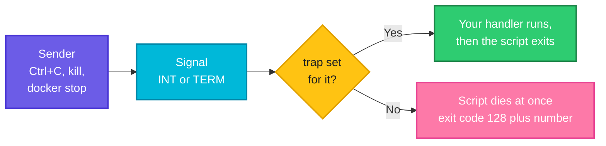
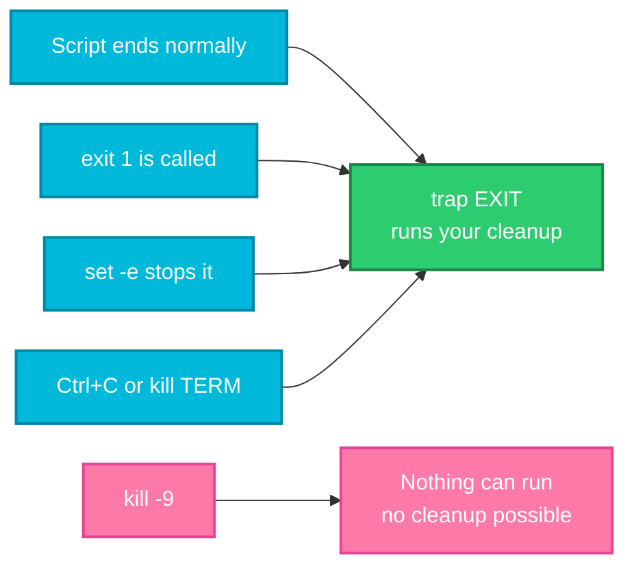

# Signals and `trap`: Cleaning Up When a Script Is Interrupted

> **Before this page:** you have read pages [01](01-what-is-a-shell-script.md) to [14](14-safe-and-debuggable-scripts.md). You can write careful scripts with functions, environment settings, `set -euo pipefail` and basic debugging.
>
> **By the end of this page** you will know what happens when someone presses Ctrl+C or runs `docker stop` on your script, and you will be able to make it clean up after itself, finish its current job, and refuse to run twice at once.

---

## 1. Start with a problem: the script that leaves a mess

Your script creates a temporary file, does some slow work, and deletes the file at the end. On a good day, that is fine. But what if somebody **stops it half-way**: a person presses Ctrl+C, a deploy tool times out, or the server is shutting down?

To test this safely, we need a small helper that starts a script, waits, and then sends it a "please stop" message. Let's say we have this file `stopit.sh`:

**Input file** (`stopit.sh`):
```bash
#!/bin/bash
# stopit.sh - run a script, send it a signal after a delay, and report
# usage: ./stopit.sh script [SIGNAL] [seconds]
script="$1"
sig="${2:-TERM}"
delay="${3:-1}"

"$script" &
pid=$!
sleep "$delay"
sent=$EPOCHREALTIME
kill -s "$sig" "$pid"
code=0
wait "$pid" || code=$?
took=$(awk -v a="$sent" -v b="$EPOCHREALTIME" 'BEGIN { printf "%.0f", b - a }')
echo "exit code: $code, stopped $took s after the signal"
```

(You do not need to understand every line yet. It starts the script in the background with `&` (page 11), sleeps, sends the signal with `kill`, and prints how the script ended. By the end of the page you will understand all of it.)

Now the script we want to stop. It creates a work file, takes a long time, and cleans up at the end:

Let's say we have this file `leaky.sh`:

**Input file** (`leaky.sh`):
```bash
#!/bin/bash
echo "working" > work.tmp
echo "started, work.tmp created"
sleep 30
rm -f work.tmp
echo "finished normally"
```

**Command:**
```bash
chmod +x stopit.sh leaky.sh
./stopit.sh ./leaky.sh TERM 1
ls work.tmp
```
**Sample Output:**
```text
started, work.tmp created
exit code: 143, stopped 0 s after the signal
work.tmp
```

The script was stopped after one second. It never reached `rm -f work.tmp`, and the final `ls` shows **`work.tmp` is still there**. The script died instantly, in the middle of its work, and left its mess behind.

In real life the "mess" can be much worse: a half-written report, a lock that is never released, a database left in a strange state, or a service that was told "I am starting" but never "I am done".

**How does a script get a chance to tidy up before it dies?**

---

## 2. The big idea: a tap on the shoulder

Programs on Linux can be sent short messages by the operating system, by other programs, or by you. These messages are called **signals**. Think of a signal as a **tap on the shoulder** with a very simple meaning:

| The signal | The everyday picture | What it asks |
|------------|----------------------|--------------|
| **`SIGTERM`** (15) | A polite knock: *"Please wrap up and leave."* | "Finish up and exit." This is what `kill`, `docker stop` and `systemctl stop` send by default |
| **`SIGINT`** (2) | Someone calls your name: *"Stop what you are doing!"* | "Interrupt." This is what **Ctrl+C** sends |
| **`SIGHUP`** (1) | The phone line goes dead | "Your terminal was closed." Many services also use it to mean "reload your settings" |
| **`SIGKILL`** (9) | The power is cut | "Die now." **Cannot be caught, blocked or handled**, so there is no cleanup |
| **`SIGSTOP`** (19) | The pause button | Freezes the program. Cannot be caught |
| **`SIGCONT`** (18) | The play button | Resumes a stopped program |
| **`SIGUSR1`** (10) | A private, agreed signal | Means whatever the program decides |

For every signal except `SIGKILL` and `SIGSTOP`, a script may **react**. By default, with no reaction set up, the script simply **dies at once**. But if the script has set a **trap**, then when the signal arrives the shell runs **your code first**. That code is your chance to clean up.

**Follow the arrows from the left.** A sender sends a signal. Without a trap the script dies on the spot. With a trap, your handler runs first.



---

## 3. Sending signals yourself

### The `kill` command

Despite its name, `kill` just **sends a signal**. With no option it sends `SIGTERM` (the polite one).

| Command | What it does |
|---------|--------------|
| `kill 1234` | Send `SIGTERM` to the process with number (PID) 1234 |
| `kill -INT 1234` | Send `SIGINT` (like Ctrl+C) |
| `kill -9 1234` | Send `SIGKILL` (cannot be refused) |
| `kill -l` | List all signals |
| `kill -l TERM` | Show the number of one signal |
| `pkill -TERM name` | Send a signal to every process with that name |

Let's look up a few signal numbers:

**Command:**
```bash
kill -l TERM
kill -l 9
kill -l INT
kill -l HUP
kill -l USR1
```
**Sample Output:**
```text
15
KILL
2
1
10
```

Given a name, `kill -l` shows the number. Given a number, it shows the name.

### Finding the PID: `$$` and `$!`

Every running program has a **PID** (process ID). Two special variables help in scripts:

| Variable | Holds |
|----------|-------|
| `$$` | The PID of **the current script** |
| `$!` | The PID of **the last background job** you started with `&` (page 11) |

This is why `stopit.sh` can say `pid=$!`: it remembers the script it just started, so it can send it a signal later.

### The exit code of a stopped script: 128 plus the signal number

You saw `exit code: 143` above. When a script is killed by a signal, its exit code is **128 plus the signal number** (page 04 mentioned this):

| Signal | Number | Exit code |
|--------|--------|-----------|
| `SIGHUP` | 1 | 129 |
| `SIGINT` (Ctrl+C) | 2 | **130** |
| `SIGKILL` | 9 | **137** |
| `SIGTERM` | 15 | **143** |

So `143` means "terminated politely", `130` means "Ctrl+C" and `137` means "killed hard". When a pipeline or a container reports exit code **137**, that very often means *"someone sent `SIGKILL`"*, and in containers it is a classic sign that the process **ran out of memory** and was killed. Now you can read these numbers.

---

## 4. `trap`: telling the shell what to do when a signal arrives

The command is:

```bash
trap 'commands to run' SIGNAL [SIGNAL ...]
```

Read it as: *"When any of these signals arrives, run these commands."*

Let's say we have this file `term.sh`, which catches the polite stop request:

**Input file** (`term.sh`):
```bash
#!/bin/bash
trap 'echo "caught TERM, saying goodbye"; exit 143' TERM
echo "running"
sleep 30 &
wait $!
echo "never printed"
```

**Command:**
```bash
chmod +x term.sh
./stopit.sh ./term.sh TERM 1
```
**Sample Output:**
```text
running
caught TERM, saying goodbye
exit code: 143, stopped 0 s after the signal
```

- When the `TERM` signal arrived, the shell ran the trap's commands first: it printed the goodbye message.
- The trap ended with **`exit 143`**. A trap does **not** exit by itself. After your handler runs, the script **carries on from where it was**, unless the handler calls `exit`.
- The `sleep 30 &` followed by `wait $!` is a pattern we will explain in section 7. It lets the signal be handled immediately.

### Catching Ctrl+C

Pressing Ctrl+C sends `SIGINT` to the running script. To try this without a keyboard, a script can send the signal **to itself** with `kill -INT $$`.

Let's say we have this file `selfint.sh`:

**Input file** (`selfint.sh`):
```bash
#!/bin/bash
trap 'echo "caught Ctrl+C (INT), not quitting yet"' INT
echo "sending INT to myself"
kill -INT $$
echo "still running after INT"
```

**Command:**
```bash
chmod +x selfint.sh
./selfint.sh
```
**Sample Output:**
```text
sending INT to myself
caught Ctrl+C (INT), not quitting yet
still running after INT
```

The handler printed its message, and because it did **not** call `exit`, the script **kept going**. Compare it with a script that has **no** trap:

Let's say we have this file `selfint2.sh`:

**Input file** (`selfint2.sh`):
```bash
#!/bin/bash
echo "sending INT to myself, no trap"
kill -INT $$
echo "never printed"
```

**Command:**
```bash
chmod +x selfint2.sh
./selfint2.sh
echo "exit code: $?"
```
**Sample Output:**
```text
sending INT to myself, no trap
exit code: 130
```

Without a trap, the signal killed the script at once, with exit code `130` (128 plus 2).

### Ignoring a signal on purpose

Give `trap` an **empty** command, and the signal is **ignored**. This protects a delicate moment, such as writing a file, from being interrupted. `trap - SIGNAL` removes the trap and restores the default.

Let's say we have this file `ign.sh`:

**Input file** (`ign.sh`):
```bash
#!/bin/bash
trap '' INT
echo "critical section: Ctrl+C is ignored"
kill -INT $$
echo "survived INT"
trap - INT
echo "trap removed: INT works again"
kill -INT $$
echo "never printed"
```

**Command:**
```bash
chmod +x ign.sh
./ign.sh
echo "exit code: $?"
```
**Sample Output:**
```text
critical section: Ctrl+C is ignored
survived INT
trap removed: INT works again
exit code: 130
```

While `trap '' INT` was active, the signal did nothing. After `trap - INT`, the next one killed the script. Use this sparingly: a script that cannot be interrupted is annoying. (And remember: `SIGKILL` **cannot** be ignored by anything.)

### Listing the traps: `trap -p`

Let's say we have this file `tp.sh`:

**Input file** (`tp.sh`):
```bash
#!/bin/bash
trap 'echo bye' EXIT
trap 'echo term' TERM
trap -p
```

**Command:**
```bash
chmod +x tp.sh
./tp.sh
```
**Sample Output:**
```text
trap -- 'echo bye' EXIT
trap -- 'echo term' SIGTERM
bye
```

`trap -p` prints every trap currently set. The `bye` at the end came from the `EXIT` trap, which ran as the script finished. That special trap is next.

---

## 5. The most useful trap: `EXIT`

Besides real signals, `trap` knows a special name, **`EXIT`**. An `EXIT` trap runs **whenever the script ends, however it ends**. That makes it the perfect place for cleanup.

**Follow the arrows into the green box.** Almost every way a script can end runs your cleanup. Only `kill -9` cannot.



Here is the leaky script from section 1, fixed with one line:

Let's say we have this file `clean.sh`:

**Input file** (`clean.sh`):
```bash
#!/bin/bash
trap 'rm -f work.tmp; echo "cleanup done"' EXIT
echo "working" > work.tmp
echo "started, work.tmp created"
sleep 30
echo "finished normally"
```

**Command:**
```bash
chmod +x clean.sh
./stopit.sh ./clean.sh TERM 1
ls work.tmp
```
**Sample Output:**
```text
started, work.tmp created
cleanup done
exit code: 143, stopped 0 s after the signal
ls: cannot access 'work.tmp': No such file or directory
```

This time `cleanup done` printed, and `ls` confirms **`work.tmp` is gone**. We did not even trap `TERM` itself. The shell ran the `EXIT` trap on its way out. The exit code is still `143`, so a pipeline still sees that the script was stopped.

### The one signal that cannot be handled: `SIGKILL`

Now the same script, stopped with `KILL` instead:

**Command:**
```bash
./stopit.sh ./clean.sh KILL 1
ls work.tmp
```
**Sample Output:**
```text
started, work.tmp created
./stopit.sh: line 14:  2379 Killed                  "$script"
exit code: 137, stopped 0 s after the signal
work.tmp
```

No `cleanup done`, exit code `137`, and **`work.tmp` is left behind**. `SIGKILL` is handled by the operating system itself, and the script never gets to run a single line. (The number `2379` is the PID and differs each time.)

This is why the polite signal matters. Tools like `docker stop` and `systemctl stop` send `SIGTERM` **first**, give the program time to clean up, and only then send `SIGKILL`. A script with a good trap uses that time. A script without one gets killed in the middle of its work. And since `SIGKILL` can strike at any moment, **write scripts so that a leftover file or lock does no lasting harm**: unique temp names, `mkdir -p`, and cleaning up old leftovers at the start (page 14).

### The `EXIT` trap sees how the script ended

Inside the trap, `$?` holds the **exit status** the script was about to finish with.

Let's say we have this file `ex.sh`:

**Input file** (`ex.sh`):
```bash
#!/bin/bash
trap 'echo "[cleanup ran, exit status $?]"' EXIT
case "${1:-}" in
  normal) echo "finishing normally" ;;
  exit3)  echo "calling exit 3"; exit 3 ;;
  fail)   set -e; echo "about to fail"; false; echo "never" ;;
esac
```

**Command:**
```bash
chmod +x ex.sh
./ex.sh normal
./ex.sh exit3
./ex.sh fail
```
**Sample Output:**
```text
finishing normally
[cleanup ran, exit status 0]
calling exit 3
[cleanup ran, exit status 3]
about to fail
[cleanup ran, exit status 1]
```

The cleanup ran in all three cases: a normal finish (status `0`), an explicit `exit 3`, and a `set -e` failure (status `1`). That is why `set -euo pipefail` (page 14) together with `trap ... EXIT` is such a strong combination.

---

## 6. The `ERR` trap: say where it failed

Another special trap, **`ERR`**, runs when a command **fails** (it works together with `set -e`). Combined with the variable `$LINENO` (the current line number), it tells you **where** the script broke:

Let's say we have this file `err.sh`:

**Input file** (`err.sh`):
```bash
#!/bin/bash
set -e
trap 'echo "FAILED on line $LINENO" >&2' ERR
echo "step 1"
ls /nope
echo "step 2"
```

**Command:**
```bash
chmod +x err.sh
./err.sh
echo "exit code: $?"
```
**Sample Output:**
```text
step 1
ls: cannot access '/nope': No such file or directory
FAILED on line 5
exit code: 2
```

Instead of just "something failed", you get **line 5**. In a long script, a one-line trap like this turns a mystery into a pointer. (The message goes to `>&2`, the error channel, from page 12.)

---

## 7. A subtle rule: a trap waits for the current command to finish

Here is a surprise that confuses almost everyone. If your script is busy running a **foreground command** such as `sleep 3`, and a signal arrives, **bash waits for that command to finish before running your trap**.

Let's compare two scripts that both sleep for 3 seconds, and are both told to stop after 1 second.

Let's say we have this file `slow.sh`:

**Input file** (`slow.sh`):
```bash
#!/bin/bash
trap 'echo "trap ran"; exit 143' TERM
echo "start: sleeping 3 seconds the plain way"
sleep 3
echo "never printed"
```

And this file `fast.sh`, which sleeps in the **background** and uses `wait`:

**Input file** (`fast.sh`):
```bash
#!/bin/bash
trap 'echo "trap ran"; exit 143' TERM
echo "start: sleeping 3 seconds with sleep and wait"
sleep 3 &
wait $!
echo "never printed"
```

**Command:**
```bash
chmod +x slow.sh fast.sh
./stopit.sh ./slow.sh TERM 1
./stopit.sh ./fast.sh TERM 1
```
**Sample Output:**
```text
start: sleeping 3 seconds the plain way
trap ran
exit code: 143, stopped 2 s after the signal
start: sleeping 3 seconds with sleep and wait
trap ran
exit code: 143, stopped 0 s after the signal
```

Look at the last number on each pair:

- **`slow.sh`:** the signal arrived at second 1, but the trap ran only after the `sleep 3` finished, **2 seconds later**.
- **`fast.sh`:** the trap ran **immediately** (0 seconds). The built-in `wait` is **interrupted** by a signal, so the shell can run the trap at once.

The pattern **`some_slow_command & wait $!`** makes a long command stoppable. For short commands (a few milliseconds) it does not matter. For a `sleep 60` in a service loop, it matters a lot, because `docker stop` may only wait 10 seconds before it kills you with `SIGKILL`.

---

## 8. Graceful shutdown: finish the job, then stop

A long-running script, such as a worker that processes jobs, should not be cut off in the middle of a job. The pattern is:

1. The trap does **not** exit. It only sets a **flag** such as `running=no`.
2. The main loop checks the flag **between jobs**, and ends when it is `no`.

This way the current job is **finished**, and then the script stops cleanly.

Let's say we have this file `worker.sh`:

**Input file** (`worker.sh`):
```bash
#!/bin/bash
running=yes
trap 'echo ">> TERM received, finishing the current job first"; running=no' TERM

job=0
while [[ $running == yes ]]; do
  job=$((job + 1))
  echo "job $job: started"
  sleep 0.4
  echo "job $job: finished"
done
echo "worker stopped cleanly after $job jobs"
```

**Command:**
```bash
chmod +x worker.sh
./stopit.sh ./worker.sh TERM 1
```
**Sample Output:**
```text
job 1: started
job 1: finished
job 2: started
job 2: finished
job 3: started
>> TERM received, finishing the current job first
job 3: finished
worker stopped cleanly after 3 jobs
exit code: 0, stopped 0 s after the signal
```

The `TERM` arrived while **job 3** was running. The worker did not abandon it: it printed `job 3: finished`, noticed the flag, left the loop, and reported a clean stop with exit code `0`. (The 0.4-second job is short enough to finish before the next check.)

### Why this matters for Docker, systemd and Kubernetes

All the common tools stop things in the **same two steps**: `SIGTERM`, a wait, then `SIGKILL`.

| Tool | What it sends | How long it usually waits before `SIGKILL` |
|------|---------------|---------------------------------------------|
| `docker stop` | `SIGTERM` | 10 seconds by default |
| `systemctl stop` | `SIGTERM` | About 90 seconds by default |
| Kubernetes (deleting a Pod) | `SIGTERM` | 30 seconds by default (the "grace period") |

These defaults can be changed. The point: **you have a few seconds to wrap up. Use them.** A script without a trap gets killed instantly, and one with a trap shuts down gracefully.

### One more trap for containers: `exec`

A container's entrypoint is often a small shell script that prepares things and then starts the real program. If it simply **runs** the program, the shell stays as the parent, and signals sent by `docker stop` go to the **shell**, not to your program.

The fix is **`exec`**, which **replaces** the shell with the new program, instead of starting it as a child. The process keeps the same PID, so signals reach the program directly.

Let's say we have this file `ex2.sh`:

**Input file** (`ex2.sh`):
```bash
#!/bin/bash
echo "before exec, pid: $$"
exec bash -c 'echo "after exec,  pid: $$"'
```

**Command:**
```bash
chmod +x ex2.sh
./ex2.sh
```
**Sample Output:**
```text
before exec, pid: 2573
after exec,  pid: 2573
```

The **same PID** before and after: the new program took over the old process. That is why container entrypoint scripts usually end with `exec "$@"` (page 03): the last line hands the whole process over to the real application, so it receives `SIGTERM` itself and can shut down properly. (Your PID will differ from `2573`.)

---

## 9. Locks: stop two copies running at once

A cron job that runs every minute can start a new copy **while the previous one is still running**, if the first one is slow. Two copies of a backup writing into the same folder is a recipe for corruption. A **lock** makes the second copy refuse to start.

The simplest reliable lock in bash is a **folder**. The command `mkdir` either creates a folder or fails, and it **cannot half-succeed**, so only one script can win:

```bash
if ! mkdir "$LOCK" 2>/dev/null; then
  echo "already running"
  exit 3
fi
trap 'rmdir "$LOCK"' EXIT      # only AFTER we own the lock!
```

Notice the order. The `EXIT` trap that removes the lock is set **only after** we got the lock. If it were set before, a second copy that failed to get the lock would still run its `EXIT` trap and **delete the first copy's lock**.

---

## 10. Upgrade `morning.sh`: a lock and graceful stops

Let's add everything from this page to our running script:

- A **lock folder**, so only one copy runs at a time (the second one exits with code `3`).
- An **`EXIT` trap** that removes the lock, however the script ends.
- **`INT` and `TERM` traps** that print a message and exit with the right codes (`130` and `143`), which also triggers the `EXIT` cleanup.

Let's say we now have this file `morning.sh`:

**Input file** (`morning.sh`):
```bash
#!/bin/bash
# morning.sh - usage: [WARN=80] [CRIT=90] ./morning.sh [--fast] [disk ...]
# Exit codes: 0 all OK, 1 warning, 2 critical or missing, 3 already running
set -euo pipefail

# A tiny, known PATH so the script behaves the same in cron and in a terminal
export PATH=/usr/local/sbin:/usr/local/bin:/usr/sbin:/usr/bin:/sbin:/bin

# Settings: use the environment if given, otherwise these defaults
WARN="${WARN:-80}"
CRIT="${CRIT:-90}"
TRIES="${TRIES:-1}"
LOCK="${LOCK:-/tmp/morning.lock}"

cleanup() {
  rmdir "$LOCK" 2>/dev/null || true
}

# Only one copy may run at a time. mkdir either creates the folder or fails,
# and it cannot half-succeed, so it works as a lock.
acquire_lock() {
  if ! mkdir "$LOCK" 2>/dev/null; then
    echo "morning.sh is already running (lock: $LOCK)" >&2
    exit 3
  fi
  # Set the traps only AFTER we own the lock, so a copy that failed to get
  # the lock never deletes the lock of the copy that is really running.
  trap cleanup EXIT
  trap 'echo "Interrupted (Ctrl+C), stopping" >&2; exit 130' INT
  trap 'echo "Asked to stop (TERM), stopping" >&2; exit 143' TERM
}

disk_exists() {
  df "$1" > /dev/null 2>&1
}

wait_for_disk() {
  local disk="$1"
  local tries=0
  while ! disk_exists "$disk" && [[ $tries -lt $TRIES ]]; do
    tries=$((tries + 1))
    echo "$disk: not found yet, waiting (try $tries of $TRIES)"
    sleep 1
  done
}

disk_usage() {
  df --output=pcent "$1" | tail -1 | tr -dc '0-9'
}

check_disk() {
  local disk="$1"
  if ! disk_exists "$disk"; then
    echo "$disk: NOT FOUND"
    return 2
  fi
  local usage
  usage=$(disk_usage "$disk")
  if [[ $usage -ge $CRIT ]]; then
    echo "$disk: CRITICAL ($usage%)"
    return 2
  elif [[ $usage -ge $WARN ]]; then
    echo "$disk: WARNING ($usage%)"
    return 1
  fi
  echo "$disk: OK ($usage%)"
  return 0
}

main() {
  acquire_lock

  local fast=no
  if [[ ${1:-} == "--fast" ]]; then
    fast=yes
    shift
  fi

  local disks=("$@")
  if [[ ${#disks[@]} -eq 0 ]]; then
    disks=(/)
  fi

  echo "Date : $(date +%d-%b-%Y)"

  local worst=0 code disk
  for disk in "${disks[@]}"; do
    if [[ -z $disk ]]; then
      echo "(skipping an empty name)"
      continue
    fi

    wait_for_disk "$disk"
    code=0
    check_disk "$disk" || code=$?

    if [[ $code -gt $worst ]]; then
      worst=$code
    fi
    if [[ $fast == yes && $code -eq 2 ]]; then
      echo "Stopping early (--fast): a critical problem was found"
      break
    fi
  done
  return "$worst"
}

main "$@"
```

To test three situations in one go, here is a small driver:

Let's say we have this file `drive.sh`:

**Input file** (`drive.sh`):
```bash
#!/bin/bash
echo "--- 1. a normal run, then is the lock gone?"
./morning.sh /
echo "exit: $?"
echo "lock folder still there? $([[ -d /tmp/morning.lock ]] && echo YES || echo no)"

echo "--- 2. two copies at the same time"
TRIES=3 ./morning.sh /nope &
sleep 1
./morning.sh /
echo "second copy exit: $?"
wait
echo "first copy has finished; lock folder there? $([[ -d /tmp/morning.lock ]] && echo YES || echo no)"

echo "--- 3. the copy is told to stop (TERM) while it waits"
TRIES=5 ./morning.sh /nope &
pid=$!
sleep 1.5
kill -TERM "$pid"
wait "$pid" || echo "exit: $?"
echo "lock folder still there? $([[ -d /tmp/morning.lock ]] && echo YES || echo no)"
```

**Command:**
```bash
chmod +x morning.sh drive.sh
./drive.sh
```
**Sample Output:**
```text
--- 1. a normal run, then is the lock gone?
Date : 20-Oct-2026
/: OK (2%)
exit: 0
lock folder still there? no
--- 2. two copies at the same time
Date : 20-Oct-2026
/nope: not found yet, waiting (try 1 of 3)
morning.sh is already running (lock: /tmp/morning.lock)
second copy exit: 3
/nope: not found yet, waiting (try 2 of 3)
/nope: not found yet, waiting (try 3 of 3)
/nope: NOT FOUND
first copy has finished; lock folder there? no
--- 3. the copy is told to stop (TERM) while it waits
Date : 20-Oct-2026
/nope: not found yet, waiting (try 1 of 5)
/nope: not found yet, waiting (try 2 of 5)
Asked to stop (TERM), stopping
exit: 143
lock folder still there? no
```

Read the three parts:

1. **A normal run:** it worked and, afterwards, the lock folder is **gone**: the `EXIT` trap cleaned up.
2. **Two copies:** the first copy, which was waiting for a missing disk, held the lock. The second copy was **refused** with `already running` and exit code `3`. The first one carried on and finished, and then the lock was released.
3. **A `TERM` signal:** the script printed `Asked to stop`, exited with `143`, and **still removed its lock** thanks to the `EXIT` trap.

Compare this with a script that was killed by `SIGKILL`: it would leave a stale lock folder, and every later run would refuse to start until someone removed it by hand. That is the one weakness of the folder-lock. For heavy-duty needs, the `flock` command (from the `util-linux` package) is a sturdier alternative, because the operating system itself releases the lock when the process dies, even if it was killed.

---

## 11. The mistakes that bite

| Mistake | Symptom | Fix |
|---------|---------|-----|
| No cleanup trap | Temp files, locks and half-written output left behind | `trap '...' EXIT` |
| Using `kill -9` as the first choice | No cleanup can run | `kill` (TERM) first, `-9` only as a last resort |
| A handler that never calls `exit` | The script carries on after the signal | End the handler with `exit N`, or deliberately set a flag |
| Trap commands in double quotes with variables | Variables are filled in **when the trap is set**, not when it fires | Use **single quotes** around the trap commands |
| Setting the `EXIT` trap **before** getting the lock | A losing copy deletes the winner's lock | Set the trap only after the lock is acquired |
| `sleep 60` in a loop with a `TERM` trap | The trap waits up to 60 seconds, and Docker kills you first | `sleep 60 & wait $!` |
| Expecting to catch `SIGKILL` or `SIGSTOP` | They cannot be caught | Design leftovers to be harmless |
| An entrypoint script that does not `exec` the app | `docker stop` signals the shell, not the app | End with `exec "$@"` |
| Trapping `INT` and never allowing a way to stop | A script nobody can interrupt | Ignore signals only in short critical sections |
| A stale lock after a hard kill | Every new run says `already running` | Check the age and remove it, or use `flock` |
| Reading exit code `137` or `143` as a script bug | Misreading the cause | `137` is KILL (often out of memory), `143` is TERM |
| A trap in a function or subshell expecting it to apply everywhere | The trap is not what you expect | Set traps in the main script, near the top |

Here is why single quotes matter, shown for real.

Let's say we have this file `quote.sh`:

**Input file** (`quote.sh`):
```bash
#!/bin/bash
status="starting"
trap "echo 'double quotes saw: $status'" EXIT
trap 'echo "single quotes saw: $status"' USR1
status="finished"
kill -USR1 $$
```

**Command:**
```bash
chmod +x quote.sh
./quote.sh
```
**Sample Output:**
```text
single quotes saw: finished
double quotes saw: starting
```

The trap in **single quotes** looked up `$status` when it fired and saw the latest value, `finished`. The trap in **double quotes** had `$status` replaced **at the moment the `trap` line ran**, so it remembered the old `starting` forever. (The `EXIT` trap fired last, as the script ended.)

---

## 12. Words to remember

| Word | Simple meaning |
|------|----------------|
| **Signal** | A short message sent to a running program |
| **`SIGTERM` (15)** | "Please stop." The polite default of `kill`, `docker stop`, `systemctl stop` |
| **`SIGINT` (2)** | What Ctrl+C sends |
| **`SIGHUP` (1)** | The terminal closed (or "reload your settings") |
| **`SIGKILL` (9)** | "Die now." Cannot be caught |
| **PID** | The number identifying a running process |
| **`$$` / `$!`** | PID of this script / PID of the last background job |
| **`kill`** | Sends a signal (default `TERM`) |
| **Exit code 128 plus N** | A program was stopped by signal N (130, 137, 143) |
| **`trap`** | Run your commands when a signal or event arrives |
| **`trap '' SIG`** | Ignore the signal |
| **`trap - SIG`** | Restore the default behaviour |
| **`EXIT` trap** | Runs when the script ends, however it ends |
| **`ERR` trap** | Runs when a command fails |
| **Graceful shutdown** | Finish the current job, clean up, then stop |
| **Lock** | A marker that stops two copies from running at once |
| **`exec`** | Replace the shell with another program (same PID) |
| **`wait`** | Pause until a background job ends, and can be interrupted by a signal |

---

## 13. Try it yourself

1. **List the signals.** Run `kill -l` and find the numbers of `HUP`, `INT`, `TERM`, `KILL` and `USR1`.
2. **Leave a mess.** Write a script that creates a file, sleeps 30 seconds and removes the file. Use `stopit.sh` to stop it with `TERM`. Check that the file remains. Then fix it with an `EXIT` trap and check again.
3. **Which exit code?** Predict the exit codes after stopping a script with `TERM`, `INT` (via `kill -INT $$`) and `KILL`. Then check.
4. **Say goodbye.** Write a script with a `TERM` trap that prints `Goodbye` and exits with `143`. Use `sleep 30 & wait $!` for the long wait.
5. **Where did it fail?** Add `set -e` and an `ERR` trap that prints `$LINENO` to one of your earlier scripts, then break a line on purpose.
6. **Immediate or late?** Compare a script with `sleep 5` and one with `sleep 5 & wait $!`, both stopped after 1 second. Explain the difference in reaction time.
7. **A graceful worker.** Change `worker.sh` so that it also stops after 10 jobs on its own.
8. **A lock.** Add a folder-lock to a script of yours. Run two copies at once, and check that the second is refused and the lock is removed afterwards.
9. **Stale lock.** Create the lock folder by hand, and run the script. What happens? How would you recover?
10. **Quotes in traps.** Reproduce `quote.sh` and explain why the two messages differ.
11. **Spot the bug.** This script is meant to remove its lock on exit. What can go wrong?
    ```bash
    trap 'rmdir "$LOCK"' EXIT
    mkdir "$LOCK" || exit 1
    ```
12. **Upgrade `morning.sh`.** Add an `ERR` trap that prints the failing line number to the error channel, and a `HUP` trap that reloads the `WARN` and `CRIT` settings.

<details>
<summary>Answers for exercises 6 and 11 (open only after trying)</summary>

**Exercise 6:** With a plain `sleep 5` the shell finishes the foreground command before running the trap, so it reacts about 4 seconds after the signal. With `sleep 5 & wait $!`, the `wait` is interrupted, so it reacts at once.

**Exercise 11:** The trap is set **before** the lock is taken. If `mkdir` fails because another copy holds the lock, the script calls `exit 1`, the `EXIT` trap fires, and it **removes the other copy's lock**. Set the trap after the `mkdir` has succeeded:

```bash
mkdir "$LOCK" || exit 1
trap 'rmdir "$LOCK"' EXIT
```
</details>

---

## 14. Quick recap

- A **signal** is a short message sent to a process. **`SIGTERM`** (15) is "please stop", **`SIGINT`** (2) is Ctrl+C, **`SIGHUP`** (1) is "terminal closed", and **`SIGKILL`** (9) is "die now" and **cannot be caught**.
- A script killed by a signal exits with **128 plus the signal number**: **130** (INT), **143** (TERM), **137** (KILL).
- **`trap 'commands' SIGNAL`** runs your code when the signal arrives. Use **single quotes**. A handler does **not** exit unless it calls `exit`.
- **`trap '...' EXIT`** runs when the script ends **however it ends** (normal end, `exit`, `set -e`, `TERM`, `INT`). It is the best place for cleanup. `kill -9` is the one thing it cannot survive.
- **`trap '...' ERR`** plus `$LINENO` tells you **where** a script failed.
- A trap waits for the current **foreground** command. Use **`command & wait $!`** to be interrupted at once.
- **Graceful shutdown:** the trap sets a flag, the loop checks it between jobs, and the current job always finishes.
- `docker stop`, `systemctl stop` and Kubernetes send `TERM` **first**, then `KILL` after a delay. Use the delay. End container entrypoints with **`exec`**.
- A **folder lock** (`mkdir`) stops two copies running at once. Set the cleanup trap **only after** you own the lock.

**Next page:** [16 Scheduling scripts with cron](16-scheduling-with-cron.md), where you will learn to run your scripts automatically at fixed times, and how to avoid the classic cron surprises.
