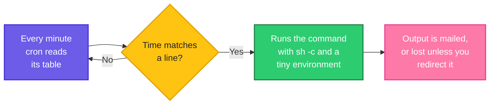
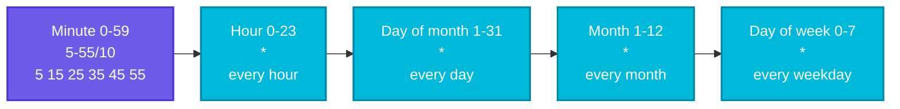

# Scheduling Scripts with Cron: Make Your Script Run by Itself

> **Before this page:** you have read pages [01](01-what-is-a-shell-script.md) to [15](15-signals-and-trap.md). You can write careful scripts with settings, functions, traps and locks, and you know why a script that works in your terminal can fail with a tiny environment.
>
> **By the end of this page** you will be able to read and write a cron schedule, make a script run every 30 minutes or every night at 2 a.m., see its output, stop copies from piling up, and avoid the classic cron surprises.
>
> **A note on safety.** While writing this page I did **not** install anything into a real crontab. Everything you see being run was tested in isolation: the job's shell and environment, redirects, locks, timeouts and `run-parts`. The meaning of schedule expressions comes from the crontab manual and from real system files, not from a run of cron itself. Treat your own crontab with care (section 9 shows a safe procedure).

---

## 1. Start with a problem: you cannot be there at 2 a.m.

You now have a good script, `morning.sh`, that checks your disks. But you still have to **type the command** to run it. What you really want is:

- check the disks **every 30 minutes**,
- run a backup **every night at 2 a.m.**,
- clean old logs **every Sunday**,
- do something **once at every reboot**.

Nobody wants to sit at a keyboard at 2 a.m. You need a program that watches the clock for you and starts your scripts at the right moments.

On Linux that program is **cron**.

---

## 2. The big idea: an alarm clock for commands

Think of a small, very reliable assistant who:

1. Looks at the clock **every minute**.
2. Looks at a **table of instructions** you wrote: *"at this time, run this command."*
3. If the current time matches a line, **starts that command**.

The assistant is the **cron daemon** (a program that runs in the background, usually called `cron` or `crond`). The table of instructions is called a **crontab** (short for *cron table*). Each **line** in a crontab is one scheduled job: a **time pattern** followed by a **command**.

**Follow the arrows from the left.** Cron wakes every minute, checks whether the time matches any line, and if so it runs the command in a very small environment. Whatever the command prints goes by mail, or is lost, unless you save it.



The two boxes on the right hide the whole reason this page exists. **A cron job runs in a different world from your terminal**: a different shell, a tiny environment, and nobody watching the output. You met this world in page 13. We will make your scripts at home in it.

---

## 3. Reading a schedule: the five fields

Every cron line starts with **five fields**, separated by spaces, followed by the command. Here is the legend, copied from a real system file, `/etc/crontab`, which every Ubuntu machine ships with:

```text
# .---------------- minute (0 - 59)
# |  .------------- hour (0 - 23)
# |  |  .---------- day of month (1 - 31)
# |  |  |  .------- month (1 - 12) OR jan,feb,mar,apr ...
# |  |  |  |  .---- day of week (0 - 6) (Sunday=0 or 7) OR sun,mon,tue,wed,thu,fri,sat
# |  |  |  |  |
# *  *  *  *  * user-name command to be executed
```

(The `user-name` column exists only in the **system** crontab files. In your own personal crontab, the command follows the fifth field directly.)

Cron runs the command **whenever all five fields match the current time**.

### A real example, line by line

Here is a real file that a monitoring package called `sysstat` installs on this machine, `/etc/cron.d/sysstat`:

Let's say we have this file `/etc/cron.d/sysstat`:

**Input file** (`/etc/cron.d/sysstat`):
```text
# The first element of the path is a directory where the debian-sa1
# script is located
PATH=/usr/lib/sysstat:/usr/sbin:/usr/sbin:/usr/bin:/sbin:/bin

# Activity reports every 10 minutes everyday
5-55/10 * * * * root command -v debian-sa1 > /dev/null && debian-sa1 1 1

# Additional run at 23:59 to rotate the statistics file
59 23 * * * root command -v debian-sa1 > /dev/null && debian-sa1 60 2
```

Read the first job. Each field in turn:

**Follow the arrows, one field at a time.** The first job fixes the minute and leaves every other field open.



- **Line 1:** `5-55/10 * * * *` means *"at minutes 5, 15, 25, 35, 45 and 55 of every hour, every day"*, that is, **every 10 minutes, starting at minute 5**. The command, run as user `root`, collects statistics.
- **Line 2:** `59 23 * * *` means *"at 23:59, every day"*, once a day, just before midnight.

### The four special characters

| Character | Meaning | Example | Matches |
|-----------|---------|---------|---------|
| `*` | **Every** value | `*` in the hour field | every hour |
| `,` | A **list** | `0,30` | minute 0 and minute 30 |
| `-` | A **range** | `9-17` | 9, 10, 11 ... 17 |
| `/` | A **step** | `*/15` | every 15th value |

You can combine them: `8-18/2` means "from 8 to 18, every 2nd", which is 8, 10, 12, 14, 16, 18.

### Common schedules

| You want | Write | In plain English |
|----------|-------|------------------|
| Every minute | `* * * * *` | every minute of every day |
| Every 5 minutes | `*/5 * * * *` | minutes 0, 5, 10 ... 55 |
| Every 30 minutes | `*/30 * * * *` | at :00 and :30 |
| Every hour | `0 * * * *` | at minute 0 of every hour |
| Every day at 2:30 a.m. | `30 2 * * *` | 02:30 daily |
| Weekdays at 9 a.m. | `0 9 * * 1-5` | Monday to Friday, 09:00 |
| Every Sunday at 3 a.m. | `0 3 * * 0` | Sundays, 03:00 (`7` also means Sunday) |
| First day of every month, midnight | `0 0 1 * *` | 00:00 on the 1st |
| Twice a day | `0 6,18 * * *` | 06:00 and 18:00 |
| Every 2 hours, in office time | `0 8-18/2 * * *` | 08:00, 10:00 ... 18:00 |

Most cron programs also accept **shortcut words**: `@hourly`, `@daily`, `@weekly`, `@monthly`, `@yearly` and **`@reboot`** (once, when the machine starts). For example, `@daily /home/devops/bin/backup.sh`.

### Seeing what a field means: a small helper

When you are unsure what a field matches, you can **expand** it into the list of values it stands for. This little script does that, and it is a good exercise in arrays, loops and the string tools from page 11.

Let's say we have this file `expand.sh`:

**Input file** (`expand.sh`):
```bash
#!/bin/bash
# expand.sh - show which values one cron field matches
# usage: ./expand.sh FIELD MIN MAX      for example: ./expand.sh '*/15' 0 59
field="$1"
min="$2"
max="$3"

values=()
IFS=',' read -ra parts <<< "$field"
for part in "${parts[@]}"; do
  step=1
  range="$part"
  if [[ $part == */* ]]; then
    range="${part%/*}"
    step="${part#*/}"
  fi

  if [[ $range == "*" ]]; then
    start=$min
    end=$max
  elif [[ $range == *-* ]]; then
    start="${range%-*}"
    end="${range#*-}"
  else
    start="$range"
    end="$range"
  fi

  for (( v = start; v <= end; v += step )); do
    values+=("$v")
  done
done

printf '%s\n' "${values[@]}" | sort -n -u | tr '\n' ' '
echo
```

It splits the field at commas, handles an optional `/step`, expands `*` or `a-b` or a single number, and prints the sorted, unique values. (It handles the common forms only: no month or day names. It is a learning aid, **not** cron itself.)

**Command:**
```bash
chmod +x expand.sh
./expand.sh '*/15' 0 59
./expand.sh '5-55/10' 0 59
./expand.sh '9-17' 0 23
./expand.sh '0,30' 0 59
./expand.sh '0-23/6' 0 23
./expand.sh '1-5' 0 7
```
**Sample Output:**
```text
0 15 30 45 
5 15 25 35 45 55 
9 10 11 12 13 14 15 16 17 
0 30 
0 6 12 18 
1 2 3 4 5 
```

The second line confirms the sysstat schedule we read above: minutes 5, 15, 25, 35, 45, 55. The two numbers after the field are its allowed range (minutes are 0 to 59, hours 0 to 23).

### A step is not always "even"

A step starts **again** at the beginning of each range. So `*/7` in the minute field does **not** give an even rhythm:

**Command:**
```bash
./expand.sh '*/7' 0 59
```
**Sample Output:**
```text
0 7 14 21 28 35 42 49 56 
```

After `:56` comes `:00` of the next hour, only **4 minutes** later. Steps that divide the range evenly (`*/5`, `*/10`, `*/15`, `*/20`, `*/30`) give a regular rhythm. `*/7` does not.

### Four schedule surprises

These come from the crontab manual, so they apply to cron itself:

1. **Day of month and day of week are combined with OR, not AND.** If you restrict **both**, the job runs when **either** matches. `0 9 13 * 5` runs at 09:00 on the 13th of every month **and** on every Friday, not only on "Friday the 13th".
2. **The `%` sign is special** inside a crontab command. An unescaped `%` is turned into a **new line**. In `date +%F` you must write `date +\%F`. The easiest cure is to keep `%` out of the crontab and put such commands in a **script**.
3. **Times are in the machine's local time zone**, and cron has **no seconds**: one minute is the finest step. Around daylight-saving changes, a job in the skipped or repeated hour may run late, twice or not at all. Servers often run in UTC to avoid this.
4. **A missed run is not caught up.** If the machine is off at 02:30, the 02:30 job simply does not run when it comes back (unless you use `anacron` or a systemd timer with catch-up, section 10).

---

## 4. Cron's world: a different shell and a tiny environment

The most common cron failure is not the schedule, it is that **the command behaves differently from how it did in your terminal**. Two reasons, both from page 13.

### Reason 1: cron runs your command with `sh`, not `bash`

By default cron starts each command with **`/bin/sh -c`**. On Ubuntu and Debian, `/bin/sh` is not bash:

**Command:**
```bash
ls -l /bin/sh | awk '{print $9, $10, $11}'
```
**Sample Output:**
```text
/bin/sh -> dash
```

`dash` is a smaller, faster shell without bash's extras. So bash-only features **inside the crontab line** fail. Here is the same two small commands, run the way cron would run them, with `sh` and with `bash`:

**Command:**
```bash
env -i SHELL=/bin/sh PATH=/usr/bin:/bin /bin/sh -c '[[ -d /tmp ]] && echo "yes, /tmp is a folder"'
echo "exit: $?"
env -i SHELL=/bin/bash PATH=/usr/bin:/bin /bin/bash -c '[[ -d /tmp ]] && echo "yes, /tmp is a folder"'
echo "exit: $?"
env -i PATH=/usr/bin:/bin /bin/sh -c 'x=(a b c); echo "${x[1]}"'
echo "exit: $?"
```
**Sample Output:**
```text
/bin/sh: 1: [[: not found
exit: 127
yes, /tmp is a folder
exit: 0
/bin/sh: 1: Syntax error: "(" unexpected
exit: 2
```

- Under `sh`, the double-bracket test `[[ ... ]]` does not exist (`command not found`, exit `127`), and an array is a syntax error. Under `bash` the same code works.

**The simple rule that avoids all of this: put your logic in a script with a `#!/bin/bash` first line, and make the crontab line only call that script.** The shebang makes the script run under bash, whatever shell cron used to launch it. Inline `[[ ]]`, arrays or `$(( ))` in the crontab line itself is where `sh` bites.

(You can also put `SHELL=/bin/bash` at the top of a crontab file to make cron use bash for its lines.)

### Reason 2: the environment is tiny

Cron starts the command with only a few variables, typically `HOME`, `LOGNAME`, `SHELL` and a **short `PATH`** (such as `/usr/bin:/bin`). It does **not** read `~/.bashrc` or `~/.profile`. Page 13 showed the consequences: tools in `~/bin` are not found, and settings from your profile are missing.

You can also set variables at the **top of a crontab**, one per line, such as `PATH=/usr/local/bin:/usr/bin:/bin` (the sysstat file above does exactly this). The cure is the one from page 13: **set `PATH` inside the script, use full paths, and give every setting a default.** Our `morning.sh` already does all three.

Also remember that cron starts jobs in your **home folder**, so relative paths such as `logs/morning.log` point somewhere you did not expect. **Always use absolute paths** in a crontab line.

---

## 5. Where does the output go?

A cron job has **no terminal**. By default, anything it prints (to the normal output or the error channel) is **emailed to the user** by the local mail system. On most servers no mail system is set up, so the output is **silently lost**, and you will have no idea why a job fails.

The fix is to **write the output to a log file** yourself. You already know the tools from the Linux fundamentals: `>>` appends to a file, and `2>&1` sends the error channel to the same place. But the **order** matters, and this catches many people.

Let's say we have this file `noisy.sh`, which prints one line normally and one line to the error channel:

**Input file** (`noisy.sh`):
```bash
#!/bin/bash
echo "normal output line"
echo "error output line" >&2
```

**Command:**
```bash
chmod +x noisy.sh
rm -f a.log b.log
./noisy.sh >> a.log 2>&1
echo "a.log contains:"
cat a.log
./noisy.sh 2>&1 >> b.log
echo "b.log contains:"
cat b.log
```
**Sample Output:**
```text
a.log contains:
normal output line
error output line
error output line
b.log contains:
normal output line
```

Read the two forms:

- **Right: `>> a.log 2>&1`.** First `stdout` goes to the file, **then** `stderr` is pointed at the same place. Both lines landed in `a.log`.
- **Wrong: `2>&1 >> b.log`.** First `stderr` is pointed at where `stdout` is **now** (the terminal, or cron's mail), **then** `stdout` goes to the file. The error line escaped to the terminal (the **second** `error output line` above), and `b.log` got only the normal line. Under cron, that error line would be mailed or lost.

**For cron, always write `>> /absolute/path/job.log 2>&1`** (in that order). To silence cron's email completely, put `MAILTO=""` at the top of the crontab.

A growing log file will eventually fill the disk. On real servers a tool called `logrotate` renames and compresses old logs. Put your log under `/var/log` (or a folder you rotate) and ask for rotation.

---

## 6. Do not let copies pile up: `flock`

What if a job takes **longer than its interval**? A job scheduled every 5 minutes that sometimes takes 8 minutes would start a **second copy** while the first is still running, and then a third. In page 15 you built a folder lock inside the script. There is also a ready-made command for exactly this, **`flock`**, which you can put **in the crontab line** without changing the script.

`flock -n LOCKFILE command` means: *"take the lock on this file, and run the command. If someone else already holds it (`-n` means do not wait), give up at once with exit code 1."*

Let's say we have this file `slowjob.sh`:

**Input file** (`slowjob.sh`):
```bash
#!/bin/bash
echo "job started"
sleep 2
echo "job finished"
```

And this driver, which starts the job, then tries to start a second copy half a second later:

**Input file** (`drive_lock.sh`):
```bash
#!/bin/bash
flock -n /tmp/pc16/job.lock ./slowjob.sh &
sleep 0.5
flock -n /tmp/pc16/job.lock ./slowjob.sh
echo "second copy exit code: $?"
wait
echo "after the first finished:"
flock -n /tmp/pc16/job.lock ./slowjob.sh
```

(`/tmp/pc16` is just the practice folder used for these demos. Use any folder you can write to.)

**Command:**
```bash
chmod +x slowjob.sh drive_lock.sh
./drive_lock.sh
```
**Sample Output:**
```text
job started
second copy exit code: 1
job finished
after the first finished:
job started
job finished
```

- The first copy started.
- The second copy was **refused at once** (`exit code: 1`), silently, so no pile-up.
- After the first finished and released the lock, a new run was accepted.

In a crontab, that becomes: `*/5 * * * * flock -n /tmp/job.lock /home/devops/bin/job.sh`.

### Why `flock` is sturdier than a folder lock

A lock **folder** (page 15) is left behind if the script is killed with `SIGKILL`, and every later run is refused until someone deletes it. A `flock` lock belongs to the **open file**, and the operating system releases it when the process holding it dies, **even when it was killed hard**.

Let's say we have this file `holder.sh`, which takes the lock and then just keeps busy:

**Input file** (`holder.sh`):
```bash
#!/bin/bash
# takes the lock on file descriptor 9 and then just keeps busy
exec 9> /tmp/pk16/job.lock
flock -n 9 || { echo "could not get the lock"; exit 1; }
echo "holder has the lock"
while true; do :; done
```

And this driver:

**Input file** (`drive.sh`):
```bash
#!/bin/bash
./holder.sh &
pid=$!
sleep 0.5
echo "second try while the holder runs:"
flock -n /tmp/pk16/job.lock echo "got it" || echo "  refused: the lock is held"
kill -9 "$pid"
wait "$pid" 2>/dev/null
echo "holder killed with SIGKILL; third try:"
flock -n /tmp/pk16/job.lock echo "  got it: no stale lock to clean up"
```

**Command:**
```bash
chmod +x holder.sh drive.sh
./drive.sh
```
**Sample Output:**
```text
holder has the lock
second try while the holder runs:
  refused: the lock is held
holder killed with SIGKILL; third try:
  got it: no stale lock to clean up
```

While the holder lived, the second try was refused. After a `kill -9`, the lock was free immediately. One caveat: the lock is released only when **every** process that inherited the open file has ended. If your job starts child programs that outlive it, they keep the lock until they finish.

---

## 7. Do not let a job run forever: `timeout`

A script that hangs (a network call that never returns, a prompt waiting for a keyboard that does not exist) would hold its lock forever and block every later run. The `timeout` command kills a command that runs too long:

**Command:**
```bash
timeout 1 sleep 5
echo "timeout exit: $?"
timeout 1 sleep 0.2
echo "finished in time exit: $?"
```
**Sample Output:**
```text
timeout exit: 124
finished in time exit: 0
```

`timeout 1 sleep 5` stopped the 5-second sleep after 1 second, and returned the special exit code **`124`** meaning "timed out". A command that finishes in time keeps its own exit code. By default `timeout` sends `SIGTERM` (page 15), so a script with a `trap` still gets to clean up. Add `-k 10` to send `SIGKILL` 10 seconds later if it still refuses to die.

A well-protected crontab line therefore looks like this:

```text
*/5 * * * * flock -n /tmp/job.lock timeout 240 /home/devops/bin/job.sh >> /home/devops/logs/job.log 2>&1
```

Read it from the left: every 5 minutes, take the lock (or give up quietly), allow at most 240 seconds, run the script, and append everything it prints to the log.

---

## 8. Drop-in directories and the `run-parts` naming trap

Besides personal crontabs, Linux has **system** places for schedules. You saw some in the real `/etc/crontab`:

```text
17 *	* * *	root    cd / && run-parts --report /etc/cron.hourly
25 6	* * *	root	test -x /usr/sbin/anacron || ( cd / && run-parts --report /etc/cron.daily )
47 6	* * 7	root	test -x /usr/sbin/anacron || ( cd / && run-parts --report /etc/cron.weekly )
52 6	1 * *	root	test -x /usr/sbin/anacron || ( cd / && run-parts --report /etc/cron.monthly )
```

| Place | What it is |
|-------|------------|
| `/etc/crontab` | The system crontab. Has an extra **user** column |
| `/etc/cron.d/` | Extra system crontab files, one per package. Also has the user column |
| `/etc/cron.hourly/`, `cron.daily/`, `cron.weekly/`, `cron.monthly/` | **Drop in a script** here, and the matching line above runs it hourly, daily, and so on. No schedule syntax needed |

The drop-in directories are convenient, but they are run by a program called **`run-parts`**, which has a **naming rule** that surprises everybody: on Debian and Ubuntu, a file is run **only if its name is made of letters, digits, underscores and hyphens**. A name with a **dot** is silently skipped. It also skips files that are not executable.

You can check what `run-parts` would run, **without running anything**, using `--test`. Let's say we have a folder `daily` with these five files:

**Input file** (the folder `daily`, shown with `ls -l`):
```text
-rwxr-xr-x 10-first
-rwxr-xr-x backup
-rwxr-xr-x backup.sh
-rwxr-xr-x cleanup_logs
-rw-r--r-- notexec
```

**Command:**
```bash
run-parts --test daily
```
**Sample Output:**
```text
daily/10-first
daily/backup
daily/cleanup_logs
```

Two files were left out:

- **`backup.sh`** has a dot in its name, so it is **skipped**. Your `.sh` script, dropped into `cron.daily`, would never run, with **no error**.
- **`notexec`** is not executable (`-rw-r--r--`), so it is skipped too.

So for the drop-in directories: **no dots, and `chmod +x`**. Name it `backup`, not `backup.sh`. And a **number prefix** such as `10-first` is a handy way to control the **order**, because `run-parts` runs names in alphabetical order.

---

## 9. Installing a crontab safely

Your **personal crontab** is managed with the `crontab` command. Learn the four forms, and treat one of them with great respect.

| Command | What it does |
|---------|--------------|
| `crontab -l` | **List** your current crontab |
| `crontab -e` | **Edit** it in your editor, and install it when you save |
| `crontab file` | **Replace** your crontab with the contents of `file` |
| `crontab -r` | **Remove your entire crontab, instantly, and by default with no confirmation** |

`crontab -r` (some systems offer `crontab -ri`, which asks first) sits right next to `crontab -e` on the keyboard (`r` and `e`), and one slip deletes **every** job you have. Many a sysadmin has lost a crontab this way. Two habits protect you: **always keep a backup**, and be wary of typing `-r`.

Here is a careful routine. (These are commands to type on **your own** machine when you are ready. I did not run them while writing this page.)

1. **Rehearse the job exactly as cron will run it** (below).
2. **Back up** the current crontab: `crontab -l > ~/crontab.backup`
   (If you have none, it says so. That is fine.)
3. **Edit:** `crontab -e`, add your line, save.
4. **Check** that it was saved: `crontab -l`
5. **Wait** for the schedule, then read your log, and cron's own log (on Ubuntu, `grep CRON /var/log/syslog`; on Red Hat systems, `/var/log/cron`).
6. If something is wrong, **restore** with `crontab ~/crontab.backup`.

### Step 1: the dress rehearsal

Never let cron be the first to run your script. Run it by hand in the **same conditions**: through `sh -c`, with a tiny environment, and with the output going to the log, exactly as the crontab line will do.

First, one small change to `morning.sh` from page 15, so that each run writes a timestamped line to the log. The only edit is the line that printed `Date : ...`, which now prints a header with the date **and time**:

```text
  echo "=== morning check $(date '+%F %T') ==="
```

Everything else is exactly as in page 15. Now the rehearsal. (`env -i ...` gives the tiny environment, and `/bin/sh -c '...'` is how cron launches the command.)

**Command:**
```bash
mkdir -p logs
env -i SHELL=/bin/sh PATH=/usr/bin:/bin HOME=/tmp LOGNAME=devops \
  /bin/sh -c '/tmp/pc16/morning.sh / /nope >> /tmp/pc16/logs/morning.log 2>&1'
echo "exit: $?"
env -i SHELL=/bin/sh PATH=/usr/bin:/bin HOME=/tmp LOGNAME=devops \
  /bin/sh -c '/tmp/pc16/morning.sh / >> /tmp/pc16/logs/morning.log 2>&1'
echo "exit: $?"
cat logs/morning.log
```
**Sample Output:**
```text
exit: 2
exit: 0
=== morning check 2026-10-20 03:32:20 ===
/: OK (2%)
/nope: not found yet, waiting (try 1 of 1)
/nope: NOT FOUND
=== morning check 2026-10-20 03:32:21 ===
/: OK (2%)
```

(The folder `/tmp/pc16` is my practice folder. Use your own absolute path. Your times will of course differ.)

What this proves:

- The script works **with no environment** and when launched through **`sh`**.
- **Nothing was printed to the screen**. Everything went to the log, with both output channels, in the right order.
- Each run starts with a **timestamped header**, so in a long log you can see when each run happened.
- The exit codes (`2` then `0`) are right, even though cron itself will ignore them. They are useful for your own monitoring.
- Because the script uses its lock from page 15, two overlapping runs would be refused.

### The crontab line

Now the crontab for `morning.sh`. These are the lines you would add with `crontab -e` (not run here):

Let's say we have this crontab (the lines you would put in with `crontab -e`):

**Input file** (your crontab, as shown by `crontab -l`):
```text
SHELL=/bin/bash
PATH=/usr/local/bin:/usr/bin:/bin
MAILTO=""

# m    h  dom mon dow   command
*/30   *   *   *   *    /home/devops/bin/morning.sh / /var >> /home/devops/logs/morning.log 2>&1
```

Read it from the top:

- `SHELL=`, `PATH=` and `MAILTO=""` are **settings** for all the lines below.
- The comment line is a reminder of the field order.
- `*/30 * * * *` means **every 30 minutes**, followed by the command: the **full path** of the script, its arguments (`/` and `/var`), and the log redirect in the right order.

---

## 10. Other ways to schedule

Cron is the classic, but not the only tool. (These are described, **not run here**.)

| Tool | What it is good for |
|------|---------------------|
| **cron** | Simple recurring jobs. Available everywhere |
| **systemd timers** | The modern alternative on systemd machines. Output goes to the **journal** (`journalctl -u name`). Can **catch up** a run missed while the machine was off (`Persistent=true`). Schedule written as `OnCalendar=` |
| **`at`** | A **one-off** job at a given time: `echo ./script.sh \| at 02:00` |
| **anacron** | For machines that are **not always on**. It runs missed daily, weekly and monthly jobs when the machine is next up |
| **Kubernetes CronJob** | The **same five fields**, but runs a container. Times are usually in UTC |
| **CI schedules** | GitHub Actions, GitLab and others let you trigger a pipeline with the **same five-field** syntax, usually in UTC |

Once you can read five cron fields, you can read the schedules in all of these places.

---

## 11. A checklist for a cron-safe script

Every habit from the last four pages shows up here:

| Do this | Why | Page |
|---------|-----|------|
| Start with `#!/bin/bash` and put the logic in a **script**, not in the crontab line | cron uses `sh`, and `%` is special | 01, 16 |
| `set -euo pipefail` | Stop at the first failure | 14 |
| Set `PATH` at the top, use **absolute paths** | The cron environment is tiny | 13 |
| Give every setting a **default** | Nothing is inherited | 13 |
| Return **meaningful exit codes** | Wrappers and monitoring can use them | 04 |
| Use a **lock** (`flock` in the line, or the script's own) | No pile-ups | 15, 16 |
| Add a **`timeout`** | A hang must not block every later run | 16 |
| Use `trap ... EXIT` to **clean up** | Interruptions leave no mess | 15 |
| Print a **timestamped header** and log to a file with `>> log 2>&1` | You can see what happened | 16 |
| Make the script **safe to repeat** (idempotent) | A job may run twice, or be re-run by hand | 14 |
| **Rehearse** with `env -i` and `sh -c` | Find problems before cron does | 13, 16 |

---

## 12. The mistakes that bite

| Mistake | Symptom | Fix |
|---------|---------|-----|
| Command works in a terminal but not in cron | `command not found`, missing variables | Set `PATH` in the script, use full paths |
| `[[ ]]`, arrays or `$(( ))` written in the crontab line | Fails under `sh` (`[[: not found`) | Put the logic in a `#!/bin/bash` script |
| `date +%F` in the crontab line | `%` becomes a new line, the job breaks | Escape it as `\%`, or put it in a script |
| Relative paths in the crontab line | Files go to your home folder | Use absolute paths |
| No redirect | Output mailed or lost, no trace of failures | `>> /path/job.log 2>&1` |
| `2>&1 >> file` (wrong order) | Errors escape the log | `>> file 2>&1` |
| Day of month **and** day of week both set | Runs on either, more often than expected | Set only one, or test inside the script |
| `*/7` expecting an even rhythm | Uneven gaps at the end of each hour | Use a step that divides the range evenly |
| Job slower than its interval | Copies pile up | `flock -n` |
| A job that can hang | One hang blocks every later run | `timeout` |
| Script named `backup.sh` in `/etc/cron.daily` | Silently never runs | Name it `backup`, and `chmod +x` |
| Forgetting `chmod +x` | Permission denied (exit 126) | `chmod +x script.sh` |
| `crontab -r` by mistake | Every job deleted | Back up with `crontab -l > backup` first |
| Never reading the log | A job fails for weeks unnoticed | Check the log, add alerting on exit codes |
| Time zone surprises | Jobs run at the "wrong" hour | Know the server's zone. Prefer UTC |
| Expecting a missed run to happen later | It simply did not run | anacron or a systemd timer with `Persistent=true` |
| Editing the crontab on one server and forgetting it | Jobs nobody remembers | Keep the crontab in Git, and install it from a file |

---

## 13. Words to remember

| Word | Simple meaning |
|------|----------------|
| **cron** | The service that starts commands at scheduled times |
| **crontab** | The table of scheduled jobs (also the command that edits it) |
| **Field** | One of the five time columns: minute, hour, day of month, month, day of week |
| **`*`** | Every value |
| **`,` `-` `/`** | A list, a range, a step |
| **`@daily`, `@reboot`** | Shortcut words for common schedules |
| **`crontab -l` / `-e`** | List / edit your crontab |
| **`crontab -r`** | Delete your whole crontab (dangerous) |
| **`>> log 2>&1`** | Append both output channels to a log file, in that order |
| **`MAILTO`** | Who cron emails the output to. `""` means nobody |
| **`flock -n`** | Run a command only if nobody else holds the lock |
| **`timeout N`** | Kill a command that runs longer than N seconds (exit code 124) |
| **`run-parts`** | Runs every script in a directory like `/etc/cron.daily` |
| **anacron** | Runs missed jobs on machines that are not always on |
| **systemd timer** | The systemd way to schedule a job |
| **Dress rehearsal** | Running the job by hand in cron-like conditions first |

---

## 14. Try it yourself

1. **Read it.** In plain English, what do these mean? `*/10 * * * *`, `0 7 * * 1-5`, `30 23 * * 0`, `0 0 1 1 *`, `15 2,14 * * *`.
2. **Write it.** Write the five fields for: every 15 minutes; every day at 6:45 a.m.; every Monday and Thursday at 18:00; the 1st and 15th of every month at 04:00; every hour from 9 to 17 on weekdays.
3. **Check with the helper.** Use `expand.sh` to expand `8-18/2` (hours), `1,15` (days of month) and `*/20` (minutes), and compare with what you expected.
4. **Spot the bug.** What is wrong with the line `0 9 13 * 5 /home/devops/bin/friday13.sh`, if you only want Friday the 13th?
5. **Redirect.** Write a script that prints one normal line and one error line. Show with a log file that `>> log 2>&1` captures both, and that `2>&1 >> log` does not.
6. **sh versus bash.** Use `env -i /bin/sh -c '...'` to show that `[[ ]]` fails under `sh`, then show it working under `bash`.
7. **Rehearse.** Take one of your scripts and run it with `env -i PATH=/usr/bin:/bin /bin/sh -c '/full/path/script.sh >> /full/path/log 2>&1'`. Fix anything that breaks.
8. **No pile-up.** Use `flock -n` to stop two copies of a script that sleeps 3 seconds from running at once. What exit code does the refused copy return?
9. **Time limit.** Wrap `sleep 10` in `timeout 2`. What exit code do you get?
10. **The naming trap.** Make a temporary folder with executable scripts named `report` and `report.sh`. Which does `run-parts --test` list?
11. **Write the line.** Write a complete crontab line that runs `/home/devops/bin/backup.sh` at 02:30 every night, with a lock, a 30-minute timeout, and both outputs appended to a log.
12. **Upgrade `morning.sh`.** Print the exit code and the duration of the run, in seconds, at the end of each log entry.

<details>
<summary>Answers for exercises 4 and 11 (open only after trying)</summary>

**Exercise 4:** Both the day of month (`13`) and the day of week (`5`) are restricted, so cron runs the job when **either** matches: on every 13th **and** on every Friday. To run only on Friday the 13th, schedule `0 9 13 * *` and let the script check: `[[ $(date +%u) -eq 5 ]] || exit 0` (`%u` is the day of the week, 1 to 7, Monday to Sunday).

**Exercise 11:**

```text
30 2 * * * flock -n /tmp/backup.lock timeout 1800 /home/devops/bin/backup.sh >> /home/devops/logs/backup.log 2>&1
```
</details>

---

## 15. Quick recap

- **cron** wakes every minute and runs the lines of your **crontab** whose time matches. One line is a **time pattern plus a command**.
- The five fields are **minute, hour, day of month, month, day of week**. Special characters: `*` every, `,` list, `-` range, `/` step. Shortcuts: `@daily`, `@reboot` and so on.
- Day of month and day of week are combined with **OR**. A bare `%` in the command is a newline. Times use the **local time zone**. A **missed run is not made up**.
- Cron runs the command with **`sh -c`** and a **tiny environment**, in your **home folder**. Put the logic in a `#!/bin/bash` script, set `PATH`, use **absolute paths**.
- Output is mailed or lost. Always use **`>> /path/log 2>&1`**, in that order, and print a timestamp.
- **`flock -n`** stops copies piling up (and, unlike a lock folder, is released even by `kill -9`). **`timeout`** stops a hang (exit code 124).
- In `/etc/cron.daily` and friends, scripts need **no dot in the name** and `chmod +x`, or `run-parts` silently skips them.
- **`crontab -r` deletes everything.** Back up with `crontab -l > backup` before editing.
- **Rehearse** every job with `env -i` and `/bin/sh -c` before cron runs it for the first time.
- Other schedulers (systemd timers, anacron, `at`, Kubernetes CronJobs, CI schedules) use the same ideas, often the same five fields.

**Next page:** [17 Project 1: a backup script](17-project-backup-script.md), the first of three capstone projects, where you will combine everything from pages 01 to 16 into a complete, production-style tool. The projects are a backup script, a health checker (page 18) and a safe user onboarding script (page 19).
