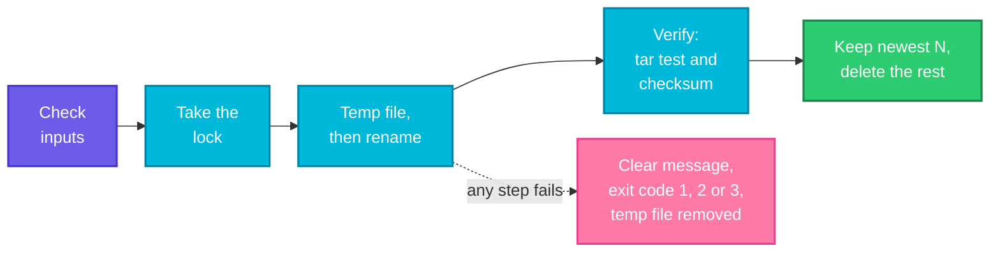

# Project 1: A Backup Script You Can Trust

> **Before this page:** you have read pages [01](01-what-is-a-shell-script.md) to [16](16-scheduling-with-cron.md). This is the first of three **projects**. Nothing new is taught here. Instead, you will use **everything** you have learned to build real tools, the way a DevOps engineer would.
>
> **By the end of this page** you will have a complete, safe, cron-ready backup script, and you will know how to approach any script you are asked to write.

---

## 1. How to build a real script

Beginners often open an editor and start typing commands. Experienced engineers do the opposite. They work in **five steps**:

| Step | The question | What you write down |
|------|--------------|---------------------|
| **1. The job** | What must it do? What must it **never** do? | A short list of requirements |
| **2. The contract** | What goes in (arguments, settings)? What comes out (output, exit codes)? | The usage line and the exit-code table |
| **3. The skeleton** | What are the steps, in order? | A `main` function that calls small functions |
| **4. The pieces** | How does each step work, and how can it fail? | One small function at a time, tested alone |
| **5. The safety net** | What if it is interrupted, run twice, or fed bad input? | Lock, cleanup trap, dry run, validation |

This page follows those five steps for a backup tool.

---

## 2. The job: what a backup must do

A good backup script is **boring and reliable**. Here is the list of requirements:

1. Archive a **source folder** into a **compressed file** (`.tar.gz`) with a **date and time in its name**.
2. Keep only the **newest N** archives and delete the older ones, so the disk does not fill up.
3. Be **sure** the archive is good: a half-written or damaged backup is worse than none.
4. **Never run twice at the same time** against the same destination.
5. Offer a **dry run**, so you can see what it would do first.
6. **Clean up** after itself, even when something fails.
7. Give clear **exit codes**, so cron and pipelines know what happened.

### The design decisions

| Decision | Why |
|----------|-----|
| Name archives `NAME-YYYYMMDD-HHMMSS.tar.gz` | Alphabetical order is **time order**, so "the oldest" is simply "the first in the list" |
| Write to a **temporary file**, then **rename** it | A rename is instant, so an archive is either complete or **not there at all**. A half-written file never looks like a valid backup |
| Store a **checksum** (`sha256`) next to each archive | A later run can prove the file has not been damaged |
| **Verify** right after creating it | Catches problems immediately, while you can still react |
| Lock with **`flock`** | Released automatically, even if the script is killed (page 16) |
| A **`STAMP`** setting that can be overridden | In tests, you can supply a fixed date and get **predictable** file names. By default it is the real date and time |

**The contract:**

```text
Usage: ./backup.sh [--dry-run] [--keep N] SOURCE_DIR DEST_DIR
Exit codes: 0 ok, 1 bad usage or input, 2 backup failed, 3 already running
```

**Follow the arrows from the left.** Every step can fail, and every failure ends in a clear message, one of three exit codes, and the temporary file removed.



---

## 3. Something to back up

To try the script, we need a small folder to protect. Let's create a pretend website with three files, one of them with a space in its name (a good test of quoting):

**Command:**
```bash
mkdir -p site/css
echo "<h1>Welcome</h1>" > site/index.html
echo "body { color: navy; }" > site/css/style.css
echo "version 1" > "site/release notes.txt"
```

The folder now contains:

**Input file** (`site/index.html`):
```text
<h1>Welcome</h1>
```

**Input file** (`site/css/style.css`):
```text
body { color: navy; }
```

**Input file** (`site/release notes.txt`):
```text
version 1
```

---

## 4. The script

Here is the complete script. It looks long, but it is built from small pieces that you already know. Read it once, then use the walkthrough in section 5.

Let's say we have this file `backup.sh`:

**Input file** (`backup.sh`):
```bash
#!/bin/bash
# backup.sh - back up a folder into a dated .tar.gz and keep only the newest N
# usage: ./backup.sh [--dry-run] [--keep N] SOURCE_DIR DEST_DIR
# Exit codes: 0 ok, 1 bad usage or input, 2 backup failed, 3 already running
set -euo pipefail
export PATH=/usr/local/sbin:/usr/local/bin:/usr/sbin:/usr/bin:/sbin:/bin

KEEP="${KEEP:-7}"
STAMP="${STAMP:-$(date +%Y%m%d-%H%M%S)}"
DRY_RUN=0
SRC=""
DEST=""
NAME=""
ARCHIVE=""
TMP=""

log() {
  echo "[$1] $2"
}

die() {
  log ERROR "$1" >&2
  exit "${2:-1}"
}

usage() {
  echo "Usage: $0 [--dry-run] [--keep N] SOURCE_DIR DEST_DIR"
}

cleanup() {
  if [[ -n $TMP && -e $TMP ]]; then
    rm -f -- "$TMP"
  fi
}

parse_args() {
  while [[ $# -gt 0 ]]; do
    case "$1" in
      --dry-run)
        DRY_RUN=1
        shift
        ;;
      --keep)
        [[ $# -ge 2 ]] || die "--keep needs a number"
        KEEP="$2"
        shift 2
        ;;
      -h|--help)
        usage
        exit 0
        ;;
      -*)
        die "unknown option: $1"
        ;;
      *)
        break
        ;;
    esac
  done

  if [[ $# -ne 2 ]]; then
    usage >&2
    exit 1
  fi
  SRC="$1"
  DEST="$2"
}

check_inputs() {
  [[ $KEEP =~ ^[1-9][0-9]*$ ]] || die "--keep must be a whole number of 1 or more, not '$KEEP'"
  [[ -d $SRC ]] || die "source folder not found: $SRC"
  [[ -r $SRC ]] || die "source folder is not readable: $SRC"
  SRC=$(cd "$SRC" && pwd)
  NAME=$(basename "$SRC")
  ARCHIVE="$DEST/$NAME-$STAMP.tar.gz"
}

acquire_lock() {
  exec 9> "$DEST/.backup.lock"
  flock -n 9 || die "another backup is already running for $DEST" 3
}

make_archive() {
  TMP=$(mktemp "$DEST/.tmp-XXXXXX")
  tar -czf "$TMP" -C "$(dirname "$SRC")" "$NAME" || die "tar failed" 2
  mv -- "$TMP" "$ARCHIVE" || die "could not move the archive into place" 2
  TMP=""
  ( cd "$DEST" && sha256sum "$(basename "$ARCHIVE")" > "$(basename "$ARCHIVE").sha256" ) \
    || die "could not write the checksum" 2
  log INFO "created $(basename "$ARCHIVE")"
}

verify_archive() {
  local files
  tar -tzf "$ARCHIVE" > /dev/null || die "the new archive cannot be read" 2
  ( cd "$DEST" && sha256sum -c --quiet "$(basename "$ARCHIVE").sha256" ) \
    || die "the checksum does not match" 2
  files=$(tar -tzf "$ARCHIVE" | wc -l)
  log INFO "verified: archive readable, checksum matches, $files entries"
}

prune_old() {
  local archives=("$DEST/$NAME"-[0-9]*-[0-9]*.tar.gz)
  local count=${#archives[@]}
  local excess i

  if [[ ! -e ${archives[0]} ]]; then
    return 0
  fi

  excess=$((count - KEEP))
  if [[ $excess -le 0 ]]; then
    log INFO "keeping all $count archive(s) (limit is $KEEP)"
    return 0
  fi

  for (( i = 0; i < excess; i++ )); do
    if [[ $DRY_RUN -eq 1 ]]; then
      log DRY "would delete $(basename "${archives[$i]}")"
    else
      rm -f -- "${archives[$i]}" "${archives[$i]}.sha256"
      log INFO "deleted old archive $(basename "${archives[$i]}")"
    fi
  done
}

main() {
  parse_args "$@"
  trap cleanup EXIT
  check_inputs

  echo "=== backup of $SRC at $STAMP ==="

  if [[ $DRY_RUN -eq 1 ]]; then
    log DRY "would create $ARCHIVE"
    prune_old
    log DRY "nothing was changed"
    return 0
  fi

  mkdir -p "$DEST"
  acquire_lock
  make_archive
  verify_archive
  prune_old
  log INFO "done"
}

main "$@"
```

---

## 5. Walking through the script

Every part of the script uses something you have already learned. Here is a map from the code to the page where you learned it.

| Part of the script | What it does | You learned it in |
|--------------------|--------------|-------------------|
| `set -euo pipefail` and `export PATH=...` | Seatbelts, and a known `PATH` for cron | Pages 14, 13 |
| `KEEP="${KEEP:-7}"`, `STAMP="${STAMP:-$(date ...)}"` | Settings with defaults that can be overridden from the environment | Pages 03, 13 |
| `log`, `die`, `usage` | Small helper functions. `die` writes to `>&2` and exits with a chosen code | Page 12 |
| `parse_args` | A `while` loop over the arguments, with a `case` for each option, `shift` to move along | Pages 07, 10, 11 |
| `[[ $KEEP =~ ^[1-9][0-9]*$ ]]` | Checks `KEEP` is a whole number, using a regular expression | Page 05 |
| `check_inputs` | Guard clauses: refuse bad input early | Pages 06, 14 |
| `exec 9> ...` and `flock -n 9` | The lock, released automatically even by `kill -9` | Page 16 |
| `mktemp`, `tar ... \|\| die`, `mv` | Write to a temp file, then rename. Each step checked | Pages 14, 04 |
| `trap cleanup EXIT` | Removes the temp file however the script ends | Page 15 |
| `sha256sum` and `sha256sum -c` | Make and check a checksum | This page |
| `"$DEST/$NAME"-[0-9]*-[0-9]*.tar.gz` in an array | A wildcard fills an array with the archives, already in alphabetical (= time) order | Page 08 |
| `for (( i = 0; i < excess; i++ ))` | A counting loop that deletes the oldest `excess` archives | Page 09 |
| `if [[ $DRY_RUN -eq 1 ]]` | The dry-run switch | Page 14 |
| `main "$@"` and `local` variables | The tidy structure | Page 12 |

A few details are worth a second look.

**The `STAMP` hook.** `STAMP="${STAMP:-$(date +%Y%m%d-%H%M%S)}"` means *"use `STAMP` if it was given, otherwise use the real date and time."* In normal use you never set it. For testing, `STAMP=20261018-020000 ./backup.sh ...` gives a predictable file name. **Designing a script so it can be tested is a skill in itself.**

**`tar -czf "$TMP" -C "$(dirname "$SRC")" "$NAME"`.** The flags are: `c` create, `z` compress with gzip, `f` into this file. `-C` makes `tar` first move to the parent folder, so the archive stores the relative path `site/...` and not the full `/home/devops/practice/site/...`. That makes restoring easy.

**The glob in `prune_old`.** The pattern `"$DEST/$NAME"-[0-9]*-[0-9]*.tar.gz` matches names like `site-20261018-020000.tar.gz`. Requiring a **digit** right after `site-` means another backup named `site-old` is never confused with ours. The shell returns matches in alphabetical order, and because our names start with `YYYYMMDD`, that is **oldest first**.

**Why the lock is taken after `mkdir -p "$DEST"`.** The lock file lives in the destination folder, so the folder must exist first. Dry run never creates it.

---

## 6. Trying it out

Make it executable once:

**Command:**
```bash
chmod +x backup.sh
```

### Step 1: bad input is refused clearly

A good script says **what is wrong**. Let's try six bad calls:

**Command:**
```bash
./backup.sh
echo "exit: $?"
./backup.sh nosuchfolder backups
echo "exit: $?"
./backup.sh --keep abc site backups
echo "exit: $?"
./backup.sh --keep 0 site backups
echo "exit: $?"
./backup.sh --bogus site backups
echo "exit: $?"
./backup.sh --keep
echo "exit: $?"
```
**Sample Output:**
```text
Usage: ./backup.sh [--dry-run] [--keep N] SOURCE_DIR DEST_DIR
exit: 1
[ERROR] source folder not found: nosuchfolder
exit: 1
[ERROR] --keep must be a whole number of 1 or more, not 'abc'
exit: 1
[ERROR] --keep must be a whole number of 1 or more, not '0'
exit: 1
[ERROR] unknown option: --bogus
exit: 1
[ERROR] --keep needs a number
exit: 1
```

Each case gives a clear message and exit code `1`. Nothing was created.

### Step 2: the dry run

**Command:**
```bash
STAMP=20261018-020000 ./backup.sh --dry-run site backups
echo "exit: $?"
ls backups
```
**Sample Output:**
```text
=== backup of /home/devops/practice/site at 20261018-020000 ===
[DRY] would create backups/site-20261018-020000.tar.gz
[DRY] nothing was changed
exit: 0
ls: cannot access 'backups': No such file or directory
```

It described what it would do, and `ls` proves the `backups` folder was **not even created**.

### Step 3: a real backup

**Command:**
```bash
STAMP=20261018-020000 ./backup.sh site backups
echo "exit: $?"
ls -A backups
```
**Sample Output:**
```text
=== backup of /home/devops/practice/site at 20261018-020000 ===
[INFO] created site-20261018-020000.tar.gz
[INFO] verified: archive readable, checksum matches, 5 entries
[INFO] keeping all 1 archive(s) (limit is 7)
[INFO] done
exit: 0
.backup.lock
site-20261018-020000.tar.gz
site-20261018-020000.tar.gz.sha256
```

- Three files appeared: the archive, its checksum file, and the hidden lock file (`ls -A` shows hidden files).
- The 5 entries are the folders `site/` and `site/css/` and the three files.
- Because the script wrote to a temp file first, there is **no** `.tmp-...` file left over.

### Step 4: the restore test

> **A backup you have never restored is a hope, not a backup.** The only real proof is to restore it and compare.

**Command:**
```bash
mkdir restore
tar -xzf backups/site-20261018-020000.tar.gz -C restore
diff -r site restore/site && echo "restore matches the original"
```
**Sample Output:**
```text
restore matches the original
```

`tar -xzf` extracts (`x`) the archive, and `diff -r` compares two folders recursively. No output from `diff` means **identical**, so the `echo` after `&&` ran. Make this drill a regular habit: it also proves the **file names with spaces** survived.

### Step 5: retention, keeping only the newest N

Let's make three more backups on three more "days", and the last one with `--keep 3`:

**Command:**
```bash
STAMP=20261019-020000 ./backup.sh site backups > /dev/null
STAMP=20261020-020000 ./backup.sh site backups > /dev/null
STAMP=20261021-020000 ./backup.sh --keep 3 site backups
ls backups
```
**Sample Output:**
```text
=== backup of /home/devops/practice/site at 20261021-020000 ===
[INFO] created site-20261021-020000.tar.gz
[INFO] verified: archive readable, checksum matches, 5 entries
[INFO] deleted old archive site-20261018-020000.tar.gz
[INFO] done
site-20261019-020000.tar.gz
site-20261019-020000.tar.gz.sha256
site-20261020-020000.tar.gz
site-20261020-020000.tar.gz.sha256
site-20261021-020000.tar.gz
site-20261021-020000.tar.gz.sha256
```

There were four archives and the limit was 3, so the **oldest** (the 18th) was deleted together with its checksum file. The three newest remain.

### Step 6: preview a clean-up with the dry run

Before lowering the limit to 2, we preview it:

**Command:**
```bash
STAMP=20261022-020000 ./backup.sh --dry-run --keep 2 site backups
ls backups
```
**Sample Output:**
```text
=== backup of /home/devops/practice/site at 20261022-020000 ===
[DRY] would create backups/site-20261022-020000.tar.gz
[DRY] would delete site-20261019-020000.tar.gz
[DRY] nothing was changed
site-20261019-020000.tar.gz
site-20261019-020000.tar.gz.sha256
site-20261020-020000.tar.gz
site-20261020-020000.tar.gz.sha256
site-20261021-020000.tar.gz
site-20261021-020000.tar.gz.sha256
```

The dry run says it would create one archive and delete one, and the `ls` shows **nothing changed**. (A subtle point: the dry run counts the 3 existing archives, so it deletes only 1 to reach the limit of 2 **before** adding the new one. The real run, which counts the new archive too, deletes 2, as the next step shows.)

### Step 7: the same run for real

**Command:**
```bash
STAMP=20261022-020000 ./backup.sh --keep 2 site backups
ls backups
```
**Sample Output:**
```text
=== backup of /home/devops/practice/site at 20261022-020000 ===
[INFO] created site-20261022-020000.tar.gz
[INFO] verified: archive readable, checksum matches, 5 entries
[INFO] deleted old archive site-20261019-020000.tar.gz
[INFO] deleted old archive site-20261020-020000.tar.gz
[INFO] done
site-20261021-020000.tar.gz
site-20261021-020000.tar.gz.sha256
site-20261022-020000.tar.gz
site-20261022-020000.tar.gz.sha256
```

After creating the new archive there were four, the limit was 2, so the two oldest were deleted, and the two newest remain.

> **Did you notice a difference between step 6 and step 7?** The dry run showed **one** deletion, but the real run did **two**. The dry run counts archives *before* the new one exists, but the real run counts *after*. A good dry run should predict the real run exactly. Here is a real flaw in the script. Fixing it is **exercise 8** at the end of this page.

### Step 8: two backups at once

While one backup holds the lock, a second one must be refused. We simulate a running backup by holding the lock for 3 seconds with `flock` ourselves:

**Command:**
```bash
flock -n backups/.backup.lock sleep 3 &
sleep 0.5
STAMP=20261023-020000 ./backup.sh site backups
echo "exit: $?"
wait
```
**Sample Output:**
```text
=== backup of /home/devops/practice/site at 20261023-020000 ===
[ERROR] another backup is already running for backups
exit: 3
```

Exit code `3` means "already running", exactly as in the contract. Nothing was changed.

### Step 9: when `tar` fails

Let's make a file that nobody can read, to force `tar` to fail:

**Command:**
```bash
echo "secret" > site/locked.txt
chmod 000 site/locked.txt
STAMP=20261024-020000 ./backup.sh site backups
echo "exit: $?"
ls -A backups
chmod 644 site/locked.txt
rm site/locked.txt
```
**Sample Output:**
```text
=== backup of /home/devops/practice/site at 20261024-020000 ===
tar: site/locked.txt: Cannot open: Permission denied
tar: Exiting with failure status due to previous errors
[ERROR] tar failed
exit: 2
.backup.lock
site-20261021-020000.tar.gz
site-20261021-020000.tar.gz.sha256
site-20261022-020000.tar.gz
site-20261022-020000.tar.gz.sha256
```

(This works as a normal user. The `root` user can read any file.)

- `tar` complained, and the script reported `[ERROR] tar failed` and exited `2` ("backup failed").
- The `ls -A` shows **no `.tmp-...` leftover**: the `EXIT` trap removed the half-made temp file. And **no bad archive** was created, and the **older good archives were not touched**.

### Step 10: the checksum catches damage

Finally, let's damage an archive on purpose, the way a failing disk or a bad copy would:

**Command:**
```bash
cd backups
sha256sum -c --quiet site-20261022-020000.tar.gz.sha256 && echo "original archive: checksum OK"
printf 'x' >> site-20261022-020000.tar.gz
sha256sum -c --quiet site-20261022-020000.tar.gz.sha256 || echo "damaged archive: checksum FAILED"
cd ..
```
**Sample Output:**
```text
original archive: checksum OK
site-20261022-020000.tar.gz: FAILED
sha256sum: WARNING: 1 computed checksum did NOT match
damaged archive: checksum FAILED
```

We added a single extra byte, and the checksum noticed. This is how you detect silent corruption before the day you need the backup.

---

## 7. Running it from cron

Time to put it on a schedule (page 16). First the **dress rehearsal**, running it exactly as cron would: through `sh -c`, with a tiny environment, with the output going to a log file.

**Command:**
```bash
mkdir -p logs
env -i SHELL=/bin/sh PATH=/usr/bin:/bin HOME=/tmp LOGNAME=devops \
  /bin/sh -c 'STAMP=20261020-023000 /home/devops/practice/backup.sh /home/devops/practice/site /home/devops/practice/backups >> /home/devops/practice/logs/backup.log 2>&1'
echo "exit: $?"
cat logs/backup.log
```
**Sample Output:**
```text
exit: 0
=== backup of /home/devops/practice/site at 20261020-023000 ===
[INFO] created site-20261020-023000.tar.gz
[INFO] verified: archive readable, checksum matches, 2 entries
[INFO] keeping all 1 archive(s) (limit is 7)
[INFO] done
```

The script needed **nothing** from the environment: it found `tar`, `flock` and `sha256sum` with the short `PATH`, and wrote everything to the log. (In my test the source folder held one file, hence 2 entries.)

Now the crontab line, as you would add it with `crontab -e` (not run here):

Let's say we have this crontab (the line you would put in with `crontab -e`):

**Input file** (your crontab, as shown by `crontab -l`):
```text
MAILTO=""
# m  h  dom mon dow  command
30   2   *   *   *   timeout 1800 /home/devops/bin/backup.sh --keep 14 /var/www /backups/www >> /home/devops/logs/backup.log 2>&1
```

Read it: *every night at 02:30, run the backup with a 30-minute time limit, keep 14 archives of `/var/www` in `/backups/www`, and append everything to the log.* The script has its own lock, so no `flock` is needed in the line.

---

## 8. What would make it even better

A real backup system has more layers. Each of these is a natural next step (and an exercise below):

| Improvement | How |
|-------------|-----|
| **Exclude** things you do not need (caches, `node_modules`) | `tar --exclude='*.cache'` |
| **Copy off the machine** | `rsync`, `scp` or `rclone` to another server or to cloud storage. A backup on the same disk dies with the disk |
| **Encrypt** the archive | `gpg --symmetric` or `age` |
| **Back up databases correctly** | Dump first (`pg_dump`, `mysqldump`), and archive the dump. Never archive a live database folder |
| **Get alerted on failure** | Mail, chat webhook, or a monitoring check on the age of the newest archive (the next project does exactly this) |
| **Restore automatically** | A scheduled "restore into a temp folder and compare" check |

---

## 9. The mistakes that bite

| Mistake | Symptom | Fix |
|---------|---------|-----|
| Writing straight to the final file name | A half-written archive that looks valid | Temp file, then `mv` |
| Never verifying | You discover the damage on the day you need the backup | Test the archive and keep a checksum |
| Never restoring | The backup is a hope, not a backup | A regular restore drill with `diff -r` |
| No retention | The backup disk fills up and every later backup fails | Keep the newest N |
| Deleting by date from `ls` output | Wrong files deleted, names with spaces break | Use a wildcard into an **array** |
| Backing up to the **same disk** | One failure loses both | Copy off-machine |
| Absolute paths stored in the archive | Awkward restores | `tar -C parent name` |
| Two runs at once | Corrupt or tangled archives | A lock (`flock`) |
| An unchecked variable in `rm` | Deletes the wrong folder | `"${VAR:?}"`, validation, dry run |
| Running from cron without testing | `command not found` at 2 a.m. | The `env -i` rehearsal |
| A dry run that differs from the real run | You approve one thing and get another | Make the dry run reuse the same logic |
| Ignoring the exit code in cron | Failures nobody notices | Log it and monitor the newest archive's age |

---

## 10. Words to remember

| Word | Simple meaning |
|------|----------------|
| **Archive** | One file that contains many files (`.tar`) |
| **`tar -czf`** | Create (`c`) a gzip-compressed (`z`) archive into a file (`f`) |
| **`tar -tzf`** | List (`t`) the contents of an archive, a quick readability test |
| **`tar -xzf`** | Extract an archive |
| **Checksum** | A short fingerprint of a file. A different file gives a different fingerprint |
| **`sha256sum -c`** | Check files against stored checksums |
| **Retention** | The rule for how many old backups to keep |
| **Atomic rename** | Making a file appear complete, all at once |
| **Restore drill** | Practising a restore to prove the backup works |
| **Contract** | The usage line plus the exit codes: what the script promises |
| **Hook** | A setting (like `STAMP`) that exists mainly so the script can be tested |

---

## 11. Try it yourself

1. **Run it.** Build the `site` folder, save the script, and run the ten steps. Compare your output with this page.
2. **Break it.** Give it a source path that is a **file** instead of a folder. What message do you get?
3. **Exclude.** Add an `--exclude PATTERN` option that passes `--exclude` to `tar`.
4. **A restore script.** Write `restore.sh ARCHIVE DEST` that extracts an archive and then verifies its checksum first, refusing to extract if the checksum fails.
5. **Latest.** Write a one-liner or small script that prints the **newest** archive for a given name.
6. **Size report.** Add a line to the log that shows the archive size in a human-readable form (`du -h` or `ls -lh`).
7. **Test the lock.** Start the script with `STAMP` and a source folder large enough to take a few seconds, then start a second copy. Confirm exit code `3`.
8. **Fix the dry run.** Make the dry run predict the real run exactly: the dry run should count the archive it *would* create. (Hint: add one to the count in dry-run mode.)
9. **Off-machine copy.** Add an optional `--remote USER@HOST:PATH` that copies the verified archive with `rsync` after the backup succeeds.
10. **Alert on failure.** Make the script send a message (an `echo` to a log is fine to start with) when it exits with a non-zero code. (Hint: an `ERR` or `EXIT` trap, page 15.)
11. **Cron-proof it.** Write the rehearsal for your own folders, then install it with `crontab -e` on a **test machine**, back up the old crontab first, and check the log the next morning.

<details>
<summary>Answer for exercise 8 (open only after trying)</summary>

The real run counts the new archive because it already exists when `prune_old` runs. The dry run counts the archives *before* the new one. In `prune_old`, add one to the count when in dry-run mode:

```bash
local count=${#archives[@]}
if [[ $DRY_RUN -eq 1 ]]; then
  count=$((count + 1))     # the archive we would have just created
fi
```
</details>

---

## 12. Quick recap

- Build a script in **five steps**: the **job**, the **contract**, the **skeleton** (`main`), the **pieces**, the **safety net**.
- A backup must be **complete or absent** (temp file, then rename), **verified** (readable and checksummed), **limited** (retention), **exclusive** (a lock), and **previewable** (dry run).
- Name files so that **alphabetical order is time order**.
- Fill an **array from a wildcard** to list and prune old archives safely, even when names contain spaces.
- **A backup you have never restored is a hope, not a backup.** Practise with `tar -xzf` and `diff -r`.
- Design for **testing**: a `STAMP` hook gives predictable names.
- Make the contract explicit: **usage line and exit codes**.
- **Rehearse** under `env -i` and `sh -c` before cron runs it.
- Keep a copy **off the machine**.

**Next page:** [18 Project 2: a health checker](18-project-health-checker.md), where you will build a tool that reads a list of checks from a file, runs each one, and reports a clear summary, including whether your **backups are fresh**.
