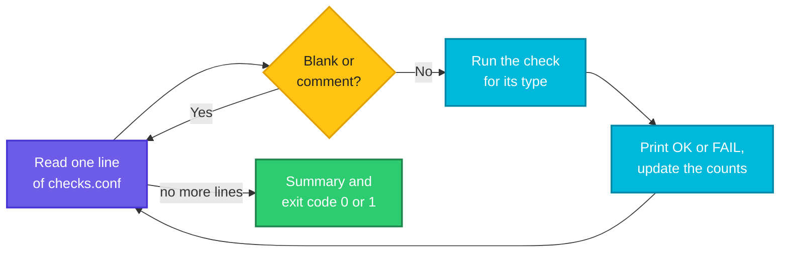

# Project 2: A Health Checker Driven by a Config File

> **Before this page:** you have read pages [01](01-what-is-a-shell-script.md) to [17](17-project-backup-script.md). This is the second of three **projects**. As on the last page, nothing new is taught. You will combine what you know into a real tool.
>
> **By the end of this page** you will have a health checker whose list of checks lives in a **plain text file**, so that adding a new check means adding **one line**, not editing the script. You will also know how to design a script around small, testable **check functions**.

---

## 1. The job: "is everything OK?"

In page 16 you scheduled jobs to run by themselves. But a scheduled job that **silently stops working** is the worst kind of problem: nobody notices until the day it matters. The backup from page 17 may have been failing for two weeks. A disk may be 97% full. A folder your application needs may have vanished.

What you want is one command that answers, in a few lines: **"Is everything OK, and if not, what is wrong?"** That is a **health check**. It is the kind of script that cron runs every 15 minutes, and that a monitoring system or an on-call engineer reads first.

### The requirements

1. Run a **list of checks** and print one clear line for each: `[ OK ]` or `[FAIL]`, with a short detail.
2. Read the list from a **config file**, so the script never needs editing to add a check.
3. Support several **kinds** of check: disk space, folder, **file freshness** (for example, "was a backup made in the last 26 hours?") and "is this tool installed?".
4. Finish with a **summary** and an **exit code**: `0` if everything passed, `1` if something failed, `2` if the config itself is broken.
5. Offer a **quiet** mode (print problems only) and a **fail-fast** mode (stop at the first problem).
6. Never crash because of a **badly written line** in the config. Report it as a failed check.

### The design decisions

| Decision | Why |
|----------|-----|
| One **function per check type** | Each check is small, easy to test alone, and easy to add |
| Every check follows the same **mini-contract**: print one short detail line, and **return 0 for pass, 1 for fail** | The main loop does not need to know how any check works. It only reads the status |
| A **`case`** picks the function from the line's first word | Adding a type means one function and one `case` line |
| The config has one **check per line**: `type name arguments...` | Easy to read, easy to edit, easy to put in Git |
| Blank lines and `#` comments are **ignored** | The config can be documented |
| A broken or unknown line is a **failed check**, not a crash | One typo does not hide the other checks |
| The summary lists the **names** of the failures | The first thing an on-call engineer wants to see |

**The contract of the script:**

```text
Usage: ./healthcheck.sh [-q|--quiet] [-f|--fail-fast] [CONFIG]
Exit codes: 0 all checks passed, 1 at least one check failed, 2 config problem
```

**Follow the arrows from the left.** The script reads the config one line at a time. Blank lines and comments go back for the next line. A real line runs its check, prints the result, and goes back for the next line. When the lines run out, it prints the summary.



---

## 2. The config file and something to check

### The check types

| Line format | Passes when |
|-------------|-------------|
| `disk NAME PATH MAX_PERCENT` | The disk holding `PATH` is **no more than** `MAX_PERCENT` full |
| `dir NAME PATH` | `PATH` is a folder that exists and is **writable** |
| `fresh NAME PATTERN MAX_HOURS` | The **newest** file matching `PATTERN` is **no older** than `MAX_HOURS` hours |
| `cmd NAME COMMAND` | `COMMAND` is installed (found in `PATH`) |

Anything else is reported as an **unknown check type**.

### Something to check

To test the checker, we need a small test world. Let's create some folders, plus files whose **age** we control with `touch -d`. This imitates the backup folder from page 17 and a report that stopped being produced:

**Command:**
```bash
mkdir -p data backups reports
touch -d '2 hours ago'  backups/site-20261020-020000.tar.gz
touch -d '3 days ago'   backups/site-20261017-020000.tar.gz
touch -d '48 hours ago' reports/report-20261018.txt
```

- `backups` holds a **fresh** archive (2 hours old) and an old one.
- `reports` holds only an **old** file (48 hours).
- `data` is an empty folder.

### The config file

Let's say we have this file `checks.conf`. Some checks are meant to **pass** and some to **fail**, so that we can see both kinds:

**Input file** (`checks.conf`):
```text
# health checks for this server
#
# type   name         target                        argument
disk     root-disk    /                             90
disk     tight-limit  /                             1
dir      data-dir     data
dir      missing-dir  nope
fresh    backups      backups/site-*.tar.gz         26
fresh    old-report   reports/report-*.txt          24
cmd      git          git
cmd      kubectl-x    nosuchtool

bogus    weird        something
```

A few things to notice:

- `tight-limit` asks that `/` be at most **1%** full. It will fail on purpose.
- `missing-dir`, `old-report` and `kubectl-x` are set up to fail too, and `bogus` is not a real type.
- The `fresh` lines use a **pattern** (`*`), because backup names change every day.
- Paths here are **relative** to the folder we run from, to keep the demo simple. **In a real config, use absolute paths**, because cron runs from your home folder (page 16).

---

## 3. The script

Let's say we have this file `healthcheck.sh`:

**Input file** (`healthcheck.sh`):
```bash
#!/bin/bash
# healthcheck.sh - run the checks listed in a config file and report a summary
# usage: ./healthcheck.sh [-q|--quiet] [-f|--fail-fast] [CONFIG]
# Exit codes: 0 all checks passed, 1 at least one check failed, 2 config problem
set -euo pipefail
export PATH=/usr/local/sbin:/usr/local/bin:/usr/sbin:/usr/bin:/sbin:/bin

CONFIG="checks.conf"
QUIET=0
FAIL_FAST=0

die() {
  echo "[ERROR] $1" >&2
  exit "${2:-2}"
}

usage() {
  echo "Usage: $0 [-q|--quiet] [-f|--fail-fast] [CONFIG]"
}

# ---- the checks ------------------------------------------------------
# Each check prints a short detail on stdout and returns 0 (pass) or 1 (fail).

check_disk() {
  local path="${1:-}" max="${2:-}" usage
  if [[ -z $path || -z $max ]]; then
    echo "needs: disk NAME PATH MAX_PERCENT"
    return 1
  fi
  if ! df "$path" > /dev/null 2>&1; then
    echo "$path not found"
    return 1
  fi
  usage=$(df --output=pcent "$path" | tail -1 | tr -dc '0-9')
  echo "$path is $usage% full (limit $max%)"
  [[ $usage -le $max ]]
}

check_dir() {
  local path="${1:-}"
  if [[ -z $path ]]; then
    echo "needs: dir NAME PATH"
    return 1
  fi
  if [[ ! -d $path ]]; then
    echo "$path does not exist"
    return 1
  fi
  if [[ ! -w $path ]]; then
    echo "$path exists but is not writable"
    return 1
  fi
  echo "$path exists and is writable"
}

# The newest file matching a pattern must be no older than MAX_HOURS.
check_fresh() {
  local pattern="${1:-}" max="${2:-}"
  if [[ -z $pattern || -z $max ]]; then
    echo "needs: fresh NAME PATTERN MAX_HOURS"
    return 1
  fi
  # We WANT the shell to expand the pattern here, so it is left unquoted.
  # (The config file is trusted, and patterns may not contain spaces.)
  local matches=( $pattern )
  if [[ ! -e ${matches[0]} ]]; then
    echo "no files match $pattern"
    return 1
  fi
  local newest="${matches[${#matches[@]}-1]}"
  local age=$(( ( $(date +%s) - $(stat -c %Y "$newest") ) / 3600 ))
  echo "newest is $(basename "$newest"), $age h old (limit $max h)"
  [[ $age -le $max ]]
}

check_cmd() {
  local command_name="${1:-}"
  if [[ -z $command_name ]]; then
    echo "needs: cmd NAME COMMAND"
    return 1
  fi
  if command -v "$command_name" > /dev/null; then
    echo "$command_name is installed"
  else
    echo "$command_name not found in PATH"
    return 1
  fi
}

# Pick the right check for a line's type.
run_check() {
  local type="$1"
  shift
  case "$type" in
    disk)  check_disk "$@" ;;
    dir)   check_dir "$@" ;;
    fresh) check_fresh "$@" ;;
    cmd)   check_cmd "$@" ;;
    *)
      echo "unknown check type '$type'"
      return 1
      ;;
  esac
}

# ---- the main program ------------------------------------------------

parse_args() {
  while [[ $# -gt 0 ]]; do
    case "$1" in
      -q|--quiet)      QUIET=1; shift ;;
      -f|--fail-fast)  FAIL_FAST=1; shift ;;
      -h|--help)       usage; exit 0 ;;
      -*)              die "unknown option: $1" ;;
      *)               CONFIG="$1"; shift ;;
    esac
  done
}

main() {
  parse_args "$@"
  [[ -f $CONFIG ]] || die "config file not found: $CONFIG"

  local total=0 passed=0 result detail
  local failed=()
  local fields=()

  echo "=== health check of $CONFIG at $(date '+%F %T') ==="

  while read -r -a fields || [[ ${#fields[@]} -gt 0 ]]; do
    if [[ ${#fields[@]} -eq 0 || ${fields[0]} == \#* ]]; then
      fields=()
      continue
    fi

    local type="${fields[0]}"
    local name="${fields[1]:-?}"
    local args=("${fields[@]:2}")
    fields=()

    total=$((total + 1))
    result=0
    detail=$(run_check "$type" "${args[@]}") || result=$?

    if [[ $result -eq 0 ]]; then
      passed=$((passed + 1))
      [[ $QUIET -eq 1 ]] || echo "[ OK ] $name: $detail"
    else
      failed+=("$name")
      echo "[FAIL] $name: $detail"
      if [[ $FAIL_FAST -eq 1 ]]; then
        echo "(stopping at the first failure: --fail-fast)"
        break
      fi
    fi
  done < "$CONFIG"

  [[ $total -gt 0 ]] || die "no checks found in $CONFIG"

  echo "Checked $total: $passed passed, ${#failed[@]} failed"
  if [[ ${#failed[@]} -gt 0 ]]; then
    echo "Failed: ${failed[*]}"
    return 1
  fi
}

main "$@"
```

---

## 4. Walking through the script

| Part of the script | What it does | You learned it in |
|--------------------|--------------|-------------------|
| `set -euo pipefail`, `die`, `usage` | Seatbelts, helper functions, errors on `>&2` | Pages 14, 12 |
| `check_disk`, `check_dir`, `check_fresh`, `check_cmd` | One small function per kind of check, each with the same contract | Page 12 |
| `local path="${1:-}" max="${2:-}"` | Arguments with defaults, so a **short line** cannot crash `set -u` | Pages 03, 14 |
| `[[ $usage -le $max ]]` as the **last line** of a function | A function returns the status of its last command, so the comparison **is** the return value | Pages 04, 12 |
| `run_check` with a `case` | Chooses the right function from the line's first word, and a `*)` catch-all | Page 07 |
| `parse_args` with a `case` and `shift` | Options `-q`, `-f`, a config file path | Pages 07, 10 |
| `while read -r -a fields` | Reads one line and **splits it into an array** of words | Pages 08, 10 |
| `${fields[@]:2}` | A **slice** of the array: everything from the third word on | Page 08 |
| `detail=$(run_check ...) \|\| result=$?` | Captures the printed detail **and** the status, without `set -e` stopping the script | Pages 12, 14 |
| `failed+=("$name")` and `${failed[*]}` | Collects the names of the failures, then reports them together | Page 08 |
| `continue` and `break` | Skip comments, stop at the first failure | Page 11 |
| `[[ -e ${matches[0]} ]]` | Detects the "pattern matched nothing" case | Page 09 |

A few details deserve a closer look.

**The mini-contract is the heart of the design.** Every check prints **one** short line (the *detail*) and returns **0 or 1**. The main loop never looks inside a check. It captures the printed line, reads the status, and formats the output. That means you can add a hundred new check types without touching the loop.

**A function returns the status of its last command.** In `check_disk`, the last line is `[[ $usage -le $max ]]`. If the usage is within the limit, the test succeeds (status `0`), and the function returns `0` (pass). Otherwise it returns `1` (fail). There is no explicit `return`, and none is needed. The same trick ends `check_fresh`.

**`${1:-}` in every check.** Without the `:-` default, a config line with a missing argument would trip `set -u` and crash the whole script. With it, the check receives an empty value and **reports the problem as an ordinary failed check** (`needs: disk NAME PATH MAX_PERCENT`).

**The one deliberately unquoted variable.** In `check_fresh`, `local matches=( $pattern )` is left **without quotes** on purpose, so the shell expands the wildcard `backups/site-*.tar.gz` into the list of matching files. This is one of the rare places where unquoted is right. It is safe here because the config file is written by you, and the comment says so. (For untrusted input, never do this.)

**Newest file by name.** The shell returns the matches in alphabetical order, and our file names start with a date, so the **last** match is the newest. The script uses `${matches[${#matches[@]}-1]}`, the last index.

**The age in hours.** `$(date +%s)` is the current time in seconds since 1970, and `stat -c %Y file` is the file's last-modified time in the same unit. The difference divided by 3600 gives hours. (The division throws away the fraction, so a file 2 hours 59 minutes old counts as 2.)

**Reading the last line.** The loop condition `read -r -a fields || [[ ${#fields[@]} -gt 0 ]]` handles a config whose last line has **no newline**: `read` fails but still filled `fields`, so the loop runs once more (page 10).

---

## 5. Trying it out

Make it executable once:

**Command:**
```bash
chmod +x healthcheck.sh
```

### Step 1: the full report

**Command:**
```bash
./healthcheck.sh
echo "exit: $?"
```
**Sample Output:**
```text
=== health check of checks.conf at 2026-10-20 03:44:22 ===
[ OK ] root-disk: / is 2% full (limit 90%)
[FAIL] tight-limit: / is 2% full (limit 1%)
[ OK ] data-dir: data exists and is writable
[FAIL] missing-dir: nope does not exist
[ OK ] backups: newest is site-20261020-020000.tar.gz, 2 h old (limit 26 h)
[FAIL] old-report: newest is report-20261018.txt, 48 h old (limit 24 h)
[ OK ] git: git is installed
[FAIL] kubectl-x: nosuchtool not found in PATH
[FAIL] weird: unknown check type 'bogus'
Checked 9: 4 passed, 5 failed
Failed: tight-limit missing-dir old-report kubectl-x weird
exit: 1
```

(Your time will differ.) Read it like an on-call engineer would:

- Each check has **one line** with the verdict and the evidence. You can see *why* `tight-limit` failed: 2% is above its limit of 1%.
- The `backups` check passed because the **newest** archive is 2 hours old. The older 3-day-old archive is irrelevant.
- `old-report` failed, since the newest report is 48 hours old, over its 24-hour limit.
- The unknown type `bogus` did not crash anything. It became an ordinary failure.
- The final lines give the **counts** and the **names** of the failures, and the exit code is `1`.

### Step 2: quiet mode, problems only

Under cron, with `MAILTO` set (page 16), **quiet mode makes cron email you only when there is something to report**.

**Command:**
```bash
./healthcheck.sh --quiet
echo "exit: $?"
```
**Sample Output:**
```text
=== health check of checks.conf at 2026-10-20 03:44:22 ===
[FAIL] tight-limit: / is 2% full (limit 1%)
[FAIL] missing-dir: nope does not exist
[FAIL] old-report: newest is report-20261018.txt, 48 h old (limit 24 h)
[FAIL] kubectl-x: nosuchtool not found in PATH
[FAIL] weird: unknown check type 'bogus'
Checked 9: 4 passed, 5 failed
Failed: tight-limit missing-dir old-report kubectl-x weird
exit: 1
```

Only the five failures are printed.

### Step 3: fail fast

(In steps 3, 6, 7 and 8, I leave out the `=== health check ... ===` header line to save space. Steps 1, 2, 4 and 5 show it.)

**Command:**
```bash
./healthcheck.sh --fail-fast
echo "exit: $?"
```
**Sample Output:**
```text
[ OK ] root-disk: / is 2% full (limit 90%)
[FAIL] tight-limit: / is 2% full (limit 1%)
(stopping at the first failure: --fail-fast)
Checked 2: 1 passed, 1 failed
Failed: tight-limit
exit: 1
```

It stopped at the first failure. This is useful for **pre-deployment gates**: there is no point continuing if the first check is already red.

### Step 4: a healthy server

A second config, where everything should pass:

Let's say we have this file `healthy.conf`:

**Input file** (`healthy.conf`):
```text
disk   root-disk  /                       90
dir    data-dir   data
fresh  backups    backups/site-*.tar.gz   26
cmd    git        git
```

**Command:**
```bash
./healthcheck.sh healthy.conf
echo "exit: $?"
```
**Sample Output:**
```text
=== health check of healthy.conf at 2026-10-20 03:44:22 ===
[ OK ] root-disk: / is 2% full (limit 90%)
[ OK ] data-dir: data exists and is writable
[ OK ] backups: newest is site-20261020-020000.tar.gz, 2 h old (limit 26 h)
[ OK ] git: git is installed
Checked 4: 4 passed, 0 failed
exit: 0
```

All green, exit code `0`.

### Step 5: problems with the config itself

**Command:**
```bash
./healthcheck.sh nosuch.conf
echo "exit: $?"
: > empty.conf
./healthcheck.sh empty.conf
echo "exit: $?"
./healthcheck.sh --bogus
echo "exit: $?"
./healthcheck.sh --help
echo "exit: $?"
```
**Sample Output:**
```text
[ERROR] config file not found: nosuch.conf
exit: 2
=== health check of empty.conf at 2026-10-20 03:44:22 ===
[ERROR] no checks found in empty.conf
exit: 2
[ERROR] unknown option: --bogus
exit: 2
Usage: ./healthcheck.sh [-q|--quiet] [-f|--fail-fast] [CONFIG]
exit: 0
```

(`: > empty.conf` creates an empty file.) A missing config, an empty config and a bad option all give exit code `2`, so a monitoring system can tell *"the check itself is broken"* apart from *"a check failed"* (`1`). An empty config is treated as an **error**, not as "all OK", because a checker that checks nothing and reports success is the most dangerous kind.

### Step 6: badly written lines become failed checks

**Command:**
```bash
printf 'disk   short-line  /\nfresh  nopattern\ndir    nothing\ncmd    nocmd\n' > short.conf
./healthcheck.sh short.conf
echo "exit: $?"
```
**Sample Output:**
```text
[FAIL] short-line: needs: disk NAME PATH MAX_PERCENT
[FAIL] nopattern: needs: fresh NAME PATTERN MAX_HOURS
[FAIL] nothing: needs: dir NAME PATH
[FAIL] nocmd: needs: cmd NAME COMMAND
Checked 4: 0 passed, 4 failed
Failed: short-line nopattern nothing nocmd
exit: 1
```

Four lines with **missing arguments** did not crash the script. Each reported what it needed. That is the `${1:-}` defaults at work.

### Step 7: "no files match" and "not writable"

**Command:**
```bash
printf 'fresh  nobackups  nothing/*.tar.gz  26\n' > nm.conf
./healthcheck.sh nm.conf
mkdir ro
chmod 555 ro
printf 'dir  readonly-dir  ro\n' > ro.conf
./healthcheck.sh ro.conf
chmod 755 ro
rmdir ro
```
**Sample Output:**
```text
[FAIL] nobackups: no files match nothing/*.tar.gz
Checked 1: 0 passed, 1 failed
Failed: nobackups
[FAIL] readonly-dir: ro exists but is not writable
Checked 1: 0 passed, 1 failed
Failed: readonly-dir
```

The first shows the "pattern matched nothing" case. **A backup that never appears is the most important thing to catch**, and here it is a plain `[FAIL]`. The second shows the writable check noticing a folder with the write permission removed (this needs a normal user; root can write anywhere).

### Step 8: a config whose last line has no newline

**Command:**
```bash
printf 'cmd  git  git' > nonl.conf
./healthcheck.sh nonl.conf
```
**Sample Output:**
```text
[ OK ] git: git is installed
Checked 1: 1 passed, 0 failed
```

The last line was not lost. (Plain `while read` would have dropped it, as you learned in page 10.)

---

## 6. Running it from cron

A health check is most useful when it runs by itself. With the lessons of page 16, a good crontab line is:

Let's say we have this crontab (the line you would put in with `crontab -e`, not run here):

**Input file** (your crontab, as shown by `crontab -l`):
```text
MAILTO="oncall@example.com"
# m    h  dom mon dow  command
*/15   *   *   *   *   /home/devops/bin/healthcheck.sh --quiet /home/devops/etc/checks.conf
```

Read it: *every 15 minutes, run the health check with the quiet option and an absolute path to the config.* Because of `--quiet`, the script prints **nothing but problems**, and because `MAILTO` is set, cron **emails you only when something is wrong**. A healthy server stays silent. (The address is a placeholder. This needs a working mail system on the server.)

You may also log everything instead: add `>> /home/devops/logs/health.log 2>&1` to keep a history. And because the script returns `0`, `1` or `2`, a monitoring tool can **alert on the exit code**.

Now the most important line of this project. Add a `fresh` check **for the backups of page 17** to your real config, for example:

```text
fresh  nightly-backup  /backups/www/www-*.tar.gz  26
```

If the backup job ever stops, then **within a day this line turns red**, and you find out the same morning, not on the day you need to restore. That is the difference between a backup system and a backup script: **somebody is watching the result**.

---

## 7. Growing the tool

Because every check is a small function, you can extend the tool by adding **one function and one `case` line**. A natural example is a `port` check. A sketch of the design (an exercise below):

| Step | What to add |
|------|-------------|
| 1 | A function `check_port` that takes `HOST PORT` and returns `0` if it can connect |
| 2 | A line in `run_check`: `port) check_port "$@" ;;` |
| 3 | Config lines such as `port  web-80  localhost  80` |

Other ideas: `url` (HTTP status code with `curl`), `proc` (is a process running, with `pgrep`), `load` (is the load average below a limit, from `/proc/loadavg`), `cert` (days until a certificate expires). Each is **one function**, and they all share the same contract.

---

## 8. The mistakes that bite

| Mistake | Symptom | Fix |
|---------|---------|-----|
| A checker with no check for the thing that matters | A silent failure (like a stopped backup) goes unnoticed | Add a `fresh` check for every scheduled job |
| An empty config treated as "all OK" | A checker that checks nothing reports success | Exit with an error (`2`) |
| A short config line crashes the script (`set -u`) | One typo hides all other checks | Use `${1:-}` defaults, and report a failed check |
| Mixing "a check failed" with "the checker is broken" | Alerts you cannot interpret | Separate exit codes: `1` versus `2` |
| Relative paths in the config under cron | Cron runs from your home folder, checks the wrong places | Absolute paths |
| Quoting the pattern in `check_fresh` | `"backups/*.gz"` is looked up literally and never matches | Unquoted on purpose, with a comment |
| Parsing `ls` output for the newest file | Names with spaces break it | Use a glob into an array |
| `cat file \| while read` for the config | Counters vanish (page 10) | `done < "$CONFIG"` |
| Forgetting the last line without a newline | The final check is silently skipped | `\|\| [[ ${#fields[@]} -gt 0 ]]` |
| A check that can hang | The whole run blocks | Wrap slow checks in `timeout` |
| Noisy output every 15 minutes | You stop reading it | `--quiet` and mail only problems |
| Every check printing different formats | Hard to read | Keep one common format: `[ OK ]` or `[FAIL]`, then `name: detail` |

---

## 9. Words to remember

| Word | Simple meaning |
|------|----------------|
| **Health check** | A quick test that reports whether a system is working |
| **Config-driven** | Behaviour is set by a data file, not by editing the code |
| **Mini-contract** | The same agreed rules for every check: print one detail, return 0 or 1 |
| **Dispatcher** | The `case` that chooses which function handles each line |
| **Freshness check** | "Was this file updated recently enough?" |
| **Fail fast** | Stop at the first problem |
| **Quiet mode** | Print only what needs attention |
| **Exit code convention** | `0` all good, `1` a check failed, `2` the checker itself is broken |
| **Unquoted on purpose** | A rare case where you *want* the shell to expand a wildcard |

---

## 10. Try it yourself

1. **Run it.** Build the test world and the config, and run the nine steps. Compare with this page.
2. **A new line.** Add a `dir` check for `/tmp` and a `cmd` check for `curl` to `checks.conf`.
3. **Break a line.** Write a line with only the type and a name (`disk root`). What does the script print?
4. **Percent in config.** Add a `disk` check for `/var` with a limit of 80. Why might it say "not found" on some machines?
5. **A `port` check.** Add the `check_port` function (section 7) using `timeout 2 bash -c "exec 3<>/dev/tcp/$host/$port"`, and a `port` line in `run_check`.
6. **A `load` check.** Write `check_load MAX` that reads the first number of `/proc/loadavg` and fails if it is above `MAX`. (Hint: `read -r one _ < /proc/loadavg`, then compare with `awk`, since bash cannot compare decimals.)
7. **A `proc` check.** Write `check_proc NAME` using `pgrep -x`.
8. **Colour.** Print `[ OK ]` in green and `[FAIL]` in red, but only when the output is a terminal (`[[ -t 1 ]]`).
9. **Summary line.** Add the total run time in seconds to the summary, using `SECONDS`.
10. **Timeout.** Make each check run with a 5-second `timeout`. Why is this harder than it sounds, given that the checks are shell **functions**? (Hint: `timeout` runs programs, not functions. Think about `bash -c` and `export -f`, or about moving slow checks into separate scripts.)
11. **A watch for the other projects.** Write a config that checks your `backup.sh` output folder from page 17, and the free space of the disk it writes to.

<details>
<summary>Answer for exercise 10 (open only after trying)</summary>

`timeout` starts a **program**, and a shell function is not a program. Two ways around that:

1. Export the function and run it in a child bash: `export -f check_disk`, then `timeout 5 bash -c 'check_disk "$@"' _ "$path" "$max"`.
2. Move slow checks into **their own small scripts** and let the config call them with a `script` type, run as `timeout 5 /path/to/check.sh args`.

The second is easier to reason about and test, which is why large monitoring tools use separate check programs.
</details>

---

## 11. Quick recap

- A **health check** answers "is everything OK, and if not, what is wrong?" in a few lines. It is the first thing an on-call engineer reads.
- **Config-driven design:** the list of checks lives in a text file, so adding a check means adding **a line**.
- Give every check the **same mini-contract**: print one short detail, return `0` (pass) or `1` (fail). Then the main loop never needs to know how any check works.
- Use a **`case` dispatcher** to pick the function. New types are one function and one `case` line.
- Read the config with **`while read -r -a`**, skip blanks and `#` comments with `continue`, and collect the names of failures in an **array**.
- Give arguments **defaults** (`${1:-}`) so a badly written line becomes a **failed check**, not a crash.
- Use clear **exit codes**: `0` all passed, `1` a check failed, `2` the checker itself is broken.
- **Watch your scheduled jobs.** A `fresh` check on the newest backup turns a silent failure into a red line within a day.
- `--quiet` plus `MAILTO` means cron only emails you when something is wrong.

**Next page:** [19 Project 3: safe user onboarding](19-project-user-onboarding.md), where you will build a script that creates accounts from a CSV file, **safely**: validating every line, previewing by default, never creating the same user twice, and refusing to do anything dangerous.
