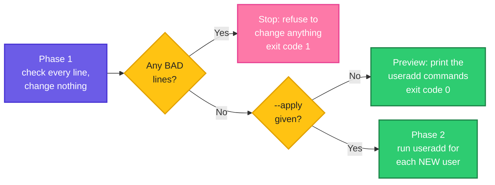

# Project 3: Safe User Onboarding from a CSV File

> **Before this page:** you have read pages [01](01-what-is-a-shell-script.md) to [18](18-project-health-checker.md). This is the last of three **projects**. As before, you will combine what you know, and nothing new is taught.
>
> **By the end of this page** you will have a script that creates user accounts from a spreadsheet, **safely**: it checks every line, previews by default, never creates anyone twice, and refuses to do anything risky. More importantly, you will know how to design **any** script that changes a system.

---

## 1. The job, and why this one is different

A new team starts on Monday. Someone from HR sends a spreadsheet with their names. Your job: create their accounts. By hand, that is twenty repetitions of the same `useradd` command, each with room for a typo. So you write a script.

But this project is different from the last two. A backup **creates** a file. A health check only **reads**. An onboarding script **changes the system**: it creates accounts, which have power. And its input is a file written by **somebody else**.

That changes the questions you must ask:

| Question | Why it matters here |
|----------|---------------------|
| What if the file contains a **mistake**? | A typo in a username creates the wrong account |
| What if it contains **something hostile**? | A "username" such as `x;rm -rf /` must never reach a command |
| What if the script is run **twice**? | It must not fail, and must not recreate or change existing users |
| What if the file is **half good, half bad**? | Creating only the good half leaves you in a confusing state |
| What if I run it **by accident**? | Nothing should change unless I clearly asked |

### The requirements

1. Read a CSV file with one account per line: `username,full name,group`.
2. **Preview by default.** Show what would happen. Change nothing without an explicit **`--apply`**.
3. **Validate every line** with strict rules before touching anything.
4. If **any** line is invalid, **refuse to create any account**. All or nothing.
5. **Skip** users that already exist, so running it twice is safe.
6. Catch **duplicates** in the file.
7. Need **root** only when really changing the system.
8. Give clear **exit codes**.

### The design decisions

| Decision | Why |
|----------|-----|
| **Preview first, `--apply` second** | The safe action is the default. The dangerous action must be asked for |
| **Two phases**: check everything, *then* act | You never end up with half the accounts created |
| **Allow-list validation** (describe what **is** allowed) | Safer than trying to list everything that is forbidden. Anything unexpected is rejected |
| **Never run text from the file as code** | The file's values are only ever **data**, always quoted, never inside `eval` or a command string |
| **Existing users are skipped**, not an error | The script is **idempotent**: safe to run again (page 14) |
| **No passwords in the file** | Passwords do not belong in a CSV. The script does not set them |
| A **`USERADD_CMD`** setting | A testing hook: the tool can be tested with a harmless stand-in command, as I did while writing this page |

**The contract of the script:**

```text
Usage: ./onboard.sh [--apply] USERS_CSV
Exit codes: 0 ok, 1 invalid lines found, 2 bad usage or missing file, 3 --apply needs root
```

**Follow the arrows from the left.** Phase 1 reads and checks every line, and changes nothing. If any line is bad, the script stops. Only when everything is clean does it either preview, or (with `--apply`) create the accounts.



---

## 2. A very important note about testing

This script's final step is the real `useradd` command, which **creates accounts on the machine**. I did **not** run the real `useradd` while writing this page. Everything was tested in **preview mode**, and the `--apply` path was tested with a **harmless stand-in** (`USERADD_CMD=echo`, which just prints the command instead of running it). The checks, the previews, the refusals and the exit codes you will see below are all real. The one thing I could not show you is a real account appearing.

When you are ready to try it for real, do it on a **throwaway test machine or virtual machine**, never on a server you care about, and read the preview carefully first. Section 6 shows how.

---

## 3. The input files

CSV stands for *comma-separated values*: a table saved as text, one row per line, columns separated by commas. A spreadsheet program can save one.

### A file with problems

Let's say we have this file `users.csv`. It is deliberately full of mistakes:

**Input file** (`users.csv`):
```text
# username,full name,group
username,full name,group
asha,Asha Rao,users
ravi,Ravi Kumar,users
meena,Meena Iyer,users
root,Fake Root,users
Bad User,Someone Else,users
asha,Asha Again,users
dev1,Dev One,nogroup_xyz
```

The lines, numbered:

| Line | Content | What is special |
|------|---------|-----------------|
| 1 | `# username,full name,group` | A comment. Ignored |
| 2 | `username,full name,group` | The header row. Ignored |
| 3 to 5 | `asha`, `ravi`, `meena` | Good lines |
| 6 | `root,Fake Root,users` | `root` already exists on every Linux machine |
| 7 | `Bad User,...` | Capital letters and a space are not allowed in a username |
| 8 | `asha,Asha Again,users` | A **duplicate** of line 3 |
| 9 | `dev1,Dev One,nogroup_xyz` | A group that does not exist |

(The group `users` exists on standard Ubuntu systems. If yours does not have it, pick any existing group.)

### A clean file

Let's say we have this file `clean.csv`:

**Input file** (`clean.csv`):
```text
username,full name,group
asha,Asha Rao,users
ravi,Ravi Kumar,users
meena,Meena Iyer,users
```

---

## 4. The script

Let's say we have this file `onboard.sh`:

**Input file** (`onboard.sh`):
```bash
#!/bin/bash
# onboard.sh - create user accounts from a CSV file, safely
# usage: ./onboard.sh [--apply] USERS_CSV
# Each CSV line is: username,full name,group
# By default it only PREVIEWS. Nothing is created unless you pass --apply.
# Exit codes: 0 ok, 1 invalid lines found, 2 bad usage or missing file,
#             3 --apply was used without root rights
set -euo pipefail
export PATH=/usr/local/sbin:/usr/local/bin:/usr/sbin:/usr/bin:/sbin:/bin

USERADD_CMD="${USERADD_CMD:-useradd}"
APPLY=0
CSV=""

new_names=()
new_fulls=()
new_groups=()
skipped=0
invalid=0
declare -A seen=()

die() {
  echo "[ERROR] $1" >&2
  exit "${2:-2}"
}

usage() {
  echo "Usage: $0 [--apply] USERS_CSV"
}

# ---- validation helpers ----------------------------------------------

valid_username() {
  [[ $1 =~ ^[a-z][a-z0-9_-]{1,31}$ ]]
}

valid_fullname() {
  local re="^[A-Za-z][A-Za-z .'-]*$"
  [[ $1 =~ $re ]]
}

user_exists() {
  id -u "$1" > /dev/null 2>&1
}

group_exists() {
  getent group "$1" > /dev/null 2>&1
}

mark_bad() {
  invalid=$((invalid + 1))
  echo "[ BAD  ] line $1: $2"
}

# ---- reading and checking the file -----------------------------------

read_csv() {
  local lineno=0 username fullname group

  while IFS=',' read -r username fullname group || [[ -n ${username:-} ]]; do
    lineno=$((lineno + 1))
    group="${group%$'\r'}"   # a file saved on Windows ends each line with a carriage return

    [[ -z ${username:-} || $username == \#* ]] && continue
    [[ $username == "username" ]] && continue    # the header line

    if ! valid_username "$username"; then
      mark_bad "$lineno" "invalid username '$username' (a-z, 0-9, _ and -, start with a letter, 2 to 32 characters)"
      continue
    fi
    if [[ -n ${seen[$username]:-} ]]; then
      mark_bad "$lineno" "'$username' is already listed on line ${seen[$username]}"
      continue
    fi
    seen[$username]=$lineno

    if ! valid_fullname "$fullname"; then
      mark_bad "$lineno" "invalid full name for '$username'"
      continue
    fi
    if ! group_exists "$group"; then
      mark_bad "$lineno" "group '$group' does not exist (user '$username')"
      continue
    fi
    if user_exists "$username"; then
      skipped=$((skipped + 1))
      echo "[ SKIP ] line $lineno: $username already exists"
      continue
    fi

    new_names+=("$username")
    new_fulls+=("$fullname")
    new_groups+=("$group")
    echo "[ NEW  ] line $lineno: $username ($fullname), group $group"
  done < "$CSV"
}

# ---- doing the work --------------------------------------------------

create_user() {
  local name="$1" fullname="$2" group="$3"
  if [[ $APPLY -eq 1 ]]; then
    "$USERADD_CMD" --create-home --shell /bin/bash --gid "$group" --comment "$fullname" "$name"
    echo "  created $name"
  else
    echo "  would run: $USERADD_CMD --create-home --shell /bin/bash --gid $group --comment \"$fullname\" $name"
  fi
}

parse_args() {
  while [[ $# -gt 0 ]]; do
    case "$1" in
      --apply)    APPLY=1; shift ;;
      -h|--help)  usage; exit 0 ;;
      -*)         die "unknown option: $1" ;;
      *)          CSV="$1"; shift ;;
    esac
  done
  [[ -n $CSV ]] || { usage >&2; exit 2; }
}

main() {
  parse_args "$@"
  [[ -f $CSV ]] || die "file not found: $CSV"

  if [[ $APPLY -eq 1 && $USERADD_CMD == "useradd" && $EUID -ne 0 ]]; then
    die "--apply needs root (try: sudo $0 --apply $CSV)" 3
  fi

  local mode="PREVIEW"
  [[ $APPLY -eq 1 ]] && mode="APPLY"
  echo "=== onboarding from $CSV ($mode) ==="

  read_csv

  local count=${#new_names[@]}
  if [[ $((count + skipped + invalid)) -eq 0 ]]; then
    die "no accounts found in $CSV"
  fi
  echo "Summary: $count to create, $skipped skipped, $invalid invalid"

  if [[ $invalid -gt 0 ]]; then
    if [[ $APPLY -eq 1 ]]; then
      die "refusing to create any account while $invalid line(s) are invalid" 1
    fi
    return 1
  fi

  local i
  for i in "${!new_names[@]}"; do
    create_user "${new_names[$i]}" "${new_fulls[$i]}" "${new_groups[$i]}"
  done

  if [[ $APPLY -eq 0 ]]; then
    echo "This was a preview. Nothing was changed. Run again with --apply to create the accounts."
  fi
}

main "$@"
```

---

## 5. Walking through the script

| Part of the script | What it does | You learned it in |
|--------------------|--------------|-------------------|
| `set -euo pipefail`, `die`, exit codes | Seatbelts and a clear contract | Pages 14, 04 |
| `USERADD_CMD="${USERADD_CMD:-useradd}"` | A setting with a default, used as a **testing hook** | Pages 13, 17 |
| `valid_username`, `valid_fullname` | **Allow-list** checks with regular expressions | Page 05 |
| `user_exists` (`id -u`), `group_exists` (`getent group`) | Ask the system, and use the **exit code** as the answer | Page 04 |
| `declare -A seen=()` | An **associative array** remembering which line each name first appeared on, to catch duplicates | Page 08 |
| `while IFS=',' read -r username fullname group` | Reads a CSV line and splits it at the commas | Page 10 |
| `[[ -z ... \|\| $username == \#* ]] && continue` | Skip blank lines and comments | Page 11 |
| `new_names`, `new_fulls`, `new_groups` | **Three parallel arrays**, one entry per account to create | Page 08 |
| `for i in "${!new_names[@]}"` | Loops over the **indexes**, so one `i` picks the matching entry from all three arrays | Page 08 |
| `if [[ $APPLY -eq 1 ]]` in `create_user` | The preview versus apply switch (like `DRY_RUN` in page 14) | Page 14 |
| `main` and `local` | The tidy structure | Page 12 |

Five details deserve a closer look.

**1. The allow-list.** A **block-list** says "reject these bad things" (`;`, `$`, spaces...), and you will always forget one. An **allow-list** says "accept only this shape, and reject everything else". Our username rule:

```text
^[a-z][a-z0-9_-]{1,31}$
```

reads: *start (`^`) with one lowercase letter, then 1 to 31 more lowercase letters, digits, underscores or hyphens, and end (`$`)*. That is 2 to 32 characters. `x;rm -rf /` and `$(whoami)` contain characters outside the allowed set, so they **never pass**.

**2. Why the full-name regex is in a variable.** In `valid_fullname`, the pattern contains a space and an apostrophe, which are awkward to write directly after `=~`. Storing it in a variable (`re=...`) and writing `[[ $1 =~ $re ]]` (the variable **unquoted**) avoids the quoting trouble. (Remember from page 05: a quoted pattern after `=~` is taken literally.)

**3. The carriage-return line.** `group="${group%$'\r'}"` removes a trailing carriage return. A CSV saved on Windows ends each line with two characters (`\r\n`), and the invisible `\r` would stick to the **last column**, making the group `users\r`, which does not exist. The notation `$'\r'` is a bash way to write a special character: here, a carriage return. `${group%...}` removes it from the end (page 11).

**4. Duplicates before everything else.** The duplicate check runs right after the username is known valid, and it records `seen[$username]` for **every** valid name. That way a second `asha` is caught, even if the first one was later skipped or rejected for another reason.

**5. Three parallel arrays.** The script appends one name, one full name and one group at the **same moment**, so index `i` always refers to the same account in all three arrays. A neater, more advanced alternative is a single array of lines. Both are fine.

**Why only the last step needs `root`.** Reading a file, checking users and printing a preview need no special rights. Asking for root only when `--apply` is used follows the **principle of least privilege**: do as little as possible with power.

---

## 6. Trying it out

Make it executable:

**Command:**
```bash
chmod +x onboard.sh
```

### Step 1: preview the file with problems

**Command:**
```bash
./onboard.sh users.csv
echo "exit: $?"
```
**Sample Output:**
```text
=== onboarding from users.csv (PREVIEW) ===
[ NEW  ] line 3: asha (Asha Rao), group users
[ NEW  ] line 4: ravi (Ravi Kumar), group users
[ NEW  ] line 5: meena (Meena Iyer), group users
[ SKIP ] line 6: root already exists
[ BAD  ] line 7: invalid username 'Bad User' (a-z, 0-9, _ and -, start with a letter, 2 to 32 characters)
[ BAD  ] line 8: 'asha' is already listed on line 3
[ BAD  ] line 9: group 'nogroup_xyz' does not exist (user 'dev1')
Summary: 3 to create, 1 skipped, 3 invalid
exit: 1
```

Read it line by line, like a reviewer:

- Lines 3 to 5 are fine: **NEW**.
- Line 6: `root` already exists, so it is **SKIP**ped (not an error).
- Line 7: the name `Bad User` breaks the rule, and the message **says which rule**.
- Line 8: a duplicate, and the message points back to **line 3**.
- Line 9: the group does not exist.
- The summary counts them. The exit code is `1`, because there are invalid lines, and the preview shows **no commands** at all: a file with problems is not previewed as if it were fine.

### Step 2: preview the clean file

**Command:**
```bash
./onboard.sh clean.csv
echo "exit: $?"
```
**Sample Output:**
```text
=== onboarding from clean.csv (PREVIEW) ===
[ NEW  ] line 2: asha (Asha Rao), group users
[ NEW  ] line 3: ravi (Ravi Kumar), group users
[ NEW  ] line 4: meena (Meena Iyer), group users
Summary: 3 to create, 0 skipped, 0 invalid
  would run: useradd --create-home --shell /bin/bash --gid users --comment "Asha Rao" asha
  would run: useradd --create-home --shell /bin/bash --gid users --comment "Ravi Kumar" ravi
  would run: useradd --create-home --shell /bin/bash --gid users --comment "Meena Iyer" meena
This was a preview. Nothing was changed. Run again with --apply to create the accounts.
exit: 0
```

Now the preview shows the **exact commands** that would run, so a colleague can review them (for example, in a ticket) before anyone presses the button. Nothing was changed, and the exit code is `0`.

### Step 3: the safety stops on `--apply`

**First, a normal user tries `--apply` with the real `useradd`:**

**Command:**
```bash
./onboard.sh --apply clean.csv
echo "exit: $?"
```
**Sample Output:**
```text
[ERROR] --apply needs root (try: sudo ./onboard.sh --apply clean.csv)
exit: 3
```

It refused **immediately**, before reading the file, and suggested the right command.

**Next, `--apply` on the file with problems.** From here on I use the harmless stand-in, `USERADD_CMD=echo`, which prints the command instead of running it, so a normal user can see how `--apply` behaves:

**Command:**
```bash
USERADD_CMD=echo ./onboard.sh --apply users.csv
echo "exit: $?"
```
**Sample Output:**
```text
=== onboarding from users.csv (APPLY) ===
[ NEW  ] line 3: asha (Asha Rao), group users
[ NEW  ] line 4: ravi (Ravi Kumar), group users
[ NEW  ] line 5: meena (Meena Iyer), group users
[ SKIP ] line 6: root already exists
[ BAD  ] line 7: invalid username 'Bad User' (a-z, 0-9, _ and -, start with a letter, 2 to 32 characters)
[ BAD  ] line 8: 'asha' is already listed on line 3
[ BAD  ] line 9: group 'nogroup_xyz' does not exist (user 'dev1')
Summary: 3 to create, 1 skipped, 3 invalid
[ERROR] refusing to create any account while 3 line(s) are invalid
exit: 1
```

Even though three lines were perfectly good, **no account was created**: the script refused because of the three bad lines. This is the **all-or-nothing** rule. You fix the file and run it again, instead of ending up with a half-onboarded team.

**Finally, `--apply` on the clean file:**

**Command:**
```bash
USERADD_CMD=echo ./onboard.sh --apply clean.csv
echo "exit: $?"
```
**Sample Output:**
```text
=== onboarding from clean.csv (APPLY) ===
[ NEW  ] line 2: asha (Asha Rao), group users
[ NEW  ] line 3: ravi (Ravi Kumar), group users
[ NEW  ] line 4: meena (Meena Iyer), group users
Summary: 3 to create, 0 skipped, 0 invalid
--create-home --shell /bin/bash --gid users --comment Asha Rao asha
  created asha
--create-home --shell /bin/bash --gid users --comment Ravi Kumar ravi
  created ravi
--create-home --shell /bin/bash --gid users --comment Meena Iyer meena
  created meena
exit: 0
```

The lines starting with `--create-home` are what `echo` printed when the script "ran" it. With the real `useradd`, those lines would not appear, and the accounts would be created. Each user's full name arrived as **one argument** (`Asha Rao`), because the script quotes it (`--comment "$fullname"`). The text is only ever passed as **data**.

### Step 4: usage problems

**Command:**
```bash
./onboard.sh
echo "exit: $?"
./onboard.sh nosuch.csv
echo "exit: $?"
./onboard.sh --bogus clean.csv
echo "exit: $?"
printf '# only a comment\nusername,full name,group\n' > empty.csv
./onboard.sh empty.csv
echo "exit: $?"
./onboard.sh --help
echo "exit: $?"
```
**Sample Output:**
```text
Usage: ./onboard.sh [--apply] USERS_CSV
exit: 2
[ERROR] file not found: nosuch.csv
exit: 2
[ERROR] unknown option: --bogus
exit: 2
=== onboarding from empty.csv (PREVIEW) ===
[ERROR] no accounts found in empty.csv
exit: 2
Usage: ./onboard.sh [--apply] USERS_CSV
exit: 0
```

A file with **only a header** is an error (`2`), not a success: a script that "onboards nobody" and reports success is hiding a mistake.

### Step 5: a hostile file

What if a line is written to attack the script? Let's say we have this file `evil.csv`:

**Input file** (`evil.csv`):
```text
username,full name,group
x;rm -rf /,Evil Name,users
$(whoami),Sneaky,users
ok-user,Name With 123,users
a,Too Short,users
fine_user,Fine Name,users
```

**Command:**
```bash
./onboard.sh evil.csv
echo "exit: $?"
```
**Sample Output:**
```text
=== onboarding from evil.csv (PREVIEW) ===
[ BAD  ] line 2: invalid username 'x;rm -rf /' (a-z, 0-9, _ and -, start with a letter, 2 to 32 characters)
[ BAD  ] line 3: invalid username '$(whoami)' (a-z, 0-9, _ and -, start with a letter, 2 to 32 characters)
[ BAD  ] line 4: invalid full name for 'ok-user'
[ BAD  ] line 5: invalid username 'a' (a-z, 0-9, _ and -, start with a letter, 2 to 32 characters)
[ NEW  ] line 6: fine_user (Fine Name), group users
Summary: 1 to create, 0 skipped, 4 invalid
exit: 1
```

- The two **injection attempts** (`x;rm -rf /` and `$(whoami)`) were rejected by the allow-list. They were treated as **plain text** and printed in quotes. Nothing was ever run.
- A digit in a full name, and a too-short username, were rejected too.
- Only `fine_user` passed.

### Step 6: a file saved on Windows

Spreadsheet programs on Windows often save with `\r\n` line endings. (The `sed 1d` below only drops the header line of the output, to save space.)

**Command:**
```bash
printf 'username,full name,group\r\nasha,Asha Rao,users\r\nravi,Ravi Kumar,users\r\n' > crlf.csv
./onboard.sh crlf.csv | sed 1d
```
**Sample Output:**
```text
[ NEW  ] line 2: asha (Asha Rao), group users
[ NEW  ] line 3: ravi (Ravi Kumar), group users
Summary: 2 to create, 0 skipped, 0 invalid
  would run: useradd --create-home --shell /bin/bash --gid users --comment "Asha Rao" asha
  would run: useradd --create-home --shell /bin/bash --gid users --comment "Ravi Kumar" ravi
This was a preview. Nothing was changed. Run again with --apply to create the accounts.
```

The invisible carriage returns were stripped, so the groups matched. (Without the `${group%$'\r'}` line, every line would fail with a group called `users` plus an invisible character.)

### Step 7: a last line without a newline, and an awkward name

(The `sed 1d` again drops the header line of the output.)

**Command:**
```bash
printf 'asha,Asha Rao,users' > nonl.csv
./onboard.sh nonl.csv | sed 1d
printf 'obrien,Sean O'"'"'Brien Jr.,users\n' > apos.csv
./onboard.sh apos.csv | sed 1d
```
**Sample Output:**
```text
[ NEW  ] line 1: asha (Asha Rao), group users
Summary: 1 to create, 0 skipped, 0 invalid
  would run: useradd --create-home --shell /bin/bash --gid users --comment "Asha Rao" asha
This was a preview. Nothing was changed. Run again with --apply to create the accounts.
[ NEW  ] line 1: obrien (Sean O'Brien Jr.), group users
Summary: 1 to create, 0 skipped, 0 invalid
  would run: useradd --create-home --shell /bin/bash --gid users --comment "Sean O'Brien Jr." obrien
This was a preview. Nothing was changed. Run again with --apply to create the accounts.
```

The last line without a newline was not lost (page 10), and a name with an apostrophe and a dot passed, because the full-name rule allows letters, spaces, dots, hyphens and apostrophes.

---

## 7. Using it for real (on a test machine)

When you want to see the real thing, use a **throwaway machine or virtual machine**. These are commands to type there. I did **not** run them:

1. **Preview** the file, and have someone else read the output: `./onboard.sh clean.csv`
2. **Apply** with root rights: `sudo ./onboard.sh --apply clean.csv`
3. **Check** the result: `id asha` and `getent passwd asha`
4. **Undo** a test account: `sudo userdel -r asha` (`-r` also removes the home folder)

### What the script deliberately does not do

| Not done | Why | What to do instead |
|----------|-----|--------------------|
| **Setting passwords** | A password in a CSV or on a command line is a leak waiting to happen | Use **SSH keys**, or set a one-time password and force a change at first login (`sudo chage -d 0 USER`) |
| **Adding SSH keys, sudo rights, extra groups** | Each is its own decision, with its own review | Add them in a separate, reviewed step |
| **Deleting accounts** (offboarding) | Removal is more dangerous than creation | A separate script, with an even stricter preview |
| **Keeping an audit trail** | Who created which account, and when? | Append each created account, with a timestamp, to a protected log (exercise) |

---

## 8. Lessons for any script that changes things

This project is really a checklist for **every** script that modifies a system:

| Principle | In this script |
|-----------|----------------|
| **Safe by default** | Preview unless `--apply` |
| **Validate before you act** | Phase 1 checks every line first |
| **All or nothing** | One bad line stops everything |
| **Allow-list, never block-list** | Strict regular expressions for names |
| **Input is data, never code** | Quoted arguments, no `eval`, no building command strings |
| **Idempotent** | Existing users are skipped |
| **Least privilege** | Root is needed only to apply |
| **Show your work** | The preview prints the exact commands |
| **Clear contract** | A usage line and exit codes |
| **Designed for testing** | The `USERADD_CMD` hook |
| **Explicit about what it does not do** | No passwords, no deletions |

---

## 9. The mistakes that bite

| Mistake | Symptom | Fix |
|---------|---------|-----|
| Running the real action by default | An accidental run changes the system | Preview by default, `--apply` to act |
| Creating accounts as the file is read | Half the team is created before a bad line is found | Two phases: validate everything, then act |
| Building a command as a string and running it (`eval`, `bash -c "$line"`) | A hostile name runs as code | Pass values as **quoted arguments** |
| Blocking only some bad characters | A character you forgot gets through | An **allow-list** regex |
| Not catching duplicates | Two lines for the same user, one fails half-way | A `seen` array |
| Failing when the user already exists | You cannot re-run the script | Skip existing users |
| Passwords in the CSV or in arguments | They leak into history and process lists | SSH keys, or forced change at first login |
| `cat file \| while read` | The arrays are filled in a subshell and vanish (page 10) | `done < "$CSV"` |
| Windows line endings (`\r`) | The last column is wrong and everything fails | Strip the `\r` |
| Treating an empty file as success | A mistake goes unnoticed | Exit with an error |
| Needing root even for a preview | Nobody can review safely | Ask for root only when applying |
| No way to test without the real command | You test on production | A hook like `USERADD_CMD` |
| Testing on a real server | A bug creates real accounts | Use a test VM |

---

## 10. Words to remember

| Word | Simple meaning |
|------|----------------|
| **CSV** | Comma-separated values: a table saved as text |
| **Onboarding** | Setting up accounts and access for new people |
| **Preview (dry run)** | Showing what would happen, without doing it |
| **`--apply`** | The explicit switch that turns the preview into action |
| **Allow-list** | Accepting only what matches an exact, safe shape |
| **Block-list** | Rejecting known-bad things. Weaker, because you will forget some |
| **Injection** | Slipping code into data, hoping a script will run it |
| **Idempotent** | Safe to run again with the same result |
| **All or nothing** | Do everything, or change nothing |
| **Least privilege** | Use only the rights a step really needs |
| **Test hook** | A setting that exists so a script can be tested safely |
| **`useradd` / `userdel`** | Create / remove a user account |

---

## 11. Try it yourself

1. **Run the previews.** Create `users.csv` and `clean.csv`, and compare each step with this page. (Remember: only previews, and `USERADD_CMD=echo` for the apply path.)
2. **Fix the file.** Edit `users.csv` so that it passes (remove or correct each bad line), and preview it again.
3. **A new rule.** Make the script reject a username that is on a **reserved list** (`admin`, `root`, `postgres`, `www-data`). Use an array and a loop.
4. **More groups.** Allow a fourth column: a comma-separated list of extra groups, validated one by one. (Hint: split with `IFS=','` and `read -ra`.)
5. **An audit log.** In `--apply` mode, append `date, name, group` for each created user to a log file, and show the log after a stand-in run.
6. **A report file.** Add `--report FILE` that writes the BAD lines to a file the HR person can open.
7. **Line-length limit.** Reject a full name longer than 60 characters.
8. **Offboarding.** Write a separate `offboard.sh` that previews, by default, which users *would* be removed. Decide what extra checks it needs (hint: never remove `root`, or a user who is logged in).
9. **Run it twice.** After a stand-in apply, mention in one sentence why running the real script twice would still be safe.
10. **Break the validator.** Try to find a username that passes `^[a-z][a-z0-9_-]{1,31}$` but would still be a bad idea. (Hint: think about names like `daemon`, `nobody`, or a name that already means something.)
11. **Combine the projects.** Add a `fresh` check to the health checker (page 18) for the audit log from exercise 5, so you are alerted if onboarding runs stop being recorded.

<details>
<summary>Answers for exercises 3 and 9 (open only after trying)</summary>

**Exercise 3:** a possible way, inside `read_csv`, right after the username passes `valid_username`:

```bash
reserved=(admin root postgres www-data)
for r in "${reserved[@]}"; do
  if [[ $username == "$r" ]]; then
    mark_bad "$lineno" "'$username' is a reserved name"
    continue 2
  fi
done
```

`continue 2` skips to the next line of the **outer** `while` loop (page 11). Quote `"$r"` on the right of `==`, so it is an exact match.

**Exercise 9:** the script checks `user_exists` for every line, and users created by the first run now exist, so the second run reports each as `SKIP` and creates nothing new. That is what *idempotent* means.
</details>

---

## 12. Quick recap

- A script that **changes a system** needs more care than one that only reads. Ask what happens with **mistakes**, **hostile input**, **a second run**, **half-good input** and **accidents**.
- **Preview by default**, and require an explicit **`--apply`** to act.
- Work in **two phases**: validate **every** line first, then act. If any line is bad, **change nothing** (all or nothing).
- Use an **allow-list** (a strict regular expression), never a block-list. Treat input as **data**: quote everything, never `eval`.
- Make it **idempotent**: skip what already exists, and catch duplicates with a `seen` array.
- Ask for **root** only for the step that needs it.
- Print the **exact commands** in the preview, so someone else can review them.
- Add a **test hook** (`USERADD_CMD`) so you can test without touching the system. Then test on a throwaway machine.
- State clearly what the script **does not** do: no passwords, no deletions.

---

## 13. You have finished the series

Take a moment to look back. Nineteen pages ago, a shell script was "a text file with commands". Now you can write scripts that:

- **remember** (variables, arrays), **take input** (arguments, `read`, environment) and **decide** (`if`, `case`);
- **repeat** (`for`, `while`, `until`) and **organise** themselves (functions, `main`, libraries);
- **fail safely** (exit codes, `set -euo pipefail`, traps, locks, dry runs);
- **run by themselves** (cron), and are **built for production** (backups, health checks, careful changes).

That is the core of shell scripting, and the habits behind every good automation.

**Where to go next:** put your scripts under **Git**, run them from a **CI pipeline**, package them in a **Docker** image, and look at **Ansible**, which describes the same kind of changes in a declarative way. All of those tools lean on exactly the habits you built here: exit codes, clear output, safe defaults and idempotence. For a map of the whole series, see the [README](README.md).
