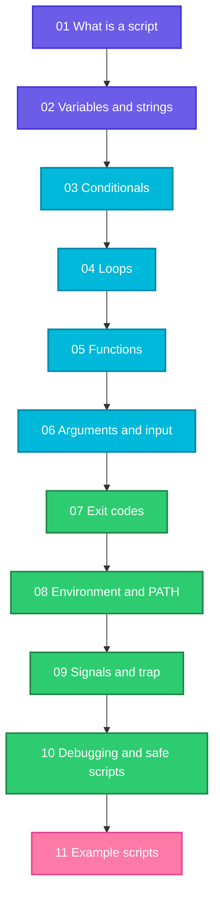

# Shell Scripting

A series for people who can already use the Linux command line and now want to automate their work. Read the pages **in number order**. Every page ends with real output from a real run, so you can type the examples and compare.

## Before you start
Finish these first, or you will meet words that are not explained here:

| Topic | Page |
|-------|------|
| Terminal, shell and bash | [03 Terminal, shell and bash](../linux/fundamentals/03-terminal-shell-bash.md) |
| Quoting | [07 Quoting](../linux/fundamentals/07-quoting.md) |
| Redirection and pipes | [08 Redirection and pipes](../linux/fundamentals/08-redirection-and-pipes.md) |
| Permissions | [10 The permission model](../linux/fundamentals/10-permission-model.md) |
| Regular expressions | [12 Regular expressions](../linux/fundamentals/12-regular-expressions.md) |

## The path

| # | Page | You learn |
|---|------|-----------|
| 01 | [What is a shell script](01-what-is-a-shell-script.md) | Shebang, `chmod +x`, three ways to run, `source`, Windows line endings |
| 02 | [Variables and strings](02-variables-and-strings.md) | Assignment, quoting, defaults, string cutting, arithmetic, arrays |
| 03 | [Conditionals](03-conditionals.md) | `if`, `[ ]`, `[[ ]]`, `case`, `&&` and `\|\|` |
| 04 | [Loops](04-loops.md) | `for`, `while`, `until`, `read`, `break` and `continue` |
| 05 | [Functions](05-functions.md) | Arguments, `local`, `return`, libraries, `main` |
| 06 | [Arguments and input](06-arguments-and-input.md) | `$1`, `shift`, `getopts`, `read`, here documents |
| 07 | [Exit codes](07-exit-codes.md) | `$?`, `0` is success, `set -e`, `pipefail`, codes 126 to 143 |
| 08 | [Environment variables and PATH](08-environment-variables-and-path.md) | `export`, `PATH` lookup, `.bashrc` vs `.profile`, cron's tiny environment |
| 09 | [Signals and trap](09-signals-and-trap.md) | `SIGTERM`, `SIGINT`, `trap ... EXIT`, locks, graceful shutdown |
| 10 | [Debugging and safe scripts](10-debugging-and-safe-scripts.md) | `bash -x`, `set -euo pipefail`, dry runs, `mktemp`, idempotence |
| 11 | [Example scripts](11-example-scripts.md) | Backup, log analysis, health check, user onboarding, rename, deploy |

## How to use these pages
1. Open a terminal in an **empty practice folder**.
2. Create the input files shown on the page, exactly as written.
3. Run the commands and compare your output with the sample output. PIDs, dates and file times will differ, the rest should match.
4. Change one thing and run it again. Breaking a script on purpose teaches more than reading it.

## What you can do after this series
- Turn a manual checklist into a script with checks, a dry run and clear exit codes.
- Write a cron job that does not fail because of a missing `PATH`.
- Make a service stop cleanly when `systemctl stop` or `docker stop` sends `SIGTERM`.
- Read someone else's script and spot unquoted variables, missing `set -u` and unsafe `rm` commands.

## What comes next
Practise on real tasks: put a script in cron, call it from a CI pipeline, or write one for a job you do by hand every week. Then continue with the other tools in this repository (Git, Docker, Ansible), which all rely on the habits from this series.
