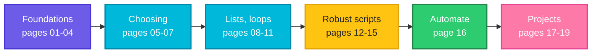

# Shell Scripting: From "What Is a Script?" to Real Tools

A beginner-friendly series that takes you from your very first script to **production-style tools**: a backup script, a health checker, and a safe user-onboarding script. You do not need any programming experience. If you can open a terminal and use `cd` and `ls`, you can start.

Read the pages **in number order**. Each one builds on the last.

---

## How every page works

Every page follows the same friendly pattern, so you always know where you are:

1. **A problem** you will actually meet, told as a short story.
2. **A simple picture** (a recipe card, a jar, a coffee-shop order, a conveyor belt...) that explains the idea in everyday words.
3. **"Do this with me"**: type a small script, run it, and compare your output with the page.
4. **Real mistakes**, shown on purpose, with the real error messages, so that you recognise them later.
5. **A running project:** `morning.sh`, a disk-check script that grows a little on almost every page (see below).
6. **Words to remember, exercises** (some with hidden answers) **and a quick recap.**

Every command output in the series comes from a **real run**, not from imagination.

---

## The path

**Follow the arrows.** Six stages, in order. The table below lists every page.

### Stage 1: Foundations

| # | Page | You learn |
|---|------|-----------|
| 01 | [What is a shell script](01-what-is-a-shell-script.md) | What a script is, the shebang, `chmod +x`, three ways to run it, `source` |
| 02 | [Variables](02-variables.md) | Giving a script a memory: assign, read, quote, `$(command)`, whole-number maths |
| 03 | [Input: arguments and `read`](03-arguments-and-input.md) | `$1`, `$#`, `"$@"`, default values, asking questions with `read` |
| 04 | [Exit codes](04-exit-codes.md) | `0` means success, `$?`, `&&` and `\|\|`, `exit`, making a script honest |

### Stage 2: Choosing

| # | Page | You learn |
|---|------|-----------|
| 05 | [Operators](05-operators.md) | Arithmetic, number and text comparison, file tests, `&&` `\|\|` `!`, and **which one to use** |
| 06 | [Decisions: `if`, `else`, `elif`](06-if-conditions.md) | Every shape of `if`, conditions, nested `if`, guard clauses |
| 07 | [The `case` statement](07-case-statements.md) | Matching one value against many, patterns, and **`if` versus `case`** |

### Stage 3: Lists and loops

| # | Page | You learn |
|---|------|-----------|
| 08 | [Arrays](08-arrays.md) | One name, many values: indexed and associative arrays |
| 09 | [`for` loops](09-for-loops.md) | Repeating for every item: lists, ranges, files, arguments, counting loops |
| 10 | [`while` and `until` loops](10-while-until-loops.md) | Repeating until something changes: reading files, waiting, retrying |
| 11 | [Loop control and real patterns](11-loop-control-and-patterns.md) | `break`, `continue`, `select`, log analysis, dry runs, a first taste of `&` and `wait` |

### Stage 4: Robust scripts

| # | Page | You learn |
|---|------|-----------|
| 12 | [Functions](12-functions.md) | Naming a block of commands, arguments, `return`, `local`, `main` |
| 13 | [Environment variables and PATH](13-environment-variables-and-path.md) | `export`, `PATH`, and why a script that works in your terminal fails in cron |
| 14 | [Safe and debuggable scripts](14-safe-and-debuggable-scripts.md) | `set -euo pipefail`, `bash -x`, dry runs, `mktemp`, safe habits |
| 15 | [Signals and `trap`](15-signals-and-trap.md) | Ctrl+C, `SIGTERM`, cleanup on exit, graceful shutdown, locks |

### Stage 5: Automate

| # | Page | You learn |
|---|------|-----------|
| 16 | [Scheduling with cron](16-scheduling-with-cron.md) | Reading and writing schedules, cron's tiny world, logging, `flock`, `timeout` |

### Stage 6: Three real projects

| # | Page | You build |
|---|------|-----------|
| 17 | [Project 1: a backup script](17-project-backup-script.md) | A safe, verified, rotating backup with a lock and a dry run |
| 18 | [Project 2: a health checker](18-project-health-checker.md) | A config-driven checker that also watches whether your backups are fresh |
| 19 | [Project 3: safe user onboarding](19-project-user-onboarding.md) | Accounts from a CSV: preview by default, validate everything, all or nothing |

---

## The running project: `morning.sh`

Starting on page 01, one small script, a morning disk check, **grows a little on almost every page**. Each new idea solves a problem the script has just run into:

| Page | What `morning.sh` gains |
|------|-------------------------|
| 01 | It exists: it prints the date, the folder and the disk usage |
| 02 | Settings live in **variables** at the top |
| 03 | The disk becomes an **argument**, with a default |
| 04 | It refuses a disk that does not exist, with an **exit code** |
| 06 | It chooses OK, WARNING or CRITICAL with an **`if` ladder** |
| 08 | It takes **many disks** (an array) |
| 09 | It loops over every disk and exits with the worst result |
| 10 | It **waits** a little for a disk that is slow to appear |
| 11 | `--fast` stops at the first critical problem (`break`), and empty names are skipped (`continue`) |
| 12 | It is split into **functions** with a `main` |
| 13 | Limits come from the **environment**, and it sets its own `PATH` |
| 14 | `set -euo pipefail` makes it safe (and shows what breaks) |
| 15 | A **lock** and **traps** stop two copies and clean up |
| 16 | It writes a **timestamped log** and is ready for cron |

After page 16 you will have taken one tiny script all the way to something you could hand to cron. The three projects then show the same habits on bigger jobs.

---

## Before you start

You should be comfortable with these topics from the Linux fundamentals series. The first three are needed from the start. The others are used a little later:

| Topic | Page | Needed from |
|-------|------|-------------|
| Terminal, shell and bash | [03 Terminal, shell and bash](../linux/fundamentals/03-terminal-shell-bash.md) | Page 01 |
| Wildcards (`*`, `?`) | [06 Wildcards and globbing](../linux/fundamentals/06-wildcards-globbing.md) | Page 07 |
| Quoting | [07 Quoting](../linux/fundamentals/07-quoting.md) | Page 02 |
| Redirection and pipes | [08 Redirection and pipes](../linux/fundamentals/08-redirection-and-pipes.md) | Page 04 |
| File permissions | [10 The permission model](../linux/fundamentals/10-permission-model.md) | Page 01 |
| Regular expressions | [12 Regular expressions](../linux/fundamentals/12-regular-expressions.md) | Page 05 (a little), 17 and 19 |

---

## How to use these pages

1. Open a terminal in an **empty practice folder**, for example `~/practice`. Never practise inside an important folder.
2. Create the files shown on each page **exactly as written**. A file is introduced with "Let's say we have this file...".
3. Run the commands and **compare your output** with the sample output.
4. **Change one thing and run it again.** Breaking a script on purpose teaches more than reading it.
5. Try the **exercises** at the end of each page before opening the hidden answers.

### Conventions used

| You see | It means |
|---------|----------|
| **Input file** (`name.sh`) | The contents of a file you create |
| **Command** | What you type |
| **Sample Output** | What you should see |
| **What you see in the terminal** | An interactive session, where you type the answers |
| `devops`, `/home/devops/practice` | Example user and folder. **Yours will show your own name and path** |
| Dates, times, process numbers, disk sizes | Will differ on your machine |

---

## What the examples were tested on

All outputs were produced on **Ubuntu 22.04 with bash 5.1** (GNU tools). You need:

- **bash 4 or newer**. Associative arrays (page 08 onward) do not exist in older bash. Linux has a recent bash. The Mac's built-in `/bin/bash` is version 3.2 and is too old, so on a Mac install a newer one (for example with Homebrew).
- **GNU tools.** A few examples use GNU-only options, such as `df --output`, `stat -c`, `date -d` and `flock`. On a Mac, these differ or are missing unless you install the GNU versions.
- A **normal user account**, not root. A few examples (for instance, a file that cannot be read) only behave as shown for a normal user.

### A note on safety

Two pages go beyond your own files:

- **Page 16 (cron)** explains how to install a schedule. It shows the safe routine (rehearse, back up the crontab, edit, check). Try it on a test machine first.
- **Page 19 (user onboarding)** ends in the real `useradd` command. Everything there was tested in preview mode and with a harmless stand-in. Try the real thing only on a **throwaway machine or virtual machine**.

---

## What you will be able to do afterwards

- Turn a manual checklist into a script with checks, a **dry run** and clear **exit codes**.
- Write a script that behaves the same in your terminal, in **cron** and in a **CI pipeline**.
- Make a script **stop at the first problem**, **clean up** after itself, and shut down **gracefully** when a service is stopped.
- Prevent two copies of a job from running at once, and stop a hung job.
- Read someone else's script and spot **unquoted variables**, a missing `set -u`, an unchecked `rm`, or a `PATH` that only works in a terminal.
- Design a script that **changes things safely**: preview first, validate everything, never trust input.

---

## What comes next

Practise on real tasks: put a script in cron, call it from a CI pipeline, or automate something you do by hand every week. Then continue with the other tools in this repository (Git, Docker, Ansible). All of them rely on the same habits you built here: clear exit codes, safe defaults, readable output, and scripts that are safe to run twice.
